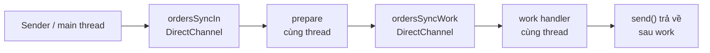
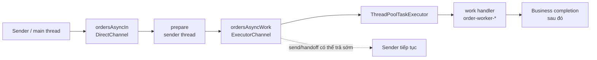
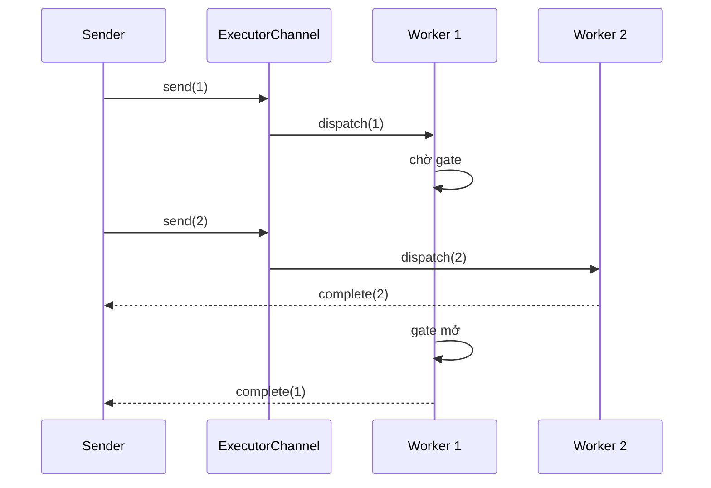
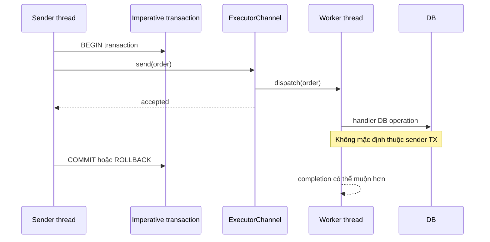
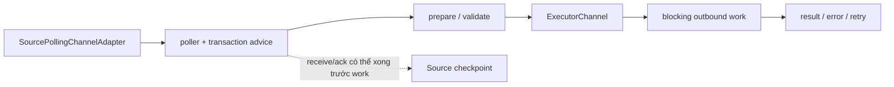

# Thực hành: Chuyển một bước sang ExecutorChannel và đo thread boundary

## 1. Bối cảnh dự án và sản phẩm cần bàn giao

Một ứng dụng Spring Integration nhận yêu cầu xử lý đơn hàng, chuẩn hóa payload rồi gọi bước tính toán chi phí. Ban đầu toàn bộ luồng chạy trên `DirectChannel`. Khi bước tính toán bắt đầu chậm, ta muốn **chỉ chuyển một ranh giới giữa hai bước** sang `ExecutorChannel` để giải phóng thread gửi sớm hơn. Nhưng nhanh hơn ở lời gọi `send()` không đồng nghĩa đơn hàng đã xử lý xong.

Bài thực hành thuộc chương **Thực hành tổng hợp** của module **SPRING_INTEGRATION_RUNTIME**. Chúng ta sẽ xây **hai phiên bản cùng logic nghiệp vụ**, đo thread, latency và completion, rồi thiết kế lại error, transaction, ordering, backpressure và lifecycle đúng với cách Spring Integration điều phối channel, endpoint, consumer, poller và executor.

**Yêu cầu cuối bài:** một nhóm có thể giải thích, dựa trên log/test/metrics, **ranh giới nào đổi thread, công việc được bàn giao khi nào, công việc hoàn tất khi nào, lỗi và transaction nằm ở đâu**, chứ không chỉ cho thấy một cấu hình `ExecutorChannel`.

### 1.1. Kết quả học tập

1. Dựng baseline dùng `DirectChannel`, có hai bước `prepare` và `work`.
2. Thay **duy nhất channel trước work** thành `ExecutorChannel`, giữ nguyên business logic và test input.
3. Dùng thread name, thread ID, `System.nanoTime()` và correlation ID để ghi nhận đường đi.
4. Dùng `CountDownLatch` xác minh việc handoff không dựa vào `Thread.sleep()`.
5. So sánh **send-return latency** với **end-to-end completion latency**.
6. Chứng minh `ExecutorChannel` có thể thay đổi thứ tự hoàn tất khi có nhiều worker.
7. Thử failure ở worker và kiểm tra `errorChannel` thay vì mong exception ném ngược tới caller.
8. Hiểu transaction thread-bound, security/MDC context, retry và broker ack sau khi đổi channel.
9. Giới hạn executor pool/queue, chọn rejection policy và đọc metrics bão hòa.
10. Viết checklist áp dụng cùng kỹ thuật cho `IntegrationFlow` thật với poller, message store và downstream adapter.

### 1.2. Phạm vi

Ví dụ sử dụng **Java 17+, Spring Integration 6.x, Spring Framework 6.x và JUnit Jupiter 5.x**. Các đoạn cấu hình dùng Java DSL và API Spring Integration. Không cần broker/DB để chạy hai thí nghiệm chính; những bài test transaction, durability hoặc JMS/Kafka được ghi rõ là **bài mở rộng cần backend thật**.

Không ngầm giả định đã có `@Transactional`, distributed tracing hay retry policy. Những khả năng đó phải được cấu hình và kiểm thử riêng.

## 2. Nhìn trước sự thay đổi

**Baseline (đồng bộ):**



**Sau thay đổi (bất đồng bộ ở một bước):**



Thay đổi **không phải** “cứ thêm `ThreadPoolTaskExecutor` thì mọi thứ thành reactive”. `ExecutorChannel` vẫn là mô hình message dispatch qua một `Executor`; nó không có giao thức `Subscriber.request(n)` như Reactive Streams.

### 2.1. Các mốc cần đo

| Mốc | Tên trong lab | Ý nghĩa |
| --- | --- | --- |
| Trước khi gọi `input.send(...)` | `SEND_BEGIN` | Bắt đầu lời gọi caller. |
| Vào bước chuẩn hóa | `PREPARE` | Handler đầu chạy trên thread nào? |
| Vào handler sau channel trung gian | `WORK_ENTER` | Thread boundary đã vượt qua chưa? |
| Handler làm xong | `WORK_DONE` | Business step kết thúc, chưa chắc DB commit/ack. |
| `input.send(...)` trả về | `SEND_RETURN` | Caller được giải phóng hoặc đã hoàn tất đồng bộ. |

Ghi thêm `eventId` và `threadName`; dùng `System.nanoTime()` cho **elapsed time** trong cùng JVM. Không lấy timestamps từ hai JVM chưa đồng bộ để tính latency chính xác, và không dùng `Thread.sleep` như bằng chứng về trật tự.

### 2.2. Hai đại lượng thường bị đọc nhầm

```text
sendReturnLatency = time(SEND_RETURN) - time(SEND_BEGIN)
stepCompletionLatency = time(WORK_DONE) - time(SEND_BEGIN)
```

Trên `DirectChannel` đồng bộ, hai đại lượng thường gần nhau. Trên `ExecutorChannel`, `sendReturnLatency` thường ngắn hơn `stepCompletionLatency`, **nhưng không bảo đảm** với mọi executor/rejection policy.

### 2.3. Tiêu chí chấp nhận trước khi bắt đầu

| Tiêu chí | Baseline | ExecutorChannel |
| --- | --- | --- |
| `prepare` chạy trên sender thread | Có | Có, vì nằm **trước** boundary. |
| `work` chạy trên sender thread khi pool còn capacity | Có | Thông thường **không**, chạy worker. |
| `send()` trả trước khi `work` hoàn tất nếu handler được giữ ở gate | Không | Có khi executor thực sự handoff. |
| Có thể quan sát `WORK_DONE` | Sau `send()` hoặc ngay trước return | Sau return, cần chờ signal riêng. |
| Exception từ `work` luôn ném về sender | Thường có khi đồng bộ | Không, phải xác định async error path. |
| Transaction thread-bound của sender bao trùm `work` | Có thể, nếu được cấu hình đúng | Không được giả định. |
| Hoàn tất theo thứ tự input với nhiều workers | Khi một sender/handler đồng bộ | Không được bảo đảm. |

## 3. Dụng cụ, dependencies và cấu trúc mẫu

Một dự án Maven hoặc Gradle hiện có Spring Integration có thể thêm dependencies test tương thích với BOM của Spring Boot/Spring Integration. Dưới đây là **hướng dẫn khai báo**, không buộc phải tạo project scaffold mới:

```gradle
dependencies {
    implementation("org.springframework.integration:spring-integration-core")
    implementation("org.springframework:spring-context")

    testImplementation("org.springframework.integration:spring-integration-test")
    testImplementation("org.junit.jupiter:junit-jupiter")
}

tasks.test {
    useJUnitPlatform()
}
```

Trong một ứng dụng Spring Boot quản lý dependency versions qua BOM/plugin, không cần gắn version riêng cho từng artifact trên. Trong dự án thuần Gradle, phải khai báo versions hoặc BOM tương thích, nếu không dependency resolution sẽ thất bại.

Gợi ý tổ chức ví dụ:

```text
src/main/java/demo/boundary/
  WorkItem.java
  ThreadTrace.java
  WorkGate.java
  BoundaryFlowConfiguration.java
  BoundaryDemo.java

src/test/java/demo/boundary/
  BoundaryFlowTest.java
  ExecutorOrderingTest.java
```

Đây là **các file Java được trình bày trong bài học để người học tự tạo trong dự án ví dụ**, không phải yêu cầu STEP_4 tạo chúng trong workspace. Mọi code của bài được giữ trong đúng Markdown được giao.

### 3.1. Chọn tên rõ ràng cho các channel

Sử dụng cặp flow song song để giữ cùng logic:

- `ordersSyncIn` → `ordersSyncWork` (`DirectChannel`) → xử lý.
- `ordersAsyncIn` → `ordersAsyncWork` (`ExecutorChannel`) → xử lý.

Flow không có inbound adapter, broker hay poller nên dễ quan sát thread boundary; về sau sẽ thay input bằng nguồn thật nhưng giữ nguyên luận điểm.

## 4. Tạo dữ liệu và bộ ghi nhận thread an toàn

**`WorkItem.java`**

```java
package demo.boundary;

public record WorkItem(String eventId, String orderId) {
    public WorkItem {
        if (eventId == null || eventId.isBlank()) {
            throw new IllegalArgumentException("eventId is required");
        }
        if (orderId == null || orderId.isBlank()) {
            throw new IllegalArgumentException("orderId is required");
        }
    }
}
```

**`ThreadTrace.java`**

```java
package demo.boundary;

import java.util.ArrayList;
import java.util.List;
import java.util.concurrent.LinkedBlockingQueue;
import java.util.concurrent.TimeUnit;

import org.springframework.transaction.support.TransactionSynchronizationManager;

public final class ThreadTrace {

    public record Hop(
            String eventId,
            String phase,
            String threadName,
            long threadId,
            long nanoTime,
            boolean transactionActive) { }

    private final LinkedBlockingQueue<Hop> events = new LinkedBlockingQueue<>();

    public void mark(WorkItem item, String phase) {
        Thread current = Thread.currentThread();
        events.add(new Hop(
                item.eventId(),
                phase,
                current.getName(),
                current.getId(),
                System.nanoTime(),
                TransactionSynchronizationManager.isActualTransactionActive()));
    }

    public Hop next(long timeout, TimeUnit unit) throws InterruptedException {
        return events.poll(timeout, unit);
    }

    public List<Hop> drain() {
        List<Hop> result = new ArrayList<>();
        events.drainTo(result);
        return List.copyOf(result);
    }
}
```

**Vì sao chọn `LinkedBlockingQueue` thay vì `ArrayList` thường?** Khi chuyển sang `ExecutorChannel`, producer và worker cùng ghi/đọc trace từ các threads khác nhau. Một `ArrayList` không có synchronization có thể mất event hoặc gây data race, làm chính **harness đo** không đáng tin. `LinkedBlockingQueue` đủ đơn giản cho lab; không dùng queue trace không giới hạn trong production có lưu lượng lớn mà thiếu sampling/capacity.

`TransactionSynchronizationManager.isActualTransactionActive()` giúp **quan sát** transaction được bind vào thread tại một mốc; nó không chứng minh transaction có commit thành công hay bao trùm mọi resource. Khi chưa cấu hình transaction manager, cả hai flow đều có thể ghi `false`.

## 5. Tạo một gate để kiểm tra việc bàn giao không dựa vào timing

Ở máy nhanh, handler có thể hoàn tất trước khi caller kịp in `SEND_RETURN`. Điều đó **không phủ định** việc đã đổi thread. Để thấy sự khác nhau một cách quyết định, ta dùng `CountDownLatch` giữ worker tại một điểm đã xác định.

**`WorkGate.java`**

```java
package demo.boundary;

import java.util.concurrent.CountDownLatch;
import java.util.concurrent.TimeUnit;

public final class WorkGate {
    private record Gates(CountDownLatch entered, CountDownLatch release) { }

    private volatile Gates current =
            new Gates(new CountDownLatch(0), new CountDownLatch(0));

    public void arm() {
        current = new Gates(new CountDownLatch(1), new CountDownLatch(1));
    }

    public void stopAtBoundary() {
        Gates gates = current;  // Snapshot nhất quán của hai latches.
        gates.entered().countDown();
        try {
            if (!gates.release().await(5, TimeUnit.SECONDS)) {
                throw new IllegalStateException("Timed out at work gate");
            }
        } catch (InterruptedException ex) {
            Thread.currentThread().interrupt();
            throw new IllegalStateException("Interrupted at work gate", ex);
        }
    }

    public boolean awaitWorker(long timeout, TimeUnit unit)
            throws InterruptedException {
        return current.entered().await(timeout, unit);
    }

    public void open() {
        current.release().countDown();
    }
}
```

Trong production không chèn gate chặn thread. `WorkGate` chỉ thuộc **harness kiểm thử**. Khi assertion fail, test **phải** gọi `open()` trong `finally` để worker không tiếp tục chờ cho đến khi timeout.

Gate dùng chung giữa hai flow chỉ để giảm số class trong lab. Khi chạy tests song song, mỗi test tạo **application context riêng** hoặc scope gate theo test; không dùng một mutable singleton gate chung giữa những tests đang chạy đồng thời.

## 6. Cấu hình hai flow: chỉ thay loại channel của bước work

**`BoundaryFlowConfiguration.java`**

```java
package demo.boundary;

import java.util.concurrent.ThreadPoolExecutor;

import org.springframework.beans.factory.annotation.Qualifier;
import org.springframework.context.annotation.Bean;
import org.springframework.context.annotation.Configuration;
import org.springframework.integration.channel.DirectChannel;
import org.springframework.integration.channel.ExecutorChannel;
import org.springframework.integration.config.EnableIntegration;
import org.springframework.integration.dsl.IntegrationFlow;
import org.springframework.messaging.Message;
import org.springframework.messaging.MessageChannel;
import org.springframework.scheduling.concurrent.ThreadPoolTaskExecutor;

@Configuration
@EnableIntegration
public class BoundaryFlowConfiguration {

    @Bean
    public ThreadTrace threadTrace() {
        return new ThreadTrace();
    }

    @Bean
    public WorkGate workGate() {
        return new WorkGate();
    }

    @Bean("ordersSyncIn")
    public MessageChannel ordersSyncIn() {
        return new DirectChannel();
    }

    @Bean("ordersSyncWork")
    public MessageChannel ordersSyncWork() {
        return new DirectChannel();
    }

    @Bean("ordersAsyncIn")
    public MessageChannel ordersAsyncIn() {
        return new DirectChannel();
    }

    @Bean("boundaryWorkerPool")
    public ThreadPoolTaskExecutor boundaryWorkerPool() {
        ThreadPoolTaskExecutor pool = new ThreadPoolTaskExecutor();
        pool.setCorePoolSize(2);
        pool.setMaxPoolSize(2);
        pool.setQueueCapacity(8);
        pool.setThreadNamePrefix("order-worker-");
        pool.setRejectedExecutionHandler(
                new ThreadPoolExecutor.AbortPolicy());
        pool.setWaitForTasksToCompleteOnShutdown(true);
        pool.setAwaitTerminationSeconds(10);
        return pool; // Spring initialize()/shutdown() theo bean lifecycle.
    }

    @Bean("ordersAsyncWork")
    public MessageChannel ordersAsyncWork(
            @Qualifier("boundaryWorkerPool") ThreadPoolTaskExecutor pool) {
        return new ExecutorChannel(pool);
    }

    @Bean
    public IntegrationFlow synchronousOrderFlow(
            ThreadTrace trace, WorkGate gate) {
        return IntegrationFlow.from("ordersSyncIn")
                .handle(WorkItem.class, (item, headers) -> {
                    trace.mark(item, "PREPARE_SYNC");
                    return item;
                })
                .channel("ordersSyncWork")
                .handle((Message<?> message) -> {
                    WorkItem item = (WorkItem) message.getPayload();
                    trace.mark(item, "WORK_ENTER_SYNC");
                    gate.stopAtBoundary();
                    if (item.eventId().startsWith("FAIL-")) {
                        throw new IllegalStateException("Injected sync work failure");
                    }
                    trace.mark(item, "WORK_DONE_SYNC");
                })
                .get();
    }

    @Bean
    public IntegrationFlow asynchronousOrderFlow(
            ThreadTrace trace, WorkGate gate) {
        return IntegrationFlow.from("ordersAsyncIn")
                .handle(WorkItem.class, (item, headers) -> {
                    trace.mark(item, "PREPARE_ASYNC");
                    return item;
                })
                .channel("ordersAsyncWork")
                .handle((Message<?> message) -> {
                    WorkItem item = (WorkItem) message.getPayload();
                    trace.mark(item, "WORK_ENTER_ASYNC");
                    gate.stopAtBoundary();
                    if (item.eventId().startsWith("FAIL-")) {
                        throw new IllegalStateException("Injected async work failure");
                    }
                    trace.mark(item, "WORK_DONE_ASYNC");
                })
                .get();
    }
}
```

### 6.1. Giải phẫu một thay đổi duy nhất

Trong hai definitions, code của `prepare` và `work` giống nhau về hành vi: ghi lại trace, vào gate, ghi completion. Khác biệt:

```java
// Baseline:
@Bean("ordersSyncWork")
public MessageChannel ordersSyncWork() {
    return new DirectChannel();
}

// After:
@Bean("ordersAsyncWork")
public MessageChannel ordersAsyncWork(ThreadPoolTaskExecutor pool) {
    return new ExecutorChannel(pool);
}
```

Trong code thực tế, nếu muốn giữ một flow duy nhất, chỉ cần thay **bean implementation** của channel trung gian theo config, không đổi hàng chục handler cùng lúc. Hai bean ID khác nhau ở lab để **chạy song song đối chứng** mà không tạo collision.

### 6.2. Điểm quan trọng về Java DSL

Lệnh `.handle(WorkItem.class, (item, headers) -> item)` là handler **tạo reply** để chuyển tiếp `WorkItem` tới channel tiếp theo. Lệnh `.handle((Message<?> message) -> { ... })` cuối flow là **terminal `MessageHandler` một chiều**, không tạo reply.

Không thay bước `prepare` bằng terminal `MessageHandler` chỉ trả `void` rồi kỳ vọng `.channel("ordersAsyncWork")` tự động có message: không có reply, flow có thể kết thúc tại đó.

Trong thực tế có thể dùng `@ServiceActivator` hoặc `.transform(...)` cho bước chuẩn hóa; ở đây `GenericHandler` có reply giúp bộc lộ rõ ranh giới trước/sau channel.

### 6.3. Vì sao dùng executor có capacity và policy rõ ràng?

Với `corePoolSize=2`, `maxPoolSize=2` và `queueCapacity=8`:

- Tối đa hai tasks chạy đồng thời trong pool này, nếu không có caller-runs hay executor bên ngoài.
- Tối đa tám tasks pending trong **queue của executor này**.
- Khi không còn worker hoặc queue slot, `AbortPolicy` từ chối task.
- Rejection có thể xảy ra ngay khi sender gọi `send()`, dù việc xử lý vốn là async.

Đó là một **bounded design** để không sinh backlog vô hạn. `ThreadPoolTaskExecutor` còn quản lý thread lifecycle và shutdown. Nếu dùng executor chung với các flow khác, phải đo mức sử dụng tổng và không gán toàn bộ saturation cho duy nhất channel này.

## 7. Chạy demo và đọc timeline

**`BoundaryDemo.java`**

```java
package demo.boundary;

import java.util.ArrayList;
import java.util.List;
import java.util.concurrent.TimeUnit;

import org.springframework.context.annotation.AnnotationConfigApplicationContext;
import org.springframework.messaging.MessageChannel;
import org.springframework.messaging.support.MessageBuilder;

public class BoundaryDemo {

    public static void main(String[] args) throws Exception {
        try (var context = new AnnotationConfigApplicationContext(
                BoundaryFlowConfiguration.class)) {
            runOne(context, "ordersSyncIn", "S-1");
            runOne(context, "ordersAsyncIn", "A-1");
        }
    }

    private static void runOne(
            AnnotationConfigApplicationContext context,
            String channelName, String eventId) throws Exception {

        ThreadTrace trace = context.getBean(ThreadTrace.class);
        MessageChannel input =
                context.getBean(channelName, MessageChannel.class);
        WorkItem item = new WorkItem(eventId, "SO-42");

        trace.mark(item, "SEND_BEGIN");
        boolean accepted = input.send(
                MessageBuilder.withPayload(item)
                        .setHeader("eventId", item.eventId())
                        .build());
        trace.mark(item, "SEND_RETURN");

        if (!accepted) {
            throw new IllegalStateException("Input channel rejected request");
        }

        List<ThreadTrace.Hop> hops = new ArrayList<>();
        for (int i = 0; i < 5; i++) {
            ThreadTrace.Hop event = trace.next(3, TimeUnit.SECONDS);
            if (event == null) {
                throw new IllegalStateException("Missing trace event " + i);
            }
            hops.add(event);
        }

        long started = hops.stream()
                .filter(h -> h.phase().equals("SEND_BEGIN"))
                .findFirst().orElseThrow().nanoTime();

        System.out.println("Flow=" + channelName);
        for (ThreadTrace.Hop hop : hops) {
            long microseconds = (hop.nanoTime() - started) / 1_000;
            System.out.printf("%s %7d us  %s  tx=%s%n",
                    hop.phase(), microseconds,
                    hop.threadName(), hop.transactionActive());
        }
    }
}
```

Demo thực hiện một event trên mỗi flow, mỗi event ghi đúng **năm mốc**:

```text
SEND_BEGIN
PREPARE_SYNC hoặc PREPARE_ASYNC
WORK_ENTER_SYNC hoặc WORK_ENTER_ASYNC
WORK_DONE_SYNC hoặc WORK_DONE_ASYNC
SEND_RETURN
```

**Thứ tự có thể khác** ở async flow: `SEND_RETURN` có thể xảy ra trước hoặc sau `WORK_ENTER_ASYNC`, thậm chí `WORK_DONE_ASYNC` khi work rất nhanh. Đó là lý do test ở mục 8 dùng gate để tạo interleaving xác định.

**Ví dụ đầu ra minh họa, không phải kết quả đo sẵn:**

```text
Flow=ordersSyncIn
SEND_BEGIN         0 us  main           tx=false
PREPARE_SYNC     920 us  main           tx=false
WORK_ENTER_SYNC 1210 us  main           tx=false
WORK_DONE_SYNC  1230 us  main           tx=false
SEND_RETURN     1350 us  main           tx=false

Flow=ordersAsyncIn
SEND_BEGIN         0 us  main           tx=false
PREPARE_ASYNC    105 us  main           tx=false
SEND_RETURN      450 us  main           tx=false
WORK_ENTER_ASYNC 520 us  order-worker-1 tx=false
WORK_DONE_ASYNC  575 us  order-worker-1 tx=false
```

Không coi tên thread hoặc thứ tự mẫu là bất biến: thread được scheduler chọn, số `order-worker-N` phụ thuộc pool, và thời gian còn chịu JIT/GC/CPU scheduling. Test đúng phải xác nhận **invariant** thay vì assert chính xác microseconds.

### 7.1. Cần tách “accepted” và “completed”

`input.send(...) == true` trong async flow thường chỉ chứng minh **hành động dispatch được chấp nhận**. Một worker có thể ném lỗi hoặc bị kẹt **sau khi** caller đã ghi `SEND_RETURN`. Nếu là message từ broker, không được ack/commit business transaction chỉ dựa trên một boolean `send` nếu contract nguồn đòi kết quả downstream.

## 8. Test bắt buộc: cùng một gate, hai hành vi khác nhau

Điểm quan trọng nhất của lab là **điều phối sự kiện** thay vì đoán dựa trên tốc độ máy. Ta sẽ giữ `work` tại gate cho tới khi test chủ động mở.

**`BoundaryFlowTest.java`**

```java
package demo.boundary;

import static org.junit.jupiter.api.Assertions.*;

import java.util.ArrayList;
import java.util.List;
import java.util.concurrent.ExecutorService;
import java.util.concurrent.Executors;
import java.util.concurrent.Future;
import java.util.concurrent.TimeUnit;

import org.junit.jupiter.api.Test;
import org.springframework.context.annotation.AnnotationConfigApplicationContext;
import org.springframework.messaging.MessageChannel;
import org.springframework.messaging.support.MessageBuilder;

class BoundaryFlowTest {

    @Test
    void directChannelKeepsSenderInsideWorkUntilCompletion()
            throws Exception {

        try (var context = new AnnotationConfigApplicationContext(
                BoundaryFlowConfiguration.class)) {
            ThreadTrace trace = context.getBean(ThreadTrace.class);
            WorkGate gate = context.getBean(WorkGate.class);
            MessageChannel input =
                    context.getBean("ordersSyncIn", MessageChannel.class);

            gate.arm();
            WorkItem item = new WorkItem("SYNC-1", "SO-42");
            ExecutorService sender = Executors.newSingleThreadExecutor(
                    r -> new Thread(r, "test-sender"));

            try {
                Future<Boolean> result = sender.submit(() -> {
                    trace.mark(item, "SEND_BEGIN");
                    boolean sent = input.send(
                            MessageBuilder.withPayload(item).build());
                    trace.mark(item, "SEND_RETURN");
                    return sent;
                });

                assertTrue(gate.awaitWorker(3, TimeUnit.SECONDS),
                        "Work must reach the gate");
                assertFalse(result.isDone(),
                        "DirectChannel sender should still be in the handler");

                gate.open();
                assertTrue(result.get(3, TimeUnit.SECONDS));

                List<ThreadTrace.Hop> hops = take(trace, 5);
                assertEquals(
                        phase(hops, "SEND_BEGIN").threadId(),
                        phase(hops, "WORK_ENTER_SYNC").threadId());
                assertEquals(
                        phase(hops, "WORK_ENTER_SYNC").threadId(),
                        phase(hops, "WORK_DONE_SYNC").threadId());
                assertTrue(
                        phase(hops, "SEND_RETURN").nanoTime() >=
                        phase(hops, "WORK_DONE_SYNC").nanoTime());
            } finally {
                gate.open(); // Không để worker mắc kẹt nếu assert fail.
                sender.shutdownNow();
                assertTrue(sender.awaitTermination(3, TimeUnit.SECONDS));
            }
        }
    }

    @Test
    void executorChannelReturnsWhileWorkerIsStillBlocked()
            throws Exception {

        try (var context = new AnnotationConfigApplicationContext(
                BoundaryFlowConfiguration.class)) {
            ThreadTrace trace = context.getBean(ThreadTrace.class);
            WorkGate gate = context.getBean(WorkGate.class);
            MessageChannel input =
                    context.getBean("ordersAsyncIn", MessageChannel.class);
            WorkItem item = new WorkItem("ASYNC-1", "SO-42");

            gate.arm();
            try {
                trace.mark(item, "SEND_BEGIN");
                assertTrue(input.send(
                        MessageBuilder.withPayload(item).build()));
                trace.mark(item, "SEND_RETURN");

                assertTrue(gate.awaitWorker(3, TimeUnit.SECONDS),
                        "Worker must reach the gate");

                // Worker còn đang chờ, chưa thể có WORK_DONE_ASYNC.
                List<ThreadTrace.Hop> beforeRelease = trace.drain();
                assertEquals(4, beforeRelease.size());
                assertFalse(beforeRelease.stream()
                        .anyMatch(h -> h.phase().equals("WORK_DONE_ASYNC")));

                ThreadTrace.Hop senderStart =
                        phase(beforeRelease, "SEND_BEGIN");
                ThreadTrace.Hop prepare =
                        phase(beforeRelease, "PREPARE_ASYNC");
                ThreadTrace.Hop worker =
                        phase(beforeRelease, "WORK_ENTER_ASYNC");
                ThreadTrace.Hop sendReturn =
                        phase(beforeRelease, "SEND_RETURN");

                assertEquals(senderStart.threadId(), prepare.threadId());
                assertNotEquals(senderStart.threadId(), worker.threadId());
                assertTrue(worker.threadName().startsWith("order-worker-"));

                gate.open();
                ThreadTrace.Hop completed =
                        trace.next(3, TimeUnit.SECONDS);
                assertNotNull(completed);
                assertEquals("WORK_DONE_ASYNC", completed.phase());
                assertTrue(sendReturn.nanoTime() < completed.nanoTime());
            } finally {
                gate.open();
            }
        }
    }

    private static List<ThreadTrace.Hop> take(
            ThreadTrace trace, int count) throws InterruptedException {
        List<ThreadTrace.Hop> result = new ArrayList<>();
        for (int i = 0; i < count; i++) {
            ThreadTrace.Hop hop = trace.next(3, TimeUnit.SECONDS);
            assertNotNull(hop, "Missing hop " + (i + 1));
            result.add(hop);
        }
        return result;
    }

    private static ThreadTrace.Hop phase(
            List<ThreadTrace.Hop> hops, String name) {
        return hops.stream()
                .filter(h -> h.phase().equals(name))
                .findFirst()
                .orElseThrow(() -> new AssertionError("Missing phase " + name));
    }
}
```

### 8.1. Đọc ý nghĩa hai test

**Baseline `DirectChannel`:** test tạo một sender riêng, block trong handler, xác nhận `Future<Boolean>` của sender **chưa hoàn tất** khi gate còn đóng. Sau đó mở gate và thấy `SEND_RETURN` đến sau `WORK_DONE_SYNC` trên cùng thread.

**`ExecutorChannel`:** thread của test gửi message rồi **nhận return** trong khi worker vẫn đang bị gate giữ. `PREPARE_ASYNC` ở sender; `WORK_ENTER_ASYNC` ở thread `order-worker-*`. Sau khi mở gate mới có `WORK_DONE_ASYNC`.

Hai test chứng minh **hành vi quan sát được dưới executor đã cấu hình**, không tuyên bố mọi `ExecutorChannel` luôn dispatch sang thread khác. Nếu thay `AbortPolicy` bằng `CallerRunsPolicy`, khi pool/queue bão hòa, caller có thể thực thi handler trực tiếp; mục 11 sẽ thử trường hợp đó.

### 8.2. Vì sao không assert số microsecond cố định?

`System.nanoTime()` đo elapsed time, không điều khiển lịch chạy JVM. JIT, CPU contention, GC, logging, IDE debugger và thread scheduler làm số microseconds biến động mạnh. Một test kiểu “`sendLatency < 5 ms`” sẽ flaky trên CI dù không có lỗi cấu trúc.

Test ở trên assert **quan hệ xảy ra trước/sau** được tạo bằng gate. Benchmark định lượng được thực hiện riêng sau warmup, có percentiles và môi trường kiểm soát.

### 8.3. Lưu ý về test context

Mỗi test khởi tạo `AnnotationConfigApplicationContext` mới, nên `WorkGate`/`ThreadTrace` không chia sẻ state xuyên test. Executor là Spring-managed bean và sẽ được đóng khi context đóng. Trong một suite lớn với context caching, phải reset những probe/gate này hoặc dùng test-scoped bean để không làm rò observations giữa các method.

## 9. Test ordering: bàn giao thành công không giữ thứ tự hoàn tất

`ExecutorChannel` là point-to-point channel, có thể điều phối nhiều tasks tới nhiều workers. Giả sử hai message được gửi theo thứ tự `1 → 2`:



Kiểm thử có thể tạo kết quả `2,1` **mà không dùng `Thread.sleep()`**.

**`ExecutorOrderingTest.java`**

```java
package demo.boundary;

import static org.junit.jupiter.api.Assertions.*;

import java.util.List;
import java.util.concurrent.ConcurrentLinkedQueue;
import java.util.concurrent.CountDownLatch;
import java.util.concurrent.ExecutorService;
import java.util.concurrent.Executors;
import java.util.concurrent.TimeUnit;

import org.junit.jupiter.api.Test;
import org.springframework.integration.channel.ExecutorChannel;
import org.springframework.messaging.support.MessageBuilder;

class ExecutorOrderingTest {

    @Test
    void workCanCompleteOutOfSendOrder() throws Exception {
        ExecutorService pool = Executors.newFixedThreadPool(2);
        ExecutorChannel channel = new ExecutorChannel(pool);
        ConcurrentLinkedQueue<Integer> finished = new ConcurrentLinkedQueue<>();

        CountDownLatch firstEntered = new CountDownLatch(1);
        CountDownLatch releaseFirst = new CountDownLatch(1);
        CountDownLatch secondCompleted = new CountDownLatch(1);
        CountDownLatch allCompleted = new CountDownLatch(2);

        channel.subscribe(message -> {
            int id = (Integer) message.getPayload();
            if (id == 1) {
                firstEntered.countDown();
                try {
                    if (!releaseFirst.await(5, TimeUnit.SECONDS)) {
                        throw new IllegalStateException("First handler timeout");
                    }
                } catch (InterruptedException ex) {
                    Thread.currentThread().interrupt();
                    throw new IllegalStateException(ex);
                }
            }
            finished.add(id);
            if (id == 2) {
                secondCompleted.countDown();
            }
            allCompleted.countDown();
        });

        try {
            assertTrue(channel.send(
                    MessageBuilder.withPayload(1).build()));
            assertTrue(firstEntered.await(2, TimeUnit.SECONDS));

            assertTrue(channel.send(
                    MessageBuilder.withPayload(2).build()));
            assertTrue(secondCompleted.await(2, TimeUnit.SECONDS));
            assertEquals(List.of(2), List.copyOf(finished));

            releaseFirst.countDown();
            assertTrue(allCompleted.await(2, TimeUnit.SECONDS));
            assertEquals(List.of(2, 1), List.copyOf(finished));
        } finally {
            releaseFirst.countDown();
            pool.shutdownNow();
            assertTrue(pool.awaitTermination(3, TimeUnit.SECONDS));
        }
    }
}
```

**Kết luận:** thứ tự `send` không đồng nghĩa thứ tự `work completed` khi có nhiều worker. Nếu nghiệp vụ chỉ cần tăng throughput cho các đơn **độc lập**, đây có thể là hành vi mong muốn. Nếu cùng `orderId` phải xử lý `CREATED → RESERVED → CANCELLED`, cần per-key ordering hoặc version checks.

| Yêu cầu nghiệp vụ | Cách thiết kế |
| --- | --- |
| Chỉ cần xử lý độc lập, không yêu cầu thứ tự | `ExecutorChannel` với bounded pool thường phù hợp. |
| Cần total order trong một JVM | Một consumer/worker tuần tự, đánh đổi throughput. |
| Cần thứ tự **theo orderId** nhưng các orders độc lập chạy song song | Partition theo key, keyed executor hoặc `PartitionedChannel` ở phiên bản hỗ trợ. |
| Source có `sequenceNumber` và cần xuất kết quả đúng sequence | Resequencer và `MessageGroupStore`, xử lý missing parts/timeout. |
| Có thể redelivery hoặc concurrent updates | Stable event ID, optimistic locking/version check, idempotency. |

`LockRegistry` theo group giúp **ngăn thao tác đồng thời**, không tự sắp đúng sequence: nếu sự kiện CANCELLED lấy khóa trước CREATED, khóa vẫn cho phép nó chạy trước. Muốn đúng thứ tự nghiệp vụ cần sequence/state validation hoặc partition routing.

## 10. Test lỗi: exception thay đổi đường đi sau thread boundary

Trong cấu hình ở mục 6, handler sẽ cố ý ném `IllegalStateException` khi `eventId` bắt đầu bằng `FAIL-`. Thay đổi nhỏ này giúp kiểm thử cùng một lỗi trên hai channel:

```text
DirectChannel:
  sender.send(message) → work throws → exception ném ngược tới sender

ExecutorChannel:
  sender.send(message) → executor accepts task → send có thể trả true
  worker thread → work throws → async error-handling path
```

### 10.1. Lỗi đồng bộ ở baseline

Ví dụ fragment dùng đúng `BoundaryFlowConfiguration`:

```java
MessageChannel direct =
        context.getBean("ordersSyncIn", MessageChannel.class);

assertThrows(Exception.class, () ->
        direct.send(MessageBuilder
                .withPayload(new WorkItem("FAIL-SYNC-1", "SO-42"))
                .build()));
```

`assertThrows(Exception.class)` cố tình không ràng buộc subtype vì Spring Integration có thể wrap exception của handler trong `MessageHandlingException`/`MessageDeliveryException`. Muốn assert nguyên nhân, hãy đi qua `getCause()` và kiểm tra chuỗi nguyên nhân thay vì so sánh đúng một lớp mà không có contract.

### 10.2. Bắt `ErrorMessage` từ nhánh bất đồng bộ

Trong Spring Integration async infrastructure, lỗi của handler thực thi trên worker thường đi qua `MessagePublishingErrorHandler`, được gửi đến `errorChannel` trong headers nếu có, hoặc global `errorChannel` theo cấu hình. Hãy cấp một **error channel riêng cho message thử nghiệm**:

```java
import java.util.concurrent.TimeUnit;
import org.springframework.integration.channel.QueueChannel;
import org.springframework.messaging.Message;
import org.springframework.messaging.MessageChannel;
import org.springframework.messaging.MessageHeaders;
import org.springframework.messaging.support.ErrorMessage;
import org.springframework.messaging.support.MessageBuilder;

MessageChannel async =
        context.getBean("ordersAsyncIn", MessageChannel.class);
QueueChannel testErrors = new QueueChannel();

boolean accepted = async.send(MessageBuilder
        .withPayload(new WorkItem("FAIL-ASYNC-1", "SO-42"))
        .setHeader(MessageHeaders.ERROR_CHANNEL, testErrors)
        .setHeader("eventId", "FAIL-ASYNC-1")
        .build());

assertTrue(accepted); // Task được chấp nhận, KHÔNG là business success.

Message<?> error = testErrors.receive(3_000);
assertNotNull(error, "Expected asynchronous ErrorMessage");
assertTrue(error instanceof ErrorMessage);

Throwable failure = ((ErrorMessage) error).getPayload();
assertNotNull(failure);
```

Đây là fragment đặt trong test có Spring context và `async` channel ở mục 6. Khi chạy, cần xác minh executor/channel có được **Spring Integration infrastructure** khởi tạo và bọc cơ chế error handling đúng phiên bản. Nếu dùng custom raw `Executor`/handler tự submit task ngoài framework, lỗi có thể chỉ nằm trong `Future`, log hoặc `UncaughtExceptionHandler` và **không tự đến `errorChannel`**.

**Đừng quên:** `ErrorMessage.getOriginalMessage()` có thể `null`; `MessagingException.getFailedMessage()` cũng không luôn tồn tại. Hãy mang một `eventId` ổn định và log flow ID, stage, exception type, attempt count để nối các mốc trước và sau boundary.

### 10.3. Những cách xử lý sai cần tránh

```java
// SAI: false-success khi exception ở worker đến sau:
boolean accepted = async.send(request);
if (accepted) {
    markOrderCompleted(request); // Chưa có business completion.
}

// SAI: chỉ catch tại sender rồi nghĩ sẽ bắt mọi lỗi worker:
try {
    async.send(request);
} catch (RuntimeException ex) {
    recoverAllBusinessFailures(ex); // Không bắt lỗi đến muộn.
}
```

Ở async path, cần **kênh kết quả/notification riêng** hoặc gateway với reply/error semantics được xác định, timeout hữu hạn và policy retry/compensation. Một `void` one-way handler không tự gửi một success reply chỉ vì callback đã chạy xong.

## 11. Executor saturation: vì sao “async” đôi khi chạy trên caller?

`ExecutorChannel` không hứa mọi lần dispatch đều sử dụng thread khác. Điều đó phụ thuộc **TaskExecutor implementation, queue capacity và rejection policy**.

| Chính sách | Khi pool và queue đầy | Hệ quả đối với sender |
| --- | --- | --- |
| `AbortPolicy` | Ném `RejectedExecutionException` hoặc exception được chuyển đổi bởi adapter | Sender có thể nhận lỗi ngay ở handoff; không có task chạy. |
| `CallerRunsPolicy` | Thực thi task ngay trên thread gọi `execute` nếu pool chưa shutdown | Lời gọi `send()` có thể block; thread boundary trở nên **không ổn định**. |
| `DiscardPolicy` | Bỏ tác vụ mới một cách im lặng | Rất nguy hiểm cho message nghiệp vụ nếu thiếu cơ chế phát hiện. |
| `DiscardOldestPolicy` | Bỏ task cũ nhất trong queue rồi thử lại | Có thể mất message đã được nhận; cần policy và audit riêng. |
| Custom bounded blocking/retry handler | Chờ capacity hoặc trả tín hiệu backpressure | Phải kiểm thử timeout, interruption, error và fairness. |

**Cảnh báo:** một ứng dụng trước đó dùng `DirectChannel` với transaction scope ở sender sẽ không được “giữ transaction đôi khi” một cách đáng tin chỉ vì `CallerRunsPolicy`; khi pool còn capacity, worker vẫn chạy ở thread khác. Không xây business correctness dựa trên thread dispatch thay đổi theo mức tải.

### 11.1. Test `CallerRunsPolicy` theo cách quyết định

```java
import static org.junit.jupiter.api.Assertions.*;

import java.util.concurrent.ArrayBlockingQueue;
import java.util.concurrent.CountDownLatch;
import java.util.concurrent.ThreadPoolExecutor;
import java.util.concurrent.TimeUnit;
import java.util.concurrent.atomic.AtomicReference;

import org.junit.jupiter.api.Test;
import org.springframework.integration.channel.ExecutorChannel;
import org.springframework.messaging.support.MessageBuilder;

class CallerRunsBoundaryTest {

    @Test
    void thirdTaskCanRunInSenderThreadWhenSaturated()
            throws Exception {
        ThreadPoolExecutor executor = new ThreadPoolExecutor(
                1, 1, 0L, TimeUnit.SECONDS,
                new ArrayBlockingQueue<>(1),
                new ThreadPoolExecutor.CallerRunsPolicy());

        ExecutorChannel channel = new ExecutorChannel(executor);
        CountDownLatch firstEntered = new CountDownLatch(1);
        CountDownLatch releaseFirst = new CountDownLatch(1);
        CountDownLatch allDone = new CountDownLatch(3);
        AtomicReference<Thread> threadForThird = new AtomicReference<>();

        channel.subscribe(message -> {
            int id = (Integer) message.getPayload();
            if (id == 1) {
                firstEntered.countDown();
                try {
                    if (!releaseFirst.await(5, TimeUnit.SECONDS)) {
                        throw new IllegalStateException("Gate timeout");
                    }
                } catch (InterruptedException ex) {
                    Thread.currentThread().interrupt();
                    throw new IllegalStateException(ex);
                }
            }
            if (id == 3) {
                threadForThird.set(Thread.currentThread());
            }
            allDone.countDown();
        });

        try {
            assertTrue(channel.send(
                    MessageBuilder.withPayload(1).build()));
            assertTrue(firstEntered.await(2, TimeUnit.SECONDS));

            // 1 đang chạy; 2 vào queue capacity=1.
            assertTrue(channel.send(
                    MessageBuilder.withPayload(2).build()));

            // Pool+queue đầy, CallerRunsPolicy gọi handler #3 tại caller.
            Thread caller = Thread.currentThread();
            assertTrue(channel.send(
                    MessageBuilder.withPayload(3).build()));
            assertSame(caller, threadForThird.get());

            releaseFirst.countDown();
            assertTrue(allDone.await(3, TimeUnit.SECONDS));
        } finally {
            releaseFirst.countDown();
            executor.shutdownNow();
            assertTrue(executor.awaitTermination(3, TimeUnit.SECONDS));
        }
    }
}
```

Test tạo tình huống bão hòa có điều khiển, không chạy loop “hy vọng trúng” saturation. `CallerRunsPolicy` có thể hoạt động như một dạng throttling, nhưng lại phá giả định **sender luôn được giải phóng nhanh** và làm call stack/transaction/trace khác nhau theo tải.

### 11.2. Test rejection với `AbortPolicy`

Đổi policy sang `AbortPolicy`, giữ một worker bận và queue đầy, rồi gửi task thứ ba. Điều cần xác minh:

1. Có lỗi handoff đồng bộ (loại wrapper tùy integration dispatch).
2. Task thứ ba **không được xử lý**.
3. Task đầu và thứ hai vẫn được xử lý sau khi mở gate.
4. Lỗi được đưa về một response/retry/DLQ theo policy; không để mất request mà caller tưởng đã thành công.
5. Metrics `rejected_total` và alarm có giá trị.

Không thêm retry tức thì vô hạn sau rejection: nếu pool bão hòa, hàng trăm producer cùng retry sẽ tạo **retry storm**.

### 11.3. “Bất đồng bộ” không phải “không chặn”

Ngay cả với pool còn chỗ, `send()` có thể mất thời gian vì converter, interceptor, routing trước executor, lock nội bộ hoặc saturation ở những layer khác. Nếu executor có blocking queue policy, caller còn có thể chờ capacity. Do đó phải đo **send-return latency** thực, thay vì gắn nhãn non-blocking từ tên class.

## 12. Transaction: chuyển thread là thay ranh giới giao dịch

Spring Integration Reference nhấn mạnh `ExecutorChannel` **không hỗ trợ transaction context trải xuyên từ sender sang receiving handler**. Với transaction manager imperative (ví dụ `DataSourceTransactionManager` hoặc `JpaTransactionManager`), resource/transaction state được liên kết theo thread. Khi `ExecutorChannel` chuyển message sang worker khác, transaction của sender không tự được chia sẻ cho worker đó.



### 12.1. Thí nghiệm transaction bằng `TransactionTemplate`

Để thấy khác biệt, bổ sung **một transaction manager thật** và database thử nghiệm (ví dụ H2) vào test. Sau đó dùng `TransactionTemplate` ở **caller**:

```java
import org.springframework.jdbc.datasource.DataSourceTransactionManager;
import org.springframework.messaging.MessageChannel;
import org.springframework.messaging.support.MessageBuilder;
import org.springframework.transaction.support.TransactionTemplate;

// dataSource: DataSource thực có bean trong test (H2/JDBC).
var txManager = new DataSourceTransactionManager(dataSource);
var txTemplate = new TransactionTemplate(txManager);

WorkItem item = new WorkItem("TX-A-1", "SO-42");
WorkGate gate = context.getBean(WorkGate.class);
ThreadTrace trace = context.getBean(ThreadTrace.class);
MessageChannel input =
        context.getBean("ordersAsyncIn", MessageChannel.class);

gate.arm();
try {
    txTemplate.executeWithoutResult(status -> {
        trace.mark(item, "SEND_BEGIN_IN_TX");
        input.send(MessageBuilder.withPayload(item).build());
        trace.mark(item, "SEND_RETURN_IN_TX");

        try {
            if (!gate.awaitWorker(3, java.util.concurrent.TimeUnit.SECONDS)) {
                throw new IllegalStateException("Worker never entered");
            }
        } catch (InterruptedException ex) {
            Thread.currentThread().interrupt();
            throw new IllegalStateException(ex);
        }
    }); // Sender transaction đã kết thúc ở đây.
} finally {
    gate.open();
}
```

Trong trace:

- `SEND_BEGIN_IN_TX`/`PREPARE_ASYNC` và `SEND_RETURN_IN_TX` có thể hiển thị `transactionActive=true`.
- `WORK_ENTER_ASYNC` trên worker **không phải** transaction của sender, thông thường `transactionActive=false` nếu worker chưa tự mở transaction.
- `WORK_DONE_ASYNC` có thể tới sau sender commit, phụ thuộc gate/scheduling.

Đây là **fragment có chủ đích**, không phải test hoàn chỉnh: cần import, cấu hình `DataSource`, xác minh transaction manager hoạt động, thu tất cả hops và teardown context. Nếu muốn kiểm tra chính xác database consistency, thêm bảng và assert dữ liệu đã commit, không chỉ xem flag.

### 12.2. Lỗi thường gặp khi chuyển một bước sang async

```text
@Transactional acceptOrder():
  insert order row (chưa commit)
  send order qua ExecutorChannel
  return → commit sau đó

worker:
  SELECT order row trước khi sender commit
  → có thể không thấy dữ liệu (tuỳ isolation)
  → xử lý lỗi/duplicate/retry
```

Nếu cùng một business transaction trước đây bao quanh cả `prepare` và `work` khi dùng `DirectChannel`, việc thay channel có thể làm **thay đổi correctness**, chứ không chỉ latency.

**Các phương án thiết kế hợp lệ (tùy nghiệp vụ):**

| Mục tiêu | Phương án | Đánh đổi |
| --- | --- | --- |
| Cần một transaction imperative duy nhất từ nhận tới xử lý | Giữ đường đồng bộ trong transaction boundary | Giảm concurrency; caller/consumer bị giữ lâu hơn. |
| Muốn xử lý async sau khi dữ liệu đã commit | Dùng transactional outbox hoặc event sau commit, rồi worker tiêu thụ | Phải thiết kế durability, ordering và idempotency. |
| Worker có thể commit transaction riêng | Mở transaction **trong worker** với manager/resource thích hợp | Không có atomicity tự động với transaction nguồn. |
| Có nhiều resource JMS/DB/Kafka | Xác định adapter ack/offset và transaction manager phối hợp | Có thể cần redelivery/compensation thay vì giả định exactly-once. |
| Cần business consistency xuyên microservices | Stable event ID, optimistic locking, saga/outbox/reconciliation | Phức tạp hơn nhưng phù hợp ranh giới mạng/async. |

**Không dùng `CallerRunsPolicy` như workaround cho transaction**: đôi khi handler chạy trên caller, đôi khi chạy trên worker, làm hành vi transaction thay đổi theo độ bão hòa của pool.

### 12.3. Poller transaction và acknowledgment

Nếu upstream là `SourcePollingChannelAdapter` với poller transaction advice:

```text
poller transaction:
  receive()
  send to ExecutorChannel
  handoff accepted
  poller method returns → commit/ack theo source

later worker thread:
  process
  exception hoặc business commit
```

Đây là một **kịch bản rủi ro**: poller có thể commit/ack trước khi worker hoàn tất. Behavior thực tế còn phụ thuộc source/broker adapter, acknowledgment mode và transaction coordination, nhưng không được mặc định “poller transactional” bảo đảm downstream async đã hoàn tất trước commit.

Trong lab mở rộng, kiểm thử bằng source có redelivery thật, inject worker failure và so sánh ack/DB state ở hai topology. Cần xác định **mốc nào cho phép đánh dấu đã xử lý** trước khi đổi `DirectChannel` sang `ExecutorChannel`.

## 13. ThreadLocal, MDC, security và Reactor Context

Một ranh giới thread không chỉ ảnh hưởng transaction. Nhiều thư viện lưu context ở `ThreadLocal`:

| Loại context | `DirectChannel` cùng thread | `ExecutorChannel` qua worker |
| --- | --- | --- |
| `TransactionSynchronizationManager` | Có thể dùng chung transaction của sender | Không tự propagate transaction. |
| SLF4J MDC | Thường vẫn có key đã gắn trên caller | Không tự propagate qua worker. |
| `SecurityContextHolder` với thread-local strategy | Có thể truy cập authentication caller | Thường không có; nguy cơ reuse context cũ nếu cleanup sai. |
| Locale/RequestContextHolder | Có thể tồn tại ở request thread | Không tự có ở worker; web request có thể đã kết thúc. |
| `MessageHeaders` | Được mang theo message | Header vẫn đi theo message nếu endpoint không tự loại bỏ. |
| Reactor `Context` | Phụ thuộc subscription, không phải một ThreadLocal thông thường | Không được tự giả định propagate khi bridge imperative/reactive. |

### 13.1. Gắn correlation ID vào message

```java
WorkItem item = new WorkItem("E-2026-42", "SO-42");

input.send(MessageBuilder
        .withPayload(item)
        .setHeader("eventId", item.eventId())
        .setHeader("orderId", item.orderId())
        .build());
```

Với luồng thông thường, `MessageHeaders` được giữ qua một số endpoint/framework operations, nhưng không bảo đảm mọi custom transformer/header mapper và external adapter đều preserve mọi header. Cần kiểm tra ở ranh giới HTTP, JMS, Kafka, JSON serialization và các handler tự build message mới.

**Không dùng mỗi `MessageHeaders.ID` làm business idempotency key**: một business event được rebuild/redeliver có thể có message UUID mới. `eventId` phải ổn định theo nghiệp vụ.

### 13.2. MDC bị mất không có nghĩa đã mất correlation

Ví dụ:

```text
Sender:
  MDC.traceId = E-2026-42
  before ExecutorChannel

Worker:
  MDC.traceId có thể null
  Spring MessageHeaders.eventId vẫn có thể = E-2026-42
```

Một cách an toàn là dùng **tracing/context propagation được cấu hình đúng** hoặc `TaskDecorator` để capture/restore MDC, đồng thời dọn ThreadLocal trong `finally`. Không đặt một map MDC được capture một lần ở lúc tạo bean rồi dùng mãi: context phải được capture theo **task submission** và không rò sang request khác.

### 13.3. Security context phải được quản lý theo trust boundary

Nếu downstream handler cần quyền của caller, cân nhắc `DelegatingSecurityContextAsyncTaskExecutor` hoặc `SecurityContextPropagationChannelInterceptor` theo Spring Security version và channel design. Tuy nhiên:

- Xác thực **ngay ở ingress**; không tin `role`/`principal` từ header do client tự gắn.
- Xác định có thật sự cần chuyển **quyền của người dùng** sang background worker hay nên chạy với service principal quyền hạn hẹp.
- Dọn security context sau task, tránh user B dùng lại principal của user A vì thread pool tái sử dụng thread.
- Khi task nằm trong durable queue rồi được xử lý vài giờ sau, không dùng một `SecurityContext` request object đã hết hiệu lực thay cho authorization policy có kiểm soát.

Một test bảo mật nên gửi xen kẽ hai identity trên executor pool size=1, xác minh quyền của task B không kế thừa từ task A.

### 13.4. Không nhầm `ExecutorChannel` với reactive scheduler

`ExecutorChannel` bàn giao **Spring `Message<?>`** tới một `Executor`. `FluxMessageChannel`/`ReactiveStreamsConsumer` dùng publisher/subscriber và có semantics backpressure khác. Nếu một handler trả `Mono<T>`, phải xác định ai subscribe, async reply mode và where completion is measured. Không gọi `Mono.block()` trên event loop chỉ để “kéo transaction” về một thread.

## 14. Metrics: đo handoff, work, queue và kết quả nghiệp vụ riêng

Mục tiêu lab không phải chứng minh `ExecutorChannel` luôn làm nhanh hơn, mà là chứng minh **thời gian đo tại những mốc khác nhau**.

### 14.1. Bốn phép đo bắt buộc

| Metric | Bắt đầu/kết thúc | Cách diễn giải |
| --- | --- | --- |
| `send_return_latency` | `SEND_BEGIN → SEND_RETURN` | Caller chờ bao lâu, bao gồm xử lý đồng bộ trước handoff. |
| `work_duration` | `WORK_ENTER → WORK_DONE` | Bước work mất bao lâu, không bao gồm queue wait trước đó. |
| `work_queue_delay` | Khi dispatch accepted → `WORK_ENTER` | Thời gian chờ executor queue/scheduling; cần thêm timestamp tại dispatch. |
| `end_to_end_completion` | Ingress → business commit/reply/ack thực sự | SLI nghiệp vụ, không được suy từ `send()` success. |

Trong class `ThreadTrace` hiện tại, `SEND_RETURN` không hoàn toàn là dispatch timestamp vì còn thời gian từ `prepare`. Muốn đo queue delay chính xác cần thêm một mốc **ngay trước khi gửi vào ordersAsyncWork** và một mốc `WORK_ENTER`. Có thể đặt `ChannelInterceptor` hoặc endpoint trước channel để ghi `BEFORE_ASYNC_HANDOFF`.

**Đặc biệt:** trong async flow, tính `WORK_ENTER − SEND_RETURN` có thể âm nếu worker được schedule rất nhanh và bắt đầu trước khi caller kịp ghi `SEND_RETURN`. Không gọi giá trị âm này là “negative queue time”; đó là **hai sự kiện khác ranh giới**.

### 14.2. Thêm native Spring Integration metrics

Khi cấu hình `MeterRegistry`/`MicrometerMetricsCaptor` hoặc Micrometer Observation phù hợp, Spring Integration có thể xuất metrics cho những component hỗ trợ `IntegrationManagement`.

Với nhánh metrics truyền thống, meter tiêu biểu:

```text
spring.integration.send
  type=channel
  name=ordersAsyncWork
  result=success/failure
  exception=none/<type>
```

Timer ở `ordersAsyncWork` thường đo **thời gian gọi send/handoff**, không phải tổng thời gian của handler chạy sau đó trên worker. Timer ở handler `type=handler` có thể đo thời gian xử lý theo framework, nhưng vẫn cần phân biệt commit/ack ở ngoài handler.

Từ Spring Integration 6.x có nhánh Micrometer Observation với những metric names khác như `spring.integration.handler`/`spring.integration.producer` khi được bật theo patterns. Đừng cộng hai hệ metric rồi gọi đó là “hai lần xử lý”; kiểm tra instrumentation mode thực.

### 14.3. Quan sát executor pool

`ThreadPoolTaskExecutor` cung cấp:

```java
ThreadPoolTaskExecutor pool =
        context.getBean("boundaryWorkerPool", ThreadPoolTaskExecutor.class);

int currentThreads = pool.getPoolSize();
int active = pool.getActiveCount();
int queued = pool.getThreadPoolExecutor().getQueue().size();

System.out.printf("pool=%d active=%d queued=%d%n",
        currentThreads, active, queued);
```

Đây là **snapshot tại một thời điểm**. Khi dùng `CallerRunsPolicy`, một số công việc có thể chạy trên caller mà không xuất hiện trong `activeCount` của pool; khi backend có broker/poller cũng cần đo **backlog của nguồn**. Đừng chỉ theo dõi executor queue rồi kết luận hệ thống không còn pending messages.

### 14.4. Trình bày số liệu trong báo cáo

| Run | Channel trước work | Workers / queue | Send p50/p95 (ms) | Work p50/p95 (ms) | E2E p50/p95 (ms) | Error/reject |
| --- | --- | --- | --- | --- | --- | --- |
| A | `DirectChannel` | n/a | *Tự đo* | *Tự đo* | *Tự đo* | *Tự đo* |
| B | `ExecutorChannel` | 2 / 8 | *Tự đo* | *Tự đo* | *Tự đo* | *Tự đo* |
| C | `ExecutorChannel` | 4 / 8 | *Tự đo* | *Tự đo* | *Tự đo* | *Tự đo* |
| D | `ExecutorChannel` + tải quá mức | 2 / 8 | *Tự đo* | *Tự đo* | *Tự đo* | *Tự đo* |

Không có số liệu benchmark giả định nào ở đây được trình bày là kết quả thực thi. Người học điền kết quả từ cùng workload, sau warmup, ghi rõ máy/JDK/phiên bản và number of completed events.

### 14.5. Percentile và throughput

Một số SLI nên đo:

```text
throughput_completed =
  số business events đã hoàn tất / thời gian quan sát

accepted_rate =
  số send được channel chấp nhận / thời gian quan sát

completion_ratio =
  số business event IDs duy nhất có success / số input hợp lệ
```

Nếu chỉ dùng `send()` để đo throughput, async flow thường có vẻ “nhanh hơn” vì chấp nhận việc nhanh, nhưng pending queue có thể phình to và completion rate vẫn thấp. Theo dõi **completed**, không chỉ **accepted**.

Khi dùng Micrometer timer, `count`/`totalTime` cho mean; p95/p99 cần histogram/percentiles được cấu hình. Đừng tính p95 end-to-end bằng cách cộng p95 send và p95 work: percentile của tổng không bằng tổng percentile các đoạn.

## 15. Thử tải có kiểm soát: không đồng nhất tốc độ nhận với tốc độ xử lý

Lab ban đầu chỉ có một message nên dễ thấy thread khác nhau. Nhưng muốn đánh giá hiệu năng cần đưa vào **burst** và **sustained load**, đồng thời giữ các invariant:

1. Không mất message im lặng.
2. Không double count business completion.
3. Queue và in-flight có giới hạn biết trước.
4. Error/rejection có nơi xử lý rõ ràng.
5. Latency p95/p99 của completion đáp ứng SLO, không chỉ send p95.

### 15.1. Workload đối chứng

| Loại tải | Input | Mục đích |
| --- | --- | --- |
| Một message | 1 event | Xác minh thread boundary. |
| Burst nhỏ | 10 events, worker pool 2/queue 8 | Quan sát acceptance và queue behavior. |
| Burst vượt capacity | 100 events vào pool 2/queue 8 | Đếm rejection và xác minh policy không im lặng mất dữ liệu. |
| Sustained load | Producer đều trong nhiều phút | Đo completion rate và backlog có ổn định hay không. |
| Slow downstream | Worker bị gate/throttling | Kiểm tra saturation và timeout/recovery. |
| Error mix | 1–5% events làm handler throw | Kiểm tra errorChannel, retry budget và DLQ. |

Các giá trị chỉ là **kịch bản thực hành**, không phải tải mặc định/framework benchmark. Nếu worker xử lý gần như tức thì, burst 100 messages có thể không làm pool đầy; muốn kiểm tra saturation hãy dùng gate hoặc source có latency được điều khiển.

### 15.2. Tại sao tăng worker có thể không giúp?

`ExecutorChannel` có thể giúp nâng throughput nếu `work` độc lập và sử dụng I/O blocking với pool hợp lý. Nhưng có thể không cải thiện khi:

- `work` dùng database connection pool chỉ có 2 connections.
- Nhiều message có cùng `orderId` phải chờ `LockRegistry` của aggregator.
- Backend HTTP giới hạn rate hoặc có circuit breaker.
- Handler đồng bộ hóa trên một global lock.
- Transaction giữ row lock lâu, khiến worker mới chỉ tăng lock wait.
- Upstream poller/source chậm hơn năng lực hiện tại.
- Retry storm làm phần lớn công việc là attempts lặp.

Để tìm bottleneck, đo pool active/queue cùng với downstream connection pool, lock wait, error/retry và completed events. Một “tốc độ send gấp 20 lần” khi có 10.000 tasks pending **không phải** cải thiện end-to-end throughput.

### 15.3. Ước lượng khả năng phục vụ và backlog

Nếu mỗi worker cần trung bình \(s\) giây cho một công việc và có \(c\) workers, giới hạn lý tưởng của bước work khoảng:

\[
\mu \lesssim \frac{c}{s}
\]

Ví dụ minh họa: `c=2` và `s=0.2 s` thì năng lực lý tưởng là **khoảng 10 completions/giây** khi tài nguyên downstream không phải nút thắt. Nếu producer liên tục gửi 50 events/giây, backlog tăng hoặc có rejection/throttling; tăng queue capacity chỉ trì hoãn thời điểm bão hòa.

Trong giai đoạn tải **ổn định**, Little's Law cho \(L = \lambda W\), với \(L\) là số việc trung bình trong hệ, \(\lambda\) là throughput hoàn tất và \(W\) là thời gian trung bình. Không áp dụng công thức này như lời hứa đúng cho hệ đang tích lũy backlog không giới hạn.

### 15.4. Gợi ý code tạo burst test với deadline

```java
import java.util.concurrent.*;
import java.util.concurrent.atomic.AtomicInteger;
import org.springframework.messaging.MessageChannel;
import org.springframework.messaging.support.MessageBuilder;

// Fragment trong integration test đã có context và channel.
MessageChannel input =
        context.getBean("ordersAsyncIn", MessageChannel.class);

int total = 100;
ExecutorService producers = Executors.newFixedThreadPool(4);
AtomicInteger accepted = new AtomicInteger();
AtomicInteger rejected = new AtomicInteger();
CountDownLatch start = new CountDownLatch(1);

try {
    java.util.List<Future<?>> requests = new java.util.ArrayList<>();
    for (int i = 0; i < total; i++) {
        final int id = i;
        requests.add(producers.submit(() -> {
            start.await();
            try {
                boolean result = input.send(
                        MessageBuilder.withPayload(
                                new WorkItem("LOAD-" + id, "SO-" + id))
                                .build());
                if (result) {
                    accepted.incrementAndGet();
                } else {
                    rejected.incrementAndGet();
                }
            } catch (RuntimeException ex) {
                rejected.incrementAndGet();
            }
            return null;
        }));
    }

    start.countDown();
    for (Future<?> request : requests) {
        request.get(10, TimeUnit.SECONDS);
    }
} finally {
    start.countDown();
    producers.shutdownNow();
    producers.awaitTermination(3, TimeUnit.SECONDS);
}

assertEquals(total, accepted.get() + rejected.get());
```

**Cực kỳ quan trọng:** snippet này chỉ đếm **accept/reject tại send**. Nó chưa chứng minh các task accepted đã hoàn tất hay tạo đúng business output. Do vậy, test production cần thêm một **completion sink** (ví dụ `PollableChannel`, reliable DB state hoặc counting collector), chờ với deadline và assert:

```text
accepted + rejected = total inputs        (tại ingress)
completedSuccess + completedFailure = accepted  (sau drain, nếu policy không có pending)
duplicateBusinessCommits = 0
executorQueueSize <= configured capacity
```

Nếu retry/redelivery làm số attempts tăng, phải đếm theo stable event ID ở tầng nghiệp vụ thay vì mỗi attempt. Nếu có task còn pending lúc deadline, hãy ghi rõ **pending/retry/DLQ** thay vì tuyên bố message đã mất.

Đoạn code dùng `CountDownLatch` để cho producers bắt đầu gần nhau, nhưng scheduler vẫn có thể xen kẽ; nó không buộc 100 tasks cùng chạm một điểm. Test saturation thật nên **chặn worker trong controllable gate** và đưa đủ tasks để queue đầy trước khi gửi phần test rejection.

## 16. Chuyển một bước trong flow có poller, queue và dynamic lifecycle

Khi áp dụng trong dự án thật, entrypoint thường không phải một `MessageChannel` được test gọi trực tiếp. Có thể là:



### 16.1. Checklist trước khi đổi một production channel

- **Source:** polling hay message-driven? `maxMessagesPerPoll`, prefetch, concurrent consumers và ack mode là gì?
- **Handoff:** khi nào `send()` trả true/false hoặc throw? Có queue bound và rejection handling chưa?
- **Transaction:** transaction đang bắt đầu/kết thúc ở thread nào? DB write và message source có cùng transaction thật không?
- **Error:** lỗi worker có đi tới `errorChannel` hay chỉ vào log/`Future`? Có DLQ/recovery cho poison messages không?
- **Reply:** gateway request–reply đợi completion bằng đường nào, timeout bao nhiêu? Có nguy cơ late reply?
- **Ordering:** có cần per-order/per-partition order không, hay chỉ cần parallel independent work?
- **State:** idempotency key, message store, checkpoint, duplicate delivery và replay semantics ra sao?
- **Context:** security, tracing, MDC, locale và headers có được propagate đúng trust boundary không?
- **Lifecycle:** khi stop endpoint hoặc remove dynamic flow, các tasks in-flight được drain hay cancel theo policy nào?
- **Performance:** completion p95/p99, queue age, active threads, connection pool, error rate và backlog được đo không?

### 16.2. `@Transactional` ở poller không tự bảo vệ worker

Nếu flow cũ dựa vào transaction của poller bao quanh `validate → DB write` trên `DirectChannel`, khi chèn `ExecutorChannel` ở giữa, worker có thể chạy **sau commit** và không có transaction của poller. Dùng transaction riêng trong worker hoặc durable handoff/outbox theo business requirement. Không “vá” bằng cách tăng timeout poller hoặc giữ một ThreadLocal thủ công.

### 16.3. `QueueChannel` khác `ExecutorChannel` ở đâu?

| Đặc tính | `ExecutorChannel` | `QueueChannel` + poller |
| --- | --- | --- |
| Bàn giao | Dispatch task tới `Executor` | Enqueue message; consumer chủ động `receive`. |
| Lịch consumer | Theo executor scheduling | Theo poller trigger/max messages per poll. |
| Backlog | Queue của executor (không phải message store mặc định) | Queue channel, có thể kết hợp persistent store phù hợp. |
| Error | Async worker error handler theo channel/infrastructure | Error handling theo poller/task scheduler và transaction advice. |
| Durability | Không tự bền qua restart chỉ vì là async | In-memory cũng không bền; phải dùng persistent store/broker nếu cần. |
| Thread boundary | Thường sender → worker | Sender → poller consumer. |

Nếu mục tiêu là **durable handoff** hoặc replay sau crash, `ExecutorChannel` với thread pool **không** thay thế `JdbcChannelMessageStore`, JMS/Kafka hay outbox.

### 16.4. Lifecycle và `IntegrationFlowContext`

Trong ứng dụng đăng ký `IntegrationFlow` động, stop/destroy registration không có nghĩa mọi tác vụ đã được enqueue vào shared executor đều bị cancel. Nếu một flow sở hữu một executor riêng, shutdown policy cũng quyết định pending tasks sẽ được xử lý hay bỏ. Nếu executor **dùng chung** nhiều flows, xóa một registration không được làm shutdown pool đang phục vụ flow khác.

Gợi ý quy trình thay flow:

1. Tạo cấu hình v2 (có explicit version/flow ID) nhưng chưa cho nhận traffic.
2. Chặn ingress mới tới v1, giảm producer rate.
3. Drain/đếm v1 in-flight với deadline; xử lý pending theo durable retry/error policy.
4. Stop/destroy v1 hoặc chuyển router sang v2 theo plan có version check.
5. Start v2 và quan sát completion/error, source checkpoint, duplicate events.
6. Nếu rollback, không chuyển lại v1 mà bỏ qua những event đã được v2 commit.

Một throughput test chỉ đo `send()` sẽ bỏ qua lỗi race ở bước 3–6.

## 17. Debugging: khi kết quả thực tế không giống dự đoán

| Hiện tượng | Điều cần kiểm tra | Cách xác minh |
| --- | --- | --- |
| `WORK_ENTER_ASYNC` vẫn ở thread sender | Dùng `CallerRunsPolicy`, `SyncTaskExecutor`, hoặc đặt sai channel trong flow | Đọc loại bean `ordersAsyncWork`, executor/rejection, thread pool saturation và trace. |
| `SEND_RETURN` có sau `WORK_DONE_ASYNC` | Work quá nhanh nên hoàn tất trước caller ghi return | Dùng controllable `WorkGate`; không coi timeline này chứng minh không có handoff. |
| `send()` có lúc rất chậm dù có `ExecutorChannel` | Caller-runs, bounded blocking, interceptor/prepare, lock, quá tải JVM | Đo thời gian từng bước trước channel và policy rejection. |
| Worker chưa chạy mà `send() == true` | Dispatch mới được chấp nhận; task đang chờ queue | Đo active workers và executor queue size. |
| Message biến mất khi pool đầy | Discard policy, swallowed rejection, producer không kiểm tra outcome | Dùng `AbortPolicy`/error handling rõ, assert accepted/rejected/pending. |
| Handler throw nhưng caller không catch | Lỗi xảy ra ở worker sau handoff | Kiểm tra errorChannel header/global error channel, async error handler. |
| `ErrorMessage` không đến channel test | Header mất, executor custom không dùng error handler, endpoint chưa được init | Dump headers/routing, kiểm tra `MessagePublishingErrorHandler`. |
| `ErrorMessage` đến hai lần | Retry/recovery hoặc lỗi được publish ở nhiều tầng | Phân biệt attempts, final failure, event ID, advice chain. |
| `@Transactional` không rollback work | Worker không dùng transaction thread-bound của sender | Đo transactionActive ở từng hop; test DB commit state. |
| Worker không thấy row vừa insert | Caller chưa commit, khác transaction isolation/thread | Kiểm tra commit timeline và transaction manager. |
| MDC/traceId mất ở worker | ThreadLocal không được propagate | Kiểm tra message headers, tracing/TaskDecorator và cleanup. |
| Worker dùng nhầm principal | Executor thread reuse, SecurityContext không được dọn | Gửi xen kẽ hai identities, kiểm tra authorize và cleanup. |
| Output đổi thứ tự | Hai workers chạy song song | Test forced `2 → 1`, dùng per-key sequencing nếu cần. |
| Throughput tăng nhưng p99 xấu | Executor backlog, downstream pool saturation | Đo E2E p99, queue age, in-flight và completion rate. |
| Poller ack rồi worker fail | Ack/transaction gắn poller, không gắn downstream completion | Kiểm tra source redelivery contract, durable handoff/outbox. |
| Stop flow nhưng work vẫn chạy | Task đã được executor nhận trước stop | Quan sát in-flight và shutdown/drain policy. |
| Shutdown làm mất task pending | Queue chỉ ở memory; executor shutdown policy | Test crash/stop, durable store và replay. |
| Memory vẫn tăng dù queue executor bounded | Producer/source/broker/reactive operator có buffer khác | Đo mọi queue và bridge boundary. |
| `spring.integration.send` rất nhanh nhưng SLA không đạt | Timer đo handoff, không phải DB commit/reply | Thêm business completion metric và trace timeline. |

### 17.1. Quy trình xử lý một tình huống lạ

1. Xác nhận **flow ID** và tên channel **thực** — không dựa vào tên method đoán rằng DSL đang dùng executor.
2. Lấy một `eventId` và đủ năm mốc `SEND_BEGIN, PREPARE, WORK_ENTER, WORK_DONE, SEND_RETURN`.
3. Kiểm tra `threadId` **và** `threadName`, không chỉ tên hiển thị.
4. Ghi executor `active/queued/poolSize` cùng lúc; chụp `RejectedExecutionException` nếu có.
5. Lặp lại bằng `WorkGate` để loại yếu tố timing.
6. Tách sender failure, handoff rejection và worker failure.
7. Đối chiếu transaction, error/retry và source ack/DB commit state.
8. Thử một thay đổi tại một thời điểm rồi đo lại completion p95/p99.

## 18. Quy trình thực hiện lab theo từng checkpoint

### Checkpoint A — Baseline đúng trước khi tối ưu

1. Tạo `WorkItem` và `ThreadTrace`.
2. Tạo `WorkGate` và hai `DirectChannel` đầu vào/trung gian.
3. Tạo `synchronousOrderFlow()` có bước `prepare` và `work`.
4. Chạy `BoundaryDemo` cho `ordersSyncIn`.
5. Xác minh tất cả hops của event `S-1` thuộc cùng thread, và `WORK_DONE_SYNC` có trước `SEND_RETURN`.
6. Thử gửi `FAIL-SYNC-1`, xác nhận sender thấy exception.

**Deliverable:** một bảng gồm `phase`, `threadName`, `relativeTime` và `transactionActive`.

### Checkpoint B — Chuyển một bước sang executor

1. Thêm bean `boundaryWorkerPool` cấu hình workers=2, queue=8, `AbortPolicy`.
2. Đổi channel **trung gian ngay trước work** sang `ExecutorChannel` (lab giữ riêng flow async).
3. Chạy `BoundaryDemo` cho `ordersAsyncIn`.
4. So sánh `PREPARE_ASYNC` với `WORK_ENTER_ASYNC` và `SEND_RETURN`.
5. Chạy hai JUnit tests ở mục 8, có gate và deadline.
6. Viết nhận xét về sender, worker và điều gì được gọi là completion.

**Deliverable:** một sơ đồ sequence có đúng điểm thread boundary; hai tests xanh.

### Checkpoint C — Lỗi, saturation và ordering

1. Gửi `FAIL-ASYNC-1` với header `errorChannel`, xác minh `ErrorMessage`.
2. Chạy `ExecutorOrderingTest`, quan sát completion order `2,1`.
3. Chạy `CallerRunsBoundaryTest` để thấy task thứ ba được xử lý trên caller khi pool đầy.
4. Thử `AbortPolicy` và kiểm tra rejection được quan sát/đếm đúng.
5. Quyết định có cần per-key ordering không; nếu có, phác thảo partition/resequencer hoặc database version check.
6. Mô tả retry budget và idempotency key khi worker fail.

**Deliverable:** error-handling matrix + một test ordering và một test saturation.

### Checkpoint D — Transaction và telemetry

1. Thêm `DataSourceTransactionManager` và `TransactionTemplate` vào test riêng nếu muốn xác minh bằng JDBC thật.
2. Ghi `transactionActive` ở sender/prepare/worker.
3. Tạo một DB state assertion sau commit, không chỉ đọc flag.
4. Thu `SEND_RETURN` và `WORK_DONE` để so sánh hai định nghĩa latency.
5. Thêm instrumentation cho queue delay và executor pool nếu yêu cầu performance.
6. Ghi hậu quả của `ExecutorChannel` đối với poller/source ack và planned recovery.

**Deliverable:** biểu đồ latency và một đoạn giải thích transaction boundary bằng timeline.

### Checkpoint E — Tải và quyết định triển khai

1. Chạy A/B với cùng input distribution và payload size.
2. Warmup trước khi ghi thống kê, chạy nhiều samples.
3. Đo throughput **completed**, p95/p99 end-to-end, queue depth, error/reject.
4. Tăng workers một bước; kiểm tra downstream connection pool và lock contention.
5. Thử stop/restart trong lúc có tasks đang xử lý; xác định durable handoff nếu cần.
6. Quyết định: giữ `DirectChannel`, dùng `ExecutorChannel`, hoặc dùng queue/poller/durable broker với semantics mạnh hơn.

**Deliverable:** báo cáo quyết định với trade-off, failure modes và rollback plan.

### 18.1. Chạy các tests trong dự án của người học

Với Gradle đã có test dependencies:

```sh
./gradlew test --tests demo.boundary.BoundaryFlowTest
./gradlew test --tests demo.boundary.ExecutorOrderingTest
./gradlew test --tests demo.boundary.CallerRunsBoundaryTest
```

Các lệnh là **hướng dẫn người học chạy trong dự án thực hành**. Bài này không tạo những file Java trực tiếp hay thực thi Gradle trong repository của module knowledge. Với Windows, dùng `gradlew.bat test ...` nếu đang làm việc bằng cmd/PowerShell.

Nếu test fail, không sửa bằng cách tăng `Thread.sleep()`. Kiểm tra: bean/channel IDs, code của `WorkGate`, exception trong `Future`, executor initialization, timeout của CI và log các phase.

## 19. Ma trận kiểm thử mở rộng trước khi mang vào production

| Test case | Input/điều kiện | Assertion cần thiết |
| --- | --- | --- |
| Sync path | 1 message, một sender | PREPARE/WORK/RETURN trên cùng thread. |
| Async path | 1 message, gate giữ work | Caller return khi work chưa hoàn tất, work thread khác. |
| Async race | Work cực nhanh | Không assert thứ tự RETURN và WORK_ENTER; vẫn đúng contract. |
| Caller-runs | Worker bận, queue đầy | Task quá tải có thể chạy sender; không xây transaction dựa vào nó. |
| Abort rejection | Pool 1/queue 1, task thứ ba | Task bị từ chối có tín hiệu rõ, không silently completed. |
| Parallel ordering | Giữ message 1, thả message 2 | Completion có thể thành 2,1. |
| Per-key sequence | Events cùng `orderId` | Commit đúng sequence hoặc reject stale version. |
| Async worker exception | Handler throw sau handoff | ErrorMessage đúng channel, eventId được trace. |
| Gateway timeout | Work chậm hơn timeout | Không coi timeout là side effect chưa xảy ra; xử lý late reply. |
| Retry | Lỗi tạm thời 2 attempts | Tổng attempts đúng; business commit unique. |
| Sender transaction | `@Transactional` trước channel | Worker không tự nằm trong transaction caller. |
| Source broker redelivery | DB commit rồi ack fail | Event được nhận lại nhưng không tạo duplicate side effect. |
| Context propagation | Security/MDC qua thread pool | Principal/trace đúng nguồn, dọn ThreadLocal giữa requests. |
| Lifecycle stop | Stop lúc task đang chạy | In-flight policy được thực thi, không báo drain giả. |
| Crash/restart | Kill process sau handoff | Recovery từ durable source/outbox nếu SLA đòi. |
| High load | Burst > capacity | Queue bounded, reject/throttle/DLQ theo policy. |
| Sustained load | Producer nhanh hơn service rate | Backlog không phát triển vô hạn; SLO/error budget rõ. |
| Dynamic flow replacement | v1→v2 khi backlog còn | Không hai flows xử lý trùng, có audit/version. |

### 19.1. Invariant không được đánh đổi

Nếu bước work có side effect (thanh toán, ghi sổ, gửi event), hiệu năng chỉ là cải thiện khi:

- **Không mất event** mà không có trạng thái lỗi/retry rõ ràng.
- **Không tạo hai business commits** cho cùng stable event ID.
- **Không gửi reply success** trước khi business completion thực sự.
- **Không vô tình đổi quyền thực thi** khi security context mất ở thread boundary.
- **Không vi phạm ordering** theo key mà nghiệp vụ yêu cầu.
- **Không giữ queue/in-flight vô hạn** khi downstream chậm.

Một cấu hình làm `send()` nhanh hơn 50 lần nhưng tăng DLQ hoặc duplicate payment không phải tối ưu thành công.

## 20. Bài tập nâng cao và gợi ý thiết kế

### Bài A — Bước xử lý gọi HTTP blocking

Giả định `work` gọi client HTTP blocking trong 250 ms. Hãy:

1. Chạy baseline với `DirectChannel`, đo send-return và completion.
2. Chuyển bước này sang `ExecutorChannel`, giữ nguyên HTTP client.
3. Điều chỉnh worker count 2, 4, 8 với cùng connection pool size.
4. Đo p95/p99 và số HTTP calls đang chạy, không chỉ thread count.
5. Thêm timeout, circuit breaker và bounded retry.
6. Đề xuất idempotency key nếu HTTP request có side effect.

**Câu hỏi thiết kế:** nếu downstream rate-limits ở 20 requests/giây, vì sao tăng worker từ 8 lên 32 có thể chỉ làm rejection và latency xấu hơn?

### Bài B — Đơn hàng cần đúng thứ tự

Một event `CREATED` phải commit trước `CANCELLED` của cùng order.

1. Dùng test `ExecutorOrderingTest` để tạo completion `2 → 1`.
2. Thiết kế partition theo `orderId` hoặc dùng resequencer với `correlationId` và `sequenceNumber`.
3. Trộn messages của hai orders; cho các orders song song nhưng giữ order trong từng key.
4. Thêm duplicate `sequenceNumber` và missing sequence, mô tả timeout/release strategy.
5. Chứng minh business state không chấp nhận chuyển `NEW → CANCELLED` nếu chưa xử lý điều kiện bắt buộc.

**Câu hỏi thiết kế:** vì sao một `LockRegistry` per-order không tự giải quyết ordering nếu event sau lấy lock trước?

### Bài C — Poller JDBC và transaction

1. Tạo bảng input records và inbound poller đọc theo transaction.
2. Xử lý record bằng `DirectChannel`, inject DB failure và kiểm tra rollback/redelivery.
3. Chuyển handler sang `ExecutorChannel` mà giữ transaction của poller; xác định điều gì thay đổi.
4. Thêm một outbox/reliable queue để đảm bảo downstream asynchronous work có thể replay.
5. Crash sau khi sender commit nhưng trước worker completion; kiểm tra recovery.
6. Xác nhận số **business commits unique** chứ không chỉ số receive/handler attempts.

**Tiêu chí:** có sơ đồ transaction boundary và bằng chứng DB/source state sau mỗi điểm fault injection.

### Bài D — Hệ thống multi-tenant có hot correlation key

1. Gửi 80% tasks đến một tenant/order ID và 20% tới nhóm độc lập.
2. Thêm aggregator/`LockRegistry` phía sau worker.
3. Đo thread pool active, group lock wait và end-to-end latency.
4. Tăng worker count và xác minh throughput có thực sự cải thiện không.
5. Đề xuất điều tiết theo key hoặc phân chia aggregation thành hai tầng nếu phép gộp cho phép.

**Câu hỏi thiết kế:** tại sao `ExecutorChannel` tăng số contenders nhưng không tăng năng lực xử lý **một** critical section của aggregator?

### Bài E — Context propagation và bảo mật

1. Thêm `traceId` vào message header và MDC ở sender.
2. Quan sát `MDC.get("traceId")` trên worker khi chưa cấu hình context propagation.
3. Thêm `TaskDecorator`/tracing integration đúng contract, capture/restore/clear trên mỗi task.
4. Gửi xen kẽ hai request mang identity khác nhau; bảo đảm không dùng nhầm security context.
5. Kiểm tra authentication ở ingress trước khi queue, và quyền truy cập backend ở worker.

**Tiêu chí:** log/trace có correlation ổn định nhưng không rò thông tin cá nhân hoặc principal của request khác.

## 21. Rubric nghiệm thu bài thực hành

| Hạng mục | Điểm tối đa | Minh chứng chấp nhận |
| --- | ---: | --- |
| Baseline chạy đúng | 15 | Flow sync, đủ năm hops, thread ID giống nhau ở PREPARE/WORK. |
| Chuyển chính xác một channel | 15 | Async flow cùng business logic, `ExecutorChannel` với bounded pool. |
| Test thread boundary quyết định | 20 | Có gate/latches, sync sender block; async sender return trước WORK_DONE. |
| Test ordering và saturation | 15 | Forced completion 2→1, CallerRuns hoặc Abort rejection được giải thích đúng. |
| Error/transaction semantics | 15 | Async error path, thread-bound transaction và ack/retry risks được nêu có chứng cứ. |
| Đo performance và outcome | 10 | Phân biệt send, work, E2E, queue và completion; số liệu do chính lab đo. |
| Cleanup/lifecycle và báo cáo | 10 | Không treo test/executor; báo cáo trade-off và rollback plan. |
| **Tổng** | **100** | |

**Nộp tối thiểu:** source của các class demo/test trong dự án người học, log năm mốc cho hai flows, kết quả tests, bảng số liệu A/B có thông số máy/test, một sơ đồ thread/transaction boundary, và quyết định dùng hay không dùng executor cho bước work cụ thể.

### 21.1. Những kết luận không được chấp nhận

- “`send() == true` nghĩa là đơn hàng đã xử lý xong.”
- “Có `ExecutorChannel` là transaction được tự động propagate sang worker.”
- “`ExecutorChannel` luôn không block và luôn chạy thread khác.”
- “Kết quả hoàn tất luôn giữ thứ tự input.”
- “Tăng queue capacity nghĩa là có end-to-end backpressure hoặc durability.”
- “Chỉ cần catch exception ở sender là đã xử lý mọi lỗi worker.”
- “Test có `Thread.sleep(100)` pass nên chắc chắn không có race.”
- “Metrics channel send đủ để tính business SLO.”

## 22. Checklist triển khai và tự đánh giá

### Khi phát triển

- [ ] Đã xác nhận business step nào thực sự cần async, và loại channel đang dùng?
- [ ] Chỉ thay ranh giới giữa `prepare` và `work`; chưa trộn thêm thay đổi logic?
- [ ] Đã có stable `eventId`/`orderId` trong message?
- [ ] Đã ghi năm mốc và thread name/thread ID?
- [ ] Có test gate/latch phân biệt sync và async không phụ thuộc timing?
- [ ] Đã xác nhận errorChannel/reply path đúng?
- [ ] Đã kiểm tra transaction và SecurityContext/MDC boundary?
- [ ] Đã có test ordering theo yêu cầu nghiệp vụ?
- [ ] Đã xác minh pool/queue bounded, chính sách rejection rõ ràng?

### Khi chạy tải và vận hành

- [ ] Đã tách accepted, started, completed, failed, rejected và pending?
- [ ] Đã đo send-return latency, work duration, queue wait và E2E p95/p99?
- [ ] Đã đo executor active/queued cùng downstream resource saturation?
- [ ] Khi có retry/redelivery, business side effect vẫn idempotent?
- [ ] Có backpressure/rate limit hoặc durable queue nếu producer vượt năng lực?
- [ ] Stop/restart/drain không làm mất message chưa xử lý?
- [ ] Có rollback plan nếu latency hoặc duplicate rate xấu đi?
- [ ] Có alert khi rejection, worker exception và queue age tăng?

### Câu hỏi tự đánh giá

1. `DirectChannel` và `ExecutorChannel` khác nhau tại mốc thực thi nào?
2. Vì sao `PREPARE_ASYNC` vẫn chạy trên sender thread trong lab?
3. Tại sao `SEND_RETURN` có thể xuất hiện trước hoặc sau `WORK_ENTER_ASYNC` dù channel thực sự dùng executor?
4. `WorkGate` giúp test khẳng định điều gì mà `Thread.sleep` không khẳng định được?
5. Khi handler được gate giữ, vì sao `Future` của sender sync chưa hoàn tất?
6. Vì sao `input.send() == true` không thể dùng làm business completion criterion?
7. Khi worker throw sau handoff, lỗi phải được tìm ở đâu?
8. `CallerRunsPolicy` thay đổi thread boundary thế nào khi executor bão hòa?
9. Tại sao không nên dựa vào `CallerRunsPolicy` để giữ transaction?
10. `AbortPolicy` có thể đưa lỗi tới sender tại thời điểm nào?
11. Vì sao hai messages được gửi 1→2 có thể hoàn tất 2→1?
12. Có thể đạt per-key ordering mà vẫn cho các keys độc lập song song bằng cách nào?
13. Transaction của poller có tự bao gồm work trên executor không?
14. Nếu DB commit ở sender rồi worker fail, cần cơ chế khôi phục nào?
15. Những loại context nào không tự đi theo Java thread boundary?
16. Vì sao stable event ID phù hợp cho idempotency hơn `MessageHeaders.ID`?
17. `spring.integration.send` trên executor channel đo mốc nào?
18. Vì sao p95 của send không bằng p95 end-to-end?
19. `QueueChannel` bền vững qua restart mặc định không? `ExecutorChannel` thì sao?
20. Khi queue executor đầy nhưng incoming rate không đổi, hậu quả nào cần đo?
21. Stop một `IntegrationFlow` có bắt buộc hoàn tất/cancel mọi tasks đã bàn giao không?
22. Cần những trường thông tin nào trong báo cáo A/B để kết quả có thể so sánh và tái lập?

## 23. Tài liệu tham khảo

- [Spring Integration Reference — Message Channel Implementations](https://docs.spring.io/spring-integration/reference/channel/implementations.html)
- [Spring Integration Reference — Configuring Message Channels và ExecutorChannel](https://docs.spring.io/spring-integration/reference/channel/configuration.html)
- [Spring Integration Reference — Java DSL và Message Channels](https://docs.spring.io/spring-integration/reference/dsl/java-channels.html)
- [Spring Integration 6.4 API — BaseIntegrationFlowDefinition](https://docs.spring.io/spring-integration/docs/6.4.2/api/org/springframework/integration/dsl/BaseIntegrationFlowDefinition.html)
- [Spring Integration Reference — Error Handling](https://docs.spring.io/spring-integration/reference/error-handling.html)
- [Spring Integration Reference — Message Endpoints / Pollers](https://docs.spring.io/spring-integration/reference/endpoint.html)
- [Spring Integration Reference — Transactions](https://docs.spring.io/spring-integration/reference/transactions.html)
- [Spring Integration Reference — Message Stores](https://docs.spring.io/spring-integration/reference/message-store.html)
- [Spring Integration Reference — Reactive Streams Support](https://docs.spring.io/spring-integration/reference/reactive-streams.html)
- [Spring Integration Reference — Testing Support](https://docs.spring.io/spring-integration/reference/testing.html)
- [Spring Integration Reference — Metrics and Management](https://docs.spring.io/spring-integration/reference/metrics.html)
- [Spring Integration Reference — Dynamic Runtime Flows](https://docs.spring.io/spring-integration/reference/dsl/java-runtime-flows.html)
- [Spring Framework Reference — Task Execution and Scheduling](https://docs.spring.io/spring-framework/reference/integration/scheduling.html)
- [Spring Security Reference — Concurrency Support](https://docs.spring.io/spring-security/reference/features/integrations/concurrency.html)
- [Micrometer Reference — Timers and Meters](https://docs.micrometer.io/micrometer/reference/concepts/timers.html)
