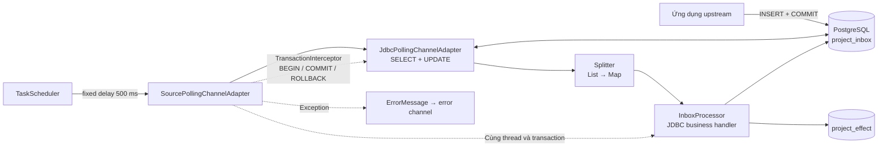
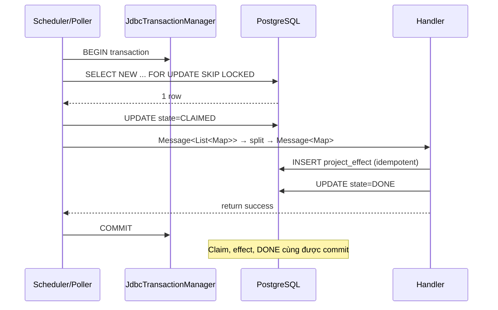
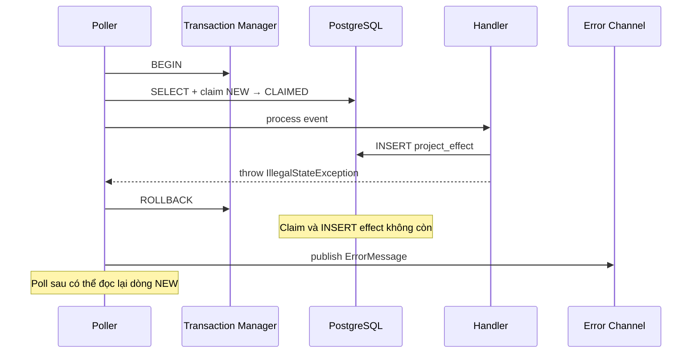
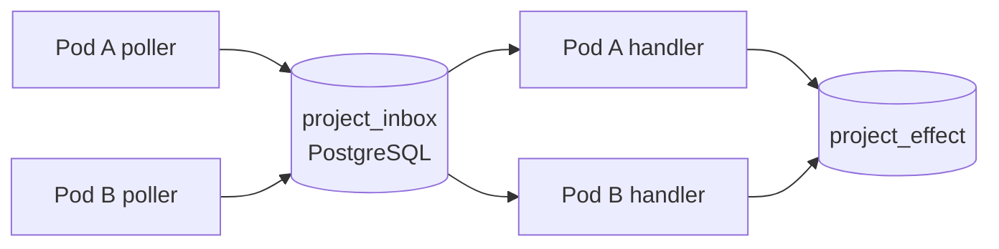
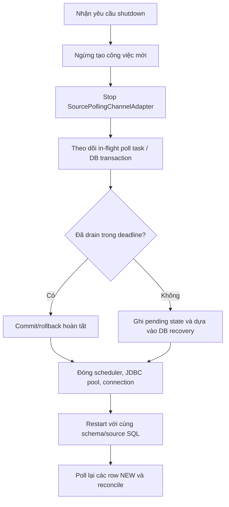

# Thêm polling source với fixed delay và transaction trong Spring Integration Runtime

## 1. Mục tiêu bài thực hành tổng hợp

Trong chương **Thực hành tổng hợp** của module `SPRING_INTEGRATION_RUNTIME`, ta sẽ thêm một **polling source** vào ứng dụng Java/Spring Integration hiện có: cứ sau một khoảng `fixed delay`, endpoint tìm dữ liệu mới trong PostgreSQL, chuyển thành message, xử lý đồng bộ và cập nhật kết quả **trong cùng một transaction**.

Bài nối các năng lực runtime: `MessageSource`, `SourcePollingChannelAdapter`, `IntegrationFlow`, channel/endpoint, poller, transaction, retry, message store, lỗi, correlation và quan sát thread/latency. Đây không chỉ là cấu hình chạy theo lịch; trọng tâm là làm rõ **mốc commit, rollback và điều kiện một message đủ an toàn để xử lý lại**.

### 1.1. Yêu cầu nghiệp vụ

Giả sử một dịch vụ thu thập các sự kiện giao dịch do hệ thống khác ghi vào bảng `project_inbox`. Mỗi dòng là một lệnh cần xử lý:

- `event_key` nhận diện **sự kiện nghiệp vụ** ổn định.
- `payload` chứa dữ liệu cần xử lý.
- `state` có thể là `NEW`, `CLAIMED` hoặc `DONE`.
- Một worker đọc các dòng `NEW`, ghi kết quả vào `project_effect` rồi đánh dấu `DONE`.
- Nếu handler ném exception trước commit, việc claim và ghi effect **phải rollback** để lệnh có thể thử lại.
- Nếu có nhiều application instances, chúng không được cùng claim một dòng tại cùng thời điểm.

Ta dùng **JDBC inbound channel adapter**, `fixedDelay(500 ms)` và transaction manager JDBC trên **cùng `DataSource`**. Ví dụ dành cho PostgreSQL; không áp SQL `FOR UPDATE SKIP LOCKED` nguyên văn cho MySQL/Oracle/SQL Server mà chưa kiểm tra dialect.

### 1.2. Tiêu chí hoàn thành

| Mã | Tiêu chí có thể kiểm chứng |
|---|---|
| AC-01 | Poller chạy theo fixed delay, không phải fixed rate |
| AC-02 | Khi không có dòng `NEW`, source trả không có message; không tạo nghiệp vụ giả |
| AC-03 | Một lần `receive()` lấy tối đa một dòng (`maxRows=1`) |
| AC-04 | Một scheduled poll gọi `receive()` tối đa một lần (`maxMessagesPerPoll=1`) |
| AC-05 | Claim, xử lý và cập nhật `DONE` nằm trong cùng transaction JDBC |
| AC-06 | Lỗi sau khi đã INSERT effect làm rollback cả claim lẫn effect |
| AC-07 | Lần poll sau có thể xử lý lại một dòng đã rollback |
| AC-08 | `event_key` được dùng làm khóa idempotency nghiệp vụ |
| AC-09 | Có error channel/log/metric để biết vì sao poll thất bại |
| AC-10 | Dừng và khởi động lại poller không làm mất dòng `NEW` đã commit |
| AC-11 | Có kiểm thử happy path, lỗi một lần, rollback và dữ liệu trùng |
| AC-12 | Có kế hoạch xử lý poison message, backlog, graceful shutdown và scale-out |

**Phạm vi:** Spring Integration **6.5.x**, Spring Framework 6.x, Java 17+, Spring Boot 3.5.x hoặc nền tảng tương thích, PostgreSQL trong demo. Không có quy trình build/QA nào được chạy trong lúc viết tài liệu; các ví dụ cần được người học thử trên một project/test environment phù hợp.

## 2. Sơ đồ giải pháp và transaction boundary

### 2.1. Topology dự kiến



**Tách lớp cần nhớ:**

- `TaskScheduler` kích hoạt poll task theo lịch.
- `SourcePollingChannelAdapter` là **inbound endpoint** được Spring Integration quản lý theo lifecycle.
- `JdbcPollingChannelAdapter` là **`MessageSource`** thực hiện SELECT và UPDATE tùy cấu hình.
- `IntegrationFlow` nối các message endpoints; mặc định các chặng DSL liền kề có thể dùng `DirectChannel` nên downstream chạy **cùng thread**.
- `PollerSpec.transactional(transactionManager)` đặt transaction advice bao quanh **poll task**.
- `ErrorMessage` là đường báo lỗi; không phải thao tác rollback tự động nếu transaction boundary không được cấu hình đúng.

### 2.2. Dòng thời gian khi thành công



### 2.3. Dòng thời gian khi lỗi



Lược đồ này đúng khi **mọi thao tác JDBC dùng cùng transaction manager/DataSource** và handler không tách sang thread khác trước khi kết thúc poll. Nếu handler gọi remote HTTP và phía đối tác đã commit, rollback JDBC **không hoàn tác HTTP**; phải thêm idempotency/reconciliation.

## 3. Hiểu fixed delay và maxMessagesPerPoll

### 3.1. Fixed delay không phải fixed rate

`Pollers.fixedDelay(Duration.ofMillis(500))` dùng khoảng thời gian dựa trên **thời điểm poll task trước thực sự hoàn tất**, không phải khoảng cách cố định giữa các lần bắt đầu.

Ví dụ (thời gian minh họa, chưa tính jitter):

```text
fixedDelay = 500 ms, mỗi poll xử lý trong 200 ms

poll 1: START 00:00.000 → END 00:00.200
                         (đợi 500 ms)
poll 2: START 00:00.700 → END 00:00.900
                         (đợi 500 ms)
poll 3: START 00:01.400 → ...
```

`fixedRate(500 ms)` cố giữ lịch giữa các lần **bắt đầu** gần mỗi 500 ms, nên hành vi khác khi poll kéo dài. Scheduler capacity và giới hạn concurrency vẫn quyết định các task có thể chạy chồng lên nhau hay không; không tự suy ra fixed rate luôn sinh poll song song.

### 3.2. Hai con số thường bị nhầm

| Tham số | Nằm ở đâu | Ý nghĩa |
|---|---|---|
| `setMaxRows(1)` | `JdbcPollingChannelAdapter` | Mỗi lần SELECT dùng tối đa 1 dòng để tạo payload |
| `maxMessagesPerPoll(1)` | `PollerSpec` | Một chu kỳ poll gọi `MessageSource.receive()` tối đa 1 lần |
| `fixedDelay(500 ms)` | `PollerSpec` | Khoảng đợi sau khi một chu kỳ poll hoàn tất |
| SQL `LIMIT 1` | PostgreSQL query | Bắt DB giới hạn result set ngay từ truy vấn |
| `receiveTimeout` | Poller/`PollableChannel` | Thời gian chờ receive trong channel tương ứng; không phải JDBC query timeout |

**Đặc điểm đáng chú ý:** JDBC inbound adapter trả về **một message có payload là toàn bộ `List<?>` của result set**, không phải một message cho mỗi row. Do đó ta thêm `.split()` để tạo message cho từng dòng. Với `maxRows=1` vẫn là `List` có tối đa một phần tử; không viết handler giả định payload trực tiếp là DTO nếu chưa split.

Đối với `SourcePollingChannelAdapter`, `maxMessagesPerPoll` mặc định là **1**, nhưng bài đặt tường minh để người học không nhầm với `PollingConsumer` trên `QueueChannel` (có default khác).

### 3.3. Khi source không tìm thấy dữ liệu

Không có dòng `state='NEW'`:

1. JDBC SELECT trả result set rỗng.
2. `JdbcPollingChannelAdapter` không tạo message cần xử lý.
3. Endpoint kết thúc poll task, đợi fixed delay rồi thử lại.
4. Hệ thống có thể vẫn phát sinh **SQL query rỗng**; quá nhiều pollers với delay rất ngắn gây áp lực database.

Nếu yêu cầu độ trễ gần tức thời khi dữ liệu đến rời rạc, cân nhắc broker/event notification thay polling nóng; vẫn phải có cơ chế durable recovery.

## 4. Cấu trúc project và dependencies

### 4.1. Gợi ý bố cục dành cho người học

Đây là **cấu trúc demo trong nội dung bài**, không phải file cần tạo thêm trong bước soạn Knowledge:

```text
polling-transaction-lab/
  build.gradle
  src/main/java/demo/polling/
    PollingLabApplication.java
    InboxPollingConfig.java
    InboxProcessor.java
    PollFailureObserver.java
  src/main/resources/
    application.yml
    schema.sql
  src/test/java/demo/polling/
    InboxPollingIntegrationTest.java
```

Dùng Spring Initializr tạo một Spring Boot 3.5.x project với Java 17 và dependency management/BOM tương thích Spring Integration 6.5. Trong `build.gradle`, khai báo phần dependencies:

```groovy
dependencies {
    implementation 'org.springframework.boot:spring-boot-starter-integration'
    implementation 'org.springframework.boot:spring-boot-starter-jdbc'
    implementation 'org.springframework.integration:spring-integration-jdbc'

    runtimeOnly 'org.postgresql:postgresql'

    testImplementation 'org.springframework.boot:spring-boot-starter-test'
    testImplementation 'org.springframework.integration:spring-integration-test'
    testImplementation 'org.testcontainers:junit-jupiter'
    testImplementation 'org.testcontainers:postgresql'
}
```

Không tự đặt version cho mỗi Spring Integration jar nếu Spring Boot BOM đang quản lý; tránh trộn Spring Integration 6.5 với Spring Framework/Spring Security không tương thích. Với Testcontainers phiên bản mới, có thể cần điều chỉnh dependency name theo BOM đang dùng.

### 4.2. Entry point

```java
package demo.polling;

import org.springframework.boot.SpringApplication;
import org.springframework.boot.autoconfigure.SpringBootApplication;
import org.springframework.integration.config.EnableIntegration;

@SpringBootApplication
@EnableIntegration
public class PollingLabApplication {

    public static void main(String[] args) {
        SpringApplication.run(PollingLabApplication.class, args);
    }
}
```

Trong Spring Boot có auto-configuration cho Spring Integration khi starter được cài. `@EnableIntegration` được ghi tường minh để bài thực hành rõ trách nhiệm; khi tích hợp vào dự án hiện có, không khai báo lặp các infrastructure beans nếu không cần.

### 4.3. Cấu hình JDBC cho demo

```yaml
spring:
  datasource:
    url: jdbc:postgresql://localhost:5432/integration_lab
    username: integration_lab
    password: ${DB_PASSWORD}
  sql:
    init:
      mode: always

logging:
  level:
    org.springframework.integration.endpoint: INFO
    org.springframework.transaction: INFO
```

Ở môi trường thực, dùng secret manager/biến môi trường, không commit mật khẩu. `spring.sql.init.mode=always` phù hợp lab với `schema.sql` idempotent; ở production nên dùng Flyway/Liquibase/migrations có kiểm soát, không tạo bảng bằng script startup mỗi lần.

Cấu hình trên **không** tự mở transaction cho poller; cần `PollerSpec.transactional(...)` trong phần tiếp theo.

## 5. Tạo schema PostgreSQL

### 5.1. Bảng inbox và effect

```sql
CREATE TABLE IF NOT EXISTS project_inbox (
    id            BIGSERIAL PRIMARY KEY,
    event_key     VARCHAR(120) NOT NULL UNIQUE,
    payload       TEXT NOT NULL,
    state         VARCHAR(20) NOT NULL DEFAULT 'NEW',
    created_at    TIMESTAMPTZ NOT NULL DEFAULT now(),
    processed_at  TIMESTAMPTZ,
    CONSTRAINT ck_project_inbox_state
        CHECK (state IN ('NEW', 'CLAIMED', 'DONE'))
);

CREATE INDEX IF NOT EXISTS ix_project_inbox_new
    ON project_inbox (id)
    WHERE state = 'NEW';

CREATE TABLE IF NOT EXISTS project_effect (
    event_key       VARCHAR(120) PRIMARY KEY,
    payload         TEXT NOT NULL,
    applied_at      TIMESTAMPTZ NOT NULL DEFAULT now()
);
```

`event_key` có `UNIQUE` trong cả inbox/effect để hỗ trợ **idempotency** của nghiệp vụ tại database. Tương quan giữa hai bảng là một minh họa đơn giản; thực tế cần kiểm tra status, tenant, audit và external side effects theo domain.

### 5.2. Thêm dữ liệu mẫu

```sql
INSERT INTO project_inbox (event_key, payload)
VALUES
    ('evt-1001', 'ORDER-1001'),
    ('evt-1002', 'ORDER-1002'),
    ('evt-1003', 'ORDER-1003')
ON CONFLICT (event_key) DO NOTHING;

SELECT id, event_key, payload, state
FROM project_inbox
ORDER BY id;
```

Trước khi chạy polling, cả ba dòng nên có `state='NEW'`. `ON CONFLICT` trong SQL này là cú pháp **PostgreSQL**; ứng dụng chạy DB khác cần thay theo dialect.

### 5.3. Hợp đồng của trạng thái

| State | Nghĩa trong demo | Khi nào được lưu |
|---|---|---|
| `NEW` | Sự kiện sẵn sàng để poll | Khi upstream INSERT và COMMIT |
| `CLAIMED` | Adapter đã claim dòng trong transaction hiện tại | `UPDATE` của `JdbcPollingChannelAdapter`, chưa chắc được commit |
| `DONE` | Handler đã cập nhật result thành công | Ghi trong **cùng transaction** trước COMMIT |

Trong flow chuẩn của bài, `CLAIMED` chỉ là **trạng thái trung gian trong transaction**; sau commit thành công trạng thái là `DONE`. Nếu transaction rollback, `CLAIMED` cũng rollback trở về `NEW`. Một dòng `CLAIMED` commit lâu dài do thay đổi code/flow là tình huống cần recovery riêng; không tự suy ra mọi dòng đó sẽ được poll tiếp bởi câu SELECT chỉ lọc `NEW`.

## 6. Thêm JDBC MessageSource và polling IntegrationFlow

### 6.1. Tạo JdbcPollingChannelAdapter

```java
package demo.polling;

import javax.sql.DataSource;

import org.springframework.context.annotation.Bean;
import org.springframework.context.annotation.Configuration;
import org.springframework.integration.jdbc.JdbcPollingChannelAdapter;

@Configuration
class InboxPollingConfig {

    static final String POLL_SQL = """
        SELECT id, event_key, payload
        FROM project_inbox
        WHERE state = 'NEW'
        ORDER BY id
        LIMIT 1
        FOR UPDATE SKIP LOCKED
        """;

    @Bean("projectJdbcSource")
    JdbcPollingChannelAdapter projectJdbcSource(DataSource dataSource) {
        JdbcPollingChannelAdapter source =
                new JdbcPollingChannelAdapter(dataSource, POLL_SQL);

        // Mặc định trả về một List<Map<String, Object>>.
        source.setMaxRows(1);

        // :id lấy từ cột id của (các) row đã SELECT.
        source.setUpdateSql("""
            UPDATE project_inbox
               SET state = 'CLAIMED'
             WHERE id IN (:id)
               AND state = 'NEW'
            """);

        return source;
    }
}
```

Ở PostgreSQL, `FOR UPDATE SKIP LOCKED` cho phép nhiều transactions chọn **những dòng không bị transaction khác khóa**, giảm việc hai pollers cùng claim một row. Đây không thay thế idempotency hoặc chính sách xử lý lỗi; mọi instances cần truy vấn cùng bảng và dùng khóa/transaction đúng.

**SQL được cố ý giới hạn bằng `LIMIT 1`** để tránh SELECT quá nhiều rồi làm transaction giữ hàng loạt row locks. `setMaxRows(1)` là giới hạn thêm ở adapter; không dựa vào `setMaxRows` như một cách duy nhất giới hạn tải của database.

`JdbcPollingChannelAdapter.setUpdateSql(...)` áp dụng UPDATE **sau SELECT** trong cùng call `receive()`. Nếu handler sau đó throw và poller transaction đang mở, cả UPDATE claim và handler JDBC operations rollback.

### 6.2. Đặt transaction manager và poller

Trong cùng lớp `InboxPollingConfig`, thêm:

```java
import java.time.Duration;

import org.springframework.beans.factory.annotation.Qualifier;
import org.springframework.context.annotation.Bean;
import org.springframework.integration.dsl.IntegrationFlow;
import org.springframework.integration.dsl.Pollers;
import org.springframework.jdbc.support.JdbcTransactionManager;
import org.springframework.transaction.PlatformTransactionManager;

@Bean("projectTransactionManager")
PlatformTransactionManager projectTransactionManager(DataSource dataSource) {
    return new JdbcTransactionManager(dataSource);
}

@Bean("projectInboxFlow")
IntegrationFlow projectInboxFlow(
        @Qualifier("projectJdbcSource") JdbcPollingChannelAdapter source,
        @Qualifier("projectTransactionManager") PlatformTransactionManager txManager,
        InboxProcessor processor) {

    return IntegrationFlow
            .from(source, endpoint -> endpoint
                    .id("projectInboxPollingEndpoint")
                    .poller(Pollers.fixedDelay(Duration.ofMillis(500))
                            .maxMessagesPerPoll(1)
                            .transactional(txManager)
                            .errorChannel("project.poll.errors")))
            .split()
            .handle(processor, "process")
            .get();
}
```

Đặt hai `@Bean` trong lớp `@Configuration` `InboxPollingConfig` của mục 6.1, không tạo hai cấu hình trùng tên/bean. `JdbcTransactionManager` là `PlatformTransactionManager` dựa trên JDBC và Spring Framework. Nếu dự án đã có transaction manager cho cùng DataSource, **ưu tiên reuse**, không khai báo thêm manager thứ hai rồi chọn sai bean.

**Điểm không được bỏ qua:**

- `endpoint.id("projectInboxPollingEndpoint")` cho một tên ổn định để monitor/start/stop.
- `Pollers.fixedDelay(Duration.ofMillis(500))` dùng khoảng đợi sau poll, không phải cron.
- `maxMessagesPerPoll(1)` giới hạn mỗi scheduled task một `receive()`.
- `.transactional(txManager)` gắn `TransactionInterceptor` cho **polling task**, không phải chỉ cho handler.
- `.errorChannel("project.poll.errors")` chỉ đường phát lỗi của poller; cần định nghĩa bean/error consumer ở mục 8.
- `.split()` chuyển payload `List<Map>` của JDBC source thành message chứa từng `Map`.
- `.handle(processor, "process")` gọi bean Spring theo method; method trả `void`.
- DSL dùng các `DirectChannel` mặc định giữa splitter/handler, không thêm executor/queue bất đồng bộ trong chuỗi giao dịch.

Spring Integration **không tự mở transaction** chỉ vì có `DataSource`, hoặc chỉ vì handler có `@Transactional`. Nếu thiếu `.transactional(txManager)`, SELECT/UPDATE có thể commit độc lập trước khi handler xử lý.

### 6.3. Vì sao dùng splitter dù chỉ nhận một dòng?

`JdbcPollingChannelAdapter` coi **một lần SELECT** là **một message** và trả toàn bộ result set dưới dạng `List`. Nếu bỏ `split()`, handler nhận `List<Map<String,Object>>`, không phải một row.

Khi tăng `LIMIT` lên 10, splitter phát 10 messages trong **cùng polling task/transaction** nếu các chặng vẫn đồng bộ. Một part throw có thể khiến **toàn bộ batch** rollback, không chỉ một row. Vì bài muốn kiểm tra chính xác từng event, giữ `LIMIT=1`, `maxRows=1` và `maxMessagesPerPoll=1` trước khi thử batch.

### 6.4. Các biến thể khác không được đánh đồng

- `@InboundChannelAdapter(poller=@Poller(fixedDelay="500"))` cũng tạo một source polling endpoint, nhưng transaction không tự xuất hiện chỉ do `fixedDelay`.
- `IntegrationFlow.fromSupplier(...)` hữu ích với một supplier thuần; nhưng **không** tự đảm bảo atomic SELECT/UPDATE, claim và commit.
- `QueueChannel` + `PollingConsumer` là một topology khác: poller đọc từ **message channel**, không phải từ `MessageSource` của JDBC inbound adapter.
- `SourcePollingChannelAdapter` và `JdbcPollingChannelAdapter` là hai component khác nhiệm vụ; không gắn transaction vào một bean nhầm cấp rồi kỳ vọng toàn bộ flow rollback.

## 7. Processor: effect + DONE trong cùng transaction

### 7.1. Java handler đầy đủ

```java
package demo.polling;

import java.util.Map;
import java.util.Set;
import java.util.concurrent.ConcurrentHashMap;
import java.util.concurrent.atomic.AtomicInteger;

import org.springframework.jdbc.core.JdbcTemplate;
import org.springframework.stereotype.Component;
import org.springframework.transaction.support.TransactionSynchronizationManager;

@Component
public class InboxProcessor {

    private final JdbcTemplate jdbc;

    // Chỉ dùng trong lab: tạo một exception ở lần xử lý đầu.
    private final Set<String> failOnceKeys =
            ConcurrentHashMap.newKeySet();

    private final Map<String, AtomicInteger> observedAttempts =
            new ConcurrentHashMap<>();

    public InboxProcessor(JdbcTemplate jdbc) {
        this.jdbc = jdbc;
    }

    public void failOnceFor(String eventKey) {
        failOnceKeys.add(eventKey);
    }

    public int attemptsFor(String eventKey) {
        AtomicInteger count = observedAttempts.get(eventKey);
        return count == null ? 0 : count.get();
    }

    public void process(Map<String, Object> row) {
        long rowId = ((Number) row.get("id")).longValue();
        String eventKey = (String) row.get("event_key");
        String payload = (String) row.get("payload");

        observedAttempts.computeIfAbsent(eventKey,
                unused -> new AtomicInteger())
                .incrementAndGet();

        // Guard trong lab để bắt lỗi cấu hình transaction sớm.
        if (!TransactionSynchronizationManager
                .isActualTransactionActive()) {
            throw new IllegalStateException(
                    "Polling transaction is not active");
        }

        // Idempotency tại database (PostgreSQL).
        jdbc.update("""
            INSERT INTO project_effect (event_key, payload)
            VALUES (?, ?)
            ON CONFLICT (event_key) DO NOTHING
            """, eventKey, payload);

        // Mô phỏng lỗi SAU khi đã ghi effect, TRƯỚC commit.
        if (failOnceKeys.remove(eventKey)) {
            throw new IllegalStateException(
                    "Simulated transient failure for " + eventKey);
        }

        int updated = jdbc.update("""
            UPDATE project_inbox
               SET state = 'DONE',
                   processed_at = now()
             WHERE id = ?
               AND state = 'CLAIMED'
            """, rowId);

        if (updated != 1) {
            throw new IllegalStateException(
                    "Unexpected inbox state for row " + rowId);
        }
    }
}
```

Trong ví dụ, `row.get("id")` trả `Number` (PostgreSQL BIGINT), còn `event_key`/`payload` được map từ các cột `SELECT`. Adapter mặc định dùng một map JDBC có khả năng tra tên cột; khi tích hợp DB/RowMapper khác, kiểm tra **case của keys** hoặc khai báo RowMapper tường minh.

`AtomicInteger` và `failOnceKeys` chỉ dùng để quan sát test; chúng **không thuộc transaction** và không tồn tại qua restart. Đây là điều có chủ đích: có thể chứng minh hai **attempts** diễn ra dù database chỉ lưu **một effect** sau commit.

### 7.2. Vì sao INSERT effect rồi mới giả lập lỗi?

Nếu dòng đã claim và handler ném lỗi **trước khi viết DB**, test rollback quá dễ, có thể không chứng minh được một **business write** đã rollback. Với trình tự:

1. Adapter đổi `NEW → CLAIMED`.
2. Handler INSERT `project_effect`.
3. Handler ném exception có chủ đích.
4. Transaction rollback, INSERT effect và claim đều bị hủy.
5. Lần poll sau đọc lại dòng `NEW`.
6. Handler INSERT effect và cập nhật `DONE`.
7. Commit thành công → đúng **một effect row**.

Nếu người học vô tình bỏ `.transactional(txManager)`, handler guard sẽ ném lỗi trước khi INSERT; nếu bỏ guard, claim có thể commit trước failure, row mắc ở `CLAIMED` và bài test eventual `DONE` sẽ fail.

### 7.3. Tại sao vẫn cần ON CONFLICT?

Transaction rollback bảo vệ case ném lỗi **trong cùng database transaction**. Nó không ngăn mọi duplicate:

- Upstream gửi lặp cùng business event nhưng message ID mới.
- Process chết sau một external side effect không nằm trong transaction.
- Một command được replay từ DLQ.
- Retry từ broker/adapter khác gửi cùng event.

`UNIQUE(event_key)` và `ON CONFLICT DO NOTHING` bảo vệ ví dụ **ghi hiệu ứng vào database này**. Nếu payload mới khác payload đã commit với cùng key, không được bỏ qua âm thầm trong production; cần đối chiếu canonical payload/hash và policy conflict.

Không dùng `MessageHeaders.ID` làm khóa idempotency duy nhất vì một logical event có thể được tạo lại với message ID khác.

## 8. Xử lý lỗi poller mà không làm mất dữ liệu

### 8.1. ErrorMessage chỉ là đường báo lỗi

Nếu `InboxProcessor.process()` ném `IllegalStateException`, lỗi lan ngược qua splitter và polling endpoint. `TransactionInterceptor` rollback transaction JDBC; cơ chế error handling của poller có thể tạo `ErrorMessage` qua channel đã cấu hình `project.poll.errors`.

**Không nhầm ba hành động:**

- **Rollback:** database trả dòng `CLAIMED → NEW` và hủy `project_effect` insert chưa commit.
- **Error publication:** framework phát báo cáo lỗi để operator quan sát.
- **Retry:** poll tiếp theo đọc lại `NEW`; cần policy tránh vòng lặp với message luôn lỗi.

Nếu `ErrorMessage` được chuyển tới một `QueueChannel` không có consumer và không giới hạn capacity, lỗi có thể chất đống trong RAM. Lab dùng `DirectChannel` với error handler gọn.

### 8.2. Khai báo error channel và handler

```java
package demo.polling;

import org.springframework.context.annotation.Bean;
import org.springframework.context.annotation.Configuration;
import org.springframework.integration.channel.DirectChannel;
import org.springframework.messaging.MessageChannel;

@Configuration
class PollingErrorChannelsConfig {

    @Bean("project.poll.errors")
    MessageChannel pollErrors() {
        return new DirectChannel();
    }
}
```

```java
package demo.polling;

import org.slf4j.Logger;
import org.slf4j.LoggerFactory;
import org.springframework.integration.annotation.ServiceActivator;
import org.springframework.messaging.MessagingException;
import org.springframework.messaging.support.ErrorMessage;
import org.springframework.stereotype.Component;

@Component
public class PollFailureObserver {

    private static final Logger log =
            LoggerFactory.getLogger(PollFailureObserver.class);

    @ServiceActivator(inputChannel = "project.poll.errors")
    public void observe(ErrorMessage error) {
        Throwable failure = error.getPayload();

        Throwable root = failure;
        for (int level = 0; root.getCause() != null && level < 20;
                level++) {
            if (root.getCause() == root) {
                break;
            }
            root = root.getCause();
        }

        log.warn("event=poll_failed errorType={} rootCauseType={} "
                        + "message={}",
                failure.getClass().getSimpleName(),
                root.getClass().getSimpleName(),
                safeRootReason(root));
    }

    private static String safeRootReason(Throwable failure) {
        // Ví dụ lab: chỉ log loại lỗi, không lộ payload/header/secret.
        return failure.getClass().getSimpleName();
    }
}
```

Đây là một **observer**, chưa phải retry/quarantine policy. Trong hệ thống thật nên ghi thêm `event_key`/`businessRequestId` khi có thể lấy an toàn từ `MessagingException.getFailedMessage()` hoặc original message. Không nên dump toàn bộ `ErrorMessage`, vì failed message có thể chứa payload và headers nhạy cảm.

Chú ý đường error khi poller lỗi **không giống** một exception trên `DirectChannel` do producer gọi. Ta đang quan sát một **scheduled task** được framework quản lý, nên phải kiểm tra `SourcePollingChannelAdapter` đã cấu hình error handler/error channel đúng.

### 8.3. Vì sao không xử lý failed row ngay trong error handler?

Một `ErrorMessage` là **sự kiện quan sát**, không mặc nhiên chứa đủ thông tin để cập nhật retry count chính xác. Handler có thể fail sau splitter, nên `failedMessage` có payload `Map` trong khi original poll message chứa `List`. Ngoài ra, error handler thường hoạt động **sau khi transaction gốc rollback**, nhưng không nên viết lại source row mù quáng theo một ID lấy từ log.

Production design có thể thêm:

- `attempt_count`, `next_attempt_at` và `last_error_code` trong inbox.
- Quarantine state `DEAD`, retry delay/backoff và max retry count.
- Một failure-state writer chạy trong **transaction mới có commit độc lập**, với correlation hợp lệ và ownership check.
- Business idempotency theo `event_key`, không phụ thuộc message ID.
- Policy cho poison messages để một dòng lỗi vĩnh viễn không cản mọi dòng phía sau.

**Bẫy phổ biến:** tăng `attempt_count` bên trong transaction rồi throw làm rollback; sau mỗi poll, số lần retry vẫn là 0. Muốn ghi bền một failure sau rollback, phải có một transaction **khác** và cơ chế đảm bảo failure event được theo dõi. Xem mục 14.

## 9. Chạy dự án và đọc trạng thái PostgreSQL

### 9.1. Các bước vận hành ở môi trường lab

1. Khởi động PostgreSQL test instance và tạo database `integration_lab`, user có quyền tạo/đọc/ghi các bảng demo.
2. Cung cấp `DB_PASSWORD` qua environment/secret.
3. Chạy ứng dụng Spring Boot; `schema.sql` được áp theo cấu hình môi trường lab.
4. Kiểm tra log khởi tạo có bean `projectInboxPollingEndpoint` và không có lỗi SQL/transaction manager.
5. INSERT ba sự kiện mẫu (mục 5.2) sau khi ứng dụng đang chạy, hoặc dùng dữ liệu đã seed.
6. Truy vấn trạng thái đến khi tất cả chuyển `DONE`.

Ví dụ kiểm tra bằng `psql`:

```sql
SELECT event_key, state, created_at, processed_at
FROM project_inbox
ORDER BY id;

SELECT event_key, payload, applied_at
FROM project_effect
ORDER BY applied_at;
```

Khi tất cả dòng xử lý thành công, kỳ vọng:

```text
project_inbox:
  evt-1001   DONE
  evt-1002   DONE
  evt-1003   DONE

project_effect:
  evt-1001   ORDER-1001
  evt-1002   ORDER-1002
  evt-1003   ORDER-1003
```

Các giá trị trên là **kết quả dự kiến**, không phải output đã chạy trong môi trường của người học.

### 9.2. Kích hoạt một lần lỗi sau INSERT effect

`InboxProcessor.failOnceFor(eventKey)` là hook chỉ dành cho test. Để dùng trong test, gọi method trên bean **trước khi** INSERT dòng tương ứng:

```java
String key = "evt-fail-demo";
inboxProcessor.failOnceFor(key);

jdbcTemplate.update(
        "INSERT INTO project_inbox (event_key, payload) VALUES (?, ?)",
        key, "PAYLOAD-FAIL-ONCE");
```

Dự kiến:

- Poll đầu claim row, INSERT effect, ném lỗi; transaction rollback.
- `PollFailureObserver` ghi lỗi an toàn.
- Poll sau đọc lại row và xử lý thành công.
- Cuối cùng `state='DONE'`, `project_effect` có một row và `attemptsFor(key) >= 2`.

**Không gọi `failOnceFor` trên một bean khác instance handler mà Spring Integration đang dùng.** Trong test dùng `@Autowired InboxProcessor` để đảm bảo hook tác động đúng bean.

### 9.3. Trình tự SQL cần để điều tra

```text
Poll 1:
 BEGIN
 SELECT ... FOR UPDATE SKIP LOCKED  -> row id=101
 UPDATE project_inbox SET CLAIMED  -> id=101
 INSERT project_effect             -> event_key=evt-fail-demo
 THROW
 ROLLBACK
  => project_inbox: NEW, project_effect: không có row này

Poll 2:
 BEGIN
 SELECT ... FOR UPDATE SKIP LOCKED  -> row id=101
 UPDATE project_inbox SET CLAIMED
 INSERT project_effect
 UPDATE project_inbox SET DONE
 COMMIT
  => project_inbox: DONE, project_effect: có đúng 1 row
```

Nếu có hai poller instances hoặc tải concurrent, thứ tự log có thể xen kẽ. Dựa vào `event_key`, row ID, transaction ID và timestamp, không suy luận từ thứ tự in log toàn hệ thống.

## 10. Kiểm thử tích hợp thật với PostgreSQL/Testcontainers

### 10.1. Vì sao không dùng H2 cho test chính?

Demo sử dụng PostgreSQL `FOR UPDATE SKIP LOCKED`, `ON CONFLICT`, partial index, transaction/locking semantics. H2 có thể dùng cho unit test repository trong một số tình huống nhưng **không thay thế được** integration test đúng dialect, locking và rollback của PostgreSQL.

Dùng Testcontainers để tạo một PostgreSQL riêng cho test; **không thử trên database production**. Testcontainers cần Docker/container runtime tại máy/CI của người học. Bài chỉ mô tả và cung cấp mã; worker viết Knowledge không chạy build/test.

### 10.2. JUnit: happy path và rollback sau một failure

```java
package demo.polling;

import static org.junit.jupiter.api.Assertions.assertEquals;
import static org.junit.jupiter.api.Assertions.assertTrue;
import static org.awaitility.Awaitility.await;

import java.time.Duration;
import java.util.UUID;

import org.junit.jupiter.api.Test;
import org.springframework.beans.factory.annotation.Autowired;
import org.springframework.boot.test.context.SpringBootTest;
import org.springframework.jdbc.core.JdbcTemplate;
import org.springframework.test.context.DynamicPropertyRegistry;
import org.springframework.test.context.DynamicPropertySource;
import org.testcontainers.containers.PostgreSQLContainer;
import org.testcontainers.junit.jupiter.Container;
import org.testcontainers.junit.jupiter.Testcontainers;

@SpringBootTest
@Testcontainers
class InboxPollingIntegrationTest {

    @Container
    static PostgreSQLContainer<?> db =
            new PostgreSQLContainer<>("postgres:16-alpine")
                    .withDatabaseName("integration_lab")
                    .withUsername("integration_lab")
                    .withPassword("test-password");

    @DynamicPropertySource
    static void datasourceProperties(DynamicPropertyRegistry registry) {
        registry.add("spring.datasource.url", db::getJdbcUrl);
        registry.add("spring.datasource.username", db::getUsername);
        registry.add("spring.datasource.password", db::getPassword);
    }

    @Autowired
    JdbcTemplate jdbc;

    @Autowired
    InboxProcessor processor;

    @Test
    void pollsNewRowAndCommitsEffect() {
        String key = "ok-" + UUID.randomUUID();

        jdbc.update("""
            INSERT INTO project_inbox (event_key, payload)
            VALUES (?, ?)
            """, key, "ORDER-OK");

        await().atMost(Duration.ofSeconds(15))
                .pollInterval(Duration.ofMillis(100))
                .untilAsserted(() -> {
                    assertEquals("DONE", state(key));
                    assertEquals(1, effectCount(key));
                });
    }

    @Test
    void handlerFailureRollsBackClaimAndBusinessWrite() {
        String key = "retry-" + UUID.randomUUID();
        processor.failOnceFor(key);

        jdbc.update("""
            INSERT INTO project_inbox (event_key, payload)
            VALUES (?, ?)
            """, key, "ORDER-RETRY");

        await().atMost(Duration.ofSeconds(15))
                .pollInterval(Duration.ofMillis(100))
                .untilAsserted(() -> {
                    assertEquals("DONE", state(key));
                    assertEquals(1, effectCount(key));
                    assertTrue(processor.attemptsFor(key) >= 2,
                            "One attempt must have failed before commit");
                });
    }

    private String state(String key) {
        return jdbc.queryForObject("""
            SELECT state FROM project_inbox WHERE event_key = ?
            """, String.class, key);
    }

    private int effectCount(String key) {
        Integer count = jdbc.queryForObject("""
            SELECT count(*) FROM project_effect WHERE event_key = ?
            """, Integer.class, key);
        return count == null ? 0 : count;
    }
}
```

**Phụ thuộc:** Spring Boot test starter thường có `Awaitility`; nếu BOM/test starter của bạn không kéo thư viện, thêm dependency test `org.awaitility:awaitility`. Điều chỉnh Testcontainers artifacts theo phiên bản do BOM quản lý.

**Điều kiện để test có ý nghĩa:**

- `PollingLabApplication` được tìm thấy qua component scan.
- `schema.sql` ở classpath và `spring.sql.init.mode=always`; Testcontainers JDBC properties đã inject trước khi Boot khởi tạo database.
- Test methods không dựa vào thứ tự; mỗi method dùng `event_key` duy nhất.
- Poller chạy tự động trong test context như ứng dụng.
- Không thêm một consumer khác lấy cùng rows hoặc làm `ExecutorChannel` chen giữa source và handler.
- Khi chờ kết quả, dùng `await().untilAsserted(...)` thay vì sleep một thời gian cố định và đoán hệ thống kịp xử lý.

### 10.3. Diễn giải kết quả failure test

`assertTrue(processor.attemptsFor(key) >= 2)` chứng minh có ít nhất hai lượt handler invocation. `effectCount=1` và `state='DONE'` chứng minh sau cùng database chỉ có một effect và inbox ở trạng thái cuối.

Tuy vậy, **một final-state assertion không phải bằng chứng tuyệt đối về mọi chi tiết transaction**. Nếu cần chứng minh row `NEW` ngay sau rollback lần đầu, dùng latch/barrier trong một fixture kiểm soát poller stop/start hoặc event listener sau rollback; không đặt một `Thread.sleep` tùy ý rồi query một thời điểm ngẫu nhiên. Để kiểm thử mạnh hơn, thêm kiểm tra SQL transaction state và fault injection/commit-failure tests.

### 10.4. Test deduplication và idempotency

Nếu muốn test **cùng event_key được gửi lại**, unique constraint trên `project_inbox.event_key` đã reject thêm dòng trùng; test cần quyết định upstream phải **bỏ qua duplicate** hay nhận lỗi 409 nghiệp vụ.

Một cách thử:

```java
String key = "duplicate-" + UUID.randomUUID();

jdbc.update("""
    INSERT INTO project_inbox (event_key, payload)
    VALUES (?, ?) ON CONFLICT (event_key) DO NOTHING
    """, key, "first");

jdbc.update("""
    INSERT INTO project_inbox (event_key, payload)
    VALUES (?, ?) ON CONFLICT (event_key) DO NOTHING
    """, key, "duplicate");

Integer rows = jdbc.queryForObject("""
    SELECT count(*) FROM project_inbox WHERE event_key = ?
    """, Integer.class, key);

assertEquals(1, rows);
```

Đây chỉ là **inbox uniqueness test**. Muốn kiểm chứng exactly-once business effect cần thêm test consumer/replay, external side effect và reconciliation khi một HTTP call đã commit nhưng JDBC transaction rollback.

### 10.5. Test dừng poller rồi resume

Tìm endpoint bằng ID `projectInboxPollingEndpoint` và gọi lifecycle API:

```java
import org.springframework.beans.factory.annotation.Qualifier;
import org.springframework.context.Lifecycle;
import org.springframework.stereotype.Component;

@Component
class PollerLifecycleControl {

    private final Lifecycle endpoint;

    PollerLifecycleControl(
            @Qualifier("projectInboxPollingEndpoint") Lifecycle endpoint) {
        this.endpoint = endpoint;
    }

    public void stop() {
        endpoint.stop();
    }

    public void start() {
        endpoint.start();
    }

    public boolean isRunning() {
        return endpoint.isRunning();
    }
}
```

Trong test, dừng poller trước khi INSERT row mới; xác nhận sau một thời gian/điều kiện phù hợp row vẫn `NEW`, rồi start lại và chờ `DONE`. Test không nên chạy song song với các tests đang chờ poller; dùng context riêng hoặc test lifecycle ở suite riêng và **luôn start lại trong `finally`**.

`stop()` không đồng nghĩa mọi in-flight transaction đã kết thúc ngay lập tức. Trước khi destroy/redeploy, cần kiểm tra active poll tasks, DB locks và backlog; test stop riêng không bảo đảm graceful drain.

## 11. Kiểm thử transaction boundary đúng và sai

### 11.1. Transaction chỉ hợp lệ khi đi cùng thread và DataSource

`PollerSpec.transactional(txManager)` bao **một poll task**. Các thao tác SQL tham gia cùng transaction nếu:

- `JdbcPollingChannelAdapter` lấy connection từ DataSource được `txManager` quản lý.
- `InboxProcessor` dùng `JdbcTemplate` của **cùng DataSource**.
- Các chặng từ source qua splitter tới processor chạy **cùng thread**.
- Exception handler phải **ném ra** thay vì nuốt lỗi, để advice rollback.

Trong ví dụ chính, những điều kiện này được thiết kế có chủ đích. Không tự suy từ `@Transactional` trên một method ở thread khác rằng transaction JDBC đã đi xuyên qua executor.

### 11.2. Phản mẫu: thêm ExecutorChannel giữa source và handler

```java
return IntegrationFlow.from(source, e -> e.poller(
            Pollers.fixedDelay(Duration.ofMillis(500))
                    .transactional(txManager)))
        .split()
        // Phản mẫu trong bài nếu muốn receive+process atomic:
        .channel(c -> c.executor(threadPoolTaskExecutor))
        .handle(processor, "process")
        .get();
```

Khi chuyển tới `ExecutorChannel`, việc gửi message cho worker có thể hoàn tất ngay; transaction ở poller thread commit **trước khi worker thực sự xử lý**. Nếu worker ném exception, `CLAIMED` có thể đã commit trong database và SQL source chỉ chọn `NEW` sẽ không lấy dòng đó nữa.

**Hậu quả:** message có thể mắc ở `CLAIMED` mà không được retry, dù error channel nhận exception. Đây là lỗi correctness, không chỉ là thay đổi latency.

Nếu cần tách thread để tăng throughput, phải thiết kế **acknowledgment/lease/claim state có timeout và recovery riêng** hoặc dùng broker/durable channel với transaction/ACK semantics phù hợp. Không chỉ chèn executor vào flow rồi mặc định rollback còn hoạt động.

### 11.3. Phản mẫu: handler nuốt exception

```java
public void process(Map<String, Object> row) {
    try {
        doBusinessWrite(row);
    }
    catch (Exception failure) {
        log.warn("failed, but returning normally", failure);
    }
}
```

Nếu poller transaction thấy handler **trả về bình thường**, advice có thể commit trạng thái `CLAIMED` của adapter dù business write không thành công. Lỗi mất message trở nên khó thấy hơn vì không có exception để rollback.

Cách đúng: classify lỗi tại boundary phù hợp, rồi:

- Với transient failure: ném exception để rollback; có retry/backoff policy.
- Với permanent invalid input: lưu `REJECTED`/quarantine trong transaction có chủ ý rồi commit (nếu domain cho phép).
- Với unknown external side effect: dùng trạng thái `RECONCILING` và idempotency, không trả thành công giả.
- Với lỗi quan sát/logging: không để logging failure phá business transaction nếu đó không phải policy.

### 11.4. Phản mẫu: transaction manager trỏ sai database

Nếu source JDBC đọc từ database A nhưng `JdbcTemplate` của handler ghi database B:

```text
Transaction manager A:
  BEGIN → SELECT/UPDATE source A

Handler:
  INSERT effect vào B (transaction B riêng hoặc autocommit)

Handler throw:
  ROLLBACK A; effect ở B vẫn còn
```

`Pollers.transactional(txManagerA)` **không tự tạo distributed transaction** trên B. Nếu cần atomicity xuyên hai databases, cân nhắc outbox/inbox, saga, idempotency hoặc XA/JTA được thiết kế kỹ, không giả định local JDBC transaction đủ.

### 11.5. Timeout khác transaction rollback

`fixedDelay(500 ms)` không giới hạn thời gian chạy `receive()`, SQL query hoặc handler. Nếu DB lock chờ 30 giây, poll task có thể kẹt 30 giây; fixed delay được tính **sau khi task hoàn tất**.

Cần quản lý timeout riêng:

- JDBC query timeout và statement timeout của database.
- Connection acquisition timeout của pool.
- Transaction timeout ở advice.
- External HTTP client connect/read timeout.
- Deadline nghiệp vụ end-to-end, retry/backoff budget.
- Shutdown drain deadline.

**Không dùng `Thread.sleep(1000)` trong handler để giả lập deadline** của production logic; dùng test fixtures có latches/controllable faults.

## 12. Fixed delay, throughput và thiết kế lịch polling

### 12.1. Ước lượng throughput trước khi tune

Trong ví dụ chính, mỗi chu kỳ chỉ gọi JDBC source một lần và lấy một row. Khi source có backlog, thời gian tối thiểu giữa hai lần bắt đầu poll xấp xỉ:

\[T_{\text{cycle}} \approx T_{\text{select+update+handler+commit}} + T_{\text{fixed-delay}} + T_{\text{jitter}}\]

Ví dụ có số liệu **giả lập**:

```text
JDBC read + claim:         20 ms
Handler + effect write:   50 ms
Commit:                   30 ms
Fixed delay:             500 ms
Scheduler jitter:         ~0 ms (giả lập)

Một chu kỳ ≈ 600 ms
Throughput trần cho 1 poller, 1 row/chu kỳ ≈ 1.67 events/s
```

**Đây là estimate cho một poller tuần tự đang bận xử lý rows**, không phải benchmark thực tế; khi không có dữ liệu, truy vấn rỗng vẫn xuất hiện nhưng không phát message. Nếu cần 100 events/s, cấu hình một row/500 ms chắc chắn không phù hợp dù handler rất nhanh.

### 12.2. Nếu tăng maxRows thì sao?

`JdbcPollingChannelAdapter` trả một List cho mỗi poll. Nếu `LIMIT 10`, `setMaxRows(10)` và `split()`, một poll có thể gửi tối đa 10 row messages **trong cùng transaction**. Khi phần thứ bảy throw, transaction có thể rollback **tất cả 10 rows** (tùy flow dispatch và rollback configuration).

| Cấu hình | Số rows SQL mỗi receive | Số receives mỗi scheduled poll | Phạm vi transaction của bài |
|---|---:|---:|---|
| Lab mặc định | 1 | 1 | Một row + handler |
| Batch nhỏ | 10 | 1 | Có thể là toàn batch 10 rows |
| Gọi source nhiều lần | 1 | 10 | Mười lượt nhận trong poll task; phải kiểm tra transaction/advice scope |
| Poll rate lớn | 1 | 1 với delay 50 ms | SQL query rate tăng; có thể gây DB load |

Tăng `maxMessagesPerPoll` hoặc `maxRows` mà không hiểu ranh giới transaction có thể làm thay đổi atomicity, lock hold time, error recovery và p99 latency. Luôn có **regression test rollback** cho cấu hình mới.

### 12.3. Fixed delay và fixed rate dưới tải

| Tình huống | fixed delay | fixed rate |
|---|---|---|
| Poll nhanh hơn interval | Đợi đúng khoảng sau khi task kết thúc | Cố duy trì lịch bắt đầu đều |
| Poll chậm hơn interval | Lượt sau không bắt đầu trước khi task hiện tại hoàn tất với scheduler tuần tự | Có thể trễ lịch; không tự bảo đảm chạy song song |
| Khi DB quá tải | Thường tạo nhịp tự giãn vì task kéo dài | Có thể dồn scheduled work nếu cấu hình scheduler/threads không phù hợp |
| Khi cần “cứ 500 ms sau lần hoàn tất” | Phù hợp | Không đúng semantics |
| Khi cần theo mốc giờ cố định | Không trực tiếp | Có thể dùng fixed rate/cron tùy yêu cầu |

Đừng cho rằng đổi sang `fixedRate(500)` sẽ chữa backlog do DB lock hoặc handler chậm. Nó chỉ thay đổi schedule; khi tài nguyên xử lý đạt giới hạn, throughput không tự tăng.

### 12.4. Theo dõi poll rỗng

Một query rỗng mỗi 500 ms tương đương khoảng hai SQL queries/giây cho một instance. Với 20 pods cùng poll, có thể gần 40 empty queries/giây trong trạng thái idle, chưa kể health/metrics.

Khi poll liên tục vào database nhưng traffic hiếm, cân nhắc:

- Tăng delay khi idle theo policy; giảm khi backlog tăng.
- Notification/event-driven source (nếu hạ tầng hỗ trợ), nhưng phải có durable fallback.
- Dùng broker cho việc wake up và database cho idempotency/business state.
- Giảm số pods cùng poll một partition.
- Giữ poller transaction đủ ngắn và indices phù hợp.

Đừng tắt polling vô thời hạn mà không có cơ chế wake/recover nguồn khi có message mới.

## 13. Nhiều workers/instances và PostgreSQL SKIP LOCKED

### 13.1. Tại sao thêm một poller không tự tăng throughput tuyến tính?

Khi chạy hai JVM với source và query giống nhau:



`FOR UPDATE SKIP LOCKED` giúp mỗi transaction bỏ qua row đang bị transaction khác giữ khóa, phù hợp pattern **competing consumers**. Nhưng cần lưu ý:

- Hai instances phải dùng cùng database schema và query semantics.
- `SKIP LOCKED` có thể khiến rows xử lý **không đúng thứ tự tăng của ID**; ordering không được bảo đảm trong nhiều worker.
- Row locks được giữ đến cuối transaction. Handler chậm đồng nghĩa giữ lock lâu.
- Nếu poller transaction timeout hoặc process crash, PostgreSQL giải phóng transaction và row có thể được poll lại.
- Một message commit thành công nhưng external side effect thất bại sau đó vẫn cần reconciliation.
- Không dùng `SKIP LOCKED` như cơ chế bảo đảm exactly-once effect khi có HTTP side effects.

### 13.2. Phép thử cạnh tranh hai pollers

Trong staging/test, chạy hai instances với cùng database; seed ít nhất 100 `NEW` rows và ghi `event_key` được instance nào xử lý.

Tiêu chí:

1. Mọi `event_key` chuyển `DONE` đúng theo contract.
2. `project_effect` có đúng một row cho mỗi event.
3. Không có hai instances cùng giữ claim của một row trong cùng thời điểm.
4. Các rows bị rollback được nhận lại, không kẹt `CLAIMED`.
5. Không phụ thuộc ordering toàn cục; nếu business cần ordering theo tenant/order, phải có partitioning/serializing theo business key.
6. Theo dõi throughput và p95/p99 DB lock wait trước/sau scale-out.

**Dùng môi trường test**, không cố tạo đồng thời hai pollers lên queue production chỉ để kiểm tra race.

### 13.3. Sự khác nhau giữa row lock và LockRegistry

`FOR UPDATE SKIP LOCKED` là **khóa dữ liệu SQL** trong transaction PostgreSQL hiện tại. `LockRegistry` của Spring Integration thường được dùng bảo vệ **message groups/correlation state** ở aggregator, và có implementation local/distributed tùy backend.

Không thay thế hai cơ chế bằng nhau:

| Cơ chế | Bảo vệ | Scope |
|---|---|---|
| PostgreSQL row lock | Quyền truy cập/claim từng inbox row | Transaction/database |
| `JdbcLockRegistry`/`RedisLockRegistry` | Critical section theo logical lock key, ví dụ group ID | Tùy lock backend/lease |
| Business idempotency key | Chống lặp effect nghiệp vụ | Theo domain/resource |
| Transaction manager | Commit/rollback một tập resource operations | Theo resource và transaction context |

Một poller có `FOR UPDATE` vẫn có thể tạo duplicate external API call sau timeout; một distributed lock vẫn không tự bảo đảm payload thuộc đúng tenant hoặc event chưa được xử lý trước đó.

### 13.4. Row claim khi nhiều apps dùng chung một bảng

Nếu source của service khác cũng đọc `project_inbox`, cần phân biệt `event_type`/`owner`/`region` bằng điều kiện SQL và kiểm soát access rights ở DB. Không chia chung một bảng và coi `ORDER BY id LIMIT 1` tự hiểu service nào có quyền xử lý row nào.

Với nhiều tenants, đặt index/select theo partition/tenant hoặc event type phù hợp. Không lấy tenant từ một header client không xác thực rồi dùng nó làm predicate duy nhất để quyết định quyền xử lý dữ liệu.

## 14. Retry, backoff và poison-message recovery có trạng thái bền

### 14.1. Tình huống handler luôn thất bại

Nếu `process()` luôn throw đối với event `bad-001`:

```text
poll 1: SELECT bad-001 -> ROLLBACK -> NEW
fixed delay 500ms
poll 2: SELECT bad-001 -> ROLLBACK -> NEW
fixed delay 500ms
poll 3: SELECT bad-001 -> ROLLBACK -> NEW
...
```

Vì SQL chọn `ORDER BY id LIMIT 1`, một poison message ở ID thấp có thể **làm đói** các rows đến sau, dù SELECT/transaction hoạt động đúng. Error handler chỉ log không đủ.

### 14.2. Một schema nâng cấp cho production

Đề xuất thêm columns vào `project_inbox` (schema migration, **không tự thêm vào bài lab đang chạy nếu chưa điều chỉnh code**):

```sql
ALTER TABLE project_inbox
    ADD COLUMN IF NOT EXISTS attempt_count INTEGER NOT NULL DEFAULT 0,
    ADD COLUMN IF NOT EXISTS next_attempt_at TIMESTAMPTZ,
    ADD COLUMN IF NOT EXISTS last_error_code VARCHAR(80);

-- Nâng cấp constraint state để có FAILED/DEAD theo migration thực tế.
-- Không DROP constraint production tùy tiện.
```

Sau migration có kiểm soát, select có thể chỉ lấy rows:

```sql
SELECT id, event_key, payload
FROM project_inbox
WHERE state = 'NEW'
  AND (next_attempt_at IS NULL OR next_attempt_at <= now())
ORDER BY id
LIMIT 1
FOR UPDATE SKIP LOCKED;
```

Khi một transaction thất bại và rollback:

1. Error handler/classifier xác định `event_key` từ **nguồn đủ tin cậy**.
2. Một service khác ghi `attempt_count` và `next_attempt_at` trong **transaction mới**, đã commit.
3. Với lỗi không thể retry, chuyển row sang trạng thái quarantine/`DEAD` theo schema/policy.
4. Nếu lỗi transient, đặt backoff có giới hạn và jitter; cố gắng không poll cùng row ngay lập tức.
5. Ghi audit và phân biệt **đã xử lý nghiệp vụ**, **đã phát lỗi**, **đang chờ retry**, **đã quarantine**.

**Điểm mấu chốt:** không viết tăng attempt count trong cùng polling transaction rồi throw; toàn bộ increment cũng rollback. Cần bảo đảm failure-state update diễn ra ở một transaction **khác** sau khi transaction gốc đã kết thúc, hoặc dùng một công cụ retry/lease chuyên dụng có semantics đã kiểm chứng.

### 14.3. Chú ý khi error publication cũng lỗi

Nếu `project.poll.errors` có handler ném exception, đang stop hoặc buffer đầy, error publication có thể thất bại trong khi JDBC transaction gốc đã rollback. Hệ thống phải có logging/alert tối thiểu ở scheduler, và một cơ chế reconcile từ database để phát hiện rows bị retry mãi.

Không thể dựa vào **một event trong RAM error channel** làm bằng chứng duy nhất đã xử lý thất bại. Với mức yêu cầu reliability cao, có thể dùng durable failure/outbox records hoặc persistent broker DLQ.

### 14.4. Retry của handler khác retry bằng repoll

`RequestHandlerRetryAdvice` có thể retry handler **nhiều lần trong cùng polling task**; trong khi repoll xảy ra ở **scheduled task sau**, thường mở transaction mới. Hai cách khác nhau:

| Cơ chế | Đơn vị thử lại | Rủi ro |
|---|---|---|
| Handler retry advice | Method handle/endpoint trong một invocation | Giữ DB lock/transaction trong backoff |
| Repoll sau rollback | Source SELECT lại trong transaction mới | Poison message lặp, chậm do fixed delay |
| Broker redelivery | Message được phát lại theo ACK/reject policy | Có thể duplicate side effects |
| Dedicated retry queue | Scheduled/delayed message delivery | Cần durable state và tracing/correlation |

**Không kết hợp vô hạn nhiều tầng retry.** Ví dụ 3 handler attempts * 5 broker redeliveries * 10 application repolls có thể tạo rất nhiều calls cho cùng event, làm latency và tấn công dependency trầm trọng hơn.

### 14.5. Business state UNKNOWN khác transaction rollback

Nếu handler gọi HTTP bên ngoài và bị timeout:

```text
BEGIN JDBC
SELECT/CLAIM inbox row
HTTP call -> remote server đã commit (nhưng response timeout)
THROW
ROLLBACK JDBC
next poll -> HTTP call lần hai
```

Thêm `ON CONFLICT DO NOTHING` vào `project_effect` **không bảo vệ** HTTP remote side effect, vì HTTP không tham gia JDBC transaction. Dùng **idempotency key gửi cho remote partner**, outbox/saga hoặc đối soát transaction status trước khi retry. Nếu outcome chưa rõ, đưa command vào trạng thái `RECONCILING` thay vì xem tất cả lỗi I/O là “chưa làm gì”.

## 15. Observability của SourcePollingChannelAdapter và JDBC

### 15.1. Những chỉ số phải có

| Metric / event | Câu hỏi |
|---|---|
| `poll.task.count`/`poll.task.duration` | Có poll thật không, mỗi poll mất bao lâu? |
| `source.receive.count`/`empty.poll.count` | Tỷ lệ poll có row và poll rỗng? |
| `poll.jdbc.select.duration` | SQL read/lock wait chậm ở đâu? |
| `poll.jdbc.update.duration` | Claim update/commit có tốn thời gian? |
| `handler.process.duration` | Business processing có chậm không? |
| `handler.error.count` | Những nguyên nhân nào làm transaction rollback? |
| `inbox.new.count` | Còn bao nhiêu events chưa được nhận? |
| `inbox.oldest.age` | Event cũ nhất đang chờ bao lâu? |
| `inbox.claimed.stuck.count` | Có row kẹt `CLAIMED` sau code/flow thay đổi? |
| `project_effect.duplicate.conflict` | Có duplicate event key đến không? |
| `db.connection.acquire.duration` | Pool có đang bão hòa? |
| `db.lock.wait.duration` | Nhiều instances tranh row/group locks? |
| `transaction.rollback.count` | Lỗi có tạo rollback đúng không? |
| `poll.error.publish.failures` | Error channel có bị lỗi/không consumer? |

Các tên metric trên là **gợi ý instrumentation**, không phải tất cả đều được Spring Integration tự xuất theo tên đó. Với Spring Boot Actuator/Micrometer, `ObservationRegistry` và `@EnableIntegrationManagement`/`observationPatterns` cần được cấu hình phù hợp để có metrics/tracing ở những component được chọn.

### 15.2. SQL để quan sát backlog

```sql
SELECT state, count(*) AS total
FROM project_inbox
GROUP BY state
ORDER BY state;

SELECT count(*) AS pending,
       min(created_at) AS oldest_created_at
FROM project_inbox
WHERE state = 'NEW';

SELECT event_key, created_at, now() - created_at AS age
FROM project_inbox
WHERE state = 'NEW'
ORDER BY created_at
LIMIT 10;
```

Đây là **query chẩn đoán**, không nên chạy full-table scans liên tục với tần suất rất cao ở production. Index theo predicate/query sẽ cần tối ưu theo workload thật.

### 15.3. Log theo business event, không theo ID tự sinh

```text
event=poll_started
flow=projectInboxFlow
endpoint=projectInboxPollingEndpoint
thread=integrationScheduler-1

event=inbox_claimed
eventKey=evt-1001
rowId=101
transactionActive=true

event=processing_failed
eventKey=evt-1001
exception=IllegalStateException
outcome=rollback

event=inbox_done
eventKey=evt-1001
outcome=committed
```

Đây là **schema log minh họa**, không phải log tự động sinh bởi code. Nếu muốn ghi “committed” chính xác, log ở transaction **afterCommit** hoặc kiểm tra state đã commit; log trong handler **trước COMMIT** chỉ chứng minh code đã chạy đến điểm đó.

Không dùng raw `event_key`/`orderId`/`correlationId` làm Micrometer/Prometheus labels khi giá trị gần như duy nhất theo message; tạo cardinality rất cao. Dùng chúng ở structured log được bảo vệ theo chính sách bảo mật.

### 15.4. Transaction instrumentation trong code

Trong `InboxProcessor`, có thể kiểm tra transaction đang active như bài đã làm. Với log thời điểm commit thật:

```java
import org.springframework.transaction.support.TransactionSynchronization;
import org.springframework.transaction.support.TransactionSynchronizationManager;

// Đặt trong handler khi transaction đã active.
TransactionSynchronizationManager.registerSynchronization(
        new TransactionSynchronization() {
            @Override
            public void afterCommit() {
                // Chỉ log hoặc phát metric; tránh gọi business side effect
                // không idempotent mà không có outbox/recovery.
                System.out.println("transaction committed for " + eventKey);
            }

            @Override
            public void afterCompletion(int status) {
                if (status == STATUS_ROLLED_BACK) {
                    System.out.println("rolled back " + eventKey);
                }
            }
        });
```

`eventKey` là biến của handler và ví dụ nằm trong code đang có transaction active/synchronization active. `afterCommit()` không phải nơi bảo đảm durable publication đến external broker nếu JVM crash ngay sau DB commit; dùng **transactional outbox** khi cần bảo đảm sự kiện completion có thể replay.

### 15.5. Dựng timeline chính xác

```text
t0  upstream INSERT project_inbox (commit)
t1  poll scheduled
t2  JDBC SELECT returns row
t3  JDBC update CLAIMED
t4  splitter dispatches Map
t5  processor INSERT effect
t6  processor UPDATE DONE
t7  transaction COMMIT
t8  next scheduled poll = t7 + fixed delay (+ jitter)
```

Nếu event đến ngay sau `t1` và không được chọn ở poll này, nó thường phải chờ lần poll tiếp theo. End-to-end latency vì vậy bao gồm **thời gian chờ lịch + SQL + xử lý + commit**, không chỉ handler duration.

`JdbcPollingChannelAdapter` còn có counters/management interfaces theo Spring Integration; khi instrument cần tách receive/select/commit time và không cộng trùng các timer lồng nhau.

## 16. Lifecycle, dynamic runtime và shutdown

### 16.1. Quản lý vòng đời polling endpoint

`SourcePollingChannelAdapter` là lifecycle component; endpoint có ID `projectInboxPollingEndpoint` do DSL cấu hình. Khi cần tạm dừng lấy dữ liệu mới:

```java
import org.springframework.beans.factory.annotation.Qualifier;
import org.springframework.context.Lifecycle;
import org.springframework.stereotype.Component;

@Component
public class InboxPollerControl {

    private final Lifecycle pollingEndpoint;

    public InboxPollerControl(
            @Qualifier("projectInboxPollingEndpoint") Lifecycle endpoint) {
        this.pollingEndpoint = endpoint;
    }

    public void pause() {
        pollingEndpoint.stop();
    }

    public void resume() {
        pollingEndpoint.start();
    }

    public boolean running() {
        return pollingEndpoint.isRunning();
    }
}
```

`stop()` yêu cầu dừng scheduling/endpoint, **không phải** một bảo đảm tuyệt đối đã drain mọi in-flight handler hoặc hoàn tất transaction. Trước khi đổi schema hoặc deploy flow mới, phải đối chiếu active poll tasks, DB transactions/locks và số dòng `NEW`/`CLAIMED`.

**Không expose bean `InboxPollerControl` qua một public HTTP endpoint mà không có authn/authz riêng**. Control plane start/stop có thể làm hệ thống ngừng xử lý hàng nghìn message.

### 16.2. Shutdown an toàn hơn bằng một runbook



Nếu JVM nhận `SIGKILL` giữa transaction, database thường giải phóng connection/rollback transaction chưa commit; nhưng **đừng thay kiểm thử crash/restart bằng suy luận này**. Driver/network, transaction manager, database failover và external calls phải được kiểm tra trên môi trường có cùng cấu hình production.

### 16.3. Thay đổi IntegrationFlow động

Nếu ứng dụng dùng `IntegrationFlowContext`:

- Đăng ký flow v2 với ID khác; không thay thế flow v1 đang active bằng destroy/register cùng ID mà không có cutover plan.
- Không cho cả v1/v2 poll chung một nguồn nếu business contract không cho phép competing consumers.
- Nếu chủ đích scale-out, phải test `FOR UPDATE SKIP LOCKED` và idempotency cho các versions.
- `IntegrationGraphServer.rebuild()` sau khi thêm/xóa flow để cập nhật graph.
- Dừng v1 khi không còn inbound traffic mới, chờ transaction hoàn tất rồi mới destroy.
- Khi rollback, không đổi namespace/state/schema khiến rows chưa xử lý biến mất khỏi SELECT.

Những quy tắc này quan trọng khi thêm polling source vào ứng dụng đã có inbound adapters, consumer endpoints, routing và message store khác.

### 16.4. Transaction với restart và tính bền dữ liệu

Vì source của bài đọc trực tiếp bảng `project_inbox`, dữ liệu `NEW` đã commit **nằm ngoài JVM** và vẫn sẵn có sau restart. Đây không phải là persistence tự động của một `SimpleMessageStore`, mà là data durability của PostgreSQL và schema inbox.

Tuy nhiên:

- Dòng `DONE` chỉ tồn tại nếu transaction commit thành công.
- Một dòng `CLAIMED` lâu dài có thể biểu thị bug/legacy code; cần reconciliation.
- Nếu tên table, predicate `state='NEW'` hoặc schema đổi trong deploy, worker mới có thể không nhìn thấy pending rows.
- External API đã commit dù JDBC rollback sẽ cần idempotency/status checks.
- Một retry policy viết attempt count trong transaction rollback sẽ không giữ được count.

## 17. Security, validation và trách nhiệm của nguồn dữ liệu

### 17.1. Poller không có HTTP user security context

Một polling consumer chạy từ scheduler thread, không có principal của HTTP request. Nếu upstream ghi sự kiện vào `project_inbox`, cần xác định **ai có quyền INSERT** và **consumer có quyền xử lý event type/tenant nào**.

Ví dụ một row có thể mang:

```json
{
  "tenantId": "tenant-A",
  "eventKey": "evt-1001",
  "operation": "orders.approve",
  "orderId": "ORD-1001"
}
```

Đây chỉ là dữ liệu, **không tự chứng minh authorization**. Khi đi từ HTTP ingress vào inbox, service nhận phải xác thực, phân quyền resource, tạo command có provenance đáng tin hoặc ghi metadata đã được phê duyệt. Consumer đọc row cần áp policy long-running command/reauthorization tương ứng.

### 17.2. Bảo vệ ở database boundary

- Dùng database user có quyền tối thiểu trên các bảng cần đọc/ghi.
- Không cho client internet trực tiếp INSERT vào inbox table.
- Bind values bằng `JdbcTemplate` prepared statements/parameters; không ghép SQL bằng String từ payload.
- Validate payload schema, tenant ID, độ dài chuỗi, timestamp và event type.
- Không log raw access token, PII hoặc payload chứa thông tin nhạy cảm.
- Giới hạn kích thước/retention của inbox và effect rows.
- Có policy TTL/archival cho `DONE`, nhưng đừng xóa dữ liệu chưa reconcile hoặc đang được audit.
- Khi lưu correlation ID, phân biệt request/group identity với credential/authorization.

### 17.3. Idempotency và transaction là hai lớp bảo vệ khác nhau

Transaction JDBC khiến những thao tác cùng resource hoặc connection **commit/rollback như một khối**. Idempotency xử lý việc **cùng logical event có thể được giao lại sau commit, retry, failover hoặc caller timeout**.

Trong demo, unique index trên `project_effect.event_key` giúp tránh hai database effect rows cho cùng event. Với một outbound payment/email/HTTP handler thật, cần key ổn định gửi sang downstream hoặc outbox pattern. Không cho transaction rollback dùng làm bằng chứng chắc chắn side effect bên ngoài chưa xảy ra.

## 18. Bảng chẩn đoán sự cố

| Triệu chứng | Nguyên nhân có khả năng | Kiểm tra hoặc cách xử lý |
|---|---|---|
| Poller không lấy row mới | Endpoint stop/`autoStartup=false` | `isRunning()`, bean ID, startup logs |
| SQL chạy nhưng không có message | SELECT sai predicate/schema hoặc database khác | Query bằng cùng DB user, xem `state` |
| Source có row nhưng handler không được gọi | Thiếu `split()`, sai handler signature/dispatch | Kiểm tra payload là `List<Map>` |
| Lỗi `ClassCastException` trong handler | Key/row mapper type sai | Log data types an toàn, RowMapper |
| Poll có 10 rows nhưng handler tưởng 1 | `maxRows` khác `maxMessagesPerPoll` | Check SQL LIMIT, adapter maxRows, splitter |
| SQL báo `FOR UPDATE` không hợp lệ | Đang dùng DB không phải PostgreSQL hoặc query sai | Xem dialect và syntax |
| SQL update báo không bind được `:id` | SELECT không có cột `id`/mapper không tạo property | Kiểm tra cột ID và update mapping |
| Transaction guard báo inactive | Poller thiếu `.transactional(...)` hoặc bị proxy/config sai | Bean transaction manager, poller advice |
| Lỗi handler nhưng row kẹt `CLAIMED` | Claim đã commit trước handler | Async boundary, transaction manager sai |
| Handler lỗi rồi mỗi poll log lại cùng một event | Poison message + rollback + no durable backoff | Retry budget, next_attempt_at/quarantine |
| Lần poll mới không chạy dù fixedDelay=500ms | Handler/SQL/lock đang block | Thread dump, lock wait, query/tx timeout |
| `send/receive` nhanh nhưng end-to-end chậm | Chờ lịch poll và backlog | Ingress-to-commit latency, queue age |
| DB pool hết connections | Nhiều pollers/long transaction | Hikari active/pending, slow queries |
| Hai pods xử lý cùng row | Thiếu locking/commit isolation hoặc query khác nhau | `FOR UPDATE SKIP LOCKED`, row ownership |
| Event order thay đổi sau scale-out | `SKIP LOCKED`/concurrent processing | Partition theo business key nếu cần ordering |
| Có effect nhưng inbox vẫn `NEW` | Effect ngoài transaction hoặc handler rollback một phần | DataSource/transaction boundary |
| Row `DONE` nhưng external API chưa xử lý | Handler nuốt lỗi hoặc async side effect | Test external outcomes, outbox/saga |
| ErrorMessage không tới custom channel | Sai tên bean hoặc ErrorHandler không publish | `project.poll.errors` subscriber, scheduler |
| Error channel có lỗi lặp vô hạn | Error handler lại throw hoặc recovery loop | Error path nonrecursive, alert |
| Sau restart không tìm thấy message | Schema/source predicate đổi | Cùng database/schema và state policy |
| Test chỉ pass với H2, fail trên Postgres | Dialect/locking khác | Testcontainers PostgreSQL |
| CPU/DB cao dù không có rows | Empty polls quá thường xuyên | Poll interval, number of instances |
| p99 tăng sau khi tăng maxRows | Batch transaction/lock hold dài | DB metrics và rollback tests |
| Tăng retry mà backlog phình | Retry storm, dependency chưa hồi phục | Backoff/jitter, retry budgets |
| Sai tenant khi xử lý | Dùng tenant từ payload không xác minh | Provenance + resource-level authorization |

### 18.1. Quy trình debug 10 bước

1. Xác nhận **source đang hoạt động**: `projectInboxPollingEndpoint` running và scheduler có trigger.
2. Xác nhận datasource của adapter và transaction manager **cùng database/resource**.
3. Chạy SELECT cùng predicate, nhìn row `NEW` và độ cũ của backlog.
4. Đọc cấu hình `fixedDelay`, `maxMessagesPerPoll`, `setMaxRows` và SQL `LIMIT`.
5. Kiểm tra payload output sau source: `List<Map>` hay `Map`? `split()` có chạy không?
6. Kiểm tra thread boundary và `TransactionSynchronizationManager.isActualTransactionActive()` ở handler.
7. Với lỗi, đọc `ErrorMessage`/cause chain, failed message và error subscriber.
8. Đối chiếu state `NEW/CLAIMED/DONE` với effect rows và transaction logs.
9. Nếu có retry, tách handler retry, repoll và broker redelivery; tìm poison messages.
10. Viết regression test với PostgreSQL, thêm fault/restart test, đo lại throughput/p99 và correctness sau sửa.

### 18.2. Ca điều tra mẫu

```text
09:00:00  upstream INSERT evt-55, state=NEW
09:00:00  poll SELECT row id=55
09:00:00  adapter UPDATE state=CLAIMED
09:00:00  poll sends to ExecutorChannel, returns
09:00:00  COMMIT CLAIMED
09:00:01  async handler throws IllegalArgumentException
09:00:01  ErrorMessage logged
09:00:02  poll SELECT state=NEW -> none
```

**Chẩn đoán:** transaction kết thúc tại thread poller **trước khi** handler xử lý. Dòng đã commit `CLAIMED`, nên SELECT chỉ lọc `NEW` không bao giờ lấy lại. Không sửa bằng cách giảm `fixedDelay`; phải khôi phục atomicity hoặc thiết kế ACK/claim lease/recovery thật sự.

## 19. Bài tập mở rộng theo mức độ

### 19.1. Bài tập cơ bản

**Bài 1 — Chạy lab và chứng minh happy path.** Seed ba events, ghi trạng thái trước và sau, xác nhận `DONE` và đúng một `project_effect` cho mỗi event.

**Bài 2 — Fixed delay thay vì fixed rate.** Instrument thời điểm bắt đầu/kết thúc poll, dùng một test source có độ trễ xác định, so khi `fixedDelay=500 ms` và `fixedRate=500 ms`. Vì sao lịch poll chậm khi handler mất 2 giây?

**Bài 3 — Hai loại giới hạn.** Giữ `maxMessagesPerPoll=1` và thử `maxRows=5`/`LIMIT 5`; đếm số message sau splitter. Sau đó thử `maxRows=1` nhưng `maxMessagesPerPoll=5` và so số lượt query/poll.

**Bài 4 — Guard transaction.** Bỏ `.transactional(txManager)` trong một **test-only flow**, chạy failure test và giải thích vì sao state bị kẹt hoặc test fail. Hoàn nguyên cấu hình sau bài.

**Bài 5 — Rollback sau DB effect.** Dùng `failOnceFor`, assert có tối thiểu hai attempts, một effect row sau cuối và `DONE`. Quan sát cả PostgreSQL state/transaction rollback events.

### 19.2. Bài tập nâng cao

**Bài 6 — Poison message.** Gây một lỗi vĩnh viễn ở row ID nhỏ nhất, quan sát starvation. Thiết kế state `DEAD` và `next_attempt_at` với commit ở transaction **khác sau rollback**.

**Bài 7 — Hai instances.** Chạy hai pollers trên cùng Testcontainers PostgreSQL, 100 rows. Xác minh mỗi event có một effect row, dù thứ tự thực thi thay đổi.

**Bài 8 — Transaction qua ExecutorChannel.** Chèn executor vào giữa splitter và handler, tái hiện commit `CLAIMED` trước lỗi handler. Đề xuất cách phục hồi: xử lý đồng bộ trong transaction hoặc durable claim/lease/ACK.

**Bài 9 — DB connection pressure.** Thử số pollers 1, 2, 4, 8 với pool size giới hạn. Đo SQL lock wait, connection acquisition, p95/p99 và throughput.

**Bài 10 — Caller timeout và remote side effect.** Thêm HTTP client giả xử lý thành công rồi trả timeout. Thiết kế idempotency key và reconciliation thay vì retry mù sau JDBC rollback.

**Bài 11 — Dynamic flow cutover.** Register flow v2 bằng `IntegrationFlowContext`, test topology với `IntegrationGraphServer.rebuild()`; đảm bảo không có hai pollers cạnh tranh trái ý hoặc mất rows trong lúc stop/destroy.

**Bài 12 — Bảo mật dữ liệu inbox.** Thêm `tenant_id`, phân quyền nguồn ghi/scheduler đọc, xác minh không có worker nào xử lý row tenant sai chỉ bằng cách thay header/payload.

### 19.3. Bảng kết quả thực hành người học cần nộp

| Kiểm thử | Thông số được ghi | Dự kiến |
|---|---|---|
| Happy path | Event key, trạng thái, effect count | `DONE`, effect=1 |
| Transient error | Số attempts, error type, terminal state | Attempts≥2, effect=1, `DONE` |
| Permanent error | Thời gian retry/backoff, quarantine state | Không retry vô hạn |
| Stop/resume | Poller running status, DB backlog | Không mất rows `NEW` |
| 2 instances | Row claim and effect uniqueness | Không cùng claim một row |
| SQL/handler timeout | Thread/transaction logs | Deadline được quan sát, không kẹt vĩnh viễn |
| Scale maxRows | SQL rows, splits, rollback scope | Đúng batch semantics |
| Crash/restart | Dữ liệu đã commit trước/sau restart | Không mất pending rows |
| Error observability | Error channel và root cause | Có audit/alert, không leak payload |
| Idempotency | Duplicate business event | Không duplicate effect |

## 20. Checklist cuối bài và tài liệu tham khảo

### 20.1. Checklist trước khi đưa polling source vào production

- **Source rõ:** `JdbcPollingChannelAdapter` đang đọc đúng bảng và trạng thái; không nhầm với `QueueChannel` poller.
- **Fixed delay rõ:** hiểu interval từ lúc poll task hoàn tất, biết giới hạn throughput.
- **Hai giới hạn khác nhau:** `maxRows` của adapter và `maxMessagesPerPoll` của poller.
- **Transaction đúng:** `.transactional(txManager)` đặt trên poll task.
- **Cùng DataSource:** SELECT/claim/effect/DONE nằm trong một transaction JDBC.
- **Không ngắt thread:** giữ DirectChannel giữa source/splitter/handler nếu muốn atomic receive-and-process.
- **Không nuốt lỗi:** exception cần lan đến advice để rollback, hoặc được classify/commit trạng thái hợp lệ có chủ đích.
- **Chặn duplicate:** business event key có unique constraint và idempotency policy.
- **Quản lý poison messages:** max attempts, durable backoff, next attempt, quarantine/DLQ.
- **Xác minh rollback:** test sau khi đã INSERT effect, không chỉ throw trước business write.
- **Error path:** custom `errorChannel` có consumer và alert; không tạo queue lỗi vô hạn.
- **DB concurrency:** PostgreSQL `FOR UPDATE SKIP LOCKED`, indexes, connection pool, lock wait và dialect.
- **Quan sát latency:** poll interval, empty polls, SQL/commit time, handler duration, oldest event age và backlog.
- **Bảo vệ security:** quyền DB, validated payload/tenant, không lưu JWT trong message.
- **Có lifecycle runbook:** stop, drain, restart, dynamic flow cutover và crash recovery.
- **Không đánh đồng ACK:** source receive, DB transaction commit và external business side effect là các mốc khác nhau.
- **Không thay production schema bằng demo SQL mù quáng:** cần migration/versioning và kiểm thử data compatibility.
- **Có test trong PostgreSQL thật:** Testcontainers, rollback, concurrent poll, failover và idempotency.

**Kết luận:** thêm một polling source với `fixed delay` không chỉ là đặt một timer. Bài này thành công khi **`MessageSource` chỉ phát đúng dữ liệu, transaction bao toàn bộ nhận-xử lý-commit, lỗi được rollback/quan sát, và event có thể xử lý lại an toàn**. Khi chuyển sang nhiều workers, batching hoặc async flow, mọi thay đổi phải được kiểm chứng lại về transaction, concurrency, latency và business idempotency.

### 20.2. Tài liệu tham khảo chính thức

1. [Spring Integration 6.5 — Channel Adapter](https://docs.spring.io/spring-integration/reference/6.5/channel-adapter.html): `SourcePollingChannelAdapter`, fixed delay/rate, default `maxMessagesPerPoll`.
2. [Spring Integration 6.5 — JDBC Inbound Channel Adapter](https://docs.spring.io/spring-integration/reference/6.5/jdbc/inbound-channel-adapter.html): `JdbcPollingChannelAdapter`, SELECT/UPDATE, list payload, transaction và `maxRows`.
3. [Spring Integration 6.5 — Message Endpoints](https://docs.spring.io/spring-integration/reference/6.5/endpoint.html): Poller, transaction advice, scheduling/lifecycle.
4. [Spring Integration 6.5 — Transaction Support](https://docs.spring.io/spring-integration/reference/6.5/transactions.html): Poller transaction, synchronization, resource semantics.
5. [Spring Integration 6.5 — Java DSL Inbound Adapters](https://docs.spring.io/spring-integration/reference/6.5/dsl/java-inbound-adapters.html): `IntegrationFlow.from(MessageSource, spec)`.
6. [Pollers — Spring Integration 6.5 API](https://docs.spring.io/spring-integration/docs/6.5.0/api/org/springframework/integration/dsl/Pollers.html): `fixedDelay(Duration)`.
7. [PollerSpec — Spring Integration 6.5 API](https://docs.spring.io/spring-integration/docs/6.5.0/api/org/springframework/integration/dsl/PollerSpec.html): `transactional(TransactionManager)`, `maxMessagesPerPoll`, `errorChannel`.
8. [JdbcPollingChannelAdapter — Spring Integration 6.5 API](https://docs.spring.io/spring-integration/docs/6.5.0/api/org/springframework/integration/jdbc/JdbcPollingChannelAdapter.html): `setUpdateSql`, `setMaxRows` và `MessageSource`.
9. [Spring Integration 6.5 — Error Handling](https://docs.spring.io/spring-integration/reference/6.5/error-handling.html): `ErrorMessage`, error channel và scheduled tasks.
10. [Spring Integration 6.5 — Testing](https://docs.spring.io/spring-integration/reference/6.5/testing.html): `@SpringIntegrationTest`, `MockIntegrationContext` và test utilities.
11. [Spring Integration 6.5 — Message Channels](https://docs.spring.io/spring-integration/reference/6.5/channel.html): `DirectChannel`, `ExecutorChannel`, `QueueChannel` và threading.
12. [Spring Integration 6.5 — Dynamic Integration Flows](https://docs.spring.io/spring-integration/reference/6.5/dsl/java-runtime-flows.html): `IntegrationFlowContext`, registration lifecycle và cleanup.
13. [Spring Framework — Transaction Management](https://docs.spring.io/spring-framework/reference/data-access/transaction.html): `JdbcTransactionManager`, rollback, thread-bound resources.
14. [Spring JDBC — JDBC Core](https://docs.spring.io/spring-framework/reference/data-access/jdbc/core.html): `JdbcTemplate`, prepared statements và JDBC transaction participation.
15. [PostgreSQL — Explicit Locking](https://www.postgresql.org/docs/current/explicit-locking.html): row-level locks và transaction behavior.
16. [PostgreSQL — SELECT](https://www.postgresql.org/docs/current/sql-select.html): `FOR UPDATE SKIP LOCKED`, `LIMIT`, ordering.
17. [Testcontainers — PostgreSQL module](https://java.testcontainers.org/modules/databases/postgres/): PostgreSQL containers trong integration tests.

**Bằng chứng cần nộp sau lab:** (1) SQL state trước/sau, (2) kết quả JUnit rollback, (3) số lần handler gọi và số effect rows, (4) một timeline poll/commit, (5) giải thích vì sao thêm ExecutorChannel không có ACK/lease sẽ làm sai contract. Chỉ khi có các bằng chứng này mới khẳng định đã triển khai **fixed-delay polling có transaction**, thay vì chỉ cấu hình một scheduled SELECT.
