# Thiết kế error flow, retry và dead-letter

Trong **Spring Integration runtime**, một message đi qua nhiều ranh giới: inbound adapter, channel, consumer hoặc poller, executor, handler, transaction, outbound gateway và message store. Khi một stage lỗi, câu hỏi không chỉ là “có retry không?” mà còn là **ai giữ message gốc, lần thử nào đã tạo side effect, lỗi đi vào error channel nào, khi nào source được acknowledge và công việc thất bại được phục hồi ra sao**.

Bài thuộc chương **Thực hành tổng hợp** của module `SPRING_INTEGRATION_RUNTIME`. Ta sẽ xây dựng một dự án mini xử lý lệnh đặt hàng, thiết kế **error flow – bounded retry – dead-letter – replay**, sau đó mở rộng từ phiên bản chạy trong một JVM sang thiết kế có broker, database và giao dịch. Bài kết hợp Java DSL, `RequestHandlerRetryAdvice`, `ErrorMessage`, `errorChannel`, `QueueChannel`, `DirectChannel`, poller, `IntegrationFlow`, idempotency, observability và kiểm thử sự cố.

> **Kết quả mong muốn:** cuối bài, người học phân biệt được **lỗi tạm thời** với **lỗi vĩnh viễn**, đảm bảo message không “biến mất” giữa các bước, tránh retry vô hạn hoặc nhân đôi side effect, biết dead-letter thực sự được lưu ở đâu và có thể chứng minh điều đó qua integration test/failure injection.

## 1. Bối cảnh dự án

Một service nhận lệnh `CreateOrder` từ HTTP hoặc broker. Hệ thống cần kiểm tra dữ liệu, xác minh quyền truy cập, lưu đơn hàng và gửi thông báo sau khi commit. Một dependency ngoài có thể timeout, database có thể deadlock, producer có thể gửi payload sai hoặc message có thể được giao lại.

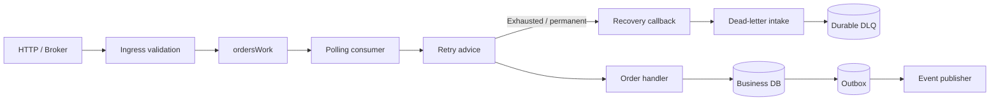

Các nhiệm vụ cụ thể:

1. Lệnh hợp lệ tạo **một** business effect.
2. Lỗi transient được retry **có giới hạn** và có backoff.
3. Validation/authentication/authorization failure không bị retry nóng.
4. Lỗi không thể xử lý ngay được đưa vào **dead-letter record bền vững** hoặc được giữ tại source để redelivery.
5. Source không được coi một message là xử lý thành công chỉ vì nó đã enqueue vào RAM.
6. Có thể tra cứu, phân loại, sửa nguyên nhân rồi **re-drive** một dead-letter có kiểm soát.
7. Nếu restart, duplicate delivery hoặc rollback, không mất sự kiện trái hợp đồng và không ghi đơn hàng hai lần.

Đây là một *reference lab*, không phải hệ thống thanh toán production hoàn chỉnh. Phần chạy trong RAM được dùng để học cách điều phối endpoint; phần durability/ack được thiết kế và kiểm thử riêng vì cần backend thật.

## 2. Viết acceptance criteria trước khi code

| ID | Tình huống | Kết quả chấp nhận |
| --- | --- | --- |
| AC-01 | Lệnh hợp lệ, dependency khỏe | Một `COMMITTED` outcome, không có DLQ |
| AC-02 | Dependency transient fail hai lần rồi thành công | Tối đa ba handler attempts, một business effect |
| AC-03 | Payload/schema sai | Không retry lặp, có reject/dead-letter theo policy |
| AC-04 | Không đủ quyền tenant | Không có DB update; error code an toàn |
| AC-05 | Dependency fail quá số attempts | Có dead-letter hoặc source redelivery được bảo toàn |
| AC-06 | Dead-letter store mất kết nối | Không được silently acknowledge lệnh chưa lưu bền |
| AC-07 | Crash sau business commit trước source ack | Redelivery không tạo duplicate business effect |
| AC-08 | Crash giữa DB commit và outbound publish | Outbox còn pending; publisher phục hồi |
| AC-09 | Replay cùng event hai lần | Kết quả idempotent; audit được số lần replay |
| AC-10 | Executor/poller đang quá tải | Có capacity/reject/backpressure và backlog quan sát được |
| AC-11 | ErrorMessage chứa failedMessage nhạy cảm | Logs không dump token/payload/headers |
| AC-12 | Restart khi còn dead-letter pending | Record còn bền vững và replay được theo quyền |
| AC-13 | Hai worker cùng replay một DLQ record | Chỉ một claim theo generation/revision tại một thời điểm |
| AC-14 | Từ chối vĩnh viễn | Không có vòng retry/redelivery vô hạn |

Các tiêu chí này xác định rõ **outcome nghiệp vụ**, thay vì chỉ kiểm tra log có dòng “retry exhausted”.

## 3. Hợp đồng message của dự án

Một payload nhỏ, có định danh nghiệp vụ ổn định:

```java
public record CreateOrder(
        String eventId,
        String tenantId,
        String orderId,
        long amountMinor,
        int schemaVersion) {}

public record OrderAccepted(
        String eventId,
        String orderId,
        String status) {}
```

| Trường | Ý nghĩa | Quy tắc |
| --- | --- | --- |
| `eventId` | ID của sự kiện nghiệp vụ, dùng cho idempotency | Không tạo ID mới khi retry/redelivery |
| `tenantId` | Scope nghiệp vụ mong muốn | Đối chiếu với verified actor, không tin raw header |
| `orderId` | Định danh đơn | Validate độ dài, format, ownership |
| `amountMinor` | Đơn vị tiền nhỏ nhất | Dương và trong giới hạn hợp đồng |
| `schemaVersion` | Phiên bản payload | Chỉ nhận những phiên bản được hỗ trợ |

**`MessageHeaders.ID` không thay cho `eventId`:** khi message được dựng lại, forwarded hoặc redelivered, ID của message object có thể khác. Idempotency cần một khóa nghiệp vụ ổn định cùng producer/tenant scope phù hợp.

### 3.1. Những headers có thể hữu ích

```text
message.id        -> quan sát một message object
traceId           -> truy vết, chỉ là dữ liệu kỹ thuật
correlationId     -> nhóm/request nếu thật sự cần
deliveryAttempt   -> metadata đáng tin từ source/runtime
contentType       -> contract converter đã duyệt
replyChannel      -> chỉ tin nếu do gateway nội bộ tạo
errorChannel      -> chỉ tin nếu được cấu hình/kiểm soát
```

Không để producer tự đặt `role=ADMIN`, `retryCount=0` hoặc `replyChannel` tùy ý rồi coi đó là quyết định của framework. Security gate và header allowlist cần nằm trước business handler.

## 4. Sơ đồ lỗi: ba lớp không được trộn

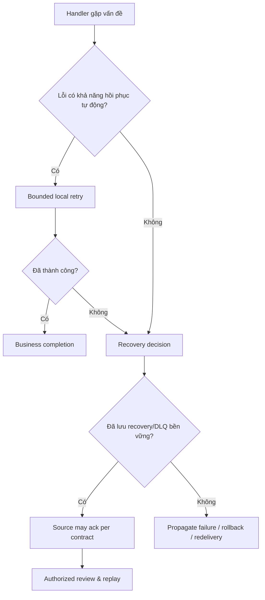

Ba lớp khác nhau:

- **Retry trong invocation:** ví dụ `RequestHandlerRetryAdvice` gọi lại handler nhiều lần khi cùng một message đang được xử lý.
- **Redelivery của source:** broker giao lại message sau nack/rollback hoặc ack bị mất. Đây là **delivery mới**, có thể chạy ở instance khác.
- **Dead-letter/recovery:** message không còn được thử tức thì, được lưu để điều tra, sửa và replay theo quy trình.

Một hệ thống có thể sử dụng cả ba; nhưng tổng số attempts sẽ tăng. Không để retry advice và broker cùng retry vô hạn.

## 5. Phân loại lỗi trước khi chọn retry

| Lớp lỗi | Ví dụ | Chính sách gợi ý |
| --- | --- | --- |
| **Validation permanent** | Schema không hỗ trợ, thiếu required field | Reject/quarantine; không retry không điều kiện |
| **Authorization permanent** | Actor tenant A yêu cầu sửa tenant B | Deny và audit an toàn; không tự retry |
| **Business conflict permanent** | Đơn đã hủy, invariant không cho tạo lại | Rejection code riêng; có thể không cần DLQ nếu đã ghi outcome |
| **Transient infrastructure** | DB deadlock, HTTP 503, pool timeout | Bounded retry/backoff, có timeout |
| **Unknown outcome** | Request ngoài timeout nhưng có thể đã thực hiện | Reconcile/idempotency key trước khi thử lại |
| **Programming bug** | `NullPointerException`, mapping sai | Không retry nóng vô ích; alert/quarantine |
| **Poison message** | Dữ liệu cố định khiến handler luôn fail | DLQ có giới hạn và sửa nguyên nhân |
| **Store/DLQ outage** | Không ghi được record phục hồi | Propagate failure, giữ lại nghĩa vụ xử lý tại nguồn |

**Một exception class không luôn đủ phân loại.** `MessagingException` có thể wrap nguyên nhân; HTTP 409 có thể là business conflict, nhưng với API khác lại là optimistic concurrency cần retry. Hãy mapping theo **error code và contract của dependency**, không theo tên exception một cách máy móc.

### 5.1. Exception mẫu

```java
public class TransientOrderException extends RuntimeException {
    public TransientOrderException(String message, Throwable cause) {
        super(message, cause);
    }
}

public class InvalidOrderException extends RuntimeException {
    public InvalidOrderException(String code) {
        super(code);
    }
}

public class UnknownOutcomeException extends RuntimeException {
    public UnknownOutcomeException(String code, Throwable cause) {
        super(code, cause);
    }
}
```

Đừng đưa token, raw SQL parameters hay dữ liệu cá nhân vào `Exception.getMessage()`. Log/recovery chỉ nên dùng **error code an toàn**, loại exception đã phân loại và reference tới event.

## 6. Ma trận quyết định retry

| Đặc tính | Local retry | Delayed source redelivery | Dead-letter |
| --- | --- | --- | --- |
| Lỗi transient ngắn | Phù hợp, có backoff | Có thể tốn nhiều hơn | Không cần ngay |
| Dependency outage nhiều phút | Không nên giữ worker vô hạn | Phù hợp nếu broker hỗ trợ delay/retry topic | Có thể quarantine theo policy |
| Validation permanent | Không | Không | Quarantine/audit hoặc rejection |
| Side effect đích không idempotent | Nguy hiểm nếu outcome chưa rõ | Cũng nguy hiểm | Reconcile trước khi replay |
| Worker cần giải phóng thread | Backoff dài giữ tài nguyên nếu block | Phù hợp hơn với schedule bền vững | Cho phép vận hành xử lý |
| Trạng thái cần tồn tại qua restart | Không đủ | Phụ thuộc durable source | Phụ thuộc durable DLQ |
| Phát hiện incident tập trung | Cần metrics riêng | Cần broker metrics | DLQ record cho audit |

Không có “một kiểu retry tốt cho mọi lỗi”. Với một dependency outage dài, nhiều worker cùng retry đồng thời còn tạo **retry storm** làm phục hồi khó hơn.

## 7. Chọn một topology tối thiểu để học

Phiên bản lab sử dụng các channel sau:

```text
ordersWork         QueueChannel (RAM, bounded)
ordersDone         QueueChannel (RAM, chỉ để test)
deadLetterIntake   DirectChannel
    └── DeadLetterSink.record(ErrorMessage)
```

Polling consumer nhận từ `ordersWork`, gọi `OrderProcessor` dưới `RequestHandlerRetryAdvice`. Khi retry cạn, `ErrorMessageSendingRecoverer` chuyển lỗi sang `deadLetterIntake`. `DeadLetterSink` trong bản demo ghi nhận để test; **production phải thay bằng durable sink**.

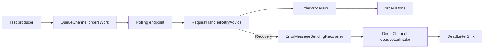

**Cảnh báo:** `QueueChannel` RAM không chịu được JVM crash. Không đặt ack của HTTP/broker production tại thời điểm gửi thành công vào queue RAM. Đây là lab để học error flow, không phải thiết kế durable ingress cuối cùng.

## 8. Dependencies cho bản thực hành

Nếu dùng Spring Boot 3.x / Spring Integration 6.x tương ứng, một `build.gradle` minh họa cần:

```groovy
dependencies {
    implementation 'org.springframework.boot:spring-boot-starter-integration'
    implementation 'org.springframework.boot:spring-boot-starter-jdbc'
    implementation 'org.springframework.retry:spring-retry'
    implementation 'org.springframework.integration:spring-integration-jdbc'

    runtimeOnly 'org.postgresql:postgresql'

    testImplementation 'org.springframework.boot:spring-boot-starter-test'
    testImplementation 'org.springframework.integration:spring-integration-test'
    testImplementation 'org.testcontainers:junit-jupiter'
    testImplementation 'org.testcontainers:postgresql'
}
```

Đây là **fragment dependencies**, không phải một project Gradle đầy đủ. Version được quản lý bằng Spring Boot dependency management/BOM phù hợp. Nếu dùng JMS/AMQP/Kafka, cần thêm starter/module tương ứng; không thể tự chạy inbound broker chỉ nhờ dependencies trên.

Trong bài này **không biên dịch hoặc chạy Gradle**. Các đoạn code là khung thực hành và phải được kiểm tra, hoàn thiện theo version thư viện khi ghép thành ứng dụng.

## 9. Tạo channel có capacity hữu hạn

```java
import org.springframework.context.annotation.Bean;
import org.springframework.context.annotation.Configuration;
import org.springframework.integration.channel.DirectChannel;
import org.springframework.integration.channel.QueueChannel;
import org.springframework.messaging.MessageChannel;

@Configuration
class OrderChannels {

    @Bean
    QueueChannel ordersWork() {
        return new QueueChannel(100);
    }

    @Bean
    QueueChannel ordersDone() {
        return new QueueChannel(100);
    }

    @Bean
    MessageChannel deadLetterIntake() {
        return new DirectChannel();
    }
}
```

Các tên channel là **bean names**, được dùng trong Java DSL. `ordersWork` và `ordersDone` là queue RAM để test; `deadLetterIntake` là channel đồng bộ để lỗi từ dead-letter sink có thể propagate về recovery callback.

Một vài đặc điểm:

- `QueueChannel` lưu message đến khi `receive`; nếu poller chậm, queue depth tăng.
- Channel có capacity giúp lỗi quá tải **hiển lộ** thay vì giữ message vô hạn trong heap.
- `DirectChannel` gọi subscriber synchronously trên caller thread nếu thiết kế không chen thêm ranh giới async.
- `QueueChannel.send()` thành công **không chứng minh business handler đã commit**.
- Không cấu hình toàn bộ channel trên làm nguồn sự thật cho payment/order production.

## 10. Service xử lý đơn hàng và failure injection

Ví dụ handler trả `OrderAccepted` khi thành công. Những dependency thật như repository, HTTP client, payment API được thay bằng interface để test chủ động gây lỗi:

```java
public interface OrderCommandService {
    // Production implementation phải validate + authorize + idempotently commit.
    OrderAccepted create(CreateOrder command);
}

public final class OrderProcessor {
    private final OrderCommandService service;

    public OrderProcessor(OrderCommandService service) {
        this.service = service;
    }

    public OrderAccepted process(CreateOrder command) {
        if (command.eventId() == null || command.eventId().isBlank()
                || command.schemaVersion() != 1
                || command.amountMinor() <= 0) {
            throw new InvalidOrderException("ORDER_INPUT_INVALID");
        }
        return service.create(command);
    }
}
```

Nếu `OrderCommandService.create` gọi một API ngoài, hãy sử dụng `eventId` làm **idempotency key** khi destination hỗ trợ. Khi call timeout và kết quả không rõ, đừng retry ngay như thể chắc chắn chưa có side effect.

## 11. RequestHandlerRetryAdvice: cấu hình attempts và backoff

Ví dụ dưới đây đặt policy **tối đa ba attempts tính cả lần đầu** cho `TransientOrderException`. `SimpleRetryPolicy` có thể xét cause chain để nhận biết lỗi bị framework wrap; hiệu lực cụ thể cần được kiểm thử với exception thực tế của phiên bản đang dùng.

```java
import java.util.Map;

import org.springframework.beans.factory.annotation.Qualifier;
import org.springframework.context.annotation.Bean;
import org.springframework.integration.handler.advice.ErrorMessageSendingRecoverer;
import org.springframework.integration.handler.advice.RequestHandlerRetryAdvice;
import org.springframework.messaging.MessageChannel;
import org.springframework.retry.policy.SimpleRetryPolicy;
import org.springframework.retry.backoff.FixedBackOffPolicy;
import org.springframework.retry.support.RetryTemplate;

@Configuration
class OrderRetryConfig {

    @Bean
    RequestHandlerRetryAdvice orderRetryAdvice(
            @Qualifier("deadLetterIntake") MessageChannel deadLetterIntake) {

        Map<Class<? extends Throwable>, Boolean> retryable =
                Map.of(TransientOrderException.class, true);

        // maxAttempts = 3 (kể cả lần thử đầu); traverseCauses = true.
        SimpleRetryPolicy retryPolicy =
                new SimpleRetryPolicy(3, retryable, true);

        FixedBackOffPolicy backOff = new FixedBackOffPolicy();
        backOff.setBackOffPeriod(200);

        RetryTemplate template = new RetryTemplate();
        template.setRetryPolicy(retryPolicy);
        template.setBackOffPolicy(backOff);

        RequestHandlerRetryAdvice advice = new RequestHandlerRetryAdvice();
        advice.setRetryTemplate(template);
        advice.setRecoveryCallback(
                new ErrorMessageSendingRecoverer(deadLetterIntake));
        return advice;
    }
}
```

**Điều phải hiểu:**
- `retryPolicy` quyết định exception nào được thử lại.
- `maxAttempts=3` không có nghĩa ba lần retry *sau* lần đầu.
- `FixedBackOffPolicy` giữ worker trong thời gian chờ; delay dài nên cân nhắc delayed broker redelivery thay thế.
- `traverseCauses=true` chỉ hữu ích khi exception chain được giữ đúng; test phải chứng minh type classification không bị wrap che mất.
- Sau cạn attempts, `recoveryCallback` chạy; nếu callback xử lý và **trả về bình thường**, adapter/poller có thể coi handler đã được recover. Điều này **không đồng nghĩa DLQ đã durable** nếu sink phía sau chỉ ghi vào RAM.

Bản lab dùng fixed backoff để dễ quan sát. Production thường cần exponential backoff, jitter và giới hạn thời gian; tránh mọi worker cùng retry theo chu kỳ giống nhau trong lúc outage.

## 12. Gắn retry đúng handler trong IntegrationFlow

```java
import org.springframework.context.annotation.Bean;
import org.springframework.context.annotation.Configuration;
import org.springframework.integration.annotation.EnableIntegration;
import org.springframework.integration.dsl.IntegrationFlow;
import org.springframework.integration.dsl.Pollers;
import org.springframework.integration.handler.advice.RequestHandlerRetryAdvice;

@Configuration
@EnableIntegration
class OrderWorkerFlow {

    @Bean
    IntegrationFlow orderFlow(
            OrderProcessor processor,
            RequestHandlerRetryAdvice orderRetryAdvice) {

        return IntegrationFlow
                .from("ordersWork",
                        spec -> spec.poller(
                                Pollers.fixedDelay(200)
                                        .maxMessagesPerPoll(1)))
                .handle(processor, "process",
                        endpoint -> endpoint.advice(orderRetryAdvice))
                .channel("ordersDone")
                .get();
    }
}
```

Ở đây `ordersWork` là `PollableChannel`, nên worker sử dụng poller. `RequestHandlerRetryAdvice` bao quanh **handler được gắn advice**, không tự bao quanh toàn bộ inbound adapter, source acknowledgement, database transaction và outbound gateway.

Nếu business flow có nhiều handler, quyết định **handler nào thực sự cần retry**. Retry transformer/validator khác retry một HTTP payment call có side effect. Đặt advice sai điểm có thể lặp lại những bước đã thành công trước đó.

### 12.1. Return value sau recovery

Trong trường hợp callback xử lý lỗi và trả `null`, flow có thể **không phát message thành công tới `ordersDone`**. Vì vậy test phải khẳng định **dead-letter outcome**, chứ không giả định “retry exhausted” sẽ tạo một `OrderAccepted`.

Nếu nghiệp vụ cần reply “rejected” cho gateway, hãy thiết kế **explicit rejection reply contract** thay vì để `null` tình cờ biểu thị trạng thái đã được xử lý.

## 13. ErrorMessageSendingRecoverer thực chất gửi gì?

`ErrorMessageSendingRecoverer` tạo/gửi một `ErrorMessage` tới channel được chỉ định khi retry được xem là exhausted hoặc không retryable. Payload của `ErrorMessage` là `Throwable`; exception có thể chứa `failedMessage`.

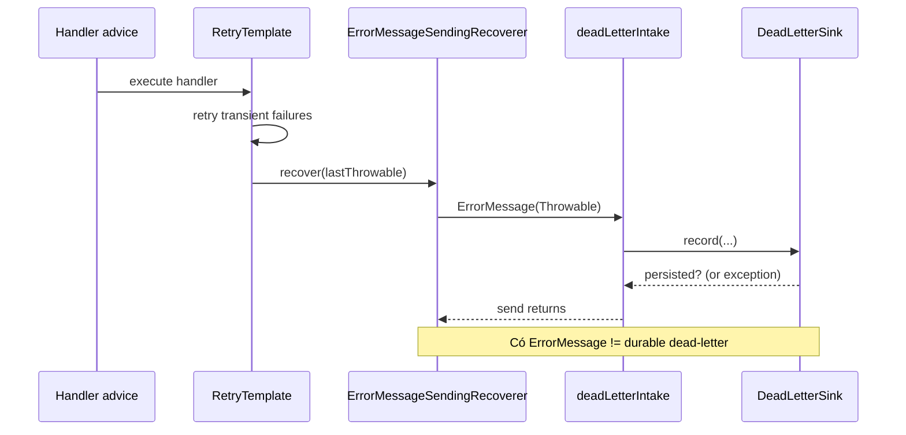

**Đặc biệt:** nếu `DeadLetterSink` dùng một logger hoặc queue RAM, callback thành công không tạo ra một DLQ đáng tin qua crash. Nếu sink ném exception, cần để lỗi propagate đến **source transaction/redelivery** theo hợp đồng; không nuốt rồi báo đã lưu.

### 13.1. Vì sao không log nguyên ErrorMessage?

`ErrorMessage.getPayload()` có thể là `MessagingException` chứa message thất bại. `toString()`/stack trace có thể đưa credential, nội dung đặt hàng, raw headers hoặc URL có token vào log.

Cần mapping lỗi thành mã an toàn, ví dụ `ORDER_INVALID`, `DEPENDENCY_TIMEOUT`, `RETRY_EXHAUSTED`, rồi lưu payload gốc **chỉ trong vùng phục hồi được bảo vệ** nếu cần replay.

## 14. Tạo dead-letter sink riêng

Ví dụ lab giữ record trong memory để kiểm tra flow control. Đây là **test-double**, không phải dead-letter persistence production:

```java
import java.util.Queue;
import java.util.concurrent.ConcurrentLinkedQueue;

import org.springframework.messaging.MessagingException;
import org.springframework.messaging.support.ErrorMessage;

public final class InMemoryDeadLetterSink {
    private final Queue<ErrorMessage> captured =
            new ConcurrentLinkedQueue<>();

    public void record(ErrorMessage errorMessage) {
        // Chỉ dùng trong lab với dữ liệu giả.
        captured.add(errorMessage);
    }

    public int size() {
        return captured.size();
    }

    public ErrorMessage poll() {
        return captured.poll();
    }
}
```

Và wiring:

```java
@Bean
InMemoryDeadLetterSink deadLetterSink() {
    return new InMemoryDeadLetterSink();
}

@Bean
IntegrationFlow deadLetterFlow(InMemoryDeadLetterSink sink) {
    return IntegrationFlow.from("deadLetterIntake")
            .handle(sink, "record")
            .get();
}
```

Khi dựng dự án thật, bổ sung imports, đặt `@Bean` methods vào `@Configuration` và bảo đảm các bean names duy nhất. Ở production **không nên giữ raw `ErrorMessage` lâu dài**, vì nó có thể giữ toàn bộ object graph và dữ liệu nhạy cảm. Thay bằng một `DeadLetterRecord` đã được chuẩn hóa, có business key, schema version, reason code và payload được bảo vệ nếu cần replay.

## 15. Thiết kế schema dead-letter bền vững

Một bảng dead-letter đơn giản:

```sql
CREATE TABLE dead_letter_event (
    dlq_id           uuid PRIMARY KEY,
    source_name      text NOT NULL,
    tenant_id        text NOT NULL,
    event_id         text NOT NULL,
    schema_version   integer NOT NULL,
    failure_code     text NOT NULL,
    attempt_count    integer NOT NULL,
    payload_json     jsonb NOT NULL,
    status           text NOT NULL DEFAULT 'PENDING',
    replay_generation bigint NOT NULL DEFAULT 0,
    created_at       timestamptz NOT NULL DEFAULT now(),
    updated_at       timestamptz NOT NULL DEFAULT now(),
    CHECK (status IN (
        'PENDING', 'CLAIMED', 'RESOLVED', 'QUARANTINED'))
);

CREATE INDEX dead_letter_pending_idx
    ON dead_letter_event (status, created_at);
```

Mục tiêu của các trường:

| Trường | Dùng cho | Lưu ý |
| --- | --- | --- |
| `dlq_id` | Định danh record phục hồi | Khác `eventId`, không thay idempotency |
| `source_name` | Nguồn/route đã phát sinh lỗi | Alias từ allowlist, không raw URL |
| `tenant_id` | Scope và phân quyền replay | Phải lấy từ provenance đã xác minh |
| `event_id` | Business idempotency/reconciliation | Giữ ổn định qua các lần replay |
| `schema_version` | Đọc lại payload của phiên bản cũ | Có kế hoạch migration |
| `failure_code` | Phân loại lỗi an toàn | Không ghi toàn bộ exception string |
| `attempt_count` | Attempts tại phạm vi đã định nghĩa | Phân biệt local retry và broker deliveries |
| `payload_json` | Dữ liệu để replay | **Nhạy cảm**, yêu cầu ACL/encryption/retention |
| `status` | Vòng đời xử lý DLQ | Không dùng một boolean `processed` đơn giản |
| `replay_generation` | Conditional claim/ownership | Cần transaction/CAS rõ |

Một bảng thế này chưa tự tạo DLQ semantics. Cần code lưu transaction, kiểm soát duplicate DLQ records, quyền truy cập, retention và quy trình replay.

### 15.1. Không copy bừa headers vào payload DLQ

Chỉ lưu những trường **cần thiết để khôi phục**. Không đưa access token, `Authorization`, `Cookie`, live `replyChannel` object hay `SecurityContext` vào JSON. Một token đã hết hạn cũng không nên được dùng lại khi replay.

Nếu cần một payload nhạy cảm để tái xử lý, phải bảo vệ riêng bằng encryption/access controls/retention. Log chỉ giữ **DLQ ID + event ID pseudonym + error code**, không log `payload_json`.

## 16. Dead-letter là trạng thái nghiệp vụ, không phải một channel tên “dlq”

```text
Wrong mental model:
  send(errorMessage) -> "done"

Safer contract:
  classify failure
  -> persist recovery record durably / or source retains message
  -> confirm durable outcome
  -> acknowledge source according to protocol
  -> authorized review / replay
```

Có ít nhất ba lựa chọn triển khai:

1. **Broker native DLQ/DLX:** broker chuyển message khi reject/nack/TTL/max delivery theo chính sách, nếu khả năng route/dead-letter được cấu hình đúng.
2. **Application-owned DLQ table:** service lưu `DeadLetterRecord` trong SQL DB, với transaction và replay worker.
3. **Quarantine topic/queue:** publish message có envelope an toàn sang một destination bền vững, rồi xác nhận nguồn theo protocol thích hợp.

Không giả định **publish tới DLQ** và **ack message gốc** tự nằm trong một transaction nếu chúng thuộc hai broker/resource khác nhau. Cần xác nhận semantics hoặc dùng protocol at-least-once + idempotency.

## 17. Cửa sổ lỗi giữa DLQ write và source ack

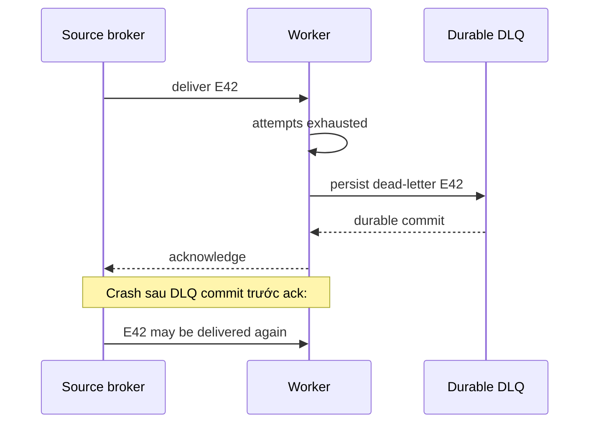

Có hai cửa sổ quan trọng:

| Crash point | Điều có thể xảy ra | Bảo vệ |
| --- | --- | --- |
| **Trước DLQ commit** | Không còn record phục hồi nếu source đã ack | Không ack; rollback/nack; source retention |
| **Sau DLQ commit, trước source ack** | Message được redeliver và có thể ghi DLQ lần nữa | Idempotent DLQ upsert hoặc unique logical key |
| **Sau source ack** | Broker không còn nghĩa vụ giao lại theo mode | DLQ phải đã bền vững/được confirm |
| **Sau replay commit, trước DLQ mark RESOLVED** | Replay có thể chạy lại | Business idempotency và CAS state |

**Không thể chỉ nhìn số lần gọi `DeadLetterSink.record()` để kết luận đúng một DLQ record**. Cần unique key, operation ID hoặc idempotent upsert phù hợp scope và giai đoạn xử lý.

## 18. Phân biệt errorChannel với DLQ

Trong Spring Integration, `errorChannel` thường là nơi đưa **`ErrorMessage`** để xử lý lỗi runtime. Nó không mặc nhiên là broker DLQ hay persistent store.

| Kênh / cơ chế | Vai trò |
| --- | --- |
| `errorChannel` mặc định | Báo lỗi bất đồng bộ, lỗi của polling/message-driven flow theo cấu hình |
| Custom `errorChannel` | Phân tuyến lỗi của một endpoint/flow cụ thể |
| `ErrorMessageSendingRecoverer` | Recovery callback phát `ErrorMessage` tới channel |
| Broker DLX/DLQ | Destination nhận message bị dead-letter theo broker policy |
| Application DLQ table | Store lưu lỗi và message để review/replay |
| Business rejection record | Kết quả từ chối hợp lệ, có thể không cần DLQ |

**Một lỗi đồng bộ trên `DirectChannel` có thể propagate về sender**, trong khi một lỗi ở executor/poller thường được chuyển qua error handling path do task scheduler/adapter quy định. Vì vậy, không đặt toàn bộ hy vọng vào một `@ServiceActivator(inputChannel="errorChannel")` mà chưa kiểm tra nơi exception phát sinh.

### 18.1. Phân biệt “xử lý lỗi” với “nuốt lỗi”

Nếu error handler chỉ:

```java
// Không đủ nếu công việc chưa được bảo toàn.
public void onError(ErrorMessage error) {
    log.warn("Failed: {}", "RETRY_EXHAUSTED");
    // return normally
}
```

thì một số đường execution có thể được xem là đã recover, khiến source không redeliver. Chỉ return bình thường khi **outcome đã được ghi bền vững hoặc rejection/ack policy cho phép**.

## 19. Sơ đồ phân tuyến lỗi hai tầng

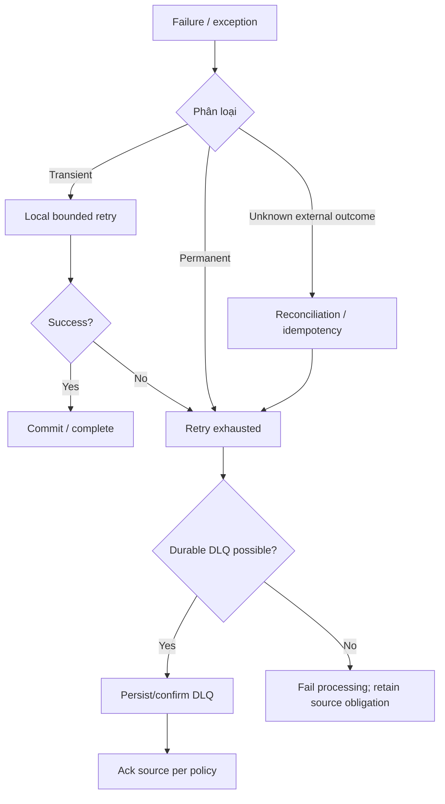

Đặt **nơi phân loại** rõ ràng: có thể là custom `RetryPolicy`, error router, một exception classifier hoặc business rejection service. Đừng cho một exception đi qua nhiều router độc lập với kết quả khác nhau (một nhánh ack, nhánh khác nack).

## 20. Retry scope và transaction boundary

Một flow có thể là:

```text
Source poller
  -> handler A: normalize
  -> handler B: call external API (retry)
  -> handler C: update DB
  -> source ack
```

Gắn `RequestHandlerRetryAdvice` vào **B** sẽ retry B, không tự retry A hay C. Nếu B đã tạo side effect ở remote nhưng timeout, lần thử tiếp theo có thể gọi lại side effect. Nếu advice bao quanh **cả flow**, các bước đã chạy thành công trước đó cũng có thể bị chạy lại.

Bảng câu hỏi thiết kế:

| Câu hỏi | Tác động |
| --- | --- |
| Handler có idempotent không? | Quyết định retry có an toàn |
| Transaction bắt đầu trước hay sau advice? | Ảnh hưởng rollback và state visibility |
| Retry chạy trên cùng thread không? | Ảnh hưởng thread-local transaction/context |
| Endpoint là one-way hay gateway có reply? | Ảnh hưởng giá trị từ recovery callback |
| Source ack khi nào? | Ảnh hưởng lost/duplicate delivery |
| Retry backoff có giữ thread không? | Ảnh hưởng throughput và pool saturation |

**Transaction JDBC trong thread handler không tự lan qua `ExecutorChannel`**. Một `send()` trả về từ queue/executor không đồng nghĩa công việc downstream đã commit.

## 21. Local retry và transaction rollback: tránh transaction “đã hỏng”

Giả sử DB ném exception trong transaction. Không phải mọi lỗi đều cho phép tiếp tục dùng transaction hiện tại để retry. Một transaction có thể đã bị đánh dấu rollback-only hoặc đã mất tính hợp lệ.

```text
BEGIN TX
  execute SQL -> exception
  retry SQL in same broken TX -> fail again
COMMIT -> UnexpectedRollback?
```

Hướng đúng có thể là **mỗi attempt nằm trong transaction mới**, hoặc rollback toàn bộ delivery rồi cho broker redeliver trong transaction khác. Thứ tự advice, transaction interceptor và vị trí `@Transactional` quyết định điều gì được reset giữa các attempts.

Khi kiểm thử, ghi:
- Thread ID.
- Transaction started/committed/rolled back.
- Retry attempt index.
- SQL outcome.
- Source delivery/ack outcome.

Không khẳng định chỉ có `@Transactional` là bảo đảm retry an toàn.

## 22. Inbox để chống duplicate sau redelivery

Một business event có thể được xử lý thành công nhưng source chưa nhận ack do process crash. Source sẽ redeliver; nếu không có idempotency, order có thể bị ghi hai lần.

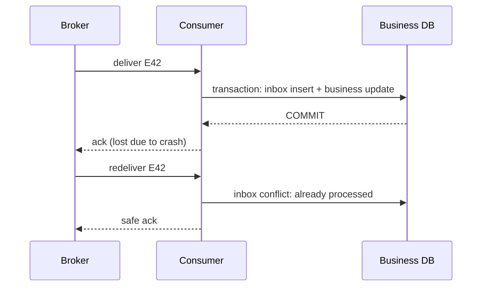

Một schema PostgreSQL tối thiểu:

```sql
CREATE TABLE processed_event (
    tenant_id text NOT NULL,
    producer_id text NOT NULL,
    event_id text NOT NULL,
    committed_at timestamptz NOT NULL DEFAULT now(),
    PRIMARY KEY (tenant_id, producer_id, event_id)
);
```

Trong cùng transaction với việc tạo order:

```sql
BEGIN;

INSERT INTO processed_event (tenant_id, producer_id, event_id)
VALUES (:verifiedTenantId, :producerId, :eventId)
ON CONFLICT DO NOTHING
RETURNING event_id;

-- Nếu có row RETURNING: thực thi business update.
-- Nếu không: đã commit event này theo khóa idempotency.
-- Không dùng MessageHeaders.ID làm business event ID.

COMMIT;
```

**Chỉ ghi marker `processed_event` khi business effect thực sự thuộc cùng transaction**. Nếu marker commit trước update, crash có thể khiến event bị skip dù order chưa tạo.

## 23. Outbox cho output phát sau business commit

Một handler tạo order có thể cần publish `OrderCreated` sau commit. Nếu DB commit rồi JVM crash trước publish, downstream không biết order đã được tạo. Đây là **dual-write gap**.

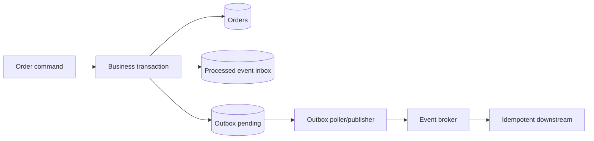

Outbox được ghi cùng DB transaction với order/inbox; publisher đọc và gửi sau đó. Nếu crash sau broker publish nhưng trước khi đánh dấu outbox sent, publisher có thể gửi lại; downstream cũng cần idempotency.

**Không đặt outbound publish bên trong một retry loop tùy ý** nếu remote side effect không hỗ trợ idempotency. Đừng nhầm “DB transaction rollback” với khả năng thu hồi một HTTP request đã đến đích.

## 24. Unknown outcome: timeout không chứng minh call thất bại

Ví dụ service gọi API thanh toán và nhận timeout:

```text
T0 -> Payment API receives request (with eventId E42)
T1 -> Payment API charges card
T2 -> Network response lost
T3 -> Handler sees timeout
T4 -> Retry advice calls again
```

Nếu API không hỗ trợ idempotency key, T4 có thể charge lần thứ hai. Vì vậy cần:
1. Idempotency key từ business event ổn định.
2. Thỏa thuận API đích về semantics của key.
3. Query/reconcile trạng thái đích nếu outcome chưa rõ.
4. Chỉ retry khi có bằng chứng rằng lặp lại là an toàn.
5. Dead-letter/quarantine với reason `UNKNOWN_OUTCOME` khi không thể quyết định tự động.

Đây là một failure mode khác với HTTP 503 chắc chắn từ chối request trước xử lý. Error classifier phải giữ sự khác biệt đó.

## 25. Broker DLQ, application DLQ và retry topic

| Lựa chọn | Ưu điểm | Giới hạn cần kiểm tra |
| --- | --- | --- |
| Broker-native DLQ/DLX | Tách backlog lỗi, có retention/ACL/consumer tooling | Routing/ack/publish semantics và số lần redelivery tùy broker |
| Delayed retry topic/queue | Giải phóng consumer worker khi chờ lâu | Thứ tự theo key có thể thay đổi; cần idempotency |
| Application DB DLQ | Dễ truy vấn status, owner, replay audit | Cần DB transaction, cleanup và replay worker |
| ErrorMessage channel thuần | Thuận tiện cho runtime error flow | Không mặc nhiên durable hay replayable |
| Quarantine object storage | Phù hợp payload lớn/đòi hỏi điều tra | Access control, encryption và pointer durability |
| Permanent rejection table | Audit các lệnh invalid/denied | Phải bảo đảm không xử lý lại như transient |

Với RabbitMQ, Kafka và JMS, các cơ chế DLQ có hình thức khác nhau. **Không áp dụng máy móc một câu “nack = vào DLQ”** mà chưa cấu hình dead-letter exchange/topic, delivery limit hoặc listener error handler tương ứng.

### 25.1. Khi nào chọn broker redelivery thay local retry?

Nếu lỗi kéo dài vài phút, local retry thường giữ thread/poller và transaction trong thời gian chờ. Delayed message/broker retry có thể hiệu quả hơn, nhưng phải đo:
- Số delivery tăng.
- Độ trễ đến lượt xử lý lại.
- Sự thay đổi ordering theo partition/key.
- Ack/re-publish atomicity.
- Retention và độ bền của retry destination.
- Lượng tải dồn khi dependency hồi phục.

## 26. Vòng đời dead-letter record

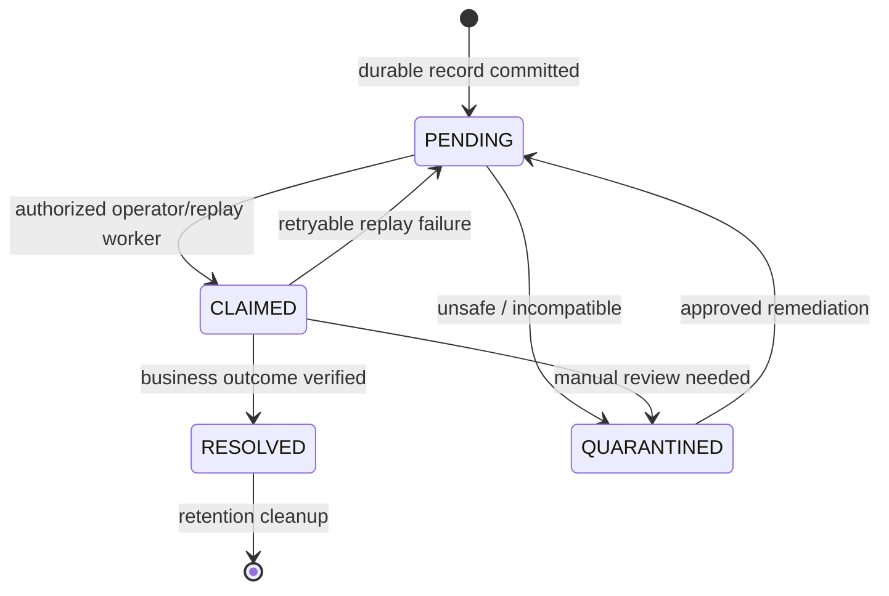

**Quy trình đề xuất:**

1. Lỗi được phân loại và `DeadLetterRecord` được commit.
2. Record bắt đầu ở `PENDING`.
3. Operator/replay worker có quyền chọn record phù hợp, claim với generation.
4. Input được **validate lại** theo schema và security policy hiện hành.
5. Handler xử lý lại bằng **cùng `eventId`**, có idempotency protection.
6. Chỉ đánh dấu `RESOLVED` sau khi outcome được xác nhận.
7. Nếu replay thất bại tạm thời, trả lại `PENDING` theo backoff/retry budget.
8. Nếu schema quá cũ hoặc outcome không xác định, chuyển `QUARANTINED` chờ quyết định.

Dead-letter là **nơi lưu nghĩa vụ chưa giải quyết**, không phải thùng rác có thể xóa định kỳ bất kể trạng thái.

## 27. Claim replay an toàn với nhiều worker

Hai worker có thể chọn cùng DLQ record. Một lệnh cập nhật có điều kiện sẽ giúp chỉ một worker chuyển trạng thái:

```sql
-- SQL PostgreSQL minh họa, chạy trong transaction phù hợp.
UPDATE dead_letter_event
SET status = 'CLAIMED',
    replay_generation = replay_generation + 1,
    updated_at = now()
WHERE dlq_id = :dlqId
  AND status = 'PENDING'
RETURNING replay_generation;
```

Nếu không có row trả về, worker không có quyền claim tại snapshot hiện tại. Sau khi xử lý:

```sql
UPDATE dead_letter_event
SET status = 'RESOLVED',
    updated_at = now()
WHERE dlq_id = :dlqId
  AND status = 'CLAIMED'
  AND replay_generation = :myGeneration;
```

**Caveat:** một record mắc `CLAIMED` khi worker crash cần **lease/timeout/reclaim policy**, không tự trở lại `PENDING`. Nếu reclaim, stale worker cũ vẫn có thể chạy, nên authoritative business DB/đích phải dùng idempotency hoặc fencing theo semantics tương ứng.

## 28. Không replay thẳng vào handler đặc quyền

Một dead-letter có thể chứa payload từ client chưa được xác thực hoặc schema cũ. Replay phải qua boundary bảo mật thích hợp:

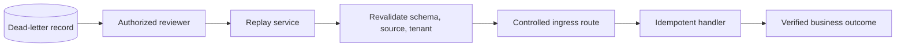

Kiểm soát:
- Quyền replay riêng với quyền xem DLQ.
- Audit ai, lúc nào, lý do gì replay.
- Không khôi phục raw access token hoặc `SecurityContext` cũ.
- Không tự ý thay `eventId` để vượt inbox dedup.
- Cho phép schema migration có version và test.
- Giới hạn tốc độ replay để không tạo lại incident.
- Chặn re-drive cho `UNKNOWN_OUTCOME` khi chưa reconcile hệ đích.

**Replay không phải là “publish nguyên byte cũ”** nếu định dạng, authorization hoặc downstream contract đã thay đổi.

## 29. Chọn retry budget theo thời gian và nguồn lực

Một policy có thể mô tả:
- Tối đa 3 attempts local, kể cả lần đầu.
- Backoff 200 ms, 400 ms, 800 ms (exponential).
- Tổng timeout nhỏ hơn deadline request, nếu là request–reply.
- Sau exhaustion: durable delayed retry hoặc DLQ theo classifier.
- Giới hạn số lần source redelivery trong một khoảng.
- Circuit breaker/concurrency limit khi dependency đang outage.
- Metric rõ số attempts mỗi unique event.

### 29.1. Cẩn thận với timeout tổng

Nếu remote call timeout 5 giây/lần, ba attempts có thể mất ít nhất 15 giây chưa tính backoff. Một HTTP gateway timeout 10 giây sẽ hết hạn trước khi retry xong, trong khi backend vẫn có thể tiếp tục. Cần thống nhất **deadline end-to-end**, không thiết kế từng timeout độc lập.

### 29.2. Jitter giúp gì?

Khi nhiều worker cùng gặp 503, exponential backoff không jitter có thể khiến tất cả cùng thức dậy ở 200/400/800 ms. Jitter làm giảm hiện tượng **thundering herd**. Đây là bài toán hiệu năng/ổn định, không thay thế việc phân loại lỗi và idempotency.

## 30. Nhận biết retry storm qua số liệu

Một dashboard hữu ích:

| Metric / log | Phạm vi | Phát hiện |
| --- | --- | --- |
| `source_delivery_total` | Broker/source | Redelivery tăng |
| `handler_attempt_total` | Retry advice | Lặp trong cùng delivery |
| `unique_business_committed_total` | DB outcome | Goodput thật |
| `dead_letter_pending` | DLQ store | Tăng backlog lỗi |
| `dead_letter_write_failure_total` | Recovery persistence | Có nguy cơ mất nghĩa vụ |
| `replay_claim_total` | Replay service | Replay bất thường |
| `replay_resolution_total` | Business outcome | Hồi phục thành công |
| `handler_duration` | Handler | Tail latency/timeout |
| `poller_receive_total` | Polling endpoint | Poller còn chạy không |
| `executor_queue_depth` | Executor | Task bị dồn |
| `db_connection_wait` | Database pool | Tắc nghẽn nguồn lực |
| `error_code_total` | Classifier | Loại lỗi nào chiếm ưu thế |

Những tên trên là **đề xuất instrumentation**, không phải cam kết metrics mặc định của framework. Không dùng raw `eventId`, `orderId`, `correlationId` làm metric label gây high cardinality.

## 31. Lỗi đi qua DirectChannel, ExecutorChannel và poller khác nhau

| Boundary | Cách lỗi thường xuất hiện | Cách quan sát |
| --- | --- | --- |
| `DirectChannel` | Exception từ handler đồng bộ có thể propagate về sender | Caller exception, transaction và synchronous error path |
| `ExecutorChannel` | Handler chạy trên thread khác; exception có thể thành async `ErrorMessage` | Error channel, task executor logs, completion metric |
| `QueueChannel` + poller | Polling consumer nhận sau khi enqueue; lỗi nằm trên poller thread | Poller error channel, rollback và source semantics |
| Broker listener | Container quản lý ack/nack/requeue theo mode | Delivery count, DLQ, container error handler |
| Reactive pipeline | `onError` signal; cancel/subscribe ảnh hưởng flow | Terminal signals, backpressure, error mapping |
| Outbound gateway | Timeout/cause có thể bọc trong messaging exception | Error classification theo cause chain |

Một handler retry advice gắn ở endpoint **không nhất thiết bắt** exception của một stage khác sau ranh giới async. Vì vậy hãy vẽ đúng thread và channel của flow thật.

### 31.1. Những câu hỏi khi “không thấy errorChannel”

- Lỗi đã bị retry advice recover thành giá trị bình thường?
- Lỗi xảy ra trên DirectChannel đồng bộ và đã được throw về caller?
- Poller/listener có một error channel riêng?
- Error handler đầu tiên đã nuốt exception?
- Executor task có bị reject trước khi handler chạy?
- Message đã được filter/discard trước endpoint?
- DLQ store handler có ném exception mà không được log đúng?

Không tạo một global catch-all logger rồi coi là đã có recovery.

## 32. Transaction và nguồn ack: ma trận tình huống

| Điều xảy ra | Store/ack boundary | Kết quả và hành động |
| --- | --- | --- |
| Handler fail trước DB commit | Transaction rollback, broker chưa ack | Có thể redeliver/retry |
| DB commit thành công, ack mất | Broker giao lại | Inbox bảo đảm idempotent outcome |
| DLQ write thành công, ack mất | Hai nghĩa vụ có thể xuất hiện | Dedup DLQ/upsert và source delivery |
| DLQ write fail nhưng handler recover bình thường | Có nguy cơ mất message | **Sai**: phải propagate/fail |
| `QueueChannel` RAM nhận rồi JVM crash | Queue mất | Dùng durable source/backlog |
| Outbox insert + business commit thành công | Publisher chưa gửi | Outbox poller tiếp tục sau restart |
| Outbox đã publish nhưng mark sent chưa commit | Event có thể publish lại | Downstream idempotency |
| Custom recovery trả success với lỗi authorization | Source có thể ack | Phải có audit/rejection policy rõ |

**Đây là bảng trọng tâm của dự án.** Test phải quan sát **business DB state + source ack/redelivery + DLQ state**, không chỉ số log.

## 33. Test unit cho classifier

Một cách bắt đầu là tách logic phân loại thành function thuần:

```java
public enum FailureKind {
    PERMANENT, TRANSIENT, UNKNOWN_OUTCOME
}

public final class FailureClassifier {

    public FailureKind classify(Throwable failure) {
        Throwable current = failure;
        while (current != null) {
            if (current instanceof InvalidOrderException) {
                return FailureKind.PERMANENT;
            }
            if (current instanceof UnknownOutcomeException) {
                return FailureKind.UNKNOWN_OUTCOME;
            }
            if (current instanceof TransientOrderException) {
                return FailureKind.TRANSIENT;
            }
            current = current.getCause();
        }
        return FailureKind.PERMANENT;
    }
}
```

Ở đây các wrapper được duyệt theo cause chain; mặc định `PERMANENT` là một policy ví dụ tránh retry lỗi lập trình vô hạn. Trong production nên phân biệt **unexpected/programming failure** để cảnh báo và quarantine, thay vì báo như input sai.

Kiểm thử:

```java
import static org.junit.jupiter.api.Assertions.assertEquals;
import org.junit.jupiter.api.Test;

class FailureClassifierTest {
    private final FailureClassifier classifier =
            new FailureClassifier();

    @Test
    void doesNotRetryInvalidPayload() {
        assertEquals(FailureKind.PERMANENT,
                classifier.classify(
                        new InvalidOrderException("ORDER_INPUT_INVALID")));
    }

    @Test
    void distinguishesUnknownOutcomeFromTransientFailure() {
        var timeout = new java.net.SocketTimeoutException("timeout");
        assertEquals(FailureKind.UNKNOWN_OUTCOME,
                classifier.classify(new UnknownOutcomeException(
                        "PAYMENT_STATUS_UNKNOWN", timeout)));
    }
}
```

Test classifier riêng **không** chứng minh `RequestHandlerRetryAdvice` dùng cùng policy; cần test wiring/flow và exception wrapping thực tế.

## 34. Test retry bằng một service giả có counter

Một service giả có thể thất bại hai lần rồi thành công:

```java
import java.util.concurrent.atomic.AtomicInteger;

final class FlakyOrderService implements OrderCommandService {
    private final AtomicInteger attempts = new AtomicInteger();

    @Override
    public OrderAccepted create(CreateOrder command) {
        int attempt = attempts.incrementAndGet();
        if (attempt <= 2) {
            throw new TransientOrderException("DB_TEMPORARY", null);
        }
        return new OrderAccepted(
                command.eventId(), command.orderId(), "COMMITTED");
    }

    int attempts() {
        return attempts.get();
    }
}
```

Với retry policy ba attempts, kỳ vọng:
- `FlakyOrderService.attempts()==3`.
- Một `OrderAccepted` đi tới `ordersDone`.
- Không có error gửi vào `deadLetterIntake`.
- Business outcome chỉ được tạo một lần (nếu fake có persist).

Dùng input event ID riêng cho từng test; không chia sẻ `AtomicInteger` giữa các test song song nếu chưa reset fixture.

## 35. Integration test: thành công và exhausted retry

Skeleton sau minh họa kiểu assertion cho một `@SpringBootTest` đã wiring các bean ở trên:

```java
import static org.junit.jupiter.api.Assertions.*;

import org.junit.jupiter.api.Test;
import org.springframework.beans.factory.annotation.Autowired;
import org.springframework.beans.factory.annotation.Qualifier;
import org.springframework.boot.test.context.SpringBootTest;
import org.springframework.integration.channel.QueueChannel;
import org.springframework.messaging.support.MessageBuilder;

@SpringBootTest
class OrderFlowIntegrationTest {

    @Autowired
    @Qualifier("ordersWork")
    QueueChannel input;

    @Autowired
    @Qualifier("ordersDone")
    QueueChannel output;

    @Autowired
    InMemoryDeadLetterSink deadLetters;

    @Test
    void validOrderProducesOneCompletion() {
        var command = new CreateOrder(
                "event-test-001", "tenant-test",
                "order-test-001", 1000, 1);

        assertTrue(input.send(
                MessageBuilder.withPayload(command).build()));

        var result = output.receive(5_000);
        assertNotNull(result);
        assertEquals("COMMITTED",
                ((OrderAccepted) result.getPayload()).status());
        assertEquals(0, deadLetters.size());
    }
}
```

Đây là skeleton: cần cung cấp `OrderCommandService`, `OrderProcessor` và beans của lab, cùng dữ liệu fixture độc lập. **Một test chỉ assert happy path không chứng minh retry/error semantics**; thêm:
- `InvalidOrderException` → không gọi service nhiều lần, có DLQ/rejection.
- Transient fail đúng hai attempts → attempt 3 thành công.
- Transient fail mãi → một recovery event sau max attempts.
- DLQ sink ném lỗi → processing không bị xem là durable recover.
- Handler có side effect một phần rồi timeout → kiểm tra idempotency.
- Sau test không còn pending message lẫn giữa cases.

Vì poller bất đồng bộ, dùng deadline/await condition, không dùng `Thread.sleep(100)` rồi hy vọng scheduler chắc đã chạy.

## 36. Test dead-letter write failure

Đây là test thiết kế quan trọng hơn việc chỉ thấy một `ErrorMessage`:

```text
Given:
  handler raises retryable failure on every attempt
  retry policy exhausts
  dead-letter persistence throws DB unavailable

Expect:
  recovery path must not report durable success
  source remains obligated to redeliver OR a durable job exists elsewhere
  error/alert metric is emitted
  no silent source acknowledgement
```

Ở bản RAM `QueueChannel` mini-lab, message đã bị `receive()` và có thể không tự quay vào queue. Test này giúp thấy **hạn chế của demo**; muốn chứng minh bảo toàn delivery, phải chuyển sang broker hoặc queue transactional durable và cấu hình error/ack phù hợp.

Không “chữa” bằng cách catch exception trong dead-letter handler rồi return bình thường. Điều đó có thể che mất lỗi lưu trữ.

## 37. Test crash windows và redelivery bằng backend thật

Một bộ kiểm thử production-like có thể dùng Testcontainers cho PostgreSQL và broker phù hợp. Kế hoạch:

1. Khởi tạo schema business inbox, outbox, DLQ.
2. Gửi event hợp lệ với `eventId` ổn định.
3. Dừng consumer ngay sau DB commit nhưng trước ack.
4. Khởi chạy consumer mới, để broker redeliver.
5. Assert một business effect trong DB, không nhân đôi order.
6. Thử crash sau DLQ commit trước ack, kiểm tra dedup DLQ.
7. Thử crash sau publish outbox trước mark sent, kiểm tra downstream idempotency.
8. Thử backend DLQ outage và phục hồi.
9. Assert số message đang pending/recovery về 0 sau drain (trừ những case chủ ý quarantine).

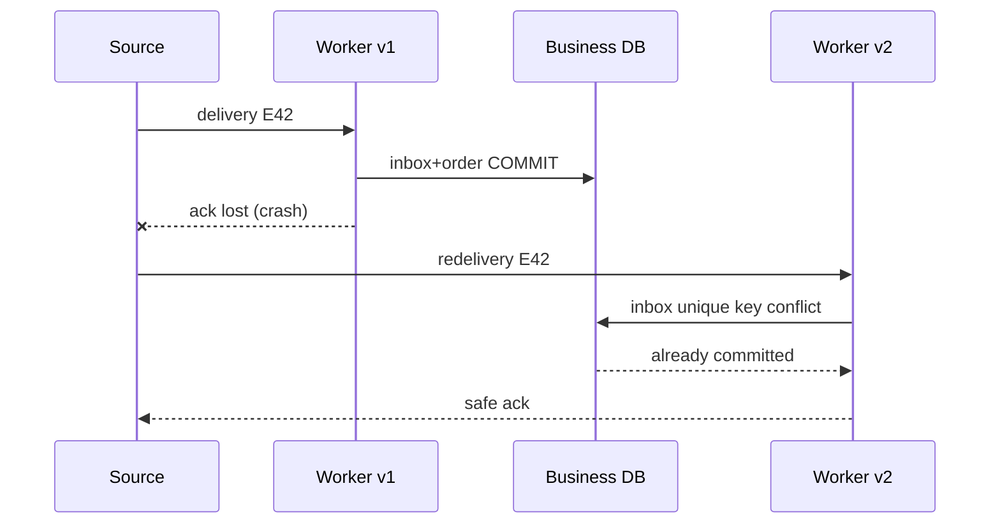

**Một integration test với `SimpleMessageStore`/`QueueChannel` RAM không kiểm chứng được các cửa sổ crash này.** Cần backend đúng và kiểm tra transaction boundaries thực tế.

## 38. Replay có thể thay đổi version/schema

Một DLQ record từ tháng trước có thể dùng `schemaVersion=1`, trong khi code đang deploy chỉ hỗ trợ schema version 2. Nếu re-drive mà không migrate, error flow sẽ lặp lại.

Phương án:
- Hỗ trợ đọc cả phiên bản 1 và 2 ở replay boundary.
- Hoặc tạo migration xác định, có test dữ liệu giả của phiên bản 1.
- Giữ `eventId` và tenant scope xuyên migration.
- Không loại bỏ những field cần cho kiểm tra quyền, idempotency và reconciliation.
- Không dùng replay để bypass validation của phiên bản hiện hành.
- Không tự xóa DLQ record chỉ vì payload không còn parse được; chuyển `QUARANTINED`.

**Schema compatibility là một phần của recovery**, không chỉ bài toán của message converter.

## 39. Logging an toàn cho error flow

Một record lỗi tốt có thể là:

```json
{
  "event": "dead_letter_persisted",
  "flow": "orders-v1",
  "endpoint": "createOrder",
  "trace_id": "opaque-trace-123",
  "event_key_ref": "hmac:example-token",
  "failure_code": "DEPENDENCY_RETRY_EXHAUSTED",
  "local_attempts": 3,
  "source_deliveries": 1,
  "dlq_id": "d8f6ec1a-example",
  "status": "PENDING"
}
```

Đây là format minh họa, không phải event tự động của Spring Integration. Không copy:
- Raw payload và toàn bộ `MessageHeaders`.
- `Authorization`, cookies, broker credentials, token.
- URL có query string chứa secret.
- `Throwable.getMessage()` chưa kiểm soát.
- `failedMessage` từ `MessagingException`.
- Business IDs nhạy cảm ở metric labels.

Một DLQ record có thể cần payload thật để replay, nhưng phải đặt ở **protected data store**, không ở log phổ thông.

## 40. Observability cho worker, poller và dead-letter

Một sơ đồ alerting tối thiểu:

| Signal | Cảnh báo khi | Hành động |
| --- | --- | --- |
| `dead_letter_pending` | Tăng liên tục | Phân loại root cause, hạn chế replay |
| `retry_exhausted_total` | Spike so với baseline | Kiểm tra dependency outage/bug |
| `dlq_write_failure_total` | Lớn hơn 0 | Kiểm tra nguy cơ lost obligation |
| `poller_last_success_age` | Quá ngưỡng | Endpoint stopped, scheduler/pool issue |
| `ordersWork.queueDepth` | Tăng dù offered load ổn định | Consumer chậm hoặc retry block |
| `handler_attempts_per_event` | Cao bất thường | Nested retry/broker redelivery |
| `unique_business_goodput` | Giảm mạnh | Đo thật outcome, không chỉ send |
| `outbox_pending_age` | Tăng | Publisher/broker gặp vấn đề |
| `dead_letter_replay_failure_total` | Spike | Replay schema/policy chưa phù hợp |
| `recovery_time_to_resolve` | Vượt RTO | Điều chỉnh triage/replay capacity |

Không có tín hiệu nào trong bảng tự đảm bảo framework xuất sẵn; cần đo qua Micrometer/Actuator, broker metrics hoặc instrumentation custom.

## 41. Tuning throughput nhưng không phá reliability

Retry và dead-letter tác động trực tiếp tới hiệu năng. Ví dụ:
- Một handler mất 200 ms do network.
- Retry ba lần làm một delivery giữ worker lâu hơn.
- Poller có một thread sẽ giảm rate dequeue.
- Queue tăng và producer có thể gặp capacity limit.

Hướng tối ưu:
1. Đo **unique goodput** và queue depth trước.
2. Tách retry ngắn trong handler khỏi retry dài qua broker/durable job.
3. Giới hạn concurrency đúng với DB/API pool.
4. Dùng bounded queues và policy reject/retain tại source.
5. Theo dõi hot correlation groups, locks và `MessageGroupStore`.
6. Đảm bảo mọi tối ưu không thay đổi idempotency/ack boundary.
7. Chạy benchmark với transient error mix thật, không chỉ happy path.

**Đẩy retries sang background không tự giải quyết mất dữ liệu** nếu background queue chỉ tồn tại trong RAM.

## 42. Mở rộng cho aggregator và correlation runtime

Dự án order có thể được mở rộng: một đơn được chia thành `n` phần và phải aggregate trước khi commit.

```text
parts (correlation=order-42)
  -> aggregator + MessageGroupStore
  -> create order
  -> retry advice / DLQ
```

Những failure mode cần bổ sung:
- Một part bị DLQ thì aggregator sẽ chờ gì?
- Group timeout có phát partial result không?
- Duplicate part có làm `group.size()` đạt `sequenceSize` sai?
- Cùng correlation key có bị xử lý bởi hai nodes/store regions không?
- Khi aggregator release rồi downstream lỗi, group state còn phù hợp replay không?
- Completed marker retention có chặn late duplicate không?

**Group store và dead-letter store phục vụ hai nghĩa vụ khác nhau.** Một DLQ chứa part lỗi không tự giải phóng group đang chờ phần đó; cần expiry/partial/quarantine policy theo nghiệp vụ.

## 43. Một flow động có thể thay đổi đường lỗi

Nếu ứng dụng dùng `IntegrationFlowContext` để đăng ký flow v2, test:
- Flow mới có đúng retry advice và classifier không?
- `errorChannel`/dead-letter destination có tồn tại trước khi publish route?
- Flow cũ đang retry có thể hoàn tất hoặc cần drain trước khi remove?
- Dead-letter records có `flowVersion` để replay đúng schema/behavior không?
- Reply/error channel không bị gỡ khi còn pending callback?
- Rollback route có bỏ sót recovery obligations đã tạo ở v2 không?

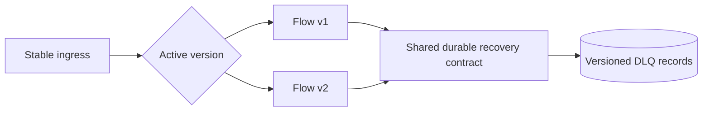

Không tái sử dụng flow ID khi v1 và v2 còn song song; phải có revision và cleanup/draintime theo contract. Thay topology không tự migrate state hoặc retry attempt đã được schedule.

## 44. Security cho dead-letter và replay

Một dead-letter chứa dữ liệu thật có thể nhạy cảm hơn log thông thường vì giữ cả payload từ message lỗi. Cần:
- ACL riêng cho đọc, duyệt, replay, quarantine và xóa.
- Tenant scope từ verified source, không raw claim.
- Encryption in transit/at rest, bảo vệ backup.
- Retention và deletion theo yêu cầu pháp lý/nghiệp vụ.
- Audit thao tác replay, số attempts và operator identity.
- Rate limiting và approval cho replay hàng loạt.
- Không phát lại credential cũ, signed token hết hạn.
- Đọc/error logs theo **allowlist projection**, không full ErrorMessage.
- Không cho replay worker chọn handler arbitrary theo SpEL/class name do DLQ payload ghi.

Một user được quyền xem DLQ metadata **không mặc nhiên có quyền replay vào flow xử lý tiền**. Replay là một thao tác nghiệp vụ có tác dụng phụ, cần phân quyền riêng.

## 45. Quy trình xử lý incident từ DLQ

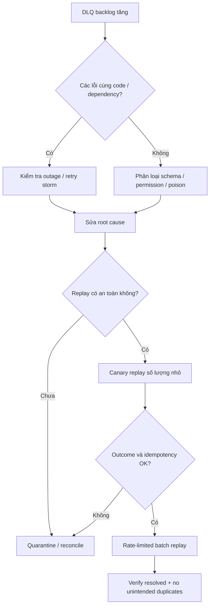

Runbook:
1. Khóa scope sự cố: source, endpoint, flow version, error code, khoảng thời gian.
2. Đếm unique business event IDs và deliveries/attempts.
3. Kiểm tra dependency health và transaction state.
4. Kiểm tra DLQ records đã bền vững hay source vẫn còn messages.
5. Xem có `UNKNOWN_OUTCOME` cần reconcile trước khi retry không.
6. Sửa root cause/triển khai bản fix có kiểm thử.
7. Chạy canary replay với số lượng nhỏ.
8. Đối soát business DB, outbox, broker/DLQ outcomes.
9. Replay batch với rate limit và alert.
10. Chỉ mark `RESOLVED` sau khi xác nhận outcome, giữ audit.

**Không “drain DLQ bằng cách xóa record”** để làm dashboard đẹp. Cách đó xóa nghĩa vụ nghiệp vụ và bằng chứng cần điều tra.

## 46. Ma trận kiểm thử regression

| Test case | Input/failure injection | Assertion chính |
| --- | --- | --- |
| Happy path | Event hợp lệ | Một output và business commit |
| Transient then success | Fail attempts 1–2 | Thành công ở attempt 3, không DLQ |
| Exhausted transient | Fail mọi attempt | Một recovery outcome, số attempts đúng |
| Validation permanent | Schema invalid | Không retry nóng, không business effect |
| Authorization denied | Tenant mismatch | DB không đổi, audit rejection |
| Exception wrapped | `MessagingException` bọc transient | Retry policy xử lý cause đúng |
| Unknown remote outcome | Timeout sau side effect | Reconcile/idempotency, không gọi mù |
| DLQ store outage | Throw trong persistence | Không silently ack/done |
| Crash before DLQ commit | Process chết | Source còn nghĩa vụ redelivery |
| Crash after DLQ commit before ack | Ack mất | DLQ idempotent; không lặp business effect |
| Crash after business commit before ack | Redelivery | Inbox unique constraint chặn duplicate |
| Outbox publish crash | Publish rồi chưa mark sent | Downstream idempotency |
| Poller stopped | Queue RAM có backlog | Không gán lỗi cho handler retry |
| Executor saturated | Worker queue đầy | Reject/backpressure và metrics rõ |
| Error channel mismatch | Lỗi stage async | Error đi đúng configured channel |
| Poison message loop | Permanent failure redelivered | Delivery limit/quarantine chặn vòng lặp |
| DLQ replay concurrency | Hai operators claim | CAS/generation bảo vệ ownership |
| Replay schema v1 | Payload từ version cũ | Migrate hoặc quarantine rõ |
| Replay authorization | Actor không có quyền | Không xử lý/không xem raw payload |
| Dynamic flow v2 | Cutover khi còn retries | Không mất error/recovery path |
| Correlation incomplete | Part bị DLQ | Group expiry/recovery đúng contract |
| Soak test | Nhiều dead letters/completed markers | Retention không làm DB tăng vô hạn |

Khi test một luồng bất đồng bộ, dùng deadline/`Awaitility` hoặc `receive(timeout)`, chờ đúng **business completion**. Không kết luận thành công từ việc producer `send()` vào RAM queue.

## 47. Bài thực hành theo từng cấp

### Bài 1 — Dựng lab ba channel

Tạo `ordersWork`, `ordersDone`, `deadLetterIntake` như ở mục 9. Dùng `QueueChannel` để poller xử lý một message một lần. Test healthy path và đo độ trễ enqueue → handler.

### Bài 2 — Chứng minh retry scope

Cho `OrderCommandService` fail transient hai lần. Gắn `RequestHandlerRetryAdvice` vào đúng `process` handler. Assert tối đa ba attempts và một completion; sau đó chuyển advice sang handler khác để quan sát phạm vi retry thay đổi.

### Bài 3 — Bỏ qua retry cho validation error

Gửi `schemaVersion=999`. Assert business service không chạy, classifier trả permanent, recovery/rejection outcome có mã `ORDER_INPUT_INVALID`. Không để poison message tạo một chuỗi retries dài.

### Bài 4 — ErrorMessage không đồng nghĩa DLQ

Dùng `InMemoryDeadLetterSink` rồi restart JVM/test context: record mất. Thay bằng `DeadLetterSink` ghi PostgreSQL với schema đã định. Kiểm tra persistence commit trước khi báo recovery success.

### Bài 5 — Simulate DLQ DB outage

Cho dead-letter repository throw exception khi save. Chứng minh error phải propagate; nếu đang dùng RAM queue, ghi rõ rủi ro mất message và chuyển test sang durable source/broker. Không “fix” bằng catch rồi ignore.

### Bài 6 — Inbox và broker redelivery

Commit business update cùng inbox rồi mô phỏng source ack thất bại. Gửi lại cùng `eventId` bằng một Spring message ID mới. Assert DB chỉ có một order/outcome.

### Bài 7 — Outbox sau transaction

Ghi order và outbox trong cùng transaction. Crash trước publish rồi restart publisher; sau đó crash sau publish trước mark sent. Assert downstream không có side effect trùng.

### Bài 8 — Thử unknown outcome

API giả lập thực thi payment rồi trả timeout. Không retry trực tiếp; dùng idempotency key và query trạng thái đích trước khi quyết định. Test cả kết quả “đã xử lý” và “chưa xử lý”.

### Bài 9 — Phân biệt errorChannel mặc định và custom recovery

Cho một lỗi ở `DirectChannel` đồng bộ và một lỗi ở poller. Ghi thread/exception path; kiểm tra handler nào nhận `ErrorMessage`, có lỗi nào propagate thẳng về sender hay không.

### Bài 10 — Replay claim an toàn

Tạo hai worker cùng cố claim một DLQ ID. Dùng SQL conditional update và generation; assert chỉ một worker claim thành công, sau đó inject crash để kiểm thử reclaim/stale completion.

### Bài 11 — DLQ backlog và alerts

Tạo một burst các transient failures. Đo attempt total, retry exhausted, DLQ pending age, queue depth, unique goodput. Đặt alert tránh dùng raw `eventId` làm metric tag.

### Bài 12 — Correlation group thiếu part

Kết nối splitter/aggregator. Cho một part vào DLQ, các part còn lại vào group store. Đề xuất group timeout/quarantine/recovery rõ, không tự phát partial result trái quy tắc.

### Bài 13 — Replay dưới flow version mới

Dead-letter một payload schema v1, deploy handler v2. Viết converter/migration có test rồi re-drive bằng cùng business `eventId`. Đảm bảo policy security và idempotency không bị bypass.

### Bài 14 — Chaos rehearsal

Trong một test end-to-end dùng PostgreSQL và broker, lần lượt dừng consumer, ngắt DLQ DB, chặn outbound API và restart node. Sau mỗi sự cố, đối soát planned/accepted/committed/rejected/pending/duplicate outcomes theo `eventId`.

## 48. Rubric đánh giá dự án

| Tiêu chí | Trọng số gợi ý | Bằng chứng |
| --- | ---: | --- |
| Kiến trúc và ranh giới ack/transaction | 20% | Sơ đồ failure windows, durable obligations |
| Phân loại lỗi và retry budget | 15% | Permanent/transient/unknown tests |
| Error flow và DLQ durability | 20% | Thử DLQ outage/crash, không silent loss |
| Idempotency và replay | 15% | Inbox/outbox, dedup sau redelivery |
| Testing và fault injection | 15% | Test cases pass, data reconciliation |
| Observability và vận hành | 10% | Metrics, alerts, DLQ runbook |
| Security của error/replay | 5% | ACL, no secret logs, authz test |

Tổng **100%**. Trọng số chỉ là đề nghị cho lab; không phải tiêu chuẩn đánh giá bắt buộc của module. **Điểm loại trừ** nên là mất business event sau ack, double-charge do replay không idempotent, hoặc leak credential trong DLQ/log ngoài phạm vi được phép.

## 49. Anti-pattern cần tránh

| Anti-pattern | Vì sao nguy hiểm? | Cách sửa |
| --- | --- | --- |
| Retry mọi exception vô điều kiện | Poison message và unauthorized command lặp vô hạn | Classifier + bounded policy |
| Retry chỉ dựa vào exception name | Wrapped cause hoặc unknown outcome bị sai phân loại | Mapping theo contract/cause và tests |
| Tăng maxAttempts vô hạn | Giữ thread, tắc pool, retry storm | Budget + delayed durable retry |
| Coi `send()==true` là business commit | Queue/executor chỉ accept task | Outcome tại DB/ack boundary |
| Coi `ErrorMessage` là DLQ bền vững | Channel có thể chỉ nằm trong RAM | Durable DLQ/broker confirmation |
| Recovery callback return bình thường dù DLQ save fail | Source có thể ack và mất event | Propagate error, retain source |
| DLQ ghi raw exception vào log | Lộ failedMessage/credential | Safe error codes/protected payload |
| Ack broker trước durable write | Crash làm mất message | Đổi ack boundary/source transaction |
| Business commit trước ack nhưng không inbox | Redelivery tạo side effect trùng | Unique event ID + DB transaction |
| Publish sau commit mà không outbox | Dual-write gap | Transactional outbox |
| HTTP timeout ⇒ chắc chắn chưa làm gì | Có thể lặp side effect | Idempotency + reconciliation |
| Replay bằng event ID mới | Bypass dedup, tạo duplicate | Giữ stable business key |
| DLQ replay không kiểm tra quyền | Lệnh cũ bypass security | Authorized revalidation |
| DLQ không có state machine | Không biết pending/claimed/resolved | Trạng thái, CAS/generation, audit |
| Force requeue poison vô hạn | DLQ ↔ retry loop không dứt | Delivery limit/quarantine |
| Retry advice gắn ở nhầm endpoint | Retry một phần không mong muốn | Rõ handler/advice scope |
| Giữ transaction mở qua backoff dài | DB locks/pool saturation | Thiết kế transaction/attempt boundary |
| Coi lock là idempotency | Unlock rồi vẫn có duplicate | Inbox và conditional business update |
| Dùng RAM QueueChannel làm durable ingress | Crash sau source ack gây mất việc | Durable source/queue/commit |
| Quên completed correlation groups | Late arrival hoặc group kẹt | Expiry/retention/group ownership |
| Dọn DLQ bằng xóa record | Mất recovery obligations | Replay/reconcile/quarantine |
| Chỉ test happy path | Không có bằng chứng khi crash | Failure matrix và fault injection |

## 50. Câu hỏi tự kiểm tra

1. **Retry advice khác broker redelivery thế nào?** Retry advice gọi lại handler trong một execution; redelivery là lần giao message mới từ source.
2. **`maxAttempts=3` thường gồm bao nhiêu lần gọi?** Ba lần tính cả attempt đầu, theo retry policy đã cấu hình.
3. **Tại sao không retry lỗi payload sai mãi?** Lỗi permanent không tự sửa và gây poison loop.
4. **Khi nào timeout bên ngoài không nên retry ngay?** Khi side effect có thể đã xảy ra và chưa có idempotency/reconciliation.
5. **`ErrorMessageSendingRecoverer` có tạo DLQ bền vững không?** Không mặc nhiên; nó gửi ErrorMessage tới channel, sink phía sau phải bền vững.
6. **RecoveryCallback return bình thường có thể gây gì?** Endpoint/source có thể xem lỗi đã recover và ack theo contract.
7. **Vì sao không log nguyên `ErrorMessage`?** Exception/failedMessage có thể chứa payload, headers, token.
8. **`QueueChannel` RAM có bảo vệ message qua JVM crash không?** Không.
9. **`DirectChannel` và `ExecutorChannel` có cùng exception propagation không?** Không; async boundary làm lỗi xuất hiện theo đường khác.
10. **Sau business commit nhưng ack bị mất, có thể xảy ra gì?** Source redeliver; cần inbox/idempotency.
11. **Inbox marker nên commit khi nào?** Trong cùng transaction với business effect để không tạo trạng thái lệch.
12. **Outbox giải quyết cửa sổ lỗi nào?** DB commit thành công nhưng outbound event chưa publish.
13. **Outbox có bảo đảm downstream nhận đúng một lần không?** Không tự động; publisher có thể gửi lại.
14. **Điểm ack hợp lý sau lưu DLQ là gì?** Sau khi có bằng chứng DLQ đã bền vững, theo source protocol đã chọn.
15. **Crash sau DLQ commit trước ack có hậu quả gì?** Có thể redelivery và ghi DLQ trùng; cần idempotent DLQ write.
16. **Vì sao dead-letter schema cần `schemaVersion`?** Replay sau deploy phải đọc được payload cũ hoặc migrate.
17. **Người xem DLQ có mặc nhiên được quyền replay không?** Không; replay tạo side effect và cần quyền riêng.
18. **`replay_generation` bảo vệ điều gì?** Ngăn stale completion nếu thao tác claim/commit dùng conditional update đúng.
19. **Nếu worker crash khi `CLAIMED` phải làm gì?** Có lease/reclaim/timeout policy, không để kẹt vô hạn.
20. **Vì sao cố requeue mãi một poison message là sai?** Gây loop, tốn nguồn lực và làm backlog/availability xấu.
21. **Một aggregator thiếu part do DLQ có tự release không?** Không; cần group expiry/partial/recovery theo policy.
22. **Nên đo goodput hay số handler attempts?** Cả hai, nhưng goodput đo unique business outcomes; attempts đo amplification.
23. **Retry backoff dài ảnh hưởng poller như thế nào?** Có thể giữ worker, giảm dequeue rate và tăng queue backlog.
24. **Vì sao phải kiểm tra exception wrapper?** `MessagingException` có thể che type transient ở cause chain.
25. **Test tối quan trọng của DLQ là gì?** Khi DLQ persistence fail, event không được xem là đã phục hồi/ack an toàn.
26. **Vì sao replay không nên thay business `eventId`?** Sẽ bypass idempotency và có thể nhân đôi side effect.
27. **Default `errorChannel` có phải nơi mọi lỗi synchronous đều tới?** Không; nhiều lỗi propagate trực tiếp tới caller.
28. **Một hàng DLQ `RESOLVED` có chứng minh source ack thành công không?** Không tự động; đó là hai trạng thái ở các nguồn khác nhau.
29. **Khi nào chọn delayed broker retry thay local advice?** Khi cần chờ lâu, giải phóng worker và source có durable scheduling phù hợp.
30. **Tại sao project cần failure-injection test?** Vì happy path không phơi bày crash windows, duplicate, mất DLQ hoặc transaction mismatch.

## 51. Tài liệu tham khảo theo phiên bản

- [Spring Integration Reference Documentation](https://docs.spring.io/spring-integration/reference/): error handling, channels, endpoints, retry advice, dead-letter và Java DSL.
- [Spring Integration — Error Handling](https://docs.spring.io/spring-integration/reference/error-handling.html): `ErrorMessage`, `errorChannel` và xử lý lỗi bất đồng bộ.
- [Spring Integration — Retry Advice](https://docs.spring.io/spring-integration/reference/handler-advice/classes.html): `RequestHandlerRetryAdvice`, retry và recovery (đối chiếu API/đường dẫn theo version).
- [Spring Retry Documentation](https://docs.spring.io/spring-retry/docs/current/reference/html/): `RetryTemplate`, retry policy và backoff.
- [Spring Integration — Message Store](https://docs.spring.io/spring-integration/reference/message-store.html): store bền vững và phạm vi transactional.
- [PostgreSQL Documentation](https://www.postgresql.org/docs/): unique constraint, transaction và conditional update.
- [Testcontainers for Java](https://java.testcontainers.org/): database/broker phục vụ integration/failure tests.

**Phải đối chiếu phiên bản Spring Integration, Spring Retry, Spring Boot và adapter/broker đang triển khai.** Error handling, ack/nack/requeue, retry advice, default channel names và transaction boundaries có thể khác theo channel/adapter/version. Bài là hướng dẫn thiết kế và khung thực hành, **chưa phải mã đã build và QA học thuật**.

## 52. Tổng kết

**Thiết kế error flow, retry và dead-letter là thiết kế vòng đời của một nghĩa vụ xử lý message, không chỉ gắn một advice rồi tạo channel có tên `deadLetter`.** Trước hết phân loại transient/permanent/unknown outcome; đặt retry có giới hạn và đúng handler; xác định khi nào error đi về caller, error channel hoặc source; và chỉ xem một message được phục hồi khi **dead-letter bền vững hoặc source vẫn có thể giao lại**.

Bản lab dùng `QueueChannel`, poller, `RequestHandlerRetryAdvice`, `ErrorMessageSendingRecoverer` và `DirectChannel` để nhìn rõ luồng điều khiển. Khi nâng thành production, cần thêm **durable source/DLQ, inbox, outbox, ack/transaction boundary, replay authorization, state machine, idempotency và failure-injection tests**. Không vì retry thành công ở một lần test mà kết luận không có duplicate, và không vì error đã được log mà kết luận công việc được bảo toàn.

Hãy luôn đặt cạnh nhau hai timeline: **message received → attempts → business commit/recovery durable → source ack** và **failure classified → retries → dead-letter persisted → replay claimed → resolved**. Chính việc đối chiếu chúng tại các điểm crash, timeout và redelivery mới chứng minh runtime không đánh mất hoặc lặp tác dụng nghiệp vụ ngoài hợp đồng.
