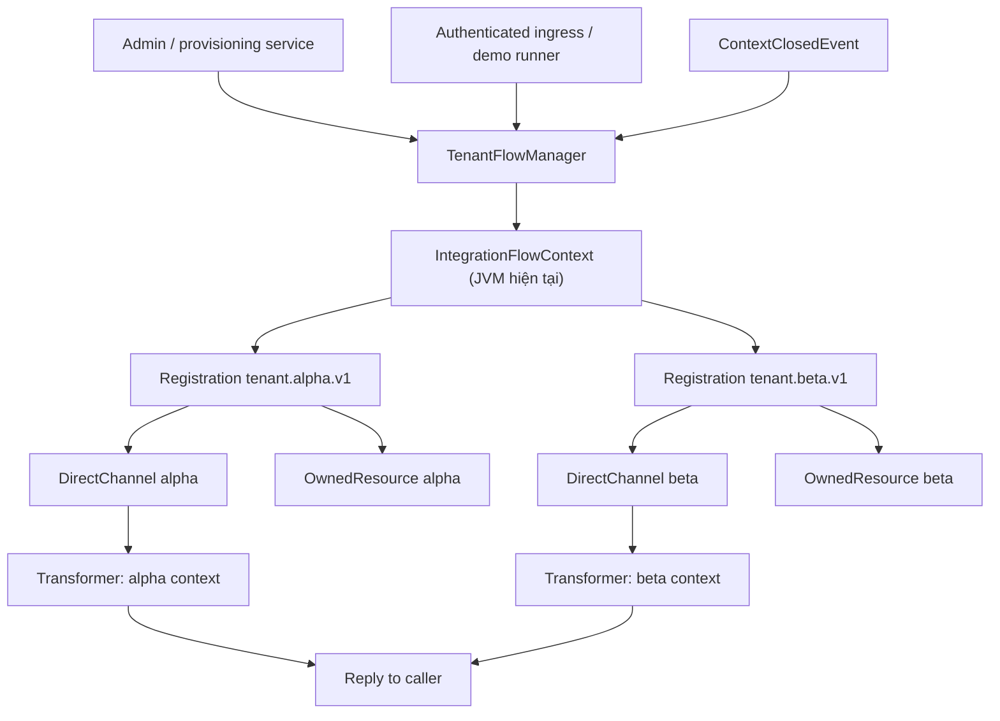
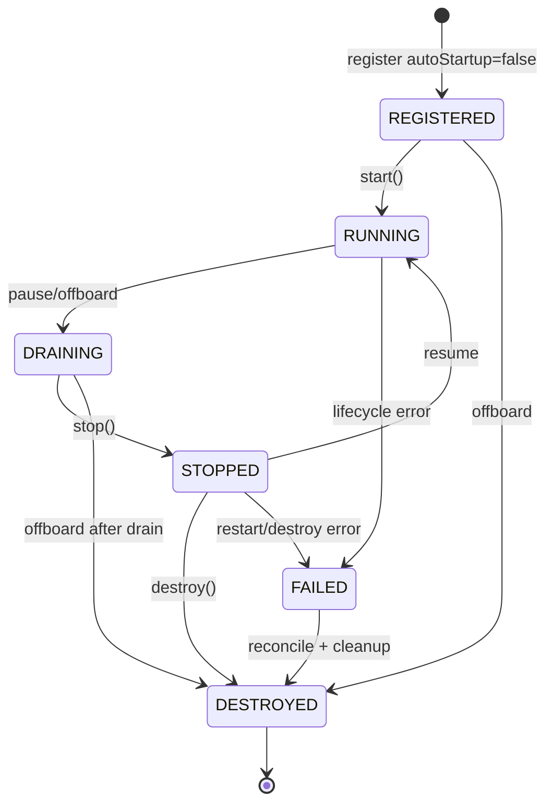
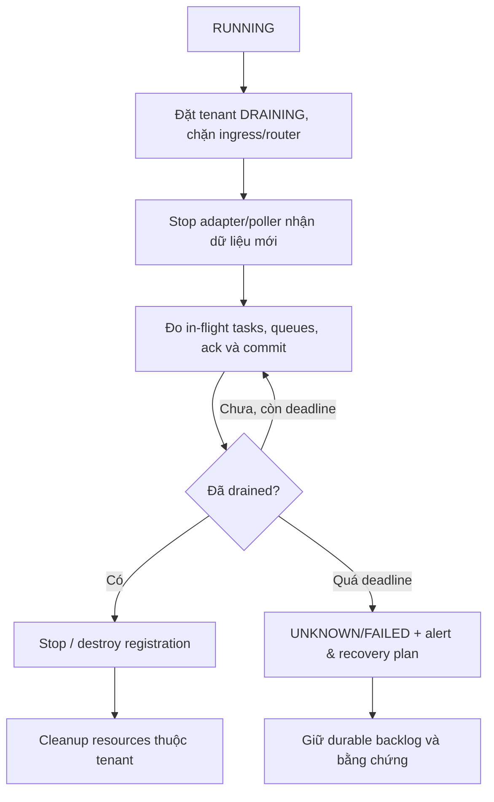

# Đăng ký flow động theo tenant và cleanup khi dừng

## 1. Đề bài: onboarding/offboarding tenant mà không restart JVM

Một dịch vụ Spring Integration nhận request từ nhiều tenant. Mỗi tenant có một pipeline riêng: nhận message trên input channel, gọi handler xử lý và trả reply. Tenant mới có thể được kích hoạt khi application đang chạy; tenant cũ phải **dừng nhận công việc mới, chờ xử lý đang chạy, giải phóng endpoint và tài nguyên thuộc sở hữu của nó** mà không ảnh hưởng tenant khác.

Đây là dự án thực hành thuộc chương **Thực hành tổng hợp**, module `SPRING_INTEGRATION_RUNTIME`. Bài áp dụng cơ chế Spring Integration điều phối `MessageChannel`, endpoint, consumer, poller, executor; quản lý vòng đời `IntegrationFlow` và kiểm tra những hệ quả đối với transaction, retry, message store, error, correlation, threading, hiệu năng và trạng thái runtime.

**Mục tiêu cuối:** dựng một ứng dụng Spring Boot với `IntegrationFlowContext` để đăng ký, start, pause, resume và offboard những `IntegrationFlow` được tạo **sau khi application context đã khởi động**. Khi offboard, ta xác minh flow biến mất khỏi registry và bean phụ thuộc của tenant đã được destroy.

> **Ngữ cảnh kỹ thuật:** Java 17+, Spring Boot 3.5.x cùng Spring Integration 6.5.x do BOM quản lý. Ví dụ chính dùng `DirectChannel` và transformer **đồng bộ** để chứng minh lifecycle/draining một cách rõ ràng. Với SFTP, JMS, broker, poller hoặc `ExecutorChannel` thật cần thiết kế bổ sung ở mục 15–18.

### 1.1. Yêu cầu chức năng

| Mã | Nhiệm vụ | Tiêu chí hoàn thành |
|---|---|---|
| F1 | Provision tenant `alpha`, `beta` tại runtime | Có hai flow IDs unique trong `IntegrationFlowContext`. |
| F2 | Không tự start ngay khi đăng ký | `autoStartup(false)`; chưa mở traffic trước `start()`. |
| F3 | Gửi request riêng theo tenant | Reply của alpha không chứa dữ liệu/logic của beta. |
| F4 | Pause rồi resume alpha | Beta vẫn xử lý; alpha bị từ chối trong khi pause. |
| F5 | Offboard beta | Không thể gửi mới, registration bị destroy, resource tenant đóng. |
| F6 | Provision beta lại | Có thể dùng lại flow ID sau destroy hoàn chỉnh. |
| F7 | Provision đồng thời cùng tenant | Không tạo hai registration/bean có cùng ID. |
| F8 | Offboard lúc request đồng bộ đang chạy | Không destroy endpoint ở giữa lời gọi được manager cho phép. |
| F9 | Application shutdown | Có bước cleanup best-effort với tất cả dynamic registrations. |
| F10 | Test/quan sát | Có JUnit tests và cơ chế kiểm tra registry/lifecycle. |

### 1.2. Ngoài phạm vi của bản chạy tối thiểu

Dự án chưa kết nối broker/SFTP/JDBC thật; chưa có distributed lock, durable tenant catalog, multi-pod orchestration, control-plane authorization production hoặc exactly-once delivery. Những thứ đó **không được suy ra** từ việc demo register/destroy thành công. Ta phân biệt cách làm tối thiểu chạy được với các bước nâng cấp production.

## 2. Kiến trúc và ranh giới tài nguyên



**Các ranh giới cần nhận biết:**

- **Flow registry:** `IntegrationFlowContext` quản lý những dynamic flow trong một `ApplicationContext`. Nó không phải distributed database, không tự đồng bộ với pod khác.
- **Tenant map:** `TenantFlowManager` giữ handle `IntegrationFlowRegistration` cho mỗi tenant, phục vụ lifecycle. Đây là registry **trong bộ nhớ**; mất sau restart.
- **Input channel:** mỗi flow tạo `DirectChannel` riêng. Lời gọi đồng bộ có thể nhận reply qua `MessagingTemplate.convertSendAndReceive(...)`.
- **Shared processor:** service xử lý stateless nhận tenant đã xác thực làm tham số. Không dùng biến singleton mutable như `currentTenantId`.
- **Owned resource:** mỗi flow tạo một `TenantOwnedResource` và đăng ký làm **dependent bean** bằng `addBean()`. Khi `destroy()`, Spring Integration dọn nó theo lifecycle.
- **In-flight gate:** khóa đọc/ghi cho phép nhiều request đồng bộ chạy, nhưng admin offboard phải đợi request đang giữ read lock hoàn tất.

### 2.1. Flow riêng hay flow chung?

| Một flow per tenant | Một shared flow + router |
|---|---|
| Hợp khi tenant có adapter, connection, poller, lịch chạy, endpoint lifecycle riêng. | Hợp khi nhiều tenant chỉ khác business data/permission. |
| Cho phép start/stop từng tenant. | Giảm số bean, thread và connection. |
| Cần quota, cleanup, naming và reconciliation. | Cần đảm bảo tenant-aware handler/storage/routing. |
| Không tự tạo isolation về security hoặc DB. | Cũng không tự tạo isolation; authorization vẫn bắt buộc. |

**Không nên** tạo hàng nghìn `IntegrationFlow` nếu sự khác biệt duy nhất là một header `tenantId`. Ví dụ per-tenant ở đây được chọn để thực hành **lifecycle và cleanup**.

## 3. Thiết kế state machine rõ ràng



Phân biệt **application state** do manager quản lý và **framework state** do registration/endpoint giữ. State `DRAINING` là **policy của ứng dụng**, không phải một method có sẵn tên `registration.drain()`.

| Lệnh | Thao tác Spring Integration | Kết quả quan sát |
|---|---|---|
| Register | `flowContext.registration(flow).id(...).autoStartup(false).register()` | Có registration nhưng endpoint chưa start. |
| Start | `registration.start()` | Endpoint được yêu cầu khởi động, cho phép traffic sau khi thành công. |
| Pause | Chặn admission mới → chờ in-flight → `registration.stop()` | Registration còn để resume. |
| Resume | `registration.start()` | Không tạo flow/bean mới. |
| Offboard | Chặn admission → chờ in-flight → stop → `registration.destroy()` | Xóa registration và dependent beans. |
| Shutdown JVM | Lặp cleanup theo tenant trong `ContextClosedEvent` | Best-effort trước khi Spring đóng context. |

**Không nhầm `stop()` với `destroy()`:** stop giữ nguyên registration và bean để start lại; destroy hủy flow, các bean phụ thuộc và local cache. **Không nhầm destroy với xóa business data** trong JDBC store, broker, file, metadata hoặc DLQ.

## 4. Chuẩn bị project

### 4.1. Cấu trúc mã nguồn gợi ý

```text
src/main/java/com/example/tenantflow/
  TenantFlowProjectApplication.java
  TenantPayloadProcessor.java
  DefaultTenantPayloadProcessor.java
  TenantOwnedResource.java
  TenantFlowManager.java
  DemoScenario.java

src/test/java/com/example/tenantflow/
  TenantFlowManagerIT.java
  TenantFlowConcurrencyIT.java
```

Dùng chung package `com.example.tenantflow` để Spring Boot component scan và test có thể kiểm tra helper package-private.

### 4.2. Dependency

Với một Spring Boot 3.5.x Gradle project đã có Boot plugin/BOM, thêm:

```groovy
dependencies {
    implementation 'org.springframework.boot:spring-boot-starter-integration'
    // Giữ runtime đang chạy bằng embedded server (chưa expose admin API).
    implementation 'org.springframework.boot:spring-boot-starter-web'

    testImplementation 'org.springframework.boot:spring-boot-starter-test'
    testRuntimeOnly 'org.junit.platform:junit-platform-launcher'
}

tasks.named('test') {
    useJUnitPlatform()
}
```

Không cần SFTP/JMS adapters, JDBC hoặc embedded broker cho baseline. Web starter giúp ứng dụng giữ HTTP server đang chạy để có thể quan sát SIGTERM/shutdown, **nhưng bài chưa mở endpoint quản trị nào**. Với bài kiểm thử có thể đặt `webEnvironment = NONE`. Spring Integration core và Java DSL được Boot starter/BOM quản lý; tránh ghép các version thủ công không tương thích.

### 4.3. Spring Boot entrypoint

**`TenantFlowProjectApplication.java`**

```java
package com.example.tenantflow;

import org.springframework.boot.SpringApplication;
import org.springframework.boot.autoconfigure.SpringBootApplication;
import org.springframework.integration.config.EnableIntegration;

@SpringBootApplication
@EnableIntegration
public class TenantFlowProjectApplication {

    public static void main(String[] args) {
        SpringApplication.run(TenantFlowProjectApplication.class, args);
    }
}
```

`IntegrationFlowContext` là bean hạ tầng được Spring Integration cung cấp; inject nó qua constructor. **Không tạo một `new StandardIntegrationFlowContext()`** bên ngoài Spring container để tự quản lý registry.

## 5. Processor dùng chung nhưng không trộn tenant state

**`TenantPayloadProcessor.java`**

```java
package com.example.tenantflow;

@FunctionalInterface
public interface TenantPayloadProcessor {
    String process(String tenantId, String payload);
}
```

**`DefaultTenantPayloadProcessor.java`**

```java
package com.example.tenantflow;

import java.util.Locale;
import org.springframework.stereotype.Component;

@Component
public final class DefaultTenantPayloadProcessor
        implements TenantPayloadProcessor {

    @Override
    public String process(String tenantId, String payload) {
        // Không có mutable singleton currentTenantId!
        return "[tenant=" + tenantId + "] "
                + payload.toUpperCase(Locale.ROOT);
    }
}
```

Processor không dùng `tenantId` header do client gửi để quyết định quyền truy cập. Trong demo, manager nhận tenant ID từ caller tin cậy; ở REST/broker ingress production, tenant ID phải đến từ **security principal hoặc mapping đã được kiểm chứng**.

**Sai lầm cần tránh:**

```java
// SAI: singleton mutable state có thể bị request tenant khác ghi đè.
private String currentTenant;
public String process(String tenant, String payload) {
    this.currentTenant = tenant;
    return "tenant=" + this.currentTenant + ";" + payload;
}
```

Với nhiều threads, `currentTenant` không đảm bảo identity của request ban đầu. Giữ các tham số bất biến hoặc dùng object per-tenant có ownership rõ.

## 6. OwnedResource: chứng minh cleanup có thật

**`TenantOwnedResource.java`**

```java
package com.example.tenantflow;

import java.util.concurrent.atomic.AtomicBoolean;
import org.springframework.beans.factory.DisposableBean;

public final class TenantOwnedResource implements DisposableBean {

    private final String tenantId;
    private final AtomicBoolean destroyed = new AtomicBoolean();

    public TenantOwnedResource(String tenantId) {
        this.tenantId = tenantId;
    }

    public void assertAvailable() {
        if (destroyed.get()) {
            throw new IllegalStateException(
                    "Resource is closed for " + tenantId);
        }
    }

    public boolean isDestroyed() {
        return destroyed.get();
    }

    @Override
    public void destroy() {
        // Thực tế: đóng một connection/client/subscription thuộc tenant.
        // AtomicBoolean giúp callback cleanup idempotent.
        destroyed.compareAndSet(false, true);
    }
}
```

Đây là một **tài nguyên giả lập**, không mở socket, thread hay file thật. Nó cho phép test kiểm tra callback `DisposableBean.destroy()` khi registration bị hủy. Trong production, một resource có thể là connection factory/SSH session pool/adapter dependency và phải quản lý close/release đúng API, timeout và error handling.

**Ownership invariant:** nếu resource do một tenant sở hữu, nó có thể là dependent bean của flow đó; nếu dùng chung cho nhiều tenant (ví dụ global `DataSource`, shared `TaskExecutor`, Kafka factory), **không đăng ký nó như dependent bean** để tránh flow A destroy làm tenant B hỏng.

## 7. TenantFlowManager: đăng ký và điều phối vòng đời

### 7.1. Những lựa chọn trước khi đọc code

- Mỗi tenant có ID hợp lệ theo regex `[a-z0-9][a-z0-9-]{0,39}`. Không tạo bean/flow vì raw input chưa xác minh.
- Flow ID cố định theo tenant trong demo: `tenant.<tenantId>.v1`. Đổi schema config có thể dùng revision khác hoặc destroy trước khi dùng lại ID.
- `useFlowIdAsPrefix()` giúp các component có ID bên trong flow ít va chạm tên bean. Đã có flow ID tường minh.
- `autoStartup(false)` đảm bảo sau register phải có lệnh start, tránh nhận dữ liệu trước khi provisioning hoàn tất.
- Manager giữ `ConcurrentHashMap` nhưng serialize **các thao tác admin** bằng `synchronized` đơn giản để chống trùng provision/destroy trong một JVM.
- Mỗi slot dùng `ReentrantReadWriteLock(true)`: request đồng bộ giữ read lock, pause/offboard giữ write lock và phải chờ các request trước đó.
- Khi offboard, **không gọi cả `registration.destroy()` và `flowContext.remove(id)`** cho cùng một registration: cả hai đều là đường destroy.
- `shutdown` dùng `ContextClosedEvent` để chặn provisioning mới và cleanup các registration còn lại.

### 7.2. Implementation — TenantFlowManager.java

```java
package com.example.tenantflow;

import java.util.ArrayList;
import java.util.Map;
import java.util.concurrent.ConcurrentHashMap;
import java.util.concurrent.locks.Lock;
import java.util.concurrent.locks.ReentrantReadWriteLock;

import org.slf4j.Logger;
import org.slf4j.LoggerFactory;
import org.springframework.context.event.ContextClosedEvent;
import org.springframework.context.event.EventListener;
import org.springframework.integration.channel.DirectChannel;
import org.springframework.integration.dsl.IntegrationFlow;
import org.springframework.integration.dsl.context.IntegrationFlowContext;
import org.springframework.integration.dsl.context.IntegrationFlowContext
        .IntegrationFlowRegistration;
import org.springframework.stereotype.Service;

@Service
public final class TenantFlowManager {

    private static final Logger log =
            LoggerFactory.getLogger(TenantFlowManager.class);

    public enum Phase {
        REGISTERED, RUNNING, DRAINING, STOPPED, FAILED, DESTROYED
    }

    public record View(String tenantId, String flowId,
                       Phase phase, boolean accepting) {
    }

    private static final class Slot {
        final IntegrationFlowRegistration registration;
        final TenantOwnedResource resource;
        final ReentrantReadWriteLock gate =
                new ReentrantReadWriteLock(true);

        volatile Phase phase = Phase.REGISTERED;
        volatile boolean accepting = false;

        Slot(IntegrationFlowRegistration registration,
             TenantOwnedResource resource) {
            this.registration = registration;
            this.resource = resource;
        }
    }

    private final IntegrationFlowContext flowContext;
    private final TenantPayloadProcessor processor;
    private final Map<String, Slot> slots = new ConcurrentHashMap<>();
    private volatile boolean shuttingDown;

    public TenantFlowManager(IntegrationFlowContext flowContext,
                             TenantPayloadProcessor processor) {
        this.flowContext = flowContext;
        this.processor = processor;
    }

    private static String checkedTenant(String tenantId) {
        if (tenantId == null
                || !tenantId.matches("[a-z0-9][a-z0-9-]{0,39}")) {
            throw new IllegalArgumentException("Invalid tenant ID");
        }
        return tenantId;
    }

    private static String flowId(String tenant) {
        return "tenant." + tenant + ".v1";
    }

    public synchronized String provision(String tenantId) {
        String tenant = checkedTenant(tenantId);
        if (shuttingDown) {
            throw new IllegalStateException("Application is shutting down");
        }

        Slot existing = slots.get(tenant);
        if (existing != null) {
            if (existing.phase == Phase.FAILED) {
                throw new IllegalStateException(
                        "Tenant needs reconciliation: " + tenant);
            }
            // Idempotent provisioning trong cùng JVM.
            return existing.registration.getId();
        }

        String id = flowId(tenant);
        if (flowContext.getRegistrationById(id) != null) {
            throw new IllegalStateException(
                    "Flow ID already owned outside manager: " + id);
        }

        TenantOwnedResource owned = new TenantOwnedResource(tenant);
        IntegrationFlow flow = IntegrationFlow.from(new DirectChannel())
                .<String, String>transform(payload -> {
                    owned.assertAvailable();
                    return processor.process(tenant, payload);
                })
                .get();

        // register() có thể throw vì bean collision/config lỗi;
        // production phải audit và reconcile mọi partial resource.
        IntegrationFlowRegistration registration = flowContext
                .registration(flow)
                .id(id)
                .useFlowIdAsPrefix()
                .autoStartup(false)
                .addBean("ownedResource." + tenant, owned)
                .register();

        slots.put(tenant, new Slot(registration, owned));

        log.info("Tenant flow registered: {}", id);
        return id;
    }

    public synchronized void start(String tenantId) {
        String tenant = checkedTenant(tenantId);
        Slot slot = required(tenant);
        Lock write = slot.gate.writeLock();
        write.lock();
        try {
            ensureCurrent(tenant, slot);
            if (slot.phase == Phase.FAILED) {
                throw new IllegalStateException(
                        "Reconcile failed tenant before start");
            }

            slot.registration.start();
            slot.phase = Phase.RUNNING;
            slot.accepting = true;
        }
        catch (RuntimeException e) {
            slot.accepting = false;
            slot.phase = Phase.FAILED;
            throw e;
        }
        finally {
            write.unlock();
        }
    }

    public String request(String tenantId, String payload) {
        String tenant = checkedTenant(tenantId);
        if (payload == null || payload.length() > 1_024) {
            throw new IllegalArgumentException("Invalid payload");
        }

        Slot slot = slots.get(tenant);
        if (slot == null) {
            throw new IllegalStateException("Tenant not provisioned");
        }

        Lock read = slot.gate.readLock();
        read.lock();
        try {
            ensureCurrent(tenant, slot);
            if (!slot.accepting || slot.phase != Phase.RUNNING) {
                throw new IllegalStateException(
                        "Tenant not accepting new requests");
            }

            // Chính ví dụ này là DirectChannel + handler đồng bộ.
            // Read lock giữ đến khi đã nhận reply.
            String reply = slot.registration.getMessagingTemplate()
                    .convertSendAndReceive(payload, String.class);

            if (reply == null) {
                throw new IllegalStateException(
                        "No reply from tenant flow");
            }
            return reply;
        }
        finally {
            read.unlock();
        }
    }

    public synchronized void pause(String tenantId) {
        String tenant = checkedTenant(tenantId);
        Slot slot = required(tenant);

        // Gate admission trước khi đợi in-flight; write lock chờ
        // các synchronous request đang giữ read lock.
        slot.accepting = false;
        slot.phase = Phase.DRAINING;

        Lock write = slot.gate.writeLock();
        write.lock();
        try {
            ensureCurrent(tenant, slot);
            slot.registration.stop();
            slot.phase = Phase.STOPPED;
            log.info("Tenant flow stopped: {}",
                    slot.registration.getId());
        }
        catch (RuntimeException e) {
            slot.phase = Phase.FAILED;
            throw e;
        }
        finally {
            write.unlock();
        }
    }

    public synchronized void offboard(String tenantId) {
        String tenant = checkedTenant(tenantId);
        Slot slot = slots.get(tenant);
        if (slot == null) {
            return; // Idempotent khi đã offboard.
        }

        slot.accepting = false;
        slot.phase = Phase.DRAINING;

        Lock write = slot.gate.writeLock();
        write.lock();
        try {
            ensureCurrent(tenant, slot);
            slot.registration.stop();
            slot.registration.destroy();

            slots.remove(tenant, slot);
            slot.phase = Phase.DESTROYED;

            log.info("Tenant flow destroyed: {}",
                    slot.registration.getId());
        }
        catch (RuntimeException e) {
            // Không xóa slot mù quáng nếu destroy lỗi một phần.
            slot.phase = Phase.FAILED;
            log.error("Tenant cleanup failed: {}", tenant, e);
            throw e;
        }
        finally {
            write.unlock();
        }
    }

    public View view(String tenantId) {
        String tenant = checkedTenant(tenantId);
        Slot slot = required(tenant);
        // Snapshot, không phải transaction hay atomic cluster state.
        return new View(tenant,
                slot.registration.getId(),
                slot.phase, slot.accepting);
    }

    // Package-private: chỉ để integration test giữ reference
    // và xác minh DisposableBean.destroy() đã xảy ra.
    TenantOwnedResource ownedResourceForTest(String tenantId) {
        return required(checkedTenant(tenantId)).resource;
    }

    private Slot required(String tenant) {
        Slot slot = slots.get(tenant);
        if (slot == null) {
            throw new IllegalStateException(
                    "Tenant not provisioned: " + tenant);
        }
        return slot;
    }

    private void ensureCurrent(String tenant, Slot slot) {
        if (slots.get(tenant) != slot) {
            throw new IllegalStateException(
                    "Tenant registration changed while waiting");
        }
    }

    @EventListener(ContextClosedEvent.class)
    public synchronized void cleanupOnApplicationShutdown() {
        shuttingDown = true;
        // Chụp snapshot tránh iterating map đang thay đổi.
        for (String tenant : new ArrayList<>(slots.keySet())) {
            try {
                offboard(tenant);
            }
            catch (RuntimeException failure) {
                // Tiếp tục best-effort với tenant còn lại;
                // Spring context shutdown không cho phép retry vô hạn.
                log.error("Shutdown cleanup failed for {}", tenant,
                        failure);
            }
        }
    }
}
```

### 7.3. Giải thích sâu các lựa chọn đồng bộ hóa

**A. Khóa đọc/ghi giữ đúng phạm vi**

`request()` giữ read lock suốt quá trình `convertSendAndReceive(...)`. Một lúc nhiều request alpha có thể thực thi, nhưng admin `pause(alpha)` phải đợi chúng nhả read lock trước khi gọi `registration.stop()`. `ReentrantReadWriteLock(true)` giảm nguy cơ write lock bị starvation khi có nhiều caller.

**B. Chặn traffic trước khi đợi drain**

Trước khi đợi write lock, manager đặt `accepting=false` và `phase=DRAINING`. Request mới có thể đã nhìn thấy `Slot` từ trước, nhưng sau khi lấy read lock vẫn phải kiểm tra `accepting` và xác minh `slots.get(tenant)==slot`. Nó sẽ bị từ chối nếu flow đã pause/destroy.

**C. Không thể dùng read lock này cho async completion**

Flow hiện dùng `DirectChannel` và transformer trả kết quả đồng bộ, nên read lock được giữ cho tới khi business handler xong. Nếu thay bằng `ExecutorChannel`, `FluxMessageChannel`, `QueueChannel`/poller hoặc outbound gateway có callback, lời gọi `request()` có thể kết thúc **trước công việc downstream**. Khi đó cần in-flight tracking, ack/transaction completion và deadline riêng — không coi write lock như bằng chứng async tasks đã drain.

**D. `synchronized` quản trị là baseline của một JVM**

Nó ngăn hai admin requests đồng thời provision cùng ID hoặc đan xen start/pause/destroy. Nhưng một thao tác offboard alpha chờ handler lâu sẽ chặn admin operations của beta vì dùng manager monitor chung. Production nên dùng **per-tenant management mutex**, command queue hoặc state machine với expected revision để độc lập hơn.

**E. Khi destroy throw**

`destroy()` có thể đã làm một phần công việc trước khi exception ném ra. Manager giữ slot ở `FAILED` và yêu cầu reconciliation; không tự tuyên bố đã cleanup sạch. Đừng gọi remove/destroy lần hai vô điều kiện trên handle đã partially destroyed hoặc xóa tenant catalog trước khi quan sát actual state.

**F. Timeout phải được thiết kế theo adapter**

Ví dụ không gọi I/O mạng nên operation ngắn. Nếu handler thực tế có call TCP/DB chặn vô hạn, `offboard()` chờ read lock có thể cũng chờ vô hạn. Hãy áp deadline, I/O timeout, cooperative cancellation và runbook cho trạng thái UNKNOWN/DRAINING; không đơn giản `Thread.stop()` hoặc destroy shared resources cưỡng bức.

## 8. Chạy demo không cần HTTP endpoint quản trị

Để project **có thể chạy được mà không expose administrative API**, dùng `CommandLineRunner` chỉ bật bởi profile `demo`. Đây là cách hợp lý để học lifecycle trước khi thêm Spring Security và REST.

**`DemoScenario.java`**

```java
package com.example.tenantflow;

import org.springframework.boot.CommandLineRunner;
import org.springframework.context.annotation.Bean;
import org.springframework.context.annotation.Configuration;
import org.springframework.context.annotation.Profile;

@Configuration
@Profile("demo")
class DemoScenario {

    @Bean
    CommandLineRunner runTenantScenario(TenantFlowManager manager) {
        return args -> {
            System.out.println("REGISTER alpha: "
                    + manager.provision("alpha"));
            System.out.println("REGISTER beta: "
                    + manager.provision("beta"));

            manager.start("alpha");
            manager.start("beta");

            System.out.println(manager.request("alpha", "order-17"));
            System.out.println(manager.request("beta", "order-17"));

            manager.pause("alpha");
            System.out.println("alpha: "
                    + manager.view("alpha").phase());

            // Beta vẫn nhận request dù alpha đã pause.
            System.out.println(manager.request("beta", "order-18"));

            manager.start("alpha"); // Resume registration cũ.
            System.out.println(manager.request("alpha", "order-19"));

            manager.offboard("beta");
            System.out.println("beta đã offboard");

            // Application context còn mở: alpha đang RUNNING.
            // Khi Spring đóng context, ContextClosedEvent sẽ cleanup.
        };
    }
}
```

### 8.1. Chạy và kết quả

```bash
./gradlew bootRun --args='--spring.profiles.active=demo'
```

Output minh họa, bỏ qua timestamp/log của Spring:

```text
REGISTER alpha: tenant.alpha.v1
REGISTER beta: tenant.beta.v1
[tenant=alpha] ORDER-17
[tenant=beta] ORDER-17
alpha: STOPPED
[tenant=beta] ORDER-18
[tenant=alpha] ORDER-19
beta đã offboard
```

Dùng `Ctrl+C`/SIGTERM để dừng ứng dụng một cách có quản lý; Spring phát `ContextClosedEvent` trong quá trình close. Kiểm tra log cleanup của alpha. **SIGKILL, OOM hoặc power failure không đảm bảo callback shutdown chạy**. Vì vậy application shutdown hook không thay thế durable state/reconciliation.

### 8.2. Khi không chạy profile demo

Application không tự provision tenant nào. Điều này giúp test và production không bị một `CommandLineRunner` bất ngờ tạo flow/connection trước khi admin policy hoặc catalog sẵn sàng.

## 9. Integration tests chứng minh vòng đời tenant

Các test sau dùng **Spring Integration runtime thật**, không mock `IntegrationFlowContext`. `webEnvironment = NONE` tránh mở cổng HTTP trong test dù project có web starter.

**`TenantFlowManagerIT.java`**

```java
package com.example.tenantflow;

import static org.junit.jupiter.api.Assertions.*;

import org.junit.jupiter.api.AfterEach;
import org.junit.jupiter.api.Test;
import org.springframework.beans.factory.annotation.Autowired;
import org.springframework.boot.test.context.SpringBootTest;
import org.springframework.integration.dsl.context.IntegrationFlowContext;

@SpringBootTest(
        classes = TenantFlowProjectApplication.class,
        webEnvironment = SpringBootTest.WebEnvironment.NONE)
class TenantFlowManagerIT {

    @Autowired TenantFlowManager manager;
    @Autowired IntegrationFlowContext context;

    @AfterEach
    void cleanup() {
        // Spring Test có thể cache application context giữa các test.
        manager.offboard("alpha");
        manager.offboard("beta");
        manager.offboard("gamma");
    }

    @Test
    void registerStartPauseResumeOffboard() {
        String id = manager.provision("alpha");

        assertEquals("tenant.alpha.v1", id);
        assertNotNull(context.getRegistrationById(id));
        assertEquals(TenantFlowManager.Phase.REGISTERED,
                manager.view("alpha").phase());

        // autoStartup(false) + gate: chưa nhận request.
        assertThrows(IllegalStateException.class,
                () -> manager.request("alpha", "job-1"));

        manager.start("alpha");
        assertEquals("[tenant=alpha] JOB-1",
                manager.request("alpha", "job-1"));

        manager.pause("alpha");
        assertEquals(TenantFlowManager.Phase.STOPPED,
                manager.view("alpha").phase());
        assertThrows(IllegalStateException.class,
                () -> manager.request("alpha", "job-2"));

        manager.start("alpha");
        assertEquals(id, manager.view("alpha").flowId());
        assertEquals("[tenant=alpha] JOB-3",
                manager.request("alpha", "job-3"));

        manager.offboard("alpha");
        assertNull(context.getRegistrationById(id));
        assertThrows(IllegalStateException.class,
                () -> manager.request("alpha", "job-4"));
    }

    @Test
    void pausingAlphaDoesNotPauseBeta() {
        manager.provision("alpha");
        manager.provision("beta");
        manager.start("alpha");
        manager.start("beta");

        assertEquals("[tenant=alpha] ORDER-17",
                manager.request("alpha", "order-17"));
        assertEquals("[tenant=beta] ORDER-17",
                manager.request("beta", "order-17"));

        manager.pause("alpha");

        assertThrows(IllegalStateException.class,
                () -> manager.request("alpha", "order-18"));
        assertEquals("[tenant=beta] ORDER-18",
                manager.request("beta", "order-18"));
    }

    @Test
    void repeatedProvisionIsIdempotentAndIdCanBeReused() {
        String first = manager.provision("gamma");
        String again = manager.provision("gamma");
        assertEquals(first, again);

        manager.offboard("gamma");
        assertNull(context.getRegistrationById(first));

        String recreated = manager.provision("gamma");
        assertEquals(first, recreated);
        manager.start("gamma");
        assertEquals("[tenant=gamma] NEW",
                manager.request("gamma", "new"));
    }

    @Test
    void destroyClosesDependentBeanButStopDoesNot() {
        manager.provision("beta");
        TenantOwnedResource owned =
                manager.ownedResourceForTest("beta");

        manager.start("beta");
        manager.pause("beta");
        assertFalse(owned.isDestroyed());

        manager.offboard("beta");
        assertTrue(owned.isDestroyed());
        assertNull(context.getRegistrationById(
                "tenant.beta.v1"));
    }

    @Test
    void rejectsInvalidTenantId() {
        assertThrows(IllegalArgumentException.class,
                () -> manager.provision("../../admin"));
        assertThrows(IllegalArgumentException.class,
                () -> manager.provision("alpha.bad"));
    }
}
```

### 9.1. Test chứng minh được điều gì?

| Assertion | Ý nghĩa |
|---|---|
| Registry chứa `tenant.alpha.v1` | Flow được đăng ký trong Spring context hiện tại. |
| Chưa start thì request bị từ chối | Lifecycle gate và `autoStartup(false)` hoạt động. |
| Reply mang tenant khác nhau | Payload processor dùng đúng tenant capture; **chưa** chứng minh security authorization. |
| Pause giữ registration | Có thể resume mà không re-register. |
| Resource chưa destroyed sau pause | `stop()` **không** dọn dependent bean. |
| Resource destroyed sau offboard | `registration.destroy()` gọi lifecycle cleanup. |
| Registry ID biến mất, re-provision dùng lại được | Không để orphan registration trong happy path. |

Test không kiểm tra socket/connection thật vì `TenantOwnedResource` là fixture giả. Khi thay bằng SFTP/JMS/TCP, dùng fake resource hoặc integration test với server/broker thật để đo connection cleanup.

## 10. Test hai admin requests cùng provision một tenant

`ConcurrentHashMap` không đủ nếu hai thread cùng `get()` rồi `register()`: cả hai có thể tạo flow với cùng ID. Manager demo dùng `synchronized provision()` để serialize thao tác này **trong một JVM**.

Đoạn test dưới đây đặt thêm **bên trong class `TenantFlowManagerIT` mục 9**, dùng fields `manager` và `context` đã inject.

```java
import java.util.concurrent.Callable;
import java.util.concurrent.CountDownLatch;
import java.util.concurrent.ExecutorService;
import java.util.concurrent.Executors;
import java.util.concurrent.Future;
import java.util.concurrent.TimeUnit;

@Test
void concurrentProvisionReturnsOneFlowId() throws Exception {
    ExecutorService pool = Executors.newFixedThreadPool(2);
    CountDownLatch ready = new CountDownLatch(2);
    CountDownLatch go = new CountDownLatch(1);

    try {
        Callable<String> create = () -> {
            ready.countDown();
            if (!go.await(5, TimeUnit.SECONDS)) {
                throw new IllegalStateException("Barrier timed out");
            }
            return manager.provision("alpha");
        };

        Future<String> first = pool.submit(create);
        Future<String> second = pool.submit(create);

        assertTrue(ready.await(5, TimeUnit.SECONDS));
        go.countDown();

        String a = first.get(10, TimeUnit.SECONDS);
        String b = second.get(10, TimeUnit.SECONDS);
        assertEquals(a, b);
        assertNotNull(context.getRegistrationById(a));
    }
    finally {
        go.countDown();
        pool.shutdownNow();
        manager.offboard("alpha");
    }
}
```

Test này chỉ chứng minh đồng bộ hóa nội bộ JVM. Hai pod có hai `IntegrationFlowContext` và hai map riêng: muốn chỉ một pod được phép poll một nguồn độc quyền cần distributed coordination/source ownership.

## 11. Test offboard phải đợi request đồng bộ đang thực thi

Ta dùng `CountDownLatch` để giữ business handler trong call stack, kiểm tra owned resource **không bị destroy** khi một request đã được manager chấp nhận đang chạy.

**`TenantFlowConcurrencyIT.java`**

```java
package com.example.tenantflow;

import static org.junit.jupiter.api.Assertions.*;

import java.util.concurrent.CountDownLatch;
import java.util.concurrent.ExecutorService;
import java.util.concurrent.Executors;
import java.util.concurrent.Future;
import java.util.concurrent.TimeUnit;
import java.util.concurrent.TimeoutException;
import org.junit.jupiter.api.Test;
import org.springframework.beans.factory.annotation.Autowired;
import org.springframework.boot.test.context.SpringBootTest;
import org.springframework.boot.test.context.TestConfiguration;
import org.springframework.context.annotation.Bean;
import org.springframework.context.annotation.Import;
import org.springframework.context.annotation.Primary;
import org.springframework.integration.dsl.context.IntegrationFlowContext;

@SpringBootTest(
        classes = TenantFlowProjectApplication.class,
        webEnvironment = SpringBootTest.WebEnvironment.NONE)
@Import(TenantFlowConcurrencyIT.BlockingConfig.class)
class TenantFlowConcurrencyIT {

    @TestConfiguration
    static class BlockingConfig {
        @Bean
        @Primary
        BlockingProcessor blockingProcessor() {
            return new BlockingProcessor();
        }
    }

    static final class BlockingProcessor
            implements TenantPayloadProcessor {

        final CountDownLatch entered = new CountDownLatch(1);
        final CountDownLatch release = new CountDownLatch(1);

        @Override
        public String process(String tenant, String payload) {
            entered.countDown();
            try {
                if (!release.await(20, TimeUnit.SECONDS)) {
                    throw new IllegalStateException(
                            "Test handler release timeout");
                }
            }
            catch (InterruptedException e) {
                Thread.currentThread().interrupt();
                throw new IllegalStateException(
                        "Test handler interrupted", e);
            }
            return "[tenant=" + tenant + "] "
                    + payload.toUpperCase(java.util.Locale.ROOT);
        }
    }

    @Autowired TenantFlowManager manager;
    @Autowired BlockingProcessor blocking;
    @Autowired IntegrationFlowContext context;

    @Test
    void offboardWaitsForSynchronousRequest() throws Exception {
        manager.provision("alpha");
        manager.start("alpha");

        TenantOwnedResource owned =
                manager.ownedResourceForTest("alpha");
        ExecutorService pool = Executors.newFixedThreadPool(2);

        try {
            Future<String> request = pool.submit(() ->
                    manager.request("alpha", "hold"));

            assertTrue(blocking.entered.await(
                    5, TimeUnit.SECONDS));

            Future<?> removal = pool.submit(() ->
                    manager.offboard("alpha"));

            // Write lock của offboard chưa thể đi qua read lock.
            assertThrows(TimeoutException.class,
                    () -> removal.get(
                            100, TimeUnit.MILLISECONDS));
            assertFalse(owned.isDestroyed());

            blocking.release.countDown();

            assertEquals("[tenant=alpha] HOLD",
                    request.get(10, TimeUnit.SECONDS));
            removal.get(10, TimeUnit.SECONDS);

            assertTrue(owned.isDestroyed());
            assertNull(context.getRegistrationById(
                    "tenant.alpha.v1"));
        }
        finally {
            blocking.release.countDown();
            pool.shutdownNow();
            manager.offboard("alpha");
        }
    }
}
```

**Giải thích:** handler đã vào `BlockingProcessor` và giữ read lock trong `manager.request()`. Offboard chờ write lock; nó chỉ được gọi `registration.destroy()` sau khi xử lý xong và read lock được thả.

**Giới hạn rất quan trọng:** đây **không** phải bằng chứng `registration.stop()` tự đợi mọi loại tác vụ. Tính chờ xuất phát từ **read/write gate ứng dụng**, bao trùm một `DirectChannel` synchronous request. Với `ExecutorChannel`, `QueueChannel`, poller, network adapters hoặc async `Mono`, cần tracking và draining riêng.

### 11.1. Xử lý drain timeout

Nếu handler I/O treo, read lock có thể giữ lâu. Với production cần deadline, I/O timeout và `tryLock(...)` theo chính sách. Khi hết deadline, giữ state DRAINING/UNKNOWN và phát cảnh báo; không khẳng định flow DESTROYED hay xóa backlog. Cưỡng bức destroy trong lúc task còn chạy có thể gây duplicate, timeout, mất reply hoặc lỗi resource.

## 12. Test shutdown dọn flow động

Dùng Spring application context riêng để đóng thật. **Không close context của SpringBootTest đã cache dùng chung**.

**`TenantFlowShutdownIT.java`**

```java
package com.example.tenantflow;

import static org.junit.jupiter.api.Assertions.*;

import java.util.concurrent.atomic.AtomicReference;
import org.junit.jupiter.api.Test;
import org.springframework.boot.WebApplicationType;
import org.springframework.boot.builder.SpringApplicationBuilder;
import org.springframework.context.ConfigurableApplicationContext;

class TenantFlowShutdownIT {

    @Test
    void contextCloseDestroysTenantResource() {
        AtomicReference<TenantOwnedResource> ref =
                new AtomicReference<>();

        try (ConfigurableApplicationContext app =
                new SpringApplicationBuilder(
                        TenantFlowProjectApplication.class)
                    .web(WebApplicationType.NONE)
                    .run()) {

            TenantFlowManager manager =
                    app.getBean(TenantFlowManager.class);

            manager.provision("alpha");
            manager.start("alpha");
            ref.set(manager.ownedResourceForTest("alpha"));
            assertFalse(ref.get().isDestroyed());
        }

        // try-with-resources gọi close; ContextClosedEvent cleanup.
        assertNotNull(ref.get());
        assertTrue(ref.get().isDestroyed());
    }
}
```

Khi nhận SIGTERM, Spring Boot thường có cơ hội đóng context. **SIGKILL, OOM, mất điện hoặc kernel crash không bảo đảm Java callback sẽ chạy**. Do vậy shutdown cleanup là best-effort; data ngoài JVM và tenant desired state phải có chính sách phục hồi độc lập.

### 12.1. Restart không giống resume

- Sau restart, `slots` là map mới và `IntegrationFlowContext` chưa có những runtime registration trước đó.
- JVM mới không thể `start()` trực tiếp registration object đã mất theo process cũ.
- Dữ liệu broker/JDBC store có thể còn tồn tại, nhưng flow mới phải kết nối đúng destination, region và group ID.
- Cần rehydrate từ **tenant catalog bền vững**: tenant active/paused, config revision, adapter resource reference và last applied state.

## 13. Cleanup matrix: bean khác dữ liệu bền vững

Khi dừng tenant, hãy liệt kê chính xác **resource nào phải được giải phóng** và **data nào phải giữ lại**:

| Thành phần | `registration.stop()` | `registration.destroy()` | JVM crash |
|---|---|---|---|
| Registration trong `IntegrationFlowContext` | Vẫn có | Xóa khỏi local registry | Registry RAM mất |
| Consumer/endpoint | Dừng nhận công việc theo lifecycle | Destroy theo contract | Không bảo đảm callback cleanup |
| `DirectChannel` thuộc flow | Bean còn | Dependent bean được dọn | JVM mất |
| `TenantOwnedResource` demo | Chưa destroyed | `DisposableBean.destroy()` được gọi | Callback không đảm bảo |
| Manager `slots` | Còn để resume | Xóa sau destroy thành công | Map RAM mất |
| `QueueChannel` in-memory nếu dùng | Backlog còn RAM | Message có thể mất khi bean bị dọn | Backlog mất |
| JDBC MessageStore, Redis, broker | Backlog bền vững còn theo retention | **Không tự xóa dữ liệu** | Có thể sống qua restart |
| Business DB đã commit | Không rollback | Không rollback | Commit vẫn tồn tại |
| Worker async còn chạy | Không chắc đã drain | Không chắc đã hoàn tất | Có thể bị gián đoạn |
| Shared `DataSource`/`TaskExecutor` | Không nên đóng | Không được destroy cùng tenant đơn lẻ | Thuộc app lifecycle |

**Quy tắc cốt lõi:** `destroy()` quản lý beans/endpoint của flow trong Spring context, không phải lệnh “xóa mọi dữ liệu tenant trên toàn hệ thống”.

### 13.1. addBean() chỉ dành cho resource thực sự thuộc tenant

```java
// Trong một method đã xây flow và tenantOnlyFactory:
var handle = flowContext.registration(flow)
        .id("tenant.alpha.v1")
        .useFlowIdAsPrefix()
        .autoStartup(false)
        .addBean("alphaConnectionFactory", tenantOnlyFactory)
        .register();
```

`addBean(...)` đăng ký dependent bean. Chỉ dùng cho `tenantOnlyFactory` nếu alpha là **chủ sở hữu duy nhất**. Với connection pool/HTTP client, `DataSource` hoặc `TaskExecutor` dùng chung, tạo bean trong application scope và inject vào flow; không đăng ký nó làm dependent bean để offboard alpha phá hỏng beta.

### 13.2. Không dọn bằng BeanFactory thủ công

Không trực tiếp gọi `destroySingleton()` hoặc `removeBeanDefinition()` trên component do `IntegrationFlowContext` quản lý. Cách đó có thể khiến registry, consumer subscriptions và lifecycle mất đồng bộ. Dùng một trong hai đường chính thức: `registration.destroy()` **hoặc** `flowContext.remove(flowId)`.

## 14. Khi register/destroy lỗi một phần

**Register lỗi:** bean name collision, ID flow đã có, thiếu secret, resource/connection factory init thất bại hoặc config không hợp lệ. `register()` có thể tạo một số bean trước khi ném exception.

**Runbook:**

1. Audit `PROVISION_REQUESTED` với tenant, flow ID, revision, request/actor.
2. Validate tenant ID, quota, endpoint IDs và connection configuration trước khi tạo resource.
3. Serialize registration cho cùng flow ID và kiểm tra `getRegistrationById(id)`.
4. Nếu register throw, chỉ cleanup những tài nguyên chắc chắn thuộc attempt đó. Không blind `remove(id)` nếu một tác nhân khác có thể là owner.
5. Giữ desired-state FAILED/RECONCILING; không báo READY.
6. Kiểm thử register-fail-retry nhiều vòng để phát hiện leaked bean/thread/socket.

**Destroy lỗi:** stop endpoint hoặc `DisposableBean.destroy()` có thể throw sau khi đã dọn một phần. Manager để `phase=FAILED`, giữ slot thay vì báo offboard thành công. Hãy kiểm tra registry thực còn flow không, dependent beans đã đóng chưa; có thể cần compensation cho external resource. Tránh retry `destroy()` vô hạn hoặc tự tạo flow mới với ID cũ khi bean registry chưa sạch.

**Quan trọng:** test fixture `TenantOwnedResource` không mở socket nên ít failure surface; khi thay bằng SFTP/JMS/TCP, cần test đóng connection thật, pending tasks và timeout.

## 15. Mở rộng sang executor, poller và adapter thật

Ví dụ chính dùng `DirectChannel` với handler đồng bộ. Chuyển sang adapter khác **thay đổi ý nghĩa của “đã drain”**:

| Đường xử lý | Điều kiện để cleanup an toàn |
|---|---|
| `DirectChannel` → handler đồng bộ | Chặn request mới, đợi handler/reply hoàn thành như manager demo. |
| `ExecutorChannel` | Theo dõi executor queued/active tasks; lời gọi gửi có thể kết thúc trước business work. |
| `QueueChannel` RAM + `PollingConsumer` | Stop poller, quyết định giữ/tiêu hủy/chuyển backlog còn trong RAM. |
| `QueueChannel` với `JdbcChannelMessageStore` | Transaction receive, đúng store region/group; dữ liệu còn sau destroy. |
| `SourcePollingChannelAdapter` | Stop lấy message mới; kiểm tra polling source checkpoints và công việc đã nhận. |
| SFTP inbound | Kiểm tra local temp files, remote file filters, marker/metadata store và partial downloads. |
| JMS/AMQP listener | Ack/nack, prefetch và requeue khi consumer bị stop. |
| Kafka inbound | Consumer-group/partition ownership, offsets, uncommitted records và replay. |
| TCP/HTTP gateway | Outstanding replies, timeout và connection close; có thể business đã commit dù caller timeout. |
| Reactive `FluxMessageChannel` | Subscription/cancellation, inner tasks còn chạy và replay semantics. |

### 15.1. Quy trình drain cho nguồn bất đồng bộ



Thứ tự stop source, đợi worker và ack cụ thể **phụ thuộc driver/protocol**. Với một source, `stop()` có thể ngăn poll mới nhưng callback đã được giao vẫn chạy; với source khác, đóng connection làm unacked message được broker redeliver. Cần integration test và timeout theo contract thật.

### 15.2. Transaction và retry không theo tên flow

```text
Thread A: HTTP -> DirectChannel -> handler  (có thể cùng thread/tx)
Thread B: ExecutorChannel -> worker        (transaction riêng nếu có)
Thread C: poller.receive() -> handler      (poller transaction nếu cấu hình)
```

Một `@Transactional` trên handler hoặc `RequestHandlerRetryAdvice` thay đổi boundary lỗi, nhưng `registration.stop()/destroy()` **không tự rollback** giao dịch đã commit. Nếu poller commit trước async handler hoàn tất, lỗi downstream có thể xảy ra khi source đã ack.

Đối với retry:
- Handler đang retry trong một lời gọi có thể vẫn in-flight khi admin yêu cầu stop.
- Bounded retry/backoff, DLQ và business idempotency là bắt buộc với tác vụ có side effect.
- Dùng idempotency key theo `tenantId + businessEventId`; `MessageHeaders.ID` không đảm bảo ổn định qua redelivery.
- `ErrorMessage` trên errorChannel không mặc nhiên gây rollback nếu error handler đã nuốt lỗi.

## 16. Khi triển khai nhiều replica hoặc restart

`IntegrationFlowContext` và `TenantFlowManager.slots` là **local per JVM**. Hai pod cùng có flow ID `tenant.alpha.v1` thì đó là hai registrations khác nhau. Destroy trên pod A **không** stop flow beta/alpha trên pod B.

### 16.1. Tenant catalog bền vững

| Trường | Ví dụ | Mục đích |
|---|---|---|
| `tenantId` | alpha | Identity đã được xác minh. |
| `desiredState` | ACTIVE/PAUSED/INACTIVE | Control plane muốn flow ở trạng thái nào. |
| `desiredRevision` | 42 | Phiên bản cấu hình/policy. |
| `flowId` | tenant.alpha.v42 | ID theo revision để đối soát. |
| `sourceId` | sftp-alpha | Destination hoặc connection source. |
| `ownerInstance`/lease | worker-3 | Worker nào được phép poll một nguồn độc quyền. |
| `lastAppliedRevision` | 41 | Phát hiện state drift. |
| `commandId`/`updatedAt` | ... | Audit và xử lý retry. |

Khi startup, reconciler nạp catalog, validate config, lấy source ownership/lease, **provision với autoStartup(false)**, chỉ start những tenant ACTIVE đã health-check, giữ tenant PAUSED dừng, cleanup INACTIVE. Sau restart, đừng cố deserialize `IntegrationFlowRegistration` object từ storage — hãy **dựng flow mới** từ config.

### 16.2. Hai mô hình scale

- **Active-active:** có flow cùng tenant trên nhiều instance, dựa vào broker consumer group/partition assignment và business idempotency.
- **Single active source per tenant:** dùng distributed lease/leader election/fencing để chỉ một node poll nguồn độc quyền. Lease expiration/network partition phải được xử lý để tránh hai node cùng poll.

`synchronized`, `ConcurrentHashMap` và `ReentrantReadWriteLock` trong demo **không phải** distributed lock. Xử lý uniqueness trong mỗi JVM vẫn cần coordinator ở cluster level nếu use case yêu cầu.

### 16.3. Crash window

```text
t0: catalog desired=ACTIVE, revision=42
t1: pod A register flow tenant.alpha.v42
t2: pod A crash trước khi ghi APPLIED
t3: pod B nhìn desired=ACTIVE
t4: reconciler xác định lease/source owner, actual runtime
    rồi register/start không tạo hai active pollers cùng nguồn
```

Không coi cờ APPLIED trong DB là bảo đảm exactly-once delivery. Transaction, broker ack và business idempotency vẫn phải thiết kế riêng.

## 17. Bảo vệ bề mặt điều khiển flow

**Không expose `IntegrationFlowContext`, Control Bus hoặc JMX cho caller không tin cậy.** Nếu thêm REST endpoint quản trị, cần:

1. Xác thực principal qua OIDC/OAuth2/mTLS hoặc cơ chế tương đương.
2. Kiểm tra role **và** quyền theo tenant, environment, target, operation.
3. Chỉ chấp nhận tenant ID theo allowlist/regex và mapping được xác minh; không nhận tùy ý bean name.
4. Ghi audit `actor, commandId, action, targetFlow, before/after, outcome, timestamp, instanceId`.
5. Rate limit provisioning để tránh attacker tạo quá nhiều bean/poller/connection.
6. Bảo vệ mọi đường bypass khác (JMX, Control Bus, ops scripts và internal service calls).

Ví dụ một REST façade với Spring Security method authorization, **chỉ để mở rộng sau khi cấu hình authentication thật**:

```java
@RestController
@RequestMapping("/admin/tenant-flows")
@PreAuthorize("hasAuthority('INTEGRATION_ADMIN')")
class TenantFlowAdminApi {

    private final TenantFlowManager manager;

    TenantFlowAdminApi(TenantFlowManager manager) {
        this.manager = manager;
    }

    @PostMapping("/{tenant}/provision")
    public String provision(@PathVariable String tenant) {
        return manager.provision(tenant);
    }

    @PostMapping("/{tenant}/start")
    public void start(@PathVariable String tenant) {
        manager.start(tenant);
    }

    @PostMapping("/{tenant}/pause")
    public void pause(@PathVariable String tenant) {
        manager.pause(tenant);
    }

    @DeleteMapping("/{tenant}")
    public void offboard(@PathVariable String tenant) {
        manager.offboard(tenant);
    }

    @GetMapping("/{tenant}")
    public TenantFlowManager.View status(@PathVariable String tenant) {
        return manager.view(tenant);
    }
}
```

Các imports cần từ `org.springframework.web.bind.annotation.*` và `org.springframework.security.access.prepost.PreAuthorize`. Nếu dùng controller này, thêm `spring-boot-starter-security`, bật `@EnableMethodSecurity`, định nghĩa `SecurityFilterChain`/identity provider, TLS và authorization theo tenant. **Chỉ gắn `@PreAuthorize` mà không bật method security hoặc không có authentication đúng là chưa an toàn.** Bản chạy tối thiểu cố ý không expose những API này.

## 18. Monitoring, leak testing và giới hạn tài nguyên

Một tenant tạo flow mới có thể tăng số bean, scheduled pollers, threads, sockets và metrics. Sau `offboard()`, các tài nguyên thuộc tenant phải giảm về trạng thái mong đợi.

| Metric/snapshot nên ghi | Ý nghĩa |
|---|---|
| Số registrations từ `flowContext.getRegistry()` | Có bao nhiêu flow động trong **JVM hiện tại**. |
| Flow state RUNNING/STOPPED/FAILED | Có stuck DRAINING hoặc FAILED không. |
| Số tenant-owned connection/threads | Có resource leak sau destroy không. |
| In-flight request count + oldest age | Drain mất bao lâu, có request bị treo không. |
| Executor queue depth/poller active | Tenant chậm có chiếm tài nguyên không. |
| JDBC store/broker backlog, DLQ | Cleanup runtime có làm orphan message không. |
| Registration/start/stop/destroy latency | Ước lượng thời gian management actions. |
| Failed registrations/cleanup retries | Lỗi provisioning hoặc resource close. |

Test leak:

```text
Repeat 100 times:
  provision("alpha")
  start("alpha")
  request("alpha", "work")
  offboard("alpha")

Assert after each:
  flowContext.getRegistrationById("tenant.alpha.v1") == null
  oldOwnedResource.isDestroyed() == true

Track before/after:
  bean count, active threads, open connections, heap after GC,
  executor queues, scheduled tasks, transport sessions.
```

Đây là checklist của **performance/integration test**, không phải đoạn code JUnit tự chạy. Khi chuyển sang adapter mạng, có thể cần nhiều vòng warmup và chờ async shutdown. Không dùng chỉ số heap ở một thời điểm làm bằng chứng tuyệt đối không có leak.

### 18.1. Tên flow và component

Đặt flow ID/endpoint IDs ổn định và có tenant namespace, ví dụ `tenant.alpha.v42`. `useFlowIdAsPrefix()` giúp các component trùng ID nội bộ không va chạm. Với `IntegrationGraphServer`, sau dynamic register/destroy cần `rebuild()` nếu snapshot topology cũ không phản ánh flow mới.

Khi log, kèm `tenantId, flowId, revision, instanceId, commandId, correlationId`. Không log token, secret hoặc raw payload chứa PII.

## 19. Troubleshooting: flow có mặt nhưng không chạy, hoặc cleanup chưa sạch

| Triệu chứng | Nguyên nhân khả dĩ | Cách kiểm tra/khắc phục |
|---|---|---|
| `provision()` thành công nhưng request bị từ chối | `autoStartup(false)`, state REGISTERED | Gọi `start()` sau provisioning/health check. |
| `Dispatcher has no subscribers` | Endpoint chưa start, sai input channel hoặc đã stop | Kiểm tra registry, endpoint lifecycle, channel subscriber. |
| `getMessagingTemplate()` ném `IllegalStateException` | Flow không bắt đầu từ input `MessageChannel` | Với polling source/network inbound dùng adapter của source; demo dùng `DirectChannel`. |
| Bean name collision khi register beta | Trùng flow ID/named component ID, quên prefix | ID unique, `useFlowIdAsPrefix()`, check registration hiện hữu. |
| Cùng tenant bị tạo hai lần | Hai admin requests race | Serialize/lock provisioning; multi-pod cần coordinator nếu source shared. |
| Pause alpha làm beta ngừng | Resource shared bị đóng, handler dùng mutable tenant state | Tách ownership, không destroy shared pool, test isolation. |
| Sau pause vẫn có log xử lý | Async in-flight, retry task hoặc broker prefetched record | Thêm DRAINING, đo pending/ack/completion, không chỉ xem `isRunning()`. |
| Offboard treo | Handler giữ read lock do I/O không timeout | I/O deadline, async draining riêng, alert/UNKNOWN policy. |
| Offboard return nhưng socket/thread vẫn còn | Cleanup không thuộc registration hoặc resource destroy lỗi | Ownership map, dependent bean close, pending worker tasks. |
| `destroy()` xong, message vẫn có trong broker/JDBC | Durable storage độc lập với bean | Retention/replay/DLQ policy cho tenant offboarding. |
| Sau restart tất cả registrations mất | Registry chỉ tồn tại trong JVM | Rehydrate từ persistent tenant catalog, reconcile desired state. |
| Hai pod cùng poll SFTP directory | Không có distributed source ownership | Leader/lease/fencing, idempotency, tránh duplicate. |
| Gateway timeout trong lúc stop | In-flight request/reply chưa hoàn thành | Drain, deadline, retry với business ID và status query. |
| Không reuse được flow ID sau offboard | Partial bean cleanup/registration còn | `getRegistrationById(id)` và bean ownership; không xóa thủ công tùy tiện. |
| Thread count tăng sau nhiều vòng | TaskScheduler/connection factory leak | Stress create–destroy, snapshot threads/resources trước/sau. |
| Command admin bị gọi bởi tenant khác | Thiếu authentication/authorization | Restrict control plane, map principal to allowed tenant. |

### 19.1. Checklist debug một request cụ thể

```text
time=2026-11-22T10:00:00Z
tenant=alpha
flowId=tenant.alpha.v1
instance=worker-1
commandId=...
requestId=...
phase=RUNNING
event=REQUEST_RECEIVED|REQUEST_DONE|DRAINING|STOPPED|DESTROYED
thread=...
durationMs=...
errorCode=...
```

Đó là một **định dạng log ứng dụng đề xuất**, không phải format mặc định của framework. Không log raw PII, credentials hoặc toàn bộ Spring `Message<?>` trong production. Để tìm lỗi async, tương quan theo `businessId`/trace ID và instance; `MessageHeaders.ID` có thể đổi qua các lần tạo message.

## 20. Bài tập nâng cấp có hướng dẫn

### Bài A — Kiểm thử idempotent offboard

**Đề:** Gọi `offboard("alpha")` hai lần, không gây exception sau lần cleanup thành công. Sau đó provision alpha mới, start và gửi lại.

**Gợi ý:** Hàm offboard hiện trả về khi `slots.get(tenant) == null`. Assert registry không có ID sau mỗi lần và resource của flow cũ vẫn ở trạng thái destroyed.

### Bài B — Thêm in-flight counter và deadline

**Đề:** Ngoài read/write lock, quản lý `inFlightCount` bằng `AtomicInteger`. Đo thời gian drain và không đợi vô hạn.

**Gợi ý:** Tăng count đúng khi accept request; giảm trong `finally`. Với asynchronous handler, giảm **sau khi publisher/callback/ack hoàn tất**, không giảm ngay khi send return. Khi quá hạn, ghi phase UNKNOWN/DRAINING và giữ registration cho reconciliation theo chính sách.

### Bài C — Đổi sang QueueChannel + PollingConsumer

**Đề:** Thêm queue có capacity nhỏ và consumer poller; tạo backlog rồi pause tenant.

**Gợi ý:** Phân biệt queue đã nhận message với business handler đã hoàn tất. Quan sát queue depth và số poller threads. Nếu muốn survive restart, thay bằng persistent store và test process restart thật.

### Bài D — Flow theo revision

**Đề:** Tenant alpha từ v41 sang v42 với transformer khác. Giữ input routing tới v41 cho đến khi v42 được kiểm tra.

**Gợi ý:** Đặt hai IDs `tenant.alpha.v41`/`tenant.alpha.v42`, tránh hai inbound adapters cùng poll một source độc quyền. Chuyển routing, drain v41 rồi destroy. Nếu register v42 lỗi, giữ v41 active hoặc rollback routing.

### Bài E — Fault injection trong resource destroy

**Đề:** Thay `TenantOwnedResource` bằng một resource có thể ném lỗi trong `destroy()`.

**Gợi ý:** Không tuyên bố offboard thành công; ghi FAILED, đo external resources, xây compensation. Kiểm tra registration state sau exception trước khi retry.

### Bài F — Tenant catalog và restart

**Đề:** Lưu `desiredState`/`configRevision` vào JDBC. Startup đọc catalog và re-register các flows mong muốn.

**Gợi ý:** Không persist `IntegrationFlowRegistration` object; chỉ persist config/desired state, áp dụng ID có revision và idempotent reconciliation.

### Bài G — Multi-pod ownership

**Đề:** Hai worker cùng muốn poll một SFTP source của alpha.

**Gợi ý:** Thêm distributed lease/leader election, có fencing token và đo liệu pod mất lease có thực sự stop poller không. Thử network partition/crash.

### Bài H — Audit quản trị

**Đề:** Ghi `actor, commandId, target, beforeState, afterState, outcome` cho `provision/start/pause/offboard`.

**Gợi ý:** Phải phân biệt REQUESTED, SUCCEEDED, FAILED và UNKNOWN. Nếu operation thành công nhưng ghi audit completion lỗi, không đổi thực trạng bằng cách ghi FAILED giả; cần reconciliation.

## 21. Checklist nghiệm thu dự án

Dùng checklist dưới đây khi tự đánh giá:

- [ ] Tạo được alpha và beta **sau khi** Spring context khởi động, ID unique.
- [ ] `autoStartup(false)`: request trước start được manager từ chối.
- [ ] Alpha trả `[tenant=alpha] ...`, beta trả `[tenant=beta] ...` cho cùng payload.
- [ ] Pause alpha không ảnh hưởng request beta.
- [ ] Resume alpha **không** tăng số registration trong context.
- [ ] Offboard alpha/beta xóa đúng registration theo flow ID.
- [ ] `TenantOwnedResource.isDestroyed()` chỉ true sau destroy, không phải chỉ pause.
- [ ] Re-provision cùng ID sau destroy thành công.
- [ ] Hai requests provision đồng thời một tenant nhận cùng ID và không collision.
- [ ] Test request đang xử lý chứng minh offboard chờ read lock.
- [ ] Đóng Spring context gọi cleanup best-effort cho các flows còn lại.
- [ ] Không đọc/ghi shared DB/broker data trong logic destroy của demo.
- [ ] Có policy cho async tasks, retry/ack, timeout và durable backlog khi nâng cấp adapters.
- [ ] Có phương án authentication/authorization và audit cho mọi admin API.
- [ ] Có quota/monitoring, tránh provisioning vô hạn và rò bean/thread/socket.
- [ ] Có tenant catalog và reconciliation nếu muốn survive restart hoặc scale out multi-pod.

### 21.1. Chạy test và kiểm tra runtime

Khi thực hành trong repo học độc lập đã dựng đúng các classes ở trên:

```bash
./gradlew test
./gradlew bootRun --args='--spring.profiles.active=demo'
```

**Chú ý:** Các lệnh trên là hướng dẫn cho người học, không phải bằng chứng test đã được chạy trong quy trình biên soạn bài này. Test cần classpath Spring Boot/Spring Integration tương thích và project build file hoàn chỉnh.

Trong một production deployment, nên kiểm tra thêm termination grace period của orchestrator và Spring Boot; ví dụ `spring.lifecycle.timeout-per-shutdown-phase=20s` áp dụng cho phase graceful shutdown của `SmartLifecycle` beans. Nó **không** thay thế deadline/draining policy của adapter và không đảm bảo JVM cleanup khi SIGKILL.

## 22. Câu hỏi tự kiểm tra

**1.** Khi nào dùng `IntegrationFlowContext.registration(flow)` thay vì bean `@Bean IntegrationFlow`?  
**Đáp án:** Khi flow phải tạo/hủy khi ứng dụng đang chạy theo tenant/configuration mà không restart toàn bộ context.

**2.** Vì sao chọn `autoStartup(false)` trong bài?  
**Đáp án:** Để bean/flow được register trước, kiểm tra điều kiện READY và explicit start sau đó, tránh adapter tự mở nhận message quá sớm.

**3.** `stop()` và `destroy()` khác nhau ở đâu?  
**Đáp án:** Stop giữ registration/bean để resume; destroy hủy flow và dependent beans, dọn registry theo lifecycle.

**4.** `useFlowIdAsPrefix()` có yêu cầu đặt `id(...)` không?  
**Đáp án:** Có, flow ID tường minh giúp prefix tên các bean/components và tránh collision giữa nhiều bản của cùng flow.

**5.** Vì sao `TenantOwnedResource` implement `DisposableBean`?  
**Đáp án:** Để test thấy rõ callback destroy của dependent bean khi flow offboard, không nhầm stop với cleanup.

**6.** Với manager demo, read/write lock bảo vệ những tác vụ nào?  
**Đáp án:** Lời gọi `request()` đồng bộ qua `DirectChannel`, nơi read lock được giữ đến khi reply trả về.

**7.** Đổi sang `ExecutorChannel`, có thể giữ nguyên khẳng định “offboard chờ mọi task xong” không?  
**Đáp án:** Không. Send có thể kết thúc trước worker; phải track async completion/ack và đặt draining deadline riêng.

**8.** Offboard tenant có tự xóa JDBC MessageStore hoặc Kafka messages không?  
**Đáp án:** Không. Data bền vững có lifecycle/retention và disposition policy riêng.

**9.** Hai pods cùng có `tenant.alpha.v1` là một registration chung?  
**Đáp án:** Không. Mỗi JVM có `IntegrationFlowContext`/registry riêng.

**10.** Tại sao `synchronized provision()` chưa đủ cho single-active SFTP poller trên hai pods?  
**Đáp án:** Vì synchronization chỉ trong một JVM; cần distributed lease/leader election/fencing hoặc source ownership từ hạ tầng.

**11.** Flow mới sau restart có được Spring tự khôi phục từ registry cũ không?  
**Đáp án:** Không. Registry là in-memory; cần catalog bền vững và startup reconciliation.

**12.** Gateway timeout khi offboard có nghĩa transaction business rollback chưa?  
**Đáp án:** Chưa. Side effect có thể đã commit; cần kiểm tra outcome và idempotency trước khi retry.

**13.** Đăng ký global shared `DataSource` bằng `addBean()` của mỗi tenant có nguy cơ gì?  
**Đáp án:** Destroy một flow có thể phá resource đang được các tenant khác dùng; shared resource phải thuộc application scope.

**14.** Tại sao `getRegistrationById(id)==null` chưa đủ kết luận mọi tài nguyên ngoài đã được giải phóng?  
**Đáp án:** Registry chỉ phản ánh flow bean trong JVM; socket/thread/file/remote subscription hoặc data store có thể chưa cleanup.

## 23. Tài liệu tham khảo chính thức

1. [Spring Integration 6.5 — Dynamic and Runtime Integration Flows](https://docs.spring.io/spring-integration/reference/6.5/dsl/java-runtime-flows.html): dynamic registration, `useFlowIdAsPrefix()` và destroy dependent beans.
2. [Spring Integration 6.5 API — IntegrationFlowContext](https://docs.spring.io/spring-integration/docs/6.5.0/api/org/springframework/integration/dsl/context/IntegrationFlowContext.html): `registration()`, `getRegistrationById()`, `remove()` và `getRegistry()`.
3. [Spring Integration 6.5 API — IntegrationFlowRegistrationBuilder](https://docs.spring.io/spring-integration/docs/6.5.0/api/org/springframework/integration/dsl/context/IntegrationFlowContext.IntegrationFlowRegistrationBuilder.html): `id()`, `autoStartup()`, `addBean()` và `register()`.
4. [Spring Integration 6.5 API — IntegrationFlowRegistration](https://docs.spring.io/spring-integration/docs/6.5.0/api/org/springframework/integration/dsl/context/IntegrationFlowContext.IntegrationFlowRegistration.html): `getMessagingTemplate()`, `start()`, `stop()`, `destroy()`.
5. [Spring Integration 6.5 — Message Channels](https://docs.spring.io/spring-integration/reference/6.5/channel.html): `DirectChannel`, `ExecutorChannel`, `QueueChannel`.
6. [Spring Integration 6.5 — Polling Consumer](https://docs.spring.io/spring-integration/reference/6.5/polling-consumer.html): `PollingConsumer`, `SourcePollingChannelAdapter`, poller semantics.
7. [Spring Integration 6.5 — Transaction Support](https://docs.spring.io/spring-integration/reference/6.5/transactions.html): poller transaction, async boundaries và rollback.
8. [Spring Integration 6.5 — Error Handling](https://docs.spring.io/spring-integration/reference/6.5/error-handling.html): sync/async exception và error channel.
9. [Spring Integration 6.5 — Testing Support](https://docs.spring.io/spring-integration/reference/6.5/testing.html): `@SpringIntegrationTest`, `MockIntegrationContext` và endpoint testing.
10. [Spring Boot 3.5 — Graceful Shutdown](https://docs.spring.io/spring-boot/3.5/reference/web/graceful-shutdown.html): lifecycle shutdown phase và `spring.lifecycle.timeout-per-shutdown-phase`.
11. [Spring Boot 3.5 — Embedded Web Servers](https://docs.spring.io/spring-boot/3.5/how-to/webserver.html): embedded server lifecycle cho profile demo.
12. [Spring Security — Method Security](https://docs.spring.io/spring-security/reference/servlet/authorization/method-security.html): `@PreAuthorize`, method interception và policy.
