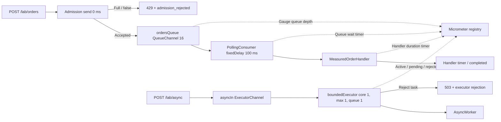
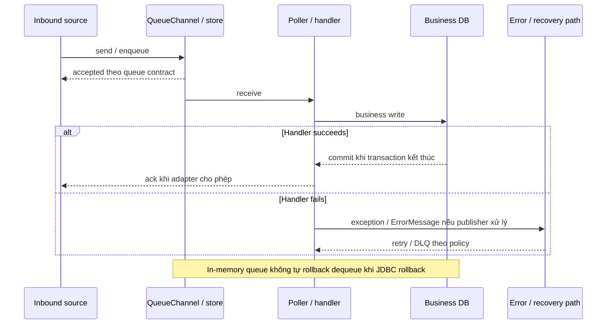
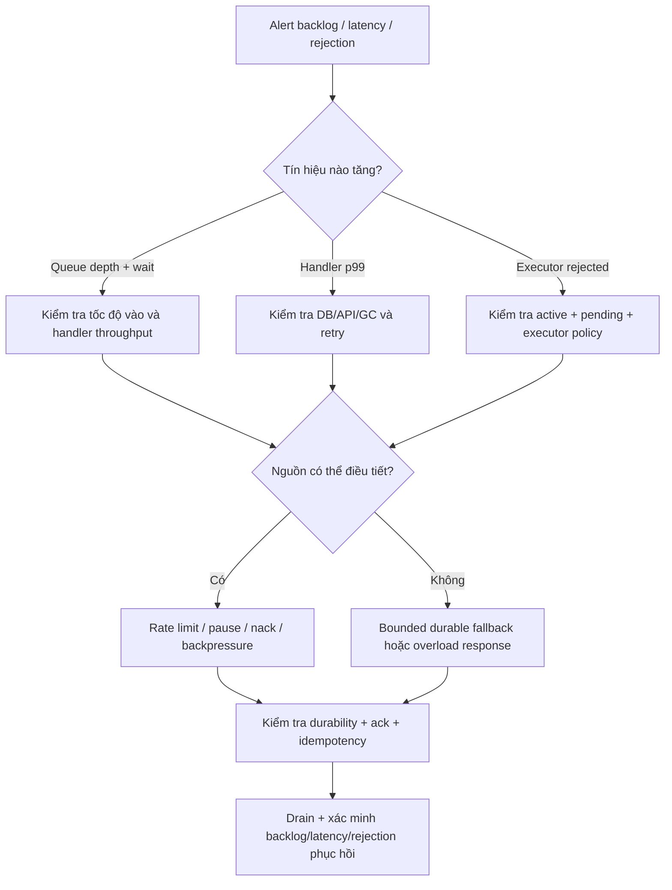

# Đo queue depth, handler latency và executor rejection trong Spring Integration

## 1. Bài thực hành tổng hợp: nhìn thấy điểm nghẽn trước khi hệ thống quá tải

Trong chương **Thực hành tổng hợp** của mô-đun `SPRING_INTEGRATION_RUNTIME`, chúng ta đã làm việc với vòng đời `IntegrationFlow`, channel, endpoint, consumer, poller và executor, cũng như transaction, retry, message store, lỗi và correlation. Bài này kết hợp các khái niệm đó thành **một phòng thí nghiệm đo đạc có thể tái hiện**: từ nguồn HTTP đẩy message vào `QueueChannel`, polling consumer gọi handler có độ trễ giả lập, và một nhánh riêng dùng `ExecutorChannel` với thread pool hữu hạn để tạo tình huống từ chối task.

Ba tín hiệu cần đo:

1. **Queue depth** — có bao nhiêu message **đang chờ trong một queue cụ thể** tại thời điểm lấy mẫu?
2. **Handler latency** — thời gian **handler thực sự làm việc** là bao nhiêu; có bị nhầm với thời gian chờ trong queue không?
3. **Executor rejection** — bao nhiêu lần executor **không nhận task ở thời điểm submit** do không còn capacity?

Mục tiêu không chỉ là vẽ dashboard. Sau mỗi phép đo, bạn cần giải thích **dữ liệu nào đã được chấp nhận**, **dữ liệu nào chưa được nhận**, **chặng nào đang nghẽn**, và **việc gì xảy ra nếu ứng dụng chết trước khi commit/ack**.

### Kết quả mong đợi

- Một ứng dụng Spring Boot/Spring Integration nhỏ có `QueueChannel` capacity hữu hạn, polling handler và `ExecutorChannel` dùng `ThreadPoolTaskExecutor` hữu hạn.
- Micrometer `Gauge` cho queue depth/capacity và executor pending/active.
- Micrometer `Timer` tách **queue wait** và **handler execution time**; có histogram phục vụ p95/p99.
- Micrometer `Counter` cho admission accepted/rejected và executor rejected.
- HTTP/Actuator endpoints để gửi synthetic workload và đọc số liệu.
- JUnit 5 kiểm tra queue đầy, timer được ghi và executor rejection bằng latch **không dùng `Thread.sleep()` để đồng bộ test**.
- Kịch bản load/stress, truy vấn PromQL, alert, runbook và ma trận failure/restart.

**Phạm vi:** code dưới đây là **lab in-memory**, không phải một hệ thống hàng đợi đơn hàng production. Payload và độ trễ đều giả lập; không đưa credential hoặc PII thật vào logs/metrics. Khi triển khai thực cần thêm durable source/message store, transaction/ack, retry, DLQ và idempotency.

## 2. Topology và ranh giới đo

Ứng dụng có **hai nhánh độc lập**, vì queue depth và executor rejection xảy ra ở hai nơi khác nhau.



**Vị trí đo rất quan trọng:**

| Tín hiệu | Bắt đầu và kết thúc | Đo được | Không đo được |
|---|---|---|---|
| `queue.depth` | Snapshot số item nằm trong `ordersQueue` | Backlog **trong channel này** | Item đã dequeued nhưng chưa xử lý xong, broker lag, executor queue |
| `queue.remaining` | Snapshot số slot còn trống | Khả năng nhận thêm theo count tại thời điểm lấy mẫu | Memory bytes còn trống hoặc durable acceptance |
| `queue.wait` | Từ khi gửi vào queue đến khi handler được gọi | Độ trễ đợi trong **JVM hiện tại** | Thời gian ở broker trước ingress, thời gian sau handler |
| `handler.duration` | Handler bắt đầu công việc → hoàn tất/throw | Thời gian synchronous work của handler demo | Thời gian message nằm trong queue |
| `executor.pending` | Snapshot executor task queue | Task đã submit nhưng chưa được worker lấy | Work đang chạy, JDBC pool pending, source backlog |
| `executor.active` | Snapshot active threads | Worker đang có task | Số message đang chờ ở các chặng khác |
| `executor.rejected` | Increment khi `RejectedExecutionHandler` được gọi | Task không được executor nhận tại điểm submit | Handler failures phát sinh **sau khi submit đã thành công** |

Một message có thể đi qua nhiều queue; **không suy luận tổng backlog chỉ từ một `QueueChannel.getQueueSize()`**. Tương tự, `ExecutorChannel.send()` trả thành công thường chỉ chứng minh task đã được chấp nhận, không chứng minh handler đã xử lý hoặc database đã commit.

## 3. Khởi tạo dự án và cách chạy

Ví dụ nhắm tới **Java 17+**, Spring Boot 3.x tương thích với Spring Integration 6.x và Micrometer/Actuator do BOM quản lý. Với Spring Boot 4.x hoặc Spring Integration 7.x, giữ nguyên ý tưởng đo nhưng kiểm tra API/starter và cấu hình theo đúng phiên bản đang sử dụng.

### 3.1. Dependency minh họa với Gradle

```groovy
plugins {
    id "java"
    id "org.springframework.boot" version "3.5.16"
    id "io.spring.dependency-management" version "1.1.7"
}

java {
    toolchain {
        languageVersion = JavaLanguageVersion.of(17)
    }
}

repositories {
    mavenCentral()
}

dependencies {
    implementation "org.springframework.boot:spring-boot-starter-web"
    implementation "org.springframework.boot:spring-boot-starter-integration"
    implementation "org.springframework.boot:spring-boot-starter-actuator"

    runtimeOnly "io.micrometer:micrometer-registry-prometheus"

    testImplementation "org.springframework.boot:spring-boot-starter-test"
}

tasks.named("test") {
    useJUnitPlatform()
}
```

Ví dụ chốt Spring Boot **3.5.16** và plugin dependency-management **1.1.7** để học viên có cấu hình tái hiện được với Java 17/Gradle tương thích. Dòng Boot 3.5.x đã kết thúc vòng phát hành OSS; **không dùng version này làm khuyến nghị bảo mật cho production tháng 11/2026**. Với sản phẩm mới hoặc dự án đang vận hành, chọn release Boot còn được hỗ trợ và phiên bản Spring Integration phù hợp theo BOM rồi kiểm thử lại các API. Không tự trộn nhiều dòng Spring Framework, Spring Integration và Boot.

### 3.2. Cấu hình Actuator

File `src/main/resources/application.yml`:

```yaml
server:
  port: 8080

management:
  endpoints:
    web:
      exposure:
        include: health,info,metrics,prometheus
  endpoint:
    health:
      show-details: never

logging:
  level:
    root: INFO
```

Sau khi chạy, những endpoint quan trọng:

- `GET /actuator/metrics`: danh sách tên meter trong registry hiện tại.
- `GET /actuator/metrics/lab.si.queue.depth`: giá trị gauge tự đăng ký ở lab.
- `GET /actuator/metrics/lab.si.handler.duration`: `count` và thời gian handler đã được ghi.
- `GET /actuator/prometheus`: dữ liệu dạng Prometheus nếu có `micrometer-registry-prometheus`.

Endpoint Actuator cần **network policy và authentication/authorization phù hợp** khi triển khai; ví dụ local trên máy phát triển không phải cấu hình truy cập production. Không expose các management endpoints nhạy cảm một cách vô điều kiện.

## 4. Phân biệt meter có sẵn với meter tự định nghĩa

Spring Integration hỗ trợ Micrometer metrics cho những component như `AbstractMessageChannel`, `AbstractMessageHandler` và `AbstractMessageSource`. Reference còn mô tả gauges cho `QueueChannel`:

| Meter từ framework (khi được instrument) | Ý nghĩa |
|---|---|
| `spring.integration.channel.queue.size` | Số message tại `QueueChannel`, tag thường gồm type/channel name |
| `spring.integration.channel.queue.remaining.capacity` | Số slot còn lại tại queue |
| `spring.integration.send` | Thời gian send của channel/handler trong cách instrument Micrometer truyền thống |
| `spring.integration.receive` | Số lượt nhận ở channel/source phù hợp |
| `spring.integration.handler` | Timer theo **Micrometer Observation** khi Observation được bật và instrument handler |
| `spring.integration.handler.active` | Long task timer của handler theo Observation |
| `spring.integration.producer` | Timer cho producer/channel theo Observation |

**Hai cơ chế metrics và Observation không có cùng tên meter hoặc cấu hình bật.** Theo tài liệu Spring Integration hiện đại, có `@EnableIntegrationManagement` và `ObservationRegistry` nhưng mặc định `observationPatterns` không chọn tất cả component. Muốn instrument chọn lọc, xác minh registry, annotation/pattern và runtime thực. Không mặc định `spring.integration.handler` sẽ có chỉ vì đã thêm Actuator.

Để bài thực hành **độc lập với version/meter naming** của framework, ta dùng thêm namespace riêng `lab.si.*`. Nếu registry cũng có meter mặc định của Spring Integration, **không cộng chúng với meter của lab** để tính throughput vì dễ double count.

### Contract cho meter của bài

| Meter custom | Loại | Tags ít biến động | Đơn vị |
|---|---|---|---|
| `lab.si.queue.depth` | Gauge | `channel=ordersQueue` | message |
| `lab.si.queue.remaining` | Gauge | `channel=ordersQueue` | slot |
| `lab.si.queue.capacity` | Gauge | `channel=ordersQueue` | slot |
| `lab.si.queue.wait` | Timer | `handler=orders` | time |
| `lab.si.handler.duration` | Timer | `handler=orders` hoặc `handler=async` | time |
| `lab.si.handler.completed` | Counter | `handler=orders` | event |
| `lab.si.handler.failed` | Counter | `handler=orders` | event |
| `lab.si.admission.accepted` | Counter | `route=orders` | message |
| `lab.si.admission.rejected` | Counter | `route=orders` | message |
| `lab.si.executor.active` | Gauge | `executor=boundedExecutor` | thread |
| `lab.si.executor.pending` | Gauge | `executor=boundedExecutor` | task |
| `lab.si.executor.rejected` | Counter | `executor=boundedExecutor` | task |

Không gắn `eventId`, message UUID, email, token, raw exception text hoặc tenant ID không bị giới hạn vào labels. Những giá trị ấy có **cardinality rất cao** và có thể rò rỉ dữ liệu nhạy cảm. Correlation ID dùng ở trace/log đã kiểm soát, không dùng làm metric label.

## 5. Ứng dụng: message, channel và bounded executor

Tổ chức các `public class` dưới package `lab.runtime`, **mỗi class trong một file Java tương ứng**. Các đoạn sau là mã ứng dụng của cùng một project.

### 5.1. Điểm khởi động

File `RuntimeMetricsLabApplication.java`:

```java
package lab.runtime;

import org.springframework.boot.SpringApplication;
import org.springframework.boot.autoconfigure.SpringBootApplication;
import org.springframework.integration.config.EnableIntegration;

@SpringBootApplication
@EnableIntegration
public class RuntimeMetricsLabApplication {

    public static void main(String[] args) {
        SpringApplication.run(RuntimeMetricsLabApplication.class, args);
    }
}
```

### 5.2. Payload công việc giả lập

File `WorkItem.java`:

```java
package lab.runtime;

public record WorkItem(String eventId, int workMillis) {
}
```

`workMillis` là độ trễ được cố ý đưa vào lab để nhìn thấy saturation. Ứng dụng phải xác thực `0 <= workMillis <= 1500` ở ingress; **không** để dữ liệu bên ngoài điều khiển thread sleep không giới hạn. Khi triển khai production, thay công việc giả lập bằng service/adapter thực, đặt timeout và transaction đúng nghiệp vụ.

### 5.3. Channels, executor và gauges

File `RuntimeFlowConfig.java`:

```java
package lab.runtime;

import java.util.concurrent.RejectedExecutionException;

import io.micrometer.core.instrument.Counter;
import io.micrometer.core.instrument.Gauge;
import io.micrometer.core.instrument.MeterRegistry;

import org.springframework.beans.factory.annotation.Qualifier;
import org.springframework.boot.ApplicationRunner;
import org.springframework.context.annotation.Bean;
import org.springframework.context.annotation.Configuration;
import org.springframework.integration.channel.ExecutorChannel;
import org.springframework.integration.channel.QueueChannel;
import org.springframework.messaging.MessageChannel;
import org.springframework.scheduling.concurrent.ThreadPoolTaskExecutor;

@Configuration
public class RuntimeFlowConfig {

    public static final int ORDER_QUEUE_CAPACITY = 16;

    @Bean("ordersQueue")
    public QueueChannel ordersQueue() {
        return new QueueChannel(ORDER_QUEUE_CAPACITY);
    }

    @Bean("boundedExecutor")
    public ThreadPoolTaskExecutor boundedExecutor(
            MeterRegistry meterRegistry) {

        Counter rejects = Counter
                .builder("lab.si.executor.rejected")
                .description("Tasks rejected at executor submission")
                .tag("executor", "boundedExecutor")
                .register(meterRegistry);

        ThreadPoolTaskExecutor executor = new ThreadPoolTaskExecutor();
        executor.setThreadNamePrefix("lab-async-");
        executor.setCorePoolSize(1);
        executor.setMaxPoolSize(1);
        executor.setQueueCapacity(1);

        executor.setRejectedExecutionHandler(
                (task, threadPool) -> {
                    rejects.increment();
                    throw new RejectedExecutionException(
                            "boundedExecutor saturated");
                });

        return executor;
    }

    @Bean("asyncIn")
    public MessageChannel asyncIn(
            @Qualifier("boundedExecutor")
            ThreadPoolTaskExecutor boundedExecutor) {
        return new ExecutorChannel(boundedExecutor);
    }

    @Bean
    public ApplicationRunner registerLiveGauges(
            MeterRegistry registry,
            @Qualifier("ordersQueue") QueueChannel queue,
            @Qualifier("boundedExecutor") ThreadPoolTaskExecutor executor) {

        return args -> {
            Gauge.builder("lab.si.queue.depth",
                    queue, QueueChannel::getQueueSize)
                    .description("Messages waiting in ordersQueue")
                    .tag("channel", "ordersQueue")
                    .register(registry);

            Gauge.builder("lab.si.queue.remaining",
                    queue, QueueChannel::getRemainingCapacity)
                    .tag("channel", "ordersQueue")
                    .register(registry);

            Gauge.builder("lab.si.queue.capacity",
                    queue, q -> ORDER_QUEUE_CAPACITY)
                    .tag("channel", "ordersQueue")
                    .register(registry);

            Gauge.builder("lab.si.executor.active",
                    executor, ThreadPoolTaskExecutor::getActiveCount)
                    .tag("executor", "boundedExecutor")
                    .register(registry);

            Gauge.builder("lab.si.executor.pending",
                    executor,
                    e -> e.getThreadPoolExecutor().getQueue().size())
                    .tag("executor", "boundedExecutor")
                    .register(registry);
        };
    }
}
```

**Lưu ý kỹ thuật:**

1. `QueueChannel(16)` giới hạn **số message**, không phải 16 bytes/KiB.
2. `setCorePoolSize(1)`, `setMaxPoolSize(1)`, `setQueueCapacity(1)` tạo executor dễ bão hòa: một task chạy và một task đợi, task kế tiếp có thể bị reject.
3. `RejectedExecutionHandler` tăng `Counter` **tại thời điểm executor từ chối submit**. Nếu handler sau khi chạy bị lỗi, counter này **không** tăng.
4. Khi Bean được Spring quản lý, `ThreadPoolTaskExecutor` được khởi tạo và giải phóng theo lifecycle; không tự gọi `initialize()` hai lần trên bean đó.
5. `ApplicationRunner` đăng ký gauges sau khi Spring Boot khởi động và beans đã có. Gauge là phép **đọc trạng thái tại thời điểm scrape**, không phải bộ đếm sự kiện.
6. Đăng ký Gauge bằng object `queue` hoặc `executor` giúp hàm đo bám theo **cùng instance** đang chạy. Nếu tự tạo một queue khác trong instrumentation, dashboard sẽ hiển thị số liệu sai.
7. Không dùng `QueueChannel.clear()` để “làm giảm queue depth” khi quá tải trong production: thao tác đó có thể loại bỏ công việc chưa được xử lý.

Hai biến `active` và `pending` không phải tổng message còn ở broker. Một task đã được executor chấp nhận còn có thể chưa vào handler, và khi async handler bắt đầu chạy thì task không còn ở pending queue.

## 6. Handler latency và queue wait là hai phép đo khác nhau

### 6.1. Dùng đồng hồ đơn điệu cho hàng đợi trong cùng JVM

Tại ingress, ta đặt header `enqueuedAtNanos=System.nanoTime()` ngay trước khi gửi vào `ordersQueue`. Khi polling consumer lấy message và gọi handler, nó tính:

\[
\text{queueWaitNanos} =
  \max(0,\ \text{System.nanoTime()} -
               \text{enqueuedAtNanos})
\]

`System.nanoTime()` thích hợp để đo **khoảng thời gian trong cùng JVM**, kể cả qua thread; nó **không phải timestamp tuyệt đối** và **không được lưu bền rồi so qua lần restart/host khác**. Khi đo broker lag hoặc persistent store xuyên JVM, dùng timestamp nguồn tạo/append và xử lý clock skew theo contract phù hợp.

`queue.wait` chỉ ghi khi message **đến được handler**. Nếu message vẫn nằm trong backlog hoặc bị mất/trả lỗi trước handler, không có sample. Vì thế queue wait histogram có thể nhìn tốt trong khi các message cũ nhất vẫn kẹt — hãy đo thêm **oldest pending age** ở source/store nếu nghiệp vụ yêu cầu.

### 6.2. Handler có timer độc lập

File `MeasuredOrderHandler.java`:

```java
package lab.runtime;

import java.util.concurrent.TimeUnit;

import io.micrometer.core.instrument.Counter;
import io.micrometer.core.instrument.MeterRegistry;
import io.micrometer.core.instrument.Timer;

import org.springframework.integration.annotation.MessageEndpoint;
import org.springframework.integration.annotation.Poller;
import org.springframework.integration.annotation.ServiceActivator;
import org.springframework.messaging.Message;

@MessageEndpoint
public class MeasuredOrderHandler {

    private final MeterRegistry registry;
    private final Timer handlerTimer;
    private final Timer queueWaitTimer;
    private final Counter completed;
    private final Counter failed;

    public MeasuredOrderHandler(MeterRegistry registry) {
        this.registry = registry;

        this.handlerTimer = Timer
                .builder("lab.si.handler.duration")
                .description("Synchronous work inside order handler")
                .tag("handler", "orders")
                .publishPercentileHistogram()
                .register(registry);

        this.queueWaitTimer = Timer
                .builder("lab.si.queue.wait")
                .description("Time from local enqueue to handler invocation")
                .tag("handler", "orders")
                .publishPercentileHistogram()
                .register(registry);

        this.completed = registry.counter(
                "lab.si.handler.completed", "handler", "orders");
        this.failed = registry.counter(
                "lab.si.handler.failed", "handler", "orders");
    }

    @ServiceActivator(
            inputChannel = "ordersQueue",
            poller = @Poller(
                    fixedDelay = "100",
                    maxMessagesPerPoll = "1",
                    receiveTimeout = "0"))
    public void handle(Message<WorkItem> message) {
        Object stamp = message.getHeaders().get("enqueuedAtNanos");

        if (stamp instanceof Long enqueueNanoTime) {
            long queueWait = Math.max(
                    0L, System.nanoTime() - enqueueNanoTime);
            queueWaitTimer.record(queueWait, TimeUnit.NANOSECONDS);
        }

        Timer.Sample sample = Timer.start(registry);

        try {
            simulateBlockingWork(message.getPayload().workMillis());
            completed.increment();
        } catch (RuntimeException failure) {
            failed.increment();
            throw failure;
        } finally {
            sample.stop(handlerTimer);
        }
    }

    static void simulateBlockingWork(int millis) {
        try {
            // Chỉ để sinh độ trễ trong LAB, không dùng ở production.
            Thread.sleep(millis);
        } catch (InterruptedException interrupted) {
            Thread.currentThread().interrupt();
            throw new IllegalStateException(
                    "Handler interrupted", interrupted);
        }
    }
}
```

Trong mã này:

- `queueWaitTimer` được ghi **trước** khi bắt đầu `handlerTimer`; không cộng chúng làm “handler latency”.
- `Timer.Sample` dừng trong `finally`, nên một handler thất bại vẫn có **duration sample**.
- `completed` chỉ tăng sau công việc giả lập thành công. Trong nghiệp vụ có DB transaction, **không suy ra counter tăng nghĩa là DB đã commit** nếu transaction được commit ở ngoài method hoặc có async side effect.
- `failed` là lỗi phát sinh trong method này, **không** bao gồm executor rejection trước khi method được gọi.
- `fixedDelay=100` và `maxMessagesPerPoll=1` khiến queue dễ tăng trong load test. Chúng không tương đương “đúng 10 message/giây”: thời gian xử lý handler và scheduler cũng ảnh hưởng.

**Về tính ổn định của test:** `Thread.sleep` ở đây được **cố ý** dùng trong handler demo để tạo độ trễ quan sát được; **không dùng sleep như phương pháp đồng bộ assertion**. Trong các test ở phần sau, dùng latch, timer count và timeout hữu hạn.

### 6.3. Handler async của ExecutorChannel

File `AsyncWorker.java`:

```java
package lab.runtime;

import io.micrometer.core.instrument.MeterRegistry;
import io.micrometer.core.instrument.Timer;

import org.springframework.integration.annotation.MessageEndpoint;
import org.springframework.integration.annotation.ServiceActivator;

@MessageEndpoint
public class AsyncWorker {

    private final Timer handlerTimer;

    public AsyncWorker(MeterRegistry registry) {
        this.handlerTimer = Timer
                .builder("lab.si.handler.duration")
                .description("Synchronous work inside async worker")
                .tag("handler", "async")
                .publishPercentileHistogram()
                .register(registry);
    }

    @ServiceActivator(inputChannel = "asyncIn")
    public void handle(WorkItem item) {
        handlerTimer.record(
                () -> MeasuredOrderHandler.simulateBlockingWork(
                        item.workMillis()));
    }
}
```

Trong lab, `AsyncWorker` xử lý đồng bộ **trên worker thread** nên timer được ghi khi công việc hoàn tất. Nếu handler tương lai trả về `Mono<?>`, `CompletableFuture<?>` hoặc bắt đầu một tác vụ bất đồng bộ rồi trả ngay, đo quanh lời gọi tạo future **không phản ánh thời gian hoàn tất thực**. Khi đó đặt timer trong completion callback hoặc reactive `doFinally`/`doOnEach` đúng nghĩa và kiểm tra cancel/error semantics.

## 7. Gửi workload và phân loại overload ở ingress

File `LabIngressController.java`:

```java
package lab.runtime;

import java.util.Map;

import io.micrometer.core.instrument.Counter;
import io.micrometer.core.instrument.MeterRegistry;

import org.springframework.beans.factory.annotation.Qualifier;
import org.springframework.core.task.TaskRejectedException;
import org.springframework.http.HttpStatus;
import org.springframework.http.ResponseEntity;
import org.springframework.integration.channel.QueueChannel;
import org.springframework.messaging.MessageChannel;
import org.springframework.messaging.MessageDeliveryException;
import org.springframework.messaging.support.MessageBuilder;
import org.springframework.web.bind.annotation.PostMapping;
import org.springframework.web.bind.annotation.RequestBody;
import org.springframework.web.bind.annotation.RequestMapping;
import org.springframework.web.bind.annotation.RestController;

@RestController
@RequestMapping("/lab")
public class LabIngressController {

    private final QueueChannel queue;
    private final MessageChannel asyncIn;

    private final Counter ordersAccepted;
    private final Counter ordersRejected;

    public LabIngressController(
            @Qualifier("ordersQueue") QueueChannel queue,
            @Qualifier("asyncIn") MessageChannel asyncIn,
            MeterRegistry registry) {

        this.queue = queue;
        this.asyncIn = asyncIn;

        this.ordersAccepted = registry.counter(
                "lab.si.admission.accepted", "route", "orders");
        this.ordersRejected = registry.counter(
                "lab.si.admission.rejected", "route", "orders");
    }

    private static boolean valid(WorkItem item) {
        return item != null
                && item.eventId() != null
                && item.eventId().matches("[A-Za-z0-9_-]{1,80}")
                && item.workMillis() >= 0
                && item.workMillis() <= 1500;
    }

    @PostMapping("/orders")
    public ResponseEntity<Map<String, String>> orders(
            @RequestBody WorkItem item) {

        if (!valid(item)) {
            return ResponseEntity.badRequest()
                    .body(Map.of("status", "invalid"));
        }

        boolean accepted = queue.send(
                MessageBuilder.withPayload(item)
                        .setHeader("enqueuedAtNanos", System.nanoTime())
                        .setHeader("businessEventId", item.eventId())
                        .build(),
                0); // Không block request thread chờ slot.

        if (!accepted) {
            ordersRejected.increment();
            return ResponseEntity.status(HttpStatus.TOO_MANY_REQUESTS)
                    .body(Map.of("status", "queue_full"));
        }

        ordersAccepted.increment();
        return ResponseEntity.accepted()
                .body(Map.of("status", "queued_in_memory"));
    }

    @PostMapping("/async")
    public ResponseEntity<Map<String, String>> async(
            @RequestBody WorkItem item) {

        if (!valid(item)) {
            return ResponseEntity.badRequest()
                    .body(Map.of("status", "invalid"));
        }

        try {
            boolean submitted = asyncIn.send(
                    MessageBuilder.withPayload(item).build(), 0);

            if (!submitted) {
                return ResponseEntity.status(
                        HttpStatus.SERVICE_UNAVAILABLE)
                        .body(Map.of("status", "not_submitted"));
            }

            return ResponseEntity.accepted()
                    .body(Map.of("status", "submitted_to_executor"));
        } catch (MessageDeliveryException | TaskRejectedException problem) {
            // Lab: đồng nhất những lỗi handoff đã được chờ đợi.
            // Production: phân loại chính xác nguyên nhân, alert
            // misconfiguration, không coi MỌI exception là overload.
            return ResponseEntity.status(HttpStatus.SERVICE_UNAVAILABLE)
                    .body(Map.of("status", "async_handoff_failed"));
        }
    }
}
```

**Hợp đồng cần đọc chính xác:**

- `202 queued_in_memory` chỉ nói `QueueChannel` đã nhận message **trong JVM**. Nếu process chết, công việc chưa xử lý có thể mất.
- `202 submitted_to_executor` chỉ nói `ExecutorChannel`/executor nhận task; **không** phải xác nhận handler xong.
- `429 queue_full` nói lần nhận hiện tại thất bại; HTTP caller phải biết có nên retry và có idempotency key không.
- `503 async_handoff_failed` từ ví dụ cần tách tiếp nguyên nhân tại production: executor reject do overload khác với không có subscriber, lỗi configuration hoặc dispatcher khác. Counter `lab.si.executor.rejected` chỉ tăng với **rejection của executor**.
- Header `enqueuedAtNanos` phục vụ đo **local**, không được lưu bền/replay qua JVM rồi so với `System.nanoTime()` mới.
- Không đưa `eventId`, payload, token, email hay exception message thành metric tag hoặc log mặc định.

Trong một hệ thống HTTP thực có client retry, 429/503 phải đi kèm hợp đồng **at-least-once + idempotency** nếu lệnh đã từng được nhận ở bất kỳ hop nào. Đừng trả `202` ở một adapter upstream trước khi xác nhận lưu message bền vững theo SLO nghiệp vụ.

## 8. Chạy lab và đọc số liệu

### 8.1. Khởi chạy

Sau khi chọn phiên bản dependency phù hợp:

```bash
./gradlew bootRun
```

Trên Windows có thể dùng `gradlew.bat bootRun` trong terminal project. Theo giới hạn STEP 4 Worker, phần này là **hướng dẫn cho học viên**, không có nghĩa bài đã được biên dịch hoặc test tự động tại bước soạn.

Gửi một message thử:

```bash
curl -i -X POST http://localhost:8080/lab/orders \
  -H "Content-Type: application/json" \
  -d '{"eventId":"evt-001","workMillis":500}'
```

Đọc metadata của meters:

```bash
curl -s http://localhost:8080/actuator/metrics
curl -s http://localhost:8080/actuator/metrics/lab.si.queue.depth
curl -s http://localhost:8080/actuator/metrics/lab.si.queue.remaining
curl -s http://localhost:8080/actuator/metrics/lab.si.handler.duration
curl -s http://localhost:8080/actuator/metrics/lab.si.executor.rejected
```

Một số meters dạng timer/counter chỉ có sample sau khi flow đã thực hiện ít nhất một lần; names/tags thực tế có thể phụ thuộc registry. `/actuator/metrics` là nơi đầu tiên cần kiểm tra, không suy đoán meter đã tồn tại khi ứng dụng chưa có event.

### 8.2. Thử burst làm đầy queue

Trong terminal dành cho bài test local:

```bash
for i in $(seq 1 80); do
  curl -s -o /dev/null -w '%{http_code}\n' \
    -X POST http://localhost:8080/lab/orders \
    -H 'Content-Type: application/json' \
    -d "{\"eventId\":\"burst-$i\",\"workMillis\":700}" &
done
wait
```

Đây là bash trên môi trường có `curl`; trên PowerShell, dùng nhiều concurrent requests tương đương. Với consumer chạy một poller và xử lý giả lập 700 ms, queue capacity 16 có thể đạt ngưỡng rất nhanh. **Không tuyên bố mọi lần chạy sẽ có đúng 16 HTTP 202**: poller có thể lấy message khi request đang đến, HTTP concurrency khác nhau và thời điểm scrape khác nhau.

Quan sát:

- `lab.si.queue.depth` tăng khi queue tích backlog và giảm khi poller xử lý.
- `lab.si.queue.remaining` giảm về gần 0 khi queue đầy.
- `lab.si.admission.accepted` / `rejected` cho biết **kết quả nhận ở ingress**.
- `lab.si.queue.wait` tăng theo độ dài backlog với những item cuối cùng đã đến được handler.
- `lab.si.handler.duration` quanh độ trễ công việc giả lập; không tăng tuyến tính theo backlog nếu handler không đổi.
- `lab.si.executor.rejected` **không cần tăng** ở test này, vì branch executor là một đường khác.

**Bài học:** queue wait p95 có thể xấu đi khi queue depth lớn, dù handler latency vẫn ổn định. Nếu chỉ quan sát handler timer, bạn có thể bỏ qua phần lớn thời gian chờ của user.

### 8.3. Thử executor rejection

```bash
for i in $(seq 1 30); do
  curl -s -o /dev/null -w '%{http_code}\n' \
    -X POST http://localhost:8080/lab/async \
    -H 'Content-Type: application/json' \
    -d "{\"eventId\":\"async-$i\",\"workMillis\":1000}" &
done
wait
```

Với pool `core=1, max=1, queueCapacity=1`, khi một task chạy và một task đang đợi, những lần submit tiếp theo có thể bị từ chối theo `AbortPolicy` do lab cấu hình. Những dấu hiệu:

- Một số request trả `503` thay vì `202`.
- `lab.si.executor.rejected` tăng đúng ở **RejectedExecutionHandler**, không phải trong handler.
- `lab.si.executor.active` tối đa khoảng 1 theo cấu hình.
- `lab.si.executor.pending` tối đa khoảng 1 theo cấu hình.
- `lab.si.handler.duration{handler="async"}` có sample của những task đã thực sự chạy; không có sample cho task bị reject trước khi chạy.

Các snapshot gauge được scrape không đồng bộ nên **có thể không bắt trúng đỉnh** active/pending 1 nếu burst rất ngắn. Counter rejection vẫn lưu tổng sự kiện trong thời gian process còn sống; dùng `rate()` cho tốc độ theo cửa sổ thời gian.

## 9. JUnit 5: kiểm tra queue depth không phụ thuộc poller

Một kiểm thử thật sự xác định nên cô lập `QueueChannel` để poller không lấy message trong lúc đang assert.

File `QueueDepthTest.java`:

```java
package lab.runtime;

import io.micrometer.core.instrument.Gauge;
import io.micrometer.core.instrument.simple.SimpleMeterRegistry;
import org.junit.jupiter.api.Test;
import org.springframework.integration.channel.QueueChannel;
import org.springframework.messaging.support.MessageBuilder;

import static org.junit.jupiter.api.Assertions.*;

class QueueDepthTest {

    @Test
    void gaugeTracksMessagesWaitingInQueue() {
        try (var registry = new SimpleMeterRegistry()) {
            QueueChannel queue = new QueueChannel(2);

            Gauge depth = Gauge.builder(
                    "lab.si.queue.depth",
                    queue, QueueChannel::getQueueSize)
                    .register(registry);

            Gauge remaining = Gauge.builder(
                    "lab.si.queue.remaining",
                    queue, QueueChannel::getRemainingCapacity)
                    .register(registry);

            assertEquals(0.0, depth.value());
            assertEquals(2.0, remaining.value());

            assertTrue(queue.send(
                    MessageBuilder.withPayload("A").build(), 0));
            assertTrue(queue.send(
                    MessageBuilder.withPayload("B").build(), 0));

            assertEquals(2.0, depth.value());
            assertEquals(0.0, remaining.value());

            // Không thể nhận thêm; queue vẫn có 2 item.
            assertFalse(queue.send(
                    MessageBuilder.withPayload("C").build(), 0));
            assertEquals(2.0, depth.value());

            assertEquals("A", queue.receive(0).getPayload());
            assertEquals(1.0, depth.value());
            assertEquals(1.0, remaining.value());
        }
    }
}
```

**Điểm được chứng minh:** gauge phản ánh queue instance này, `send(...,0)` trả `false` khi đầy, `receive(0)` giải phóng slot.

**Điểm chưa chứng minh:** queue có thể lưu bền qua restart, handler đã xử lý thành công hoặc lời gọi controller đã trả đúng HTTP 429. Những mục đó cần integration test riêng. Test ở đây dùng `QueueChannel` độc lập **không có polling consumer**, do đó tránh race khiến depth thay đổi giữa hai assertion.

### 9.1. Vì sao không assert chính xác queue depth trên production?

Ngay khi một gauge đọc được `depth=10`, polling consumer có thể vừa dequeue thêm message. Giá trị là **ảnh chụp gần đúng một thời điểm**, không phải kết quả snapshot transaction toàn hệ thống. Vì vậy không viết một alert “depth == capacity tại đúng một scrape” để kết luận chắc chắn mọi ingress đang bị từ chối.

Ngoài ra, nếu poller nhận vào executor riêng, `QueueChannel` có thể gần 0 nhưng executor pending rất lớn. Một dashboard đúng cần quan sát **tất cả điểm buffer và in-flight**.

## 10. JUnit 5: handler timer và queue wait có được ghi đúng?

File `HandlerMetricsTest.java` kiểm tra class handler bằng `SimpleMeterRegistry`, không cần khởi động HTTP server/poller:

```java
package lab.runtime;

import java.util.concurrent.TimeUnit;

import io.micrometer.core.instrument.Timer;
import io.micrometer.core.instrument.simple.SimpleMeterRegistry;

import org.junit.jupiter.api.Test;
import org.springframework.messaging.support.MessageBuilder;

import static org.junit.jupiter.api.Assertions.*;

class HandlerMetricsTest {

    @Test
    void recordsWorkDurationSeparatelyFromQueueWait() {
        try (var registry = new SimpleMeterRegistry()) {
            var handler = new MeasuredOrderHandler(registry);

            var message = MessageBuilder
                    .withPayload(new WorkItem("evt-test", 0))
                    .setHeader("enqueuedAtNanos", System.nanoTime())
                    .build();

            handler.handle(message);

            Timer work = registry.find("lab.si.handler.duration")
                    .tag("handler", "orders").timer();
            Timer queueWait = registry.find("lab.si.queue.wait")
                    .tag("handler", "orders").timer();

            assertNotNull(work);
            assertNotNull(queueWait);
            assertEquals(1L, work.count());
            assertEquals(1L, queueWait.count());
            assertEquals(1.0, registry.find(
                    "lab.si.handler.completed")
                    .tag("handler", "orders")
                    .counter().count());

            assertTrue(work.totalTime(TimeUnit.NANOSECONDS) >= 0);
            assertTrue(queueWait.totalTime(TimeUnit.NANOSECONDS) >= 0);
        }
    }
}
```

Không dùng `assertEquals(700ms, timer.totalTime())` trong test: thời gian thực thi phụ thuộc scheduler/CPU/CI, và bài này sử dụng delay bằng 0 để tập trung vào **hợp đồng ghi metric**. Trong một test integration, cần gửi qua `ordersQueue` rồi chờ `timer.count()` tăng với timeout; test trên chỉ chứng minh logic meter trong class, **không** chứng minh Spring đã gắn endpoint đúng channel.

### 10.1. Test khi handler throw

Thêm failure injection có thể kiểm soát, ví dụ một `WorkService` mock ném exception sau khi bắt đầu. Oracle phù hợp:

- `handler.duration.count` tăng **kể cả failure**, do `sample.stop(...)` nằm trong `finally`.
- `handler.failed` tăng; `handler.completed` không tăng cho cùng attempt.
- Poller/error handler xử lý exception theo cấu hình thật, **không mặc định** error đã vào global `errorChannel`.
- Nếu retry advice gọi lại handler, một **logical message** có thể có nhiều handler attempts/timer samples.

Đo **attempt latency** khác đo **end-to-end successful completion latency**. Với retry/backoff, end-to-end có thể dài hơn tổng những khoảng handler work.

## 11. JUnit 5: tạo executor rejection xác định bằng latch

Nếu cố gây reject chỉ bằng `sleep(1000)` và bắn ba task thật nhanh, test có thể flaky trên CI: worker có thể hoàn tất quá sớm hoặc scheduler sắp xếp khác dự kiến.

Sử dụng `CountDownLatch` để giữ **task thứ nhất đang chạy**, task thứ hai chiếm **slot queue duy nhất**, rồi submit task thứ ba. Điều này tạo đúng trạng thái bão hòa mà không dựa vào timing ngẫu nhiên.

File `ExecutorRejectionTest.java`:

```java
package lab.runtime;

import java.util.concurrent.CountDownLatch;
import java.util.concurrent.RejectedExecutionException;
import java.util.concurrent.TimeUnit;

import io.micrometer.core.instrument.Counter;
import io.micrometer.core.instrument.simple.SimpleMeterRegistry;

import org.junit.jupiter.api.Test;
import org.springframework.integration.channel.ExecutorChannel;
import org.springframework.messaging.support.MessageBuilder;
import org.springframework.scheduling.concurrent.ThreadPoolTaskExecutor;

import static org.junit.jupiter.api.Assertions.*;

class ExecutorRejectionTest {

    @Test
    void recordsRejectionAtSubmissionBeforeHandlerRuns()
            throws Exception {

        try (var registry = new SimpleMeterRegistry()) {
            Counter rejection = Counter.builder(
                    "lab.si.executor.rejected")
                    .tag("executor", "testExecutor")
                    .register(registry);

            var executor = new ThreadPoolTaskExecutor();
            executor.setCorePoolSize(1);
            executor.setMaxPoolSize(1);
            executor.setQueueCapacity(1);
            executor.setRejectedExecutionHandler((task, pool) -> {
                rejection.increment();
                throw new RejectedExecutionException("full");
            });
            executor.initialize();

            CountDownLatch started = new CountDownLatch(1);
            CountDownLatch release = new CountDownLatch(1);

            ExecutorChannel channel = new ExecutorChannel(executor);
            channel.subscribe(message -> {
                if ("first".equals(message.getPayload())) {
                    started.countDown();
                    try {
                        if (!release.await(5, TimeUnit.SECONDS)) {
                            throw new IllegalStateException("test timeout");
                        }
                    } catch (InterruptedException interrupted) {
                        Thread.currentThread().interrupt();
                    }
                }
            });

            try {
                assertTrue(channel.send(MessageBuilder
                        .withPayload("first").build(), 0));

                assertTrue(started.await(2, TimeUnit.SECONDS));

                assertTrue(channel.send(MessageBuilder
                        .withPayload("second").build(), 0));

                // Task thứ nhất đang chạy, thứ hai đợi trong queue.
                assertThrows(RuntimeException.class,
                        () -> channel.send(MessageBuilder
                                .withPayload("third").build(), 0));

                assertEquals(1.0, rejection.count());
            } finally {
                release.countDown();
                executor.shutdown();
            }
        }
    }
}
```

**Giải thích oracle:**

1. `started.await(...)` xác nhận first task **đã vào handler** và đang đợi `release`.
2. Pool có đúng 1 worker, nên second task được enqueue khi first đang giữ worker.
3. Queue capacity 1 đã đầy; third submit khiến rejection handler tăng counter và throw. Tầng `ExecutorChannel`/dispatcher có thể bọc exception vào `MessagingException`/`MessageDeliveryException` nên test chỉ assert exception thuộc `RuntimeException`, sau đó assert **counter riêng chính xác là 1**.
4. `finally` luôn giải phóng latch và shutdown executor để CI không bị treo.
5. Đây là bài test của **hành vi submit/rejection**. Không suy ra business transaction, broker ack hoặc DLQ đã xử lý third message. Nó bị từ chối ở boundary đang test và cần một recovery policy khi dùng nguồn thật.

Nếu topology có nhiều subscriber/failover, dispatcher có thể thử handler khác; test production cần kiểm tra chính xác số lần submit và exception mapping theo version. Với một subscriber trong fixture, oracle trực quan hơn.

### 11.1. Vì sao fail của handler không phải rejection?

Sau khi second task được executor nhận, handler của second có thể ném `IllegalStateException` trên worker thread. Đó là **processing failure**, không phải `RejectedExecutionHandler`. Kết quả cần được ghi ở error channel/async `ErrorHandler`/retry policy phù hợp, **không** tăng `lab.si.executor.rejected`.

Cần ít nhất ba counters riêng:

- **Admission reject:** channel/ingress không nhận message mới.
- **Executor submit reject:** executor không nhận runnable.
- **Handler processing failure:** runnable đã chạy nhưng business logic thất bại.

Nếu trộn chúng, dashboard không thể xác định nên **giảm intake**, **mở rộng executor**, hay **sửa lỗi nghiệp vụ**.

## 12. Đo bằng Prometheus và PromQL

Micrometer thường đổi dấu chấm trong meter name thành dấu gạch dưới ở Prometheus, và timer xuất `_seconds_count`, `_seconds_sum`, `_seconds_bucket` (khi bật histogram). Tên chính xác phải kiểm tra qua `/actuator/prometheus` vì registry/version/config có thể đổi naming conventions.

### 12.1. Queue utilization

```promql
lab_si_queue_depth{channel="ordersQueue"}
/
clamp_min(lab_si_queue_capacity{channel="ordersQueue"}, 1)
```

Ví dụ gauge `depth=12`, `capacity=16` → utilization 75%. Con số này chỉ cho biết **số slot đã dùng**, không phải % heap hoặc latency percentile.

Đếm tốc độ từ chối tại ingress:

```promql
sum by (route) (
  rate(lab_si_admission_rejected_total[5m])
)
```

Đếm tốc độ submit rejected:

```promql
sum by (executor) (
  rate(lab_si_executor_rejected_total[5m])
)
```

Nếu `executor.pending` luôn nhỏ nhưng rejection rate tăng cao, có thể queue chỉ có 1 slot và bị đầy theo burst nhanh hơn chu kỳ scrape. Đừng kết luận “không reject” vì một gauge snapshot bằng 0.

### 12.2. Throughput và mean handler latency

```promql
sum by (handler) (
  rate(lab_si_handler_duration_seconds_count[5m])
)
```

Đơn vị của kết quả là **handler executions/giây**, không nhất thiết là logical events/giây khi có retry hoặc duplicate.

Mean handler duration:

```promql
sum by (handler) (
  rate(lab_si_handler_duration_seconds_sum[5m])
)
/
clamp_min(
  sum by (handler) (
    rate(lab_si_handler_duration_seconds_count[5m])
  ),
  0.000001
)
```

Mean không thay p95/p99. Các sample ít hoặc histogram mới tạo có thể làm kết quả khó diễn giải; cần một lượng quan sát tối thiểu.

### 12.3. p95 handler duration

Do `publishPercentileHistogram()` được bật cho timer ở lab, có thể truy vấn:

```promql
histogram_quantile(
  0.95,
  sum by (le, handler) (
    rate(lab_si_handler_duration_seconds_bucket[5m])
  )
)
```

Tương tự, p95 thời gian **chờ trong queue**:

```promql
histogram_quantile(
  0.95,
  sum by (le, handler) (
    rate(lab_si_queue_wait_seconds_bucket[5m])
  )
)
```

**Không cộng trực tiếp hai giá trị p95** để tuyên bố p95 end-to-end: percentile không có tính cộng như mean. Nếu cần p95 từ ingress đến business completion, thêm một timer end-to-end đo trên **cùng logical event** và ghi ở thời điểm kết thúc phù hợp. Với nhiều JVM/restart, phải dùng sự kiện bắt đầu/kết thúc hoặc tracing có xử lý clock skew.

### 12.4. Gợi ý dashboard 4 hàng

| Khu vực | Panel | Câu hỏi |
|---|---|---|
| Admission | Accepted/s và rejected/s theo route | Upstream có bị chặn an toàn khi quá tải không? |
| Backlog | Queue depth, remaining, capacity ratio, oldest age nếu có | Work đang giữ ở đâu và còn chỗ không? |
| Processing | Handler count/s, mean, p95/p99, completed/failed | Bottleneck nằm trong handler hay ngoài handler? |
| Async saturation | Executor active, pending, rejected/s | Task bị reject ở submit hay handler xử lý lỗi sau đó? |

Nên thêm broker lag, database pool pending và CPU/GC khi triển khai thực. Nếu chỉ có 4 panel của lab, queue ở broker hay transaction replay vẫn là một vùng chưa được nhìn thấy.

## 13. Kỳ vọng định lượng khi thay tải

Giả sử producer gửi `λ=100 message/giây` và một polling consumer chỉ hoàn tất `μ=2 message/giây` do xử lý gần 500 ms/message:

\[
\frac{dQ}{dt} \approx \lambda-\mu=98\ \text{message/giây}
\]

Với queue capacity 16 đang trống, thời gian đến ngưỡng trong xấp xỉ ban đầu là:

\[
T_{\mathrm{full}} \approx \frac{16}{98}
                     \approx 0{,}16\ \text{giây}
\]

Đây là ước lượng **fluid model** với tốc độ ổn định; burst, poller scheduling, HTTP thread pool và timing thay đổi khiến số lần accepted thực tế khác. Nhưng nó đủ để thấy: **tăng queue từ 16 lên 160 không sửa được tình trạng λ lớn hơn μ kéo dài** — nó chỉ đẩy thời điểm reject ra xa thêm khoảng 1,5 giây.

Nếu nguồn dừng và consumer xử lý đều `2 message/giây`, 16 message chờ cần ít nhất khoảng **8 giây** chỉ tính handler work, chưa tính fixed delay, retry và overhead.

### Handler latency vs queue latency

| Tình huống | Queue depth | Queue wait | Handler duration | Executor rejection |
|---|---|---|---|---|
| Tải thấp, consumer nhanh | Thường gần 0 | Thấp | Thấp | 0 |
| Handler chậm, ingress nhanh | Tăng đến capacity | Tăng với message đã được xử lý | Tăng nếu delay nằm trong handler | Không nhất thiết tăng |
| Chỉ tăng producer rate | Tăng | Tăng | Có thể vẫn ổn định | Không nhất thiết tăng |
| Executor quá nhỏ, nhánh async burst | `ordersQueue` không liên quan | Không liên quan | Handler async của accepted task có thể ổn | Tăng |
| Downstream JDBC pool cạn | Có thể tăng tại nhiều buffer | Có thể tăng | Tăng khi handler chờ connection | Có thể không tăng |
| Poller bị stop | Tăng tới full | Không có sample mới sau khi stop | Không có sample mới | 0 nếu executor khác |
| Handler throw/retry | Có thể tăng | Có thể tăng | Nhiều sample attempts | Chỉ tăng nếu executor submit bị reject |

**Bài học:** một dashboard hữu ích cần đồng thời theo dõi **stock** (độ sâu queue) và **flow** (tốc độ accepted/completed/rejected). Queue depth thấp có thể do consumer đã chuyển work sang executor queue không giới hạn; không có nghĩa downstream khỏe.

## 14. Lỗi runtime: retry, transaction, error channel và recovery

Một sự kiện đã được chấp nhận vào `QueueChannel` không tự có độ bền. Khi handler ném exception hoặc JVM crash, hệ quả phụ thuộc vào source và transaction boundary:



### 14.1. Retry có thể làm méo phép đo

Với `RequestHandlerRetryAdvice` và `maxAttempts=3`:

- Một logical event có thể khiến handler timer tăng **3 samples**.
- `handler.completed` chỉ tăng nếu attempt cuối thực sự thành công trong code minh họa.
- Queue wait có thể chỉ được ghi **một lần khi endpoint bắt đầu xử lý message**, hoặc nhiều lần nếu source redeliver khiến message được enqueue lại.
- Executor rejection không tăng chỉ vì handler attempt ném exception.

Nếu cần phân biệt **attempt**, **successful event** và **redelivery**, phải instrument từng tầng bằng business event ID cho tracing/ledger; **không gắn event ID vào metric tags**.

### 14.2. Transaction và ack

- Với `QueueChannel` RAM, poller đã `receive()` lấy message khỏi queue rồi handler bị lỗi; rollback JDBC **không tự đưa item trở lại RAM queue**.
- Với `JdbcChannelMessageStore` và transactional poller đúng nguồn/transaction manager, việc receive có thể được rollback theo contract của store.
- Nếu chuyển qua `ExecutorChannel`, JDBC transaction ở thread gửi/poller **không tự truyền** sang worker thread.
- Với Kafka/JMS/AMQP, quyết định ack/nack/offset/requeue thuộc adapter và broker; cần test từng hợp đồng nguồn.
- Crash **sau DB commit trước source ack** có thể gây redelivery; business handler phải idempotent theo business ID.

Metric ở lab **không chứng minh durability hoặc exactly-once**. Khi chuyển thành project thực, thêm test crash/restart và kiểm tra final DB rows/broker offsets.

### 14.3. Error channel và diagnostic side effects

Một exception đồng bộ trong `DirectChannel` có thể throw về `send()`. Một exception bất đồng bộ trong `ExecutorChannel` phát sinh ở worker và đi theo `ErrorHandler`/`ErrorMessage` phù hợp. **Không mặc định** mọi lỗi đều đi global `errorChannel`.

Khi thêm `WireTap` hoặc logging, tránh đặt toàn bộ `MessageHeaders`/payload trong logs để giải thích rejection. Chỉ giữ operation, channel/executor name, error **category**, timestamp, thread và opaque trace ID đã kiểm tra; không log token/PII.

## 15. Kịch bản kiểm thử tăng tải và phản ứng an toàn

### 15.1. Ma trận failure injection

| Kịch bản | Cách tạo điều kiện | Oracle / hành động kỳ vọng |
|---|---|---|
| Queue empty | Không gửi, polling consumer chạy | `depth≈0`, receive không có message; không coi idle là lỗi |
| Queue đầy | Dừng consumer trong test hoặc gửi burst lớn | `depth=capacity` ở thời điểm xác định, `send(...,0)==false` |
| Handler chậm | Tăng `workMillis` của nhánh orders | `handler.duration` tăng, queue wait/backlog có thể tăng |
| Producer burst, handler tốc độ không đổi | Gửi nhiều request đồng thời | `admission.rejected` tăng khi capacity hết |
| Executor reject | Latch giữ một worker và queue đầy | Counter `executor.rejected` tăng, task thứ ba không chạy |
| Handler throw ở worker | Inject exception sau submit | `handler.failed`/error path tăng, **không** tự tăng executor rejection |
| Source timeout | Delay broker/DB connection | Theo dõi intake lag, ack/retry, đừng chỉ nhìn queue local |
| Retry storm | Handler luôn throw + retry budget hữu hạn | Attempts, error/DLQ, p95 tăng, không retry vô hạn |
| JVM crash | Kill sau in-memory accept | Nhận diện mất pending RAM message; không hứa durable 202 |
| JDBC store crash | Kill sau receive trước commit | Với transaction đúng, pending work được replay |
| Crash sau business commit trước broker ack | Kill theo failpoint | Idempotency ngăn duplicate side effect |
| Multi-instance | Hai pod dùng cùng broker/store | Không cộng queue local như tổng broker backlog, đo đúng từng pod |
| Metric missing | Xóa registry dependency/tắt instrument | Dashboard báo missing series, không mặc định số 0 |
| Logging failure | Collector bị chậm/đầy | Diagnostic không được nuốt tài nguyên business quá mức |

### 15.2. Test bằng latch thay cho sleep

Khi cần giữ handler ở trạng thái đang xử lý, dùng `CountDownLatch`, `Future.get(timeout)` hoặc một fake downstream có barrier. `Thread.sleep` vẫn hợp lý như **phần workload giả lập**, nhưng không nên dùng nó để kết luận một sự kiện async chắc chắn đã xảy ra trước assertion.

Một test ổn định cần:

1. Điều kiện trước rõ (executor 1 worker, 1 queue slot, latch giữ work).
2. Trigger chính xác (submit thứ ba).
3. Oracle tại đúng ranh giới (rejection handler increment và submit failure).
4. Timeout hữu hạn.
5. `finally` giải phóng worker và shutdown executor.
6. Không dựa vào thứ tự log hoặc thread name cố định.

## 16. Prometheus scrape, dashboard cardinality và chi phí đo

**Gauge không tích lũy.** Nếu queue đầy trong 100 ms rồi drain trước kỳ scrape 15 giây, panel queue depth có thể không thấy spike. Trong tình huống này, counter `admission.rejected`/`executor.rejected` và latency histogram đáng tin hơn để phát hiện sự kiện ngắn.

**Timer không tự là p95** khi chưa có histogram/percentile phù hợp. Code lab bật `publishPercentileHistogram()`, tạo thêm chi phí memory/time-series ở backend. Trong production, chỉ bật histogram ở những timer thiết yếu và kiểm tra bucket cardinality.

**Counter không tự reset về 0 khi sự cố hết.** Counter tăng đơn điệu trong vòng đời process, có thể reset sau JVM restart; dùng `rate()`/`increase()` trên cửa sổ, không so số tuyệt đối giữa những lần restart.

**Tag cardinality phải hữu hạn.** Các tag như `channel=ordersQueue`, `handler=orders` và `executor=boundedExecutor` phù hợp. Các tag `eventId`, `userEmail`, `token`, `rawExceptionMessage` là phản mẫu, vừa tốn tài nguyên vừa rò rỉ dữ liệu.

### 16.1. Phân biệt built-in và custom khi dựng dashboard

Với Spring Integration metrics truyền thống, queue gauge `spring.integration.channel.queue.size` và timer `spring.integration.send` có thể đã có khi `MeterRegistry` được bật. Với Observation, các tên như `spring.integration.handler` được công bố theo convention và cần cấu hình instrument cụ thể.

Không tự đồng nhất:

- `spring.integration.send` trên `QueueChannel` với **handler completion time** — nó có thể chủ yếu đo thời gian enqueue.
- `spring.integration.receive` với **business success count** — poller nhận xong vẫn có thể lỗi.
- `spring.integration.handler` với **queue wait** — thời gian chờ trước handler không nằm trong handler timer.
- `lab.si.executor.rejected` với **async handler failure** — nó ghi nhận submit reject, không phải exception sau dispatch.

Khi chuyển framework version, giữ một dashboard kiểm tra **meter name, tags, cardinality và đơn vị** trước khi gộp dữ liệu từ nhiều instance.

## 17. Alert/SLO: quyết định ngưỡng dựa trên năng lực xử lý

Một bộ alert gợi ý cho lab và production có thể là:

| Dấu hiệu | Ngưỡng cần thiết kế | Hành động |
|---|---|---|
| Queue utilization liên tục cao | Ví dụ > 80% trong vài cửa sổ, có hysteresis | Giảm intake, điều tra handler/downstream |
| Queue wait p95 vượt SLA | Ngưỡng theo deadline nghiệp vụ | Xem concurrency, retry và nguồn burst |
| Handler p99 tăng | So baseline và downstream pool saturation | Kiểm tra DB/API/GC, không chỉ tăng queue capacity |
| Executor rejection > 0 | Với command không được mất, mọi reject phải được xử lý | Xác minh 503/nack, retry, durable fallback |
| Accepted tăng nhưng completed gần 0 | Có dấu hiệu kẹt poller/handler/transaction | Kiểm tra endpoint lifecycle, scheduler, error channel |
| Backlog age tăng liên tục | Cần cảnh báo sớm trước khi queue đầy | Đo throughput/lag và dự báo time-to-full |
| Metrics biến mất | Missing series hoặc application down | Kiểm tra scrape/registry/process, không tự thay bằng 0 |

**Hysteresis:** nếu queue vượt ngưỡng giảm intake ở 85%, chỉ mở lại full intake khi dưới 60% và handler error rate hồi phục. Nếu không, readiness/traffic router có thể bật tắt liên tục quanh một ngưỡng.

Nếu command yêu cầu durable acceptance, **queue đầy phải được phản hồi rõ hoặc ghi bền qua đường khác**; không dùng `nullChannel`, `DiscardPolicy` hay silent drop như một “giải pháp vận hành”.

## 18. Runbook khi thấy queue sâu và rejection tăng



Quy trình điều tra:

1. **Chọn đúng instance/flow.** Xác nhận metric `channel`, `executor`, `handler`, pod/JVM và time range.
2. **So stock và flow.** Queue depth có tăng không? Accepted/s vs completed/s ra sao? Time-to-full và oldest age thế nào?
3. **Tìm queue ẩn.** Executor pending, JDBC connection pool, HTTP client pending, broker lag, Reactor buffer, wire tap/logging queue.
4. **Xác định lỗi và retry.** Handler fail, source redelivery, retry storm, DLQ, transaction rollback; rejection là tại submit hay lỗi business?
5. **Giảm intake có kiểm soát.** HTTP 429/503, Kafka pause/offset policy, JMS/AMQP nack/credit, poller giảm nhịp; **không ack rồi bỏ**.
6. **Khôi phục throughput.** Sửa downstream, tuning concurrency trong giới hạn DB/API và kiểm tra p99, không tăng executor vô hạn.
7. **Drain và kiểm tra nguồn bền.** Nếu queue trong RAM, xem work đã được nguồn durable bảo vệ chưa; nếu đã persist, kiểm tra disk quota, transaction và replay.
8. **Khôi phục readiness/traffic.** Chỉ mở lại khi năng lực đã phục hồi, có hysteresis và deadline.
9. **Đối soát business.** Kiểm tra accepted, ack, completed, retried, DLQ và idempotency; queue depth về 0 **không tự chứng minh** không mất message.
10. **Cập nhật alert/test.** Thêm kịch bản failure đã gặp vào suite và xác minh metric chụp được overload lần sau.

## 19. Bài tập bắt buộc và tiêu chí chấm

1. **Baseline.** Chạy app, gửi 5 `WorkItem` với `workMillis=0`, ghi lại queue depth, accepted, handler count và latency.
2. **Slow handler.** Tăng `workMillis=700` trong 50 request, vẽ đồ thị depth và queue wait. Giải thích vì sao handler duration ổn định hơn queue wait.
3. **Overload.** Gửi hơn 16 request trước khi poller kịp drain; chỉ ra ít nhất một `429` nếu trạng thái full thực sự xảy ra và kiểm tra `admission.rejected`.
4. **Executor reject.** Chạy `ExecutorRejectionTest` và quan sát một task chạy, một task chờ, task thứ ba bị reject. Giải thích vì sao không cần `Thread.sleep` trong test.
5. **Thay capacity.** Tăng queue từ 16 lên 64 nhưng giữ handler chậm; đo time-to-full. Chứng minh capacity lớn hơn không tăng service rate.
6. **Thay concurrency.** Tạo biến thể executor core/max lớn hơn; so pending/rejection/p99. Kiểm tra downstream giả lập có đủ capacity trước khi áp dụng production.
7. **Prometheus p95.** Truy vấn `histogram_quantile` cho handler và queue wait trên cùng workload; giải thích tại sao không cộng hai p95 để suy p95 end-to-end.
8. **Handler failure.** Thay fake service bằng implementation ném exception theo attempt. Xác minh handler timer, failed counter, error channel/recovery khác với executor rejected.
9. **Persistence.** Thay queue RAM bằng broker/JDBC store test; xác định metric queue depth cần đo ở đâu, kiểm tra recovery sau restart và source ack.
10. **Security.** Bảo đảm không có token, email hoặc payload thật trong metric tags, tracing baggage và log lỗi.
11. **Multiple replicas.** Chạy hai process, so queue depth per JVM và tổng broker lag. Giải thích vì sao không dùng một local queue gauge làm toàn bộ backlog.
12. **Runbook drill.** Giả lập downstream outage, đặt admission policy, theo dõi reject/retry và phục hồi; đối soát số logical messages cuối cùng.

### Mẫu bảng báo cáo thí nghiệm

| Phép đo | Baseline | Slow handler | Executor overloaded | Ý nghĩa |
|---|---:|---:|---:|---|
| Accepted/s | Ghi số liệu thực | Ghi số liệu thực | Ghi số liệu thực | Nguồn được nhận ở đâu |
| Rejected/s | Ghi số liệu thực | Ghi số liệu thực | Ghi số liệu thực | Admission vs executor |
| Queue depth / capacity | Ghi số liệu thực | Ghi số liệu thực | Ghi số liệu thực | Backlog tại queue |
| Queue wait p95 | Ghi số liệu thực | Ghi số liệu thực | Ghi số liệu thực | Chờ trước handler |
| Handler duration p95 | Ghi số liệu thực | Ghi số liệu thực | Ghi số liệu thực | Work thực trong handler |
| Executor active / pending | Ghi số liệu thực | Ghi số liệu thực | Ghi số liệu thực | Task đang chạy/đang đợi |
| Executor rejection rate | Ghi số liệu thực | Ghi số liệu thực | Ghi số liệu thực | Submit failure |
| Error/DLQ/retry | Ghi số liệu thực | Ghi số liệu thực | Ghi số liệu thực | Failure và recovery |
| End-to-end/SLO | Ghi số liệu thực | Ghi số liệu thực | Ghi số liệu thực | Kết quả nghiệp vụ |

**Không bịa số liệu** trong báo cáo: các giá trị phụ thuộc CPU, scheduling, version và tốc độ gửi thực tế. Một bài đạt yêu cầu phải có screenshot/query output hoặc test assertions từ môi trường thử nghiệm, cùng giải thích giới hạn của từng meter.

## 20. Các lỗi thường gặp khi triển khai phép đo

| Triệu chứng | Nguyên nhân có thể | Cách kiểm tra |
|---|---|---|
| `/actuator/metrics` không tồn tại | Thiếu Actuator/exposure/security/đúng port | Xem dependency, `application.yml`, status 404/403 |
| Không có `/actuator/prometheus` | Thiếu `micrometer-registry-prometheus` | Kiểm tra runtime dependency và endpoint exposure |
| `QueueChannel` gauge luôn 0 | Poller lấy message nhanh, đo sai bean hoặc scrape bỏ lỡ burst | Đối chiếu queue instance, tạm stop poller trong test, dùng accepted/rejected counter |
| Handler timer count không tăng | Chưa có message tới handler, bean không scan, poller stop hoặc timer name/tag sai | Kiểm tra `@MessageEndpoint`, `@ServiceActivator`, flow graph và meters list |
| Queue wait không tăng | Thiếu `enqueuedAtNanos`, message từ source khác hoặc đã restart | Kiểm tra header provenance và đo local only |
| Executor pending luôn 0 | Work hoàn tất nhanh hơn scrape hoặc queue thực nằm chỗ khác | Test latch bão hòa; xem rejected counter |
| `executor.rejected` không tăng dù có 503 | Không có rejection từ executor; có thể lỗi channel/subscriber khác | Phân loại exception, test direct rejection handler |
| Handler latency tăng nhưng queue depth thấp | Bottleneck ở handler/DB pool; queue đã chuyển work đi | Xem downstream pool pending và inflight |
| p95 không ra dữ liệu | Thiếu histogram, số sample ít, query metric/label sai | Xem `_bucket`/`_count` ở Prometheus và `publishPercentileHistogram()` |
| Timer “đo 0 ms” | Công việc quá ngắn hoặc đổi đơn vị nanos/ms | Xem count/totalTime đúng đơn vị, không làm tròn quá sớm |
| Counter reset sau deploy | Process restart/registry lifecycle | Dùng `rate()`, pod identity và uptime |
| Một event bị tính nhiều lần | Handler retry/redelivery, nhiều flow hoặc gắn metric ở sai boundary | Phân biệt attempt count vs logical event count |
| Request trả 202 nhưng message mất sau crash | Queue/executor RAM, đã nhận nhưng không persist | Dùng durable source/ack đúng, ghi rõ acceptance contract |

### Debug các tầng theo thứ tự

```text
HTTP/broker accepted?
  -> input channel send result?
    -> queue depth tăng?
      -> poller đang running/receive?
        -> queue wait timer có sample?
          -> handler duration + result?
            -> executor pending/rejected nếu có async hop?
              -> database commit / broker ack / recovery?
```

Mỗi câu hỏi hướng tới một **boundary**; không cần bật full-message logging chứa credential để trả lời.

## 21. Checklist trước khi áp dụng sang service thực

- [ ] Có tên `channel`, `endpoint`, `executor` rõ ràng, tag cardinality được giới hạn.
- [ ] `QueueChannel` có capacity phù hợp với heap/size budget, không chỉ message count.
- [ ] Đã ghi riêng `queue.wait` và `handler.duration`, có timer end-to-end nếu SLA yêu cầu.
- [ ] Handler timer bao phần **thực hiện work**; với reactive/future đo tới completion thật.
- [ ] Executor thread/queue hữu hạn; `RejectedExecutionHandler` instrument chính xác tại submit.
- [ ] Admission rejected và executor rejected **không bị gộp** với business errors.
- [ ] Actuator/Prometheus được bảo vệ, health metrics không lộ secrets/PII.
- [ ] Có metric broker lag, persistent store quota và oldest pending age nếu work durable.
- [ ] Có retry budget, error channel/DLQ và idempotency key theo business event ID.
- [ ] Có policy 429/503/nack/pause cho trường hợp overload, không ack work đã bị từ chối.
- [ ] Có integration/failure test khi handler chậm, executor đầy, DB outage, restart và two-instance.
- [ ] Có dashboard và alert theo queue depth, latency, rejection **cùng nhau**.
- [ ] Có runbook drain, shutdown, rollback/replay; không coi queue depth 0 là business success.
- [ ] Đã xác minh metric names/tag thực tế với phiên bản Spring Integration/Micrometer của dự án.

## 22. Ghi nhớ

- **Queue depth là stock**, không phải throughput hay work đã hoàn tất. Nó phản ánh **một queue tại một thời điểm**.
- **Handler latency không gồm queue wait** nếu timer bắt đầu tại handler. Khi backlog tăng, tổng latency người dùng cảm nhận có thể tăng mạnh dù handler duration không đổi.
- **Executor rejection là lỗi submit**, khác với processing failure trên worker thread. Đo rejection ở `RejectedExecutionHandler` và xử lý tín hiệu upstream đúng contract.
- `Gauge` có thể bỏ lỡ spike; `Counter` ghi sự kiện, `Timer` ghi phân phối thời gian; dùng cả ba.
- `QueueChannel.send(...,0)` trả `false` khi đầy; nếu source đã ack trước đó, lỗi admission có thể làm mất message.
- `ExecutorChannel` đổi thread và không tự truyền JDBC transaction từ sender. `CallerRunsPolicy` có thể chạy trên caller thread tùy tải nhưng không phải guarantee transaction.
- Built-in Micrometer meters và Observation meters có thể dùng **tên khác nhau**; phân biệt với `lab.si.*` custom.
- Một hệ thống production cần **durable storage, transaction/ack đúng, retry/DLQ, idempotency và test crash**, không chỉ dashboard đẹp.
- Đo lường có ý nghĩa khi dẫn đến hành động cụ thể: giảm intake, tối ưu handler, tăng capacity có cơ sở, hoặc phục hồi message không mất dữ liệu.

### Tài liệu tham khảo chính thức

- [Spring Integration Reference — Metrics and Management](https://docs.spring.io/spring-integration/reference/metrics.html): queue-size/remaining-capacity gauges, `spring.integration.send`/`receive` và Observation `spring.integration.handler`.
- [Spring Integration Reference — Message Channel Implementations](https://docs.spring.io/spring-integration/reference/channel/implementations.html): `QueueChannel`, `ExecutorChannel`, semantics send/receive và thread boundary.
- [Spring Integration API — QueueChannel](https://docs.spring.io/spring-integration/api/org/springframework/integration/channel/QueueChannel.html): `getQueueSize()`, `getRemainingCapacity()` và `send(...)`.
- [Spring Integration Reference — Message Endpoints](https://docs.spring.io/spring-integration/reference/endpoint.html): polling consumer, `maxMessagesPerPoll` và `receiveTimeout`.
- [Spring Framework Reference — Task Execution and Scheduling](https://docs.spring.io/spring-framework/reference/integration/scheduling.html): `ThreadPoolTaskExecutor`, core/max pool size, queue capacity, rejection policies.
- [Spring Boot Reference — Actuator Metrics](https://docs.spring.io/spring-boot/reference/actuator/metrics.html): `MeterRegistry`, Prometheus và HTTP metrics endpoint.
- [Spring Boot Reference — Monitoring and Management Over HTTP](https://docs.spring.io/spring-boot/reference/actuator/monitoring.html): Actuator endpoint exposure và management path/port.
- [Micrometer Reference — Gauges](https://docs.micrometer.io/micrometer/reference/concepts/gauges.html): gauge sample semantics, object references và limits.
- [Micrometer Reference — Timers](https://docs.micrometer.io/micrometer/reference/concepts/timers.html): `Timer`, histogram, percentiles và duration units.
- [Micrometer Reference — Counters](https://docs.micrometer.io/micrometer/reference/concepts/counters.html): events và rate thay vì so counter tuyệt đối.
- [Prometheus Documentation — Histogram Quantiles](https://prometheus.io/docs/practices/histograms/): `histogram_quantile`, buckets, p95 và aggregation.
- [Spring Integration Reference — Transactions and Error Handling](https://docs.spring.io/spring-integration/reference/transactions.html): transaction boundaries và recovery qua message flow.
