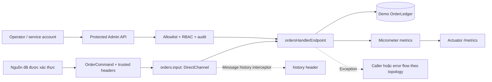
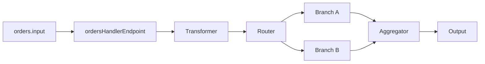
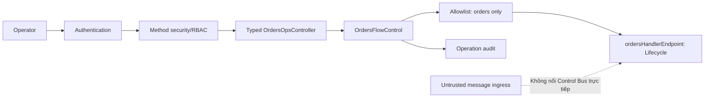
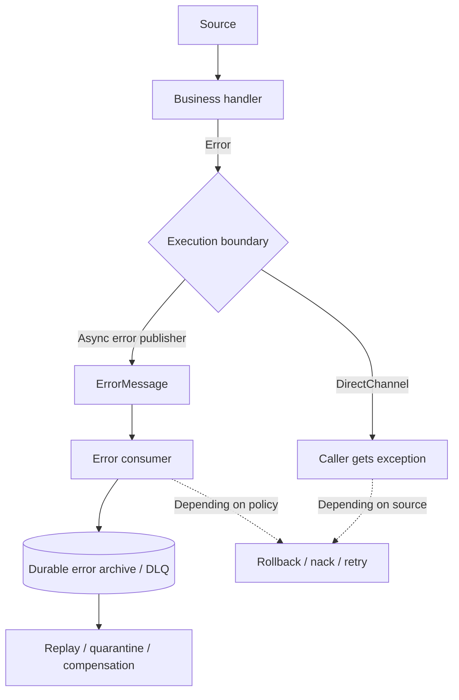

# Thêm metrics, message history và control operation cho Spring Integration runtime

## Mục tiêu và kết quả thực hành

Một `IntegrationFlow` có thể đang `RUNNING` nhưng không tạo thêm business outcome; một `DirectChannel` có thể trả về sau khi handler đã hoàn tất, còn `ExecutorChannel` có thể chấp nhận message và trả về trước khi worker chạy. Nếu một message thất bại ở transformer, đi vào error flow rồi được retry, làm thế nào chứng minh nó đã đi qua những endpoint nào? Và khi cần tạm dừng consumer để bảo trì, làm sao operator chỉ dừng **đúng endpoint được phép** mà không mở một cửa thực thi tùy ý lên Spring context?

Bài **Thêm metrics, message history và control operation** thuộc chương **Thực hành tổng hợp** của module **SPRING_INTEGRATION_RUNTIME**. Đây là một mini-project vận hành: gắn các tín hiệu quan sát lên flow, kích hoạt lịch sử đường đi message và xây một bề mặt điều khiển vòng đời endpoint có xác thực, phân quyền, audit và quy trình khôi phục. Các bài tập cũng nối với channel, endpoint, consumer, poller, executor, lifecycle của `IntegrationFlow`, transaction, retry, message store, lỗi, correlation, threading và hiệu năng.

Sau khi hoàn thành, người học có thể:

- Thiết kế **ba lớp quan sát khác nhau**: số liệu tổng hợp (metrics), đường đi message (message history) và trạng thái/lệnh điều khiển (control operation).
- Viết một flow nhỏ bằng Spring Integration Java DSL với `DirectChannel`, một handler có ID ổn định và dữ liệu test có `businessKey`/`correlationId`.
- Gắn Micrometer `Counter`, `Timer` và `Gauge` để đo success, duplicate, error, thời gian xử lý và in-flight; phân biệt kết quả `send()` với business outcome.
- Bật `@EnableMessageHistory`, kiểm tra header lịch sử, giải thích giới hạn của history khi transform, serializing, broker, lỗi và multi-instance.
- Công bố metrics qua Spring Boot Actuator trong phạm vi quản trị được bảo vệ.
- Xây typed control service có allowlist và `@PreAuthorize` để đọc trạng thái, stop và start đúng endpoint; hiểu rủi ro của Control Bus/SpEL mở rộng.
- Viết test JUnit/Spring Test/Micrometer kiểm tra instrumentation, history, authorization, stop/start, asynchronous completion và failure.
- Có checklist triển khai, rollback, quan sát và tiêu chí hoàn thành mini-project.

> **Kết quả mong đợi:** Sau khi gửi một message hợp lệ, ta có thể chứng minh **handler nào đã chạy**, **bao nhiêu lượt xử lý thuộc từng outcome**, **có history để lần theo message**, và **operator nào được phép start/stop endpoint**. Không kết luận “đã xử lý thành công” chỉ từ `send(true)`, `isRunning() == true` hoặc một log dòng “received”.

## 1. Bài toán giả lập và tiêu chí chấp nhận

Giả sử service nhận các `OrderCommand` từ một nguồn đã được xác thực. Mỗi order có tenant, order ID và amount. Trong dự án demo, handler ghi order key vào một ledger in-memory để quan sát lần xử lý đầu và lần giao trùng. Về sau ta có thể thay nguồn bằng HTTP/broker, ledger bằng DB có unique constraint, và channel bằng executor hoặc queue durable.

### 1.1. Sơ đồ tổng thể



Ở giai đoạn đầu, mọi component chạy trong **một Spring Boot process** và `DirectChannel` giao handler đồng bộ. Điều này giúp kiểm chứng mô hình một cách đơn giản trước khi thêm queue, broker, retry và nhiều pod.

### 1.2. Định nghĩa Done

| Nhóm | Bằng chứng cần đạt | Điều không được nhầm |
| --- | --- | --- |
| Metrics | Counter success/duplicate/error thay đổi đúng; Timer có sample; in-flight trở về 0 | Counter handler không phải source ack hoặc commit từ hệ thống ngoài |
| Message history | Message qua flow có history khi bật đúng; xem được thành phần đã được track | History không phải durable business audit hoặc distributed trace |
| Control | Status/start/stop chỉ tác động endpoint allowlisted; bị từ chối khi thiếu quyền | `start()` không tự phục hồi message đã mất |
| Correlation | `businessKey` và `correlationId` được giữ qua các bước trong phạm vi demo | Message UUID không phải business key |
| Test | Test sync không dùng sleep; test async có deadline; policy negative test không gây side effect | HTTP 403 một mình chưa chứng minh bean không bị stop |
| Vận hành | Có runbook, rollback và dashboard/cảnh báo | Actuator `UP` không thay thế business SLO |

## 2. Chuẩn bị mini-project và dependency

Phạm vi demo giả định **Java 17+**, Spring Boot 3.x, Spring Integration 6.x, Spring Security 6.x, Micrometer, JUnit Jupiter. Phiên bản cụ thể của dự án phải dùng BOM/parent phù hợp thay vì tự ghép jar ở các dòng release khác nhau.

Một dự án Maven sử dụng dependency chính:

```xml
<dependencies>
  <dependency>
    <groupId>org.springframework.boot</groupId>
    <artifactId>spring-boot-starter-integration</artifactId>
  </dependency>
  <dependency>
    <groupId>org.springframework.boot</groupId>
    <artifactId>spring-boot-starter-actuator</artifactId>
  </dependency>
  <dependency>
    <groupId>org.springframework.boot</groupId>
    <artifactId>spring-boot-starter-security</artifactId>
  </dependency>
  <dependency>
    <groupId>org.springframework.boot</groupId>
    <artifactId>spring-boot-starter-web</artifactId>
  </dependency>
  <dependency>
    <groupId>org.springframework.boot</groupId>
    <artifactId>spring-boot-starter-test</artifactId>
    <scope>test</scope>
  </dependency>
  <dependency>
    <groupId>org.springframework.integration</groupId>
    <artifactId>spring-integration-test</artifactId>
    <scope>test</scope>
  </dependency>
  <dependency>
    <groupId>org.springframework.security</groupId>
    <artifactId>spring-security-test</artifactId>
    <scope>test</scope>
  </dependency>
</dependencies>
```

`spring-boot-starter-integration` cung cấp hạ tầng Integration, `actuator` cung cấp endpoint health/metrics và registry tương ứng khi classpath/config được thiết lập, `security` dành cho control API, `web` dành cho demo REST. Trong các ví dụ dưới, `MeterRegistry` được Spring Boot cung cấp; khi test đơn vị độc lập có thể dùng `SimpleMeterRegistry`. Nếu muốn Prometheus cần dependency registry Prometheus riêng và exposure phù hợp.

### 2.1. Cấu trúc mã nguồn gợi ý

```text
src/main/java/.../training/
  RuntimeTrainingApplication.java
  OrdersIntegrationConfig.java
  OrderCommand.java
  InMemoryOrderLedger.java
  OrderProcessingHandler.java
  OrdersFlowControl.java
  OrdersOpsController.java
  ManagementSecurityConfig.java

src/test/java/.../training/
  OrdersMetricsTest.java
  OrdersHistoryTest.java
  OrdersFlowControlTest.java
  OrdersAsyncTest.java

src/main/resources/
  application.yml
```

Danh sách trên là **cách tổ chức gợi ý** cho người học, không phải các tệp đã được sinh trong workspace. Các snippet cần được đặt đúng package/import vào project demo. Nếu sao chép vào một file duy nhất, cần điều chỉnh visibility/public class theo quy tắc Java.

### 2.2. Application entrypoint

```java
import org.springframework.boot.SpringApplication;
import org.springframework.boot.autoconfigure.SpringBootApplication;
import org.springframework.security.config.annotation.method.configuration.EnableMethodSecurity;

@SpringBootApplication
@EnableMethodSecurity
public class RuntimeTrainingApplication {
    public static void main(String[] args) {
        SpringApplication.run(
                RuntimeTrainingApplication.class, args);
    }
}
```

`@EnableMethodSecurity` là điều kiện cần để `@PreAuthorize` trên control service được thực thi; cấu hình HTTP authentication/authorization và identity provider vẫn phải được thiết lập. Dự án demo không tự tạo tài khoản operator có quyền đặc biệt.

## 3. Thiết kế message và correlation key từ đầu

Mini-project nhận một DTO rõ ràng:

```java
record OrderCommand(
        String tenantId,
        String orderId,
        long amount) {
}
```

Ở ingress đáng tin cậy, hệ thống kiểm tra tenant/quyền trên order rồi gắn trusted headers. Khi gửi từ test, ta đóng vai ingress đã validate:

```java
import org.springframework.integration.IntegrationMessageHeaderAccessor;
import org.springframework.messaging.Message;
import org.springframework.messaging.support.MessageBuilder;

Message<OrderCommand> command = MessageBuilder
        .withPayload(new OrderCommand("tenant-a", "ORD-42", 250_000))
        .setHeader("verifiedTenant", "tenant-a")
        .setHeader("businessKey", "tenant-a:ORD-42")
        .setHeader(
                IntegrationMessageHeaderAccessor.CORRELATION_ID,
                "tenant-a:ORD-42:run-1")
        .build();
```

Cần phân biệt:

- `MessageHeaders.ID`: UUID của message instance, có thể thay khi transform/redelivery.
- `businessKey`: key để định danh side effect hoặc idempotency.
- `correlationId`: nhóm các message trong một workflow run.
- `verifiedTenant`: thông tin do boundary xác thực/ủy quyền đặt, **không** phải header client tự gửi.
- `traceId` (nếu có): dùng cho tracing, không tự là business idempotency key.

Trong demo, ta sử dụng `tenantId + ":" + orderId` làm key ledger. Trong production, key còn có thể phải có operation/event type hoặc workflow run ID nếu một order được xử lý nhiều operation độc lập. Hãy chuẩn hóa cách encode để không có va chạm khi ID chứa dấu phân cách.

### 3.1. Vì sao không dùng message history để làm correlation?

Message history mô tả **đường đi qua các component của Spring Integration**; nó không tạo ra business identity. Hai message của cùng một workflow có thể có history khác nhau (đi hai nhánh router), trong khi correlation ID giống nhau. Ngược lại, hai tenant khác nhau có thể đi qua đúng một chuỗi endpoint nhưng không được ghép chung aggregator group.

## 4. Tạo DirectChannel và endpoint có ID ổn định

```java
import org.springframework.context.annotation.Bean;
import org.springframework.context.annotation.Configuration;
import org.springframework.integration.channel.DirectChannel;
import org.springframework.integration.config.EnableIntegration;
import org.springframework.integration.config.EnableMessageHistory;
import org.springframework.integration.dsl.IntegrationFlow;

@Configuration
@EnableIntegration
@EnableMessageHistory
class OrdersIntegrationConfig {

    @Bean("orders.input")
    DirectChannel ordersInput() {
        return new DirectChannel();
    }

    @Bean
    IntegrationFlow ordersFlow(
            OrderProcessingHandler handler) {

        return IntegrationFlow.from("orders.input")
                .handle(handler, endpoint ->
                        endpoint.id("ordersHandlerEndpoint"))
                .get();
    }
}
```

Lệnh `@EnableIntegration` kích hoạt hạ tầng Integration trong context. `@EnableMessageHistory` bật thu thập message history cho các component được framework theo dõi theo cấu hình/phiên bản. Endpoint `ordersHandlerEndpoint` là **ID của consumer endpoint**, không phải ID của payload hay bean tên `handler`.

Với `DirectChannel` trong fixture này, một lời gọi `input.send(message)` thường thực thi handler cùng thread và exception có thể truyền về sender. Không cần poller. Ở môi trường thật, nếu chuyển sang `ExecutorChannel`, `send(true)` có thể chỉ phản ánh task được nhận vào executor.

### 4.1. Tại sao nên đặt ID tường minh?

Nếu giữ tên tự sinh, dashboard, test và control operation có thể khó biết đang stop endpoint nào, nhất là khi có nhiều flow version. Đặt ID ổn định giúp nối metrics/history/graph/incident vào cùng một thành phần. Tuy nhiên **không** coi ID là token bí mật: biết ID không được đồng nghĩa có quyền gọi `stop()`.

### 4.2. Lifecycle là trạng thái cục bộ

Một `EventDrivenConsumer` có thể triển khai `Lifecycle` và được quản lý bởi context. `isRunning()` cho biết vòng đời component, không chứng minh downstream đã commit hoặc source còn message. Trong nhiều pod, bean trong pod A không tự được điều khiển khi gọi method trên pod B.

## 5. Instrument business handler với Micrometer

Để bài tập tự chứa và dễ kiểm tra, ta dùng ledger in-memory. Đây là một **mô phỏng idempotency trong một process**, không phải persistence thật.

### 5.1. Demo ledger

```java
import java.util.Set;
import java.util.concurrent.ConcurrentHashMap;

import org.springframework.stereotype.Component;

@Component
final class InMemoryOrderLedger {
    private final Set<String> acceptedKeys =
            ConcurrentHashMap.newKeySet();

    boolean recordIfAbsent(OrderCommand command) {
        if (command == null
                || command.tenantId() == null
                || command.tenantId().isBlank()
                || command.orderId() == null
                || command.orderId().isBlank()
                || command.amount() <= 0) {
            throw new IllegalArgumentException(
                    "Order identity or amount is invalid");
        }

        String key =
                command.tenantId() + ":" + command.orderId();
        return acceptedKeys.add(key);
    }

    boolean contains(String key) {
        return acceptedKeys.contains(key);
    }

    int size() {
        return acceptedKeys.size();
    }
}
```

`ConcurrentHashMap.newKeySet()` cho phép một key chỉ được thêm một lần trong JVM. Khi process restart, mọi key sẽ mất. Nếu một operation gọi API đối tác, việc thêm key vào RAM **không atomically commit được external API**. Production cần database unique constraint, idempotency ledger/outbox hoặc API đích có idempotency key theo hợp đồng.

### 5.2. Handler có Counter, Timer và Gauge

```java
import java.util.concurrent.atomic.AtomicInteger;

import io.micrometer.core.instrument.Gauge;
import io.micrometer.core.instrument.MeterRegistry;
import io.micrometer.core.instrument.Timer;
import org.slf4j.Logger;
import org.slf4j.LoggerFactory;
import org.springframework.integration.IntegrationMessageHeaderAccessor;
import org.springframework.messaging.Message;
import org.springframework.messaging.MessageHandler;
import org.springframework.stereotype.Component;

@Component
final class OrderProcessingHandler implements MessageHandler {

    private static final Logger log =
            LoggerFactory.getLogger(OrderProcessingHandler.class);

    private final MeterRegistry meters;
    private final InMemoryOrderLedger ledger;
    private final AtomicInteger inFlight = new AtomicInteger();

    OrderProcessingHandler(
            MeterRegistry meters,
            InMemoryOrderLedger ledger) {
        this.meters = meters;
        this.ledger = ledger;

        Gauge.builder(
                "app.integration.orders.inflight",
                inFlight,
                AtomicInteger::get)
                .register(meters);
    }

    @Override
    public void handleMessage(Message<?> message) {
        Timer.Sample sample = Timer.start(meters);
        inFlight.incrementAndGet();
        String outcome = "error";

        try {
            if (!(message.getPayload() instanceof OrderCommand order)) {
                throw new IllegalArgumentException(
                        "Expected OrderCommand payload");
            }

            Object trustedTenant =
                    message.getHeaders().get("verifiedTenant");
            if (!order.tenantId().equals(trustedTenant)) {
                throw new IllegalArgumentException(
                        "Missing or mismatched trusted tenant");
            }

            boolean first = ledger.recordIfAbsent(order);
            outcome = first ? "success" : "duplicate";

            // Không log payload hoặc toàn bộ headers.
            if (log.isDebugEnabled()) {
                Object history =
                        message.getHeaders().get("history");
                Object correlation = message.getHeaders().get(
                        IntegrationMessageHeaderAccessor.CORRELATION_ID);

                log.debug(
                        "order handled: messageId={}, correlation={}, "
                        + "historyPresent={}, outcome={}",
                        message.getHeaders().getId(),
                        correlation,
                        history != null,
                        outcome);
            }
        }
        finally {
            meters.counter(
                    "app.integration.orders.handler.events",
                    "outcome", outcome).increment();

            sample.stop(meters.timer(
                    "app.integration.orders.handler.duration",
                    "outcome", outcome));

            inFlight.decrementAndGet();
        }
    }
}
```

**Ba loại metric phục vụ ba câu hỏi khác nhau:**

| Metric do ứng dụng định nghĩa | Loại | Trả lời | Giới hạn |
| --- | --- | --- | --- |
| `app.integration.orders.handler.events` với `outcome=success|duplicate|error` | Counter | Có bao nhiêu lượt handler hoàn tất theo outcome? | Không đồng nghĩa unique business event toàn cụm |
| `app.integration.orders.handler.duration` với `outcome` | Timer | Mỗi invocation giữ handler bao lâu? | Không bao gồm thời gian ở executor queue trước handler |
| `app.integration.orders.inflight` | Gauge | Có bao nhiêu invocation đang xử lý? | Không bao gồm backlog trước handler |

`Timer.Sample` được tạo trước logic và `stop(...)` trong `finally`, nên cả exception cũng có duration. `outcome` chỉ có ba giá trị cố định, tránh nổ cardinality. Counter được cộng cả khi handler ném lỗi, vì `finally` vẫn chạy. Nếu cần phân loại lỗi, dùng tập exception category đã định nghĩa, **không** đưa raw exception message vào tag.

### 5.3. Định nghĩa chính xác success, duplicate và error

Trong demo:

- **success**: lần đầu key được thêm vào in-memory ledger.
- **duplicate**: key đã tồn tại tại thời điểm handler nhận message; đây là lượt xử lý trùng, không phải handler failure.
- **error**: validation/handler ném exception trước khi chuyển outcome sang success/duplicate.

Chú ý `success` ở đây nghĩa là **demo ledger đã ghi vào RAM**, không có một database commit hay broker ack thật. Ở production, chuyển instrument `business.commit` tới **sau khi transaction được xác nhận**, đừng cộng success khi mới gửi downstream request hoặc enqueue task bất đồng bộ.

### 5.4. Đừng đưa correlation ID làm metric label

Sai:

```java
// Anti-pattern: tạo time series riêng cho từng order.
meters.counter("orders.handled",
        "correlationId", correlationId).increment();
```

Cách làm này tạo tag cardinality rất cao, tăng chi phí backend/Prometheus/Micrometer registry. Đưa `correlationId` vào **structured logs và distributed trace** có retention/permission thích hợp; dùng các tag ít giá trị như `outcome`, `flowType`, `environment` hoặc flow version nếu giới hạn được số lượng.

## 6. Mở Actuator metrics đúng cách

Ví dụ cấu hình trong `application.yml`:

```yaml
management:
  server:
    port: 8081
  endpoints:
    web:
      exposure:
        include: health,info,metrics
  endpoint:
    health:
      show-details: when_authorized

logging:
  level:
    root: INFO
    org.springframework.integration: INFO
```

`8081` chỉ là cổng demo cho management listener; **cổng riêng không tự là bảo mật**. Nếu deploy thật, thêm network policy, authentication/authorization, TLS hoặc private ingress, và không expose `/actuator/metrics` công khai.

Một số lệnh quan sát trên môi trường được cấp quyền:

```bash
# Chỉ dùng khi management listener đã được bảo vệ/cho phép truy cập.
curl -fsS http://localhost:8081/actuator/health
curl -fsS http://localhost:8081/actuator/metrics
curl -fsS http://localhost:8081/actuator/metrics/app.integration.orders.handler.events
curl -fsS http://localhost:8081/actuator/metrics/app.integration.orders.handler.duration
curl -fsS http://localhost:8081/actuator/metrics/app.integration.orders.inflight
```

Các URL trên **không phải lệnh đã chạy**. Metric chỉ xuất hiện sau khi meter được đăng ký và có phù hợp với cấu hình export/registry. Nếu HTTP security yêu cầu token/session, cần cung cấp xác thực đúng theo môi trường, **không** chép mật khẩu hoặc token thật vào tài liệu/log. `/actuator/metrics` trả dữ liệu ở định dạng của Actuator, không phải endpoint Prometheus scrape.

Nếu cần Prometheus, thêm registry tương ứng và expose `prometheus` theo policy; tên time series Prometheus có thể đổi dấu chấm thành gạch dưới và thêm suffix, nên không giả định tên raw của Actuator giống hoàn toàn tên query ở PromQL.

### 6.1. Metrics có sẵn của Spring Integration khác metrics do app tạo

Spring Integration có hỗ trợ Micrometer/observability và các meters theo channel/handler nếu cấu hình, phiên bản và management infrastructure phù hợp. Người học **không nên ghi cứng** rằng luôn tồn tại một meter tên cố định cho mọi endpoint.

Bộ meter `app.integration.orders.*` của mini-project là **custom** và có contract rõ. Có thể bổ sung meters mặc định cho `send`/handler, nhưng phải xem dữ liệu thực của `MeterRegistry`, tag names, behavior khi tắt management/observation và version tương thích. Đừng đếm cùng một event từ hai meter khác nhau rồi cộng trực tiếp.

### 6.2. Gắn giá trị flow version có kiểm soát

Trong một hệ thống nhiều phiên bản, tag `flowVersion=orders-v2` có thể hữu ích để so sánh rollout. Chỉ dùng khi số version được giới hạn; nếu mỗi deployment sinh hàng nghìn registration IDs động, gắn registration ID làm tag sẽ tăng cardinality.

Trong log, lại nên có `registrationId` hoặc `endpointId` để xác định đúng flow. **Metric tag và log context không có cùng yêu cầu**.

## 7. Message history là gì và không phải gì?

`@EnableMessageHistory` yêu cầu Spring Integration theo dõi đường đi của message qua các component được hỗ trợ, thường ghi thông tin vào header `history`. Thông tin này có thể giúp tìm nơi message đi qua khi flow có nhiều endpoint/routing branch. Tuy vậy, **history là metadata nằm trên message**, không phải một bảng audit bền vững tự ghi vào database.

### 7.1. Khác biệt giữa history, logs, trace và metrics

| Công cụ | Đơn vị quan sát | Trả lời | Không tự bảo đảm |
| --- | --- | --- | --- |
| **Metrics** | Số liệu nhiều messages đã tổng hợp | Throughput, duration, error, backlog | Tìm đường của một message cụ thể |
| **Message history** | Các component mà một message đã đi qua | Message đã chạm endpoint nào? | Cross-service distributed trace/durability |
| **Structured logs** | Sự kiện theo stage và correlation | Lỗi xảy ra lúc nào, context ra sao? | Log luôn tồn tại/không bị sampling |
| **Distributed tracing** | Spans qua nhiều process/services | Critical path, latency từng hop | Business idempotency hoặc audit pháp lý |
| **Audit nghiệp vụ** | Bản ghi có ownership/retention rõ | Ai làm gì, outcome đã commit chưa? | Được tạo tự động khi bật message history |
| **Control operation audit** | Actor, target, action, thời gian và kết quả | Ai start/stop component nào? | Được tạo tự động bởi mọi `Lifecycle.start()` |

### 7.2. Đọc history ở handler hoặc diagnostic tap

Trong ví dụ `OrderProcessingHandler`, ta kiểm tra:

```java
Object rawHistory = message.getHeaders().get("history");
boolean historyAvailable = rawHistory != null;
```

Giá trị `history` có dạng metadata do Spring Integration tạo, có thể được đọc/diễn giải theo API history của phiên bản đang dùng. Đừng assume đó là `String` hoặc dump thẳng vào payload nghiệp vụ. Một số component/header mapper có thể loại header, và cấu hình tracking có thể chỉ theo dõi một tập component.

**Không** log nguyên full message hoặc mọi header trong production chỉ để nhìn history: có thể chứa token, principal, địa chỉ nội bộ hoặc dữ liệu tenant. Nên log ở `DEBUG` nội bộ, mask dữ liệu, giới hạn retention và loại thông tin nhạy cảm.

### 7.3. History thay đổi thế nào qua các boundary?



Trong một flow phức tạp, history ghi lại một đường đi mà message đã thực sự trải qua tại các component được track. Khi splitter tạo nhiều message con, chúng có thể mang một phần history cha và các entries mới khác nhau. Khi merge, history của output **không tự là phép hợp tất cả đường đi** ở mọi chiến lược aggregator.

Qua broker/HTTP, việc có giữ history hay không phụ thuộc serialization/header mapping; đôi khi nên chỉ truyền `correlationId`/trace context và tái tạo observability ở consumer khác. Đừng dùng history làm group key của aggregator hoặc điều kiện authorization.

### 7.4. Chẩn đoán không có history

| Triệu chứng | Kiểm tra |
| --- | --- |
| Header `history` luôn null | `@EnableMessageHistory` đã thực sự nằm trong context chưa? |
| Một message có history, message khác không | Hai message có đi qua cùng component được track không? |
| History biến mất sau adapter | Header mapper/serializer có loại header không? |
| Không thấy tên component mong muốn | Component có được track, có ID ổn định, có thực sự được chạy? |
| Chỉ thấy history cha sau splitter | Child/aggregator có copy headers và sequencing như dự kiến không? |
| Memory/message size tăng | History có đang theo dõi quá nhiều hop hoặc serialize vào broker không? |
| Không có log dù history tồn tại | History không tự log; cần inspector/logging an toàn |

Việc bật message history toàn cục có overhead CPU, object allocations và header size. Với lượng traffic lớn, nên cân nhắc phạm vi theo dõi, sampling ở lớp log/tracing và benchmark trước/sau. Không ép history chạy qua mọi broker message có payload/header size giới hạn.

## 8. Khi nào thêm wire tap thay vì chỉ bật message history?

`WireTap` sao chép message sang một channel phụ để quan sát, nhưng là một **nhánh thực thi bổ sung**, không phải “log miễn phí”. Nếu wire tap dùng cùng thread và diagnostic handler chậm, nó có thể làm chậm critical path. Nếu gửi sang executor, nó còn tạo thêm queue/buffer và error boundary.

Ví dụ định nghĩa hướng đi:

```text
orders.input
   |
   +--> business processing handler
   |
   +--> audit/diagnostic channel  (WireTap)
          -> mask/sanitize
          -> bounded async export / logs
```

Không đưa toàn bộ message chứa PII/secret sang một audit destination không được phân quyền. Với message history, có thể kiểm tra metadata hiện có ở handler trong test trước, rồi chỉ thêm wire tap nếu mục tiêu quan sát cần một nhánh thực sự. Nếu audit nghiệp vụ là bắt buộc, hãy dùng **durable outbox/audit record**, không phụ thuộc một tap best-effort.

### 8.1. Message history không thay thế retry/error flow

Một handler throw trên `DirectChannel` có thể trả exception về caller mà không tạo `ErrorMessage` trên global `errorChannel` nếu không có error publisher. History có thể cho biết message đã qua endpoint nào, nhưng muốn biết nguyên nhân và source outcome cần:

- Cause chain của exception hoặc `ErrorMessage.getPayload()`.
- `originalMessage`/`failedMessage` nếu error publisher cung cấp.
- Retry attempt và broker redelivery count.
- Error archive/DLQ đã commit.
- Business key và transaction/ack status.

Không suy từ “history có endpoint X” rằng endpoint X đã xử lý xong hoặc đã commit side effect.

## 9. Control operation: tách đọc trạng thái khỏi thay đổi runtime

Mini-project thêm ba thao tác:

1. `STATUS`: đọc `isRunning()` của đúng endpoint.
2. `START`: yêu cầu start endpoint nếu đang stopped.
3. `STOP`: yêu cầu stop endpoint nếu đang running.

Tất cả chỉ áp dụng cho alias cố định `orders` → bean `ordersHandlerEndpoint`. **Không** cho HTTP request gửi `targetBean` hoặc một chuỗi SpEL tùy ý để truy bất kỳ bean trong Spring context.



### 9.1. Control Bus là gì và vì sao không expose raw expression?

Spring Integration Control Bus có khả năng dùng expression để gọi thao tác trên bean, ví dụ minh họa:

```text
@ordersHandlerEndpoint.isRunning()
@ordersHandlerEndpoint.stop()
@ordersHandlerEndpoint.start()
```

Những biểu thức này chỉ có ý nghĩa khi Control Bus được cấu hình và evaluation context có quyền giải bean; đây là lệnh **mạnh**. Đưa nguyên body HTTP hoặc header từ untrusted source vào Control Bus có thể mở khả năng truy cập methods/beans không mong muốn. Đối với mini-project, ta dùng **typed Java service**, không tạo endpoint nhận raw SpEL.

### 9.2. Service điều khiển có allowlist cố định

```java
import org.springframework.context.ApplicationContext;
import org.springframework.context.Lifecycle;
import org.springframework.security.access.prepost.PreAuthorize;
import org.springframework.stereotype.Service;

@Service
final class OrdersFlowControl {

    private final Lifecycle endpoint;

    OrdersFlowControl(ApplicationContext context) {
        this.endpoint = context.getBean(
                "ordersHandlerEndpoint", Lifecycle.class);
    }

    @PreAuthorize("hasAuthority('integration:read')")
    public FlowState readStatus() {
        return snapshot();
    }

    @PreAuthorize("hasAuthority('integration:operate')")
    public FlowState start() {
        if (!endpoint.isRunning()) {
            endpoint.start();
        }
        return snapshot();
    }

    @PreAuthorize("hasAuthority('integration:operate')")
    public FlowState stop() {
        if (endpoint.isRunning()) {
            endpoint.stop();
        }
        return snapshot();
    }

    private FlowState snapshot() {
        return new FlowState("orders", endpoint.isRunning());
    }

    record FlowState(String flowAlias, boolean running) {
    }
}
```

`@PreAuthorize` chỉ có hiệu lực nếu Spring Security method security được bật và call đi qua proxy. Ví dụ entrypoint ở mục 2 đã dùng `@EnableMethodSecurity`. Nếu gọi method được annotate **từ chính một method khác trong cùng object**, proxy có thể bị bỏ qua. Không dùng self-invocation làm tuyến authorization.

Hàm `snapshot()` là private và chỉ được gọi từ các method đã được cấp quyền; nó **không phải API public**. Trong production, tách quyền đọc/ghi, tenant scope, desired state, approval, audit và preflight trước stop nếu source/consumer có công việc đang chạy.

### 9.3. Controller có đường dẫn cố định

```java
import org.springframework.web.bind.annotation.GetMapping;
import org.springframework.web.bind.annotation.PostMapping;
import org.springframework.web.bind.annotation.RequestMapping;
import org.springframework.web.bind.annotation.RestController;

@RestController
@RequestMapping("/internal/ops/flows/orders")
final class OrdersOpsController {

    private final OrdersFlowControl control;

    OrdersOpsController(OrdersFlowControl control) {
        this.control = control;
    }

    @GetMapping
    OrdersFlowControl.FlowState status() {
        return control.readStatus();
    }

    @PostMapping("/start")
    OrdersFlowControl.FlowState start() {
        return control.start();
    }

    @PostMapping("/stop")
    OrdersFlowControl.FlowState stop() {
        return control.stop();
    }
}
```

Đường dẫn cố định giảm rủi ro “client quyết định bean name”. Controller không tự tạo user/role. Với mọi request, vẫn phải có **web authentication**, HTTP authorization, CSRF protection khi dùng session/cookie, network isolation, rate limits và audit.

### 9.4. Skeleton HTTP security cho demo nội bộ

```java
import org.springframework.context.annotation.Bean;
import org.springframework.context.annotation.Configuration;
import org.springframework.security.config.Customizer;
import org.springframework.security.config.annotation.web.builders.HttpSecurity;
import org.springframework.security.web.SecurityFilterChain;

@Configuration
class ManagementSecurityConfig {

    @Bean
    SecurityFilterChain appSecurity(HttpSecurity http)
            throws Exception {

        return http
                .authorizeHttpRequests(auth -> auth
                        .requestMatchers(
                                "/internal/ops/**", "/actuator/**")
                        .authenticated()
                        .anyRequest().denyAll())
                .httpBasic(Customizer.withDefaults())
                .build();
    }
}
```

Cấu hình minh họa **không cấp quyền `integration:operate` cho bất kỳ tài khoản nào**; identity/role phải được cấu hình riêng. HTTP Basic chỉ phù hợp môi trường demo được bảo vệ bằng TLS và network scope; production thường dùng OIDC/OAuth2/mTLS và security chain phù hợp. Không vô hiệu hóa CSRF toàn hệ thống chỉ để chạy lệnh POST. Nếu management actuator đặt trên port riêng, kiểm tra filter/security management context của **chính application configuration** thay vì giả định filter chain trên application port bao phủ nó.

### 9.5. Audit control operation không được bị bỏ qua

Ít nhất lưu:

```text
event=FLOW_CONTROL
  actor=oncall-operator
  target=ordersHandlerEndpoint
  flowAlias=orders
  action=STOP
  requestId=chg-42
  approval=approved
  beforeRunning=true
  afterRunning=false
  timestamp=...
  outcome=SUCCESS
```

Đây là **schema audit gợi ý**, không phải log có sẵn của Spring Integration. Bản demo `OrdersFlowControl` ở trên chưa triển khai audit/approval/tenant ownership, nên **chưa đủ yêu cầu production**. Khi hoàn thiện thực tế, audit phải bao gồm cả lệnh **DENIED/FAILED**, và operation critical cần policy xử lý audit backend unavailable.

### 9.6. Start/stop không phải drain hoặc restart toàn hệ thống

Với event-driven consumer trên `DirectChannel`, stop có thể làm subscriber rời channel. Nếu channel chỉ có một subscriber, send khi stop có thể ném `MessageDeliveryException`. Với `QueueChannel` hoặc broker, stop consumer không tự xóa hay giữ đúng các message đã nhận; kết quả phụ thuộc ack/persistence.

Không dùng `stop()` như cách hủy in-flight HTTP call hoặc rollback DB commit. Một quy trình production thường phải **pause ingress → drain/ghi durable recovery → stop đúng endpoint → verify**; khi resume thì kiểm tra nguồn, checkpoint, backlog và duplicate.

## 10. Kiểm thử metrics bằng JUnit và MeterRegistry

Test đơn vị handler có thể bỏ qua Spring context: dùng `SimpleMeterRegistry`, ledger mới và message có trusted tenant.

```java
import io.micrometer.core.instrument.simple.SimpleMeterRegistry;
import org.junit.jupiter.api.Test;
import org.springframework.messaging.Message;
import org.springframework.messaging.support.MessageBuilder;

import static org.junit.jupiter.api.Assertions.*;

class OrdersMetricsTest {

    @Test
    void countsSuccessDuplicateAndError() {
        try (SimpleMeterRegistry meters =
                new SimpleMeterRegistry()) {

            InMemoryOrderLedger ledger =
                    new InMemoryOrderLedger();
            OrderProcessingHandler handler =
                    new OrderProcessingHandler(meters, ledger);

            Message<OrderCommand> valid = MessageBuilder
                    .withPayload(new OrderCommand(
                            "tenant-a", "ORD-42", 250_000))
                    .setHeader("verifiedTenant", "tenant-a")
                    .setHeader("businessKey", "tenant-a:ORD-42")
                    .build();

            handler.handleMessage(valid);
            handler.handleMessage(valid); // duplicate

            assertEquals(1.0, meters.counter(
                    "app.integration.orders.handler.events",
                    "outcome", "success").count());

            assertEquals(1.0, meters.counter(
                    "app.integration.orders.handler.events",
                    "outcome", "duplicate").count());

            Message<OrderCommand> invalid = MessageBuilder
                    .withPayload(new OrderCommand(
                            "tenant-a", "ORD-43", -1))
                    .setHeader("verifiedTenant", "tenant-a")
                    .build();

            assertThrows(IllegalArgumentException.class,
                    () -> handler.handleMessage(invalid));

            assertEquals(1.0, meters.counter(
                    "app.integration.orders.handler.events",
                    "outcome", "error").count());

            assertEquals(0.0, meters.get(
                    "app.integration.orders.inflight")
                    .gauge().value());

            assertEquals(1L, ledger.size());
        }
    }
}
```

Test này đo chính xác contract của **demo handler**: hai invocations hợp lệ cùng key → một success, một duplicate; invalid amount → error; in-flight trở về 0. Đây chưa phải integration test của channel, message history hay lifecycle, và ledger không bền vững.

### 10.1. Test duration mà không kiểm tra con số quá chặt

Một `Timer` ghi duration có thể bị ảnh hưởng JIT/CI scheduling. Nên assert số lượng sample và tính không âm thay vì ép `duration == 1ms`:

```java
long samples = meters.get(
        "app.integration.orders.handler.duration")
        .tag("outcome", "success")
        .timer()
        .count();

assertEquals(1L, samples);
```

Nếu cần đo timeout/backoff deterministic, inject `Clock` hoặc abstraction thời gian vào business logic; Timer của Micrometer vẫn đo **thời gian thực** của invocation, không mặc nhiên lấy clock giả.

## 11. Kiểm thử Java DSL, message history và lifecycle trong Spring context

Để kiểm thử wiring của `orders.input`, `ordersHandlerEndpoint` và history, cần Spring Test context hoặc `@SpringBootTest` phù hợp. Dùng tên order ngẫu nhiên/duy nhất theo mỗi test để tránh xung đột với ledger singleton.

### 11.1. Test integration gửi message qua DirectChannel

```java
import java.util.UUID;

import org.junit.jupiter.api.Test;
import org.springframework.beans.factory.annotation.Autowired;
import org.springframework.beans.factory.annotation.Qualifier;
import org.springframework.boot.test.context.SpringBootTest;
import org.springframework.messaging.MessageChannel;
import org.springframework.messaging.support.MessageBuilder;

import static org.junit.jupiter.api.Assertions.*;

@SpringBootTest
class OrdersFlowIntegrationTest {

    @Autowired
    @Qualifier("orders.input")
    MessageChannel input;

    @Autowired
    InMemoryOrderLedger ledger;

    @Test
    void directChannelInvokesHandler() {
        String orderId = UUID.randomUUID().toString();
        String businessKey = "tenant-a:" + orderId;

        boolean accepted = input.send(MessageBuilder
                .withPayload(new OrderCommand(
                        "tenant-a", orderId, 10_000))
                .setHeader("verifiedTenant", "tenant-a")
                .setHeader("businessKey", businessKey)
                .setHeader("correlationId", businessKey + ":run-1")
                .build());

        assertTrue(accepted);
        assertTrue(ledger.contains(businessKey));
    }
}
```

Ở fixture đồng bộ, khi `send()` trả thành công thì handler đã được gọi và demo ledger đã ghi key. Nếu thay channel thành `ExecutorChannel`, phải đợi completion bằng latch/await có timeout, không assert ledger ngay sau `send()`.

### 11.2. Test message history tại điểm handler

Một test có thể gắn một recorder giả hoặc `MessageHandler` test để lưu bản snapshot của header `history`. Không nên để production handler giữ `lastMessage` vô hạn vì rủi ro lưu payload/PII.

Ví dụ kiểm tra bên trong một test-only handler:

```java
import java.util.concurrent.atomic.AtomicReference;
import org.springframework.messaging.Message;

final class HistoryProbe {
    private final AtomicReference<Object> history =
            new AtomicReference<>();

    void record(Message<?> message) {
        history.set(message.getHeaders().get("history"));
    }

    Object snapshot() {
        return history.get();
    }
}
```

Đưa `HistoryProbe::record` vào một flow test hoặc wire tap test có cấu hình `@EnableMessageHistory` và endpoint ID rõ. Gửi message qua input, assert `snapshot() != null` **khi component tracking và header mapper được cấu hình đúng**. Không assert một danh sách entries cố định theo vị trí nếu topology/phiên bản có thể tạo thêm component history.

**Quan trọng:** ví dụ trên chỉ là test helper, **không** được tự thêm vào production flow và assume nó nhận mọi message; phải nối nó vào channel/endpoint thật của Spring Test context. Nếu history null, đọc cấu hình tracking và đường đi trước khi kết luận framework hỏng.

### 11.3. Test stop/start endpoint có cleanup

```java
import org.junit.jupiter.api.Test;
import org.springframework.beans.factory.annotation.Autowired;
import org.springframework.boot.test.context.SpringBootTest;
import org.springframework.context.ApplicationContext;
import org.springframework.context.Lifecycle;

import static org.junit.jupiter.api.Assertions.*;

@SpringBootTest
class OrdersLifecycleTest {

    @Autowired
    ApplicationContext context;

    @Test
    void endpointHasLifecycleAndCanBeRestored() {
        Lifecycle endpoint = context.getBean(
                "ordersHandlerEndpoint", Lifecycle.class);
        boolean wasRunning = endpoint.isRunning();

        try {
            endpoint.stop();
            assertFalse(endpoint.isRunning());

            endpoint.start();
            assertTrue(endpoint.isRunning());
        }
        finally {
            if (wasRunning && !endpoint.isRunning()) {
                endpoint.start();
            }
            else if (!wasRunning && endpoint.isRunning()) {
                endpoint.stop();
            }
        }
    }
}
```

Không chạy lifecycle test này trên production và không dùng chung Spring Test context với test khác chạy song song mà không cách ly. Kiểm thử endpoint `isRunning` chỉ xác nhận lifecycle, **không** chứng minh broker ack, downstream health hay business commit.

## 12. Kiểm thử phân quyền control API và tác dụng phụ

Security test cần assert **thao tác bị từ chối không thay đổi endpoint**, chứ không chỉ status HTTP. Ví dụ với Spring Boot MockMvc và Spring Security Test:

```java
import org.junit.jupiter.api.Test;
import org.springframework.beans.factory.annotation.Autowired;
import org.springframework.boot.test.autoconfigure.web.servlet.AutoConfigureMockMvc;
import org.springframework.boot.test.context.SpringBootTest;
import org.springframework.context.ApplicationContext;
import org.springframework.context.Lifecycle;
import org.springframework.test.web.servlet.MockMvc;
import org.springframework.security.test.context.support.WithMockUser;

import static org.junit.jupiter.api.Assertions.*;
import static org.springframework.security.test.web.servlet.request.SecurityMockMvcRequestPostProcessors.csrf;
import static org.springframework.test.web.servlet.request.MockMvcRequestBuilders.post;
import static org.springframework.test.web.servlet.result.MockMvcResultMatchers.status;

@SpringBootTest
@AutoConfigureMockMvc
class OrdersControlSecurityTest {

    @Autowired
    MockMvc mvc;

    @Autowired
    ApplicationContext context;

    @Test
    @WithMockUser(authorities = "integration:read")
    void readOnlyActorCannotStopEndpoint() throws Exception {
        Lifecycle endpoint = context.getBean(
                "ordersHandlerEndpoint", Lifecycle.class);

        boolean before = endpoint.isRunning();

        mvc.perform(post(
                "/internal/ops/flows/orders/stop").with(csrf()))
                .andExpect(status().isForbidden());

        assertEquals(before, endpoint.isRunning());
    }

    @Test
    @WithMockUser(authorities = "integration:operate")
    void allowedActorCanStopAndStart() throws Exception {
        Lifecycle endpoint = context.getBean(
                "ordersHandlerEndpoint", Lifecycle.class);
        boolean before = endpoint.isRunning();

        try {
            mvc.perform(post(
                    "/internal/ops/flows/orders/stop").with(csrf()))
                    .andExpect(status().isOk());

            assertFalse(endpoint.isRunning());

            mvc.perform(post(
                    "/internal/ops/flows/orders/start").with(csrf()))
                    .andExpect(status().isOk());

            assertTrue(endpoint.isRunning());
        }
        finally {
            if (before && !endpoint.isRunning()) {
                endpoint.start();
            }
            else if (!before && endpoint.isRunning()) {
                endpoint.stop();
            }
        }
    }
}
```

Vì test sử dụng `@WithMockUser`, nó không kiểm tra identity provider thực ngoài môi trường test. Ngoài ra cần test URL/role mapping, CSRF behavior, authentication thực, alias ngoài allowlist, unauthorized tenant, audit và request rate limits. Trong production, lệnh stop còn cần quyền sở hữu flow và drain/approval; test demo ở trên **chưa** kiểm tra các guardrail đó.

## 13. Mở rộng sang ExecutorChannel: metrics không còn đo toàn thời gian

Sau khi ba lớp cơ bản hoạt động, thay `DirectChannel` bằng `ExecutorChannel` có worker pool hữu hạn:

```java
import java.util.concurrent.ExecutorService;
import java.util.concurrent.Executors;

import org.springframework.beans.factory.annotation.Qualifier;
import org.springframework.context.annotation.Bean;
import org.springframework.integration.channel.ExecutorChannel;
import org.springframework.messaging.MessageChannel;

@Bean(destroyMethod = "shutdown")
ExecutorService orderWorkers() {
    return Executors.newFixedThreadPool(4);
}

@Bean("orders.input")
MessageChannel ordersInput(
        @Qualifier("orderWorkers") ExecutorService workers) {
    return new ExecutorChannel(workers);
}
```

Đây là **biến thể thay thế bean orders.input** của mục 4, không khai báo hai bean trùng tên trong cùng context. Trong Spring configuration thực, đặt cả hai factory method trong config và chọn một phiên bản khi chạy thử. Cần có `@Qualifier` nếu trong context có nhiều executor.

### 13.1. Đọc kết quả metrics khi chuyển async

```text
T0: producer gửi message vào ExecutorChannel
T1: send() trả về vì task đã được nhận
T2: message đợi trong executor queue
T3: worker bắt đầu OrderProcessingHandler
T4: handler ghi demo ledger
T5: MeterRegistry nhận success + duration
```

`Timer` trong handler đo T3 → T5, **không** đo T0 → T3. `Gauge inFlight` chỉ tăng từ T3. Nếu worker bận, backlog có thể tăng mạnh mà handler chưa có in-flight; dashboard có thể nhìn “duration thấp, success thấp” nhưng không thấy queue đang đầy.

Bổ sung:

- Executor active/queued/rejected tasks.
- Thời gian chờ từ ingress đến handler started.
- Source backlog/consumer lag nếu có broker.
- Oldest pending message age.
- Throughput input so với business completion.

Không tăng pool size vô hạn khi downstream đang nghẽn. Worker pool và queue phải có giới hạn/cơ chế từ chối rõ, kèm chính sách giữ nguồn message bền vững.

### 13.2. Test async không dùng Thread.sleep

Dùng một handler test có `CountDownLatch` hoặc một queue probe; đợi deadline hữu hạn:

```java
import java.util.concurrent.CountDownLatch;
import java.util.concurrent.TimeUnit;

final class AsyncCompletionProbe {
    private final CountDownLatch completed =
            new CountDownLatch(1);

    void markCompleted() {
        completed.countDown();
    }

    void awaitCompletion() throws InterruptedException {
        if (!completed.await(5, TimeUnit.SECONDS)) {
            throw new AssertionError(
                    "Handler did not complete within 5 seconds");
        }
    }
}
```

Gắn `markCompleted()` **sau khi bước bạn thực sự muốn chứng minh đã hoàn tất**. Nếu đếm latch ngay lúc handler bắt đầu mà assert business DB đã commit, test vẫn có thể flaky hoặc sai. Trong production, đừng giữ một latch làm cơ chế vận hành giữa nhiều instances.

## 14. Poller, broker và các điểm metrics/history chưa bao phủ

Một consumer đọc `QueueChannel` bằng poller có thêm trigger, scheduler, `receiveTimeout`, `maxMessagesPerPoll` và đôi khi transaction advice. Một adapter nguồn đọc broker/file/JDBC còn có cursor, ack, redelivery, retention và checkpoints.

| Điểm runtime | Metric bổ sung nên đo | Message history có thể giúp gì? | Điều không thể suy |
| --- | --- | --- | --- |
| Source adapter | Received count, last poll, source lag | Thấy message bắt đầu đi qua adapter được track | Source ack đã đúng |
| QueueChannel | Queue depth, oldest age | Điểm trước/sau khi queue dispatch được track | Queue đã persistent |
| Poller | Last poll started/completed, duration | Tìm endpoint được gọi sau poll | Poll interval là business SLA |
| Executor | Active/queued/rejected, queue age | Lịch sử qua các component có track | ThreadLocal SecurityContext tự truyền |
| Router | Route choice, unknown route count | Nhánh message đã đi | Tenant authorization được chứng minh |
| Splitter/aggregator | Group pending age, release count | Lịch sử từng message một phần | History output = hợp nhất history mọi nhánh |
| Broker outbound | Publish confirms, error count | Đến bước outbound | Remote consumer đã commit |
| Error flow | Error received, archive committed | Đường của message khi vào recovery | Logger là durable archive |
| Dynamic flow | Active registration version, in-flight | Component path của version đó | Registration đồng bộ giữa các pod |

### 14.1. Sự khác biệt giữa polling và event-driven

`DirectChannel` là `SubscribableChannel`: send kích hoạt handler theo cơ chế event-driven. `QueueChannel` thường cần một `PollingConsumer` lấy message; nếu chỉ đổi channel mà không thêm poller, flow có thể không chạy theo kỳ vọng. Bài tập phải ghi rõ **topology** khi so sánh throughput/metrics.

### 14.2. Transaction và ack không tự đi theo executor

Một message đi vào `ExecutorChannel` có thể làm caller trả về và ack nguồn trước khi worker hoàn tất, tùy adapter/container. Transaction JDBC thường gắn thread hiện tại và **không tự lan sang worker**. Do đó counter handler success không chứng minh source ack an toàn; phải có durable handoff, idempotency và test crash window nếu nghiệp vụ quan trọng.

## 15. Thêm error flow và phân biệt lỗi quan sát với recovery bền vững

Trong flow đồng bộ demo, một invalid order khiến handler ném `IllegalArgumentException` tới người gọi `send()`. Đây là **lỗi synchronous**, không mặc định tạo `ErrorMessage` trên global `errorChannel`. Nếu muốn xử lý thất bại bất đồng bộ, cần một **error publisher và error channel theo topology/adapter thực tế**.



Một `ErrorMessage` chứa `Throwable` trong payload và có thể chứa original/failed message. Muốn tra order/correlation, cần đọc `getOriginalMessage()` hoặc `MessagingException.getFailedMessage()` khi có; không cast `ErrorMessage.getPayload()` thành `OrderCommand`.

### 15.1. Cần đo recovery riêng

| Metric đề xuất | Khi nào tăng | Ý nghĩa |
| --- | --- | --- |
| `app.integration.orders.handler.events{outcome=error}` | Handler throw | Một invocation thất bại |
| `app.integration.orders.error.published` | Error publisher gửi ErrorMessage | Error đã được dispatch |
| `app.integration.orders.error.archive_committed` | DB/DLQ xác nhận lưu bền vững | Có khả năng phục hồi theo policy |
| `app.integration.orders.retry.attempts` | Retry advice gọi lại | Số thử, không phải số business event |
| `app.integration.orders.source.redelivery` | Broker giao lại | Source có thể đã nack/chưa ack |
| `app.integration.orders.recovery.pending` | Error record chờ xử lý | Backlog recovery |

Tên metric là do ứng dụng định nghĩa, **không tự sinh tất cả khi bật Actuator**. Không cộng số ErrorMessage và retry attempts rồi gọi là số order thất bại: một business event có thể tạo nhiều attempts và publications.

### 15.2. Crash windows phải kiểm thử

```text
1. External side effect committed, trước khi ghi DONE:
   -> Retry/redelivery có thể tạo duplicate.

2. ErrorMessage đã publish nhưng error archive chưa commit:
   -> Nếu source ack, có thể mất message phục hồi.

3. Durable enqueue đã commit nhưng source ack chưa xong:
   -> Source redeliver, cần idempotency.

4. Consumer STOP khi còn in-flight:
   -> stop() không tự rollback mọi API ngoài.
```

Đối với production, thay `InMemoryOrderLedger` bằng bảng có unique constraint theo business key và transaction thích hợp; dùng outbox/broker nếu cần tách nhận request và xử lý async. Ghi trạng thái PENDING/DONE/FAILED với khả năng replay có kiểm soát, không dùng history header làm nơi giữ business state.

## 16. Dashboard và cảnh báo: thiết kế từ câu hỏi vận hành

Một dashboard hữu ích không chỉ vẽ “số message gửi” mà cần liên kết đầu vào, processing, backlog, failure và recovery.

### 16.1. Đề xuất các panel

| Panel | Số liệu | Câu hỏi |
| --- | --- | --- |
| Input versus handled | Ingress rate, handled success/duplicate/error | Nguồn còn gửi, handler còn xử lý không? |
| Handler duration | p50/p95/p99 theo outcome | Có latency tail xấu bất thường không? |
| In-flight | Gauge | Có invocation bị kẹt lâu không? |
| Executor queue | Queue depth, oldest age, rejected | Backpressure xảy ra trước handler? |
| Endpoint desired/running | `isRunning()`, maintenance state | Stopped có chủ đích hay lỗi? |
| Retry/error archive | Attempts, archive commits, pending age | Lỗi có đường phục hồi bền vững không? |
| Correlation/group | Pending group age, release/timeout | Aggregator có thiếu nhánh? |
| Version/instance | Active route, registration, pod | Rollout lệch state giữa nodes? |
| Control audit | START/STOP/STATUS outcomes | Ai thay đổi runtime, có approval không? |

**Lưu ý về phân vị:** `Timer` trong ví dụ luôn ghi nhận count và tổng duration theo registry, nhưng p95/p99 hoặc histogram buckets **không tự xuất hiện ở mọi monitoring backend**. Khi thiết kế dashboard, cấu hình distribution statistics/histogram cho meter mục tiêu theo Micrometer và exporter đang dùng, kiểm tra chi phí time series, rồi mới vẽ biểu đồ phân vị. Không suy p99 từ giá trị trung bình.

### 16.2. Một điều kiện alert không nên dựa vào output=0 đơn lẻ

```text
ExpectedWork =
     (incomingMessages > 0)
  OR (queueDepth > 0)
  OR (inFlight > 0)
  OR (pendingGroupCount > 0)

PotentialStall =
    ExpectedWork
    AND noBusinessProgressBeyondSLO
    AND notPlannedMaintenance
```

Nếu một flow chỉ nhận message lúc cuối ngày, zero throughput buổi sáng có thể là bình thường. Nếu queue tăng trong khi completion không tiến, đó là dấu hiệu đáng điều tra hơn. Ngưỡng phải xét poll interval, retry backoff, business deadline và baseline.

### 16.3. Message history phục vụ truy cứu theo một ID, không thay dashboard

Khi có một business key lỗi, dùng structured logs theo correlation để tìm endpoint, đối chiếu message history nếu còn, rồi tra cause/error archive và transaction. History không phải metric time series; đừng tạo một metric tag cho mỗi history entry hoặc mỗi correlation ID.

## 17. Runbook: endpoint có history nhưng throughput không tiến

### Bước 1 — Xác định đúng flow, version và instance

Lấy endpoint ID, pod, logical flow, version, `businessKey` và `correlationId`. So `isRunning()` với desired state. Đừng tự start một flow đang stop có chủ đích.

### Bước 2 — Xem metrics end-to-end

Kiểm tra ingress, queue depth/oldest age, handler events/duration/in-flight và business commit. Nếu `send()` tăng nhưng handled không tăng, tìm ranh giới channel→executor/consumer.

### Bước 3 — Kiểm tra message history và route

Lấy một message/correlation mẫu từ log có quyền truy cập, xem history có thành phần nào; kiểm tra transformer/router/subscriber của topology đang deploy. Nếu history biến mất sau broker, đối chiếu header mapper và trace ở phía consumer.

### Bước 4 — Phân biệt lỗi và absence of work

Nếu không có source input, flow có thể IDLE. Nếu handler fail liên tục, kiểm tra exception/retry/errorChannel, không coi endpoint STOPPED. Nếu worker blocked, dùng thread dump và downstream metrics theo quyền vận hành.

### Bước 5 — Xác minh persistence và in-flight

Trước stop/restart, biết message nằm trong RAM queue, persistent `MessageStore`, broker hay source chưa ack. Với aggregator, xem `MessageGroupStore` và correlation strategy. Với poller, xem `MetadataStore` checkpoint; không xóa key để “làm sạch”.

### Bước 6 — Kiểm tra quyền của operator

Chỉ operator được cấp `integration:operate`, đúng flow/tenant và approval mới được phép stop/start. Ghi audit trước/sau. Không gửi raw expression vào Control Bus và không expose Actuator control surface công khai.

### Bước 7 — Thao tác nhỏ nhất an toàn

Ưu tiên sửa dependency, giảm input/prefetch, điều chỉnh timeout/retry policy hoặc khôi phục error consumer. Chỉ stop/start endpoint khi nguồn đã được bảo vệ và có kế hoạch drain/rollback; không restart JVM mù quáng.

### Bước 8 — Xác nhận business outcome

Sau start, đo business commit, error rate, backlog/age, duplicate, transaction/ack và recovery pending. `isRunning=true` hoặc HTTP 200 là điều kiện phụ, không phải bằng chứng chính.

### Bước 9 — Kiểm tra audit và quyền sở hữu

Đối chiếu lệnh control với actor, timestamp, target và change record; xác nhận không có stop/start trái phép hoặc lệch state giữa pods.

### Bước 10 — Đóng incident và cập nhật test

Thêm một test hồi quy tái tạo root cause, thay metric/alert nếu thiếu và ghi rõ error/persistence contract. Đóng incident khi các message bị ảnh hưởng đã có outcome hoặc recovery owner rõ ràng.

## 18. Ma trận kiểm thử mini-project

| Tình huống | Thiết lập | Kỳ vọng |
| --- | --- | --- |
| Message hợp lệ lần đầu | DirectChannel, DTO đúng | Handler counter success +1, ledger có key |
| Message trùng | Gửi lại cùng business key | Duplicate +1, không thêm business key |
| Payload/amount sai | Handler throw | Error counter +1, in-flight về 0 |
| Header tenant thiếu | Không có verified tenant | Reject, không tạo side effect |
| Correlation qua channel | Message có correlation ID | Handler/log nhận đúng correlation |
| Message history bật | `@EnableMessageHistory`, component được track | History có metadata phù hợp |
| History qua transform | Biến đổi payload | Không mất business/correlation theo contract |
| History qua broker | Header mapper có/không | Chỉ assert retention được cấu hình |
| Actuator metrics | HTTP management được phép | Có meter đúng name/tag sau traffic |
| Metrics security | Client chưa xác thực | Không xem được dữ liệu management nhạy cảm |
| GET status | Actor có `integration:read` | Đúng endpoint running state |
| POST stop denied | Actor chỉ có read | 403, endpoint vẫn như cũ |
| POST stop allowed | Actor có operate | Endpoint dừng, audit được ghi trong bản production |
| POST start allowed | Actor có operate | Endpoint chạy lại; kiểm tra business progress |
| Stop trong lúc gửi DirectChannel | Một subscriber | Send behavior đúng topology |
| ExecutorChannel | Task chạy worker thread | Await completion, không assert sớm |
| Executor saturation | Worker chậm, queue đầy | Rejection/backlog được đo, không mất dữ liệu ngoài policy |
| Poller stopped | Nguồn có backlog | Không coi lịch poll như flow success |
| Error consumer hỏng | Archive giả ném lỗi | Secondary error và ack policy được kiểm tra |
| Retry exhausted | Handler fail nhiều attempts | Attempts khác số message duy nhất |
| Crash sau business commit | Restart trước ack | Idempotency bảo vệ duplicate |
| Dynamic flow v1/v2 | Hai registration/version | Control đúng version, drain trước remove |
| Multi-pod | Chỉ pod A nhận STOP | Pod B không tự đổi state |
| Audit unavailable | Control operation nhạy cảm | Không âm thầm bỏ dấu vết theo policy |
| Metrics cardinality | Nhiều correlation IDs | Không tăng tag series theo từng ID |
| Low traffic | Không message mới | Không báo stalled chỉ do throughput 0 |

## 19. Bài thực hành mở rộng

### Bài A — Gắn metrics cho hai handler

Thêm một transformer/validator trước `OrderProcessingHandler` và một counter riêng cho validation failures. Gửi 3 message hợp lệ, 1 duplicate, 2 invalid; đối chiếu counters ở từng tầng để tránh tính cùng một exception hai lần.

**Kết quả:** biết counter nào biểu thị attempt, success hay business outcome; xây dashboard không nhân đôi event.

### Bài B — Bật/tắt message history có kiểm soát

Chạy test context có `@EnableMessageHistory`, dùng test-only `HistoryProbe`, kiểm tra metadata. So sánh kích thước message/header và thời gian xử lý khi workload tăng trong môi trường test. Khi mô phỏng broker mapping, thử loại history header rồi xác minh correlation vẫn còn.

**Kết quả:** dùng history như công cụ debug, không lạm dụng nó làm audit/trace bền vững.

### Bài C — Control operation với quyền read/operate

Bật method security, tạo hai identity trong test: monitoring-reader và flow-operator. Kiểm tra status, stop/start, trường hợp không có CSRF token và trường hợp role đúng nhưng sai flow/tenant (sau khi bổ sung ownership).

**Kết quả:** thiếu quyền không có side effect, audit phản ánh actor/operation.

### Bài D — Thay DirectChannel bằng ExecutorChannel

Dùng một worker thread và handler chờ latch; gửi nhiều message nhanh. So `send accepted`, handler in-flight và completion duration. Thêm queue age metrics và bounded executor.

**Kết quả:** hiểu vì sao timer trong handler không bao phủ queue wait và vì sao thread boundary ảnh hưởng transaction/error flow.

### Bài E — Thêm poller và durable queue

Tạo `QueueChannel` được poll với lịch giới hạn, sau đó thay source bằng broker/container test có redelivery. Đo last poll, queue depth, handler attempt và source ack; kill worker ở một điểm có kiểm soát.

**Kết quả:** biết chỗ cần bền vững và tại sao history không thể phục hồi message mất.

### Bài F — Error flow và recovery archive

Cho handler fail do downstream; có retry advice giới hạn, error publisher được cấu hình và consumer lưu record lỗi trong test DB. Đo `error.published`, `error.archive_committed`, retry attempts và nguồn ack.

**Kết quả:** không coi một log/ErrorMessage đã nhận là durable recovery, không ack trước khi đảm bảo business policy.

### Bài G — Dashboard và SLO

Tạo traffic test có 100 message, một số duplicates và failures. Thêm biểu đồ input/handled rate, p95 latency, in-flight, error rate và queue age. Xây alert khi backlog >0 đồng thời business progress bằng 0 quá ngưỡng.

**Kết quả:** phân biệt hệ thống rảnh, xử lý chậm, bị chặn và lỗi nhanh.

### Bài H — Runbook vận hành đầy đủ

Giả lập endpoint bị stop có chủ đích trên một pod, sau đó có operator thiếu quyền cố khởi động. Đối chiếu lịch sử message, metrics trước/sau, audit denied và operation approved. Mở lại có canary, kiểm tra không có duplicate side effect.

**Kết quả:** hệ thống vừa quan sát được, vừa điều khiển được **đúng quyền**, với hồi phục nghiệp vụ có bằng chứng.

## 20. Câu hỏi tự kiểm tra

1. Metrics, message history và control operation trả lời ba loại câu hỏi nào khác nhau?
2. Tại sao `DirectChannel.send(true)` không phải tiêu chí business success tổng quát?
3. Trong demo, `success` của ledger nghĩa là gì? Vì sao không phải DB commit production?
4. `Counter`, `Timer` và `Gauge` phù hợp với các tín hiệu nào?
5. Vì sao tăng counter trong `finally` giúp thấy cả exception?
6. Khi `outcome` có ba giá trị cố định, nó giúp kiểm soát metric cardinality như thế nào?
7. Tại sao không đưa raw `correlationId` hoặc `orderId` làm label Prometheus?
8. Điều gì xảy ra với thời gian queue wait khi chuyển từ DirectChannel sang ExecutorChannel?
9. Handler timer có đo được source lag hoặc broker consumer lag không?
10. `@EnableMessageHistory` giúp theo dõi điều gì và có tạo audit table không?
11. Một history header có tự đồng nghĩa với distributed tracing xuyên dịch vụ không?
12. Tại sao history có thể biến mất khi message đi qua broker?
13. Message history có bảo đảm handler đã commit business side effect không?
14. Bật history toàn cục có thể tăng những chi phí tài nguyên nào?
15. Vì sao một wire tap đồng bộ có thể làm chậm critical path?
16. Control Bus raw expression có rủi ro gì khi nối với inbound API công khai?
17. Làm thế nào map một alias quản trị vào endpoint ID an toàn?
18. `@PreAuthorize` có tự có hiệu lực nếu chưa bật method security không?
19. Vì sao self-invocation có thể vượt qua Spring proxy authorization?
20. CSRF bảo vệ những tình huống nào khi admin API dùng session/cookie?
21. Một operator có quyền đọc status có nên có quyền stop endpoint không?
22. Khi gọi `Lifecycle.stop()`, các in-flight HTTP/DB side effect có tự rollback không?
23. Có thể dùng `Lifecycle.start()` để khôi phục message đã mất trong queue RAM không?
24. Vì sao trạng thái một endpoint ở pod A không đại diện toàn cluster?
25. Một `ErrorMessage` nhận được có chứng minh error archive commit không?
26. Retry attempt, broker redelivery và manual replay khác nhau thế nào?
27. Vì sao test async phải đợi completion signal thay vì `Thread.sleep()`?
28. `MessageStore`, `MessageGroupStore` và `MetadataStore` chứa dữ liệu gì liên quan recovery?
29. Khi nguồn không có message, output=0 có phải health DOWN không?
30. Vì sao test 403 phải kiểm tra endpoint không đổi trạng thái?
31. Trong quá trình stop để bảo trì, drain và durable handoff khác nhau thế nào?
32. Metrics nào giúp chứng minh hồi phục thật sự sau start?
33. Một lệnh audit ghi SUCCESS nhưng flow vẫn không có output: incident đã kết thúc chưa?
34. Tại sao error metric và business failure metric không được tự cộng bằng nhau?
35. Khi tăng workload và bật history, cần benchmark và giới hạn thông tin nhạy cảm thế nào?
36. Bốn bằng chứng tối thiểu nào chứng minh mini-project đã hoàn thành ba lớp quan sát/điều khiển?

**Ghi nhớ:** **Metrics** giúp nhận biết sức khỏe và hiệu năng trên nhiều message; **message history** giúp xác định đường đi của một message trong những component được track; **control operation** cho phép người có thẩm quyền thay đổi lifecycle của đúng endpoint. Ba cơ chế cần được thiết kế cùng **correlation, thread boundary, transaction, retry/error, persistence và audit**, nhưng không thay thế nhau. Hoàn thành dự án khi bạn đo đúng outcome, truy vết được flow có kiểm soát, từ chối lệnh trái phép và xác minh message vẫn an toàn sau stop/start.

