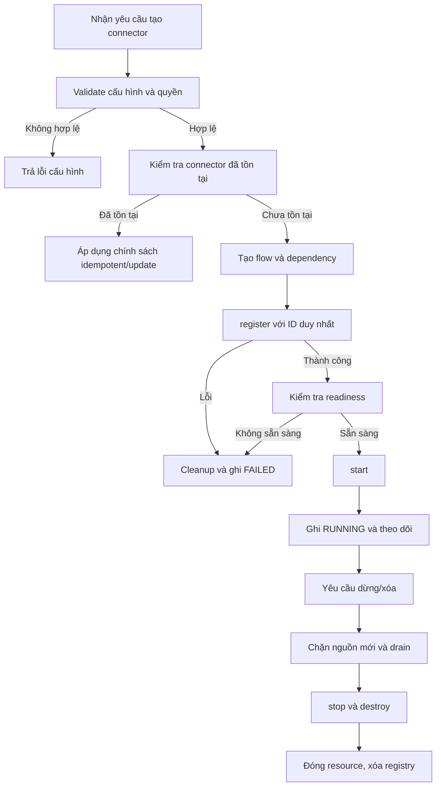

# IntegrationFlowContext đăng ký flow động

Trong nhiều ứng dụng, các tuyến tích hợp được biết trước khi ứng dụng khởi động. Ta khai báo chúng bằng `@Bean`, Spring tạo các thành phần cần thiết trong `ApplicationContext`, rồi quản lý vòng đời endpoint theo context. Nhưng có những hệ thống chỉ biết cần tạo flow nào khi ứng dụng đang chạy: mỗi tenant có một nguồn dữ liệu riêng, người quản trị bật một kết nối mới, hoặc cấu hình tích hợp được nạp từ database sau khi deploy.

Spring Integration cung cấp `IntegrationFlowContext` để đăng ký và quản lý `IntegrationFlow` động trong runtime. Thành phần này cho phép tạo flow, đăng ký các thành phần của flow vào Spring context, điều khiển start/stop và giải phóng registration khi không còn cần thiết. Để sử dụng an toàn, cần hiểu rõ registration, ID, channel đầu vào, lifecycle, tài nguyên phụ trợ và giới hạn của việc đăng ký flow trong một JVM.

## 1. Khi nào cần IntegrationFlowContext?

`IntegrationFlowContext` giải quyết tình huống cấu hình flow chưa thể xác định đầy đủ tại thời điểm khởi tạo ứng dụng. Ví dụ:

- Một nền tảng SaaS cho phép tenant bật/tắt kết nối tới hệ thống ERP riêng.
- Ứng dụng quản trị cho phép tạo một kết nối inbound mới mà không restart service.
- Mỗi đối tác có endpoint, credential hoặc mapping riêng và các cấu hình này được nạp trong runtime.
- Một flow chỉ tồn tại trong khoảng thời gian một tác vụ dài hạn đang hoạt động.
- Một adapter hoặc consumer được tạo theo cấu hình được cập nhật sau khi ứng dụng đã chạy.

Nếu số lượng flow, channel và endpoint đã biết cố định, khai báo bằng `@Bean` thường dễ quản lý hơn. Flow động phù hợp khi vòng đời của tuyến tích hợp phụ thuộc vào dữ liệu hoặc thao tác quản trị xuất hiện sau khi context đã được khởi động.

Không nên tạo một flow mới cho mỗi request hoặc mỗi message. Flow mang theo endpoint, handler, channel và có thể cả scheduler, executor hoặc resource riêng. Tạo flow quá thường xuyên sẽ làm tăng số bean runtime, thread, subscription và trạng thái cần quản lý. Với khác biệt chủ yếu nằm ở dữ liệu tenant, một flow dùng chung kết hợp router hoặc header-based routing có thể phù hợp hơn.

## 2. IntegrationFlowContext nằm ở đâu trong kiến trúc?

`IntegrationFlowContext` là registry/runtime API của Spring Integration để đăng ký các flow khi `ApplicationContext` đã hoạt động. Nó phối hợp với bean factory để đăng ký các thành phần thuộc flow như channel, endpoint và handler.

```mermaid
flowchart TD
    A[ApplicationContext đã khởi động] --> B[IntegrationFlowContext]
    B --> C[registration(flow)]
    C --> D[IntegrationFlowRegistrationBuilder]
    D --> E[register]
    E --> F[Flow và các bean runtime được đăng ký]
    F --> G[IntegrationFlowRegistration]
    G --> H[start / stop]
    G --> I[getInputChannel]
    G --> J[destroy]
```

Các đối tượng quan trọng:

| Thành phần | Vai trò |
|---|---|
| `IntegrationFlow` | Mô tả tuyến xử lý và các bước trong flow |
| `IntegrationFlowContext` | Điểm đăng ký, tra cứu và quản lý flow động trong context |
| `IntegrationFlowRegistrationBuilder` | Cấu hình registration trước khi đăng ký, ví dụ ID và startup behavior |
| `IntegrationFlowRegistration` | Handle đại diện cho flow đã đăng ký; cung cấp thao tác lifecycle và truy cập input channel |
| `MessageChannel` | Kênh để gửi message vào flow sau khi registration đã sẵn sàng |

Việc gọi `register()` tạo registration và đưa các thành phần của flow vào runtime. Kết quả trả về là `IntegrationFlowRegistration`; nên giữ handle này để quản lý flow về sau. Chỉ giữ một biến `IntegrationFlow` ban đầu là chưa đủ để dừng và giải phóng registration một cách có kiểm soát.

## 3. Đăng ký một flow động đầu tiên

Trước tiên, inject `IntegrationFlowContext` vào một service quản lý flow:

```java
@Component
public class DynamicFlowManager {

    private final IntegrationFlowContext flowContext;

    public DynamicFlowManager(IntegrationFlowContext flowContext) {
        this.flowContext = flowContext;
    }
}
```

Giả sử ứng dụng cần tạo một flow xử lý đơn hàng cho một tenant. Flow nhận message từ input channel riêng và gọi service nghiệp vụ:

```java
public IntegrationFlowRegistration registerTenant(String tenantId,
                                                    TenantOrderService service) {
    String flowId = "tenant-" + tenantId + "-orders";
    String inputChannelName = "tenant.orders.input." + tenantId;

    IntegrationFlow flow = IntegrationFlow.from(inputChannelName)
            .handle(service, "process")
            .get();

    IntegrationFlowRegistration registration = flowContext
            .registration(flow)
            .id(flowId)
            .autoStartup(false)
            .useFlowIdAsPrefix()
            .register();

    registration.start();
    return registration;
}
```

Luồng thao tác ở đây là:

1. Tạo một ID ổn định cho registration và tên input channel của tenant.
2. Xây dựng `IntegrationFlow` với input channel và handler phù hợp.
3. Yêu cầu `IntegrationFlowContext` tạo registration.
4. Đặt `autoStartup(false)` để chủ động quyết định thời điểm start.
5. Dùng `useFlowIdAsPrefix()` để thêm flow ID vào tên bean nội bộ do flow tạo ra, giúp tránh xung đột tên giữa các flow động.
6. Gọi `register()` để đăng ký flow, sau đó gọi `start()` khi cấu hình đã sẵn sàng.

Ví dụ minh họa API Java DSL phổ biến của Spring Integration. Các overload và cách cấu hình handler cụ thể có thể thay đổi theo phiên bản; cần dùng API tương ứng với dependency của dự án.

### 3.1. Gửi message vào flow đã đăng ký

Registration cung cấp input channel của flow. Có thể dùng channel này để gửi message:

```java
MessageChannel input = registration.getInputChannel();

Message<Order> message = MessageBuilder
        .withPayload(order)
        .setHeader("tenantId", tenantId)
        .setHeader("correlationId", requestId)
        .build();

input.send(message);
```

Lấy channel từ registration giúp caller dùng đúng input channel của flow vừa tạo. Không cần tự tìm một bean name được sinh ra bên trong flow. Nếu hệ thống cần gửi message từ nhiều nơi, hãy cung cấp một abstraction gửi message theo tenant thay vì để mọi caller tự ghép tên channel.

`getInputChannel()` chỉ có ý nghĩa khi flow có đầu vào tương ứng và registration đã được tạo thành công. Nếu flow bắt đầu từ một source adapter tự polling, caller thường không cần gửi message vào input channel đó; adapter tự lấy dữ liệu và phát vào flow.

### 3.2. Lấy registration đã tồn tại

Khi cần quản lý flow sau khi đăng ký, lưu `IntegrationFlowRegistration` trong một registry của ứng dụng. `IntegrationFlowContext` cũng hỗ trợ tra cứu registration theo ID bằng API tương ứng của phiên bản đang dùng. Tránh đăng ký lại flow chỉ để lấy một channel hoặc kiểm tra trạng thái.

## 4. ID và tên bean trong flow động

ID của registration là định danh dùng để quản lý một flow trong context. Nó phải ổn định và duy nhất trong phạm vi registry của ứng dụng.

Ví dụ:

```text
tenant-acme-orders
tenant-contoso-orders
partner-17-inventory
file-import-customer-2026
```

Khi tạo ID, nên:

- Kết hợp loại flow với định danh nghiệp vụ, chẳng hạn tenant ID hoặc connector ID.
- Chuẩn hóa ký tự để ID phù hợp với quy tắc đặt tên bean.
- Không dùng giá trị ngẫu nhiên mỗi lần restart nếu flow cần được tìm lại từ cấu hình lưu trữ.
- Không dùng dữ liệu bí mật như password, access token hoặc connection string trong ID.
- Kiểm tra trùng ID trước khi đăng ký và xử lý tình huống hai yêu cầu đăng ký đồng thời.

Một flow có thể tạo ra nhiều bean nội bộ. Khi đăng ký nhiều flow cùng loại, tên component mặc định có thể va chạm nếu không có quy ước đặt tên. `useFlowIdAsPrefix()` giúp prefix tên bean do flow tạo ra bằng flow ID. Điều này đặc biệt hữu ích khi nhiều flow cùng có transformer, channel hoặc endpoint cùng cấu trúc.

Prefix không thay thế thiết kế tên cho các channel mà ứng dụng chủ động chia sẻ. Nếu nhiều flow cần gửi vào cùng một channel công khai, hãy xác định rõ channel nào dùng chung, channel nào thuộc riêng flow. Đừng để một channel vô tình được chia sẻ chỉ vì hai flow trùng tên.

## 5. Quản lý start, stop và destroy

Đăng ký flow và bật flow là hai việc có thể điều khiển riêng. `IntegrationFlowRegistration` là handle để thực hiện vòng đời này.

| Thao tác | Ý nghĩa |
|---|---|
| `register()` | Đăng ký flow và các thành phần runtime vào context |
| `start()` | Bật các thành phần lifecycle của flow để bắt đầu hoạt động |
| `stop()` | Dừng các thành phần lifecycle của flow |
| `destroy()` | Hủy registration và giải phóng các thành phần thuộc flow |

Ví dụ:

```java
// Đã có registration
registration.stop();

// Khi cấu hình tích hợp bị xóa hoặc tenant ngừng sử dụng:
registration.destroy();
```

### 5.1. `autoStartup`

`autoStartup` quyết định flow có tự start khi đăng ký hay không theo cấu hình builder. Dùng `autoStartup(false)` khi cần hoàn tất các bước chuẩn bị trước khi flow nhận message, ví dụ:

- Kiểm tra cấu hình tenant.
- Tạo credential provider hoặc client kết nối.
- Đăng ký bean phụ trợ.
- Xác nhận endpoint đích có thể truy cập.
- Ghi nhận registration vào registry của ứng dụng.

Sau khi mọi bước chuẩn bị thành công, gọi `start()`. Nếu không cần giai đoạn chuẩn bị riêng, có thể dùng startup behavior mặc định của phiên bản framework.

### 5.2. Stop không giống destroy

`stop()` dừng các thành phần đang chạy nhưng registration vẫn còn để có thể start lại nếu thiết kế cho phép. `destroy()` dùng khi flow không còn cần tồn tại và cần giải phóng các bean/component đã đăng ký.

Không nên gọi `destroy()` chỉ để tạm ngưng một connector nếu sau đó cần bật lại cùng registration. Ngược lại, chỉ gọi `stop()` khi xóa tenant sẽ giữ lại registration và có thể làm rò rỉ bean hoặc resource nếu không có bước cleanup sau đó.

### 5.3. Dừng flow có đang xử lý message

Việc stop endpoint không tự động tạo ra một quy trình drain thống nhất cho mọi loại channel và adapter. Trước khi destroy, cần xác định message nào đang được xử lý, message nào còn trong queue và trạng thái nào được lưu bền vững.

Một quy trình ngừng connector có thể gồm:

1. Đánh dấu connector ở trạng thái `STOPPING` để chặn yêu cầu gửi mới từ ứng dụng.
2. Dừng nguồn inbound hoặc ngừng nhận message mới.
3. Chờ các tác vụ đang xử lý hoàn tất trong thời hạn cho phép.
4. Kiểm tra queue hoặc message store để bảo đảm message chưa xử lý vẫn có thể phục hồi.
5. Gọi `stop()` rồi `destroy()` khi đã sẵn sàng gỡ flow.
6. Đóng client, connection hoặc resource riêng mà ứng dụng tạo cho connector.

Nếu dùng `QueueChannel` trong bộ nhớ, message còn trong queue không tự động trở thành dữ liệu bền vững. Nếu yêu cầu không mất message khi process restart, cần message store hoặc broker có persistence và quy trình phục hồi tương ứng.

## 6. Quản lý nhiều flow động bằng registry của ứng dụng

Trong thực tế, `IntegrationFlowContext` là registry ở tầng framework; ứng dụng thường cần thêm registry nghiệp vụ để biết flow nào thuộc tenant nào, trạng thái mong muốn là gì và tài nguyên nào cần giải phóng.

Ví dụ cấu trúc dữ liệu:

```java
public record ConnectorRuntime(
        String connectorId,
        String tenantId,
        String flowId,
        IntegrationFlowRegistration registration,
        ConnectorState state) {
}
```

Registry ứng dụng có thể lưu theo `connectorId`:

```java
private final ConcurrentMap<String, ConnectorRuntime> connectors =
        new ConcurrentHashMap<>();
```

Khi đăng ký, quy trình nên được bảo vệ để hai request đồng thời không tạo hai flow cho cùng connector. Có thể dùng lock theo connector ID, thao tác atomic trên map hoặc một service quản lý duy nhất. Không nên chỉ kiểm tra `containsKey()` rồi đăng ký, vì hai thread có thể cùng vượt qua bước kiểm tra.

Một trình tự quản lý thường gặp:

```text
ABSENT
  |
  | validate config
  v
REGISTERING
  |
  | register components
  v
REGISTERED
  |
  | start
  v
RUNNING
  |
  | stop requested
  v
STOPPING
  |
  | stop + destroy + close resources
  v
REMOVED
```

Nếu `register()` hoặc `start()` thất bại, registry phải xóa trạng thái tạm và hủy registration đã tạo một phần nếu có. Nếu destroy thất bại, cần ghi nhận trạng thái cleanup lỗi để có thể retry thao tác dọn dẹp. Đừng xóa mọi dấu vết registry trước khi chắc chắn resource đã được giải phóng; nếu không, ứng dụng sẽ mất thông tin để xử lý phần cleanup còn dang dở.

### 6.1. Tránh đăng ký trùng và race condition

Một mẫu quản lý cần đảm bảo:

- Một connector ID chỉ có một thao tác đăng ký hoặc hủy đang diễn ra tại một thời điểm.
- ID flow được tạo từ dữ liệu chuẩn hóa và kiểm tra duy nhất.
- Nếu flow đã tồn tại, API quản trị phải xác định rõ đó là thao tác idempotent, cập nhật cấu hình hay lỗi xung đột.
- Khi cập nhật cấu hình, không ghi đè flow đang chạy một cách tùy tiện; phải có chiến lược thay thế và chuyển lưu lượng.
- Các bước register/start/destroy có cleanup tương ứng nếu một bước giữa chừng thất bại.

Với thao tác quản trị có thể được gọi lại do timeout, nên thiết kế API idempotent. Ví dụ, yêu cầu `ensureConnectorRunning(connectorId, version)` có thể kiểm tra trạng thái và version cấu hình trước khi tạo mới.

### 6.2. Flow dùng chung hay một flow cho mỗi tenant?

Không phải mọi ứng dụng multi-tenant đều cần một flow riêng cho từng tenant.

| Mô hình | Ưu điểm | Chi phí và giới hạn |
|---|---|---|
| Một flow dùng chung, định tuyến bằng header | Ít endpoint và bean, dễ nâng cấp logic chung | Cần cô lập tenant trong routing, credential và trạng thái nghiệp vụ |
| Một flow cho mỗi tenant | Có thể cấu hình adapter, channel và lifecycle riêng | Tăng số bean, endpoint, subscription và chi phí quản trị |
| Nhóm flow theo loại connector | Cân bằng giữa tái sử dụng và cô lập | Cần thiết kế cấu hình nhóm và định tuyến phù hợp |

Chọn mô hình theo mức khác biệt thật sự giữa các tenant. Nếu chỉ khác tenant ID hoặc một vài tham số xử lý, router và service dùng chung thường đơn giản hơn. Nếu mỗi tenant có source adapter, credential, polling schedule hoặc giao thức khác nhau, flow riêng có thể hợp lý.

## 7. Bean phụ trợ và dependency của flow động

Flow có thể cần các bean phụ trợ như handler, converter, client hoặc service. Có hai trường hợp:

- Dependency đã là bean dùng chung trong `ApplicationContext`, được inject vào component quản lý flow.
- Dependency được tạo riêng cho một registration, ví dụ client có credential riêng của connector.

Với dependency riêng cho flow, builder của `IntegrationFlowContext` hỗ trợ đăng ký bean bổ sung bằng API `addBean(...)` trong các phiên bản có hỗ trợ. Cần đặt tên bean riêng, quản lý vòng đời và giải phóng resource khi registration bị destroy.

Ví dụ ý tưởng:

```java
IntegrationFlowRegistration registration = flowContext
        .registration(flow)
        .id(flowId)
        .useFlowIdAsPrefix()
        .addBean("connectorClient", connectorClient)
        .register();
```

Hãy kiểm tra overload `addBean` của phiên bản Spring Integration đang sử dụng. Nếu client được tạo bên ngoài flow context, ứng dụng vẫn chịu trách nhiệm đóng client khi connector bị xóa; không giả định mọi object được truyền vào handler sẽ tự động được framework đóng đúng cách.

Không đưa credential vào flow ID, bean name, log hoặc message header không cần thiết. Dùng secret manager hoặc cơ chế cấu hình bảo mật của ứng dụng để cung cấp credential cho adapter/client.

## 8. Thay đổi cấu hình của một flow đang chạy

Một flow động thường được tạo từ cấu hình lưu trong database hoặc control plane. Khi cấu hình thay đổi, có ba cách xử lý phổ biến:

1. **Chỉ thay đổi dữ liệu runtime:** nếu flow dùng chung và handler đọc cấu hình mới an toàn, có thể cập nhật cấu hình nghiệp vụ mà không tạo flow mới.
2. **Dừng rồi đăng ký lại:** phù hợp khi topology, endpoint hoặc adapter thay đổi và không cần duy trì liên tục flow cũ.
3. **Tạo flow mới rồi chuyển lưu lượng:** phù hợp khi cần giảm downtime, nhưng cần quản lý phiên bản, tránh hai flow cùng xử lý một nguồn và có kế hoạch hủy flow cũ.

Với chiến lược thay thế không gián đoạn, có thể gắn version vào flow ID, ví dụ `tenant-acme-orders-v12`. Sau khi flow mới được đăng ký và kiểm tra, chuyển nguồn hoặc routing sang version mới; chỉ destroy version cũ khi đã xử lý xong message đang chạy và trạng thái cũ được bảo toàn.

Không nên sửa trực tiếp object cấu hình mà handler đang đọc từ nhiều thread nếu object đó mutable và không có cơ chế đồng bộ. Hãy dùng immutable configuration snapshot hoặc cơ chế cập nhật nguyên tử.

## 9. Flow động và giới hạn của một JVM

`IntegrationFlowContext` quản lý flow trong `ApplicationContext` của process hiện tại. Nó không phải distributed registry và không tự đồng bộ đăng ký giữa nhiều instance của ứng dụng.

Ví dụ, khi chạy ba replica:

```text
              Configuration database
                       |
                Control / deployment
                 /      |      \
                v       v       v
             App A    App B    App C
             Context  Context  Context
             Flow A   Flow B   Flow C
```

Mỗi instance có thể đăng ký một flow cùng ID cục bộ. Điều đó không có nghĩa chỉ một instance nhận message. Nếu cả ba flow kết nối tới cùng một nguồn, có thể xảy ra ba consumer cùng đọc dữ liệu hoặc cùng xử lý một sự kiện.

Với ứng dụng nhiều replica, cần quyết định rõ:

- Flow phải chạy trên mọi instance hay chỉ một instance được chọn?
- Nguồn dữ liệu có hỗ trợ consumer group, competing consumers hoặc lease/lock phân tán không?
- Cấu hình connector được broadcast tới mọi instance bằng cơ chế nào?
- Khi một instance restart, flow được khôi phục và đăng ký lại ra sao?
- Làm thế nào tránh hai instance cùng sở hữu một connector nếu nghiệp vụ yêu cầu single owner?

Các vấn đề này cần cơ chế ở tầng hệ thống như broker consumer group, distributed lock/lease, partition assignment hoặc control plane. Không thể giải quyết chỉ bằng `IntegrationFlowContext`.

## 10. Xử lý lỗi khi đăng ký và vận hành flow

Lỗi có thể xảy ra ở nhiều thời điểm:

| Thời điểm | Ví dụ nguyên nhân | Cách xử lý |
|---|---|---|
| Validate trước đăng ký | Thiếu URL, sai protocol, credential hết hạn | Từ chối cấu hình và lưu lỗi có thể đọc được |
| `register()` | Trùng ID hoặc trùng bean name, cấu hình flow không hợp lệ | Kiểm tra naming, dọn registration tạo dở nếu có |
| `start()` | Adapter không kết nối được, resource chưa sẵn sàng | Ghi trạng thái start lỗi, cleanup hoặc retry có giới hạn |
| Đang xử lý | Downstream timeout, payload sai, handler ném exception | Dùng retry/error flow và chính sách nghiệp vụ |
| `stop()` | Consumer không dừng kịp hoặc tác vụ đang chạy | Có timeout, log trạng thái và quy trình drain phù hợp |
| `destroy()` | Resource không đóng được hoặc bean phụ trợ còn hoạt động | Ghi nhận cleanup lỗi và cho phép retry cleanup |

Phân biệt lỗi đăng ký flow với lỗi xử lý message. Một flow có thể đăng ký và start thành công nhưng mọi message sau đó đều thất bại do downstream. Ngược lại, một connector có thể không start được nên chưa có message nào đi vào handler.

Trạng thái quản trị nên phản ánh ít nhất `REGISTERING`, `REGISTERED`, `RUNNING`, `STOPPING`, `STOPPED`, `FAILED` và `REMOVED` hoặc một tập trạng thái tương đương. Lưu cả thời điểm thay đổi, version cấu hình và nguyên nhân lỗi để người vận hành biết flow đang mắc ở bước nào.

## 11. Quan sát và kiểm thử flow động

Flow động cần được quan sát như một tài nguyên runtime có thể xuất hiện và biến mất trong lúc ứng dụng chạy.

Các thông tin nên theo dõi:

- Số flow đang đăng ký, đang chạy, đang dừng và bị lỗi.
- Flow ID, connector ID, tenant ID đã được che/chuẩn hóa và version cấu hình.
- Thời gian register, start, stop và destroy.
- Số message vào/ra, số lỗi, retry và độ trễ theo flow.
- Queue depth, executor activity và số thread nếu flow dùng polling hoặc async processing.
- Số registration đã bị xóa và số resource cleanup thất bại.

Không nên dùng tenant ID có cardinality rất cao làm metric label trực tiếp nếu điều đó khiến hệ thống metrics phình lớn. Có thể dùng log có cấu trúc hoặc trace cho chi tiết theo connector, còn metrics tổng hợp theo loại connector/trạng thái.

### 11.1. Các trường hợp kiểm thử quan trọng

| Trường hợp | Điều cần xác minh |
|---|---|
| Đăng ký flow hợp lệ | Registration xuất hiện, endpoint start và input channel nhận được message |
| Đăng ký ID trùng | Không tạo flow thứ hai; trạng thái lỗi hoặc idempotent theo hợp đồng |
| Hai yêu cầu đăng ký đồng thời | Chỉ một registration cho cùng connector ID |
| `autoStartup(false)` | Flow chưa xử lý message cho tới khi gọi `start()` |
| Stop và start lại | Flow có thể được bật lại nếu thiết kế cho phép và resource còn hợp lệ |
| Destroy | Component/bean thuộc registration được giải phóng và không còn xử lý message mới |
| Handler ném exception | Error/retry policy hoạt động theo cấu hình của flow |
| Cấu hình không hợp lệ | Không để lại registration hoặc resource dở dang |
| Restart ứng dụng | Control plane có thể tái tạo các flow cần thiết từ cấu hình lưu trữ |
| Nhiều replica | Không phát sinh consumer trùng nếu yêu cầu single owner |

Kiểm thử nên dùng `ApplicationContext` test và message channel để xác minh hành vi thật. Với flow dùng scheduler hoặc executor, chờ điều kiện hoàn tất bất đồng bộ bằng latch/awaitility hoặc cơ chế đồng bộ phù hợp thay vì dựa vào một khoảng `sleep` cố định.

## 12. Quy trình triển khai một dynamic flow an toàn

Một quy trình tổng quát có thể tổ chức như sau:



Thứ tự có thể thay đổi theo adapter. Với source polling adapter, readiness có thể là kiểm tra kết nối tới hệ thống nguồn. Với flow chỉ nhận message qua input channel, readiness có thể là endpoint đã start và channel đã sẵn sàng. Điều quan trọng là định nghĩa readiness theo loại flow thay vì coi `register()` thành công là bằng chứng connector đã hoạt động tốt.

## 13. Checklist trước khi dùng IntegrationFlowContext trong production

- [ ] Có lý do rõ ràng để tạo flow trong runtime; flow tĩnh không đáp ứng được yêu cầu.
- [ ] Có ID ổn định, duy nhất và không chứa dữ liệu bí mật.
- [ ] Tên bean nội bộ được cô lập bằng prefix khi cần.
- [ ] Input channel được lấy từ registration hoặc được quản lý theo hợp đồng tên rõ ràng.
- [ ] Có registry nghiệp vụ giữ `IntegrationFlowRegistration` và trạng thái connector.
- [ ] Đăng ký/start/destroy được bảo vệ trước các yêu cầu đồng thời.
- [ ] `autoStartup` và thời điểm start phù hợp với readiness của dependency.
- [ ] Stop và destroy được phân biệt; có quy trình drain message và đóng resource.
- [ ] Lỗi ở mọi giai đoạn đều có trạng thái, log và cleanup tương ứng.
- [ ] Flow theo tenant được cô lập đúng về channel, credential và dữ liệu.
- [ ] Đã xác định hành vi khi ứng dụng chạy nhiều replica.
- [ ] Có metrics/log để theo dõi số flow, lifecycle, message và lỗi.
- [ ] Có kiểm thử trùng ID, race condition, restart, cleanup và lỗi downstream.

`IntegrationFlowContext` giúp Spring Integration tạo và quản lý tuyến xử lý khi ứng dụng đang chạy. Để dùng đúng, hãy xem mỗi registration như một tài nguyên có ID, dependency, trạng thái và vòng đời riêng: tạo khi cấu hình hợp lệ, start khi sẵn sàng, stop khi ngừng nhận việc và destroy khi cần giải phóng. Khi kết hợp registry nghiệp vụ, naming rõ ràng, xử lý đồng thời và quan sát runtime, flow động có thể được vận hành có kiểm soát trong ứng dụng production.
