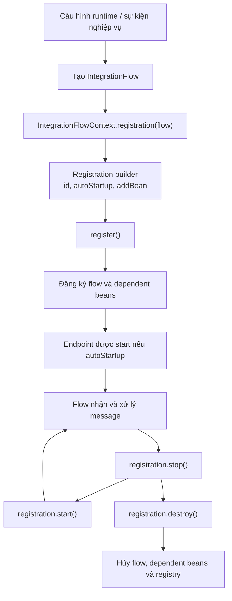
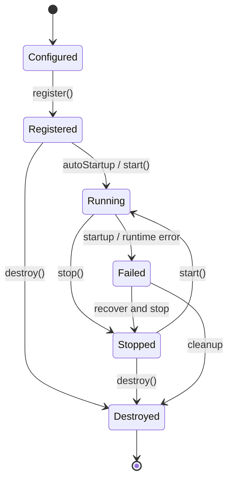

# Registration và lifecycle của flow runtime

`IntegrationFlowContext` cho phép ứng dụng tạo và đăng ký một `IntegrationFlow` ngay khi đang chạy. Đây là cơ chế phù hợp khi số lượng flow hoặc cấu hình flow phụ thuộc vào dữ liệu chỉ biết lúc runtime, chẳng hạn tenant mới, đối tác mới, một kết nối TCP vừa được cấp hoặc một nguồn dữ liệu được bật theo cấu hình vận hành.

Một flow đăng ký động vẫn được Spring Integration quản lý như các bean tích hợp trong `ApplicationContext`. Framework tạo các thành phần phụ thuộc, liên kết channel với endpoint và quản lý lifecycle của chúng. Ứng dụng nhận về một `IntegrationFlowRegistration` để truy cập flow, lấy input channel, gửi message, dừng, chạy lại hoặc hủy toàn bộ registration.

Bài này tập trung vào vòng đời của một flow động: xây dựng, đăng ký, sử dụng, tạm dừng, khởi động lại và gỡ bỏ. Trọng tâm là quyền sở hữu tài nguyên, định danh flow, bean phụ thuộc và cách tránh rò rỉ endpoint khi cấu hình runtime thay đổi.

## 1. Khi nào cần đăng ký flow động?

Flow khai báo bằng `@Bean` phù hợp khi cấu trúc tích hợp đã biết từ lúc phát triển và không thay đổi theo dữ liệu runtime. Ví dụ, ứng dụng luôn có một flow nhận đơn hàng từ một queue cố định.

Đăng ký động phù hợp khi ứng dụng cần tạo hoặc gỡ flow theo sự kiện vận hành:

- Mỗi tenant có một endpoint, thông tin xác thực hoặc quy tắc xử lý riêng.
- Một đối tác được thêm vào hệ thống và cần mở một kết nối inbound/outbound riêng.
- Một thiết bị hoặc gateway được đăng ký, kéo theo một flow TCP hoặc MQTT riêng.
- Nguồn dữ liệu chỉ xuất hiện sau khi ứng dụng đã khởi động.
- Quản trị viên bật/tắt một tích hợp mà không cần khởi động lại toàn bộ ứng dụng.
- Một bộ cấu hình được nạp từ database hoặc control plane và dùng để dựng nhiều flow cùng một mẫu.

Không nên dùng flow động chỉ vì có thể làm được. Nếu flow luôn cố định, khai báo bằng `@Bean` thường dễ đọc, dễ kiểm tra và dễ quản lý hơn. Flow động có chi phí vận hành: cần quản lý ID, xử lý đăng ký trùng, dọn bean phụ thuộc, xử lý lỗi giữa lúc đăng ký và lúc gỡ, và theo dõi số lượng flow đang chạy.

## 2. IntegrationFlowContext và các đối tượng liên quan

Spring Integration cung cấp bean `IntegrationFlowContext` để đăng ký thủ công các flow ngoài giai đoạn đăng ký bean thông thường. Framework tự cung cấp bean này; ứng dụng có thể inject nó vào service chịu trách nhiệm quản lý flow.

Quá trình cơ bản:

1. Tạo một đối tượng `IntegrationFlow` từ dữ liệu nghiệp vụ hoặc cấu hình runtime.
2. Gọi `IntegrationFlowContext.registration(flow)` để lấy builder.
3. Cấu hình ID, `autoStartup`, bean phụ thuộc và các tùy chọn đăng ký.
4. Gọi `register()` để đưa flow cùng các thành phần phụ thuộc vào application context.
5. Dùng `IntegrationFlowRegistration` để gửi message, truy cập flow hoặc điều khiển lifecycle.
6. Gọi `destroy()` hoặc `IntegrationFlowContext.remove(id)` khi flow không còn cần thiết.



Các API chính có vai trò khác nhau:

| API | Trách nhiệm |
|---|---|
| `IntegrationFlowContext` | Điểm đăng ký, tra cứu và gỡ flow động trong context |
| `IntegrationFlowRegistrationBuilder` | Cấu hình cách đăng ký trước khi gọi `register()` |
| `IntegrationFlowRegistration` | Đại diện cho một registration đã tạo; cung cấp quyền truy cập flow và điều khiển lifecycle |
| `getRegistrationById(id)` | Tra cứu registration theo ID; có thể trả về `null` nếu không tồn tại |
| `getRegistry()` | Trả về map các flow ID và registration tương ứng |
| `messagingTemplateFor(id)` | Lấy `MessagingTemplate` có destination mặc định là input channel của flow |
| `remove(id)` | Hủy flow và các bean phụ thuộc, đồng thời dọn cache/registry |

`IntegrationFlowRegistration` cung cấp các phương thức quan trọng:

- `getId()`: lấy ID của flow.
- `getIntegrationFlow()`: lấy đối tượng flow đã đăng ký.
- `getInputChannel()`: lấy input channel của flow.
- `getMessagingTemplate()`: lấy template gửi message vào input channel.
- `start()`: khởi động registration.
- `stop()`: dừng registration.
- `destroy()`: hủy flow, bean phụ thuộc và trạng thái đăng ký.

`getMessagingTemplate()` chỉ dùng được khi flow bắt đầu bằng một `MessageChannel`. Nếu flow bắt đầu từ một `MessageSource` hoặc một nguồn khác không cung cấp input channel, phương thức này có thể ném `IllegalStateException`. Khi đó cần tương tác với source theo đúng cơ chế của nó.

## 3. Đăng ký một flow từ dữ liệu runtime

Ví dụ sau tạo một flow riêng cho từng tenant. Flow nhận chuỗi đầu vào, chuẩn hóa dữ liệu và gọi service xử lý. Input channel được tạo cùng flow; sau khi đăng ký, ứng dụng có thể lấy channel hoặc messaging template từ registration.

```java
@Component
public class TenantFlowManager {

    private final IntegrationFlowContext flowContext;

    public TenantFlowManager(IntegrationFlowContext flowContext) {
        this.flowContext = flowContext;
    }

    public IntegrationFlowRegistration register(
            String tenantId,
            TenantOrderService orderService) {

        String flowId = "tenant-" + tenantId;

        MessageChannel inputChannel = new DirectChannel();

        IntegrationFlow flow = IntegrationFlow.from(inputChannel)
                .<String, String>transform(String::trim)
                .handle(String.class,
                        (payload, headers) ->
                                orderService.process(tenantId, payload))
                .get();

        return this.flowContext.registration(flow)
                .id(flowId)
                .useFlowIdAsPrefix()
                .autoStartup(true)
                .register();
    }
}
```

Ở đây, `tenantId` là dữ liệu nghiệp vụ được dùng để xác định flow. Trong ứng dụng thực tế, cần chuẩn hóa và kiểm tra giá trị này trước khi dùng làm bean ID. ID phải duy nhất trong phạm vi application context. Cùng một tenant không nên tạo nhiều flow có cùng ID khi registration cũ vẫn còn tồn tại.

Sau khi đăng ký, có thể sử dụng registration:

```java
IntegrationFlowRegistration registration =
        tenantFlowManager.register("acme", tenantOrderService);

registration.getMessagingTemplate()
        .send(new GenericMessage<>("order-100"));
```

Nếu muốn gửi trực tiếp qua input channel:

```java
MessageChannel input = registration.getInputChannel();

input.send(new GenericMessage<>("order-101"));
```

`MessagingTemplate` hữu ích khi cần các thao tác gửi message chuẩn của Spring Integration, ví dụ request-reply hoặc cấu hình timeout. Input channel hữu ích khi ứng dụng cần tích hợp trực tiếp với một producer đã có.

### 3.1. Đăng ký thêm bean phụ thuộc

Một flow có thể cần connection factory, serializer, deserializer hoặc một bean hỗ trợ riêng cho kết nối. Registration builder cho phép thêm các bean này để chúng được đăng ký cùng flow.

```java
IntegrationFlowRegistration registration =
        flowContext.registration(flow)
                .id("partner-" + partnerId)
                .addBean("partnerConnectionFactory", connectionFactory)
                .addBean("partnerSerializer", serializer)
                .register();
```

Có hai dạng thường dùng:

- `addBean(Object bean)`: để framework đăng ký bean phụ thuộc với tên phù hợp.
- `addBean(String name, Object bean)`: cung cấp tên bean tường minh.

Chỉ thêm những bean thực sự thuộc quyền sở hữu của flow. Nếu nhiều flow dùng chung một connection factory, hãy xác định rõ bean đó thuộc application context hay thuộc riêng từng registration. Không nên để một flow hủy một tài nguyên vẫn đang được flow khác sử dụng.

## 4. ID flow và tên các bean do flow tạo ra

ID là định danh của registration. Nó được dùng để tra cứu, dừng, hủy và quản lý flow. Builder cung cấp `id(String)`; ID phải duy nhất trong context và registration cũ phải được hủy trước khi dùng lại ID đó cho flow mới.

```java
IntegrationFlowRegistration registration =
        flowContext.registration(flow)
                .id("partner-42")
                .register();
```

Nên đặt ID tường minh thay vì phụ thuộc vào tên tự sinh. ID rõ ràng giúp log, registry và thao tác cleanup liên hệ được với tenant hoặc đối tác tương ứng.

### 4.1. Tránh trùng tên component giữa các flow

Khi tạo nhiều instance của cùng một mẫu flow, các component nội bộ có thể dùng chung ID, ví dụ handler đều có ID `client`. Nếu tên bean không được phân biệt, việc đăng ký nhiều flow có thể dẫn đến xung đột.

Dùng `useFlowIdAsPrefix()` để thêm flow ID làm tiền tố cho tên bean bên trong flow:

```java
IntegrationFlowRegistration flowA =
        flowContext.registration(buildClientFlow(portA))
                .id("client-a")
                .useFlowIdAsPrefix()
                .register();

IntegrationFlowRegistration flowB =
        flowContext.registration(buildClientFlow(portB))
                .id("client-b")
                .useFlowIdAsPrefix()
                .register();
```

Nếu flow có một handler nội bộ ID là `client`, tên bean của handler có thể được phân biệt theo flow, ví dụ `client-a.client.handler` và `client-b.client.handler`.

`useFlowIdAsPrefix()` yêu cầu flow có ID. Tính năng này có từ Spring Integration 5.0.6. Cách sinh tên bean đã thay đổi qua các phiên bản; khi code phụ thuộc vào tên bean nội bộ, hãy kiểm tra tài liệu đúng với phiên bản Spring Integration của ứng dụng. Tránh hard-code tên bean được sinh tự động nếu có thể thao tác qua registration API.

## 5. Lifecycle: register, start, stop, destroy

Đăng ký và chạy là hai khái niệm liên quan nhưng cần được phân biệt. Builder quyết định flow có tự khởi động sau khi đăng ký hay không; registration cho phép điều khiển vòng đời sau đó.

| Thao tác | Ý nghĩa | Registration còn tồn tại? |
|---|---|---|
| `register()` | Tạo và đăng ký flow cùng các bean phụ thuộc | Có |
| `start()` | Khởi động các thành phần lifecycle của flow | Có |
| `stop()` | Dừng các thành phần đang chạy | Có |
| `destroy()` | Hủy flow, bean phụ thuộc và trạng thái đăng ký | Không |
| `IntegrationFlowContext.remove(id)` | Hủy registration theo ID | Không |

### 5.1. autoStartup

`autoStartup` điều khiển việc flow có tự khởi động sau khi được đăng ký hay không. Mặc định là `true`.

```java
IntegrationFlowRegistration registration =
        flowContext.registration(flow)
                .id("partner-import")
                .autoStartup(false)
                .register();

// Khởi động khi đối tác đã hoàn tất bước handshake.
registration.start();
```

Cách này hữu ích khi flow cần chờ một điều kiện bên ngoài trước khi nhận message, ví dụ:

- Connection đến hệ thống đối tác phải được kiểm tra trước.
- Thông tin xác thực cần được tải và xác nhận.
- Một bước đăng ký thiết bị cần hoàn tất trước khi mở consumer.
- Quản trị viên cần bật flow sau khi kiểm tra cấu hình.

Khi `autoStartup=false`, các bean cần thiết vẫn được đăng ký và khởi tạo theo quá trình registration, nhưng các thành phần lifecycle không tự động được start. Ứng dụng chịu trách nhiệm gọi `start()` khi điều kiện đã sẵn sàng.

### 5.2. Tạm dừng và khởi động lại

`stop()` dừng các thành phần lifecycle của registration. Nó không có nghĩa là flow đã bị xóa khỏi application context. Registration vẫn còn để có thể tra cứu và khởi động lại.

```java
IntegrationFlowRegistration registration =
        flowContext.getRegistrationById("partner-import");

if (registration != null) {
    registration.stop();

    // Thực hiện thao tác bảo trì hoặc chờ nguồn dữ liệu sẵn sàng.

    registration.start();
}
```

Khi flow bị dừng, producer vẫn có thể cố gửi message. Kết quả phụ thuộc channel đầu vào và cách producer gửi. Với `DirectChannel`, không có consumer đang hoạt động thì message có thể không được xử lý và thao tác send có thể thất bại. Với channel có buffering, message có thể được giữ trong bộ đệm nếu còn dung lượng, nhưng điều đó không đồng nghĩa message đã được lưu bền vững.

Nếu mục tiêu là ngừng hoàn toàn một tích hợp và giải phóng bean cùng connection, hãy hủy registration thay vì chỉ stop.

### 5.3. Hủy registration

Khi flow không còn cần thiết, gọi `destroy()` trên registration hoặc `remove(id)` trên context:

```java
IntegrationFlowRegistration registration =
        flowContext.getRegistrationById("partner-import");

if (registration != null) {
    registration.destroy();
}
```

Hoặc:

```java
flowContext.remove("partner-import");
```

Việc hủy loại bỏ bean `IntegrationFlow`, các bean phụ thuộc do registration quản lý và trạng thái registry/cache tương ứng. Các endpoint lifecycle được dừng trong quá trình hủy. Sau khi hủy, không tiếp tục sử dụng registration hoặc các reference đến channel/handler mà flow sở hữu.

Nếu cần đăng ký lại cùng ID, hãy hủy registration cũ hoàn toàn trước. ID không được dùng lại trong lúc registration cũ còn tồn tại.

## 6. Quản lý nhiều flow và cleanup an toàn

Trong ứng dụng nhiều tenant hoặc nhiều đối tác, flow manager thường cần một registry nghiệp vụ để ánh xạ tenant với flow ID. Registry này giúp ứng dụng quyết định khi nào tạo, tạm dừng, chạy lại hoặc hủy flow.

```java
@Component
public class PartnerFlowRegistry {

    private final IntegrationFlowContext flowContext;
    private final Map<String, IntegrationFlowRegistration> registrations =
            new ConcurrentHashMap<>();

    public PartnerFlowRegistry(IntegrationFlowContext flowContext) {
        this.flowContext = flowContext;
    }

    public synchronized IntegrationFlowRegistration register(
            String partnerId,
            IntegrationFlow flow) {

        String flowId = "partner-" + partnerId;

        if (registrations.containsKey(flowId)) {
            throw new IllegalStateException(
                    "Flow already registered: " + flowId);
        }

        IntegrationFlowRegistration registration =
                flowContext.registration(flow)
                        .id(flowId)
                        .useFlowIdAsPrefix()
                        .register();

        registrations.put(flowId, registration);
        return registration;
    }

    public synchronized void unregister(String flowId) {
        IntegrationFlowRegistration registration =
                registrations.get(flowId);

        if (registration != null) {
            registration.destroy();
            registrations.remove(flowId, registration);
        }
    }
}
```

Đây là ví dụ tối giản về quyền sở hữu registration. Trong hệ thống thực tế:

- Chuẩn hóa `partnerId` trước khi tạo ID; không dùng trực tiếp dữ liệu đầu vào tùy ý làm bean name.
- Bảo đảm một đối tác không có hai thao tác register đồng thời tạo cùng ID.
- Chỉ xóa entry khỏi registry nghiệp vụ sau khi destroy thành công. Nếu cleanup thất bại, giữ lại thông tin để có thể quan sát và xử lý tiếp.
- Nếu flow manager có nhiều instance trong một JVM hoặc nhiều node, cần xác định node nào sở hữu flow. `IntegrationFlowContext` chỉ quản lý registry trong application context của tiến trình hiện tại.
- Khi nhiều flow chia sẻ một connection hoặc executor, quản lý lifecycle của tài nguyên chia sẻ ở cấp ứng dụng thay vì để một flow tự hủy.
- Khi ứng dụng shutdown, context sẽ đóng các bean do nó quản lý; flow manager vẫn nên cung cấp thao tác unregister sớm khi tenant hoặc đối tác bị gỡ trong lúc ứng dụng còn chạy.

Không nên xem `getRegistry()` là nguồn dữ liệu nghiệp vụ bền vững. Registry của `IntegrationFlowContext` mô tả các flow đã đăng ký trong context hiện tại. Nếu cần khôi phục các flow sau restart, hãy lưu cấu hình cần thiết ở database hoặc configuration store rồi dựng lại flow trong quá trình startup.

## 7. Xử lý lỗi trong quá trình tạo và hủy flow

Đăng ký động có thể thất bại trước khi flow sẵn sàng nhận message. Ví dụ:

- ID đã được sử dụng.
- Một dependency của flow chưa tồn tại hoặc không tương thích.
- Connection factory không mở được kết nối.
- Bean phụ thuộc bị cấu hình sai.
- Endpoint không thể khởi động.
- Nguồn bên ngoài ngắt kết nối trong lúc flow được đăng ký.

Cần phân biệt lỗi cấu hình/registration với lỗi xử lý message sau khi flow đã chạy. Lỗi lúc đăng ký thường xuất hiện trong lời gọi `register()` hoặc trong quá trình khởi động các thành phần. Lỗi message xuất hiện khi endpoint nhận và xử lý message; chúng đi theo cơ chế error handling của flow, ví dụ error channel hoặc retry advice đã cấu hình.

Một mẫu quản lý đăng ký nên ghi log flow ID ở cả ba điểm: bắt đầu đăng ký, đăng ký thành công và bắt đầu hủy. Khi có lỗi, ghi nhận trạng thái hiện tại và nguyên nhân gốc để có thể biết flow chưa từng được tạo, đã tạo nhưng chưa chạy, hay đã chạy rồi mới gặp lỗi.

Khi hủy flow, nếu một dependent bean không giải phóng được tài nguyên, cần giữ đủ log để xác định bean sở hữu tài nguyên đó. Không nên chỉ xóa entry registry nghiệp vụ rồi bỏ qua trạng thái hủy thất bại.

## 8. Transaction, retry, message store và tài nguyên đi kèm flow

`IntegrationFlowContext` quản lý việc đăng ký flow và các bean phụ thuộc. Nó không tự tạo transaction boundary, retry policy hoặc message persistence cho nghiệp vụ. Những cơ chế đó vẫn phải được cấu hình trong flow hoặc các bean mà flow sử dụng.

Ví dụ:

- Nếu handler cần transaction, cấu hình transaction advice hoặc transaction support phù hợp tại endpoint.
- Nếu thao tác cần retry, thêm retry advice và xác định exception nào được retry.
- Nếu aggregator hoặc resequencer cần lưu state, cấu hình message store phù hợp.
- Nếu flow dùng correlation, bảo đảm correlation key và release strategy phù hợp với vòng đời dữ liệu.
- Nếu flow dùng connection factory riêng, đăng ký nó như dependent bean khi registration sở hữu tài nguyên đó; nếu connection factory được chia sẻ, để bean ở phạm vi ứng dụng quản lý.

Khi hủy flow, hãy xác định rõ dữ liệu nào cần giữ lại. Xóa endpoint không tự động đồng nghĩa dữ liệu message đã được xử lý, commit hoặc lưu bền vững. Với message store dùng chung hoặc dữ liệu cần phục hồi, cần có chính sách retention và cleanup riêng.

## 9. Kiểm tra trạng thái flow runtime

Có thể tra cứu registration bằng ID:

```java
IntegrationFlowRegistration registration =
        flowContext.getRegistrationById("partner-42");

if (registration == null) {
    log.info("Flow partner-42 is not registered");
}
else {
    log.info("Flow id={}", registration.getId());
    log.info("Input channel={}", registration.getInputChannel());
}
```

Có thể xem registry hiện tại:

```java
flowContext.getRegistry().forEach((id, registration) ->
        log.info("registered flow: {}", id));
```

Lưu ý: registry xác nhận registration có tồn tại, nhưng không thay thế việc kiểm tra trạng thái running của từng endpoint. Một registration có thể vẫn tồn tại sau khi đã gọi `stop()`.

Khi cần kiểm tra chi tiết, có thể tra cứu các endpoint và bean theo tên hoặc kiểu từ application context, đồng thời quan sát log startup/shutdown. Nếu ứng dụng có nhiều flow động, ID tường minh và tên component dễ nhận diện giúp đối chiếu log tốt hơn.

| Triệu chứng | Kiểm tra | Hướng xử lý |
|---|---|---|
| `register()` báo trùng ID | Registry và ID hiện có | Dùng ID duy nhất hoặc destroy registration cũ trước |
| Flow đăng ký thành công nhưng không xử lý message | `autoStartup`, trạng thái endpoint, input channel | Gọi `start()` hoặc sửa cấu hình đầu vào |
| Không lấy được messaging template | Flow có bắt đầu bằng `MessageChannel` không? | Dùng input channel phù hợp hoặc gửi theo cơ chế source |
| Nhiều flow va chạm tên bean | ID component nội bộ và `useFlowIdAsPrefix()` | Đặt flow ID tường minh và bật prefix |
| Flow cũ vẫn chiếm tài nguyên | Registration ID, dependent beans, destroy | Gọi `destroy()` hoặc `remove(id)` |
| Restart ứng dụng mất flow động | Nguồn cấu hình runtime | Lưu cấu hình ngoài registry và đăng ký lại khi startup |
| Dừng flow nhưng producer vẫn gửi | Kiểu channel và producer | Điều phối producer, xử lý lỗi send hoặc dùng cơ chế buffering phù hợp |

## 10. Quy trình vận hành đề xuất

Một flow động nên có vòng đời gắn với một đối tượng nghiệp vụ rõ ràng, chẳng hạn tenant hoặc partner:

1. Nhận cấu hình và xác thực dữ liệu đầu vào.
2. Tạo flow và các bean phụ thuộc từ cấu hình đã xác thực.
3. Tạo ID ổn định, duy nhất trong application context.
4. Đăng ký flow bằng `IntegrationFlowContext`.
5. Kiểm tra trạng thái kết nối và endpoint; chỉ bật producer khi flow sẵn sàng.
6. Theo dõi lỗi message, retry, transaction và trạng thái tài nguyên.
7. Khi tích hợp tạm dừng, gọi `stop()`; khi phục hồi, gọi `start()`.
8. Khi tích hợp bị gỡ, gọi `destroy()` hoặc `remove(id)`, rồi cập nhật registry nghiệp vụ sau khi cleanup thành công.

Luồng thao tác này có thể biểu diễn như sau:



Sơ đồ là mô hình vận hành ở cấp ứng dụng. Một lỗi trong handler không nhất thiết chuyển registration sang trạng thái `Failed`; endpoint có thể vẫn chạy và tiếp tục nhận message. Cần quan sát riêng trạng thái registration, lifecycle endpoint và kết quả xử lý message.

## 11. Ghi nhớ

- `IntegrationFlowContext` đăng ký và quản lý flow động trong application context hiện có.
- `registration(flow)` tạo builder; `register()` đăng ký flow và bean phụ thuộc.
- ID phải duy nhất trong context; đặt ID tường minh giúp tra cứu và cleanup.
- `useFlowIdAsPrefix()` giúp phân biệt tên component khi đăng ký nhiều instance cùng mẫu flow.
- `autoStartup` mặc định là `true`; đặt `false` nếu cần kiểm soát thời điểm start.
- `stop()` tạm dừng flow nhưng giữ registration; `start()` chạy lại; `destroy()` hoặc `remove(id)` hủy flow và dependent beans.
- `getRegistry()` là trạng thái runtime trong một context, không phải nơi lưu cấu hình bền vững để phục hồi sau restart.
- Transaction, retry, message store, correlation và error handling vẫn cần được cấu hình theo nghiệp vụ của flow.
- Mỗi registration cần có chủ sở hữu và quy trình cleanup rõ ràng để tránh rò rỉ endpoint, connection hoặc executor.

## Tài liệu tham khảo

- [Spring Integration — Dynamic and Runtime Integration Flows](https://docs.spring.io/spring-integration/reference/dsl/java-runtime-flows.html)
- [Javadoc — IntegrationFlowContext (Spring Integration 6.2.6)](https://docs.spring.io/spring-integration/docs/6.2.6/api/org/springframework/integration/dsl/context/IntegrationFlowContext.html)
- [Javadoc — IntegrationFlowRegistration (Spring Integration 6.2.6)](https://docs.spring.io/spring-integration/docs/6.2.6/api/org/springframework/integration/dsl/context/IntegrationFlowContext.IntegrationFlowRegistration.html)
- [Javadoc — IntegrationFlowRegistrationBuilder (Spring Integration 6.5.0)](https://docs.spring.io/spring-integration/docs/6.5.0/api/org/springframework/integration/dsl/context/IntegrationFlowContext.IntegrationFlowRegistrationBuilder.html)

