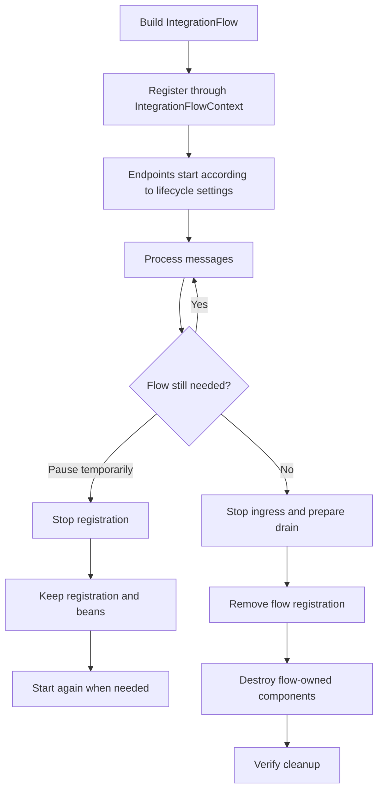
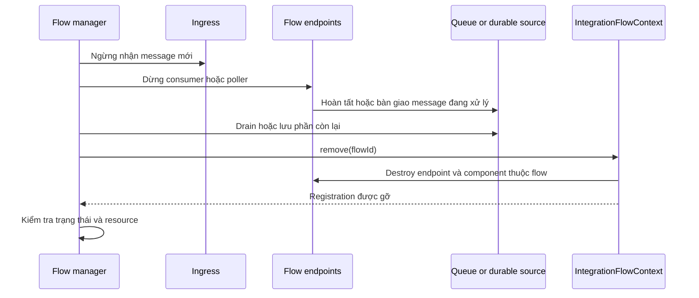

# Unregister flow và dọn bean liên quan

Spring Integration cho phép đăng ký một `IntegrationFlow` trong lúc ứng dụng đang chạy thông qua `IntegrationFlowContext`. Cách làm này phù hợp với hệ thống có flow được tạo theo tenant, khách hàng, cấu hình tích hợp hoặc một phiên làm việc. Nhưng đăng ký chỉ là nửa đầu của vòng đời. Khi cấu hình không còn hiệu lực, ứng dụng cần tháo flow khỏi runtime và giải phóng các component do flow tạo ra.

Điểm cần phân biệt là **dừng flow** và **unregister flow**. Dừng flow ngăn endpoint tiếp tục xử lý theo lifecycle của nó, nhưng các bean và đăng ký vẫn còn trong context để có thể khởi động lại. Unregister loại flow khỏi `IntegrationFlowContext`, hủy đăng ký các component thuộc flow và giải phóng tài nguyên mà các component đó sở hữu. Nếu chỉ dừng mà không unregister, ứng dụng có thể tích lũy endpoint, bean, scheduler hoặc trạng thái không còn được sử dụng.

## 1. IntegrationFlowContext quản lý những gì?

Với flow khai báo tĩnh, Spring tạo các bean khi ApplicationContext khởi tạo. Các bean tồn tại theo vòng đời của context. Với flow động, `IntegrationFlowContext` cung cấp một registry để đăng ký và quản lý flow trong lúc ứng dụng đang chạy.

Một đăng ký động thường gồm các đối tượng sau:

- **IntegrationFlow**: mô tả tuyến xử lý message.
- **IntegrationFlowRegistration**: đại diện cho một lần đăng ký flow, cung cấp ID và các thao tác quản lý vòng đời.
- **Channel và endpoint**: các component được tạo từ flow và đưa vào Spring bean factory.
- **Bean hỗ trợ riêng cho flow**: các component bổ sung được đăng ký cùng flow nếu ứng dụng sử dụng cơ chế đó.
- **Dependency bên ngoài**: service, repository, executor hoặc channel có sẵn trong ApplicationContext mà flow tham chiếu.

Sự khác biệt giữa component thuộc đăng ký và dependency bên ngoài rất quan trọng khi dọn dẹp. Khi tháo flow, framework có thể hủy các component được đăng ký cùng flow. Nhưng một service singleton được inject từ ApplicationContext vẫn thuộc quyền quản lý của context chính; flow chỉ sử dụng nó. Không được đóng hoặc xóa service dùng chung chỉ vì một flow ngừng sử dụng service đó.

## 2. Vòng đời của một flow động

Một flow động thường trải qua các giai đoạn sau:



Trình tự này tách hai tình huống:

- **Tạm dừng**: dừng endpoint nhưng giữ registration. Flow có thể được start lại khi cần.
- **Kết thúc vòng đời**: tháo registration. Flow và các component thuộc đăng ký được hủy khỏi runtime.

Khi gọi `register()`, endpoint được khởi động theo cấu hình lifecycle, chẳng hạn `autoStartup`. Vì vậy, “đã register” và “đang running” là hai trạng thái cần quan sát riêng. Một flow có thể đã được đăng ký nhưng endpoint được cấu hình không tự khởi động.

## 3. Đăng ký flow với ID ổn định

Ví dụ sau đăng ký một flow dành riêng cho một tenant:

```java
String flowId = "tenant-" + tenantId + "-orders";

IntegrationFlow flow = buildTenantOrderFlow(tenantId);

IntegrationFlowRegistration registration =
        integrationFlowContext
                .registration(flow)
                .id(flowId)
                .useFlowIdAsPrefix()
                .register();
```

Các điểm cần chú ý:

- `id(flowId)` đặt ID cho lần đăng ký. ID phải duy nhất trong phạm vi registry của ApplicationContext.
- `useFlowIdAsPrefix()` dùng flow ID làm tiền tố cho tên các component được tạo từ flow, giúp giảm xung đột tên và dễ nhận diện component thuộc flow nào.
- `register()` đăng ký flow và trả về `IntegrationFlowRegistration`.
- `registration.getId()` cung cấp ID thực tế để lưu lại và dùng khi quản lý hoặc unregister.
- `buildTenantOrderFlow(...)` cần tạo cấu hình flow riêng cho tenant. Không nên tái sử dụng một flow instance có state hoặc endpoint riêng cho nhiều đăng ký độc lập.

Tên flow cần được chuẩn hóa trước khi dùng làm ID. Không đưa trực tiếp dữ liệu nhạy cảm như email, token hoặc thông tin cá nhân vào bean name; tên có thể xuất hiện trong log, metric hoặc công cụ quản lý. Nếu tenant ID có ký tự không phù hợp với quy ước đặt tên của ứng dụng, hãy chuyển nó thành một định danh an toàn và ổn định.

Nếu flow cần một input channel riêng, hãy bảo đảm channel đó được tạo và quản lý cùng registration hoặc được đăng ký dưới một tên riêng cho flow. Nếu flow tham chiếu một channel dùng chung, channel đó vẫn tồn tại sau khi flow bị unregister.

## 4. Dừng và unregister khác nhau như thế nào?

Đây là điểm dễ gây rò rỉ component nhất khi quản lý flow động.

| Thao tác | Kết quả | Có thể start lại? |
|---|---|---|
| `registration.stop()` | Dừng các thành phần lifecycle thuộc registration | Có, nếu registration còn tồn tại |
| `registration.start()` | Khởi động lại registration đã dừng | Có |
| `integrationFlowContext.remove(flowId)` | Gỡ registration và hủy các component thuộc flow | Không; phải đăng ký lại |
| Đóng ApplicationContext | Dừng và hủy các bean do context quản lý | Không trong context đã đóng |

Dừng flow phù hợp khi cần tạm ngưng xử lý, bảo trì hoặc chờ một điều kiện vận hành. Unregister phù hợp khi cấu hình tích hợp đã hết hiệu lực, tenant bị xóa, một kết nối động bị thu hồi hoặc flow được thay thế bằng một registration mới.

Ví dụ unregister:

```java
public void unregisterFlow(String flowId) {
    integrationFlowContext.remove(flowId);
}
```

`remove(flowId)` là thao tác của `IntegrationFlowContext` để loại flow khỏi registry và hủy registration tương ứng. Đây là API nên dùng để kết thúc vòng đời flow động. Không nên tự tìm bean name nội bộ rồi xóa bean definition bằng tay; cách đó bỏ qua quan hệ giữa flow, endpoint và component do framework đăng ký.

Nếu chỉ muốn tạm dừng, giữ lại đối tượng registration:

```java
registration.stop();

// Khi cần chạy lại:
registration.start();
```

Sau khi đã gọi `integrationFlowContext.remove(flowId)`, không tiếp tục dùng registration cũ. Nếu cần chạy lại, hãy tạo hoặc xây dựng flow phù hợp rồi đăng ký lại.

## 5. Quản lý ID để không mất dấu registration

Ứng dụng cần lưu ID của những flow đã đăng ký. Nếu không lưu ID, đến lúc tenant bị xóa hoặc cấu hình bị thu hồi, ứng dụng có thể không biết registration nào cần được tháo.

Ví dụ một registry đơn giản:

```java
@Component
public class DynamicOrderFlows {

    private final IntegrationFlowContext flowContext;
    private final TenantOrderFlowFactory flowFactory;

    private final ConcurrentMap<String, String> flowIds =
            new ConcurrentHashMap<>();

    public DynamicOrderFlows(
            IntegrationFlowContext flowContext,
            TenantOrderFlowFactory flowFactory) {
        this.flowContext = flowContext;
        this.flowFactory = flowFactory;
    }

    public void register(String tenantId) {
        String flowId = "tenant-" + tenantId + "-orders";

        flowIds.computeIfAbsent(tenantId, key -> {
            IntegrationFlow flow = this.flowFactory.createForTenant(key);

            IntegrationFlowRegistration registration =
                    this.flowContext.registration(flow)
                            .id(flowId)
                            .useFlowIdAsPrefix()
                            .register();

            return registration.getId();
        });
    }

    public void unregister(String tenantId) {
        flowIds.computeIfPresent(tenantId, (key, flowId) -> {
            this.flowContext.remove(flowId);
            return null;
        });
    }

}
```

`TenantOrderFlowFactory` là abstraction do ứng dụng định nghĩa để tạo một flow mới cho tenant; nó có thể được triển khai bằng một `@Component` khác. Việc dùng `computeIfAbsent` tránh đăng ký lặp cho cùng một khóa tenant trong cùng instance registry. Nếu hệ thống có nhiều yêu cầu đăng ký đồng thời, cần thống nhất cách chuẩn hóa ID và xử lý trường hợp cùng một flow ID đã được đăng ký bởi một thành phần khác.

Ví dụ hợp đồng của factory:

```java
public interface TenantOrderFlowFactory {
    IntegrationFlow createForTenant(String tenantId);
}
```

Khi unregister, ví dụ dùng `computeIfPresent` và chỉ xóa mapping sau khi `remove(flowId)` hoàn tất. Nếu thao tác remove phát sinh lỗi, mapping vẫn còn để hệ thống có thể ghi log và thử xử lý lại theo chính sách vận hành.

Với hệ thống lớn hơn, registry này có thể cần lưu trạng thái cấu hình ở database hoặc một nguồn điều phối bền vững. Map trong bộ nhớ chỉ mô tả các registration của một JVM và mất khi process restart.

## 6. Bean nào được dọn khi unregister?

Không phải mọi bean mà flow sử dụng đều bị xóa. Hãy phân biệt quyền sở hữu:

| Loại đối tượng | Khi unregister flow |
|---|---|
| Endpoint được tạo từ flow registration | Được tháo khỏi runtime và hủy theo lifecycle của registration |
| Channel nội bộ được tạo cùng flow | Được hủy cùng các component của registration |
| Bean hỗ trợ được đăng ký riêng cho flow | Được dọn theo cơ chế đăng ký và lifecycle của flow |
| Service singleton có sẵn trong ApplicationContext | Vẫn tồn tại; chỉ flow ngừng tham chiếu |
| Repository, DataSource hoặc HTTP client dùng chung | Vẫn do ApplicationContext chính quản lý |
| Executor hoặc scheduler dùng chung | Không tự đóng chỉ vì một flow unregister |
| Message hoặc trạng thái lưu ở hệ thống ngoài | Không tự bị xóa; cần chính sách riêng |

Một flow có thể tham chiếu bean dùng chung bằng constructor injection hoặc bằng tên. Những dependency đó không thuộc quyền sở hữu riêng của flow. Nếu unregister flow rồi gọi `close()` trên một executor hoặc client dùng chung, các flow khác có thể bị lỗi.

Ngược lại, nếu một component hoặc resource được tạo riêng cho một flow và được Spring quản lý trong phạm vi registration, hãy để lifecycle của bean thực hiện cleanup. Custom bean có thể dùng các callback Spring như `DisposableBean`, `@PreDestroy` hoặc `AutoCloseable` theo cách phù hợp với cấu hình bean. Cleanup phải an toàn khi được gọi trong quá trình shutdown và không nên phụ thuộc vào một message mới được gửi vào flow.

### Tránh tạo resource ngoài vòng đời Spring

Ví dụ không tốt là tạo executor trong một handler nhưng không có nơi dừng executor đó:

```java
public class BadHandler {

    private final ExecutorService executor =
            Executors.newFixedThreadPool(8);

}
```

Executor này không tự động được Spring quản lý chỉ vì handler được tạo trong một flow. Nếu handler bị unregister mà executor không được shutdown, worker thread có thể tiếp tục tồn tại.

Có hai hướng rõ ràng:

- Dùng executor bean được ApplicationContext quản lý nếu nhiều flow cùng chia sẻ.
- Nếu executor chỉ phục vụ một flow, đăng ký nó như resource có lifecycle rõ ràng và bảo đảm cleanup khi registration bị hủy.

Không đóng executor dùng chung trong callback hủy của một flow. Chủ sở hữu resource phải là nơi quyết định thời điểm shutdown.

## 7. Trình tự tháo flow an toàn khi đang có message

Gọi remove ngay khi flow vẫn đang nhận tải có thể làm mất công việc đang chờ hoặc khiến message đang xử lý bị gián đoạn. Việc unregister cần gắn với semantics giao nhận của nguồn và chính sách xử lý message của ứng dụng.

Một trình tự vận hành thường dùng:

1. **Ngừng nhận công việc mới**: tạm dừng inbound adapter, route đầu vào hoặc thành phần upstream đưa message vào flow.
2. **Dừng consumer phù hợp**: ngăn poller hoặc endpoint nhận thêm message trong lúc chuẩn bị tháo flow.
3. **Theo dõi công việc đang chạy**: dùng metric, log hoặc cơ chế ứng dụng để xác định message đang xử lý đã hoàn tất.
4. **Drain hoặc lưu công việc còn lại**: xử lý hết queue, chuyển message sang nơi lưu bền vững hoặc dead-letter theo chính sách.
5. **Unregister**: gọi `integrationFlowContext.remove(flowId)`.
6. **Xác minh cleanup**: kiểm tra registration không còn trong registry, endpoint không còn hoạt động và resource riêng đã được giải phóng.

Sơ đồ trình tự:



Không phải mọi hệ thống đều có thể drain queue ngay lập tức. Với broker, cần xác định ack, offset hoặc visibility timeout. Với `QueueChannel` trong bộ nhớ, message chưa được lấy ra có thể mất khi channel bị hủy. Với persistent queue hoặc nguồn bền vững, message có thể được consumer khác tiếp tục xử lý nếu cơ chế ownership và ack được thiết kế đúng.

Lưu ý rằng `stop()` của endpoint không mặc nhiên là một giao thức drain hoàn chỉnh cho mọi nguồn. Nó quản lý lifecycle của endpoint; việc bảo đảm không mất message còn phụ thuộc adapter, channel, transaction và semantics của hệ thống nguồn. Nếu cần graceful shutdown, ứng dụng phải định nghĩa điều kiện hoàn tất và timeout cụ thể trước khi remove.

## 8. Queue, MessageStore và dữ liệu ngoài flow

Unregister flow dọn component runtime. Nó không đồng nghĩa xóa toàn bộ dữ liệu mà flow từng xử lý.

Ví dụ:

- `QueueChannel` lưu message trong bộ nhớ của channel. Nếu channel thuộc flow và bị hủy, message chưa được xử lý có thể không còn truy cập được.
- Một broker có thể vẫn giữ message chưa ack theo chính sách của broker.
- `MessageStore` có thể giữ message group của aggregator. Nếu store là bean dùng chung hoặc nằm trong database, unregister flow không nhất thiết xóa các group đó.
- Một database hoặc object storage có thể giữ payload do flow ghi ra. Dữ liệu đó cần retention policy riêng.
- Error channel có thể là channel dùng chung; unregister một flow không nên xóa error channel nếu các flow khác vẫn sử dụng.

Với aggregator, cần xem xét các message group còn mở. Nếu flow bị gỡ nhưng message group vẫn nằm trong persistent `MessageStore`, nhóm có thể còn tồn tại sau restart hoặc được một flow mới tiếp tục đọc nếu cấu hình cùng store và cùng correlation strategy. Nếu dữ liệu đó không còn hợp lệ, phải có chính sách timeout, expiry hoặc cleanup rõ ràng. Không xóa toàn bộ store dùng chung chỉ để dọn một flow.

Trước khi unregister, hãy xác định nơi message đang nằm: endpoint đang xử lý, queue trong memory, broker, database hay message group store. Chỉ khi biết nơi lưu và semantics giao nhận, ta mới đánh giá được tác động của việc hủy channel hoặc endpoint.

## 9. Thay thế flow: unregister phiên bản cũ rồi đăng ký phiên bản mới

Một trường hợp phổ biến là cập nhật cấu hình tích hợp khi tenant đổi endpoint, credential hoặc quy tắc xử lý. Cách làm an toàn là quản lý phiên bản hoặc trạng thái của flow để không có hai registration cùng xử lý một nguồn ngoài ý muốn.

Một trình tự đơn giản:

```java
public void replaceFlow(String tenantId, IntegrationFlow newFlow) {
    String flowId = flowIdFor(tenantId);

    stopIngressFor(tenantId);
    drainOrPersistPendingMessages(tenantId);

    this.flowContext.remove(flowId);

    IntegrationFlowRegistration newRegistration =
            this.flowContext.registration(newFlow)
                    .id(flowId)
                    .useFlowIdAsPrefix()
                    .register();

    recordRegistration(tenantId, newRegistration.getId());
    startIngressFor(tenantId);
}
```

Các hàm `stopIngressFor`, `drainOrPersistPendingMessages`, `recordRegistration` và `startIngressFor` là trách nhiệm của ứng dụng, không phải API có sẵn của `IntegrationFlowContext`.

Nếu không thể gián đoạn xử lý, có thể triển khai chiến lược blue/green: đăng ký flow mới với ID riêng, xác minh endpoint mới đã sẵn sàng, chuyển ingress hoặc routing sang flow mới, drain flow cũ rồi unregister flow cũ. Khi làm vậy, cần tránh để hai flow cùng consume một nguồn độc quyền hoặc cùng thực hiện side effect không idempotent.

Nếu đăng ký flow mới thất bại sau khi flow cũ đã bị remove, ứng dụng cần một chính sách phục hồi: giữ ingress ở trạng thái dừng, retry đăng ký hoặc khôi phục cấu hình cũ. Không mở lại ingress khi chưa có consumer hợp lệ.

## 10. Các lỗi thường gặp khi dọn flow

| Triệu chứng | Nguyên nhân có thể | Hướng kiểm tra |
|---|---|---|
| Tạo lại flow bị báo trùng tên | Registration cũ chưa được remove hoặc ID/component name bị trùng | Kiểm tra flow ID và registry trước khi register |
| Message không được xử lý sau khi pause | Registration đã bị remove thay vì chỉ stop, hoặc endpoint chưa start lại | Kiểm tra registration còn tồn tại và trạng thái running |
| Thread vẫn còn sau unregister | Executor hoặc scheduler được tạo ngoài lifecycle quản lý | Xác định resource owner và shutdown callback |
| Flow khác bị lỗi sau khi tháo một flow | Đã đóng bean dùng chung hoặc xóa channel dùng chung | Phân biệt dependency ngoài flow và component thuộc registration |
| Message biến mất khi unregister | Queue in-memory bị hủy khi còn message | Drain hoặc lưu message trước khi remove |
| Aggregator còn group cũ | MessageStore nằm ngoài registration hoặc thiếu expiry | Kiểm tra store, correlation và retention policy |
| Flow mới và cũ cùng xử lý | Ingress chưa được chuyển hoặc consumer cũ chưa dừng | Kiểm tra topology, subscription và routing |
| Flow không xuất hiện trong graph sau khi register | Registration chưa thành công, endpoint chưa start hoặc graph chưa cập nhật | Kiểm tra registry, lifecycle và công cụ quan sát |

Một flow ID ổn định giúp quản lý dễ hơn nhưng cũng có nghĩa là không thể đăng ký một flow mới cùng ID khi registration cũ còn tồn tại. Nếu cần chạy song song hai phiên bản, hãy dùng hai ID riêng và quy định rõ thời điểm chuyển ingress.

## 11. Unregister trong ứng dụng nhiều instance

`IntegrationFlowContext` quản lý flow trong một Spring ApplicationContext cụ thể, thường tương ứng với một instance ứng dụng. Nếu dịch vụ chạy trên nhiều pod hoặc nhiều JVM, gọi `remove(flowId)` ở một instance không tự động gỡ flow ở những instance còn lại.

Vì vậy, hệ thống phân tán cần một cơ chế điều phối vòng đời:

- Lưu cấu hình flow mong muốn ở nguồn trạng thái chung.
- Phát sự kiện đăng ký hoặc thu hồi để từng instance cập nhật local registry.
- Dùng cùng một quy tắc tạo flow ID trên mọi instance.
- Theo dõi trạng thái apply thành công hoặc thất bại của từng instance.
- Có khả năng reconcile khi instance restart hoặc bỏ lỡ sự kiện.
- Đảm bảo chỉ instance được phân công mới consume một nguồn độc quyền, nếu nguồn không hỗ trợ competing consumers.

Không nên xem một registry trong bộ nhớ là nguồn sự thật cho toàn cluster. Nó chỉ phản ánh các flow mà instance hiện tại đang quản lý. Nếu một tenant bị xóa, hệ thống điều phối cần bảo đảm mọi instance đang chạy đều nhận được yêu cầu unregister hoặc tự phát hiện trạng thái mong muốn đã thay đổi.

## 12. Checklist trước và sau khi unregister

Trước khi tháo flow:

- Đã xác định đúng flow ID và instance ApplicationContext sở hữu registration chưa?
- Flow có đang nhận message mới không?
- Có endpoint, poller hoặc inbound adapter cần dừng trước không?
- Có message đang xử lý hoặc đang chờ trong queue không?
- Queue là in-memory hay persistent?
- Có aggregator group hoặc dữ liệu ngoài flow cần retention/cleanup không?
- Có dependency dùng chung mà flow chỉ tham chiếu không?
- Có executor, scheduler hoặc client riêng cần được đóng theo lifecycle không?

Sau khi tháo flow:

- `IntegrationFlowContext` không còn registration theo flow ID đó.
- Endpoint thuộc flow không còn chạy hoặc subscribe.
- Bean và channel riêng do registration tạo đã được hủy.
- Dependency dùng chung vẫn hoạt động cho các flow khác.
- Thread hoặc resource riêng đã được giải phóng.
- Message còn lại đã được xử lý, bàn giao hoặc lưu theo chính sách.
- Registry của ứng dụng đã xóa mapping tương ứng.
- Với nhiều instance, trạng thái unregister đã được xác nhận ở từng instance.

Unregister flow là một phần của quản lý lifecycle, không chỉ là thao tác xóa một tên khỏi registry. Khi tách rõ component do registration sở hữu, dependency dùng chung, message đang chờ và resource ngoài flow, ứng dụng có thể thay đổi cấu hình tích hợp trong runtime mà không để lại endpoint mồ côi hoặc làm gián đoạn các luồng khác.

