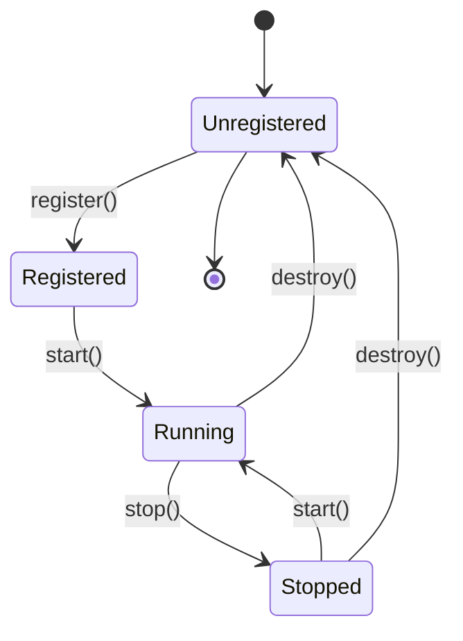

# Kiểm thử register, start, stop và unregister

`IntegrationFlowContext` cho phép Spring Integration đăng ký một `IntegrationFlow` khi `ApplicationContext` đã chạy. Vì flow được tạo trong runtime, kiểm thử không chỉ xác minh handler xử lý đúng message mà còn phải kiểm tra vòng đời của registration: flow được thêm vào context, endpoint bắt đầu nhận message, dừng đúng cách, có thể start lại khi còn registration và được gỡ hoàn toàn khi unregister.

Một bài kiểm thử tốt cần xác minh cả hai mặt: **trạng thái quản lý** của flow và **hành vi message** quan sát được ở input channel. Chỉ kiểm tra `register()` không ném exception chưa đủ; chỉ gửi message và thấy handler chạy cũng chưa chứng minh registration đã được cleanup sau test.

## 1. Phạm vi cần kiểm thử

Một flow động thường trải qua các trạng thái sau:



Các thao tác cần có bằng chứng kiểm thử:

| Thao tác | Điều cần xác minh |
|---|---|
| `register()` | Registration xuất hiện trong `IntegrationFlowContext`, ID đúng và input channel có thể truy cập |
| `start()` | Endpoint được kích hoạt và message gửi vào channel tới được handler |
| `stop()` | Endpoint ngừng nhận message theo semantics của channel/adapter |
| `start()` sau `stop()` | Registration còn tồn tại và endpoint có thể chạy lại nếu flow được thiết kế restartable |
| `destroy()` | Registration được gỡ khỏi context và thành phần thuộc flow được giải phóng |
| Đăng ký ID trùng | Hệ thống từ chối hoặc áp dụng chính sách idempotent đã định nghĩa; không tạo hai flow ngoài ý muốn |
| Lỗi trong lifecycle | Resource đã tạo được cleanup hoặc được ghi nhận để retry cleanup |

`stop()` và `destroy()` không phải hai tên cho cùng một hành động. `stop()` tạm dừng các thành phần lifecycle; `destroy()` kết thúc registration. Bài test phải phân biệt hai kết quả này.

## 2. Chuẩn bị test context

Có thể dùng JUnit 5, Spring TestContext và Mockito để kiểm thử flow trong một `ApplicationContext` thật. `@EnableIntegration` đăng ký hạ tầng Spring Integration cần thiết, trong đó có `IntegrationFlowContext`.

Ví dụ cấu hình test:

```java
import static org.mockito.Mockito.mock;

import org.springframework.context.annotation.Bean;
import org.springframework.context.annotation.Configuration;
import org.springframework.integration.config.EnableIntegration;

@Configuration
@EnableIntegration
class IntegrationFlowTestConfig {

    @Bean
    OrderHandler orderHandler() {
        return mock(OrderHandler.class);
    }
}
```

Handler có thể là một interface nhỏ để kiểm tra việc dispatch:

```java
public interface OrderHandler {
    void handle(String orderId);
}
```

Trong test, inject `IntegrationFlowContext` và handler mock. Mỗi test tự tạo channel và flow với ID riêng hoặc dùng một ID cố định nhưng phải destroy registration sau mỗi test.

```java
import static org.junit.jupiter.api.Assertions.*;
import static org.mockito.Mockito.*;

import org.junit.jupiter.api.AfterEach;
import org.junit.jupiter.api.Test;
import org.springframework.beans.factory.annotation.Autowired;
import org.springframework.integration.channel.DirectChannel;
import org.springframework.integration.dsl.IntegrationFlow;
import org.springframework.integration.dsl.context.IntegrationFlowContext;
import org.springframework.integration.dsl.context.IntegrationFlowRegistration;
import org.springframework.messaging.MessagingException;
import org.springframework.messaging.MessageChannel;
import org.springframework.messaging.support.MessageBuilder;
import org.springframework.test.context.junit.jupiter.SpringJUnitConfig;

@SpringJUnitConfig(IntegrationFlowTestConfig.class)
class IntegrationFlowContextLifecycleTest {

    private static final String FLOW_ID = "orders-lifecycle-test";

    @Autowired
    IntegrationFlowContext flowContext;

    @Autowired
    OrderHandler orderHandler;

    private IntegrationFlowRegistration registration;
    private DirectChannel inputChannel;

    @AfterEach
    void cleanup() {
        if (registration != null) {
            registration.destroy();
            registration = null;
        }
        reset(orderHandler);
    }

    private IntegrationFlowRegistration registerFlow() {
        inputChannel = new DirectChannel();
        IntegrationFlow flow = IntegrationFlow
                .from(inputChannel)
                .handle(orderHandler, "handle")
                .get();

        registration = flowContext.registration(flow)
                .id(FLOW_ID)
                .autoStartup(false)
                .useFlowIdAsPrefix()
                .register();

        return registration;
    }
}
```

Các import và class nghiệp vụ là ví dụ tối thiểu; điều chỉnh package và API theo phiên bản Spring Integration/JUnit của dự án. Điểm quan trọng là test dùng `ApplicationContext` thật và một handler mock để quan sát việc gọi endpoint.

## 3. Kiểm thử register

Sau khi gọi `register()`, xác minh registration được tạo với đúng ID và có input channel. Với flow có input channel được truyền vào từ trước, có thể kiểm tra registration trả về đúng channel đó.

```java
@Test
void registerCreatesRegistrationAndInputChannel() {
    IntegrationFlowRegistration result = registerFlow();

    assertNotNull(result);
    assertEquals(FLOW_ID, result.getId());
    assertSame(inputChannel, result.getInputChannel());
    assertNotNull(flowContext.getRegistrationById(FLOW_ID));
}
```

Test này xác minh registration đã được đăng ký và caller có thể lấy input channel. Nó chưa chứng minh endpoint đang chạy; vì builder đặt `autoStartup(false)`, endpoint được chủ động start ở bước tiếp theo.

Không nên kiểm tra tên bean nội bộ được sinh ra bằng một chuỗi hard-code nếu mục tiêu test chỉ là lifecycle của flow. Tên bean nội bộ có thể thay đổi theo DSL hoặc phiên bản. Kiểm tra qua `IntegrationFlowRegistration` và hành vi message thường bền vững hơn.

## 4. Kiểm thử start và dispatch message

Với `DirectChannel`, handler được gọi đồng bộ trên thread gửi. Đây là lựa chọn phù hợp cho test lifecycle cơ bản vì không cần chờ executor hoặc poller.

```java
@Test
void startEnablesMessageDispatch() {
    IntegrationFlowRegistration result = registerFlow();
    MessageChannel input = result.getInputChannel();

    result.start();

    boolean sent = input.send(MessageBuilder
            .withPayload("order-42")
            .build());

    assertTrue(sent);
    verify(orderHandler).handle("order-42");
}
```

Kết quả cần quan sát là handler nhận đúng payload. Nếu handler không được gọi, kiểm tra endpoint đã start, flow có nối đúng channel, handler method có đúng chữ ký và test có đang gửi vào input channel của registration đó hay không.

### 4.1. Kiểm tra `autoStartup(false)`

Khi registration được cấu hình `autoStartup(false)`, endpoint chưa tự chạy. Với `DirectChannel` chưa có subscriber, thao tác gửi có thể ném `MessagingException` do chưa có handler nhận message. Test có thể xác minh handler chưa được gọi trước `start()`:

```java
@Test
void flowDoesNotDispatchBeforeExplicitStart() {
    IntegrationFlowRegistration result = registerFlow();

    assertThrows(MessagingException.class, () -> result.getInputChannel().send(
            MessageBuilder.withPayload("order-42").build()));

    verifyNoInteractions(orderHandler);

    result.start();
    result.getInputChannel().send(
            MessageBuilder.withPayload("order-42").build());

    verify(orderHandler).handle("order-42");
}
```

Kiểu exception cụ thể phụ thuộc channel và dispatcher. Ví dụ trên dùng `DirectChannel`, nơi không có subscriber thường dẫn tới lỗi dispatch. Với channel khác, hãy kiểm tra semantics gửi/nhận của channel thay vì áp dụng nguyên assertion này.

## 5. Kiểm thử stop và start lại

`stop()` cần làm endpoint ngừng nhận message. Với `DirectChannel`, endpoint không còn subscribe nên thao tác gửi thường thất bại vì không có subscriber. Sau đó có thể gọi `start()` trên cùng registration để kiểm tra khả năng chạy lại.

```java
@Test
void stopDisablesDispatchAndStartEnablesItAgain() {
    IntegrationFlowRegistration result = registerFlow();
    MessageChannel input = result.getInputChannel();

    result.start();
    input.send(MessageBuilder.withPayload("order-1").build());
    verify(orderHandler).handle("order-1");

    reset(orderHandler);
    result.stop();

    assertThrows(MessagingException.class, () -> input.send(
            MessageBuilder.withPayload("order-2").build()));
    verifyNoInteractions(orderHandler);

    result.start();
    input.send(MessageBuilder.withPayload("order-3").build());
    verify(orderHandler).handle("order-3");
}
```

Test này xác minh ba điểm: message đầu được xử lý khi chạy, message thứ hai không tới handler sau stop, và message thứ ba được xử lý sau khi start lại. Nếu flow dùng adapter hoặc channel có semantics khác, hãy điều chỉnh cách xác minh dừng theo hành vi thực tế của thành phần đó.

## 6. Kiểm thử unregister bằng destroy

Khi flow không còn được sử dụng, gọi `destroy()` để gỡ registration. Sau đó tra cứu theo ID để xác nhận registration không còn trong `IntegrationFlowContext`.

```java
@Test
void destroyUnregistersFlow() {
    IntegrationFlowRegistration result = registerFlow();
    assertNotNull(flowContext.getRegistrationById(FLOW_ID));

    result.destroy();
    registration = null; // cleanup() không destroy lần thứ hai

    assertNull(flowContext.getRegistrationById(FLOW_ID));
}
```

Nếu ứng dụng quản lý registration bằng `IntegrationFlowContext.remove(flowId)` ở phiên bản đang dùng, có thể kiểm thử API remove theo đúng hợp đồng của phiên bản đó. Không gọi cả `destroy()` và `remove()` một cách máy móc nếu một thao tác đã thực hiện việc gỡ registration.

Một test bổ sung có thể xác minh channel cũ không còn dispatch tới handler sau khi destroy. Với `DirectChannel`, sau khi endpoint đã bị gỡ, gửi message vào channel không còn subscriber thường ném lỗi dispatch. Tuy nhiên, assertion quan trọng nhất của unregister là registration đã biến mất khỏi context và resource riêng được cleanup theo ownership.

## 7. Kiểm thử ID trùng

ID phải duy nhất trong registry. Khi một flow đã được đăng ký, thử đăng ký flow khác với cùng ID để xác minh framework từ chối xung đột và registration ban đầu vẫn còn.

```java
@Test
void duplicateFlowIdIsRejected() {
    IntegrationFlowRegistration first = registerFlow();

    DirectChannel anotherInput = new DirectChannel();
    IntegrationFlow anotherFlow = IntegrationFlow
            .from(anotherInput)
            .handle(orderHandler, "handle")
            .get();

    assertThrows(RuntimeException.class, () -> flowContext
            .registration(anotherFlow)
            .id(FLOW_ID)
            .autoStartup(false)
            .useFlowIdAsPrefix()
            .register());

    assertSame(first, flowContext.getRegistrationById(FLOW_ID));
}
```

Exception cụ thể có thể là lỗi đăng ký bean hoặc lỗi ID tùy phiên bản và cấu hình bean factory. Trong test ứng dụng, có thể bắt exception cụ thể sau khi xác nhận loại exception thực tế của dependency. Tránh kiểm tra message exception quá chi tiết vì nội dung có thể thay đổi giữa các phiên bản.

## 8. Cleanup registration giữa các test

Registration động được thêm vào cùng `ApplicationContext` của test. Nếu không destroy, registration có thể còn tồn tại và làm test sau thất bại vì trùng ID hoặc khiến handler nhận message ngoài dự kiến.

Các nguyên tắc cleanup:

- Dùng `@AfterEach` để destroy registration nếu test tạo thành công.
- Đặt handle về `null` sau khi destroy tường minh để tránh cleanup hai lần.
- Nếu test đăng ký nhiều flow, giữ tất cả handle trong collection và destroy từng registration.
- Nếu một test thất bại giữa `register()` và `start()`, vẫn phải cleanup registration đã tạo.
- Nếu `destroy()` thất bại, báo lỗi test và giữ lại exception gốc; không che lỗi cleanup bằng một assertion khác.

Với nhiều flow, có thể dùng helper:

```java
private final List<IntegrationFlowRegistration> registrations =
        new ArrayList<>();

private IntegrationFlowRegistration register(IntegrationFlow flow, String id) {
    IntegrationFlowRegistration result = flowContext.registration(flow)
            .id(id)
            .autoStartup(false)
            .useFlowIdAsPrefix()
            .register();
    registrations.add(result);
    return result;
}

@AfterEach
void destroyRegistrations() {
    for (IntegrationFlowRegistration item : registrations) {
        item.destroy();
    }
    registrations.clear();
}
```

Helper này phù hợp khi test quản lý nhiều flow. Nếu muốn cleanup vẫn chạy khi một `destroy()` ném exception, hãy thu thập lỗi, tiếp tục destroy các registration còn lại rồi báo lỗi tổng hợp sau cùng.

## 9. Kiểm thử service quản lý flow

Trong ứng dụng thực tế, controller không nên trực tiếp gọi `IntegrationFlowContext`. Một service quản lý connector thường có các method như `register`, `start`, `stop`, `restart` và `remove`. Ngoài kiểm thử framework, cần kiểm thử hợp đồng của service này.

| Trường hợp | Kết quả mong đợi |
|---|---|
| Connector chưa tồn tại | Tạo registration, start theo cấu hình và lưu handle |
| Gọi start lần hai | Trả registration hiện có hoặc báo conflict theo hợp đồng idempotent |
| Stop connector đang chạy | Gọi stop và cập nhật trạng thái `STOPPED` |
| Start connector đã stop | Dùng registration hiện có và start lại |
| Remove connector | Stop, destroy, đóng resource riêng và xóa registry sau cleanup |
| Connector ID không hợp lệ | Từ chối trước khi tạo flow |
| Register lỗi | Không lưu trạng thái `RUNNING`; cleanup các dependency đã tạo |
| Start lỗi | Ghi trạng thái lỗi và destroy registration hoặc giữ handle ở trạng thái cần cleanup |
| Destroy lỗi | Không xóa mất handle; ghi nhận để có thể retry cleanup |

Khi mock `IntegrationFlowContext`, kiểm tra service gọi đúng `registration(flow)`, cấu hình ID và startup behavior, rồi xử lý handle trả về. Khi kiểm thử tích hợp, dùng `ApplicationContext` thật để xác minh endpoint/channel thực sự được tạo và gỡ.

Không nên chỉ test `ConcurrentHashMap` hoặc mock toàn bộ Spring Integration rồi kết luận lifecycle đúng. Cần ít nhất một test integration nhỏ chạy qua registration thật.

## 10. Kiểm thử đăng ký đồng thời

Một race condition thường gặp là hai request cùng đăng ký một connector:

```text
Thread A: kiểm tra chưa có registration ---- register ---- start
Thread B: kiểm tra chưa có registration ---- register ---- start
```

`ConcurrentHashMap` chỉ bảo vệ thao tác map. Nó không tự biến chuỗi kiểm tra, register, start và lưu handle thành một thao tác atomic.

Test concurrency nên xác minh:

1. Gửi đồng thời hai yêu cầu start cùng connector ID.
2. Chỉ một registration được tạo.
3. Yêu cầu còn lại nhận registration hiện tại hoặc lỗi conflict theo hợp đồng.
4. Sau khi hoàn tất, chỉ có một endpoint xử lý một message gửi vào connector.
5. Khi remove đồng thời với start, trạng thái cuối phải nhất quán và không để lại registration mồ côi.

Có thể dùng `CountDownLatch` để đồng bộ thời điểm hai thread bắt đầu, `ExecutorService` để chạy song song và `Future` để lấy kết quả. Không dùng `Thread.sleep()` để cố tạo race condition vì kết quả phụ thuộc lịch thread và máy chạy test.

Nếu hệ thống chạy nhiều replica, test lock trong JVM không chứng minh ownership phân tán. Cần test riêng cơ chế distributed lease, broker consumer group hoặc control plane đang được ứng dụng sử dụng.

## 11. Kiểm thử flow dùng poller hoặc executor

Test với `DirectChannel` là nền tảng cho lifecycle cơ bản. Nếu flow dùng polling consumer, source polling adapter hoặc `ExecutorChannel`, cần kiểm thử bất đồng bộ theo đúng execution model.

### 11.1. Polling flow

Với polling flow, nên kiểm tra:

- Poller chỉ bắt đầu lấy dữ liệu sau khi endpoint được start.
- `maxMessagesPerPoll`, trigger và receive timeout có hiệu lực.
- Khi stop, các lần poll mới ngừng theo lifecycle của endpoint.
- Message đã nhận trước khi stop được xử lý hoặc phục hồi theo chính sách đã chọn.
- Sau destroy, registration không còn tồn tại và scheduler không tiếp tục kích hoạt endpoint.

Dùng `CountDownLatch` hoặc Awaitility để đợi handler nhận message. Sau khi đạt điều kiện, stop flow và kiểm tra không có lần xử lý mới ngoài dự kiến. Không khẳng định mọi task đang chạy bị hủy ngay lập tức khi gọi stop; hành vi phụ thuộc adapter, scheduler và công việc đang thực thi.

### 11.2. ExecutorChannel

Với `ExecutorChannel`, `send()` có thể chỉ dispatch task vào executor. Test cần đợi handler hoàn thành trước khi assert:

```java
CountDownLatch handled = new CountDownLatch(1);
doAnswer(invocation -> {
    handled.countDown();
    return null;
}).when(orderHandler).handle("order-async");

inputChannel.send(MessageBuilder.withPayload("order-async").build());

assertTrue(handled.await(2, TimeUnit.SECONDS));
verify(orderHandler).handle("order-async");
```

Ví dụ chỉ minh họa cơ chế chờ; cần cấu hình input channel/executor tương ứng và tránh dùng timeout quá ngắn khiến test chập chờn trên CI. Nếu dùng executor riêng cho flow, phải xác định ai sở hữu executor và ai đóng nó khi destroy.

## 12. Kiểm thử lỗi và cleanup bù trừ

Lỗi có thể xảy ra trong `register()`, `start()`, lúc handler xử lý message, trong `stop()` hoặc khi `destroy()`. Mỗi loại lỗi cần một assertion riêng.

| Điểm lỗi | Assertion quan trọng |
|---|---|
| Flow ID trùng | Không tạo registration thứ hai; registration cũ vẫn hoạt động |
| Cấu hình flow không hợp lệ | Đăng ký thất bại và không để lại bean/registration dở dang |
| Dependency không sẵn sàng khi start | Trạng thái không được ghi là `RUNNING`; cleanup được thử |
| Handler ném exception | Exception/error channel/retry đi theo cấu hình flow |
| Stop bị lỗi | Trạng thái quản lý phản ánh lỗi, không báo `STOPPED` giả |
| Destroy bị lỗi | Giữ handle trong danh sách cleanup cần xử lý |

Để kiểm thử cleanup bù trừ của service, có thể mock registration handle và cấu hình `start()` ném exception, sau đó xác minh service gọi `destroy()`. Nếu `destroy()` cũng ném exception, xác minh handle được lưu ở trạng thái cleanup cần retry. Test này kiểm tra orchestration của service; nó bổ sung cho test tích hợp dùng registration thật.

Không nên giả định transaction database sẽ rollback việc đăng ký bean hoặc đóng client Java. Registration và resource ngoài transaction cần cleanup tường minh.

## 13. Các lỗi kiểm thử thường gặp

| Triệu chứng | Nguyên nhân có thể | Cách xử lý |
|---|---|---|
| Test sau báo trùng flow ID | Test trước không destroy registration | Cleanup trong `@AfterEach` hoặc `@AfterAll` phù hợp |
| Handler không được gọi | Chưa start endpoint, gửi sai input channel hoặc handler mapping sai | Xác minh registration, start và channel từ cùng handle |
| Gửi message sau stop vẫn tới handler | Flow khác đang subscribe cùng channel hoặc channel được chia sẻ | Cô lập channel theo test và kiểm tra subscriber |
| Test async chập chờn | Assert trước khi executor/poller xử lý xong | Dùng latch/awaitility với timeout hợp lý |
| Destroy xong vẫn còn resource | Client/executor do ứng dụng tự tạo chưa được đóng | Xác định ownership và cleanup hook riêng |
| Test chạy riêng pass nhưng chạy suite fail | Context dùng chung và registration rò rỉ giữa test | Dùng ID duy nhất, cleanup chắc chắn hoặc context isolation có chủ đích |
| Assert exception không ổn định | Phụ thuộc message/exception cụ thể của dispatcher hoặc phiên bản | Assert loại exception ổn định hơn và kiểm tra hành vi quan sát được |

## 14. Bộ test tối thiểu nên có

Trước khi đưa một dynamic flow manager vào production, nên có ít nhất các test sau:

- [ ] Register tạo registration có ID đúng và input channel truy cập được.
- [ ] `autoStartup(false)` giữ endpoint chưa hoạt động cho tới khi gọi start.
- [ ] Start làm message tới handler.
- [ ] Stop ngăn message mới tới handler theo semantics của channel/adapter.
- [ ] Start lại hoạt động nếu registration chưa destroy.
- [ ] Destroy gỡ registration khỏi `IntegrationFlowContext`.
- [ ] ID trùng được xử lý theo hợp đồng và không tạo flow ngoài ý muốn.
- [ ] Cleanup chạy sau mỗi test, kể cả khi assertion thất bại.
- [ ] Service quản lý xử lý đúng lỗi register/start/stop/destroy.
- [ ] Hai yêu cầu quản lý đồng thời không tạo registration trùng.
- [ ] Poller/executor được kiểm thử bằng cơ chế chờ bất đồng bộ.
- [ ] Resource riêng của connector được đóng khi unregister.

## 15. Quy trình kiểm tra khi một test lifecycle thất bại

Khi test không đạt, kiểm tra theo thứ tự sau:

1. Xác nhận `IntegrationFlowContext` được đăng ký trong test `ApplicationContext`.
2. Kiểm tra flow ID có trùng với registration còn sót từ test trước không.
3. Kiểm tra builder có đặt `autoStartup(false)` hay không và test đã gọi `start()` chưa.
4. Xác nhận test gửi message vào đúng `registration.getInputChannel()`.
5. Kiểm tra channel là direct, queue hay executor để hiểu kết quả `send()`.
6. Kiểm tra handler mapping và payload type.
7. Với stop, xác nhận endpoint đã dừng và không có subscriber khác trên channel dùng chung.
8. Với destroy, kiểm tra `getRegistrationById(flowId)` và resource do ứng dụng tự quản lý.
9. Với async flow, chờ điều kiện hoàn tất trước khi assert.
10. Với lỗi cleanup, giữ lại registration handle và exception gốc để điều tra.

Kiểm thử register/start/stop/unregister giúp xác nhận flow động có vòng đời dự đoán được trong Spring context. Khi test bao phủ cả registration state, message dispatch, ID conflict, cleanup và concurrency, ứng dụng có bằng chứng rõ ràng rằng connector được tạo đúng, dừng đúng và không để lại tài nguyên runtime sau khi bị gỡ.
