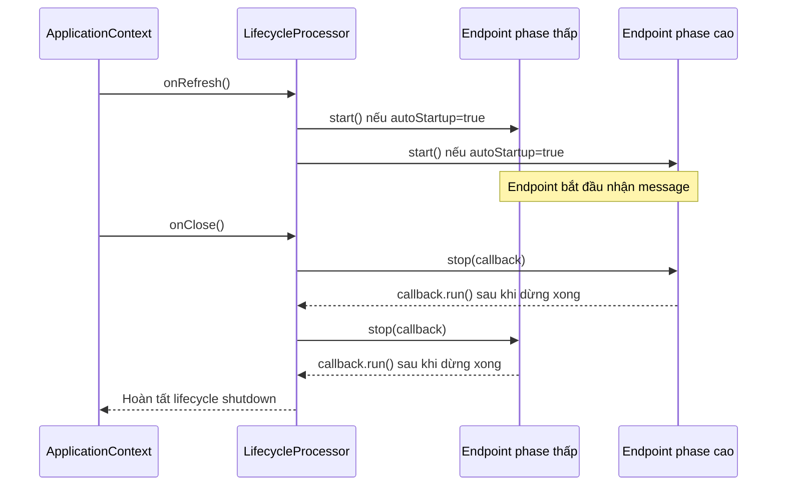
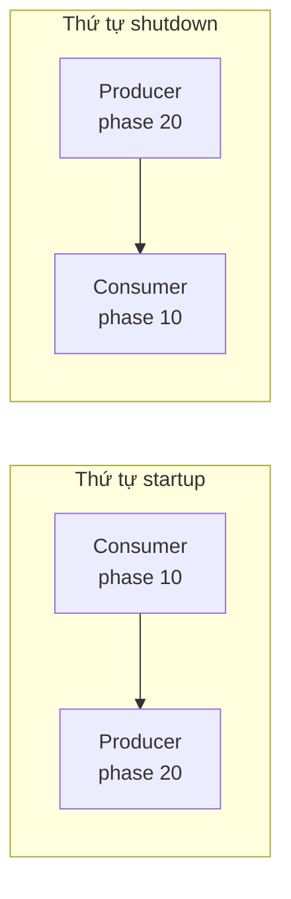

# SmartLifecycle, phase và autoStartup

Spring Integration dùng cơ chế lifecycle của Spring để điều khiển thời điểm message endpoint bắt đầu nhận message và thời điểm nó ngừng nhận message. Ba khái niệm cần nắm là `SmartLifecycle`, `phase` và `autoStartup`.

- `SmartLifecycle` là hợp đồng lifecycle mở rộng của Spring, hỗ trợ tự khởi động khi context refresh, sắp thứ tự start/stop và callback cho shutdown bất đồng bộ.
- `phase` quyết định thứ tự tương đối giữa các thành phần lifecycle: phase thấp start trước và stop sau.
- `autoStartup` quyết định một endpoint có được Spring tự động start khi application context refresh hay phải được ứng dụng start chủ động.

Trong Spring Integration, các message endpoint kế thừa `AbstractEndpoint`, lớp nền triển khai `ManageableSmartLifecycle`. Vì vậy, một endpoint có thể đã được tạo thành bean trong `ApplicationContext` nhưng vẫn chưa chạy. Hiểu ranh giới giữa trạng thái bean và trạng thái lifecycle giúp kiểm soát consumer, inbound adapter, poller và các kết nối bên ngoài một cách có chủ đích.

## 1. Lifecycle của Spring và vị trí của SmartLifecycle

Spring có hai hợp đồng thường gặp:

| Hợp đồng | Phương thức chính | Cách điều khiển |
|---|---|---|
| `Lifecycle` | `start()`, `stop()`, `isRunning()` | Ứng dụng hoặc lifecycle processor có thể điều khiển start/stop; không có cờ tự khởi động và phase riêng |
| `SmartLifecycle` | Các phương thức của `Lifecycle`, thêm `isAutoStartup()`, `getPhase()`, `stop(Runnable)` | Hỗ trợ tự start khi context refresh, thứ tự start/stop và shutdown bất đồng bộ |

`SmartLifecycle` kế thừa `Lifecycle` và `Phased`. Nó phù hợp với các thành phần cần tự khởi động khi ứng dụng refresh và cần dừng theo thứ tự có kiểm soát khi context đóng.

### 1.1. AbstractEndpoint của Spring Integration

`AbstractEndpoint` là lớp cơ sở cho các message endpoint. Các loại endpoint thường gặp như `EventDrivenConsumer`, `AbstractPollingEndpoint`, inbound adapter và messaging gateway đều nằm trong hệ thống lifecycle này.

Lớp này cung cấp các phương thức và thuộc tính quan trọng:

- `start()`: gọi logic khởi động endpoint.
- `stop()`: dừng endpoint.
- `stop(Runnable callback)`: dừng endpoint và thông báo khi quá trình dừng hoàn tất.
- `isRunning()`: kiểm tra endpoint có đang chạy không.
- `isAutoStartup()`: cho biết endpoint có tự khởi động khi context refresh không.
- `getPhase()`: lấy phase hiện tại.
- `setAutoStartup(boolean)`: cấu hình tự khởi động.
- `setPhase(int)`: cấu hình phase.
- `destroy()`: giải phóng tài nguyên khi bean bị hủy.

Theo Javadoc của Spring Integration, `AbstractEndpoint` mặc định có `autoStartup=true`. Endpoint sẽ được tự động khởi động nếu lifecycle processor của context thực hiện giai đoạn refresh tương ứng. Nếu đặt `autoStartup=false`, ứng dụng phải gọi `start()` hoặc dùng cơ chế điều khiển lifecycle theo nhóm.

Cần phân biệt:

- Bean tồn tại: Spring đã tạo endpoint và inject dependency.
- Endpoint đang chạy: logic `doStart()` của endpoint đã được thực thi và endpoint đã bắt đầu hoạt động.
- Endpoint đang xử lý message: endpoint đang nhận message qua channel hoặc poller và gọi handler.

Ba trạng thái này liên quan nhưng không đồng nhất.

## 2. Spring khởi động và dừng SmartLifecycle như thế nào?

Sau khi hoàn tất quá trình tạo bean và refresh context, `LifecycleProcessor` điều phối các thành phần lifecycle. Khi context đóng, lifecycle processor điều phối việc dừng chúng.



Với cùng một application context, các thành phần `SmartLifecycle` được sắp theo phase. Những thành phần cùng phase có thể được xử lý theo thứ tự không xác định; không nên dựa vào thứ tự khai báo bean hoặc thứ tự đăng ký để tạo phụ thuộc.

### 2.1. Lifecycle không giống bean initialization

`@PostConstruct`, `InitializingBean.afterPropertiesSet()` và các callback khởi tạo chạy trong quá trình tạo bean. `SmartLifecycle` được điều phối ở giai đoạn lifecycle của context.

Vì vậy, việc một endpoint đã được tạo không có nghĩa endpoint đã start. Nếu producer gửi message quá sớm vào một `DirectChannel` trước khi consumer endpoint đăng ký subscriber, message có thể không được xử lý và thao tác gửi có thể thất bại.

Nếu cần phát message sau khi endpoint sẵn sàng, hãy chọn một mốc sau khi context refresh hoặc một cơ chế điều phối lifecycle rõ ràng. Với Spring Boot, `ApplicationRunner` hoặc `ApplicationReadyEvent` thường phù hợp cho tác vụ khởi tạo sau refresh; với Spring Framework thuần, có thể dùng sự kiện context hoặc một bean điều phối lifecycle riêng.

## 3. Phase quyết định thứ tự start và stop

`phase` là số nguyên biểu diễn thứ tự lifecycle. Spring khởi động phase thấp trước và dừng phase cao trước.

| Phase | Startup | Shutdown |
|---:|---|---|
| 10 — thấp | Start sớm | Stop muộn |
| 20 — cao | Start muộn | Stop sớm |

Ví dụ có hai endpoint:

| Thành phần | Phase | Khi start | Khi stop |
|---|---:|---|---|
| Consumer xử lý đơn hàng | 10 | Start trước | Stop sau |
| Inbound adapter nhận đơn hàng | 20 | Start sau | Stop trước |

Cách sắp xếp này hữu ích vì consumer nên sẵn sàng trước khi producer bắt đầu đẩy message. Khi shutdown, producer ngừng phát message trước, sau đó consumer mới dừng.

### 3.1. Các giá trị phase đặc biệt

- `Integer.MIN_VALUE`: giá trị thấp nhất; được start sớm nhất và stop muộn nhất.
- `Integer.MAX_VALUE`: giá trị cao nhất; được start muộn nhất và stop sớm nhất.
- Các bean chỉ triển khai `Lifecycle` mà không triển khai `SmartLifecycle` được xem như phase `0` khi Spring sắp thứ tự.
- `SmartLifecycle` có phase mặc định là `Integer.MAX_VALUE` trong Spring Framework.

Một điểm cần chú ý: endpoint Spring Integration có thể cấu hình phase riêng. Một số endpoint hoặc annotation có phase mặc định phụ thuộc loại consumer và phiên bản framework. Ví dụ, tài liệu API của `@ServiceActivator` mô tả phase mặc định khác nhau cho `PollingConsumer` và `EventDrivenConsumer`. Do đó, khi thứ tự khởi động có ý nghĩa vận hành, hãy đặt phase tường minh thay vì phụ thuộc vào mặc định.

### 3.2. Phase không thay thế quan hệ phụ thuộc

Nếu bean B có quan hệ `depends-on` với bean A, Spring bảo đảm A được khởi động trước B và B được dừng trước A. Quan hệ phụ thuộc tường minh này được ưu tiên so với thứ tự phase.

Dùng phase khi cần sắp xếp một nhóm thành phần lifecycle theo vai trò. Dùng `depends-on` khi có quan hệ phụ thuộc bean trực tiếp và rõ ràng. Không nên dùng phase như một cơ chế thay thế dependency injection hoặc thứ tự tạo bean.

### 3.3. Phase không điều khiển thứ tự message

`phase` chỉ điều khiển lifecycle start/stop. Nó không:

- Tạo thread mới.
- Làm message chạy song song.
- Thay đổi thứ tự message trong channel.
- Điều chỉnh tốc độ poller.
- Thay đổi retry hoặc transaction.
- Bảo đảm một message đã được xử lý xong trước khi endpoint khác start.

Threading và thứ tự xử lý message vẫn phụ thuộc channel, poller, executor và cấu hình endpoint.

## 4. AutoStartup quyết định endpoint có tự chạy không

`autoStartup` điều khiển việc Spring có tự động gọi `start()` cho endpoint khi context refresh hay không.

| Giá trị | Hành vi |
|---|---|
| `true` | Endpoint được lifecycle processor tự động start khi context refresh |
| `false` | Endpoint vẫn là bean trong context nhưng không tự start; ứng dụng phải chủ động start |

Với `AbstractEndpoint`, giá trị mặc định của `autoStartup` là `true`. Khi đặt thành `false`, endpoint không tự nhận message cho đến khi được khởi động.

### 4.1. Khi nào nên đặt autoStartup=false?

Một số trường hợp thường gặp:

- Inbound adapter chỉ được phép nhận dữ liệu khi ứng dụng đã lấy được quyền leader.
- Kết nối tới đối tác phải được xác thực trước khi mở consumer.
- Một nguồn dữ liệu chỉ được bật sau khi quản trị viên xác nhận cấu hình.
- Flow cần chờ tài nguyên bên ngoài sẵn sàng.
- Ứng dụng muốn khởi động từng nhóm endpoint theo tenant hoặc theo vùng.

Ví dụ với annotation:

```java
@Component
public class OrderHandler {

    @ServiceActivator(
            inputChannel = "orders.in",
            autoStartup = "false",
            phase = "10")
    public void handle(Order order) {
        // Xử lý đơn hàng.
    }
}
```

Endpoint được tạo và liên kết với channel `orders.in`, nhưng không tự start khi context refresh. Ứng dụng có thể lấy endpoint bean và gọi `start()` sau khi điều kiện vận hành đã thỏa mãn.

### 4.2. Cấu hình bằng Java DSL

Java DSL cho phép cấu hình lifecycle ngay tại endpoint spec:

```java
@Configuration
@EnableIntegration
public class OrderFlowConfiguration {

    @Bean
    public IntegrationFlow orderFlow(OrderHandler handler) {
        return IntegrationFlow.from("orders.in")
                .handle(handler, "handle", endpoint -> endpoint
                        .id("orders-handler")
                        .autoStartup(false)
                        .phase(10))
                .get();
    }
}
```

Các phương thức `autoStartup(boolean)` và `phase(int)` thuộc endpoint spec. Có thể kết hợp với `id()` để đặt tên endpoint rõ ràng, thuận tiện cho việc tra cứu và điều khiển.

### 4.3. Start endpoint thủ công

Sau khi context đã refresh và điều kiện bên ngoài đã sẵn sàng, ứng dụng có thể lấy endpoint bean theo ID và gọi `start()`.

```java
@Component
public class OrderEndpointStarter {

    private final ApplicationContext applicationContext;

    public OrderEndpointStarter(ApplicationContext applicationContext) {
        this.applicationContext = applicationContext;
    }

    public void startOrderEndpoint() {
        SmartLifecycle endpoint =
                applicationContext.getBean(
                        "orders-handler",
                        SmartLifecycle.class);

        if (!endpoint.isRunning()) {
            endpoint.start();
        }
    }

    public void stopOrderEndpoint() {
        SmartLifecycle endpoint =
                applicationContext.getBean(
                        "orders-handler",
                        SmartLifecycle.class);

        if (endpoint.isRunning()) {
            endpoint.stop();
        }
    }
}
```

Tên bean phải khớp với ID endpoint thực tế trong cấu hình. Nếu framework hoặc DSL tạo tên khác, hãy kiểm tra tên bean trong application context trước khi gọi `getBean()`.

### 4.4. Vô hiệu hóa auto startup theo mẫu tên

Spring Integration có global property:

```properties
spring.integration.endpoints.noAutoStartup=orders*,inventoryInbound
```

Thuộc tính này nhận danh sách pattern tên bean endpoint không được tự động start trong quá trình ứng dụng khởi động. Ứng dụng có thể chủ động start chúng sau đó qua bean lifecycle, Control Bus hoặc `SmartLifecycleRoleController`.

Có thể ghi đè hành vi global bằng cấu hình `autoStartup` tường minh trên endpoint theo cơ chế được tài liệu phiên bản tương ứng hỗ trợ. Khi debug, hãy kiểm tra cả global properties lẫn cấu hình cục bộ của endpoint.

## 5. Phối hợp phase giữa producer và consumer

Trong message flow, producer tạo message và gửi vào channel; consumer endpoint đăng ký nhận message và gọi handler. Khi khởi động, thường nên để consumer sẵn sàng trước producer.

Ví dụ:



Giả sử ứng dụng có:

- Một `@ServiceActivator` nhận message từ `orders.in`.
- Một inbound channel adapter đọc dữ liệu từ file hoặc hệ thống ngoài rồi gửi vào `orders.in`.

Có thể đặt consumer ở phase 10 và inbound adapter ở phase 20. Consumer start trước để đăng ký nhận message; inbound adapter start sau để bắt đầu phát message. Khi shutdown, inbound adapter stop trước để ngừng phát message mới; consumer tiếp tục chạy trong giai đoạn ngắn để xử lý các message còn đến.

Ví dụ annotation với phase được cấu hình rõ:

```java
@Component
public class OrderHandler {

    @ServiceActivator(
            inputChannel = "orders.in",
            autoStartup = "true",
            phase = "10")
    public void handle(Order order) {
        // Xử lý đơn hàng.
    }
}
```

Inbound adapter hoặc polling endpoint có thể được cấu hình phase cao hơn theo API của adapter:

```java
@Bean
@InboundChannelAdapter(
        channel = "orders.in",
        autoStartup = "true",
        phase = "20",
        poller = @Poller(fixedDelay = "1000"))
public MessageSource<Order> orderSource() {
    return new OrderMessageSource();
}
```

Đây là mô hình thứ tự lifecycle. Nó không bảo đảm consumer đã xử lý hết mọi message trước khi shutdown. Nếu cần graceful drain, ứng dụng phải có cơ chế ngừng producer, chờ backlog xử lý, xác nhận message hoặc giới hạn thời gian shutdown phù hợp.

## 6. Shutdown bất đồng bộ và callback

`SmartLifecycle` bổ sung phương thức:

```java
void stop(Runnable callback);
```

Phương thức này hữu ích khi một thành phần cần thời gian hoàn tất shutdown bất đồng bộ, ví dụ:

- Chờ một kết nối mạng đóng.
- Dừng poller và chờ tác vụ đang thực hiện.
- Chờ consumer hoàn tất đoạn xử lý đang chạy.
- Ngừng nhận request mới và chờ các request đang xử lý kết thúc.

Nếu tự triển khai `SmartLifecycle`, cần gọi `callback.run()` sau khi shutdown thực sự hoàn tất. Lifecycle processor sử dụng callback này để biết khi nào có thể tiếp tục quá trình shutdown.

Ví dụ đơn giản:

```java
@Component
public class RemoteConsumerLifecycle implements SmartLifecycle {

    private volatile boolean running;

    @Override
    public void start() {
        // Mở kết nối hoặc khởi động consumer.
        this.running = true;
    }

    @Override
    public void stop() {
        this.running = false;
    }

    @Override
    public void stop(Runnable callback) {
        try {
            // Dừng nhận công việc mới và hoàn tất cleanup.
            stop();
        }
        finally {
            callback.run();
        }
    }

    @Override
    public boolean isRunning() {
        return this.running;
    }

    @Override
    public boolean isAutoStartup() {
        return true;
    }

    @Override
    public int getPhase() {
        return 20;
    }
}
```

Đây chỉ là ví dụ minh họa hợp đồng lifecycle. Với một consumer thực tế, phần `stop()` cần chờ hoặc điều phối đúng các tác vụ đang chạy trước khi gọi callback.

Nếu callback không được gọi, context shutdown có thể phải chờ đến timeout của phase đó. Spring Framework cho phép cấu hình thời gian chờ theo phase thông qua `DefaultLifecycleProcessor`; Spring Boot cũng cung cấp cấu hình shutdown lifecycle tương ứng. Hãy chọn timeout phù hợp với thời gian xử lý tối đa và chính sách dừng của ứng dụng.

## 7. Điều khiển nhiều endpoint theo role

Khi có nhiều endpoint cần start/stop cùng lúc, Spring Integration hỗ trợ endpoint role. Mỗi endpoint có thể được gán một role, chẳng hạn `cluster`, `leader-only` hoặc `partner-import`.

`SmartLifecycleRoleController` có thể start hoặc stop toàn bộ các `SmartLifecycle` thuộc một role. Đây là cách hữu ích cho hệ thống dùng leader election: chỉ node đang giữ quyền leader mới được chạy nhóm endpoint đọc tài nguyên dùng chung.

Ví dụ với Java DSL:

```java
@Bean
public IntegrationFlow sharedFileFlow() {
    return IntegrationFlow.from(
                    Files.inboundAdapter(new File("/data/shared")),
                    endpoint -> endpoint
                            .id("shared-file-source")
                            .role("leader-only")
                            .autoStartup(false)
                            .poller(Pollers.fixedDelay(1000)))
            .handle("fileHandler", "process")
            .get();
}
```

Điều khiển theo role:

```java
@Component
public class LeaderEndpointController {

    private final SmartLifecycleRoleController roleController;

    public LeaderEndpointController(
            SmartLifecycleRoleController roleController) {
        this.roleController = roleController;
    }

    public void onLeadershipGranted() {
        roleController.startLifecyclesInRole("leader-only");
    }

    public void onLeadershipRevoked() {
        roleController.stopLifecyclesInRole("leader-only");
    }
}
```

Khi dùng leader election, đặt `autoStartup=false` cho các endpoint chỉ được chạy trên leader. Nếu để tự start, mọi node có thể bắt đầu polling hoặc tiêu thụ tài nguyên dùng chung trước khi cơ chế bầu leader điều khiển chúng.

Role controller cũng cung cấp các phương thức kiểm tra trạng thái nhóm, ví dụ:

- `getRoles()`: danh sách role đang được quản lý.
- `allEndpointsRunning(role)`: tất cả endpoint trong role có đang chạy không.
- `noEndpointsRunning(role)`: không có endpoint nào trong role đang chạy không.
- `getEndpointsRunningStatus(role)`: trạng thái từng endpoint trong role.

## 8. Quan sát trạng thái endpoint

Khi debug, không chỉ kiểm tra bean có tồn tại. Hãy kiểm tra cả `isRunning()`, `isAutoStartup()` và `getPhase()`.

Ví dụ:

```java
Map<String, AbstractEndpoint> endpoints =
        applicationContext.getBeansOfType(AbstractEndpoint.class);

endpoints.forEach((name, endpoint) ->
        log.info(
                "endpoint={}, running={}, autoStartup={}, phase={}",
                name,
                endpoint.isRunning(),
                endpoint.isAutoStartup(),
                endpoint.getPhase()));
```

Có thể kết hợp log startup của Spring Integration để biết endpoint nào được start hoặc stop. Nếu cần quan sát qua JMX, `AbstractEndpoint` cũng là một thành phần được đánh dấu để quản lý thông qua các integration management resource.

### 8.1. Bảng chẩn đoán

| Triệu chứng | Kiểm tra | Nguyên nhân có thể |
|---|---|---|
| Bean endpoint tồn tại nhưng không nhận message | `isRunning()`, `autoStartup` | Endpoint chưa được start hoặc auto startup bị tắt |
| Endpoint start sai thứ tự | `getPhase()`, `depends-on` | Phase chưa được đặt rõ hoặc có dependency override |
| Producer gửi message trước consumer | Phase của producer và consumer | Producer start trước endpoint nhận message |
| Endpoint không tự start dù autoStartup=true | Global `noAutoStartup`, lifecycle processor | Pattern global loại endpoint khỏi auto startup |
| Shutdown bị chậm | `stop(Runnable)`, callback, timeout | Thành phần chưa gọi callback hoặc tác vụ cleanup kéo dài |
| Nhiều node cùng đọc một nguồn | Role, autoStartup, leader election | Endpoint không được điều khiển theo role hoặc vẫn tự start |
| Endpoint cùng phase chạy theo thứ tự khó đoán | Phase và dependency | Các bean cùng phase không có thứ tự đảm bảo |

Một quy trình chẩn đoán:

1. Xác nhận đúng application context chứa endpoint.
2. Xác nhận bean endpoint đã được tạo.
3. Đọc `isAutoStartup()` và `getPhase()`.
4. Kiểm tra global property `spring.integration.endpoints.noAutoStartup`.
5. Kiểm tra endpoint có đang chạy bằng `isRunning()`.
6. Đối chiếu phase của producer và consumer.
7. Khi shutdown, theo dõi callback và thời gian dừng của từng phase.

## 9. Các nguyên tắc thiết kế lifecycle

- Đặt phase tường minh cho các endpoint có quan hệ thứ tự vận hành.
- Start consumer trước producer để giảm nguy cơ message được gửi khi chưa có consumer.
- Stop producer trước consumer để ngừng phát message mới trước khi consumer dừng.
- Dùng `autoStartup=false` khi endpoint cần điều kiện bên ngoài hoặc quyền leader trước khi chạy.
- Dùng role controller khi cần điều khiển một nhóm endpoint cùng lúc.
- Không dùng phase để điều khiển threading hoặc thứ tự message.
- Không coi `isRunning()` của một endpoint là bằng chứng toàn bộ flow đã xử lý thành công.
- Khi tự triển khai `SmartLifecycle`, phải hoàn tất callback shutdown.
- Đặt timeout shutdown phù hợp và quan sát các endpoint mất nhiều thời gian dừng.
- Kiểm tra phase mặc định theo đúng loại endpoint và phiên bản Spring Integration đang chạy.

## 10. Ghi nhớ

`SmartLifecycle` là cơ chế Spring dùng để tự động khởi động và dừng thành phần theo vòng đời application context. Spring Integration áp dụng cơ chế này cho message endpoint qua `AbstractEndpoint`.

`autoStartup` quyết định endpoint có tự start khi context refresh. `phase` quyết định thứ tự start/stop giữa các thành phần lifecycle. Phase thấp start trước, phase cao stop trước. Nếu cần điều khiển một nhóm endpoint, hãy gán role và dùng `SmartLifecycleRoleController`.

Khi chẩn đoán một flow không chạy, hãy kiểm tra lần lượt bean đã tồn tại chưa, endpoint đã start chưa, phase và autoStartup có đúng không, rồi mới theo dõi channel, poller, executor và message handler.

## Tài liệu tham khảo

- [Spring Framework — Customizing the Nature of a Bean: Lifecycle and SmartLifecycle](https://docs.spring.io/spring-framework/reference/core/beans/factory-nature.html)
- [Javadoc — SmartLifecycle (Spring Framework 6.2)](https://docs.spring.io/spring-framework/docs/6.2.9/javadoc-api/org/springframework/context/SmartLifecycle.html)
- [Spring Integration — DSL and Endpoint Configuration](https://docs.spring.io/spring-integration/reference/dsl/java-endpoints.html)
- [Spring Integration — Endpoint Roles](https://docs.spring.io/spring-integration/reference/endpoint-roles.html)
- [Javadoc — AbstractEndpoint (Spring Integration 6.5)](https://www.springframework.org/spring-integration/docs/6.5.x/api/org/springframework/integration/endpoint/AbstractEndpoint.html)
- [Javadoc — SmartLifecycleRoleController (Spring Integration 6.5)](https://www.springframework.org/spring-integration/docs/6.5.0/api/org/springframework/integration/support/SmartLifecycleRoleController.html)
- [Spring Integration — Global Properties](https://docs.spring.io/spring-integration/reference/7.2/configuration/global-properties.html)

