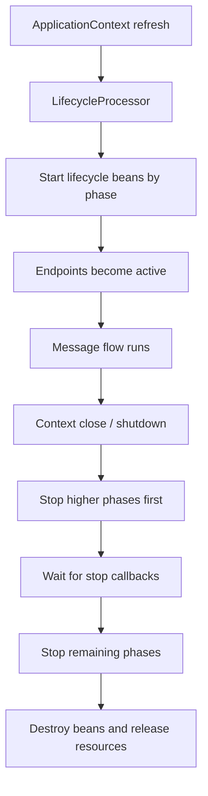
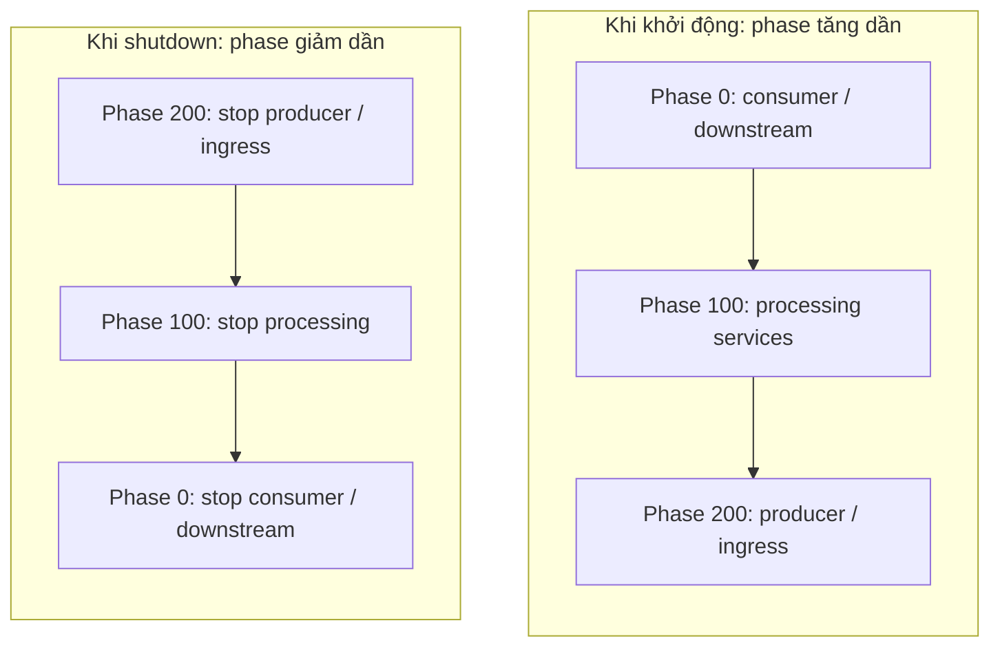
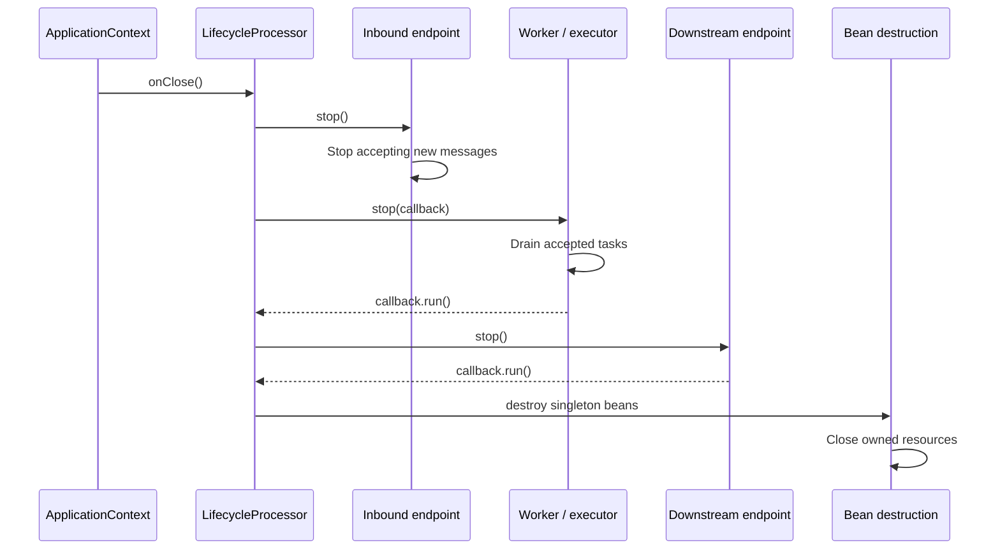

# start, stop, stop callback và shutdown

Trong Spring Integration, endpoint là những thành phần runtime có vòng đời riêng. Chúng có thể đăng ký nhận message, lên lịch polling, mở kết nối tới hệ thống bên ngoài hoặc chuyển công việc sang executor. Vì vậy, khi ứng dụng khởi động hay dừng, Spring cần điều phối thời điểm endpoint bắt đầu nhận việc, ngừng nhận việc, hoàn tất công việc đang chạy và giải phóng tài nguyên.

Spring quản lý vòng đời này qua `Lifecycle` và `SmartLifecycle`. Các endpoint Spring Integration thường được đăng ký như lifecycle bean trong application context. `start()` kích hoạt component; `stop()` yêu cầu component dừng; `stop(Runnable callback)` cho phép component báo lại khi quá trình dừng đã hoàn tất. Khi application context đóng, lifecycle processor điều phối các component theo phase, sau đó Spring mới hủy bean và giải phóng tài nguyên.

Hiểu rõ ba thời điểm **ngừng nhận message**, **xử lý xong message đang chạy** và **hủy tài nguyên** giúp tránh mất message, dừng executor quá sớm hoặc giữ ứng dụng shutdown quá lâu.

## 1. Endpoint có vòng đời độc lập với message flow

`IntegrationFlow` mô tả cách ghép các channel, endpoint và handler. Khi application context khởi tạo, Spring Integration tạo và đăng ký các runtime component tương ứng. Endpoint mới là thành phần trực tiếp tham gia vòng đời chạy.

Một số loại endpoint và tài nguyên thường gặp:

| Thành phần | Việc cần thực hiện khi start | Việc cần thực hiện khi stop |
|---|---|---|
| Event-driven consumer | Đăng ký handler làm subscriber trên input channel | Ngừng nhận dispatch mới hoặc hủy đăng ký subscriber |
| Polling consumer | Lên lịch poll và bắt đầu lấy message | Hủy lịch poll, ngăn poll cycle mới |
| Source polling channel adapter | Lên lịch gọi `MessageSource` và gửi kết quả vào channel | Ngừng gọi source và hủy lịch |
| Inbound channel adapter | Bắt đầu nhận dữ liệu từ hệ thống ngoài | Ngừng tiêu thụ dữ liệu hoặc đóng listener theo implementation |
| Outbound adapter | Sẵn sàng gửi dữ liệu tới hệ thống đích | Ngừng gửi và giải phóng tài nguyên do adapter sở hữu |
| Executor hoặc scheduler | Chấp nhận task theo cấu hình | Từ chối task mới, hoàn tất hoặc hủy task còn lại, rồi giải phóng pool |

Không phải mọi component đều sở hữu tài nguyên riêng. Một endpoint có thể dùng chung `TaskExecutor` hoặc `TaskScheduler` với nhiều endpoint khác. Khi đó phải xác định bean nào sở hữu pool và chịu trách nhiệm shutdown. Một endpoint dừng không có nghĩa executor dùng chung cũng phải dừng theo.

### Flow definition và runtime endpoint

Với flow khai báo bằng `@Bean`, Spring tạo các endpoint và channel trong application context. Vòng đời của chúng do context và lifecycle processor quản lý.

Không nên xem object `IntegrationFlow` như một lời gọi xử lý duy nhất có thể dừng giữa chừng. Cần xác định endpoint nào đang chạy, input channel nào đang nhận message và scheduler hoặc executor nào đang thực thi task.

Sơ đồ khái quát:

## 2. `Lifecycle`: start, stop và trạng thái running

Spring Core định nghĩa `Lifecycle` với ba thao tác chính:

~~~java
public interface Lifecycle {

    void start();

    void stop();

    boolean isRunning();
}
~~~

Ý nghĩa:

- `start()` yêu cầu component bắt đầu hoạt động.
- `stop()` yêu cầu component ngừng hoạt động.
- `isRunning()` trả về trạng thái lifecycle mà component công bố.

Các endpoint Spring Integration được lifecycle processor quản lý để chúng có thể được start và stop cùng application context. Trong ứng dụng, cũng có thể lấy reference tới một lifecycle bean và điều khiển nó bằng API tương ứng khi có nhu cầu vận hành.

`isRunning()` không phải bằng chứng rằng mọi message đã được xử lý, downstream đang khỏe hoặc hệ thống ngoài đã sẵn sàng. Nó phản ánh trạng thái hoạt động mà component lifecycle báo cáo. Readiness và health cần được quan sát bằng cơ chế health check phù hợp.

### Start và stop có thể được gọi nhiều lần

Vòng đời thông thường cho phép component được start sau khi đã stop, miễn implementation hỗ trợ restart. Với endpoint Spring Integration tiêu chuẩn, việc start/stop được tích hợp với lifecycle của framework.

Nếu tự viết lifecycle component, cần xác định rõ:

- `start()` có tạo lại scheduler, executor hoặc connection đã đóng không?
- `stop()` có thể được gọi khi component chưa chạy không?
- Gọi `start()` hai lần có tạo hai listener hoặc hai lịch poll không?
- Sau một lần stop timeout, component còn ở trạng thái nào?
- `isRunning()` chuyển trạng thái vào thời điểm nào?

Không nên chỉ gán một boolean `running` mà bỏ qua trạng thái thật của tài nguyên. Ví dụ, nếu executor đã shutdown vĩnh viễn nhưng `isRunning()` vẫn trả về `true`, component đang công bố trạng thái sai.

## 3. `SmartLifecycle`: tự động start, phase và callback

`SmartLifecycle` mở rộng `Lifecycle` với khả năng điều khiển thời điểm tự khởi động, thứ tự khởi động và callback khi dừng:

~~~java
int getPhase();

boolean isAutoStartup();

void stop(Runnable callback);
~~~

Ba phần bổ sung có vai trò khác nhau:

| API | Vai trò |
|---|---|
| `isAutoStartup()` | Cho biết component có tự khởi động khi lifecycle processor xử lý application context refresh hay không |
| `getPhase()` | Xác định thứ tự start và stop tương đối giữa các lifecycle component |
| `stop(Runnable callback)` | Báo cho lifecycle processor biết khi nào component đã dừng hoàn toàn |

Theo contract của Spring, `isAutoStartup()` mặc định trả về `true`, `getPhase()` mặc định là `Integer.MAX_VALUE`, và `stop(Runnable)` mặc định gọi `stop()` rồi chạy callback ngay sau đó. Phase mặc định này khiến component khởi động muộn và dừng sớm so với component có phase nhỏ hơn. Một endpoint cụ thể có thể override các giá trị này. Với endpoint, thuộc tính `autoStartup` có thể được cấu hình để trì hoãn việc kích hoạt; hãy kiểm tra cấu hình runtime thay vì giả định mọi flow đều có cùng trạng thái.

### autoStartup

`autoStartup=true` nghĩa là component được lifecycle processor tự động start trong quá trình context refresh. Nếu đặt `false`, component không được tự start theo cơ chế này; ứng dụng có thể start chủ động sau khi điều kiện cần thiết đã sẵn sàng.

Một số tình huống phù hợp với `autoStartup=false`:

- Chỉ nhận message sau khi cấu hình tenant đã được nạp.
- Chờ kiểm tra kết nối tới hệ thống bên ngoài.
- Triển khai một consumer cần được operator kích hoạt.
- Chạy migration hoặc bootstrap trước khi bắt đầu polling.
- Tạo flow động và chỉ bật sau khi đã đăng ký routing.

Không nên dùng `autoStartup=false` để che giấu dependency chưa sẵn sàng mà không có cơ chế readiness hoặc giám sát rõ ràng.

## 4. Phase quyết định thứ tự start và stop

Lifecycle processor nhóm các component theo phase. Phase nhỏ được start trước; phase lớn được start sau. Khi shutdown, thứ tự được đảo ngược: phase lớn stop trước, phase nhỏ stop sau.

Ví dụ, nếu producer gửi message vào consumer, ta thường muốn:

1. Consumer khởi động trước để sẵn sàng nhận message.
2. Producer khởi động sau để bắt đầu phát message.
3. Khi shutdown, producer ngừng phát trước.
4. Consumer tiếp tục xử lý message đã nhận.
5. Consumer chỉ dừng sau khi công việc cần drain đã hoàn tất.

Có thể mô hình hóa bằng phase: consumer ở phase thấp, producer ở phase cao. Đây là một quy tắc điều phối hữu ích, nhưng phải xét dependency thực tế và các tài nguyên dùng chung.

### Dependency và phase

Quan hệ dependency giữa bean, chẳng hạn `depends-on`, cũng ảnh hưởng thứ tự khởi tạo và hủy bean. Không nên dùng phase để thay thế một dependency bắt buộc giữa hai bean.

Nếu các component có cùng phase, không nên dựa vào một thứ tự start/stop cụ thể giữa chúng. Khi thứ tự là yêu cầu nghiệp vụ, hãy mô hình hóa dependency hoặc phase riêng và kiểm tra trong ứng dụng.

### Ví dụ về phase

Giả sử flow nhận event từ broker, xử lý rồi gửi sang hệ thống khác:

| Component | Phase minh họa | Start | Stop |
|---|---:|---|---|
| Consumer nội bộ | 0 | Đầu tiên | Cuối cùng |
| Service xử lý nền | 100 | Sau consumer | Trước consumer |
| Inbound adapter | 200 | Sau cùng | Đầu tiên |

Các số trên chỉ minh họa quan hệ thứ tự, không phải giá trị mặc định bắt buộc của Spring Integration. Hãy chọn phase phù hợp với các component thực tế trong application context.

## 5. Endpoint stop làm gì với message?

Dừng endpoint là yêu cầu ngừng hoạt động của consumer hoặc adapter đó. Hành vi cụ thể phụ thuộc loại endpoint.

### Event-driven consumer

Event-driven consumer thường đăng ký handler làm subscriber trên một `SubscribableChannel`. Khi stop, endpoint ngừng nhận dispatch mới theo cơ chế quản lý subscriber của nó.

Nếu message handler đang chạy đồng bộ trên thread gửi, lời gọi stop không tự động hủy ngang một đoạn code Java đang thực thi. Nếu endpoint dùng executor, task đã được bàn giao có thể tiếp tục chạy tùy executor và cách endpoint quản lý task.

### Polling consumer

Polling consumer dùng poller để gọi `receive()` trên `PollableChannel`. Khi stop, lịch polling được ngừng để không tạo poll cycle mới.

Một poll cycle đang chạy có thể đã nhận message hoặc đang ở trong handler. Cần xác định endpoint và task executor có chờ công việc đó hoàn tất hay không. Không nên suy luận rằng stop poller đồng nghĩa mọi message trong backlog đã được xử lý.

### Inbound adapter

Inbound adapter có thể sở hữu listener, connection hoặc consumer từ hệ thống ngoài. Stop thường yêu cầu adapter ngừng tiếp nhận dữ liệu mới và giải phóng hoặc tạm dừng tài nguyên theo implementation.

Với broker, semantics thực tế còn phụ thuộc acknowledgment, prefetch, redelivery và transaction của adapter. Khi stop, cần xác định message đang được giao dở sẽ được acknowledge, reject, requeue hay xử lý theo timeout.

### QueueChannel không tự bị xóa khi endpoint stop

`QueueChannel` có thể tiếp tục chứa message trong khi polling consumer đã dừng. Stop consumer không đồng nghĩa purge queue.

Nếu queue nằm trong bộ nhớ, message còn tồn tại khi application context vẫn sống và queue bean chưa bị hủy. Khi process kết thúc, queue trong bộ nhớ không tự trở thành durable. Nếu cần giữ backlog qua restart, cần dùng broker hoặc message store có persistence và cấu hình phù hợp.

## 6. Stop thường và graceful stop khác nhau ở đâu?

Một lệnh stop có thể chỉ ngừng nhận công việc mới. Graceful stop còn phải xử lý công việc đã được tiếp nhận theo một chính sách đã định.

| Giai đoạn | Mục tiêu | Câu hỏi vận hành |
|---|---|---|
| Quiesce | Ngừng nhận message mới | Producer, listener hoặc poller đã ngừng nhận chưa? |
| Drain | Hoàn tất message đang xử lý và backlog được chọn để drain | Còn task, transaction hoặc reply đang chờ không? |
| Stop | Đánh dấu component đã dừng | Callback đã được gọi chưa? |
| Destroy | Hủy tài nguyên cuối cùng | Executor, scheduler, connection và store được đóng đúng owner chưa? |

Graceful stop cần một ranh giới rõ ràng giữa message đã được nhận và message chưa được nhận. Ví dụ, khi dừng một inbound adapter, hệ thống có thể ngừng poll broker nhưng để consumer hoàn tất các delivery đang in-flight. Sau đó adapter mới báo đã dừng.

Không có một chính sách drain phù hợp cho mọi loại channel. Với queue nội bộ, có thể chọn xử lý hết backlog trước khi stop hoặc giữ message trong một store bền vững. Với broker, có thể dừng nhận delivery mới, hoàn tất và acknowledge message đang xử lý, để broker giao lại message chưa được acknowledge. Chính sách phải dựa trên adapter và broker thực tế.

### Ba câu hỏi phải tách riêng

- **Ngừng nhận:** endpoint có còn nhận hoặc poll message mới không?
- **Hoàn tất:** handler, transaction và task đang chạy đã xong chưa?
- **Bền vững:** message chưa xử lý có còn sau khi process kết thúc không?

Ba câu hỏi này không có cùng câu trả lời. Một QueueChannel có thể ngừng nhận consumer nhưng vẫn còn backlog trong bộ nhớ; một executor có thể đã ngừng nhận task mới nhưng còn task đang chạy; một broker có thể giữ message chưa acknowledge để redelivery sau restart.

## 7. `stop(Runnable callback)` và ý nghĩa của callback

`SmartLifecycle` có overload:

~~~java
void stop(Runnable callback);
~~~

Callback là tín hiệu báo cho lifecycle processor rằng component đã hoàn tất quá trình dừng. Component có thể dừng ngay và gọi callback tức thì, hoặc thực hiện shutdown bất đồng bộ rồi gọi callback sau.

Ví dụ về ý tưởng của một component cần drain task:

~~~java
@Override
public void stop(Runnable callback) {
    acceptingNewWork.set(false);
    drainService.stopAcceptingNewWork();

    drainService.whenDrained().whenComplete((ignored, error) -> {
        running = false;
        callback.run();
    });
}
~~~

Đây là minh họa cho một component có `drainService` do ứng dụng cung cấp; `whenDrained()` trả về một completion stage chỉ hoàn tất khi mọi công việc đã được chấp nhận đều kết thúc. Trong ứng dụng thật, cần quy định cách xử lý khi stage hoàn tất lỗi hoặc không hoàn tất trước timeout. Callback phải phản ánh chính sách dừng đã thực hiện. Nếu worker pool được inject từ bean dùng chung, component không nên tự ý shutdown nó; bean sở hữu pool mới chịu trách nhiệm dừng tài nguyên.

### Quy tắc khi gọi callback

1. Chỉ gọi callback sau khi component đã hoàn tất công việc mà nó cam kết trong stop.
2. Gọi callback đúng một lần cho mỗi lần stop.
3. Bảo đảm callback được gọi cả khi shutdown có lỗi hoặc bị interrupt, nếu component đã kết thúc quá trình dừng theo chính sách.
4. Không gọi callback ngay sau khi mới yêu cầu `executor.shutdown()` nếu task còn đang chạy và component cam kết chờ drain.
5. Không chặn callback vô thời hạn; phải có timeout hoặc chính sách force stop.
6. Không chạy công việc shutdown nặng ngay trong callback. Callback là tín hiệu hoàn tất để lifecycle processor tiếp tục điều phối.

`SmartLifecycle` có default behavior cho trường hợp component không cần dừng bất đồng bộ: gọi `stop()` rồi thực thi callback. Nếu cần drain hoặc chờ task, component phải cung cấp semantics phù hợp.

### Lifecycle processor chờ callback như thế nào?

`DefaultLifecycleProcessor` quản lý start/stop các lifecycle bean trong context. Khi stop một phase, nó có thể đợi callback của các component trong phase đó trước khi chuyển sang phase tiếp theo.

Điều này cho phép phase upstream dừng trước, sau đó phase downstream mới dừng. Nếu callback không được gọi, lifecycle processor chỉ có thể chờ đến timeout đã cấu hình; timeout không làm cho công việc chưa hoàn tất tự động trở nên an toàn.

Trong Spring Boot, có thể cấu hình thời gian chờ mỗi shutdown phase bằng thuộc tính:

~~~properties
spring.lifecycle.timeout-per-shutdown-phase=30s
~~~

Giá trị cần dựa trên thời gian xử lý lớn nhất hợp lý, backlog cần drain và SLA shutdown. Timeout quá ngắn có thể làm shutdown kết thúc khi task còn chạy; timeout quá dài có thể khiến triển khai hoặc restart bị treo lâu khi có component không phản hồi.

## 8. Shutdown application context diễn ra theo thứ tự nào?

Khi application context được đóng, Spring lifecycle processor dừng các lifecycle component trước khi bean bị destroy. Về mặt khái niệm:

1. Context bắt đầu quá trình close và phát tín hiệu đóng.
2. Lifecycle processor yêu cầu các lifecycle bean stop theo thứ tự phase giảm dần.
3. Với `SmartLifecycle`, processor chờ callback của component đang dừng, trong giới hạn timeout.
4. Khi lifecycle stop hoàn tất hoặc hết thời gian chờ, Spring tiếp tục hủy các singleton bean.
5. Các callback hủy như `DisposableBean.destroy()`, `@PreDestroy` hoặc destroy method được gọi để giải phóng tài nguyên.

Sơ đồ shutdown:

Sơ đồ thể hiện một chuỗi minh họa. Thứ tự thực tế được quyết định bởi phase, dependency và implementation của component; các component trong cùng phase có thể dừng đồng thời.

### Shutdown hook và tín hiệu hệ điều hành

Trong ứng dụng Spring Boot thông thường, SpringApplication đăng ký shutdown hook để đóng application context khi JVM shutdown bình thường. Khi chạy trong container hoặc orchestrator, cần bảo đảm process nhận được tín hiệu dừng và có đủ thời gian trước khi bị terminate cưỡng bức.

Graceful shutdown của web server là một phần riêng của quá trình dừng ứng dụng. Nó giúp server ngừng nhận request mới và xử lý request đang chạy theo cấu hình. Điều đó không tự động bảo đảm mọi message flow, broker consumer hay executor của Spring Integration đã drain đúng cách; các endpoint vẫn cần lifecycle policy phù hợp.

## 9. Phối hợp phase để dừng producer trước consumer

Một lỗi phổ biến là dừng consumer trước khi producer ngừng phát message. Điều đó có thể tạo lỗi gửi, backlog hoặc mất message tùy channel.

Giả sử có luồng:

`Broker inbound adapter → QueueChannel → PollingConsumer → Service → Outbound adapter`

Một thứ tự shutdown hợp lý có thể là:

1. Dừng inbound adapter để ngừng nhận delivery mới.
2. Để consumer tiếp tục lấy message đã nằm trong QueueChannel và hoàn tất xử lý theo drain policy.
3. Dừng outbound adapter sau khi các handler không còn cần gửi kết quả.
4. Dừng executor/scheduler sau khi các endpoint sử dụng chúng đã kết thúc.

Khi start, thứ tự nên đảo lại: downstream và worker sẵn sàng trước, ingress bắt đầu sau cùng.

Phase giúp biểu đạt thứ tự tổng thể. Nhưng nếu một endpoint dùng executor chung, hãy bảo đảm executor không bị dừng trước endpoint. Đặt phase cho executor thấp hơn hoặc cao hơn không đúng tùy tiện có thể làm component phụ thuộc bị dừng quá sớm. Hãy xác định quan hệ: endpoint cần executor cho đến khi stop callback hoàn tất, do đó executor phải còn hoạt động trong toàn bộ thời gian endpoint dừng.

### Một bảng thứ tự minh họa

| Component | Phase minh họa | Lý do |
|---|---:|---|
| Shared worker executor | 0 | Start sớm, stop muộn để endpoint còn dùng được |
| Service consumer | 100 | Chỉ dừng sau khi ingress ngừng nhận |
| Inbound adapter | 200 | Dừng sớm để chặn nguồn message mới |
| Outbound adapter | 50 | Duy trì khả năng gửi reply khi consumer drain |

Trong ví dụ này, outbound adapter có phase thấp hơn consumer, nên nó khởi động trước consumer và dừng sau consumer. Cách sắp xếp này giữ đường gửi reply hoạt động trong lúc consumer drain. Phase phải được thiết kế từ quan hệ sử dụng tài nguyên thực tế, không sao chép một bảng mẫu mà không phân tích flow.

## 10. Dynamic IntegrationFlow: register, start, stop và destroy

Spring Integration hỗ trợ đăng ký flow động thông qua `IntegrationFlowContext`. Cách này hữu ích khi ứng dụng tạo flow theo tenant, cấu hình runtime hoặc một loại kết nối chỉ tồn tại trong một khoảng thời gian.

Ví dụ đăng ký flow động:

~~~java
IntegrationFlowRegistration registration =
        flowContext.registration(
                IntegrationFlow.from("tenant.orders.input")
                        .handle(orderHandler, "handle")
                        .get()
        )
        .id("tenantOrdersFlow")
        .register();
~~~

Sau khi đăng ký, registration cung cấp các thao tác lifecycle cho flow động:

~~~java
registration.start();

boolean running = registration.isRunning();

registration.stop();

// Khi không còn sử dụng flow:
registration.destroy();
~~~

Ý nghĩa của từng thao tác:

- `register()` đăng ký flow và các bean runtime liên quan trong application context.
- `start()` kích hoạt flow khi cần.
- `stop()` ngừng hoạt động flow nhưng registration vẫn còn để có thể quản lý tiếp.
- `destroy()` gỡ registration và hủy các bean runtime do registration quản lý.

Không nên gọi `destroy()` chỉ để tạm dừng flow nếu còn ý định start lại. Cũng cần xác định channel đầu vào có được chia sẻ với flow khác hay không trước khi xóa registration; chỉ tài nguyên do registration sở hữu mới thuộc phạm vi cleanup của nó.

Khi tạo nhiều flow động, phải quản lý ID duy nhất, tránh đăng ký trùng, lưu lại registration để dừng và destroy đúng lúc. Nếu flow phụ thuộc executor hoặc channel dùng chung, không destroy tài nguyên dùng chung cùng lúc với flow.

## 11. Stop endpoint không thay thế cleanup tài nguyên

`stop()` và `destroy()` có mục đích khác nhau:

| Thao tác | Mục tiêu | Có thể start lại không? |
|---|---|---|
| `stop()` | Tạm dừng hoạt động lifecycle | Thường có, nếu implementation hỗ trợ restart |
| `destroy()` | Giải phóng tài nguyên và kết thúc vòng đời bean/registration | Thường không |
| `ApplicationContext.close()` | Dừng các lifecycle component rồi hủy bean của context | Context đã đóng không được dùng như trước |

Ví dụ, một polling endpoint có thể stop lịch poll nhưng scheduler được chia sẻ vẫn còn hoạt động cho endpoint khác. Một inbound adapter có thể stop listener nhưng connection factory được quản lý bởi bean khác vẫn còn sống. Ngược lại, nếu endpoint sở hữu socket hoặc client riêng, destroy phải giải phóng tài nguyên đó.

Nên xác định rõ owner của từng tài nguyên:

- Endpoint sở hữu listener riêng: endpoint hoặc adapter chịu trách nhiệm đóng listener.
- Nhiều endpoint dùng chung scheduler: scheduler bean chịu trách nhiệm shutdown.
- Executor được inject từ cấu hình: bean executor chịu trách nhiệm shutdown.
- Flow động sở hữu các endpoint riêng: registration destroy gỡ những bean thuộc registration.
- Channel dùng chung: chỉ hủy khi owner của channel và toàn bộ consumer liên quan đã dừng.

Tránh đóng cùng một resource ở cả endpoint và bean factory nếu không có quy ước rõ ràng; double close có thể gây lỗi khó chẩn đoán.

## 12. Điều gì xảy ra với message đang xử lý khi shutdown?

Đây là câu hỏi quan trọng nhất khi thiết kế shutdown cho message-driven application. Một message có thể đang ở một trong nhiều trạng thái:

| Trạng thái | Ví dụ | Quyết định cần có |
|---|---|---|
| Chưa được consumer nhận | Nằm trong QueueChannel hoặc broker queue | Giữ bền vững, drain hoặc để redelivery |
| Đã nhận nhưng chưa bắt đầu handler | Task nằm trong executor queue | Chờ chạy, trả lại broker hoặc hủy theo chính sách |
| Handler đang chạy | Đang gọi database hoặc API ngoài | Chờ hoàn tất, timeout hoặc interrupt nếu an toàn |
| Đã thực hiện side effect nhưng chưa acknowledge | Database commit xong nhưng broker chưa nhận ack | Phải idempotent để xử lý redelivery |
| Đã hoàn tất và acknowledge | Consumer xác nhận thành công | Không cần xử lý lại theo delivery semantics thông thường |

Không có một câu lệnh stop duy nhất giải quyết mọi trạng thái này. Chính sách phải phù hợp với nguồn message, channel, executor và transaction boundary.

### In-flight transaction

Nếu handler đang ở trong transaction, việc dừng cưỡng bức giữa chừng có thể khiến transaction rollback, commit hoặc để trạng thái phụ thuộc vào resource manager và điểm interrupt. Không nên tự interrupt thread đang xử lý transaction nếu chưa hiểu tác động.

Graceful shutdown thường cho handler đang chạy một khoảng thời gian để hoàn tất. Nếu hết thời gian, cần có chính sách phục hồi: để broker redeliver, retry bằng message store, hoặc đưa task vào trạng thái có thể reconciliation.

### Side effect và acknowledgment

Một trường hợp khó là handler đã ghi database thành công nhưng chưa acknowledge message với broker. Khi process dừng, broker có thể giao lại message. Consumer phải idempotent để lần giao lại không tạo side effect lần thứ hai.

Tương tự, nếu handler gọi API ngoài rồi process chết trước khi lưu trạng thái hoàn tất, hệ thống có thể không biết request ngoài đã thành công hay chưa. Cần idempotency key, outbox/inbox hoặc cơ chế reconciliation phù hợp với nghiệp vụ.

## 13. Cấu hình timeout và force shutdown

Một graceful shutdown cần có giới hạn thời gian. Nếu không có timeout, một endpoint bị kẹt có thể giữ process không kết thúc.

Trong Spring Boot, thuộc tính `spring.lifecycle.timeout-per-shutdown-phase` đặt thời gian chờ lifecycle component trong mỗi phase. Khi hết thời gian, lifecycle processor tiếp tục theo chính sách framework và ghi nhận timeout. Không được hiểu timeout là xác nhận task đã hoàn tất.

Khi thiết kế timeout, cân nhắc:

- Thời gian tối đa handler cần để hoàn thành bình thường.
- Số lượng task đang in-flight.
- Thời gian chờ connection hoặc transaction.
- Thời gian drain queue nếu chính sách yêu cầu.
- Thời gian triển khai mà orchestrator cho phép trước khi kill process.
- Thời gian dự phòng cho cleanup bean và log cuối cùng.

Một thứ tự timeout nên có khoảng dự phòng giữa thời gian drain bên trong và grace period của môi trường chạy. Nếu orchestrator kill process trước khi Spring lifecycle processor hết thời gian, callback không còn cơ hội hoàn tất.

### Không biến timeout thành một con số tùy tiện

Nếu handler có thể gọi API ngoài với timeout 60 giây nhưng lifecycle phase chỉ chờ 10 giây, shutdown thường xuyên có thể cắt ngang các request hợp lệ. Ngược lại, đặt timeout 20 phút trong khi orchestrator chỉ cho 30 giây cũng không giúp bảo vệ message.

Hãy đặt timeout nhất quán giữa:
- HTTP/RPC client timeout.
- Database query/transaction timeout.
- Retry backoff và số lần retry.
- Executor task timeout nếu có.
- Lifecycle phase timeout.
- Container/orchestrator termination grace period.

## 14. Quan sát lifecycle và chẩn đoán endpoint không dừng

Khi endpoint không start hoặc không stop như mong đợi, cần xác định component nào đang giữ lifecycle và nó bị chặn ở bước nào.

### Endpoint không start

Kiểm tra:

1. Bean endpoint đã được tạo và đăng ký trong application context chưa?
2. `autoStartup` có đang là false không?
3. Lifecycle processor đã nhận context refresh chưa?
4. Phase và dependency có khiến component chờ một component khác không?
5. Adapter có lỗi khi mở connection hoặc đăng ký listener không?
6. Poller có được cấu hình đúng scheduler và trigger không?
7. Dynamic flow đã được register và gọi start chưa?

### Endpoint không stop

Kiểm tra:

1. `stop()` hoặc `stop(Runnable)` có được gọi không?
2. Component có ngừng nhận công việc mới không?
3. Callback có được gọi đúng một lần không?
4. Có task nào đang chạy hoặc chờ executor không?
5. Thread đang chờ I/O, lock hoặc transaction nào?
6. Phase hiện tại có đang chờ component khác cùng phase không?
7. Shutdown timeout có đủ dài và có được cấu hình ở đúng nơi không?
8. Một bean destroy method có đang chặn sau khi lifecycle stop đã hoàn tất không?

### Các triệu chứng thường gặp

| Triệu chứng | Nguyên nhân cần kiểm tra |
|---|---|
| Context refresh xong nhưng endpoint không chạy | `autoStartup=false`, endpoint chưa register hoặc start thất bại |
| Polling tiếp tục sau khi gọi stop một bean khác | Đang stop nhầm component; poller thuộc endpoint hoặc adapter khác |
| Context shutdown bị chậm | Stop callback chưa được gọi, task đang drain, I/O bị block hoặc phase timeout lớn |
| Context shutdown nhanh nhưng task chưa hoàn tất | Component báo callback quá sớm hoặc task executor không thuộc lifecycle đang chờ |
| Queue còn message sau khi stop consumer | Consumer đã dừng nhưng queue vẫn còn backlog |
| Flow động không thể đăng ký lại | Registration cũ chưa destroy hoặc ID bean còn tồn tại |
| Executor không nhận task sau restart | Executor đã shutdown và không được tạo lại |
| Message được xử lý lặp sau restart | Broker redelivery sau khi side effect hoàn tất nhưng trước acknowledgment |

### Dữ liệu nên ghi nhận

Khi debug shutdown, ghi log có cấu trúc gồm:

- Tên bean hoặc endpoint ID.
- Phase và trạng thái `isRunning()`.
- Thời điểm nhận tín hiệu stop và thời điểm callback hoàn tất.
- Số task đang chạy, task đang chờ và queue depth.
- Correlation ID hoặc event ID của message đang xử lý (không ghi payload nhạy cảm).
- Thread name và stack trace khi có timeout.
- Kết quả đóng connection, scheduler, executor và message store.

Với Spring Boot Actuator và Spring Integration Management được cấu hình, có thể dùng endpoint quản lý hoặc Integration Graph để quan sát các component đã đăng ký. Tên endpoint, mức độ chi tiết và thao tác điều khiển phụ thuộc phiên bản, cấu hình exposure và quyền truy cập. Không nên công khai endpoint điều khiển lifecycle mà không có bảo vệ phù hợp.

## 15. Quy trình shutdown thực tế cho một message flow

Giả sử một ứng dụng có inbound adapter, polling consumer, service handler và outbound adapter. Một quy trình shutdown có thể được thiết kế như sau:

1. Nhận tín hiệu shutdown từ application context.
2. Stop inbound adapter trước để không nhận thêm message mới.
3. Chờ các message đã nhận được xử lý theo acknowledgment và transaction policy.
4. Nếu có QueueChannel, drain backlog theo giới hạn hoặc giữ backlog trong storage bền vững.
5. Chờ executor task hoàn tất; không shutdown shared executor khi endpoint vẫn còn sử dụng.
6. Stop consumer sau khi không còn task cần xử lý.
7. Stop outbound adapter sau khi không còn reply hoặc side effect cần gửi.
8. Shutdown scheduler và executor do ứng dụng sở hữu.
9. Destroy flow động, connection factory và resource bean theo ownership.
10. Để application context hoàn tất quá trình đóng.

Thứ tự cụ thể phải điều chỉnh theo dependency. Ví dụ, nếu handler cần outbound adapter để phát event hoàn tất, outbound adapter phải còn hoạt động trong suốt quá trình handler drain. Nếu handler dùng shared executor, executor phải sống đến khi callback của endpoint hoàn tất.

## 16. Checklist thiết kế start, stop và shutdown

Trước khi triển khai hoặc vận hành lifecycle cho flow, hãy kiểm tra:

- [ ] Đã xác định endpoint và adapter nào là lifecycle bean chưa?
- [ ] `autoStartup` có phù hợp với readiness của dependency không?
- [ ] Phase có bảo đảm downstream start trước upstream và upstream stop trước downstream không?
- [ ] Dependency giữa bean có được biểu diễn đúng không?
- [ ] Stop có ngăn nhận message mới không?
- [ ] Chính sách xử lý in-flight message và executor queue đã rõ chưa?
- [ ] Queue backlog sẽ được drain, giữ bền vững hay chấp nhận mất khi process kết thúc?
- [ ] Acknowledgment chỉ xảy ra sau khi nghiệp vụ đạt trạng thái cần thiết chưa?
- [ ] `stop(Runnable)` có gọi callback sau khi dừng thật sự và đúng một lần không?
- [ ] Có timeout và force-stop policy cho component bị kẹt không?
- [ ] Shared executor/scheduler có owner rõ ràng và không bị đóng quá sớm không?
- [ ] `destroy()` có giải phóng đúng tài nguyên thuộc component không?
- [ ] Dynamic flow có được stop trước destroy và có ID registration được quản lý không?
- [ ] Shutdown timeout của Spring Boot có phù hợp với termination grace period của môi trường không?
- [ ] Có log/metric để biết endpoint nào chưa dừng và callback nào chưa hoàn tất không?

Vòng đời endpoint là một phần của correctness của message flow. `start()` làm component tham gia xử lý; `stop()` ngăn component tiếp tục hoạt động; stop callback cho lifecycle processor biết lúc nào component đã thực sự hoàn tất; `destroy()` giải phóng tài nguyên cuối cùng. Khi kết hợp đúng phase, timeout, drain policy và ownership, ứng dụng có thể khởi động có trật tự và shutdown mà vẫn kiểm soát được message đang xử lý.

## Tài liệu tham khảo

- [Spring Framework — Lifecycle](https://docs.spring.io/spring-framework/reference/core/beans/factory-nature.html) — vòng đời bean và các callback lifecycle.
- [Spring Framework — `Lifecycle` and `SmartLifecycle`](https://docs.spring.io/spring-framework/reference/core/beans/factory-nature.html#beans-factory-lifecycle) — tự động khởi động, phase và stop callback.
- [Spring Integration — Endpoints](https://docs.spring.io/spring-integration/reference/endpoint.html) — endpoint và cách Spring Integration nối channel với handler.
- [Spring Integration — Java DSL](https://docs.spring.io/spring-integration/reference/dsl/java-basics.html) — khai báo IntegrationFlow và runtime components.
- [Spring Integration — Dynamic and Runtime Integration Flows](https://docs.spring.io/spring-integration/reference/dsl/java-runtime-flows.html) — đăng ký, quản lý và hủy flow động.
- [Spring Boot — Graceful Shutdown](https://docs.spring.io/spring-boot/reference/web/graceful-shutdown.html) — shutdown của ứng dụng và web server.
- [Spring Boot — Application Properties](https://docs.spring.io/spring-boot/appendix/application-properties/index.html) — cấu hình thời gian chờ lifecycle shutdown.

Các chi tiết phase, timeout và cách endpoint dừng task có thể khác theo phiên bản Spring Framework, Spring Integration, Spring Boot và adapter đang dùng. Hãy đối chiếu tài liệu đúng phiên bản dependency của ứng dụng.
