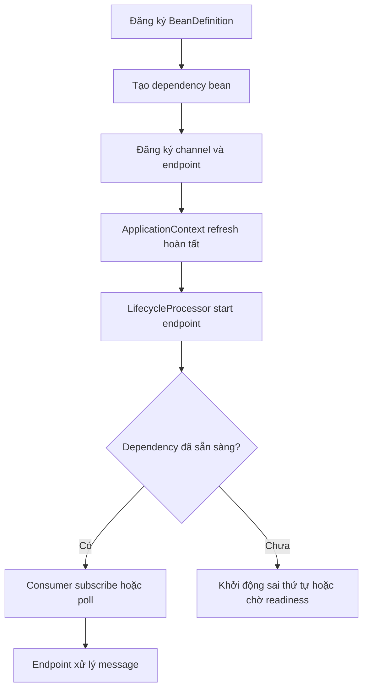
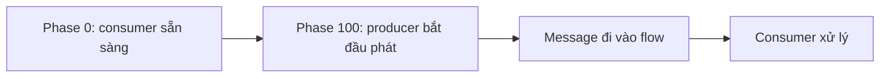

# Endpoint chạy trước hoặc sau các dependency

Trong Spring Integration, một endpoint chỉ nên nhận hoặc phát message khi những thành phần mà nó phụ thuộc đã sẵn sàng. Endpoint có thể cần channel, handler bean, connection factory, transaction manager, schema database hoặc endpoint khác hoạt động trước. Nếu thứ tự khởi động không phù hợp, ứng dụng có thể tạo bean thành công nhưng message vẫn thất lạc, bị từ chối hoặc được xử lý khi hạ tầng chưa sẵn sàng.

Bài này thuộc phần **Endpoint lifecycle** của module `SPRING_INTEGRATION_RUNTIME`. Module tập trung vào cách Spring Integration điều phối message flow qua channel, endpoint, consumer, poller và executor; đồng thời hướng dẫn quản lý vòng đời IntegrationFlow, transaction, retry, message store, lỗi, correlation và chẩn đoán runtime.

## 1. Dependency của endpoint gồm những loại nào?

Từ góc nhìn runtime, từ “dependency” có thể chỉ nhiều quan hệ khác nhau. Cần gọi đúng tên để chọn cơ chế điều khiển phù hợp.

| Loại dependency | Ví dụ | Điều cần bảo đảm |
|---|---|---|
| **Bean dependency** | Handler service, channel, converter, transaction manager | Bean được tạo và dependency được inject trước khi endpoint dùng nó |
| **Lifecycle dependency** | Connection container, listener container, endpoint khác | Thành phần phụ thuộc được start trước và stop sau endpoint |
| **Message-flow dependency** | Consumer phía sau một DirectChannel, router và các nhánh đích | Consumer sẵn sàng trước khi producer bắt đầu phát message |
| **Resource readiness** | Database đã migrate, broker đã kết nối, remote API đã xác thực | Tài nguyên thực sự sẵn sàng, không chỉ có một bean đại diện trong context |

Ví dụ: một service được inject vào handler là bean dependency. Nhưng nếu service chỉ mở kết nối tới hệ thống ngoài sau một thao tác start riêng, nó còn có lifecycle dependency. Nếu service kết nối thành công nhưng database chưa chạy migration, endpoint vẫn có resource-readiness dependency.

**Bean tồn tại không đồng nghĩa tài nguyên đã sẵn sàng.** Constructor hoàn tất chỉ chứng minh object đã được tạo. Nó không chứng minh broker đã chấp nhận kết nối, database đã migrate xong hoặc một endpoint khác đã đăng ký consumer.

## 2. Endpoint được tạo và chạy ở những giai đoạn nào?

Để kiểm soát dependency, hãy phân biệt ba giai đoạn trong ApplicationContext:

1. **Bean creation:** Spring tạo channel, service, connection factory, flow và các bean cần thiết theo dependency graph.
2. **Endpoint registration:** Spring Integration xử lý cấu hình IntegrationFlow/annotation, đăng ký endpoint và kết nối tham chiếu giữa endpoint, channel và handler.
3. **Endpoint startup:** LifecycleProcessor khởi động các endpoint triển khai Lifecycle/SmartLifecycle khi ApplicationContext hoàn tất refresh, tùy theo autoStartup và phase.

Một endpoint có thể đã được đăng ký trong context nhưng chưa chạy. Ngược lại, một dependency bean có thể đã được tạo nhưng chưa hoàn tất công việc readiness bất đồng bộ.



Nếu endpoint tự động start ngay sau refresh nhưng migration chỉ chạy trong một `ApplicationRunner`, endpoint có thể bắt đầu nhận message trước khi migration hoàn tất. Đây là ví dụ điển hình cho khác biệt giữa bean creation và resource readiness.

## 3. SmartLifecycle điều khiển thứ tự start và stop

Integration endpoint thường được quản lý theo lifecycle của Spring. `SmartLifecycle` mở rộng `Lifecycle` và bổ sung hai thông tin quan trọng:

- `isAutoStartup()` / thuộc tính cấu hình `autoStartup` quyết định thành phần có tự động start khi context refresh hoàn tất hay không.
- `getPhase()` / thuộc tính cấu hình `phase` xác định thứ tự start và stop giữa các thành phần lifecycle.

Quy tắc phase:

- Phase có giá trị **thấp hơn được start trước**.
- Phase có giá trị **cao hơn được start sau**.
- Khi dừng context, thứ tự đảo ngược: phase cao được stop trước, phase thấp được stop sau.

Quy tắc này giúp một dependency có thời gian khởi động trước endpoint sử dụng nó, đồng thời giữ dependency hoạt động trong lúc endpoint phụ thuộc đang dừng.



Nếu hai thành phần có quan hệ phụ thuộc nhưng được cấu hình phase giống nhau, đừng dựa vào thứ tự khai báo bean hoặc tên bean để suy đoán thứ tự chạy. Hãy biểu diễn dependency rõ ràng hoặc chọn phase phù hợp. Với các dependency lifecycle độc lập, phase là công cụ điều phối dễ quan sát.

## 4. Dùng phase để consumer sẵn sàng trước producer

Một trường hợp phổ biến là producer gửi message vào `DirectChannel`. DirectChannel không lưu message để chờ consumer xuất hiện; nó dispatch tới subscriber ngay trong lần gửi. Nếu producer phát message trước khi endpoint tiêu thụ đã đăng ký subscriber, việc gửi có thể thất bại hoặc không tới consumer mong muốn.

Giả sử flow có một bước kiểm tra đơn hàng và một bước lưu dữ liệu:

```java
@Bean
IntegrationFlow orderProcessing(OrderService service) {
    return IntegrationFlow.from("orders.in")
        .handle(service, "validate",
            endpoint -> endpoint.id("validateOrders").phase(100))
        .channel("orders.validated")
        .handle(service, "persist",
            endpoint -> endpoint.id("persistOrders").phase(0))
        .get();
}
```

Endpoint `persistOrders` có phase thấp hơn nên được start trước endpoint `validateOrders`. Khi bước kiểm tra bắt đầu phát message vào `orders.validated`, endpoint lưu dữ liệu đã có cơ hội đăng ký subscriber.

Trong flow có nhiều endpoint, hãy áp dụng quy tắc tương tự theo hướng message đi:

- Consumer ở phía sau có thể cần start trước producer ở phía trước.
- Inbound adapter hoặc poller tạo message chủ động nên chỉ bắt đầu phát sau khi các consumer downstream sẵn sàng.
- Khi dừng ứng dụng, producer nên dừng trước để không tiếp tục phát message vào consumer đang bị đóng.

Nếu nguồn phát message là một inbound adapter riêng, hãy đặt phase của endpoint nguồn cao hơn phase của các endpoint downstream hoặc điều khiển thời điểm start nguồn sau khi flow đích đã sẵn sàng.

### 4.1. DirectChannel và QueueChannel có yêu cầu khác nhau

| Channel | Hành vi | Ý nghĩa đối với thứ tự startup |
|---|---|---|
| `DirectChannel` | Dispatch đồng bộ tới subscriber | Consumer nên được start trước producer; message không được lưu để chờ consumer xuất hiện |
| `ExecutorChannel` | Dispatch qua executor tới subscriber | Consumer vẫn cần được đăng ký trước; executor chỉ thay đổi cách dispatch và thread thực thi |
| `QueueChannel` | Giữ message trong queue tới khi consumer poll | Có thể hấp thụ message trong giới hạn queue, nhưng vẫn phải kiểm soát capacity, thời gian chờ và thời điểm consumer start |

QueueChannel giúp tách thời điểm gửi và nhận, nhưng không tự giải quyết mọi vấn đề readiness. Queue có capacity hữu hạn; khi đầy, producer có thể bị chặn hoặc thao tác gửi thất bại tùy cấu hình. Queue trong bộ nhớ cũng không tự trở thành durable queue khi ứng dụng dừng đột ngột.

## 5. Dùng depends-on cho quan hệ phụ thuộc bean

`@DependsOn` và thuộc tính `depends-on` biểu diễn rằng một bean cần một bean khác được khởi tạo trước. Ví dụ, flow cần một bean chạy migration đồng bộ trong giai đoạn khởi tạo:

```java
@Bean
SchemaInitializer schemaInitializer(DataSource dataSource) {
    return new SchemaInitializer(dataSource);
}

@Bean
@DependsOn("schemaInitializer")
IntegrationFlow customerFlow(CustomerService service) {
    return IntegrationFlow.from("customers.in")
        .handle(service, "process")
        .get();
}
```

Ví dụ này giả định `SchemaInitializer` hoàn tất công việc cần thiết trong quá trình khởi tạo bean, chẳng hạn constructor, `@PostConstruct` hoặc `afterPropertiesSet()`. Khi flow bean được tạo, initializer đã được khởi tạo trước.

Với các bean có lifecycle, Spring cũng tính đến quan hệ depends-on khi điều phối start/stop: dependency được start trước bean phụ thuộc và được giữ lại tới khi bean phụ thuộc dừng. Tuy nhiên, `@DependsOn` không tự chờ một công việc bất đồng bộ do bean dependency khởi chạy hoàn tất. Nếu initializer chỉ gửi một tác vụ nền rồi trả về ngay, quan hệ bean dependency không chứng minh migration đã xong.

### 5.1. Constructor injection, depends-on và phase khác nhau thế nào?

| Cơ chế | Ý nghĩa | Phù hợp khi |
|---|---|---|
| Constructor injection | Bean cần dependency để được tạo; Spring phân giải dependency trước khi gọi constructor | Handler cần service, channel hoặc transaction manager |
| `@DependsOn` | Ép thứ tự khởi tạo bean, kể cả khi không có dependency trực tiếp trong constructor | Cần chạy initializer trước khi tạo bean khác |
| `SmartLifecycle.phase` | Điều khiển thứ tự start/stop của các thành phần lifecycle | Endpoint producer phải start sau consumer hoặc sau một lifecycle dependency |
| `autoStartup=false` | Không tự động start endpoint khi context refresh | Ứng dụng cần chờ readiness hoặc quyết định start theo nghiệp vụ |

Không dùng `@DependsOn` chỉ vì muốn sắp xếp thứ tự các phương thức `@Bean` trong source code. Nếu Spring đã nhìn thấy dependency qua constructor hoặc method parameter, quan hệ tạo bean đã được biểu diễn tự nhiên. Dùng depends-on cho prerequisite thực sự không thể hiện bằng dependency injection.

## 6. Bean đã tồn tại nhưng resource chưa sẵn sàng

Một endpoint có thể phụ thuộc vào hệ thống ngoài: database, broker, file server hoặc remote API. Việc bean đại diện cho hệ thống đó đã có trong ApplicationContext chưa chắc đồng nghĩa kết nối đã sẵn sàng.

Cần phân biệt ba trạng thái:

- **Configured:** thông tin kết nối và object client đã được tạo.
- **Started:** container hoặc adapter đã nhận lệnh start.
- **Ready:** kết nối đã được thiết lập, xác thực hoàn tất và resource đáp ứng yêu cầu nghiệp vụ.

Một số adapter có thể kết nối bất đồng bộ. Lệnh start trả về không nhất thiết có nghĩa broker đã hoàn tất handshake. Nếu endpoint downstream nhận message ngay sau thời điểm đó, cần dựa vào tín hiệu readiness thực tế của adapter hoặc ứng dụng.

### 6.1. Trì hoãn endpoint cho tới khi kiểm tra readiness hoàn tất

Khi một bước kiểm tra chỉ chạy sau context refresh, có thể đặt endpoint ở chế độ không tự động start rồi bật sau khi kiểm tra thành công.

```java
@Bean
IntegrationFlow remoteRequests(RemoteService remoteService) {
    return IntegrationFlow.from("remote.requests")
        .handle(remoteService, "process",
            endpoint -> endpoint.id("remoteRequestEndpoint")
                .autoStartup(false))
        .get();
}
```

Ứng dụng có thể start endpoint sau khi thực hiện readiness check:

```java
@Bean
ApplicationRunner startRemoteEndpoint(
        ConfigurableApplicationContext context,
        StartupReadiness readiness) {

    return args -> {
        readiness.verify();

        Lifecycle endpoint =
            context.getBean("remoteRequestEndpoint", Lifecycle.class);

        endpoint.start();
    };
}
```

Trong ví dụ này, `StartupReadiness.verify()` phải hoàn tất kiểm tra đồng bộ và ném exception nếu prerequisite chưa sẵn sàng. Endpoint được cấu hình `autoStartup(false)` nên không tự start trong lúc context refresh. `ApplicationRunner` chỉ start endpoint sau khi kiểm tra thành công.

Nếu readiness phụ thuộc vào một tín hiệu bất đồng bộ, hãy chờ tín hiệu đó theo timeout có giới hạn rồi mới start endpoint. Không dùng vòng lặp chờ vô hạn hoặc sleep cố định để thay thế readiness signal.

Khi ứng dụng có nhiều endpoint phụ thuộc nhau, nên gom logic điều phối vào một startup coordinator có thứ tự rõ ràng. Coordinator cần start consumer trước producer, xử lý lỗi khi một bước start thất bại và dừng các endpoint đã start nếu toàn bộ chuỗi không thể hoàn tất.

## 7. Phối hợp dependency lifecycle với flow động

Với flow tĩnh, endpoint thường được tạo và đăng ký trong lúc ApplicationContext khởi tạo. Với flow động, ứng dụng có thể đăng ký flow trong lúc đang chạy qua `IntegrationFlowContext`.

Một registration handle cho phép điều khiển flow:

```java
IntegrationFlowRegistration registration =
    flowContext.registration(flow)
        .id("tenantOrders")
        .autoStartup(false)
        .register();

// Sau khi dependency của tenant đã sẵn sàng:
registration.start();

// Khi tenant ngừng hoạt động:
registration.stop();
registration.destroy();
```

Cách này hữu ích khi mỗi tenant có một flow riêng, khi một kết nối ngoài chỉ sẵn sàng sau bước provisioning, hoặc khi cần bật/tắt endpoint theo trạng thái nghiệp vụ.

Cần xác định rõ phạm vi dependency: dependency dùng chung cho toàn ứng dụng hay dependency riêng của flow/tenant. Khi hủy flow động, chỉ destroy các thành phần thuộc registration đó sau khi producer đã dừng và message đang xử lý đã được giải quyết theo chính sách của ứng dụng.

## 8. Thứ tự shutdown cũng phải tuân theo dependency

Khởi động đúng mà dừng sai vẫn có thể gây mất message. Ví dụ, nếu producer tiếp tục gửi trong khi consumer đã dừng, message có thể bị từ chối hoặc queue tăng lên mà không có consumer xử lý.

Quy tắc shutdown thường là đảo ngược startup:

1. Dừng nguồn phát message trước: inbound adapter, scheduler hoặc endpoint producer.
2. Ngừng nhận thêm message mới và chờ các lần xử lý đang chạy hoàn tất theo timeout.
3. Dừng endpoint consumer sau khi producer đã ngừng.
4. Đóng connection factory, client hoặc resource mà endpoint phụ thuộc vào sau cùng.

Với SmartLifecycle, phase cao được stop trước phase thấp. Nếu producer có phase cao hơn consumer, thứ tự shutdown sẽ dừng producer trước rồi mới dừng consumer.

Đối với hệ thống cần graceful shutdown, cần xác định thời gian drain message, timeout xử lý và chính sách requeue/retry. Dừng endpoint không tự bảo đảm mọi message đã được xử lý thành công; điều đó còn phụ thuộc channel, broker, transaction và adapter cụ thể.

## 9. Chẩn đoán lỗi thứ tự dependency

| Triệu chứng | Nguyên nhân thường gặp | Cách kiểm tra |
|---|---|---|
| Message gửi vào DirectChannel thất bại lúc startup | Producer start trước consumer | Kiểm tra phase và trạng thái subscriber |
| Handler gọi database trước khi schema sẵn sàng | Migration chạy sau context refresh hoặc chạy nền | Kiểm tra vị trí chạy migration và readiness signal |
| Endpoint đã running nhưng broker chưa nhận message | Adapter start bất đồng bộ hoặc kết nối chưa ready | Kiểm tra trạng thái kết nối thực tế, log handshake và health indicator |
| Consumer dừng trước producer | Phase hoặc dependency lifecycle cấu hình ngược | Kiểm tra thứ tự stop và quan hệ depends-on |
| Queue tăng liên tục sau startup | Polling endpoint chưa start, poller không chạy hoặc dependency bị lỗi | Kiểm tra PollingConsumer, TaskScheduler, error log và queue depth |
| Start endpoint thủ công nhưng vẫn lỗi dependency | Chỉ start một endpoint trong khi prerequisite khác chưa sẵn sàng | Kiểm tra toàn bộ dependency graph và thứ tự start của coordinator |
| Context refresh thành công nhưng message đầu tiên thất bại | Bean đã tạo nhưng resource chưa sẵn sàng | Phân biệt configured/started/ready và thời điểm producer phát |

Một quy trình điều tra hiệu quả:

1. Xác định endpoint nào phát message và endpoint nào nhận message.
2. Xác định channel nối giữa chúng là subscribable hay pollable.
3. Kiểm tra endpoint có được tạo và đăng ký đúng trong ApplicationContext không.
4. Kiểm tra autoStartup, phase và quan hệ depends-on.
5. Kiểm tra dependency bean đã khởi tạo xong hay chỉ khởi chạy một tác vụ nền.
6. Kiểm tra resource readiness bằng trạng thái kết nối hoặc health signal thực tế.
7. Kiểm tra thời điểm start producer, thời điểm message đầu tiên được gửi và thời điểm consumer sẵn sàng.
8. Khi shutdown, kiểm tra producer có dừng trước consumer và resource có được đóng sau cùng không.

## 10. Chọn cơ chế điều khiển theo tình huống

| Tình huống | Cơ chế nên dùng |
|---|---|
| Handler cần một service hoặc channel bean | Constructor/method injection |
| Flow phải được tạo sau initializer đồng bộ | `@DependsOn` hoặc dependency injection nếu có thể biểu diễn trực tiếp |
| Consumer phải start trước producer | `SmartLifecycle.phase` hoặc startup coordinator |
| Endpoint chỉ được chạy sau readiness check | `autoStartup(false)` rồi start có kiểm soát |
| Hai lifecycle bean có quan hệ prerequisite rõ ràng | Biểu diễn dependency bean rõ ràng và để LifecycleProcessor điều phối |
| Flow theo tenant hoặc resource được provision khi runtime | `IntegrationFlowContext` và registration lifecycle |
| Shutdown cần drain message trước khi đóng resource | Dừng producer, drain consumer, rồi đóng dependency |

Điều quan trọng nhất là xác định endpoint đang phụ thuộc vào **sự tồn tại của bean**, **trạng thái lifecycle**, hay **readiness của resource**. Constructor injection và `@DependsOn` giải quyết quan hệ khởi tạo bean; `SmartLifecycle.phase` và `autoStartup` điều khiển thời điểm start/stop; readiness check xác nhận tài nguyên thực sự có thể phục vụ message. Kết hợp đúng ba lớp này giúp flow khởi động ổn định và dừng theo đúng thứ tự dependency.

