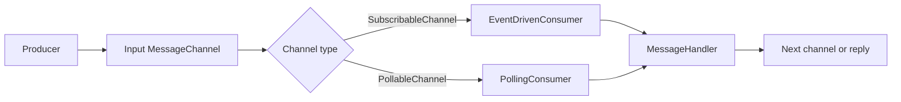
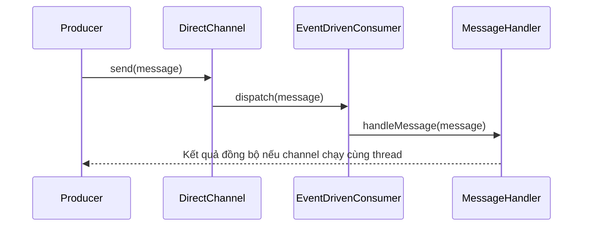
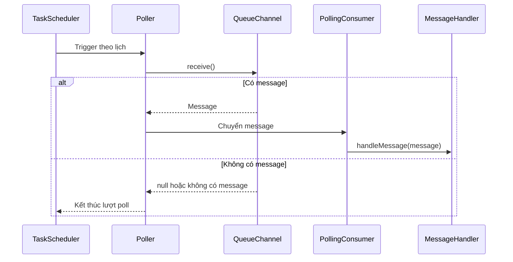
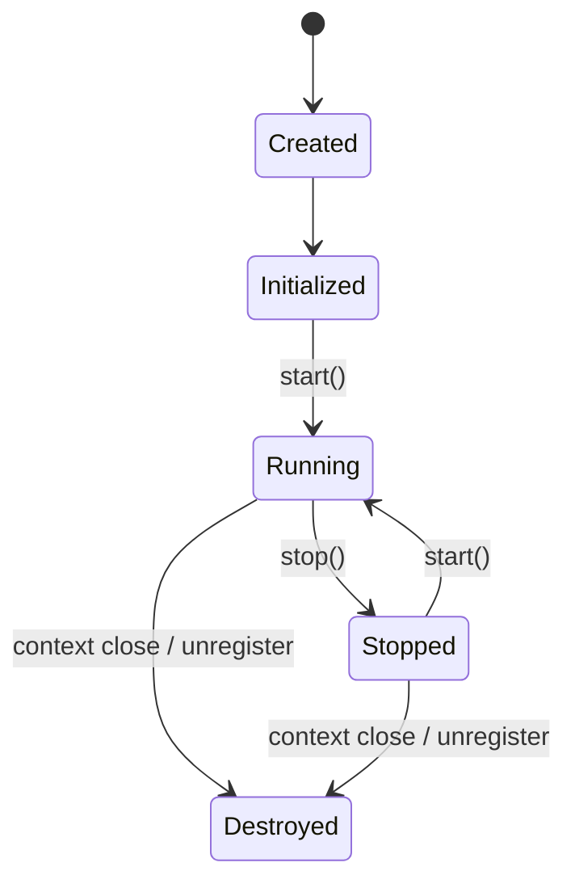

# EventDrivenConsumer và PollingConsumer

Trong Spring Integration, một endpoint kết nối channel với logic xử lý message. Với endpoint tiêu thụ message, framework thường chọn một trong hai cơ chế chính: **event-driven** hoặc **polling**. Hai cơ chế này tương ứng với hai loại channel khác nhau và quyết định consumer được kích hoạt như thế nào.

- `EventDrivenConsumer` đăng ký handler với một `SubscribableChannel`. Khi channel nhận message, nó dispatch message đến handler.
- `PollingConsumer` định kỳ gọi `receive()` trên một `PollableChannel`. Message được lấy ra khi poller kích hoạt consumer.

Hiểu đúng hai endpoint này giúp xác định thời điểm message được xử lý, thread thực thi, tác động của queue, lifecycle start/stop, transaction và cách xử lý lỗi.

## 1. Endpoint tiêu thụ message trong một IntegrationFlow

Một `IntegrationFlow` mô tả các bước xử lý. Khi flow được đăng ký vào ApplicationContext, Spring Integration tạo các channel và endpoint tương ứng. Endpoint tiêu thụ thường kết hợp một `MessageHandler` với input channel.



Endpoint không phải là channel. Channel vận chuyển hoặc lưu message; endpoint gắn channel với hành vi xử lý. Một handler có thể được dùng bởi endpoint, nhưng lifecycle của endpoint còn chịu ảnh hưởng từ ApplicationContext và loại channel.

Các abstraction quan trọng:

| Abstraction | Vai trò |
|---|---|
| `MessageChannel` | Hợp đồng gửi message vào channel |
| `SubscribableChannel` | Channel cho phép consumer subscribe để nhận message được dispatch |
| `PollableChannel` | Channel cho phép consumer lấy message bằng `receive()` |
| `MessageHandler` | Logic xử lý một message |
| `EventDrivenConsumer` | Endpoint kết nối handler với subscribable channel |
| `PollingConsumer` | Endpoint kết nối handler với pollable channel thông qua poller |
| `AbstractEndpoint` | Lớp nền quản lý lifecycle cho nhiều endpoint |

Việc chọn endpoint thường được quyết định bởi loại channel đầu vào và cấu hình endpoint trong flow. Không nên coi `EventDrivenConsumer` và `PollingConsumer` là hai cách gọi khác nhau của cùng một cơ chế.

## 2. EventDrivenConsumer: subscribe và xử lý khi message đến

`EventDrivenConsumer` là endpoint dùng cho một `SubscribableChannel`. Trong giai đoạn start, endpoint đăng ký `MessageHandler` với channel. Khi producer gửi message vào channel, channel dispatch message đến handler đã đăng ký. Khi endpoint stop, nó gỡ đăng ký handler.



Điểm nổi bật là consumer không cần tự kiểm tra channel theo chu kỳ. Channel thông báo cho subscriber khi có message. Vì thế event-driven thường có độ trễ thấp và phù hợp với nguồn phát sự kiện hoặc các bước nối tiếp trong flow.

### DirectChannel

`DirectChannel` là một `SubscribableChannel` phổ biến. Với cấu hình thông thường, handler được gọi đồng bộ trên thread thực hiện `send()`. Nếu handler xử lý lâu, producer cũng phải chờ. Nếu handler ném exception, lỗi có thể truyền ngược qua chuỗi gọi đồng bộ về phía producer.

```java
@Bean
DirectChannel ordersEvents() {
    return new DirectChannel();
}

@Bean
IntegrationFlow eventDrivenOrders(OrderService orderService) {
    return IntegrationFlow.from("ordersEvents")
            .handle(orderService, "process")
            .get();
}
```

Ở đây, channel `ordersEvents` là đầu vào dạng push. Endpoint xử lý message đăng ký với channel khi endpoint start. Không cần poller vì channel chủ động dispatch message đến subscriber.

### PublishSubscribeChannel

`PublishSubscribeChannel` dispatch một message đến nhiều subscriber. Đây là lựa chọn phù hợp khi một sự kiện cần kích hoạt nhiều nhánh, ví dụ ghi audit, cập nhật chỉ số và gửi thông báo.

Nếu không cấu hình executor, các subscriber thường được gọi đồng bộ trong quá trình dispatch. Nếu channel dùng executor, các nhánh có thể chạy bất đồng bộ; khi đó thời gian hoàn tất và thứ tự xử lý giữa các nhánh có thể khác nhau.

### ExecutorChannel

`ExecutorChannel` vẫn là channel dạng subscribable, vì vậy endpoint tiêu thụ vẫn hoạt động theo mô hình event-driven. Điểm khác biệt là channel dùng `TaskExecutor` để dispatch message sang worker thread.

Điều này có nghĩa:

- EventDrivenConsumer vẫn subscribe vào channel.
- Thread gửi message không nhất thiết là thread chạy handler.
- Transaction gắn với thread gửi không tự động truyền sang worker thread.
- Thứ tự hoàn tất có thể khác thứ tự gửi khi có nhiều worker.
- Queue của executor và chính sách từ chối task ảnh hưởng đến khả năng chịu tải.

Vì vậy, event-driven không đồng nghĩa với xử lý đồng bộ. Cơ chế dispatch của channel quyết định việc handler chạy ngay trên thread gửi hay qua executor.

## 3. PollingConsumer: lấy message theo lịch

`PollingConsumer` được dùng khi input là một `PollableChannel`. Thay vì subscribe, endpoint tạo tác vụ poll theo cấu hình poller. Khi được scheduler kích hoạt, tác vụ gọi `receive()` để lấy message. Nếu nhận được message, endpoint chuyển message cho handler; nếu không có message, lượt poll kết thúc theo chính sách nhận.



Polling thường phù hợp với queue, nguồn dữ liệu cần truy vấn hoặc tình huống ứng dụng muốn kiểm soát nhịp đọc. Với `QueueChannel`, producer có thể gửi message vào queue trước; consumer lấy message khi poller chạy.

Ví dụ:

```java
@Bean
QueueChannel ordersQueue() {
    return new QueueChannel(500);
}

@Bean
IntegrationFlow pollingOrders(OrderService orderService) {
    return IntegrationFlow.from("ordersQueue",
                    endpoint -> endpoint.poller(
                            Pollers.fixedDelay(Duration.ofMillis(500))
                                    .maxMessagesPerPoll(10)))
            .handle(orderService, "process")
            .get();
}
```

Trong ví dụ, endpoint được cấu hình poller để lấy tối đa 10 message mỗi lượt. `QueueChannel(500)` tạo queue có sức chứa hữu hạn; khi queue đầy, kết quả gửi message phụ thuộc timeout và chính sách send của channel. Giới hạn queue giúp hệ thống biểu hiện quá tải sớm hơn và tránh tích lũy vô hạn trong heap.

### Source polling khác PollingConsumer

Một nhầm lẫn thường gặp là gọi mọi tác vụ polling là `PollingConsumer`. Spring Integration còn có `SourcePollingChannelAdapter`, một inbound adapter hỏi `MessageSource` theo lịch rồi gửi message vào flow.

Hai trường hợp khác nhau ở nơi lấy message:

| Trường hợp | Đối tượng được poll | Component tiêu biểu |
|---|---|---|
| PollingConsumer | `PollableChannel` đã có message | `PollingConsumer` |
| Source polling | `MessageSource` hoặc nguồn dữ liệu | `SourcePollingChannelAdapter` |

Ví dụ source polling:

```java
@Bean
IntegrationFlow pollExternalOrders(
        MessageSource<Order> orderSource,
        OrderService orderService) {

    return IntegrationFlow.from(orderSource,
                    endpoint -> endpoint.poller(
                            Pollers.fixedDelay(Duration.ofSeconds(2))
                                    .maxMessagesPerPoll(20)))
            .handle(orderService, "process")
            .get();
}
```

Đoạn này dùng `MessageSource` làm nguồn. Framework tạo source polling adapter để hỏi nguồn theo lịch; đây không phải consumer đang gọi `receive()` trên một `QueueChannel`.

## 4. Poller điều khiển thời điểm và khối lượng xử lý

Poller kết hợp trigger, giới hạn số message và các tùy chọn thực thi. Những cấu hình thường gặp:

| Thuộc tính | Ý nghĩa |
|---|---|
| `fixedDelay` | Lên lịch lượt tiếp theo sau khi lượt trước hoàn tất và hết khoảng delay |
| `fixedRate` | Lên lịch theo nhịp thời gian cố định |
| `cron` | Kích hoạt theo biểu thức lịch |
| `maxMessagesPerPoll` | Giới hạn số message xử lý trong một lượt poll |
| `receiveTimeout` | Thời gian chờ khi lấy message từ pollable channel |
| `taskExecutor` | Executor được cấu hình để thực thi tác vụ poll |
| Advice chain | Bọc tác vụ poll bằng transaction, retry hoặc logic bổ sung |

### fixedDelay và fixedRate

`fixedDelay` phù hợp khi muốn có khoảng nghỉ sau khi lượt poll trước hoàn tất. Nếu xử lý mất nhiều thời gian, nhịp thực tế sẽ giãn theo thời gian xử lý cộng khoảng delay.

`fixedRate` phù hợp khi muốn kích hoạt theo mốc thời gian định kỳ. Khi tác vụ kéo dài, cần hiểu scheduler và executor đang cấu hình ra sao để tránh tạo công việc chờ hoặc chồng lấn ngoài dự kiến.

`cron` phù hợp với lịch nghiệp vụ như chạy vào đầu giờ hoặc vào các ngày cụ thể.

Không nên chọn chu kỳ quá ngắn chỉ để giảm latency. Polling quá thường xuyên làm tăng số lần kiểm tra rỗng, tải lên nguồn bên ngoài và chi phí lập lịch.

### maxMessagesPerPoll

`maxMessagesPerPoll` giới hạn số message mà một lượt poll xử lý. Lô lớn có thể tăng throughput bằng cách giảm overhead lập lịch, nhưng cũng có thể:

- Kéo dài thời gian một lượt poll.
- Giữ transaction và tài nguyên lâu hơn.
- Làm các consumer khác phải chờ nếu dùng chung tài nguyên.
- Tăng số message phải xem xét khi một lượt xử lý thất bại.

Lô nhỏ giới hạn thời gian mỗi lượt nhưng tăng số lần scheduler kích hoạt. Hãy chọn giá trị dựa trên thời gian xử lý, năng lực downstream, kích thước message và mục tiêu latency.

### receiveTimeout

Với pollable channel, `receiveTimeout` quyết định consumer chờ bao lâu khi lấy message. Nếu queue rỗng, một lần receive có thể chờ đến timeout rồi kết thúc. Timeout quá dài có thể giữ worker thread lâu; timeout quá ngắn có thể làm tăng số lần poll rỗng. Cần cân nhắc cùng chu kỳ trigger và loại channel.

## 5. Lifecycle chung của endpoint

Nhiều endpoint Spring Integration kế thừa `AbstractEndpoint`, triển khai `SmartLifecycle` và được Spring quản lý vòng đời. `EventDrivenConsumer` và `PollingConsumer` đều tham gia cơ chế này, dù cách start/stop bên trong khác nhau.



Các trạng thái trên mô tả khái niệm. Trạng thái bean và trạng thái endpoint không phải lúc nào cũng giống nhau: bean có thể đã tồn tại và được khởi tạo nhưng endpoint chưa start.

Các thuộc tính lifecycle thường cần quan tâm:

- `autoStartup`: endpoint có được tự động start trong quá trình khởi động context hay không.
- `phase`: thứ tự start/stop giữa các thành phần `SmartLifecycle`.
- `isRunning()`: cho biết endpoint đang ở trạng thái running theo lifecycle.
- `start()` và `stop()`: điều khiển endpoint khi ứng dụng cần tạm dừng hoặc khởi động lại.
- `stop(Runnable)`: hỗ trợ báo cho lifecycle processor biết thao tác stop đã hoàn tất.

Với các thành phần `SmartLifecycle`, phase thấp hơn thường được start trước và stop sau; phase cao hơn được start sau và stop trước. Có thể dùng phase để sắp xếp ingress và consumer theo thứ tự phù hợp, nhưng phải hiểu dependency giữa các thành phần trước khi cấu hình.

### EventDrivenConsumer khi start và stop

Khi start, `EventDrivenConsumer` subscribe handler vào input channel. Khi stop, nó unsubscribe. Sau khi unsubscribe, channel không còn dispatch message mới đến handler thông qua subscription đó.

Nếu channel đang dispatch message hoặc handler đang chạy, stop không phải là cam kết rằng công việc đang thực thi sẽ bị hủy ngay. Cần phối hợp với ingress, channel và chính sách xử lý in-flight message nếu yêu cầu shutdown có kiểm soát.

### PollingConsumer khi start và stop

Khi start, `PollingConsumer` kích hoạt tác vụ poll theo trigger đã cấu hình. Khi stop, nó dừng lịch poll để không tiếp tục lấy message mới. Một lượt poll đang thực thi hoặc handler đang xử lý có thể cần thời gian để hoàn tất; không nên xem stop là thao tác drain queue.

Khi endpoint được start lại, poller tiếp tục hoạt động theo cấu hình. Với queue trong bộ nhớ, message còn lại có thể vẫn nằm trong channel nếu channel chưa bị hủy. Nếu unregister flow và channel bị hủy, message chưa được xử lý có thể mất.

## 6. Threading: channel và poller quyết định thread nào chạy handler

Endpoint xác định cách tiêu thụ message, nhưng thread thực thi còn phụ thuộc channel, poller, scheduler và executor.

| Cấu hình | Thread xử lý handler thường gặp |
|---|---|
| EventDrivenConsumer + DirectChannel | Thread gửi message |
| EventDrivenConsumer + PublishSubscribeChannel không executor | Thread dispatch message |
| EventDrivenConsumer + ExecutorChannel | Worker thread của executor |
| PollingConsumer không cấu hình executor riêng | Thread thực thi tác vụ poll do scheduler quản lý |
| PollingConsumer có task executor | Worker thread được executor giao tác vụ poll |

Đây là mô hình khái quát; adapter và handler có thể tạo thêm ranh giới thread. Khi debug, hãy ghi nhận thread name trong log cùng component name và message ID.

### Không nhầm event-driven với asynchronous

Event-driven nói về cách consumer được kích hoạt: channel dispatch message khi message đến. Asynchronous nói về việc lời gọi xử lý có tách khỏi thread gọi hay không.

Một `DirectChannel` thường event-driven và đồng bộ. Một `ExecutorChannel` vẫn event-driven nhưng dispatch bất đồng bộ qua executor. Do đó, muốn hiểu threading phải kiểm tra channel thực tế, không chỉ nhìn tên endpoint.

### Poller và executor là hai vai trò khác nhau

Scheduler quyết định khi nào poller được kích hoạt. Executor, nếu được cấu hình, quyết định tác vụ poll được thực thi trên worker thread nào. Việc dùng executor không loại bỏ nhu cầu cấu hình trigger và không tự tạo backpressure.

Nếu scheduler hoặc executor dùng chung cho nhiều endpoint, một poller chạy lâu hoặc handler blocking có thể ảnh hưởng các tác vụ khác. Hãy dùng pool có giới hạn, theo dõi queue và tránh để tác vụ I/O blocking chiếm hết worker.

## 7. Transaction, retry và error handling

Cơ chế endpoint ảnh hưởng đến ranh giới lỗi và transaction.

### Transaction

Với EventDrivenConsumer trên `DirectChannel`, handler chạy đồng bộ trên thread gửi. Nếu producer đang ở trong transaction và transaction manager phù hợp, các bước đồng bộ có thể tham gia transaction đó.

Với `ExecutorChannel`, handler chạy trên worker thread nên transaction của thread gửi không tự truyền sang. Nếu handler cần transaction, hãy cấu hình transaction tại phía xử lý hoặc trong service được gọi.

Với PollingConsumer, transaction advice thường được gắn vào poller để mở transaction quanh tác vụ poll theo phạm vi cấu hình. Cần xác định transaction bao gồm thao tác receive, handler và xác nhận nguồn dữ liệu đến đâu. Nếu một lượt poll xử lý nhiều message, hãy kiểm tra transaction boundary thực tế thay vì mặc định mỗi message có một transaction riêng.

Transaction của database không tự làm cho `QueueChannel` trong bộ nhớ trở thành queue bền vững. Nếu handler thất bại sau khi message đã được lấy ra khỏi queue, việc message có được đưa lại hay không phụ thuộc channel, transaction support và chính sách ứng dụng.

### Retry

Retry có thể được cấu hình bằng advice chain ở poller hoặc endpoint phù hợp. Nên giới hạn số lần thử, xác định loại exception có thể retry và đặt khoảng nghỉ phù hợp. Timeout tạm thời thường có thể retry; dữ liệu không hợp lệ thường cần đưa sang error flow hoặc dead-letter.

Nếu handler có side effect, retry có thể chạy lại thao tác đã thành công một phần. Dùng idempotency key, unique constraint hoặc cơ chế deduplication để tránh ghi nhận nghiệp vụ trùng.

### Error channel

Với xử lý đồng bộ qua DirectChannel, exception có thể truyền ngược đến producer. Với xử lý bất đồng bộ qua executor hoặc tác vụ poll, lỗi không nhất thiết quay lại caller ban đầu. Spring Integration có thể chuyển lỗi thành error message đến error channel theo cấu hình và cơ chế xử lý của endpoint.

Error message thường mang cause và có thể giữ failed message để điều tra. Khi xử lý lỗi, cần log component name, message ID, correlation ID và exception gốc. Tránh ghi payload nhạy cảm nguyên vẹn vào log.

## 8. Backlog và áp lực ngược

Event-driven và polling biểu hiện backlog theo cách khác nhau:

- Với `DirectChannel`, producer bị chậm trực tiếp khi handler chậm.
- Với `ExecutorChannel`, backlog có thể hình thành trong queue của executor.
- Với `QueueChannel`, backlog hình thành trong queue channel khi producer gửi nhanh hơn consumer poll và xử lý.
- Với source polling, dữ liệu có thể tích lũy ở nguồn bên ngoài giữa các lần poll.

Không có queue không có nghĩa là không thể quá tải; nó có thể khiến producer bị block hoặc send thất bại. Có queue không có nghĩa là hệ thống đã có backpressure; queue không giới hạn chỉ trì hoãn thời điểm quá tải xuất hiện.

Các chỉ số nên theo dõi:

| Chỉ số | Ý nghĩa |
|---|---|
| Queue depth | Số message đang chờ |
| Poll duration | Thời gian hoàn thành một lượt poll |
| Messages per poll | Số message được xử lý trong một lượt |
| Receive timeout count | Số lần poll không lấy được message trước timeout |
| Handler duration | Thời gian xử lý một message |
| Executor active threads | Mức sử dụng worker |
| Executor queue size | Lượng tác vụ đang chờ |
| Rejected task count | Tác vụ bị từ chối do executor quá tải |
| Error count và retry count | Tần suất lỗi và mức độ phục hồi |

Nếu backlog tăng liên tục, cần tăng năng lực consumer, giảm tốc producer, giới hạn concurrency hoặc điều chỉnh poll interval và batch size. Tăng thread một cách tùy tiện có thể làm downstream quá tải hoặc tăng contention.

## 9. Chọn EventDrivenConsumer hay PollingConsumer?

| Yêu cầu | Cơ chế phù hợp | Lý do |
|---|---|---|
| Producer có thể push message ngay khi phát sinh | EventDrivenConsumer | Consumer được gọi khi channel dispatch |
| Xử lý chuỗi bước đồng bộ đơn giản | EventDrivenConsumer + DirectChannel | Luồng gọi dễ theo dõi |
| Cần dispatch bất đồng bộ bằng worker pool | EventDrivenConsumer + ExecutorChannel | Tách thread producer và consumer |
| Message cần được buffer trong channel | PollingConsumer + QueueChannel | Consumer lấy message theo lịch |
| Muốn giới hạn số message mỗi lượt | PollingConsumer | Điều khiển batch qua poller |
| Nguồn chỉ hỗ trợ truy vấn theo lịch | SourcePollingChannelAdapter | Poll trực tiếp MessageSource |
| Cần điều khiển nhịp đọc để bảo vệ downstream | PollingConsumer hoặc source polling | Có thể điều chỉnh trigger và batch size |

Không có lựa chọn luôn tốt hơn. Hãy chọn dựa trên khả năng của nguồn, yêu cầu latency, thứ tự xử lý, semantics giao nhận, năng lực downstream và cách ứng dụng muốn quản lý backlog.

## 10. Chẩn đoán endpoint không hoạt động

Khi message không được xử lý, hãy đi theo đường đi từ channel đến endpoint:

| Triệu chứng | Kiểm tra |
|---|---|
| DirectChannel gửi nhưng không có handler | Endpoint đã start và subscribe đúng channel chưa? |
| QueueChannel có message nhưng không giảm | Poller có chạy không? Endpoint có được cấu hình poller không? |
| Message đến chậm theo chu kỳ | Trigger, fixedDelay/fixedRate và receiveTimeout |
| Handler chạy trên thread không mong muốn | Channel có executor? Poller có taskExecutor? |
| Endpoint tồn tại nhưng không nhận message | `autoStartup`, `isRunning()`, phase và lifecycle context |
| Stop rồi vẫn thấy handler đang chạy | Có in-flight dispatch hoặc poll đang thực thi không? |
| Message bị xử lý trùng | Retry, ack/commit, nhiều consumer và idempotency |
| Lỗi không quay lại producer | Kiểm tra error channel và ranh giới asynchronous |
| Queue tăng không giảm | Throughput consumer, handler latency, batch size và downstream |
| Endpoint không còn sau unregister | Kiểm tra flow registration và component ownership |

Một quy trình điều tra thực tế:

1. Xác định channel đầu vào là subscribable hay pollable.
2. Xác định endpoint tương ứng là EventDrivenConsumer hay PollingConsumer.
3. Kiểm tra endpoint đã được tạo, khởi tạo và start chưa.
4. Với event-driven, kiểm tra subscriber và dispatch behavior của channel.
5. Với polling, kiểm tra trigger, scheduler, executor, receive timeout và queue depth.
6. Gắn component name, message ID và correlation ID vào log.
7. Kiểm tra transaction, retry và error channel nếu message đã đến handler nhưng thất bại.
8. Theo dõi thread dump và metrics khi nghi ngờ thread starvation hoặc backlog.

## 11. Checklist thiết kế endpoint

Trước khi đưa một endpoint vào vận hành, hãy trả lời:

- Channel đầu vào là `SubscribableChannel` hay `PollableChannel`?
- Consumer được kích hoạt bằng push hay poll?
- Handler chạy trên thread nào?
- Có cần executor hoặc scheduler riêng không?
- Queue có giới hạn và chính sách khi đầy không?
- Poller dùng trigger nào và xử lý tối đa bao nhiêu message mỗi lượt?
- Transaction boundary bao gồm những thao tác nào?
- Retry áp dụng cho lỗi nào và có giới hạn không?
- Error message được chuyển đến đâu?
- Stop endpoint có ảnh hưởng message đang xử lý không?
- Khi unregister flow, message còn lại và resource riêng được xử lý thế nào?
- Metrics nào giúp phát hiện endpoint dừng, queue tăng hoặc handler chậm?

Khi phân biệt rõ EventDrivenConsumer và PollingConsumer, ta có thể đọc cấu hình Spring Integration từ loại channel, xác định cơ chế kích hoạt endpoint, dự đoán thread thực thi và thiết kế lifecycle phù hợp. Đây là cơ sở để vận hành consumer ổn định, xử lý lỗi có kiểm soát và chẩn đoán hiệu năng của message flow.

