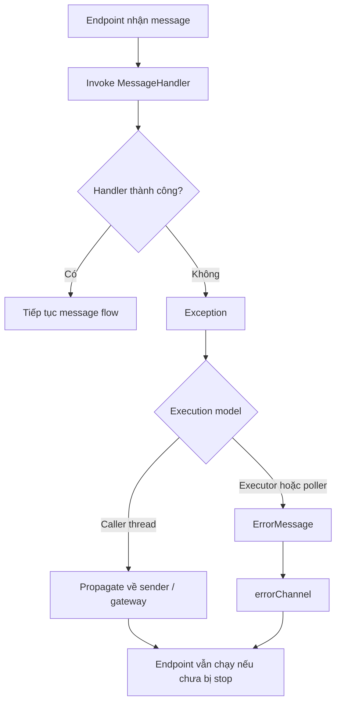
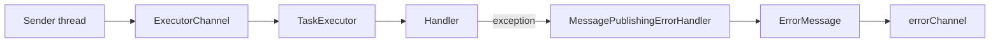
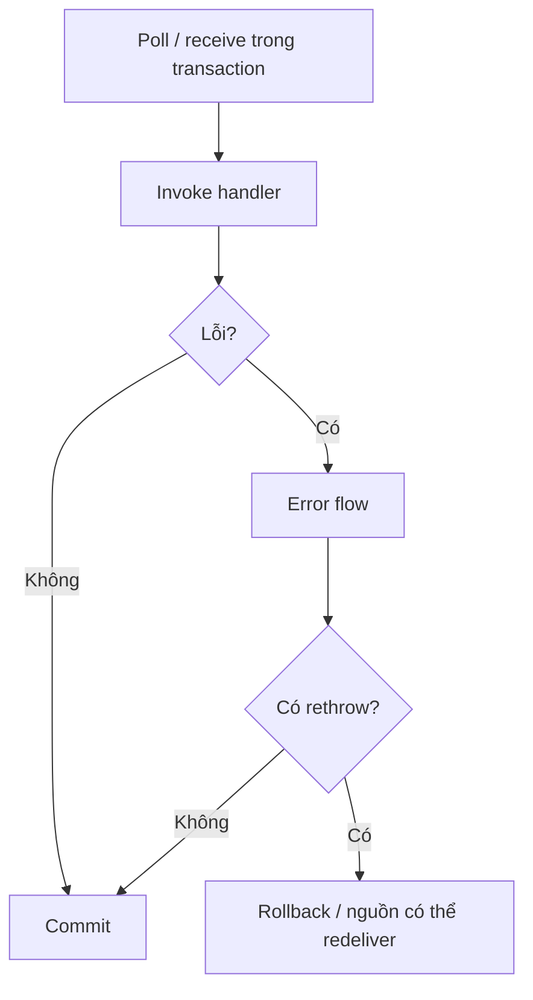

# Endpoint bị dừng khi handler lỗi

Trong Spring Integration, một handler có thể ném exception khi xử lý message vì dữ liệu không hợp lệ, dịch vụ bên ngoài tạm thời không truy cập được hoặc một thao tác nghiệp vụ thất bại. Khi đó cần phân biệt **một lần xử lý message thất bại** với **endpoint bị dừng**. Hai sự kiện này có quan hệ với nhau qua error handling và lifecycle, nhưng không phải là một.

Thông thường, exception của handler được truyền về caller hoặc được chuyển thành `ErrorMessage`, tùy cách flow chạy đồng bộ hay bất đồng bộ. Endpoint không tự động chuyển sang trạng thái stopped chỉ vì một lần gọi handler thất bại. Endpoint chỉ dừng khi lifecycle được điều khiển, context đóng, hoặc một thành phần nguồn/consumer cụ thể dừng theo chính sách riêng của nó.

## 1. Exception của handler không đồng nghĩa endpoint stop

Endpoint là thành phần kết nối channel với một `MessageHandler` hoặc `MessageSource`, đồng thời điều phối cách consumer nhận message. Một endpoint event-driven thường đăng ký subscriber lên channel; polling endpoint được scheduler kích hoạt theo trigger; inbound adapter có thể dùng listener container của broker hoặc thư viện bên ngoài.

Khi handler ném exception, runtime phải xử lý kết quả của lần invocation đó:

1. Xác định message gây lỗi và exception/cause.
2. Truyền lỗi về caller hoặc chuyển lỗi tới error channel phù hợp với execution model.
3. Áp dụng retry, recovery, transaction rollback hoặc redelivery nếu flow được cấu hình.
4. Tiếp tục nhận message tiếp theo nếu endpoint và nguồn message vẫn hoạt động.



Vì vậy, khi log ghi `MessageHandlingException`, `MessagingException` hoặc một exception từ service method, chưa thể kết luận endpoint đã dừng. Cần kiểm tra trạng thái `isRunning()`, log lifecycle start/stop và nguồn kích hoạt consumer.

## 2. Execution model quyết định lỗi đi đâu

Spring Integration tạo endpoint event-driven hay polling tùy loại channel mà endpoint kết nối:

- `SubscribableChannel` như `DirectChannel` thường tạo `EventDrivenConsumer`.
- `PollableChannel` như `QueueChannel` thường tạo `PollingConsumer` cần poller.
- Inbound channel adapter có thể tạo `SourcePollingChannelAdapter` để lấy message từ `MessageSource` theo lịch.
- Message-driven adapter dùng listener container hoặc consumer của công nghệ nguồn, ví dụ JMS, AMQP hoặc Kafka.

### DirectChannel: lỗi đi ngược về sender

Với `DirectChannel`, handler được gọi trong cùng thread thực hiện `send()`. Nếu handler ném exception và không có thành phần bắt lỗi ở giữa, exception có thể truyền ngược về caller như một lời gọi Java đồng bộ.

```java
@Bean
MessageChannel ordersInput() {
    return new DirectChannel();
}

@Component
class OrderHandlerEndpoint {

    private final OrderService orderService;

    OrderHandlerEndpoint(OrderService orderService) {
        this.orderService = orderService;
    }

    @ServiceActivator(inputChannel = "ordersInput")
    public void handle(Order order) {
        orderService.process(order); // Có thể ném exception
    }
}
```

Producer gửi message có thể nhận exception ngay trong lời gọi `send()`:

```java
try {
    ordersInput.send(new GenericMessage<>(order));
}
catch (MessagingException ex) {
    // Xử lý hoặc trả lỗi cho tầng gọi
}
```

Việc gửi thất bại không tự hủy subscriber của `DirectChannel`. Message tiếp theo vẫn có thể được gửi tới endpoint, trừ khi ứng dụng chủ động stop endpoint hoặc một thành phần khác thay đổi subscription.

Nếu flow được gọi qua messaging gateway, gateway mặc định truyền lỗi downstream về caller. Có thể cấu hình `errorChannel` cho gateway để chuyển lỗi sang một error flow thay vì ném trực tiếp ra caller. Khi gửi trực tiếp bằng `MessageChannel` hoặc `MessagingTemplate`, exception vẫn được truyền về caller.

### ExecutorChannel và xử lý bất đồng bộ

Với `ExecutorChannel`, message được giao cho executor để handler chạy trên worker thread. Thread gửi thường đã tiếp tục công việc nên không thể nhận exception trực tiếp theo call stack thông thường.

Spring Integration hỗ trợ chuyển exception thành `ErrorMessage`. Error handler chọn channel đích theo thứ tự:

1. Header `errorChannel` của message đang xử lý, nếu có.
2. Global channel có tên bean `errorChannel`, nếu message không có header riêng.



Điều này giúp tách lỗi của worker khỏi thread gửi. Tuy nhiên, nếu error flow cũng thất bại hoặc không thể dispatch `ErrorMessage`, lỗi có thể tiếp tục được ghi nhận ở error handler/executor; cần giám sát cả đường xử lý lỗi.

### Polling endpoint: scheduler và worker executor

Polling endpoint có ít nhất hai vai trò thread cần phân biệt:

- `TaskScheduler` kích hoạt poll theo trigger.
- `TaskExecutor` tùy chọn thực thi công việc xử lý message.

Nếu poller không cấu hình executor riêng, thao tác poll và phần xử lý thường chạy trên thread được scheduler kích hoạt. Nếu cấu hình executor, handler được thực thi trong pool đó. Khi một scheduled poller task ném exception, Spring Integration có thể đóng gói lỗi thành `ErrorMessage` và gửi tới `errorChannel` thông qua `MessagePublishingErrorHandler` được gắn vào global `taskScheduler`.

Với `TaskScheduler` tùy chỉnh, hãy cấu hình `MessagePublishingErrorHandler` nếu muốn dùng cùng cơ chế error-channel. Nếu scheduler sử dụng error handler chỉ log và suppress, poll tiếp theo có thể vẫn chạy nhưng lỗi chỉ được ghi log. Nếu error handler propagate exception ra ngoài scheduled task, scheduler có thể hủy các lần chạy định kỳ tiếp theo theo semantics của scheduled executor. Vì vậy, một poller có vẻ “tự dừng sau khi handler lỗi” thường cần kiểm tra error handler của scheduler trước khi kết luận endpoint đã tự stop.

## 3. Global errorChannel và ErrorMessage

Spring Integration tạo một global `errorChannel` mặc định nếu ứng dụng chưa khai báo channel riêng. Channel mặc định là `PublishSubscribeChannel` và có `LoggingHandler` subscriber ở mức `ERROR` để ghi lỗi. Ứng dụng có thể đăng ký thêm endpoint để lưu lỗi, phân loại exception, gửi cảnh báo hoặc chuyển message sang dead-letter flow.

`ErrorMessage` mang exception làm payload. Nó cũng có thể chứa message gốc gây lỗi để error flow truy vết được payload, header và nguồn phát sinh. Trong nhiều trường hợp exception được framework bọc thành `MessagingException` với `failedMessage`.

```java
@Bean
IntegrationFlow errorFlow(ErrorAuditService auditService) {
    return IntegrationFlow.from("errorChannel")
        .handle((MessageHandler) message -> {
            ErrorMessage errorMessage = (ErrorMessage) message;
            Throwable failure = errorMessage.getPayload();
            auditService.record(failure, errorMessage.getOriginalMessage());
        })
        .get();
}
```

Ví dụ trên chỉ minh họa việc ghi nhận lỗi. Trong production, error flow nên phân loại exception và có chính sách rõ ràng cho lỗi có thể retry, lỗi dữ liệu vĩnh viễn và lỗi hạ tầng. Không nên để chính error handler ném exception liên tục mà không có đường dự phòng.

Từ Spring Integration 5.4.3, default `errorChannel` có `requireSubscribers = true`. Khi không có subscriber để nhận lỗi, việc gửi `ErrorMessage` có thể ném `MessageDispatchingException` thay vì âm thầm bỏ qua. Điều này hữu ích khi ứng dụng cần biết error flow không còn hoạt động, ví dụ lúc context đang dừng.

### Error channel riêng theo message

Một message có thể mang header `errorChannel` để định tuyến lỗi tới flow riêng của request hoặc tenant:

```java
Message<Order> message = MessageBuilder.withPayload(order)
    .setHeader(MessageHeaders.ERROR_CHANNEL, tenantErrorChannel)
    .build();
```

Nếu không có header này, error handler dùng global `errorChannel`. Hãy bảo đảm channel riêng còn tồn tại và có subscriber trong suốt thời gian message có thể lỗi. Header này chỉ ảnh hưởng các cơ chế error publishing bất đồng bộ; nó không biến exception của `DirectChannel` thành lỗi được tự động gửi vào error channel.

## 4. Cấu hình TaskScheduler cho poller

Spring Integration sử dụng `ThreadPoolTaskScheduler` mặc định cho các scheduled task. Nếu ứng dụng tự cung cấp bean `taskScheduler`, cần chú ý error handler được gắn vào scheduler.

```java
@Configuration
class PollerSchedulerConfiguration {

    @Bean
    ThreadPoolTaskScheduler taskScheduler(
            @Qualifier("integrationMessagePublishingErrorHandler")
            ErrorHandler errorHandler) {
        ThreadPoolTaskScheduler scheduler = new ThreadPoolTaskScheduler();
        scheduler.setPoolSize(5);
        scheduler.setThreadNamePrefix("integration-poller-");
        scheduler.setErrorHandler(errorHandler);
        return scheduler;
    }
}
```

`integrationMessagePublishingErrorHandler` là bean error handler do Spring Integration cung cấp khi cấu hình phù hợp. Nếu ứng dụng tự tạo scheduler mà không dùng bean này, hãy chủ động cung cấp một `MessagePublishingErrorHandler` tương đương hoặc một `ErrorHandler` có semantics đã được kiểm tra. Không cấu hình handler propagate exception nếu mong muốn poller tiếp tục chạy sau lỗi thông thường.

Một poller có thể chỉ xử lý một message mỗi lần hoặc nhiều message qua `maxMessagesPerPoll`. Khi `maxMessagesPerPoll` lớn hơn một, exception ở một message có thể làm lần poll hiện tại kết thúc sớm; điều đó vẫn khác với việc lịch poll định kỳ bị hủy. Hãy kiểm tra log theo thread scheduler, thời điểm poll và số message đã xử lý trong lần poll.

## 5. Retry handler thay vì dừng endpoint

Với lỗi tạm thời như timeout, HTTP 503 hoặc database connection reset, có thể retry ngay tại endpoint bằng `RequestHandlerRetryAdvice`. Advice bao quanh lời gọi handler, nên chỉ thao tác tại endpoint được gắn advice mới được retry.

```java
@Configuration
class OrderRetryConfiguration {

    @Bean
    RequestHandlerRetryAdvice orderRetryAdvice(MessageChannel recoveryChannel) {
        RequestHandlerRetryAdvice advice = new RequestHandlerRetryAdvice();
        advice.setRecoveryCallback(
            new ErrorMessageSendingRecoverer(recoveryChannel));
        return advice;
    }
}

@Component
class OrderHandlerEndpoint {

    private final OrderService orderService;

    OrderHandlerEndpoint(OrderService orderService) {
        this.orderService = orderService;
    }

    @ServiceActivator(inputChannel = "ordersInput", adviceChain = "orderRetryAdvice")
    public void handle(Order order) {
        orderService.process(order);
    }
}
```

`RequestHandlerRetryAdvice` dùng cơ chế retry dựa trên `RetryTemplate`, cho phép định nghĩa retry policy, backoff và `RecoveryCallback`. Khi retry hết lượt, recovery callback có thể gửi `ErrorMessage` tới recovery channel để ghi nhận hoặc chuyển sang dead-letter flow.

Một số điểm cần quyết định khi thiết kế retry:

- Chỉ retry lỗi có khả năng tự phục hồi. Lỗi validation hoặc vi phạm nghiệp vụ thường không nên retry.
- Chọn số lần thử và backoff có giới hạn. Retry liên tục không delay có thể làm tăng tải khi dịch vụ đích đang sự cố.
- Đảm bảo handler có tính idempotent nếu một thao tác có thể đã thành công ở hệ thống đích nhưng client nhận timeout.
- Đặt retry ở endpoint cụ thể để tránh chạy lại các bước upstream không liên quan.
- Khi nguồn message có khả năng redelivery, cân nhắc stateful retry và để broker/adapter gửi lại message sau rollback hoặc nack.

Retry làm tăng số lần gọi handler trước khi kết luận thất bại. Nó không phải lifecycle start/stop của endpoint.

## 6. Transaction, rollback và redelivery

Với polling endpoint, transaction advice có thể bao quanh thao tác poll và xử lý message. Nếu exception thoát khỏi ranh giới transaction, transaction manager có thể rollback thao tác nhận message hoặc cập nhật dữ liệu transactional. Nếu exception được error flow xử lý và không ném lại, flow có thể được xem là hoàn tất bình thường và transaction được commit.

Với nguồn message dựa trên broker, hành vi cuối cùng còn phụ thuộc acknowledgement mode, listener container và cấu hình transaction. Ví dụ với JMS, nếu error channel được cấu hình và error flow xử lý lỗi mà không ném lại, transaction có thể commit và message được acknowledge. Nếu cần broker redeliver, error flow phải ném exception trở lại hoặc để lỗi propagate về listener container theo chính sách giao nhận đã cấu hình.

Không nên cho rằng việc gửi `ErrorMessage` tới error channel tự động rollback. Cần xác định nơi transaction bắt đầu, exception có vượt qua transaction boundary hay không, và adapter xác nhận message ở thời điểm nào.



Transaction của poller không tự lan qua ranh giới thread. Khi flow chuyển qua `ExecutorChannel`, `QueueChannel` hoặc tạo thread mới, transaction gắn với thread ban đầu không tự đi theo worker thread. Nếu cần transaction ở bước xử lý sau, hãy đặt transaction boundary tại endpoint chạy bước đó.

## 7. Khi nào endpoint thực sự bị dừng?

Một endpoint có thể bị dừng bởi nhiều cơ chế:

| Nguyên nhân | Dấu hiệu | Hướng kiểm tra |
| --- | --- | --- |
| Ứng dụng gọi `stop()` | Lifecycle log cho thấy endpoint chuyển sang stopped. | Tìm nơi gọi `stop()`, `SmartLifecycle`, Control Bus hoặc JMX. |
| Context đóng hoặc refresh | Nhiều endpoint cùng dừng theo lifecycle phase. | Kiểm tra shutdown hook, context close và sự kiện refresh. |
| `autoStartup=false` | Endpoint không tự start khi context khởi động. | Kiểm tra cấu hình endpoint/flow và thao tác start tường minh. |
| Poller schedule bị hủy | Log poll xuất hiện rồi ngừng; endpoint có thể vẫn báo running. | Kiểm tra `TaskScheduler`, `ErrorHandler`, exception từ scheduled task và thread scheduler. |
| Listener container hoặc kết nối nguồn bị lỗi | Consumer JMS/AMQP/Kafka có log disconnect, rebalance hoặc container stop. | Kiểm tra log và trạng thái của container/adapter cụ thể, broker và reconnect policy. |
| Error flow làm lỗi lan ngược | Có exception khi gửi `ErrorMessage` hoặc subscriber của error channel. | Kiểm tra subscriber, `requireSubscribers`, capacity và lỗi trong chính error flow. |

Với adapter đặc thù, stop endpoint có thể kéo theo stop listener container hoặc đóng connection. Ví dụ `JmsMessageDrivenEndpoint` từ Spring Integration 5.1 mặc định shutdown listener container khi endpoint stop; thuộc tính `shutdownContainerOnStop` có thể thay đổi hành vi đó. Đây là semantics riêng của adapter JMS, không thể suy rộng thành quy tắc cho mọi endpoint.

Khi cần điều khiển lifecycle có chủ đích, dùng `Lifecycle`/`SmartLifecycle`, `autoStartup`, phase hoặc cơ chế quản trị phù hợp. Đừng gọi `stop()` trong catch block của handler chỉ để tránh một message lỗi, trừ khi yêu cầu nghiệp vụ thực sự là ngừng nhận toàn bộ message.

## 8. Error flow cần làm gì?

Một error flow tốt phải biến lỗi runtime thành quyết định vận hành có thể quan sát và xử lý. Thông thường, error flow thực hiện:

1. Ghi lại exception, failed message, flow/endpoint ID, correlation ID và thời điểm.
2. Phân loại lỗi tạm thời, lỗi dữ liệu, lỗi cấu hình và lỗi không xác định.
3. Chọn retry, dead-letter, cảnh báo hoặc yêu cầu can thiệp thủ công.
4. Bảo toàn payload/header cần thiết để replay, đồng thời loại bỏ dữ liệu nhạy cảm khỏi log.
5. Tránh để lỗi trong error flow che mất exception ban đầu.

Không nên chỉ log rồi bỏ message nếu nguồn cần được nack hoặc rollback để redelivery. Ngược lại, không nên rethrow mọi lỗi nếu dữ liệu sai vĩnh viễn vì sẽ tạo vòng redelivery vô hạn. Hãy đặt giới hạn retry, dead-letter policy và quy trình replay rõ ràng.

## 9. Chẩn đoán endpoint có vẻ dừng sau handler error

Khi endpoint không còn xử lý message sau một exception, kiểm tra theo thứ tự:

1. **Xác nhận endpoint state:** lấy bean endpoint theo ID nếu có thể và kiểm tra `isRunning()`. Phân biệt endpoint stopped với endpoint running nhưng không có message đến.
2. **Xác định loại consumer:** `EventDrivenConsumer`, `PollingConsumer`, `SourcePollingChannelAdapter` hay message-driven adapter.
3. **Xác định thread lỗi:** sender thread, executor worker, scheduler thread hay broker listener thread.
4. **Tìm exception gốc:** đọc cause chain và `failedMessage`; exception bọc ngoài thường chỉ là `MessageHandlingException`.
5. **Kiểm tra error routing:** header `errorChannel`, global `errorChannel`, subscriber của error flow và log của `MessagePublishingErrorHandler`.
6. **Với poller:** kiểm tra `taskScheduler`, `taskExecutor`, trigger, `maxMessagesPerPoll` và error handler có propagate exception không.
7. **Với broker:** kiểm tra ack/nack, transaction, redelivery, listener container và reconnect policy.
8. **Tìm lệnh stop:** kiểm tra lifecycle management, Control Bus, JMX, shutdown event và `autoStartup`.

| Triệu chứng | Khả năng cao | Cách xác nhận |
| --- | --- | --- |
| Producer nhận exception ngay khi `send()` | Handler chạy đồng bộ qua `DirectChannel`. | Xem stack trace có đi qua thread gửi hay không. |
| Producer không thấy lỗi nhưng global errorChannel nhận ErrorMessage | Xử lý bất đồng bộ hoặc scheduled task. | Xem header `errorChannel`, original message và tên thread. |
| Poller chỉ chạy một lần sau khi handler lỗi | Scheduler error handler propagate exception hoặc scheduled task bị cancel. | Kiểm tra cấu hình `ErrorHandler` và log của scheduler. |
| Poller vẫn chạy nhưng không thấy errorChannel | Custom scheduler không dùng `MessagePublishingErrorHandler`, hoặc lỗi ở đường xử lý khác. | Kiểm tra bean `taskScheduler` và error handler được inject. |
| Endpoint `isRunning()` vẫn true nhưng không nhận message | Producer không gửi, subscription/channel topology sai hoặc poll source không còn dữ liệu. | Kiểm tra channel subscriber, poll trigger, source và metrics. |
| Broker redeliver cùng message liên tục | Transaction rollback hoặc exception tiếp tục propagate về container. | Kiểm tra retry count, ack mode, transaction và dead-letter policy. |

Nên theo dõi tối thiểu các chỉ số: số message nhận, số lần handler thất bại, số retry, số ErrorMessage được publish, số lỗi của error flow, số lần endpoint start/stop và thời điểm poll cuối cùng. Với poller, ghi cả thread name và endpoint ID để phân biệt scheduler pool với worker executor.

## 10. Checklist thiết kế failure policy

- Handler có thể ném những exception nào? Exception nào là transient, exception nào là permanent?
- Endpoint chạy đồng bộ, bất đồng bộ, polling hay message-driven?
- Ai nhận lỗi: caller, request error channel, global error channel hay broker listener container?
- Có retry không? Retry bao nhiêu lần, backoff thế nào và có idempotency không?
- Sau khi retry hết, message được dead-letter, ghi audit hay redeliver?
- Poller dùng scheduler nào và error handler có tiếp tục lịch sau lỗi không?
- Transaction bắt đầu ở đâu? Error flow swallow hay rethrow exception?
- Ai có quyền stop endpoint và ai chịu trách nhiệm start lại?
- Có log/metric để phân biệt endpoint stopped với endpoint running nhưng không có message không?

## 11. Điểm cần nhớ

- Handler exception là lỗi của một lần xử lý message; bản thân nó không phải lệnh stop endpoint.
- `DirectChannel` thường truyền lỗi về sender; `ExecutorChannel` và scheduled poller dùng cơ chế error publishing bất đồng bộ.
- Scheduled poller cần `MessagePublishingErrorHandler` nếu muốn lỗi đi qua `errorChannel`; scheduler tùy chỉnh phải được cấu hình phù hợp.
- Retry advice, recovery callback, transaction rollback và broker redelivery là các chính sách xử lý lỗi khác nhau; chúng không thay thế lifecycle start/stop.
- Muốn xác định endpoint thật sự dừng, kiểm tra `isRunning()`, lifecycle log, scheduler và listener container thay vì chỉ dựa vào một stack trace.

## Tài liệu tham khảo

- [Spring Integration Reference — Error Handling](https://docs.spring.io/spring-integration/reference/error-handling.html)
- [Spring Integration Reference — Messaging Endpoints](https://docs.spring.io/spring-integration/reference/messaging-endpoints.html)
- [Spring Integration Reference — Poller](https://docs.spring.io/spring-integration/reference/endpoint.html)
- [Spring Integration Reference — Retry Advice](https://docs.spring.io/spring-integration/reference/handler-advice/classes.html)
- [Spring Integration Reference — Transaction Support](https://docs.spring.io/spring-integration/reference/transactions.html)
- [Spring Integration Reference — JMS Support](https://docs.spring.io/spring-integration/reference/jms.html)
