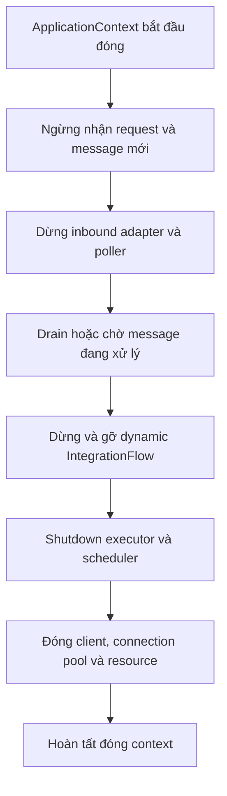

# Đảm bảo dọn executor, scheduler và resource khi context đóng

Spring Integration thường chạy message flow trong thời gian dài. Endpoint có thể nhận message từ adapter, poller hoặc channel; executor xử lý tác vụ trên worker thread; scheduler kích hoạt poller và công việc định kỳ; các handler còn có thể sử dụng connection pool, HTTP client, file handle hoặc tài nguyên bên ngoài. Khi ứng dụng dừng, tất cả thành phần này cần kết thúc theo một trình tự có kiểm soát.

Nếu chỉ đóng `ApplicationContext` mà những thread do ứng dụng tự tạo không được quản lý, JVM có thể tiếp tục chạy dù server đã ngừng nhận request. Ngược lại, nếu đóng executor hoặc connection pool quá sớm, message đang xử lý có thể thất bại giữa chừng. Vì vậy, mục tiêu của shutdown là **ngừng nhận công việc mới, cho công việc đang chạy có cơ hội hoàn tất trong giới hạn thời gian, rồi mới giải phóng tài nguyên mà chúng phụ thuộc**.

## 1. Những tài nguyên cần quản lý

Một message flow có thể sử dụng nhiều loại tài nguyên với vòng đời khác nhau:

| Thành phần | Công việc | Cách kết thúc cần quan tâm |
|---|---|---|
| `MessageEndpoint`, consumer, adapter | Nhận và chuyển message vào flow | Dừng endpoint để không nhận thêm message mới. |
| `TaskExecutor` / `ThreadPoolTaskExecutor` | Chạy handler trên worker thread | Ngừng nhận task mới và chờ task đang chạy hoặc đang xếp hàng theo chính sách. |
| `TaskScheduler` / `ThreadPoolTaskScheduler` | Kích hoạt poller và tác vụ theo lịch | Ngừng trigger mới, kết thúc hoặc hủy tác vụ đã lên lịch. |
| `ExecutorChannel` | Chuyển việc xử lý sang executor | Dừng producer/endpoint liên quan; executor được đóng theo chủ sở hữu của nó. |
| HTTP/JMS/Kafka client và connection factory | Kết nối tới hệ thống bên ngoài | Đóng connection, session, socket và background thread theo API của client. |
| `DataSource` / connection pool | Cung cấp kết nối cơ sở dữ liệu | Đóng pool sau khi handler không còn cần kết nối. |
| `MessageStore` | Giữ message hoặc message group | Đóng tài nguyên store nếu implementation yêu cầu; dữ liệu bền vững không tự động bị xóa khi context đóng. |
| Tác vụ tự tạo bằng `ScheduledFuture` | Chạy công việc do ứng dụng đăng ký trực tiếp | Hủy lịch và giải phóng scheduler nếu ứng dụng sở hữu scheduler đó. |

Điểm quan trọng là xác định **ai sở hữu tài nguyên**. Nếu executor là Spring bean dùng chung, Spring container quản lý vòng đời của nó. Một endpoint sử dụng executor đó không được tự gọi `shutdown()` khi endpoint dừng. Nếu service tự tạo một `ExecutorService` bằng `Executors.newFixedThreadPool(...)`, service đó phải chịu trách nhiệm đóng executor hoặc chuyển nó thành bean được Spring quản lý.

## 2. Trình tự khi ApplicationContext đóng

Khi `ApplicationContext` đóng, Spring điều phối vòng đời của các bean. Các bean triển khai `Lifecycle` hoặc `SmartLifecycle` được yêu cầu dừng; sau đó Spring thực hiện quá trình destroy các singleton và gọi callback như `@PreDestroy`, `DisposableBean.destroy()` hoặc `destroyMethod` đã khai báo.

Spring Integration tích hợp endpoint và các thành phần nhận message vào cơ chế lifecycle của Spring. Khi context dừng, các polling consumer, inbound endpoint và endpoint quản lý bởi Integration runtime được dừng theo lifecycle processor. Việc dừng endpoint giúp ngăn message mới đi vào các bước xử lý trong lúc các dependency chuẩn bị đóng.

Một trình tự shutdown có thể thiết kế như sau:



Đây là trình tự mục tiêu về mặt vận hành. Thứ tự thực tế còn phụ thuộc loại bean, dependency graph và phase của các thành phần `SmartLifecycle`. Không nên dựa vào thứ tự khai báo phương thức `@Bean` để suy ra thứ tự shutdown.

### Vai trò của Lifecycle và SmartLifecycle

`Lifecycle` cung cấp `start()` và `stop()`. `SmartLifecycle` bổ sung `isAutoStartup()`, `getPhase()` và dạng `stop(Runnable callback)` để Spring có thể điều phối thứ tự cũng như biết khi nào một thành phần dừng xong.

Với các bean `SmartLifecycle`, phase thấp được start trước; phase cao được start sau. Khi shutdown, thứ tự được đảo ngược: phase cao được stop trước. Nhờ đó có thể bố trí thành phần nhận tải dừng trước, trong khi thành phần hạ tầng cần thiết cho công việc đang chạy còn thời gian tồn tại. Các bean chỉ có destroy callback không được điều phối bằng phase theo cùng cách; chúng được xử lý trong giai đoạn destroy của container.

`stop(Runnable callback)` cần gọi callback khi thành phần đã dừng xong. Nếu quá trình dừng có drain bất đồng bộ, chỉ gọi callback sau khi drain hoàn tất hoặc sau khi đã quyết định kết thúc theo timeout. Không gọi callback ngay rồi tiếp tục sử dụng resource ở background, vì Spring có thể chuyển sang destroy dependency trong khi công việc vẫn còn chạy.

## 3. Để Spring quản lý executor bằng bean

Không nên tạo thread pool vô danh bên trong một handler hoặc một phương thức cấu hình flow rồi bỏ mất reference. Hãy khai báo executor thành bean có tên, giới hạn kích thước và cấu hình shutdown rõ ràng.

```java
@Configuration
public class IntegrationTaskConfiguration {

    @Bean("integrationExecutor")
    public ThreadPoolTaskExecutor integrationExecutor() {
        ThreadPoolTaskExecutor executor = new ThreadPoolTaskExecutor();
        executor.setCorePoolSize(4);
        executor.setMaxPoolSize(12);
        executor.setQueueCapacity(200);
        executor.setThreadNamePrefix("si-worker-");
        executor.setWaitForTasksToCompleteOnShutdown(true);
        executor.setAwaitTerminationSeconds(30);
        return executor;
    }
}
```

`ThreadPoolTaskExecutor` được Spring khởi tạo và quản lý như một bean. Hai thiết lập shutdown có ý nghĩa khác nhau:

- `setWaitForTasksToCompleteOnShutdown(true)` yêu cầu executor shutdown theo cách cho phép các task đã được nhận, kể cả task đang chờ trong queue, tiếp tục được thực thi.
- `setAwaitTerminationSeconds(30)` đặt giới hạn thời gian chờ executor kết thúc trong quá trình destroy.

Giới hạn chờ không làm cho một handler bị treo tự động hoàn tất. Nếu hết thời gian mà task vẫn chạy, ứng dụng cần log và giám sát tình trạng đó; một số thread có thể tiếp tục tồn tại cho đến khi task tự thoát. Handler nên có timeout cho I/O và không chờ vô hạn.

`queueCapacity` cũng là một phần của shutdown strategy. Queue quá lớn có thể khiến thời gian drain vượt xa thời gian dừng cho phép. Queue không giới hạn có thể giữ lượng công việc rất lớn và làm thời gian đóng ứng dụng khó dự đoán. Hãy chọn queue capacity dựa trên tốc độ xử lý, tải tối đa và thời gian shutdown mà hệ thống chấp nhận.

Ở các phiên bản Spring Framework hỗ trợ `setAcceptTasksAfterContextClose(false)`, có thể dùng thiết lập này để từ chối task mới khi context đang đóng. Hãy kiểm tra API của phiên bản Spring đang sử dụng trước khi thêm cấu hình này vào code dùng chung cho nhiều phiên bản.

### Dùng executor cho ExecutorChannel

Nếu flow cần chuyển xử lý sang worker thread, có thể khai báo `ExecutorChannel` dùng executor bean:

```java
@Bean
public MessageChannel asyncOrdersChannel(
        @Qualifier("integrationExecutor") TaskExecutor executor) {
    return new ExecutorChannel(executor);
}
```

Flow có thể tham chiếu channel này bằng tên. Khi context đóng, endpoint và adapter liên quan được dừng theo lifecycle; `integrationExecutor` được Spring đóng theo vòng đời bean của chính nó.

Không gọi `executor.shutdown()` trong handler hoặc trong callback dừng một flow nếu executor còn được channel khác sử dụng. Một executor dùng chung chỉ nên được đóng bởi chủ sở hữu của bean đó, thường là ApplicationContext. Nếu mỗi flow có một executor riêng, service quản lý flow phải lưu reference và đóng đúng executor khi flow bị remove.

## 4. Quản lý scheduler và tác vụ định kỳ

Scheduler thường kích hoạt poller hoặc tác vụ chạy theo thời gian. Khai báo `ThreadPoolTaskScheduler` thành bean để Spring có thể quản lý nó cùng context:

```java
@Bean("integrationScheduler")
public ThreadPoolTaskScheduler integrationScheduler() {
    ThreadPoolTaskScheduler scheduler = new ThreadPoolTaskScheduler();
    scheduler.setPoolSize(4);
    scheduler.setThreadNamePrefix("si-scheduler-");
    scheduler.setWaitForTasksToCompleteOnShutdown(true);
    scheduler.setAwaitTerminationSeconds(30);
    return scheduler;
}
```

Phân biệt hai loại công việc:

- **Scheduler trigger:** quyết định thời điểm poller hoặc tác vụ được kích hoạt.
- **Executor worker:** thực thi xử lý message hoặc tác vụ được dispatch sang pool khác.

Một cấu hình có thể dùng scheduler để đánh thức poller và một executor riêng để xử lý message. Việc tách hai pool giúp tránh handler chạy lâu làm cạn thread dùng để kích hoạt các poller khác. Tuy nhiên, không phải mọi poller đều cần executor riêng; hãy chọn theo semantics của endpoint và tải thực tế.

Khi context đóng, scheduler cần ngừng tạo lượt chạy mới. Với công việc định kỳ do ứng dụng tự đăng ký, giữ lại `ScheduledFuture` để có thể hủy lịch:

```java
@Component
public class HousekeepingJob {

    private final TaskScheduler scheduler;
    private ScheduledFuture<?> future;

    public HousekeepingJob(TaskScheduler scheduler) {
        this.scheduler = scheduler;
    }

    @PostConstruct
    public void start() {
        future = scheduler.scheduleAtFixedRate(
            this::runCleanup,
            Duration.ofMinutes(1)
        );
    }

    private void runCleanup() {
        // Công việc định kỳ có timeout và xử lý lỗi phù hợp.
    }

    @PreDestroy
    public void stop() {
        if (future != null) {
            future.cancel(false);
        }
    }
}
```

`cancel(false)` ngăn những lần chạy tiếp theo nhưng không yêu cầu interrupt lần chạy hiện tại. Nếu dùng `cancel(true)`, thread đang chạy có thể bị interrupt; chỉ chọn cách này khi công việc và thư viện I/O bên dưới xử lý interrupt an toàn. Scheduler trong ví dụ là dependency được inject, vì vậy component chỉ hủy lịch do nó đăng ký, không tự shutdown scheduler dùng chung.

Với poller được Spring Integration quản lý, ưu tiên để endpoint/poller lifecycle dừng lịch polling. Không tạo một lịch thứ hai để điều khiển cùng một poller, trừ khi ứng dụng có nhu cầu cụ thể và tự chịu trách nhiệm hủy lịch đó.

## 5. Dừng dynamic IntegrationFlow

Flow được đăng ký qua `IntegrationFlowContext` có vòng đời runtime riêng. Service quản lý flow nên giữ registration ID hoặc `IntegrationFlowRegistration` để có thể gỡ đúng flow.

```java
public void removeTenantFlow(String registrationId) {
    flowContext.remove(registrationId);
}
```

Khi gỡ registration, Spring Integration dừng và loại bỏ các component thuộc registration. Tuy nhiên, nếu flow đang nhận tải, ứng dụng vẫn cần quyết định cách xử lý message đang chạy hoặc đang chờ. Một quy trình an toàn thường là:

1. Đánh dấu flow không nhận request mới hoặc loại tenant khỏi router.
2. Ngừng nguồn phát message liên quan.
3. Chờ số message đang xử lý giảm về 0 hoặc hết thời gian drain.
4. Gỡ registration bằng `IntegrationFlowContext.remove(id)`.
5. Đóng tài nguyên riêng của flow nếu flow thực sự sở hữu chúng.

Không nên xóa executor dùng chung khi gỡ một registration. Cũng không nên giả định remove flow sẽ lưu lại message nằm trong queue hoặc đảm bảo mọi task đã submit vào executor đều hoàn tất. Nếu message cần được bảo toàn, phải có cơ chế persistence/acknowledgement riêng phù hợp với nguồn message.

Nếu các flow động cần được gỡ khi context đóng, có thể xây dựng một bean quản lý chúng và thực hiện cleanup trong lifecycle shutdown. Tránh để registration chỉ tồn tại trong một map cục bộ không có đường dọn dẹp; điều đó dễ làm endpoint và thread bị bỏ quên khi tenant bị xóa hoặc cấu hình được thay thế.

## 6. Điều phối shutdown bằng SmartLifecycle

Khi ứng dụng cần dừng theo trình tự nghiệp vụ riêng, có thể tạo một coordinator triển khai `SmartLifecycle`. Coordinator có thể ngừng nhận yêu cầu tạo flow, yêu cầu các producer dừng, drain công việc và gỡ dynamic flow trước khi dependency bị destroy.

Ví dụ dưới đây là skeleton; `FlowDrainCoordinator` là thành phần ứng dụng cần triển khai theo cơ chế đếm in-flight request hoặc theo dõi trạng thái message thực tế:

```java
@Component
public class IntegrationShutdownCoordinator implements SmartLifecycle {

    private final FlowDrainCoordinator drainCoordinator;
    private volatile boolean running;

    public IntegrationShutdownCoordinator(
            FlowDrainCoordinator drainCoordinator) {
        this.drainCoordinator = drainCoordinator;
    }

    @Override
    public void start() {
        running = true;
    }

    @Override
    public void stop(Runnable callback) {
        try {
            drainCoordinator.stopAcceptingAndDrain(Duration.ofSeconds(20));
            drainCoordinator.removeDynamicFlows();
        }
        finally {
            running = false;
            callback.run();
        }
    }

    @Override
    public void stop() {
        stop(() -> { });
    }

    @Override
    public boolean isRunning() {
        return running;
    }

    @Override
    public boolean isAutoStartup() {
        return true;
    }

    @Override
    public int getPhase() {
        return 100;
    }
}
```

Giá trị phase trong ví dụ chỉ là minh họa. Hãy chọn phase sau khi xem phase của inbound adapter, endpoint và các lifecycle bean khác trong ứng dụng. Phase cao hơn được stop trước phase thấp hơn; coordinator phải dừng đúng các thành phần phụ thuộc vào executor và resource, nhưng không được đóng một dependency trước khi consumer của nó đã ngừng.

Nếu `stop(Runnable)` thực hiện drain bất đồng bộ, callback chỉ được gọi khi drain kết thúc. Cũng cần bảo đảm callback luôn được gọi trong nhánh lỗi để Spring không chờ vô hạn. Một cách triển khai production nên có timeout rõ ràng, log số tác vụ còn lại và chính sách khi drain thất bại.

Không nên thực hiện một thao tác chờ vô hạn trong `stop()` hoặc `@PreDestroy`. Nếu shutdown bị gọi từ chính worker thread của executor rồi chờ executor kết thúc, có thể tạo deadlock vì thread đang chờ lại là một trong những thread cần kết thúc.

## 7. Đóng client và resource phụ thuộc

Các resource như HTTP client, connection pool, file watcher hoặc client của hệ thống message broker cũng cần vòng đời rõ ràng. Nếu thư viện cung cấp `close()`, hãy khai báo bean và để Spring gọi destroy method:

```java
@Bean(destroyMethod = "close")
public PartnerClient partnerClient(PartnerClientFactory factory) {
    return factory.createClient();
}
```

Khi một handler inject `PartnerClient`, Spring biết mối quan hệ dependency giữa handler và client. Bean phụ thuộc được destroy trước dependency của nó, giúp handler có cơ hội dừng trước khi client đóng. Với tài nguyên dùng chung, tránh gọi `close()` thủ công từ nhiều consumer vì có thể đóng kết nối trong khi consumer khác vẫn đang dùng.

Một số lưu ý khi đóng resource:

- Đặt connect timeout, read timeout và request timeout cho I/O để handler không giữ thread vô hạn.
- Đóng producer/client trước khi đóng connection factory mà producer/client đang sử dụng.
- Không xóa dữ liệu persistent trong `MessageStore` chỉ vì context đóng. Đóng connection hoặc store handle khác với xóa message cần phục hồi.
- Với `DataSource` hoặc pool do Spring quản lý, để bean quản lý pool thực hiện shutdown; không đóng connection pool trong từng message handler.
- Nếu một resource được tạo bên ngoài Spring, bọc nó trong bean có destroy callback hoặc tạo một lifecycle owner rõ ràng.

## 8. Cấu hình graceful shutdown trong Spring Boot

Với Spring Boot, có thể cấu hình thời gian chờ cho mỗi phase của graceful shutdown:

```properties
spring.lifecycle.timeout-per-shutdown-phase=30s
```

Đối với web server tích hợp, có thể bật graceful server shutdown bằng cấu hình phù hợp của phiên bản Spring Boot đang dùng, ví dụ:

```properties
server.shutdown=graceful
```

Hai cấu hình này hỗ trợ quá trình dừng ứng dụng, nhưng không thay thế cấu hình shutdown của executor, scheduler hoặc client riêng. `timeout-per-shutdown-phase` đặt ngân sách chờ cho phase lifecycle; `awaitTerminationSeconds` của executor đặt thời gian chờ pool kết thúc. Cần tính tổng thời gian các phase và timeout I/O để tránh ngân sách shutdown bị vượt.

Với ứng dụng Spring Framework không dùng Spring Boot, ứng dụng cần tự quyết định thời điểm gọi `ConfigurableApplicationContext.close()` và có thể cấu hình lifecycle processor phù hợp. Không nên gọi `System.exit()` từ handler hoặc từ một endpoint để ép JVM kết thúc.

## 9. Những lỗi shutdown thường gặp

| Triệu chứng | Nguyên nhân có thể | Cách xử lý |
|---|---|---|
| JVM không thoát sau khi context đóng | Thread pool được tạo thủ công và không shutdown; scheduler còn task định kỳ | Đưa executor/scheduler thành bean hoặc thêm lifecycle owner; hủy `ScheduledFuture`. |
| Message đang xử lý bị lỗi khi shutdown | Executor hoặc client bị đóng trước khi handler hoàn tất | Dừng ingress, drain task, rồi mới đóng dependency. |
| Một flow bị remove làm flow khác ngừng chạy | Hai flow dùng chung executor nhưng một flow tự shutdown executor | Để ApplicationContext sở hữu executor dùng chung. |
| Shutdown mất quá lâu | Queue lớn, handler chờ I/O vô hạn hoặc drain không có timeout | Giới hạn queue, đặt timeout I/O và timeout drain. |
| Message trong queue biến mất khỏi luồng xử lý | Channel trong bộ nhớ không bền vững hoặc message bị ack trước khi lưu lỗi | Dùng persistence/ack phù hợp với yêu cầu bảo toàn message. |
| Task mới vẫn được submit khi context đang đóng | Producer chưa bị chặn hoặc executor vẫn chấp nhận task | Dừng ingress, đóng cổng nhận task và xử lý `RejectedExecutionException`. |
| Lỗi `RejectedExecutionException` xuất hiện lúc dừng | Producer và executor dừng không đúng thứ tự hoặc pool đã shutdown | Điều phối phase và xử lý trạng thái shutdown ở producer. |
| Client đóng khi handler vẫn đang dùng | Dependency bị đóng sớm hoặc tài nguyên bị đóng thủ công ở nhiều nơi | Dùng dependency injection và để container điều phối destroy. |

## 10. Kiểm tra shutdown có thực sự hoàn tất

Không nên chỉ dựa vào log `ApplicationContext closed`. Cần kiểm tra thread và resource đã kết thúc:

1. Tạo một message có handler chạy trong khoảng thời gian xác định.
2. Bắt đầu đóng context trong lúc handler đang thực thi.
3. Xác minh ingress không nhận thêm message mới.
4. Xác minh task đang chạy được hoàn tất trong ngân sách hoặc bị xử lý theo timeout đã định.
5. Xác minh scheduler không kích hoạt lượt mới sau khi dừng.
6. Xác minh connection pool/client được đóng sau khi handler không còn sử dụng.
7. Kiểm tra thread theo prefix như `si-worker-` và `si-scheduler-` không còn sống sau khi shutdown hoàn tất.

Ví dụ trong integration test, dùng `AnnotationConfigApplicationContext` hoặc context test tương đương và gọi `close()` trong teardown. Có thể dùng `CountDownLatch` để điều khiển thời điểm handler bắt đầu/kết thúc thay vì dùng `Thread.sleep()` cố định. Nếu cần xác minh thread đã kết thúc, hãy chờ có giới hạn và báo lỗi rõ ràng khi timeout.

Kiểm tra cả trường hợp shutdown bình thường và trường hợp handler ném exception. Một flow tốt cần giữ được khả năng đóng context ngay cả khi error handler, poller hoặc client gặp lỗi trong lúc dừng.

## 11. Nguyên tắc thiết kế

- Khai báo executor, scheduler và client quan trọng thành Spring bean có vòng đời xác định.
- Dừng producer, inbound adapter và poller trước khi đóng executor hoặc resource mà handler cần.
- Dùng queue có giới hạn và timeout cho I/O để thời gian drain có thể dự đoán.
- Chỉ chủ sở hữu mới shutdown executor, scheduler hoặc client; consumer dùng chung không tự đóng dependency.
- Hủy lịch tự đăng ký và remove dynamic flow khi không còn sử dụng.
- Phân biệt đóng resource với xóa dữ liệu persistent trong message store.
- Dùng `SmartLifecycle` khi cần điều phối thứ tự dừng; luôn gọi callback sau khi thực sự hoàn tất hoặc sau khi quyết định kết thúc theo timeout.
- Kiểm thử thread, task đang chạy, queue và connection sau `ApplicationContext.close()`.

Khi vòng đời được thiết kế rõ, Spring Integration có thể dừng message flow có trật tự: nguồn nhận message ngừng trước, công việc đang chạy được xử lý theo ngân sách shutdown, executor và scheduler kết thúc sau đó, rồi các resource nền mới được đóng. Điều này giúp tránh thread bị bỏ quên, message bị gián đoạn và dependency bị đóng khi vẫn còn được sử dụng.
