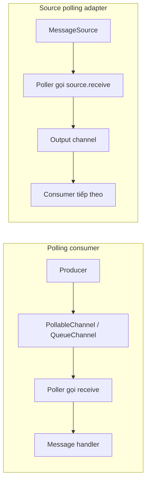
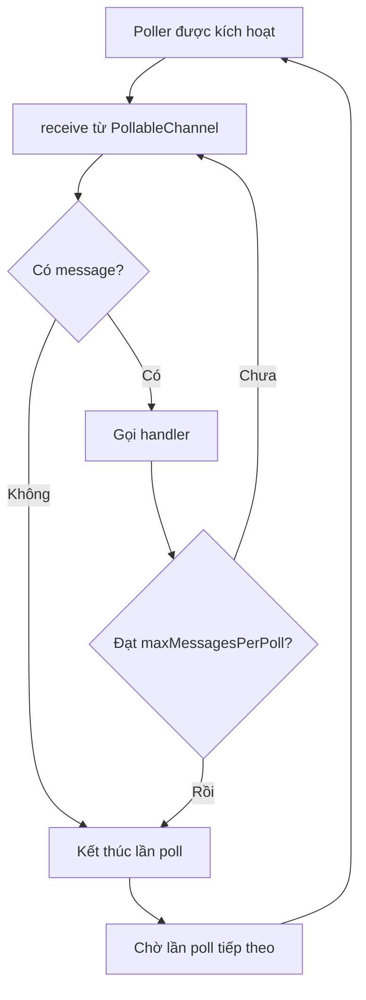

# Polling consumer đọc message từ PollableChannel

Trong Spring Integration, consumer có thể nhận message theo hai cách chính: được channel đẩy message tới khi có message mới, hoặc chủ động lấy message từ một channel có khả năng lưu và trả message. Cách thứ hai là polling consumer. Nó thường được dùng với `QueueChannel` hoặc một implementation khác của `PollableChannel` khi producer và consumer cần tách thời điểm gửi và thời điểm xử lý.

Polling consumer không liên tục chiếm CPU để hỏi channel trong một vòng lặp tự viết. Spring Integration dùng poller để lên lịch lần nhận message, giới hạn số message được lấy trong một lần poll và gọi handler khi có dữ liệu. Cấu hình poller ảnh hưởng trực tiếp đến độ trễ, throughput, mức sử dụng thread, transaction và cách lỗi được xử lý.

## 1. PollableChannel là gì?

`PollableChannel` là contract của channel cho phép consumer chủ động gọi `receive()` để lấy message. Ngoài `receive()` không tham số, contract còn cung cấp cách nhận có timeout để consumer có thể chờ message trong một khoảng thời gian xác định.

Khác với `SubscribableChannel`, nơi consumer đăng ký subscriber và channel gọi subscriber khi message được gửi, `PollableChannel` giữ message để consumer lấy ra sau. `QueueChannel` là implementation phổ biến của `PollableChannel`.

| Loại channel | Cách consumer nhận message | Đặc điểm |
|---|---|---|
| `DirectChannel` | Subscriber được gọi trong thao tác gửi | Dispatch đồng bộ, không phải channel để polling consumer gọi `receive()` |
| `ExecutorChannel` | Subscriber được dispatch qua executor | Tách việc xử lý sang executor, không phải hàng đợi để consumer polling |
| `QueueChannel` | Consumer gọi `receive()` để lấy message | Có buffer, producer và consumer có thể hoạt động ở thời điểm khác nhau |
| `PriorityChannel` | Consumer gọi `receive()` theo thứ tự ưu tiên | Message được lấy theo priority thay vì chỉ theo thứ tự FIFO |
| `RendezvousChannel` | Producer và consumer gặp nhau tại thao tác gửi/nhận | Handoff đồng bộ, producer có thể phải chờ consumer nhận |

Channel cụ thể quyết định message được giữ, sắp xếp hoặc bàn giao như thế nào. Poller quyết định khi nào consumer gọi `receive()`. Hai trách nhiệm này tách biệt nhau.

## 2. Polling consumer khác SourcePollingChannelAdapter

Hai thành phần đều sử dụng poller nhưng bắt đầu từ hai contract khác nhau:

| Thành phần | Nguồn dữ liệu | Cách hoạt động |
|---|---|---|
| Polling consumer | Một `PollableChannel` | Gọi `receive()` trên channel rồi chuyển message nhận được cho handler |
| `SourcePollingChannelAdapter` | Một `MessageSource<?>` | Gọi `receive()` trên source; nếu có message thì gửi message đó vào output channel |

Polling consumer dùng khi producer đã gửi message vào channel, ví dụ một service gửi vào `QueueChannel` và một endpoint khác lấy message để xử lý. Source polling adapter dùng khi runtime phải hỏi một nguồn dữ liệu để tạo message, ví dụ đọc file, truy vấn bảng hoặc gọi một nguồn pull.



Không nên nhầm `MessageSource` với `PollableChannel`. Source tạo hoặc lấy message từ nguồn dữ liệu; channel vận chuyển và có thể lưu message giữa producer với consumer.

## 3. QueueChannel làm buffer giữa producer và consumer

Một `QueueChannel` cho phép producer gửi message mà không cần consumer xử lý ngay tại thời điểm gửi. Ví dụ:

```java
@Configuration
class OrderChannelConfiguration {

    @Bean
    PollableChannel ordersQueue() {
        return new QueueChannel(500);
    }
}
```

Ở đây, queue có capacity được cấu hình là 500 message. Producer có thể gửi message vào channel thông qua `MessagingTemplate` hoặc một gateway:

```java
@Component
class OrderPublisher {

    private final MessageChannel ordersQueue;

    OrderPublisher(@Qualifier("ordersQueue") MessageChannel ordersQueue) {
        this.ordersQueue = ordersQueue;
    }

    void publish(Order order) {
        Message<Order> message = MessageBuilder
                .withPayload(order)
                .setHeader("tenantId", order.tenantId())
                .build();
        ordersQueue.send(message);
    }
}
```

`QueueChannel` thực hiện `MessageChannel` và `PollableChannel`, nên có thể được inject dưới kiểu phù hợp với nơi sử dụng. Nếu cần gửi với timeout, hãy dùng API gửi tương ứng và xử lý trường hợp không gửi được do queue đầy hoặc hết thời gian chờ.

Capacity là một phần của chính sách backpressure. Queue không giới hạn có thể tích tụ message và làm tăng memory khi producer liên tục nhanh hơn consumer. Queue có giới hạn giúp tạo điểm chặn rõ ràng, nhưng producer phải có chiến lược khi gửi thất bại hoặc bị block.

`QueueChannel` mặc định lưu trong bộ nhớ nếu không cấu hình store bền vững. Message trong queue bộ nhớ có thể mất khi tiến trình dừng đột ngột. Nếu yêu cầu khôi phục sau restart, cần cân nhắc message store bền vững hoặc broker có persistence và acknowledgement phù hợp; không nên xem một queue trong bộ nhớ như hàng đợi durable.

## 4. Cấu hình polling consumer bằng annotation

Một endpoint nhận từ `PollableChannel` cần poller để runtime gọi nhận message. Có thể cấu hình endpoint bằng `@ServiceActivator` và `@Poller`:

```java
@Component
class OrderConsumer {

    private final OrderService orderService;

    OrderConsumer(OrderService orderService) {
        this.orderService = orderService;
    }

    @ServiceActivator(inputChannel = "ordersQueue")
    @Poller(fixedDelay = "500", maxMessagesPerPoll = "10")
    public void handle(Order order) {
        orderService.process(order);
    }
}
```

Endpoint trên chủ động lấy message từ `ordersQueue` theo lịch. Mỗi message được phân giải payload thành tham số `Order`, sau đó gọi `handle`. Nếu endpoint cần đọc cả header hoặc kiểm tra metadata, có thể nhận `Message<Order>` hoặc khai báo thêm tham số `@Header`.

Ví dụ này giả định channel `ordersQueue` đã được khai báo là `PollableChannel`, như cấu hình ở phần trước. Nếu input channel là `DirectChannel` hoặc `ExecutorChannel`, cách tiêu thụ thông thường là đăng ký subscriber; không gắn polling consumer vào một channel không hỗ trợ `receive()`.

## 5. Poller điều khiển nhịp nhận message

Poller là cấu hình lịch và chính sách cho một polling endpoint. Các thuộc tính thường cần quan tâm gồm:

| Thuộc tính | Ý nghĩa | Ảnh hưởng |
|---|---|---|
| `fixedDelay` | Khoảng chờ sau khi một lần thực thi kết thúc trước khi lên lịch lần tiếp theo | Nhịp poll phụ thuộc thời gian xử lý thực tế |
| `fixedRate` | Nhịp bắt đầu các lần thực thi theo chu kỳ | Cần xem xét khi một lần poll kéo dài gần hoặc vượt chu kỳ |
| `cron` | Lịch chạy theo biểu thức cron | Phù hợp với lịch nghiệp vụ theo giờ/ngày |
| `maxMessagesPerPoll` | Giới hạn số message consumer lấy trong một lần poll | Cân bằng throughput với thời gian chiếm scheduler/thread |
| `receiveTimeout` | Thời gian một lần nhận có thể chờ message | Ảnh hưởng thời gian poller bị block khi channel rỗng |
| `taskExecutor` | Executor dùng để thực thi tác vụ poll theo cấu hình | Thay đổi thread thực thi và cách các lần poll cạnh tranh tài nguyên |

`fixedDelay` thường dễ dự đoán khi thời gian xử lý thay đổi: khoảng delay được tính sau khi lần thực thi hoàn tất. `fixedRate` hướng tới nhịp bắt đầu đều hơn; nếu lần xử lý trước chưa kết thúc, hành vi thực tế còn phụ thuộc scheduler và executor. Với tác vụ poll có thể chạy lâu, cần tránh cấu hình khiến các lần thực thi chồng lấn ngoài ý muốn.

`maxMessagesPerPoll` giới hạn số message được lấy trong một lần poll. Giá trị nhỏ giúp poller nhường thời gian cho công việc khác và giảm thời gian một lần poll chiếm thread; giá trị lớn có thể tăng throughput nhưng cũng kéo dài một lần poll và làm các tác vụ khác chờ lâu hơn. Cần chọn dựa trên tốc độ producer, thời gian handler và khả năng của hệ thống đích.

`receiveTimeout` điều khiển thời gian chờ bên trong thao tác nhận. Nếu timeout quá dài, một poller có thể giữ thread trong lúc queue rỗng. Nếu timeout bằng không hoặc rất ngắn, consumer không chờ message và sẽ thử lại theo lịch ở lần poll sau. Cần xét timeout cùng fixed delay để tránh tạo độ trễ không mong muốn.

## 6. Poller với Java DSL

Khi dùng Java DSL, poller thường được gắn vào endpoint tiêu thụ channel. Cách cấu hình chính xác phụ thuộc vị trí endpoint được tạo trong flow; ví dụ dưới đây thể hiện một service activator có poller:

```java
@Bean
IntegrationFlow ordersPollingFlow(OrderService orderService) {
    return IntegrationFlow
            .from("ordersQueue")
            .handle(orderService, "process", endpoint -> endpoint
                    .poller(Pollers.fixedDelay(500)
                            .maxMessagesPerPoll(10)))
            .get();
}
```

Trong flow thực tế, hãy xác nhận endpoint được cấu hình là polling consumer và input channel được resolve thành `PollableChannel`. Nếu flow bắt đầu từ một channel có subscription semantics, không nên giả định rằng chỉ thêm `.poller(...)` vào một endpoint bất kỳ sẽ biến channel đó thành queue.

Với ứng dụng dùng annotation, `@Poller` thể hiện cấu hình ngay tại endpoint. Với Java DSL, cấu hình poller ở endpoint giúp nhìn thấy nơi consumer nhận message và chính sách polling của nó.

## 7. Một lần poll diễn ra như thế nào?

Về khái quát, polling consumer thực hiện các bước:

1. Scheduler kích hoạt polling task theo trigger đã cấu hình.
2. Polling consumer yêu cầu input channel trả về message bằng thao tác `receive`.
3. Nếu có message, endpoint gọi handler với message đó.
4. Consumer tiếp tục nhận message cho đến khi đạt `maxMessagesPerPoll` hoặc không còn message theo timeout/chính sách nhận.
5. Polling task kết thúc; scheduler lên lịch lần tiếp theo.



Nếu channel không có message, handler không được gọi cho lần nhận đó. Nếu handler xử lý chậm, thời gian xử lý góp vào thời gian của lần poll và ảnh hưởng thời điểm lần tiếp theo tùy trigger. Vì thế, poller không chỉ là một bộ định thời; nó còn xác định batch size, thời gian chờ và execution boundary của consumer.

## 8. Threading và executor

Polling endpoint cần một scheduler để kích hoạt tác vụ. Nếu không cấu hình executor riêng cho poller, việc nhận và gọi handler thường diễn ra trên thread thực thi polling task. Khi cấu hình executor, task có thể chạy trên thread pool được chỉ định; điều này thay đổi khả năng song song và cách tài nguyên được sử dụng.

Một số điểm cần kiểm soát:

- Không để handler chặn quá lâu trên scheduler thread dùng chung cho nhiều poller.
- Cấu hình pool đủ cho số polling task thực sự cần chạy đồng thời.
- Tránh cho phép nhiều lần poll cùng một endpoint chồng lấn nếu handler không an toàn khi chạy đồng thời.
- Đo queue backlog, thời gian chờ, thời gian handler và số thread bận.
- Xác định executor do endpoint sở hữu hay được chia sẻ từ application context để đóng đúng nơi.

Tăng số thread không tự động tăng throughput. Nếu hệ thống đích đang giới hạn tốc độ hoặc database connection pool đã cạn, thêm consumer có thể làm tăng contention và retry. Điều chỉnh concurrency phải dựa trên năng lực downstream và semantics của handler.

## 9. Transaction và độ tin cậy khi lấy message

Poller có thể được cấu hình với advice chain, trong đó có transaction advice nếu có transaction manager phù hợp. Transaction boundary phải được thiết kế theo tài nguyên thực sự tham gia, ví dụ database hoặc một message store có hỗ trợ transaction.

Một số câu hỏi cần trả lời trước khi bật transaction:

- Transaction bao phủ thao tác nhận message, gọi handler hay cả hai?
- Channel implementation có tham gia transaction hay chỉ lưu message trong bộ nhớ?
- Nếu handler ném exception, message có được khôi phục, redeliver hay đã bị lấy khỏi queue?
- Transaction manager quản lý database hay tài nguyên messaging nào?
- Có ranh giới bất đồng bộ hoặc executor khiến phần xử lý sau chạy trên thread khác không?

Với `QueueChannel` bộ nhớ thông thường, thao tác `receive()` lấy message ra khỏi queue. Không nên giả định rằng transaction của database sẽ tự động đưa message trở lại queue khi handler thất bại. Khả năng rollback hoặc khôi phục phụ thuộc implementation channel, message store và transaction integration cụ thể.

Nếu message đến từ broker, acknowledgement, redelivery và transaction thường được điều khiển bởi adapter/container của broker. Nếu message được giữ trong store bền vững, cần xác minh transaction support của store. Thiết kế consumer idempotent vẫn quan trọng vì retry hoặc redelivery có thể khiến cùng một nghiệp vụ được thực hiện lại.

## 10. Xử lý lỗi ở polling consumer

Lỗi có thể xảy ra khi nhận message, chuyển đổi tham số hoặc gọi handler. Polling endpoint có thể dùng error channel, advice chain, retry hoặc recovery flow theo cấu hình. Cần xác định lỗi được xử lý tại polling task hay được chuyển thành `ErrorMessage` cho một endpoint khác.

| Lỗi | Triệu chứng | Hướng xử lý |
|---|---|---|
| Handler ném exception | Message không được xử lý thành công; lần poll có thể kết thúc theo error handling đã cấu hình | Xem exception gốc, error channel và retry advice |
| Payload không đúng kiểu | Lỗi phân giải hoặc chuyển đổi tham số | Kiểm tra payload runtime và hợp đồng handler |
| Queue đầy | Producer không gửi được hoặc phải chờ tùy timeout | Điều chỉnh capacity, tốc độ producer/consumer và chính sách gửi |
| Handler quá chậm | Backlog tăng và độ trễ tăng | Đo thời gian xử lý, xem lại batch và concurrency |
| Lỗi lặp lại liên tục | Retry làm tăng tải hoặc cùng message gây lỗi nhiều lần | Phân loại lỗi, giới hạn retry và đưa poison message vào recovery flow |

Không nên bắt mọi exception trong handler rồi bỏ qua. Nếu lỗi bị nuốt, runtime không thể áp dụng retry hoặc error handling theo cách mà flow mong đợi, còn message có thể bị coi là xử lý thành công dù nghiệp vụ chưa hoàn tất.

Với message không thể xử lý do dữ liệu sai, cần một chính sách poison message: ghi nhận nguyên nhân, lưu hoặc chuyển message sang error flow/dead-letter phù hợp, rồi cho consumer tiếp tục với message khác theo semantics đã chọn.

## 11. Capacity, backpressure và throughput

Queue channel tạo vùng đệm giữa producer và consumer. Nếu tốc độ gửi trung bình cao hơn tốc độ xử lý trung bình trong thời gian dài, backlog sẽ tăng cho đến khi queue đầy hoặc tài nguyên bộ nhớ bị cạn.

Một mô hình vận hành hữu ích là theo dõi:

- `queue depth`: số message đang chờ.
- `arrival rate`: số message producer gửi mỗi giây.
- `consumption rate`: số message consumer xử lý mỗi giây.
- `processing latency`: thời gian từ lúc gửi đến lúc handler hoàn tất.
- `poll duration`: thời gian một lần poll xử lý batch.
- `send wait/failure`: thời gian producer chờ và số lần gửi thất bại.

Khi queue depth tăng liên tục, hãy tìm nguyên nhân ở handler, downstream, poller schedule hoặc giới hạn concurrency. Tăng capacity chỉ tạo thêm thời gian đệm; nó không sửa được chênh lệch throughput kéo dài. Với tải đột biến, queue có capacity phù hợp giúp hấp thụ spike; với tải vượt khả năng lâu dài, cần throttle producer, tăng năng lực xử lý có kiểm soát hoặc chuyển sang broker có khả năng lưu trữ và quản lý consumer phù hợp.

## 12. Lifecycle của polling consumer

Polling consumer là endpoint được quản lý bởi Spring lifecycle. Khi endpoint được start, poller có thể bắt đầu kích hoạt các lần nhận message. Khi endpoint stop, các lần poll mới sẽ được ngừng theo semantics của endpoint; một lần poll đang chạy có thể cần thời gian hoàn tất hoặc xử lý theo shutdown policy.

Với `QueueChannel` vẫn tồn tại trong context, message chưa được nhận có thể tiếp tục nằm trong queue và được lấy khi consumer start lại. Điều này chỉ đúng trong thời gian queue và tiến trình còn tồn tại; queue bộ nhớ không bảo đảm message sống qua restart của JVM.

Khi context đóng, cần dừng polling endpoint, scheduler và executor đúng thứ tự. Nếu handler đang xử lý, xác định có chờ hoàn tất hay timeout. Với nguồn durable, kiểm tra acknowledgement/redelivery; với queue bộ nhớ, cân nhắc cách xử lý backlog trước khi đóng tiến trình.

## 13. Chẩn đoán polling consumer

Khi message nằm trong queue nhưng không được xử lý, hãy kiểm tra theo thứ tự:

1. Input channel có thực sự là `PollableChannel` không?
2. Polling endpoint có được tạo và đang `isRunning()` không?
3. Poller có trigger hợp lệ và scheduler còn hoạt động không?
4. `maxMessagesPerPoll` và `receiveTimeout` có tạo ra nhịp nhận như mong muốn không?
5. Handler có đang block, ném exception hoặc bị retry liên tục không?
6. Error channel, advice chain và log có ghi nhận lỗi không?
7. Queue capacity, send timeout và tốc độ producer có làm queue đầy không?
8. Executor hoặc scheduler có cạn thread hay bị từ chối task không?

| Triệu chứng | Kiểm tra đầu tiên |
|---|---|
| Queue depth tăng nhưng không có message được xử lý | Endpoint state, poller schedule, channel type |
| Message được xử lý chậm theo từng đợt | `fixedDelay`, `maxMessagesPerPoll`, thời gian handler |
| Producer bị block khi gửi | Queue capacity, send timeout và consumer throughput |
| CPU tăng khi queue rỗng | Poll interval, receive timeout và cấu hình scheduler |
| Message biến mất sau lỗi handler | Semantics receive, transaction/store support và recovery strategy |
| Lỗi chỉ xảy ra khi tăng concurrency | Thread safety của handler, downstream pool và shared state |

Metrics và log nên có correlation ID hoặc message ID để nối sự kiện gửi, nhận, xử lý và lỗi. Nếu có Spring Integration Management/Actuator, dùng metrics và Integration graph phù hợp với phiên bản để quan sát endpoint và topology. Đối chiếu số message gửi vào, số message xử lý thành công và số message đi vào error flow để tìm chỗ thất thoát.

## 14. Nguyên tắc cấu hình

- **Dùng PollableChannel khi cần buffer và pull consumption:** `QueueChannel` là lựa chọn phổ biến cho queue trong bộ nhớ.
- **Gắn poller vào đúng polling endpoint:** không dùng poller để biến `DirectChannel` thành queue.
- **Phân biệt polling consumer với source polling adapter:** một bên đọc channel, bên kia đọc `MessageSource`.
- **Chọn batch và lịch có căn cứ:** cân bằng `fixedDelay`/`fixedRate`, `maxMessagesPerPoll` và thời gian handler.
- **Đặt capacity và timeout rõ ràng:** xác định producer sẽ block, timeout hay xử lý khi queue đầy.
- **Thiết kế lỗi và transaction cùng channel semantics:** không giả định mọi channel đều rollback hoặc redeliver message.
- **Quản lý thread và lifecycle:** đo scheduler/executor, tránh handler chặn thread dùng chung và dừng endpoint có trật tự.
- **Theo dõi backlog và throughput:** capacity chỉ hấp thụ tải đột biến; cần xử lý nguyên nhân nếu backlog tăng kéo dài.

Trước khi triển khai một polling consumer, hãy xác định channel có hỗ trợ `receive()` hay không, poller sẽ chạy khi nào, mỗi lần lấy bao nhiêu message, handler chạy trên thread nào và điều gì xảy ra khi xử lý thất bại. Những quyết định này tạo nên hợp đồng vận hành của consumer và giúp flow dễ dự đoán khi tải tăng hoặc khi hệ thống gặp lỗi.
