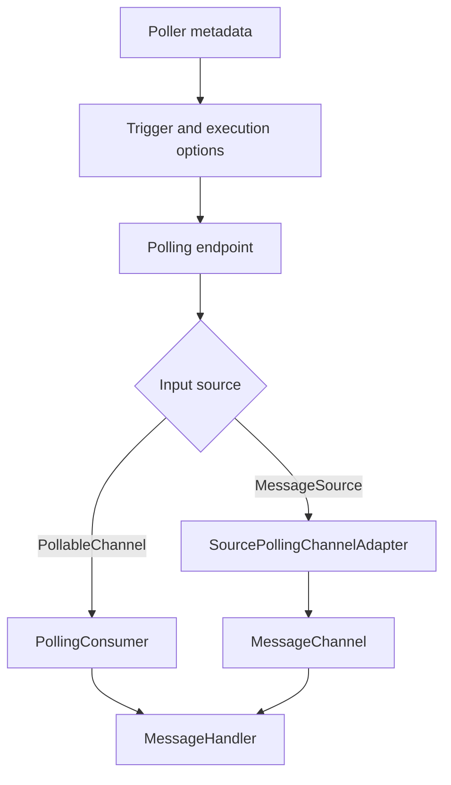
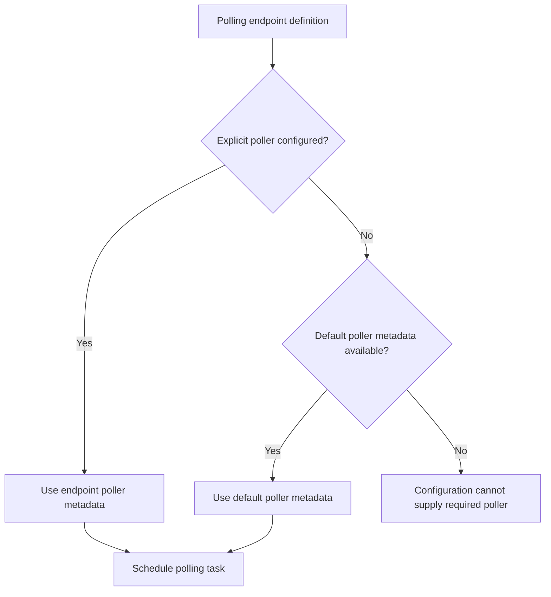

# PollerMetadata và DefaultPollerMetadata

Trong Spring Integration, poller quyết định khi nào một endpoint lấy message và một lượt poll xử lý bao nhiêu message. Các thông tin như trigger, giới hạn message, timeout, executor, transaction và advice được tập hợp trong **poller metadata**. `PollerMetadata` biểu diễn cấu hình đó; **DefaultPollerMetadata** là cấu hình mặc định được dùng làm phương án dự phòng cho endpoint cần polling nhưng không khai báo poller riêng.

Hai khái niệm này giúp chuẩn hóa cách các endpoint polling hoạt động trong một ứng dụng. Nếu cấu hình default poller quá rộng hoặc không phù hợp, nhiều endpoint có thể cùng nhận chu kỳ, batch size hoặc timeout không đúng với đặc tính nguồn dữ liệu. Ngược lại, nếu hiểu rõ metadata và phạm vi áp dụng, ta có thể đặt chính sách chung rồi ghi đè có chủ đích ở từng endpoint.

## 1. Poller nằm ở đâu trong consumer runtime?

Poller là cơ chế kích hoạt một tác vụ nhận message theo lịch. Nó thường xuất hiện ở hai trường hợp:

- **PollingConsumer** lấy message từ một `PollableChannel`, chẳng hạn `QueueChannel`.
- **SourcePollingChannelAdapter** hỏi một `MessageSource` theo lịch rồi gửi message lấy được vào flow.

Poller không phải channel, message source hay handler. Nó mô tả cách tác vụ polling được lập lịch và thực thi. Channel hoặc source cung cấp message; endpoint chuyển message đến handler.



Một endpoint event-driven đăng ký với `SubscribableChannel` và được gọi khi message đến. Nó không cần poller. Vì vậy, không nên áp dụng default poller cho mọi endpoint trong flow; metadata chỉ liên quan đến những endpoint có cơ chế polling.

## 2. PollerMetadata là gì?

`PollerMetadata` là đối tượng cấu hình mô tả cách một poller hoạt động. Endpoint sử dụng metadata để tạo tác vụ polling và kết nối tác vụ đó với scheduler, executor cùng các cơ chế bổ sung.

Các nhóm thuộc tính thường gặp:

| Nhóm cấu hình | Vai trò vận hành |
|---|---|
| Trigger | Xác định thời điểm poll, ví dụ fixed delay, fixed rate hoặc cron |
| `maxMessagesPerPoll` | Giới hạn số message xử lý trong một lượt poll |
| `receiveTimeout` | Thời gian chờ khi nhận message từ pollable channel |
| `taskExecutor` | Executor thực thi tác vụ polling khi được cấu hình |
| Advice chain | Bọc tác vụ poll bằng retry, transaction hoặc hành vi bổ sung |
| Transaction settings | Xác định transaction manager và transaction definition cho poll |
| Error handling | Xác định cách xử lý lỗi phát sinh trong tác vụ polling |
| Send timeout | Giới hạn thời gian chờ khi gửi message ở các bước liên quan, tùy cấu hình |

Tên thuộc tính và API builder cụ thể có thể thay đổi theo phiên bản Spring Integration. Khi cấu hình bằng Java DSL, thường dùng `Pollers` để tạo metadata thay vì tự khởi tạo các trường nội bộ.

Điều quan trọng là `PollerMetadata` chỉ là **cấu hình**. Nó không tự chạy một thread, không giữ message và không phải một queue. Scheduler dùng trigger để lập lịch; endpoint thực hiện thao tác receive; handler xử lý message.

## 3. DefaultPollerMetadata và default poller

Trong một application context, Spring Integration có thể cung cấp metadata mặc định cho những endpoint cần polling nhưng không chỉ định poller riêng. Cấu hình mặc định thường được đăng ký dưới bean name:

```java
PollerMetadata.DEFAULT_POLLER_METADATA_BEAN_NAME
```

Hằng số này là cách tham chiếu ổn định đến tên bean default poller. Trong các ví dụ cấu hình, bean thường được gọi là `defaultPoller`. `DefaultPollerMetadata` nói đến vai trò metadata mặc định/fallback trong cấu hình poller; điểm cấu hình mà ứng dụng thường làm việc là một bean kiểu `PollerMetadata` dưới tên chuẩn. Metadata này không phải scheduler độc lập hay endpoint tiêu thụ message.

Default metadata có vai trò cung cấp chính sách chung cho endpoint polling thiếu cấu hình riêng. Một endpoint có poller được khai báo trực tiếp sẽ dùng cấu hình riêng đó. Endpoint event-driven không cần poller nên không chịu tác động của default poller.

Có thể hình dung quy tắc chọn cấu hình:



Trong ứng dụng, không nên giả định mọi endpoint đều có cùng một default nếu chưa kiểm tra cấu hình và phiên bản framework. Khi cần hành vi rõ ràng, hãy khai báo default poller bean theo tên chuẩn hoặc cấu hình poller trực tiếp ở endpoint.

## 4. Khai báo một default poller dùng chung

Có thể cung cấp một bean `PollerMetadata` dưới tên mặc định. Ví dụ:

```java
@Configuration
@EnableIntegration
public class PollerConfiguration {

    @Bean(name = PollerMetadata.DEFAULT_POLLER_METADATA_BEAN_NAME)
    public PollerMetadata defaultPollerMetadata() {
        return Pollers.fixedDelay(Duration.ofSeconds(1))
                .maxMessagesPerPoll(10)
                .get();
    }

}
```

Cấu hình này mô tả một poller dùng fixed delay một giây và giới hạn tối đa 10 message trong một lượt poll. Bean có tên theo hằng số của `PollerMetadata`, vì vậy các endpoint cần default poller có thể tham chiếu đến cấu hình chung này.

Một số điểm cần hiểu:

- `@Bean` đăng ký metadata trong ApplicationContext.
- Tên bean phải khớp tên default poller mà Spring Integration tìm kiếm.
- `Pollers.fixedDelay(...)` tạo cấu hình trigger theo khoảng delay.
- `maxMessagesPerPoll(10)` giới hạn số message của một lượt.
- `.get()` lấy đối tượng metadata từ builder.

Nếu muốn thay đổi chính sách chung, thay đổi bean này sẽ ảnh hưởng đến những endpoint đang dùng default. Vì vậy, hãy cân nhắc kỹ trước khi đặt batch size lớn hoặc chu kỳ quá ngắn cho toàn ứng dụng.

## 5. Khai báo poller riêng cho endpoint

Khi một endpoint có yêu cầu riêng về latency, throughput hoặc nguồn dữ liệu, hãy cấu hình poller ngay tại endpoint. Ví dụ:

```java
@Bean
IntegrationFlow ordersPollingFlow(OrderService orderService) {
    return IntegrationFlow.from("ordersQueue",
                    endpoint -> endpoint.poller(
                            Pollers.fixedDelay(Duration.ofMillis(250))
                                    .maxMessagesPerPoll(5)))
            .handle(orderService, "process")
            .get();
}
```

Ở đây endpoint polling dùng chu kỳ 250 ms và tối đa 5 message mỗi lượt. Cấu hình riêng này giúp luồng đơn hàng có nhịp đọc phù hợp với yêu cầu của nó, không cần thay đổi chính sách default của các endpoint khác.

Một ví dụ khác là nguồn dữ liệu chỉ cho phép truy vấn định kỳ:

```java
@Bean
IntegrationFlow externalOrderSource(
        MessageSource<Order> orderSource,
        OrderService orderService) {

    return IntegrationFlow.from(orderSource,
                    endpoint -> endpoint.poller(
                            Pollers.fixedDelay(Duration.ofSeconds(5))
                                    .maxMessagesPerPoll(50)))
            .handle(orderService, "process")
            .get();
}
```

Nguồn bên ngoài được hỏi mỗi khoảng delay và có thể trả về tối đa số message tương ứng trong một lượt. Giá trị batch cần dựa vào khả năng nguồn, giới hạn API, thời gian xử lý và lượng dữ liệu có thể tích lũy.

## 6. Thứ tự ưu tiên giữa poller riêng và default poller

Quy tắc thiết kế nên nhớ:

1. Endpoint có poller riêng thì cấu hình riêng quyết định hành vi polling của endpoint đó.
2. Endpoint cần polling nhưng không khai báo riêng có thể dùng default poller nếu context cung cấp cấu hình fallback tương ứng.
3. Endpoint event-driven không sử dụng poller.
4. Nếu endpoint bắt buộc phải poll mà không có metadata hợp lệ, cấu hình cần được bổ sung hoặc ứng dụng phải cung cấp default poller theo cơ chế của framework.

Không nên dùng default poller như cách ép tất cả endpoint về cùng một tốc độ. Ví dụ, một endpoint đọc file có thể cần batch lớn; endpoint gọi API giới hạn quota có thể cần chu kỳ dài; endpoint đọc queue nội bộ có thể cần latency thấp. Cấu hình chung chỉ nên là mức mặc định an toàn, còn những luồng có đặc tính khác biệt cần khai báo rõ.

## 7. Trigger: fixedDelay, fixedRate và cron

Trigger quyết định thời điểm poller được kích hoạt.

| Trigger | Cách hoạt động | Phù hợp khi |
|---|---|---|
| `fixedDelay` | Lượt kế tiếp được lên lịch sau khi lượt trước hoàn tất và hết khoảng delay | Muốn có khoảng nghỉ sau xử lý |
| `fixedRate` | Kích hoạt theo nhịp thời gian cố định | Muốn bám sát lịch đều đặn |
| `cron` | Kích hoạt theo biểu thức lịch | Có giờ hoặc ngày chạy theo nghiệp vụ |

### fixedDelay

`fixedDelay` tính khoảng nghỉ sau khi lượt trước hoàn tất. Nếu một lượt mất 800 ms và delay là 200 ms, thời điểm lượt kế tiếp thường cách thời điểm kết thúc lượt trước khoảng 200 ms. Đây là lựa chọn dễ kiểm soát khi không muốn các lượt chạy quá sát nhau.

### fixedRate

`fixedRate` lên lịch theo nhịp thời gian cố định. Nếu xử lý lâu hơn chu kỳ, cách scheduler và executor xử lý tác vụ tiếp theo phụ thuộc cấu hình. Không nên giả định mọi lần poll đều chạy đồng thời; cần xem thread pool và cơ chế scheduling thực tế.

### cron

`cron` phù hợp với lịch như đầu mỗi phút, 2 giờ sáng hoặc ngày làm việc. Khi dùng cron, cần quan tâm timezone và cách biểu thức được diễn giải trong môi trường triển khai.

Việc chọn trigger phải tính cả thời gian xử lý và khả năng của nguồn. Poll quá thường xuyên làm tăng lượt kiểm tra rỗng; poll quá thưa làm tăng độ trễ và backlog.

## 8. maxMessagesPerPoll: giới hạn số message mỗi lượt

`maxMessagesPerPoll` kiểm soát số message mà poller xử lý trong một lượt. Giá trị hữu hạn giúp giới hạn thời gian một lượt và tạo cơ hội cho scheduler phục vụ các endpoint khác.

Với pollable channel, một lượt có thể lấy message lặp lại cho đến khi đạt giới hạn hoặc không còn message. Một số cấu hình cho phép giá trị âm để tiếp tục lấy cho đến khi nguồn trả về rỗng; cần xác minh ý nghĩa cụ thể theo phiên bản và endpoint đang dùng. Với nguồn luôn trả về message, không giới hạn có thể khiến một lượt poll kéo dài rất lâu.

| Batch size | Tác động thường gặp |
|---|---|
| Nhỏ | Lượt poll ngắn, latency dễ kiểm soát, overhead scheduling cao hơn |
| Vừa | Cân bằng throughput và thời gian giữ tài nguyên |
| Lớn | Tăng throughput trong một số tình huống, nhưng transaction và lượt poll kéo dài |
| Không giới hạn | Có nguy cơ chiếm tác vụ poll quá lâu nếu nguồn luôn có dữ liệu |

Đừng tăng batch size chỉ dựa trên throughput tức thời. Hãy đo latency, queue depth, thời gian handler và mức sử dụng downstream để biết batch lớn có làm hệ thống mất cân bằng hay không.

## 9. receiveTimeout và tác động đến polling

Với `PollingConsumer`, poller lấy message bằng `receive()` trên `PollableChannel`. `receiveTimeout` điều khiển thời gian chờ khi queue chưa có message.

Ví dụ, nếu queue rỗng và timeout là 100 ms, consumer có thể chờ tối đa khoảng thời gian đó trước khi kết thúc lần nhận. Nếu timeout dài, worker có thể bị giữ trong thời gian chờ; nếu timeout ngắn, tác vụ có thể nhanh chóng quay lại scheduler và phát sinh nhiều lượt poll rỗng.

Cần phân biệt:

- **Trigger interval**: khi nào tác vụ poll được kích hoạt.
- **Receive timeout**: một lần nhận message chờ tối đa bao lâu.
- **Handler duration**: mất bao lâu để xử lý message sau khi nhận.
- **Poll duration**: tổng thời gian của một lượt poll, có thể gồm nhiều lần receive và xử lý.

Các đại lượng này kết hợp với nhau để tạo ra latency và throughput thực tế. Chỉ điều chỉnh trigger mà không đo receive timeout hoặc handler duration thường không giải quyết được backlog.

## 10. Executor và scheduler trong PollerMetadata

Poller cần một scheduler để lên lịch tác vụ. Khi cấu hình thêm executor, tác vụ polling có thể được thực thi trên worker thread do executor quản lý. Scheduler và executor có vai trò khác nhau:

- Scheduler quyết định thời điểm kích hoạt.
- Executor cung cấp thread để chạy tác vụ.
- Poller endpoint gọi receive và điều phối message đến handler.
- Handler thực hiện logic nghiệp vụ.

Một executor dùng chung cho nhiều poller có thể trở thành điểm nghẽn. Nếu một handler blocking lâu, worker bị chiếm; những tác vụ khác có thể phải chờ trong queue executor. Nên giới hạn thread và queue, theo dõi active thread, queue size và rejected task.

Ví dụ cấu hình executor riêng cho poller:

```java
@Bean
ThreadPoolTaskExecutor ordersPollExecutor() {
    ThreadPoolTaskExecutor executor = new ThreadPoolTaskExecutor();
    executor.setCorePoolSize(2);
    executor.setMaxPoolSize(4);
    executor.setQueueCapacity(100);
    executor.setThreadNamePrefix("orders-poll-");
    return executor;
}

@Bean
IntegrationFlow ordersWithExecutor(
        OrderService orderService,
        ThreadPoolTaskExecutor ordersPollExecutor) {

    return IntegrationFlow.from("ordersQueue",
                    endpoint -> endpoint.poller(
                            Pollers.fixedDelay(Duration.ofSeconds(1))
                                    .maxMessagesPerPoll(10)
                                    .taskExecutor(ordersPollExecutor)))
            .handle(orderService, "process")
            .get();
}
```

Đây là ví dụ cấu hình minh họa. Trong ứng dụng thực tế, có thể khai báo executor theo lifecycle bean và để Spring quản lý shutdown. Nếu executor dùng chung, không đóng nó trong cleanup của một flow riêng.

## 11. Advice chain, transaction và retry

Poller metadata có thể mang advice chain để áp dụng hành vi xuyên suốt tác vụ poll. Các advice thường dùng gồm transaction advice và retry advice.

### Transaction

Transaction có thể bao quanh tác vụ poll theo cấu hình. Với pollable channel, cần xác định rõ thao tác receive và handler nằm trong transaction nào. Với source polling, cần xem nguồn có hỗ trợ transaction hoặc checkpoint/ack hay không.

Ví dụ cấu hình poller transaction bằng builder:

```java
@Bean
IntegrationFlow transactionalOrders(
        MessageSource<Order> orderSource,
        OrderService orderService,
        PlatformTransactionManager transactionManager) {

    return IntegrationFlow.from(orderSource,
                    endpoint -> endpoint.poller(
                            Pollers.fixedDelay(Duration.ofSeconds(2))
                                    .maxMessagesPerPoll(10)
                                    .transactional(transactionManager)))
            .handle(orderService, "process")
            .get();
}
```

Transaction manager phải phù hợp với tài nguyên cần bảo vệ. Một transaction database không tự làm cho message source bên ngoài có khả năng rollback. Nếu nguồn đã đánh dấu message là đã đọc, rollback database không nhất thiết khiến nguồn phát lại message.

### Retry

Retry phù hợp với lỗi tạm thời như timeout hoặc dịch vụ downstream tạm ngừng. Cần đặt giới hạn số lần thử, khoảng nghỉ và loại exception được retry. Không retry vô hạn lỗi dữ liệu hoặc lỗi cấu hình.

Khi handler có side effect, retry có thể chạy lại thao tác đã hoàn tất một phần. Dùng idempotency key, unique constraint hoặc deduplication để tránh tạo dữ liệu nghiệp vụ trùng. Khi hết retry, error channel hoặc dead-letter flow cần tiếp nhận lỗi theo chính sách.

## 12. Error handling và quan sát poller

Lỗi trong tác vụ polling không nhất thiết quay lại producer ban đầu. Endpoint có thể chuyển lỗi thành error message hoặc sử dụng error handler theo cấu hình. Hãy giữ các thông tin cần thiết để xác định lỗi phát sinh ở poller nào và message nào:

- Component name hoặc endpoint ID.
- Message ID và correlation ID.
- Trigger và thời điểm poll.
- Số message đã xử lý trong lượt.
- Exception gốc và failed message.
- Số lần retry và trạng thái cuối cùng.

Các chỉ số vận hành nên theo dõi:

| Metric | Câu hỏi cần trả lời |
|---|---|
| Poll execution count | Poller có được kích hoạt đều không? |
| Poll duration | Mỗi lượt mất bao lâu? |
| Messages per poll | Một lượt thực tế xử lý bao nhiêu message? |
| Empty poll count | Có quá nhiều lần poll rỗng không? |
| Receive wait time | Consumer chờ queue bao lâu? |
| Queue depth | Message có tích lũy không? |
| Handler duration | Logic nghiệp vụ có chậm không? |
| Executor active/queue | Thread pool có bị nghẽn không? |
| Error/retry count | Lỗi tạm thời hay lỗi kéo dài? |

Nếu poller không chạy, kiểm tra endpoint lifecycle, trigger, scheduler và trạng thái ApplicationContext. Nếu poller chạy nhưng queue không giảm, kiểm tra receive, handler, batch size và executor. Nếu message được xử lý nhưng lỗi không thấy ở caller, kiểm tra error channel và log của worker thread.

## 13. Những lỗi cấu hình thường gặp

| Triệu chứng | Nguyên nhân có thể | Cách xử lý |
|---|---|---|
| Pollable endpoint không chạy | Thiếu poller riêng và không có default poller phù hợp | Khai báo poller tường minh hoặc cấu hình default bean |
| Nhiều endpoint poll quá thường xuyên | Default fixed delay quá ngắn | Chọn default an toàn, override endpoint đặc thù |
| Queue tăng liên tục | Batch size nhỏ hoặc handler chậm | Đo throughput rồi điều chỉnh batch/concurrency |
| Một lượt poll chạy rất lâu | Batch không giới hạn hoặc nguồn luôn có dữ liệu | Đặt maxMessagesPerPoll hữu hạn |
| Worker thread bị chiếm lâu | receiveTimeout lớn hoặc handler blocking | Điều chỉnh timeout, executor và I/O |
| Transaction kéo dài | Batch lớn hoặc handler giữ tài nguyên lâu | Giảm batch hoặc chia transaction |
| Poller không dùng cấu hình mới | Endpoint đã có poller riêng | Kiểm tra precedence giữa endpoint metadata và default metadata |
| Các flow ảnh hưởng lẫn nhau | Dùng chung executor hoặc scheduler quá nhỏ | Phân bổ pool và theo dõi queue |
| Lỗi không được xử lý | Thiếu error handler/error flow phù hợp | Cấu hình error channel và log context |

Một lỗi thường gặp khác là dùng default poller để sửa nhanh một endpoint mà không đánh giá tác động lên các endpoint còn lại. Khi đổi default, hãy kiểm tra toàn bộ endpoint phụ thuộc cấu hình đó, đặc biệt là nguồn bên ngoài có quota hoặc yêu cầu thời gian xử lý khác nhau.

## 14. Quy trình chọn và kiểm tra PollerMetadata

Khi thiết kế một poller mới, có thể thực hiện theo trình tự:

1. Xác định endpoint là `PollingConsumer` hay `SourcePollingChannelAdapter`.
2. Xác định nguồn là `PollableChannel` hay `MessageSource`.
3. Chọn trigger theo yêu cầu latency và khả năng nguồn.
4. Đặt `maxMessagesPerPoll` hữu hạn nếu cần giới hạn thời gian mỗi lượt.
5. Đặt `receiveTimeout` phù hợp với loại channel và trigger.
6. Quyết định dùng scheduler/executor dùng chung hay riêng.
7. Xác định transaction boundary và retry policy.
8. Xác định error handling và nơi lưu failed message.
9. Đo poll duration, queue depth, handler duration và empty poll count.
10. Chỉ đưa cấu hình lên default poller khi nhiều endpoint thực sự có cùng yêu cầu.

Với endpoint có đặc tính riêng, hãy khai báo poller trực tiếp trong DSL hoặc annotation tương ứng. Với endpoint chỉ cần chính sách nền, default poller giúp tránh lặp cấu hình. Hãy coi default là giá trị mặc định có chủ đích, không phải nơi tập trung mọi tinh chỉnh hiệu năng.

## 15. Checklist vận hành

Trước khi triển khai:

- Default poller bean có đúng tên chuẩn không?
- Endpoint nào đang dùng default metadata?
- Endpoint nào đã khai báo poller riêng?
- Có endpoint event-driven nào bị hiểu nhầm là cần poller không?
- Trigger có phù hợp với latency và giới hạn nguồn không?
- Batch size có giới hạn và phù hợp với thời gian handler không?
- Receive timeout có giữ worker quá lâu không?
- Executor và scheduler có giới hạn tài nguyên không?
- Transaction, retry và error handling có rõ ràng không?

Khi điều tra sự cố:

- Poller có được schedule và thực thi không?
- Endpoint có đang running không?
- Metadata thực tế của endpoint là default hay riêng?
- Poller có nhận được message không?
- Message có bị kẹt trong handler hoặc downstream không?
- Queue depth và executor queue thay đổi như thế nào?
- Lỗi có đi đến error channel hoặc error handler không?
- Việc đổi default poller có ảnh hưởng endpoint khác không?

`PollerMetadata` mô tả chính sách thực thi của polling endpoint; default metadata cung cấp cấu hình nền cho những endpoint chưa khai báo riêng. Khi phân biệt được cấu hình với scheduler, endpoint và nguồn message, ta có thể kiểm soát nhịp đọc, batch, thread, transaction và lỗi một cách có hệ thống, đồng thời tránh để thay đổi ở default poller làm ảnh hưởng ngoài dự kiến đến toàn bộ consumer runtime.

