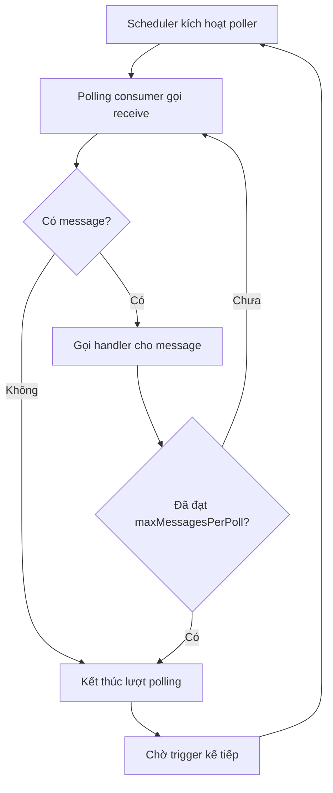

# maxMessagesPerPoll và giới hạn một lượt polling

Polling endpoint trong Spring Integration nhận message theo từng lần thực thi poller. Trong một lần như vậy, consumer có thể lấy một message rồi kết thúc, hoặc tiếp tục nhận nhiều message trước khi nhường quyền cho lần poll tiếp theo. `maxMessagesPerPoll` đặt giới hạn số message được xử lý trong một lượt polling.

Tham số này ảnh hưởng đến throughput, độ trễ, thời gian chiếm scheduler thread, transaction boundary và mức công bằng giữa nhiều polling task. Nó thường bị nhầm với kích thước queue, số consumer chạy đồng thời hoặc batch size của handler. Hiểu đúng phạm vi của nó giúp tránh cấu hình consumer xử lý quá ít message, giữ thread quá lâu hoặc làm backlog tăng liên tục.

## 1. Một lượt polling là gì?

Poller lên lịch một polling task. Khi task chạy, polling consumer gọi `receive()` trên input `PollableChannel`, chuyển message nhận được cho handler, rồi có thể tiếp tục gọi `receive()` để lấy message kế tiếp. Lượt polling kết thúc khi đạt giới hạn message, khi channel không còn message theo timeout nhận, hoặc khi quá trình xử lý kết thúc do lỗi hay điều kiện khác.



`maxMessagesPerPoll` giới hạn số message được nhận trong một lượt polling task. Với polling consumer, mỗi message thường được chuyển tới handler riêng. Ví dụ, giới hạn 10 không có nghĩa handler nhận một `List` gồm 10 message; nó có nghĩa consumer có thể gọi handler tối đa 10 lần trong lượt đó.

Nếu channel rỗng trước khi đạt giới hạn, consumer dừng lượt polling sớm sau khi thao tác nhận trả về không có message. Vì vậy, giới hạn là số tối đa, không phải số lượng phải xử lý đủ trong mọi lần poll.

## 2. Ý nghĩa các giá trị maxMessagesPerPoll

Trong cấu hình poller thông thường, giá trị mặc định là 1 nếu không có `PollerMetadata` hoặc cấu hình khác ghi đè. Khi đó mỗi lần poll chỉ xử lý tối đa một message. Có thể cấu hình số dương để xử lý nhiều message hơn trong một lượt, hoặc dùng `-1` để tiếp tục nhận cho đến khi channel không còn message.

| Giá trị | Hành vi |
|---|---|
| `1` | Tối đa một message mỗi lượt polling; đây là mặc định thông thường |
| Số dương lớn hơn `1` | Tối đa số message đã cấu hình trong một lượt |
| `-1` | Không đặt giới hạn số message; tiếp tục polling cho đến khi không nhận được message |

Giá trị `-1` không có nghĩa một thread xử lý mọi message mãi mãi trong mọi trường hợp. Lượt poll vẫn dừng khi thao tác nhận báo không còn message. Tuy nhiên, nếu producer liên tục bổ sung message nhanh hơn consumer lấy ra, một lượt poll có thể kéo dài rất lâu. Điều đó làm giảm thời gian scheduler dành cho các công việc khác nếu chúng dùng chung tài nguyên thực thi.

Khi cần một nhịp xử lý dễ dự đoán, thường nên đặt giới hạn dương. Chỉ dùng `-1` khi chủ đích là drain queue liên tục và đã đánh giá tác động lên fairness, thời gian xử lý và shutdown.

## 3. Cấu hình bằng annotation

Với polling consumer dùng `@ServiceActivator`, có thể đặt `maxMessagesPerPoll` trong `@Poller`:

```java
@Component
class PaymentConsumer {

    private final PaymentService paymentService;

    PaymentConsumer(PaymentService paymentService) {
        this.paymentService = paymentService;
    }

    @ServiceActivator(inputChannel = "payments.queue")
    @Poller(fixedDelay = "500", maxMessagesPerPoll = "20")
    public void handle(Payment payment) {
        paymentService.process(payment);
    }
}
```

Với cấu hình trên, poller được kích hoạt theo fixed delay 500 ms và mỗi lượt nhận tối đa 20 message từ `payments.queue`. Handler được gọi cho từng payload `Payment` nhận được. Nếu queue chỉ có 3 message, lượt đó xử lý 3 message rồi kết thúc khi lần nhận kế tiếp không có dữ liệu.

Input channel phải hỗ trợ polling, ví dụ `QueueChannel`. Gắn `@Poller` không biến `DirectChannel` hoặc `ExecutorChannel` thành `PollableChannel`; các channel đó dùng subscription semantics.

## 4. Cấu hình bằng Java DSL

Trong Java DSL, poller được gắn vào endpoint tiêu thụ channel:

```java
@Bean
IntegrationFlow paymentPollingFlow(PaymentService paymentService) {
    return IntegrationFlow
            .from("payments.queue")
            .handle(paymentService, "process", endpoint -> endpoint
                    .poller(Pollers.fixedDelay(500)
                            .maxMessagesPerPoll(20)))
            .get();
}
```

Hãy xác nhận `payments.queue` được resolve thành `PollableChannel` và endpoint đang được cấu hình dưới dạng polling consumer. Nếu dùng `Pollers` hoặc `PollerMetadata` dùng chung, kiểm tra xem metadata có thiết lập `maxMessagesPerPoll` riêng hay không; cấu hình tại endpoint và metadata mặc định phải được hiểu theo thứ tự áp dụng thực tế.

## 5. Phân biệt giới hạn polling với các giới hạn khác

Ba thông số thường bị gộp nhầm với nhau nhưng điều khiển ba phần khác nhau:

| Thông số | Điều khiển | Ví dụ |
|---|---|---|
| `maxMessagesPerPoll` | Số message tối đa trong một polling task | Mỗi lượt xử lý tối đa 20 message |
| Queue capacity | Số message có thể chờ trong channel có giới hạn | `QueueChannel(500)` giữ tối đa 500 message |
| Consumer concurrency | Số polling task/consumer có thể xử lý đồng thời theo cấu hình endpoint và executor | Nhiều consumer cùng đọc một queue |

Ví dụ, queue capacity là 500 và `maxMessagesPerPoll` là 20 không có nghĩa hệ thống chỉ xử lý tối đa 20 message đang tồn tại. Queue có thể giữ đến 500 message; mỗi lượt polling task nhận tối đa 20 message. Nếu có nhiều consumer, tổng số message xử lý đồng thời còn phụ thuộc số consumer, executor, scheduler và thời gian handler.

`maxMessagesPerPoll` cũng không phải batch size của API nghiệp vụ. Nếu muốn handler nhận một collection và xử lý theo batch, cần có bước gom nhóm hoặc một API batch riêng. Poller chỉ điều khiển số lần nhận message trong một lượt thực thi.

## 6. Tác động tới throughput và độ trễ

Khi queue luôn có message, giới hạn lớn hơn cho phép một polling task xử lý nhiều message trước khi kết thúc. Điều này có thể giảm overhead của việc lên lịch nhiều lượt poll và tăng throughput. Tuy nhiên, một lượt poll dài hơn sẽ giữ thread lâu hơn, làm các polling task khác chờ nếu dùng chung scheduler hoặc executor có ít thread.

Giả sử handler xử lý trung bình 10 ms mỗi message, một lượt poll 20 message cần khoảng 200 ms cho phần xử lý handler, chưa tính thời gian nhận, chuyển đổi và overhead. Với fixed delay 500 ms, thời gian giữa hai lần bắt đầu không đơn giản luôn bằng 500 ms; fixed delay được tính sau khi lần thực thi trước hoàn tất. Khi queue có backlog, khoảng thời gian từ lúc một message được gửi đến lúc xử lý còn phụ thuộc vị trí của nó trong queue và số consumer đang đọc.

Khi queue thường xuyên rỗng, tăng `maxMessagesPerPoll` không làm handler chạy nhanh hơn. Poller vẫn phải chờ trigger và lần nhận tiếp theo. Với tải nhỏ, giá trị 1 có thể đủ và dễ quan sát. Với tải cao, cần đo thời gian handler, queue depth và thời gian chờ để chọn batch limit.

Một cách ước lượng đơn giản khi queue luôn đầy là:

\[
\text{throughput} \approx \frac{\text{messages per poll}}{\text{poll execution time} + \text{delay between polls}}
\]

Đây chỉ là mô hình gần đúng cho một polling task. Nó chưa tính concurrency, scheduler contention, receive timeout, retry, lỗi và giới hạn downstream. Dùng metrics thực tế để điều chỉnh cấu hình.

## 7. `fixedDelay`, `fixedRate` và thời gian một lượt poll

`maxMessagesPerPoll` quyết định độ dài tối đa theo số message; trigger quyết định khi nào lượt polling tiếp theo được lên lịch.

| Trigger | Cách tính nhịp | Hệ quả khi handler chậm |
|---|---|---|
| `fixedDelay` | Chờ một khoảng delay sau khi lượt trước hoàn tất | Khoảng thời gian giữa hai lần bắt đầu tăng theo thời gian xử lý |
| `fixedRate` | Lên lịch theo nhịp thời gian cố định | Lượt thực thi dài có thể làm lịch bị trễ; cần xét năng lực scheduler |
| `cron` | Kích hoạt theo các mốc lịch | Có thể bỏ lỡ mục tiêu thời gian nếu một lượt kéo dài hoặc tài nguyên thực thi bận |

Không nên dùng `maxMessagesPerPoll` để thay thế trigger. Nếu muốn tăng số message mỗi phút, có thể điều chỉnh cả số message mỗi lượt lẫn khoảng cách giữa các lượt, nhưng phải xét tổng thời gian xử lý và tải của downstream.

## 8. Receive timeout và lúc queue rỗng

Polling consumer gọi `receive()` trên `PollableChannel`. Lần nhận có thể chờ message trong khoảng timeout được cấu hình. Khi không có message, timeout kết thúc và lượt poll có thể dừng trước khi đạt `maxMessagesPerPoll`.

`receiveTimeout` và `maxMessagesPerPoll` giải quyết hai vấn đề khác nhau:

- `receiveTimeout` giới hạn thời gian chờ cho một lần nhận message.
- `maxMessagesPerPoll` giới hạn tổng số message được nhận trong cả lượt polling task.

Nếu timeout quá dài, một lượt poll có thể giữ thread khi queue rỗng. Nếu timeout quá ngắn, consumer có thể kết thúc lượt ngay khi queue tạm thời rỗng rồi đợi trigger tiếp theo. Cần chọn timeout cùng fixed delay và đặc tính burst của producer.

Với `maxMessagesPerPoll = -1`, lần nhận cuối cùng thường kết thúc lượt poll khi channel không còn message và receive trả về `null`. Vì vậy, timeout nhận cũng ảnh hưởng thời gian kết thúc của lượt không giới hạn.

## 9. Polling liên tục và nguy cơ chiếm dụng scheduler

Giá trị `-1` hữu ích khi muốn drain backlog: consumer tiếp tục nhận message cho tới khi queue rỗng. Nhưng trong một hệ thống có producer liên tục, queue có thể không bao giờ rỗng. Khi đó, một lượt poll có thể chiếm thread trong thời gian dài và làm các poller khác dùng chung scheduler bị trễ.

Giới hạn dương tạo điểm nhường quyền rõ ràng. Ví dụ, `maxMessagesPerPoll = 50` cho phép consumer xử lý tối đa 50 message rồi kết thúc lượt, để scheduler lên lịch các tác vụ khác. Điều này không đảm bảo fairness tuyệt đối, nhưng giúp giới hạn thời gian chiếm dụng theo lượng công việc.

Nếu cần throughput cao và nhiều consumer độc lập, hãy xem xét executor/scheduler có kích thước phù hợp hoặc tăng số consumer theo thiết kế. Không tăng số thread chỉ để bù cho một handler chậm hoặc downstream đã quá tải.

## 10. Transaction và advice chain khi xử lý nhiều message

Poller có thể sử dụng advice chain để áp dụng transaction, retry hoặc các hành vi xuyên suốt cho polling task. Khi `maxMessagesPerPoll` lớn hơn 1, cần xác minh transaction advice đang bao quanh phần nào: một polling task, một lần nhận/handler hay một ranh giới do adapter và transaction manager định nghĩa.

Không suy ra rằng một lượt xử lý 20 message mặc nhiên là một transaction nguyên tử. Cũng không giả định rằng transaction của database sẽ rollback thao tác `receive()` trên mọi `PollableChannel`. Với `QueueChannel` bộ nhớ, message thường bị lấy khỏi queue khi nhận; khả năng khôi phục phụ thuộc implementation channel, message store và transaction support cụ thể.

Trước khi chọn batch limit, hãy xác định:

- Một message thất bại có ảnh hưởng tới những message đã xử lý trước đó trong cùng lượt không?
- Transaction commit theo từng message hay theo một phạm vi khác?
- Retry lặp lại handler của một message hay toàn bộ polling task?
- Message đã nhận nhưng chưa xử lý xong được phục hồi thế nào khi tiến trình dừng?
- Consumer có idempotent khi message được gửi lại không?

Nếu yêu cầu mỗi message có transaction riêng, hãy cấu hình và kiểm thử transaction boundary tương ứng. Nếu muốn xử lý batch như một đơn vị nghiệp vụ, hãy thiết kế batch handler hoặc aggregator rõ ràng thay vì dựa vào `maxMessagesPerPoll`.

## 11. Xử lý lỗi trong một lượt polling

Khi handler ném exception, kết quả của lượt polling phụ thuộc error handling, advice chain, retry và recovery được cấu hình. Không nên mặc định consumer sẽ bỏ qua message lỗi và tiếp tục lấy message kế tiếp. Một lỗi có thể làm kết thúc lượt hiện tại hoặc được xử lý bởi error flow theo endpoint.

| Tình huống | Điều cần xác định |
|---|---|
| Message đầu tiên của lượt bị lỗi | Poller có kết thúc lượt, retry hay gửi lỗi tới error channel? |
| Message thứ N bị lỗi | Những message trước đó đã commit chưa? Các message sau có được lấy tiếp không? |
| Retry được cấu hình | Retry áp dụng cho handler của message hay phạm vi polling task? |
| Poison message | Có recovery flow hoặc dead-letter path để tránh lặp vô hạn không? |
| Error handler nuốt exception | Runtime có coi message đã xử lý thành công dù nghiệp vụ thất bại không? |

Hãy ghi log message ID/correlation ID, flow ID, số thứ tự message trong lượt nếu có thể đo được, exception gốc và retry count. Điều này giúp xác định lỗi ảnh hưởng một message hay cả lượt poll.

## 12. Tuning theo tình huống tải

| Tình huống | Hướng cấu hình để thử | Điều cần theo dõi |
|---|---|---|
| Tải thấp, message đến thưa | `maxMessagesPerPoll = 1` và delay phù hợp | Độ trễ từ lúc gửi tới lúc bắt đầu xử lý |
| Burst ngắn, handler nhanh | Giới hạn dương lớn hơn 1 | Queue depth sau burst và thời gian một lượt poll |
| Backlog dài, muốn drain nhanh | Tăng giới hạn dương hoặc thử `-1` nếu phù hợp | Scheduler contention, fairness và thời gian shutdown |
| Nhiều flow polling dùng chung scheduler | Giới hạn dương vừa phải | Độ trễ poller khác và số task chờ |
| Handler chậm do I/O | Đo thời gian I/O, cân nhắc executor/concurrency có giới hạn | Thread bận, connection pool và timeout downstream |
| Downstream bị giới hạn tốc độ | Giảm concurrency hoặc batch limit, điều chỉnh delay | Retry, rate limit và queue backlog |

Không có một giá trị `maxMessagesPerPoll` tối ưu cho mọi flow. Cấu hình nên dựa trên tải thực tế, thời gian xử lý, yêu cầu latency và khả năng của hệ thống downstream.

## 13. Chẩn đoán khi giới hạn polling không như mong đợi

Khi consumer xử lý ít hoặc nhiều message hơn dự kiến, kiểm tra theo thứ tự:

1. Xác nhận endpoint thực sự là polling consumer và input channel là `PollableChannel`.
2. Kiểm tra `maxMessagesPerPoll` ở annotation, Java DSL và `PollerMetadata` dùng chung; xác định cấu hình nào đang có hiệu lực.
3. Kiểm tra poller có trigger hoạt động và endpoint đang chạy không.
4. Kiểm tra queue depth trước và sau một lượt poll để biết lượt kết thúc do đạt giới hạn hay do channel rỗng.
5. Kiểm tra `receiveTimeout`, thời gian handler và lỗi phát sinh giữa lượt.
6. Kiểm tra số consumer, scheduler/executor và mức độ cạnh tranh thread.
7. Đối chiếu retry, transaction và error channel để hiểu message đã nhận được xử lý ra sao.

| Triệu chứng | Nguyên nhân thường gặp |
|---|---|
| Mỗi lượt chỉ xử lý một message | `maxMessagesPerPoll` đang là mặc định 1 hoặc metadata ghi đè |
| Đặt 20 nhưng chỉ xử lý 4 | Queue chỉ có 4 message hoặc receive trả về rỗng trước khi đạt giới hạn |
| Một lượt kéo dài bất thường | Handler chậm, receive timeout dài, retry hoặc `maxMessagesPerPoll = -1` |
| Poller khác bị trễ | Một lượt poll chiếm scheduler/executor dùng chung quá lâu |
| Throughput không tăng khi tăng limit | Bottleneck ở handler, database, network hoặc downstream |
| Message sau message lỗi không được xử lý ngay | Exception làm kết thúc lượt hoặc retry/recovery đang chi phối |

Metrics hữu ích gồm queue depth, số message xử lý mỗi lượt, poll duration, handler duration, poll delay thực tế, retry count, error count và số thread bận. Kết hợp metrics với message ID/correlation ID để phân biệt backlog do producer nhanh, consumer chậm hay endpoint không được kích hoạt.

## 14. Nguyên tắc chọn maxMessagesPerPoll

- **Bắt đầu từ giá trị nhỏ và đo:** mặc định 1 là điểm xuất phát dễ kiểm soát; tăng khi metrics cho thấy overhead polling đáng kể.
- **Dùng giới hạn dương để nhường scheduler:** giới hạn một lượt giúp tránh một consumer giữ thread quá lâu khi backlog liên tục.
- **Chỉ dùng `-1` khi cần drain:** bảo đảm channel có thể trở nên rỗng và đánh giá tác động của một lượt kéo dài.
- **Tách batch limit khỏi queue capacity:** một giới hạn quyết định số message mỗi lượt; giới hạn kia quyết định số message chờ trong channel.
- **Tách batch limit khỏi concurrency:** muốn tăng song song phải cấu hình consumer/executor phù hợp và bảo đảm handler an toàn khi chạy đồng thời.
- **Đánh giá transaction và retry:** không giả định cả batch là một transaction hoặc lỗi một message sẽ được bỏ qua tự động.
- **Theo dõi downstream:** tăng giới hạn không giúp nếu database, API hoặc connection pool đã là nút thắt.
- **Kiểm thử shutdown:** xác định điều gì xảy ra khi stop endpoint giữa một lượt đang xử lý nhiều message.

Trước khi chọn giới hạn cho polling endpoint, hãy trả lời: mỗi lượt được phép giữ thread bao lâu, backlog cần được drain nhanh đến mức nào, poller khác cần được chia sẻ tài nguyên ra sao và lỗi giữa lượt ảnh hưởng những message nào. `maxMessagesPerPoll` là một nút điều chỉnh quan trọng của consumer runtime, nhưng chỉ phát huy hiệu quả khi được chọn cùng trigger, timeout, concurrency và chính sách xử lý lỗi.
