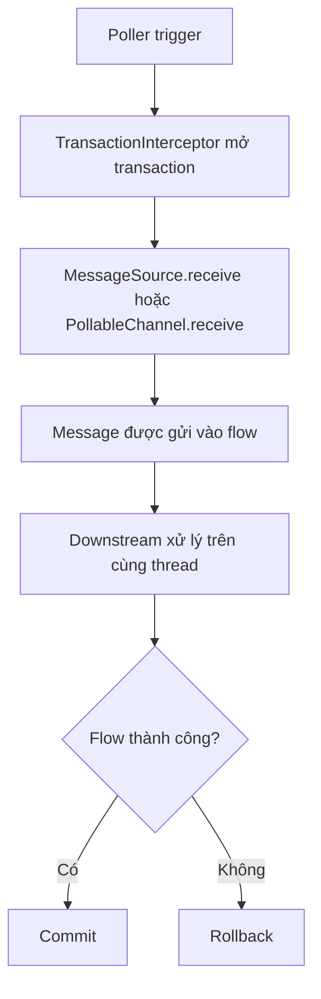
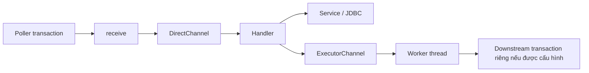

# Transaction trong poller

Poller của Spring Integration không chỉ quyết định thời điểm consumer gọi `receive()`. Nó còn là điểm thích hợp để mở transaction cho một message flow được khởi chạy bởi lịch polling. Điều này đặc biệt quan trọng khi nguồn message có khả năng tham gia transaction: thao tác lấy message và các cập nhật dữ liệu downstream có thể cùng commit hoặc rollback.

Điểm cốt lõi là **transaction phải bắt đầu trước `receive()`**. Nếu chỉ đặt `@Transactional` ở một service phía sau, thao tác nhận message đã xảy ra trước khi transaction đó bắt đầu. Khi xử lý thất bại, database có thể rollback nhưng message đã bị lấy khỏi nguồn. Bài học này trình bày transaction boundary của poller, cách cấu hình bằng Java DSL/XML, ảnh hưởng của channel và executor, cũng như cách kiểm tra rollback thực tế.

## 1. Vì sao poller cần transaction riêng?

Có nhiều cách khởi chạy một message flow: gọi gateway, gọi `MessageChannel.send()`, nhận message từ inbound adapter, scheduler hoặc poller. Với flow được gọi trực tiếp từ code ứng dụng, có thể dùng cơ chế transaction thông thường của Spring, ví dụ `@Transactional` trên phương thức gateway/service.

Poller khác ở chỗ nó tự khởi chạy flow theo trigger. Không có caller nghiệp vụ bên ngoài mở transaction trước khi flow bắt đầu. Spring Integration vì vậy cho phép khai báo transaction ngay trên poller để transaction được mở trước thao tác lấy message.



Với nguồn và các thao tác dữ liệu cùng tham gia transaction manager, rollback có thể hoàn tác cả thao tác nhận message lẫn các cập nhật downstream. Đây là ý nghĩa của một đơn vị công việc `receive-and-forward` trong poller.

Transaction không tự biến một nguồn không hỗ trợ transaction thành transactional. Ví dụ, một file trên filesystem hoặc một HTTP API bên ngoài không tự quay lại trạng thái cũ chỉ vì database rollback. Với các nguồn đó, cần transaction synchronization, cơ chế staging/rename, idempotency hoặc quy trình bù trừ phù hợp.

## 2. Transaction boundary bao quanh thao tác nào?

Transaction advice của poller được áp dụng quanh tác vụ polling (`doPoll`). Transaction bắt đầu trước khi poller gọi `receive()` và bao quanh phần gửi message cùng các bước downstream vẫn chạy đồng bộ trong cùng thread.

| Thành phần | Có nằm trong transaction của poller không? | Điều kiện |
| --- | --- | --- |
| `MessageSource.receive()` | Có | Nguồn dùng tài nguyên mà transaction manager quản lý hoặc có transaction synchronization tương ứng. |
| `PollableChannel.receive()` | Được gọi trong transaction | Việc lấy message chỉ rollback được nếu channel/store hỗ trợ transaction. |
| Handler qua `DirectChannel` | Có thể | Handler chạy đồng bộ trên cùng thread và exception truyền ngược qua transaction boundary. |
| Handler phía sau `ExecutorChannel` | Không tự động | Executor chuyển xử lý sang thread khác. |
| Handler phía sau một `QueueChannel` khác | Không tự động | Message được chuyển vào queue; poller ban đầu có thể commit ngay sau khi enqueue thành công. |
| Service có `@Transactional` riêng | Có transaction riêng hoặc tham gia transaction hiện tại | Phụ thuộc thread, transaction manager và propagation. |

Transaction context của Spring thường gắn với thread hiện tại. Vì vậy, một flow có thể đi qua nhiều endpoint mà vẫn giữ cùng transaction nếu các bước tiếp tục trên cùng thread. Khi chuyển qua `ExecutorChannel`, pollable channel khác hoặc tự tạo thread mới, transaction context không tự truyền sang thread mới.



Nếu message được chuyển thành công sang thread khác, transaction của poller có thể commit dù xử lý ở worker thread sau đó thất bại. Đây là lý do không nên đặt một ranh giới bất đồng bộ giữa thao tác nhận và phần cập nhật dữ liệu mà mình muốn rollback cùng nhau, trừ khi channel ở ranh giới đó có cơ chế transaction riêng.

## 3. Cấu hình transaction cho poller bằng Java DSL

Java DSL cung cấp `Pollers` và `PollerSpec`. Phương thức `transactional(transactionManager)` gắn một `TransactionInterceptor` vào tác vụ polling.

Ví dụ một `MessageSource` đọc dữ liệu từ nguồn đã được cấu hình sẵn, sau đó flow xử lý message trên cùng thread:

```java
@Configuration
class OrderPollingConfiguration {

    @Bean
    IntegrationFlow orderPollingFlow(
            MessageSource<?> orderSource,
            PlatformTransactionManager transactionManager,
            OrderHandler orderHandler) {

        return IntegrationFlow.from(orderSource, endpoint -> endpoint.poller(
                Pollers.fixedDelay(1000)
                    .maxMessagesPerPoll(5)
                    .transactional(transactionManager)))
            .handle(orderHandler, "process")
            .get();
    }
}
```

Trong ví dụ:

- `fixedDelay(1000)` yêu cầu poll theo khoảng delay một giây.
- `maxMessagesPerPoll(5)` giới hạn số lần gọi `MessageSource.receive()` trong một lần chạy poll.
- `transactional(transactionManager)` dùng transaction manager được inject để bao quanh tác vụ polling.
- Handler được gọi trên cùng thread trong trường hợp flow nối qua `DirectChannel` mặc định. `orderSource` và các thao tác dữ liệu downstream phải tham gia transaction manager đó nếu cần rollback cùng nhau.

Có thể gọi `.transactional()` không truyền đối số khi ứng dụng có transaction manager mặc định mà Spring Integration có thể resolve. Trong ứng dụng có nhiều transaction manager, nên truyền manager rõ ràng để tránh dùng nhầm tài nguyên.

`PollerSpec.transactional(transactionManager)` dùng `TransactionInterceptor` với `DefaultTransactionAttribute`. Nếu cần propagation, isolation, timeout hoặc rollback rule riêng, hãy tạo `TransactionInterceptor` với transaction attribute phù hợp rồi truyền vào overload `.transactional(transactionInterceptor)`, hoặc cấu hình advice chain.

## 4. Cấu hình transaction bằng XML

Trong XML namespace, đặt `<transactional/>` bên trong `<poller>`:

```xml
<int:service-activator id="processOrders"
                       input-channel="ordersQueue"
                       ref="orderHandler"
                       method="process">
    <int:poller fixed-delay="1000"
                max-messages-per-poll="5">
        <int:transactional transaction-manager="transactionManager"
                           propagation="REQUIRED"
                           isolation="READ_COMMITTED"
                           timeout="30"
                           read-only="false"/>
    </int:poller>
</int:service-activator>
```

Các thuộc tính thường dùng:

| Thuộc tính | Ý nghĩa |
| --- | --- |
| `transaction-manager` | Transaction manager quản lý tài nguyên được sử dụng trong flow. Nếu bỏ qua, Spring Integration mặc định tìm bean tên `transactionManager`. |
| `propagation` | Quy tắc tham gia hoặc tạo transaction, ví dụ `REQUIRED`, `REQUIRES_NEW`. |
| `isolation` | Mức cô lập của transaction, phụ thuộc database/transaction manager. |
| `timeout` | Thời gian tối đa cho transaction, tính theo giây trong XML ví dụ. |
| `read-only` | Đánh dấu transaction chỉ đọc; đặt `false` khi flow cần cập nhật dữ liệu. |

Nếu chỉ cần transaction cho poller, `<transactional/>` là cách cấu hình gọn. Nếu cần nhiều AOP advice, XML không cho khai báo đồng thời `<transactional/>` và `<advice-chain/>` trên cùng poller. Thay vào đó, khai báo `TransactionInterceptor` qua `<tx:advice/>` rồi đưa nó vào `<advice-chain/>` cùng các advice khác. Thứ tự advice quyết định thứ tự bao quanh tác vụ polling.

## 5. `maxMessagesPerPoll` và kích thước transaction

`maxMessagesPerPoll` quy định số lần poller gọi `receive()` trong một lần chạy poll. Nó không phải giới hạn số row mà một SQL query trả về, và cũng không mặc nhiên có nghĩa mỗi message được xử lý trong một transaction độc lập.

Vì transaction advice bao quanh tác vụ polling, một lần chạy có thể giữ transaction mở qua nhiều vòng nhận message, tùy `maxMessagesPerPoll` và loại consumer. Cần xem xét kích thước transaction khi chọn giá trị này.

| Cấu hình | Ý nghĩa | Ảnh hưởng cần cân nhắc |
| --- | --- | --- |
| `maxMessagesPerPoll = 1` | Một lần nhận trong một lần poll. | Transaction ngắn, dễ cô lập lỗi; overhead trigger/transaction có thể cao hơn. |
| Giá trị dương lớn hơn 1 | Nhận nhiều message liên tiếp trong cùng tác vụ poll. | Có thể giữ transaction và connection lâu hơn; rollback có thể ảnh hưởng nhiều message trong lượt. |
| Giá trị âm (thường `-1`) | Tiếp tục nhận cho đến khi `receive()` trả `null`. | Có thể tạo lượt poll dài khi backlog liên tục; cần giới hạn bằng năng lực xử lý và transaction timeout. |
| Giá trị `0` | Từ Spring Integration 5.5, bỏ qua lời gọi `MessageSource.receive()` cho endpoint hỗ trợ thuộc tính này. | Có thể dùng như một cách tạm dừng polling; không phải cấu hình batch thông thường. |

Giá trị mặc định khác nhau theo loại consumer. `PollingConsumer` thường mặc định `-1`, còn `SourcePollingChannelAdapter` thường mặc định `1`. Hãy đặt rõ `maxMessagesPerPoll` nếu kích thước transaction có ý nghĩa với nghiệp vụ.

Với JDBC inbound channel adapter, cần phân biệt `maxMessagesPerPoll` với `max-rows`: thuộc tính đầu điều khiển số lần thực thi `receive()`/query trong một poll; thuộc tính sau giới hạn số row được lấy trong mỗi lần query. Đặt `maxMessagesPerPoll` lớn có thể khiến query chạy liên tiếp trong cùng lượt polling.

## 6. Transactional QueueChannel và MessageStore

Một lỗi thiết kế thường gặp là bật transaction cho poller rồi giả định message được lấy từ bất kỳ `QueueChannel` nào cũng sẽ quay lại queue khi rollback. Điều đó không đúng với `QueueChannel` mặc định.

`QueueChannel` mặc định sử dụng queue trong bộ nhớ. Khi `receive()` lấy message, message bị remove khỏi queue; transaction JDBC/JPA không tự khôi phục thao tác remove trong một Java collection. Vì vậy, nếu handler lỗi sau khi lấy message từ in-memory `QueueChannel`, message có thể đã mất dù database rollback.

Để việc nhận message có thể rollback, dùng `QueueChannel` được backing bởi persistent transactional `MessageStore`, chẳng hạn `JdbcChannelMessageStore`:

```xml
<int:channel id="ordersQueue">
    <int:queue message-store="ordersChannelStore"/>
</int:channel>

<bean id="ordersChannelStore"
      class="org.springframework.integration.jdbc.store.JdbcChannelMessageStore">
    <property name="dataSource" ref="dataSource"/>
    <property name="channelMessageStoreQueryProvider"
              ref="channelMessageStoreQueryProvider"/>
</bean>
```

Transaction manager của poller cần quản lý cùng `DataSource` với `JdbcChannelMessageStore` và các cập nhật nghiệp vụ muốn commit/rollback cùng nhau. Khi message bị remove trong transaction, thao tác remove chỉ được commit khi transaction thành công; nếu rollback, message vẫn còn trong store để nhận lại.

Đây là cách tạo một ranh giới queue có persistence và transaction. Các channel/store khác có semantics riêng; hãy xác nhận implementation cụ thể hỗ trợ transaction trước khi dựa vào rollback.

## 7. Ví dụ JDBC inbound adapter: nhận và đánh dấu xử lý nguyên tử

JDBC inbound channel adapter thường chạy một câu `SELECT` để lấy dữ liệu, sau đó có thể chạy `UPDATE` để đánh dấu bản ghi đã được lấy. Nếu poller dùng transaction manager quản lý đúng `DataSource`, hai câu lệnh có thể nằm trong cùng transaction.

```xml
<int-jdbc:inbound-channel-adapter id="pendingOrders"
        query="select * from orders where status = 'PENDING'"
        update="update orders set status = 'PROCESSING' where id in (:id)"
        data-source="dataSource"
        channel="ordersForProcessing">
    <int:poller fixed-delay="1000" max-messages-per-poll="1">
        <int:transactional transaction-manager="transactionManager"/>
    </int:poller>
</int-jdbc:inbound-channel-adapter>
```

Nếu downstream nối bằng `DirectChannel` và handler cập nhật cùng database trên cùng transaction manager, lỗi downstream có thể rollback cả `SELECT`/`UPDATE` trong lượt nhận. Bản ghi trở lại trạng thái trước đó và có thể được poll lại.

Ví dụ này giả định query, update và handler dùng cùng transactional `DataSource`, và exception thực sự thoát khỏi transaction boundary. Nếu handler bắt exception rồi trả về bình thường, transaction interceptor có thể commit. Nếu flow chuyển sang executor/queue khác, transaction của poller có thể kết thúc trước khi xử lý hoàn tất.

## 8. Transaction boundary khi flow chuyển qua channel hoặc thread

Transaction context thông thường được gắn với thread. Điều này dẫn đến ba trường hợp quan trọng:

**DirectChannel:** gửi và xử lý đồng bộ. Nếu handler downstream ném unchecked exception và exception truyền ngược về poller, transaction có thể rollback.

**ExecutorChannel:** message được giao cho worker thread. Poller chỉ biết việc bàn giao thành công; transaction ban đầu có thể commit trước khi worker hoàn tất. Muốn worker xử lý trong transaction, hãy cấu hình transaction riêng tại endpoint worker.

**QueueChannel downstream:** poller gửi message vào queue rồi kết thúc. Transaction poller không tự kéo dài tới lần consumer khác lấy message. Nếu cần bảo đảm message được lưu bền vững cùng transaction, dùng transactional persistent channel/store hoặc broker có transaction phù hợp.

Không dùng `@Transactional` trên service downstream để suy ra rằng thao tác `receive()` đã được bảo vệ. Annotation đó chỉ mở transaction khi phương thức service được gọi qua proxy; nếu nó chạy sau khi poller đã lấy message thì transaction bắt đầu quá muộn để rollback việc nhận.

## 9. Rollback rule và xử lý exception

Spring transaction mặc định rollback với `RuntimeException` và `Error`. Checked exception được ném trực tiếp qua transaction interceptor thường không kích hoạt rollback theo mặc định, trừ khi transaction attribute khai báo rollback rule phù hợp. Tuy nhiên, Spring Integration có thể bọc exception của handler trong `MessagingException`/`MessageHandlingException` (đều là runtime exception). Vì vậy, cần xem exception mà transaction interceptor thực sự nhận được, không chỉ nhìn kiểu exception gốc trong cause chain.

Các tình huống cần kiểm tra:

- Handler ném `RuntimeException` và exception thoát khỏi transaction interceptor: transaction được đánh dấu rollback theo mặc định.
- Handler ném checked exception: kiểm tra exception có được Spring Integration bọc thành runtime `MessagingException` hay không; nếu checked exception đi thẳng qua interceptor thì cần khai báo rollback rule.
- Handler bắt exception rồi bỏ qua: transaction interceptor thấy lời gọi hoàn tất bình thường và thường commit, trừ khi code chủ động đánh dấu rollback-only.
- Error flow xử lý lỗi bất đồng bộ sau khi poller đã bàn giao message: lỗi đó không tự quay lại transaction poller.
- Một transaction tham gia transaction có sẵn (`REQUIRED`) có thể bị đánh dấu rollback-only bởi participant; caller có thể gặp `UnexpectedRollbackException` khi commit.

Hãy để exception cần rollback truyền qua transaction boundary hoặc đánh dấu transaction rollback-only một cách tường minh. Đừng nuốt exception chỉ để tránh log lỗi nếu nghiệp vụ yêu cầu message phải được nhận lại.

## 10. Retry và thứ tự advice

Retry và transaction thường được kết hợp để xử lý lỗi tạm thời, nhưng thứ tự advice làm thay đổi phạm vi transaction.

- **Transaction bao ngoài retry:** một transaction bao trùm toàn bộ các lần thử. Backoff có thể giữ connection/lock lâu, và mọi lần thử dùng chung transaction đó.
- **Retry bao ngoài transaction:** mỗi lần retry có thể đi qua một transaction mới nếu transaction advice mở transaction cho mỗi invocation. Cách này thường phù hợp hơn khi cần rollback riêng từng lần thử, nhưng phải cấu hình propagation và thứ tự advice có chủ đích.

Khi poller cần nhiều advice, đưa `TransactionInterceptor` và retry advice vào cùng advice chain, rồi xác định thứ tự bằng kiểm thử. Không giả định chỉ cần thêm hai annotation là đã có transaction per attempt.

Một lựa chọn khác là retry ở endpoint handler thay vì retry toàn bộ poll task. Khi đó cần quyết định liệu việc nhận message có được giữ trong transaction trong suốt các lần retry hay không. Nếu nguồn message chỉ được xác nhận sau commit, retry và rollback có thể tương tác với redelivery của broker; tránh tạo hai lớp retry không giới hạn cùng lúc.

## 11. TransactionSynchronizationFactory: hành động sau commit/rollback

Một số `MessageSource` lấy dữ liệu từ nguồn không có transaction thực sự, ví dụ file trên filesystem. Spring Integration hỗ trợ `TransactionSynchronizationFactory` để đồng bộ hành động phụ trợ với kết quả transaction.

Ví dụ inbound file adapter có thể di chuyển file sang thư mục thành công sau commit và sang thư mục lỗi sau rollback:

```xml
<int-file:inbound-channel-adapter id="filePoller"
        directory="/data/inbox"
        channel="filesToProcess">
    <int:poller fixed-delay="5000">
        <int:transactional transaction-manager="transactionManager"
                           synchronization-factory="fileSyncFactory"/>
    </int:poller>
</int-file:inbound-channel-adapter>

<int:transaction-synchronization-factory id="fileSyncFactory">
    <int:after-commit expression="payload.renameTo(new java.io.File('/data/success/' + payload.name))"/>
    <int:after-rollback expression="payload.renameTo(new java.io.File('/data/failed/' + payload.name))"/>
</int:transaction-synchronization-factory>
```

Các expression trên chỉ minh họa ý tưởng; cần kiểm tra kết quả rename, quyền filesystem và xử lý lỗi của thao tác di chuyển trong ứng dụng thực tế. Synchronization điều phối thời điểm thực hiện hành động theo commit/rollback; nó không biến filesystem thành transactional resource. Nếu process dừng giữa commit và thao tác after-commit, cần cơ chế phục hồi hoặc reconciliation.

Spring Integration cũng cung cấp `PassThroughTransactionSynchronizationFactory` từ phiên bản 5.0. Khi transaction interceptor tồn tại trên poller và không cấu hình factory riêng, factory này được áp dụng cho polling endpoint để gắn message được poll vào transaction context. Điều đó giúp framework đưa message lỗi vào `MessagingException.failedMessage` khi exception phát sinh sau transaction advice.

## 12. Transaction manager phải quản lý đúng tài nguyên

Một transaction manager chỉ quản lý các resource mà implementation của nó hỗ trợ. Ví dụ:

| Tài nguyên | Transaction manager thường dùng | Lưu ý |
| --- | --- | --- |
| JDBC `DataSource` | `DataSourceTransactionManager` hoặc `JdbcTransactionManager` | Store và service phải dùng đúng `DataSource`/transaction context. |
| JPA `EntityManagerFactory` | `JpaTransactionManager` | Entity manager và repository phải tham gia cùng transaction. |
| JMS session | `JmsTransactionManager` | Chỉ quản lý session/connection factory JMS tương ứng; phối hợp JDBC cần thiết kế thêm. |
| Nhiều resource cần atomic commit | JTA/XA khi hạ tầng hỗ trợ | Cấu hình phức tạp và có chi phí; không phải mọi resource hỗ trợ XA. |

Nếu flow cập nhật JDBC rồi publish message lên broker khác, một JDBC transaction đơn lẻ không làm cho hai hệ thống commit nguyên tử. Có thể dùng XA khi đáp ứng được yêu cầu và hạ tầng, hoặc thường gặp hơn là transactional outbox: ghi dữ liệu nghiệp vụ và bản ghi outbox trong cùng database transaction, sau đó publisher riêng chuyển outbox sang broker theo cơ chế idempotent.

## 13. Kiểm thử transaction trong poller

Một bài kiểm thử hữu ích cần xác minh kết quả ở resource, không chỉ kiểm tra handler có ném exception.

1. Tạo message trong transactional persistent queue hoặc tạo bản ghi nguồn trong database.
2. Cấu hình poller với transaction manager quản lý store và database liên quan.
3. Cho handler cập nhật một bản ghi rồi cố ý ném exception.
4. Chờ poll attempt kết thúc và kiểm tra cập nhật nghiệp vụ đã rollback.
5. Kiểm tra message vẫn còn trong persistent store hoặc bản ghi nguồn vẫn ở trạng thái có thể poll lại.
6. Cho handler chạy thành công rồi xác minh message bị remove/đánh dấu xử lý và dữ liệu nghiệp vụ được commit.

Nếu kiểm thử chỉ dùng in-memory `QueueChannel`, đừng dùng việc message không quay lại queue làm bằng chứng transaction manager lỗi: queue đó vốn không phải transactional store. Hãy dùng JDBC-backed `QueueChannel` hoặc một nguồn message có transaction thực sự.

## 14. Chẩn đoán lỗi thường gặp

| Triệu chứng | Nguyên nhân có thể | Hướng kiểm tra |
| --- | --- | --- |
| Database rollback nhưng message không xuất hiện lại | Nguồn/channel không hỗ trợ transaction hoặc receive nằm ngoài transaction. | Kiểm tra `receive()` có nằm trong poller transaction không; xem store có transactional không. |
| Message mất khi handler ném exception | Dùng in-memory `QueueChannel` hoặc nguồn non-transactional. | Chuyển sang persistent transactional store hoặc thiết kế retry/recovery cho nguồn. |
| Database commit dù downstream báo lỗi | Exception bị bắt/swallow, error flow chạy bất đồng bộ hoặc flow đã qua thread boundary. | Kiểm tra exception propagation, channel topology và transaction thread. |
| Handler chạy nhưng không thấy transaction active | Thiếu `<transactional/>`/`.transactional()`, sai transaction manager hoặc endpoint không phải polling consumer như dự kiến. | Kiểm tra loại channel, poller metadata và bean transaction manager. |
| Rollback không tác động tới repository | Repository dùng `DataSource`/`EntityManagerFactory` khác hoặc tự mở connection ngoài transaction. | So sánh resource và transaction manager của poller với service. |
| Checked exception không rollback | Checked exception đi thẳng qua transaction interceptor; trong message flow, exception cũng có thể được bọc thành runtime `MessagingException`. | Kiểm tra exception mà interceptor thực sự nhận được; khai báo rollback rule nếu checked exception đi qua trực tiếp. |
| Poller giữ lock/connection quá lâu | `maxMessagesPerPoll` lớn, receive timeout dài hoặc handler chậm. | Giảm batch, timeout và thời gian xử lý; xem xét chia nhỏ transaction. |
| Message được xử lý lặp sau restart | Transaction rollback/redelivery là hành vi ít nhất một lần, hoặc commit kết quả không đồng bộ với nguồn. | Thiết kế idempotency, unique key và outbox/inbox. |
| After-commit action thất bại | Filesystem/HTTP không thuộc transaction hoặc process dừng sau commit. | Ghi trạng thái cần hoàn tất và chạy reconciliation/retry cho action phụ trợ. |

Khi điều tra, ghi nhận tối thiểu poller ID, thời điểm bắt đầu/kết thúc poll, thread name, transaction manager, transaction active/rollback-only, message ID, correlation ID, channel/store, exception gốc và trạng thái commit/rollback. Dữ liệu này giúp xác định lỗi nằm ở receive, handler, channel handoff hay transaction manager.

## 15. Checklist thiết kế poller transaction

- Nguồn message có thực sự hỗ trợ transaction hoặc transaction synchronization không?
- Transaction có bắt đầu trước `receive()` không?
- Transaction manager có quản lý đúng `DataSource`, `EntityManagerFactory` hoặc broker resource không?
- Flow downstream có giữ cùng thread tới hết phần công việc cần rollback không?
- Nếu dùng `QueueChannel`, nó là in-memory hay persistent transactional `MessageStore`?
- `maxMessagesPerPoll`, `receiveTimeout` và transaction timeout có tạo transaction quá dài không?
- Checked exception, retry và recovery callback có rollback theo đúng chính sách không?
- Có nhiều advice không? Thứ tự retry/transaction đã được xác định và kiểm thử chưa?
- Có cần after-commit/after-rollback action hoặc transactional outbox không?
- Handler có idempotent khi broker/source redeliver message không?

## 16. Điểm cần nhớ

- Transaction của poller bắt đầu trước `receive()`, nhờ đó thao tác lấy message từ nguồn transactional có thể được rollback.
- Transaction context gắn với thread. `DirectChannel` giữ cùng thread; `ExecutorChannel` và một pollable channel downstream tạo ranh giới khác.
- Transaction không làm cho in-memory `QueueChannel`, file hoặc HTTP trở thành transactional resource.
- Muốn rollback việc lấy message từ `QueueChannel`, dùng persistent transactional `MessageStore` và transaction manager quản lý cùng store.
- `maxMessagesPerPoll` ảnh hưởng số lần nhận trong một tác vụ polling và có thể làm transaction dài hơn.
- Retry, transaction synchronization, broker redelivery và outbox giải quyết các phần khác nhau của độ tin cậy; cần thiết kế phối hợp thay vì giả định một transaction bao trùm mọi hệ thống.

## Tài liệu tham khảo

- [Spring Integration Reference — Transaction Support](https://docs.spring.io/spring-integration/reference/transactions.html)
- [Spring Integration Reference — Message Endpoints và Poller](https://docs.spring.io/spring-integration/reference/endpoint.html)
- [Spring Integration Reference — QueueChannel Configuration](https://docs.spring.io/spring-integration/reference/channel/configuration.html)
- [Spring Integration Reference — JDBC Inbound Channel Adapter: Polling and Transactions](https://docs.spring.io/spring-integration/reference/jdbc/inbound-channel-adapter.html)
- [Spring Integration API — PollerSpec](https://docs.spring.io/spring-integration/api/org/springframework/integration/dsl/PollerSpec.html)
