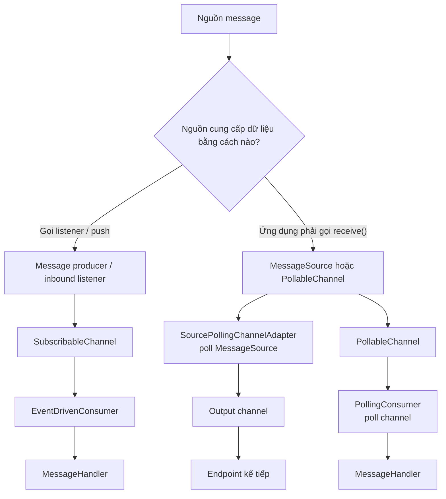
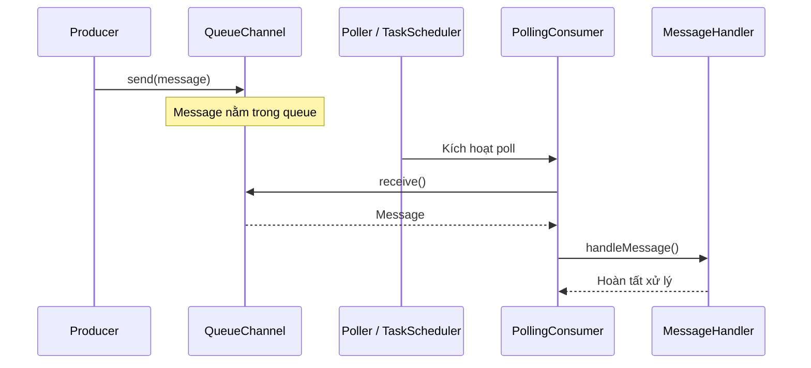
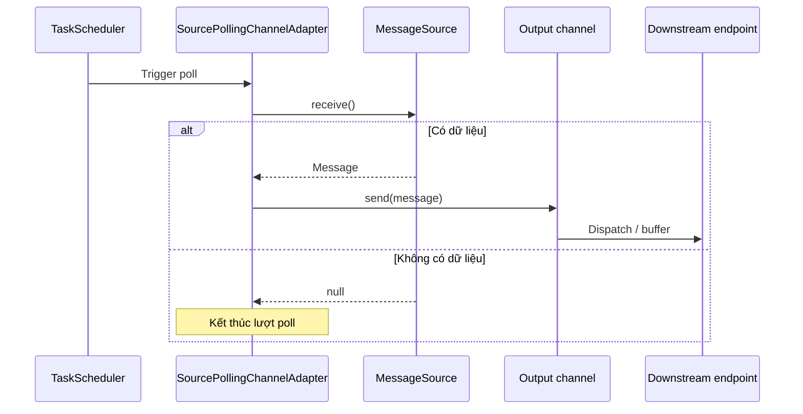

# Chọn polling hay event-driven theo nguồn message

Trong Spring Integration, chọn polling hay event-driven bắt đầu từ cách nguồn message cung cấp dữ liệu và kiểu channel mà endpoint kết nối tới.

- Nếu handler đăng ký nhận message trên một `SubscribableChannel`, Spring Integration tạo `EventDrivenConsumer`. Khi producer gửi message, channel dispatch message đến subscriber.
- Nếu handler đọc message từ một `PollableChannel`, Spring Integration tạo `PollingConsumer`. Poller định kỳ gọi `receive()` để lấy message khỏi channel.
- Nếu ứng dụng có một `MessageSource` cần được hỏi theo lịch, inbound adapter được triển khai bằng `SourcePollingChannelAdapter`. Adapter gọi source theo lịch rồi gửi message nhận được vào output channel.

Ba cơ chế này có liên hệ nhưng giải quyết ba vị trí khác nhau trong luồng message. Chọn đúng cơ chế giúp giảm độ trễ, tránh polling vô ích, kiểm soát tải, và giữ đúng semantics của nguồn dữ liệu.

## 1. Bắt đầu từ hợp đồng của nguồn message

Nguồn message có thể chủ động đẩy sự kiện khi dữ liệu xuất hiện, hoặc chỉ trả dữ liệu khi ứng dụng gọi một phương thức đọc. Đây là quyết định đầu tiên.

| Cách nguồn cung cấp dữ liệu | Ví dụ | Hướng triển khai thường phù hợp |
|---|---|---|
| Push / callback / listener | Broker gọi listener khi có message, socket nhận dữ liệu, webhook gọi endpoint | Event-driven |
| Pull / query / read | Đọc file theo lịch, truy vấn database, gọi API lấy bản ghi mới | Polling |
| Có thể dùng cả hai | Hệ thống hỗ trợ webhook lẫn API truy vấn | Ưu tiên push cho độ trễ thấp; dùng polling để đối soát hoặc phục hồi |
| Producer trong cùng ứng dụng gửi trực tiếp | Service gọi `MessageChannel.send()` | Event-driven qua `SubscribableChannel`, hoặc buffering qua `PollableChannel` |

Một nguồn push thường có một thread hoặc listener container nhận dữ liệu rồi chuyển message vào flow. Nguồn pull không tự thông báo khi dữ liệu mới xuất hiện; ứng dụng cần lên lịch đọc nó bằng poller.

Không nên chọn polling chỉ vì endpoint có cấu hình poller dễ viết. Nếu hệ thống ngoài đã cung cấp callback hoặc listener ổn định, event-driven thường tránh được các lần truy vấn rỗng. Ngược lại, nếu nguồn chỉ cung cấp API đọc dữ liệu, event-driven không thể tự tạo ra sự kiện khi không có cơ chế phát sự kiện từ nguồn.

## 2. Ba cơ chế cần phân biệt

Spring Integration quyết định loại consumer endpoint dựa trên interface của channel. Với inbound adapter, cơ chế lại phụ thuộc việc adapter cung cấp một `MessageSource` hay chủ động phát message.



| Thành phần | Nó đọc dữ liệu từ đâu? | Cách kích hoạt |
|---|---|---|
| `EventDrivenConsumer` | `SubscribableChannel` | Channel gọi subscriber khi có message |
| `PollingConsumer` | `PollableChannel` | Poller gọi `receive()` theo trigger |
| `SourcePollingChannelAdapter` | `MessageSource` | Poller gọi source theo trigger rồi gửi message ra channel |

Điểm dễ nhầm là `PollingConsumer` và `SourcePollingChannelAdapter` đều dùng poller nhưng ở hai phía khác nhau:

- `PollingConsumer` lấy message đã nằm trong một channel có khả năng buffer.
- `SourcePollingChannelAdapter` hỏi một nguồn dữ liệu bên ngoài hoặc một service để tạo message, rồi publish message vào channel.

## 3. Event-driven consumer: đăng ký subscriber trên channel

### 3.1. Cách hoạt động

`SubscribableChannel` cung cấp cơ chế `subscribe(MessageHandler)`. Khi endpoint được start, `EventDrivenConsumer` đăng ký handler với channel. Khi producer gửi message, channel dispatch message tới subscriber.

Các channel thường gặp:

- `DirectChannel`: point-to-point; dispatch tới một subscriber được chọn. Việc xử lý thường đồng bộ trong thread gọi `send()`.
- `PublishSubscribeChannel`: phát một message tới nhiều subscriber. Nếu không cấu hình executor, việc dispatch thường diễn ra đồng bộ.
- `ExecutorChannel`: vẫn là subscribable channel, nhưng dispatch qua `TaskExecutor`, nên handler có thể chạy trên thread khác.

Vì vậy, event-driven không đồng nghĩa với asynchronous. Nó có nghĩa là consumer được kích hoạt bởi message đến, thay vì tự hỏi channel theo lịch. Đồng bộ hay bất đồng bộ phụ thuộc channel và cấu hình dispatch.

### 3.2. Ví dụ DirectChannel

Một producer gửi đơn hàng vào channel. Consumer endpoint nhận message ngay khi channel dispatch.

```java
@Configuration
@EnableIntegration
public class OrderEventFlowConfiguration {

    @Bean
    public MessageChannel ordersEvents() {
        return new DirectChannel();
    }

    @Bean
    public IntegrationFlow orderEventFlow(OrderService orderService) {
        return IntegrationFlow.from("ordersEvents")
                .handle(orderService, "process")
                .get();
    }
}

@Service
public class OrderService {

    public void process(Order order) {
        // Xử lý đơn hàng ngay trong đường dispatch.
    }
}
```

Producer:

```java
@Component
public class OrderPublisher {

    private final MessageChannel ordersEvents;

    public OrderPublisher(
            @Qualifier("ordersEvents") MessageChannel ordersEvents) {
        this.ordersEvents = ordersEvents;
    }

    public void publish(Order order) {
        this.ordersEvents.send(new GenericMessage<>(order));
    }
}
```

Với `DirectChannel`, lời gọi `send()` có thể chờ cho đến khi handler hoàn tất. Nếu handler chậm, producer cũng bị chậm. Nếu handler ném exception trong đường dispatch đồng bộ, lỗi có thể được truyền về caller tùy cơ chế xử lý lỗi đang cấu hình.

### 3.3. Ví dụ ExecutorChannel

Nếu cần dispatch qua thread pool, có thể dùng `ExecutorChannel`:

```java
@Bean
public MessageChannel asyncOrders(
        @Qualifier("integrationExecutor") TaskExecutor executor) {
    return new ExecutorChannel(executor);
}

@Bean
public IntegrationFlow asyncOrderFlow(OrderService orderService) {
    return IntegrationFlow.from("asyncOrders")
            .handle(orderService, "process")
            .get();
}
```

Consumer vẫn là event-driven vì handler đăng ký với `SubscribableChannel`. Executor chỉ thay đổi nơi và thời điểm handler được thực thi.

Khi chuyển thread, cần lưu ý:

- Thứ tự xử lý có thể thay đổi nếu executor chạy nhiều task song song.
- Lỗi xảy ra trong thread xử lý có thể không được ném trực tiếp về thread gọi `send()`; cần cấu hình error handling phù hợp.
- Transaction gắn với thread gửi message không tự động truyền sang thread executor.
- Cần giới hạn queue và thread pool để tránh tích tụ task khi tốc độ producer lớn hơn tốc độ xử lý.

### 3.4. Khi nào event-driven phù hợp?

Chọn event-driven khi:

- Nguồn có API listener/callback hoặc broker có cơ chế push.
- Độ trễ từ lúc có message đến lúc xử lý cần thấp.
- Không muốn liên tục gọi nguồn để nhận kết quả rỗng.
- Nguồn có cơ chế acknowledgment, redelivery hoặc retry phù hợp.
- Tốc độ message được kiểm soát bằng concurrency, broker prefetch, executor hoặc cơ chế backpressure tương ứng.

Event-driven không tự bảo đảm exactly-once, không tự giới hạn tải và cũng không có nghĩa message luôn được xử lý ngay. Nếu downstream chậm, cần thiết kế buffering, concurrency và chính sách retry rõ ràng.

## 4. Polling consumer: đọc message từ PollableChannel

### 4.1. Cách hoạt động

`PollableChannel` cung cấp phương thức `receive()`. Message được producer gửi vào channel và có thể được buffer. `PollingConsumer` dùng poller để gọi `receive()` theo lịch, sau đó chuyển message cho handler.

`QueueChannel` là ví dụ phổ biến của `PollableChannel`. Nó tách thời điểm producer gửi message khỏi thời điểm consumer xử lý message.



Nếu queue rỗng, `receive()` có thể trả về `null` sau thời gian chờ được cấu hình; poller kết thúc lượt đọc tương ứng và chờ trigger tiếp theo. Polling consumer không cần một nguồn bên ngoài hỗ trợ callback, vì producer đã đưa message vào channel.

### 4.2. Ví dụ QueueChannel và PollingConsumer

```java
@Configuration
@EnableIntegration
public class QueueConsumerConfiguration {

    @Bean
    public PollableChannel ordersQueue() {
        return new QueueChannel(500);
    }

    @Bean
    public IntegrationFlow queuedOrderFlow(OrderService orderService) {
        return IntegrationFlow.from(
                        "ordersQueue",
                        endpoint -> endpoint.poller(
                                Pollers.fixedDelay(500)
                                        .maxMessagesPerPoll(10)))
                .handle(orderService, "process")
                .get();
    }
}
```

Producer có thể gửi message mà không cần consumer xử lý ngay:

```java
ordersQueue.send(new GenericMessage<>(order));
```

Ở đây:

- `QueueChannel` giữ message trong bộ đệm.
- Poller kích hoạt consumer theo fixed delay.
- `maxMessagesPerPoll(10)` giới hạn số message được lấy trong một lượt poll.
- Handler xử lý các message mà consumer nhận được.

Đặt giới hạn số message mỗi lượt giúp poller nhường cơ hội cho các tác vụ khác và tránh một lượt poll giữ thread quá lâu khi queue luôn có dữ liệu.

### 4.3. Khi nào polling consumer phù hợp?

Chọn polling consumer khi producer và consumer cần tách thời điểm xử lý, hoặc cần buffer message trong ứng dụng:

- Một service ghi message vào queue, worker xử lý theo lịch.
- Cần batch hoặc giới hạn số message xử lý trong mỗi lượt.
- Muốn giảm tốc độ consumer để phù hợp với downstream.
- Cần một khoảng đệm giữa producer burst và consumer có tốc độ ổn định.
- Cần kết hợp poller với transaction hoặc advice cho mỗi lượt nhận/xử lý.

Polling consumer không có nghĩa là polling một hệ thống ngoài. Nó chỉ polling channel nội bộ. Producer có thể là event-driven listener, REST endpoint, service hoặc một flow khác.

## 5. SourcePollingChannelAdapter: polling một MessageSource

### 5.1. Khác với PollingConsumer

Một `MessageSource<T>` cung cấp message khi framework gọi `receive()`. Nếu nguồn dữ liệu là file, database, remote API hoặc một service chỉ có thao tác đọc, Spring Integration có thể bọc source trong `SourcePollingChannelAdapter`.

Adapter này được poller kích hoạt. Mỗi lần poll, nó gọi source; nếu source trả về message, adapter gửi message đó vào output channel của flow. Nếu source trả về `null`, lượt poll không tạo message.



Đây là inbound polling: adapter tạo message từ nguồn rồi đẩy vào flow. Polling consumer thì ngược lại, nó nhận message đã được producer đưa vào một `PollableChannel`.

### 5.2. Ví dụ MessageSource

```java
@Bean
public MessageSource<String> invoiceSource() {
    AtomicInteger sequence = new AtomicInteger();

    return () -> {
        int next = sequence.incrementAndGet();

        if (next > 3) {
            return null;
        }

        return new GenericMessage<>("invoice-" + next);
    };
}

@Bean
public IntegrationFlow invoicePollingFlow(
        MessageSource<String> invoiceSource,
        InvoiceService invoiceService) {

    return IntegrationFlow.from(
                    invoiceSource,
                    endpoint -> endpoint.poller(
                            Pollers.fixedDelay(1000)
                                    .maxMessagesPerPoll(1)))
            .handle(invoiceService, "process")
            .get();
}
```

Ví dụ này dùng source trong bộ nhớ để minh họa hợp đồng `receive()`. Trong ứng dụng thực tế, source có thể đọc file mới, truy vấn bản ghi chưa xử lý, gọi remote API hoặc lấy dữ liệu từ một hệ thống legacy.

### 5.3. Ví dụ annotation với @InboundChannelAdapter

Có thể dùng annotation để khai báo polling source:

```java
@Component
public class InvoiceSource {

    @InboundChannelAdapter(
            channel = "invoices.in",
            poller = @Poller(fixedDelay = "1000"))
    public Message<Invoice> nextInvoice() {
        Invoice invoice = findNextInvoice();

        return invoice == null
                ? null
                : new GenericMessage<>(invoice);
    }
}
```

`@InboundChannelAdapter` tạo inbound polling endpoint. Poller gọi phương thức source theo lịch; giá trị trả về được chuyển thành message và gửi tới channel `invoices.in`.

### 5.4. Khi nào SourcePollingChannelAdapter phù hợp?

Chọn source polling khi:

- Hệ thống ngoài chỉ có API đọc hoặc query.
- Cần quét thư mục, kiểm tra file mới hoặc đọc remote directory.
- Cần truy vấn database theo watermark hoặc trạng thái chưa xử lý.
- Cần gọi dịch vụ theo chu kỳ để lấy bản ghi mới.
- Cần giới hạn tốc độ gọi hệ thống ngoài.
- Cần thực hiện đối soát định kỳ hoặc reconciliation.

Nếu nguồn có webhook hoặc listener ổn định, có thể dùng event-driven cho luồng chính và giữ polling cho đối soát, tránh bỏ sót dữ liệu hoặc khôi phục sau gián đoạn.

## 6. Cấu hình poller ảnh hưởng đến tải như thế nào?

Poller dùng trigger để xác định thời điểm thực hiện lượt poll. Các cấu hình phổ biến:

| Trigger | Ý nghĩa | Khi dùng |
|---|---|---|
| `fixedDelay` | Chờ một khoảng sau khi lượt xử lý trước hoàn tất rồi mới chạy tiếp | Muốn giữ khoảng nghỉ sau mỗi lượt |
| `fixedRate` | Lên lịch theo nhịp thời gian cố định | Muốn duy trì nhịp polling ổn định |
| `cron` | Chạy theo biểu thức lịch | Đồng bộ theo giờ/ngày hoặc khung giờ nghiệp vụ |

Ví dụ Java DSL:

```java
Pollers.fixedDelay(1000)
Pollers.fixedRate(1000)
Pollers.cron("0 */5 * * * *")
```

Cú pháp cron và đơn vị thời gian cần đối chiếu với phiên bản Spring Integration/Spring Framework đang dùng. Với fixed delay, thời điểm chạy tiếp theo được tính sau khi lượt trước kết thúc; fixed rate hướng đến nhịp lịch cố định. Nếu thời gian xử lý dài hơn khoảng lịch, cần kiểm tra scheduler và cấu hình concurrency để hiểu hành vi thực tế.

### 6.1. maxMessagesPerPoll

`maxMessagesPerPoll` giới hạn số message mà poller xử lý trong một lượt:

- Giá trị dương: xử lý tối đa số message đã cấu hình trong một lượt poll.
- Giá trị `-1`: tiếp tục poll cho đến khi không còn message hoặc source trả về `null`.
- Giá trị `0`: trong các phiên bản hỗ trợ, có thể dùng để tạm bỏ qua việc gọi source.

Có một khác biệt mặc định quan trọng trong tài liệu Spring Integration hiện hành: `PollingConsumer` thường có mặc định `-1`, trong khi `SourcePollingChannelAdapter` mặc định là `1`. Lý do là source adapter cần quay lại scheduler thường xuyên để phản ứng với lifecycle và tránh vòng lặp vô hạn nếu source không bao giờ trả về `null`. Khi throughput quan trọng, hãy đặt giới hạn tường minh thay vì phụ thuộc mặc định.

### 6.2. receiveTimeout và queue

Với `PollableChannel`, poller gọi `receive()`. Nếu queue rỗng, thời gian chờ của receive ảnh hưởng đến thời gian thread poller bị giữ lại. Nếu có nhiều endpoint polling, cần tính số thread scheduler, thời gian receive và thời gian xử lý message.

Với `QueueChannel` có dung lượng giới hạn, producer có thể bị block hoặc send thất bại khi queue đầy, tùy timeout gửi. Đây là một dạng backpressure ở ranh giới producer-channel. Nếu queue không giới hạn, producer có thể tiếp tục đẩy message trong khi consumer không theo kịp, khiến bộ nhớ tăng.

## 7. Threading: event-driven không mặc định là bất đồng bộ

Đây là nhầm lẫn phổ biến nhất khi so sánh hai cơ chế.

| Cấu hình | Cách handler được gọi | Thread thường dùng |
|---|---|---|
| `DirectChannel` + EventDrivenConsumer | Dispatch trực tiếp khi gửi message | Thread gọi `send()` |
| `PublishSubscribeChannel` không executor | Gọi các subscriber trong đường dispatch | Thường là thread gửi |
| `ExecutorChannel` + EventDrivenConsumer | Gửi task vào executor | Thread của executor |
| `QueueChannel` + PollingConsumer | Poller gọi `receive()` rồi gọi handler | Thread thực hiện lượt poll |
| `MessageSource` + SourcePollingChannelAdapter | Poller gọi source, sau đó publish message | Thread poller hoặc executor được cấu hình |

Event-driven nói về cách consumer được kích hoạt. Polling nói về việc chủ động gọi receive theo lịch. Cả hai có thể chạy trên thread khác nếu có executor hoặc cơ chế dispatch riêng.

### 7.1. Transaction boundary

Với polling endpoint, poller có thể được cấu hình transaction advice để gộp thao tác receive và xử lý đồng bộ thành một đơn vị công việc, nếu resource và transaction manager hỗ trợ.

Với event-driven endpoint, transaction thường gắn với đường xử lý message hoặc listener container của transport. Nếu channel chuyển message qua executor, transaction gắn với thread gửi không tự truyền sang thread xử lý.

Cần kiểm tra:

- Transaction bắt đầu ở poller, listener container hay handler?
- Việc lấy message và xử lý message có cùng transaction boundary không?
- Message acknowledgment có nằm trong transaction không?
- Khi handler lỗi, transaction rollback có khiến message được nhận lại không?
- Nếu flow chuyển sang executor, phần xử lý sau điểm chuyển thread có transaction riêng không?

Không nên chọn polling chỉ để “có transaction”. Cần xác định transaction manager, resource được quản lý và điểm commit/rollback thực tế.

### 7.2. Error handling và retry

Với polling, lỗi có thể phát sinh trong lúc đọc source, nhận message từ channel hoặc xử lý handler. Poller advice chain có thể dùng retry, transaction hoặc skip advice. Với event-driven, lỗi phụ thuộc channel dispatch, handler và cơ chế của inbound adapter/broker listener.

Cần phân biệt retry của handler với redelivery của broker. Một message được broker giao lại sau khi nack/rollback khác với việc handler tự retry trong cùng một lần giao. Hãy xác định ai sở hữu retry và tránh cấu hình nhiều lớp retry không kiểm soát làm tăng thời gian xử lý hoặc tạo duplicate side effect.

## 8. Bảng chọn polling hay event-driven

| Tiêu chí | Event-driven | Polling |
|---|---|---|
| Nguồn có callback/listener | Rất phù hợp | Thường không cần thiết cho luồng chính |
| Nguồn chỉ có API query/read | Không tự kích hoạt được | Phù hợp |
| Độ trễ | Có thể thấp vì xử lý khi message đến | Phụ thuộc interval và thời gian poll |
| Tải khi không có dữ liệu | Không cần truy vấn định kỳ | Có thể tạo nhiều lần poll rỗng |
| Buffering | Tùy channel hoặc broker | Có thể dùng PollableChannel để buffer |
| Batch | Tùy adapter/broker | Dễ giới hạn số message mỗi lượt |
| Rate limiting | Cần cấu hình concurrency, executor hoặc broker | Có thể điều chỉnh interval và maxMessagesPerPoll |
| Backpressure | Phụ thuộc transport/channel/executor | Có thể giới hạn queue, batch và nhịp poll |
| Transaction | Phụ thuộc listener và endpoint | Poller có thể gắn transaction advice |
| Vận hành | Cần quan sát listener, subscription, broker ack | Cần quan sát trigger, thời gian poll, số message mỗi lượt và queue depth |

### 8.1. Quy trình quyết định

1. Nguồn có thể đẩy message khi dữ liệu xuất hiện không?
   - Có: ưu tiên event-driven.
   - Không: xem xét polling.
2. Message đã nằm trong một channel nội bộ chưa?
   - Có, và channel là `PollableChannel`: dùng `PollingConsumer`.
   - Chưa, nguồn là `MessageSource`: dùng `SourcePollingChannelAdapter`.
3. Có cần buffer hoặc batch không?
   - Có: cân nhắc `QueueChannel` và `PollingConsumer`.
   - Không, cần dispatch ngay: cân nhắc `SubscribableChannel`.
4. Có cần chạy handler trên thread khác không?
   - Có: cấu hình executor rõ ràng.
   - Không: `DirectChannel` có thể đơn giản và dễ quan sát.
5. Có yêu cầu transaction, acknowledgment, retry hoặc recovery không?
   - Xác định boundary thực tế trước khi chọn concurrency và poller.
6. Đo độ trễ, throughput, queue depth và tải nguồn rồi mới tinh chỉnh interval/concurrency.

## 9. Các tình huống thực tế

### 9.1. Broker đẩy message khi có đơn hàng

Một broker có listener container gọi callback khi message đến. Inbound adapter nhận message và gửi vào `DirectChannel` hoặc `ExecutorChannel`.

Chọn event-driven vì broker đã có cơ chế push. Nếu cần xử lý song song, cấu hình concurrency ở listener container hoặc dùng executor phù hợp. Không cần tạo poller nội bộ chỉ để liên tục hỏi channel.

### 9.2. Quét file theo chu kỳ

Ứng dụng cần đọc file mới trong thư mục mỗi 10 giây. Nguồn file không phát callback cho ứng dụng; adapter phải kiểm tra thư mục theo lịch.

Chọn `SourcePollingChannelAdapter`. Cần quản lý trạng thái file đã xử lý, lock hoặc rename file, lỗi đọc và chính sách xử lý lại sau restart.

### 9.3. Worker xử lý queue nội bộ theo batch

Một REST endpoint nhận request và gửi message vào `QueueChannel`. Worker đọc tối đa 20 message mỗi lượt poll.

REST producer có thể chạy event-driven ở đầu vào, trong khi worker là polling consumer ở đoạn sau. Hai kiểu có thể cùng tồn tại trong một flow lớn.

### 9.4. Đối soát dữ liệu với hệ thống ngoài

Hệ thống ngoài có webhook nhưng webhook có thể mất khi mạng gián đoạn. Luồng chính dùng event-driven để giảm độ trễ; một job polling định kỳ query các bản ghi thay đổi từ watermark cuối cùng để đối soát.

Đây là kiến trúc hybrid. Event-driven giúp xử lý nhanh; polling giúp phục hồi hoặc phát hiện sự kiện bị bỏ lỡ. Hai luồng cần idempotency để cùng một bản ghi không tạo side effect hai lần.

## 10. Theo dõi và chẩn đoán runtime

Khi consumer không nhận message, cần xác định đúng endpoint đang chạy theo kiểu nào.

| Triệu chứng | Kiểm tra | Nguyên nhân thường gặp |
|---|---|---|
| Event-driven consumer không nhận message | Channel có phải `SubscribableChannel` không? Endpoint có subscribe chưa? | Sai channel, endpoint chưa start hoặc producer gửi vào channel khác |
| Polling consumer không nhận message | Channel có phải `PollableChannel` không? Poller có hoạt động không? | Thiếu poller, queue rỗng, receive timeout hoặc endpoint chưa start |
| Source adapter không tạo message | `MessageSource.receive()`, trigger và log source | Source trả về `null`, query sai hoặc poller chưa chạy |
| Queue tăng liên tục | Queue depth, maxMessagesPerPoll, thời gian handler | Consumer throughput thấp hơn producer throughput |
| Nhiều lần poll nhưng không có message | Interval, source query, watermark | Poll quá thường xuyên hoặc nguồn không có dữ liệu mới |
| Event-driven handler chạy trên thread gửi | Loại channel | `DirectChannel` dispatch đồng bộ |
| Message chạy song song ngoài dự kiến | Executor, concurrency, subscriber count | Executor hoặc listener container cho phép nhiều task đồng thời |
| Transaction không rollback như mong đợi | Thread boundary, poller advice, listener transaction | Transaction không bao phủ phần xử lý thực tế |

Các số liệu nên theo dõi:

- Số message nhận và xử lý theo thời gian.
- Thời gian xử lý trung bình và percentile cao.
- Queue depth và số lần send bị block/timeout.
- Poll duration, số message mỗi poll và số lượt poll rỗng.
- Số thread hoạt động, queue của executor và task bị reject.
- Số lần retry, redelivery, rollback và message chuyển vào error channel.

Nếu poller xử lý chậm, hãy đo riêng thời gian gọi source, thời gian receive và thời gian handler. Nếu event-driven xử lý chậm, hãy xác định thời gian nằm trong listener, channel dispatch, executor queue hay handler.

## 11. Ghi nhớ

- Chọn event-driven khi nguồn có thể push message hoặc channel hỗ trợ subscribe.
- Chọn `PollingConsumer` khi handler cần đọc message từ `PollableChannel`.
- Chọn `SourcePollingChannelAdapter` khi ứng dụng phải chủ động gọi `MessageSource.receive()`.
- Polling consumer và source polling adapter đều dùng poller nhưng đọc từ hai loại đầu vào khác nhau.
- Event-driven không đồng nghĩa asynchronous: `DirectChannel` thường dispatch trong thread gửi; `ExecutorChannel` dispatch qua executor.
- Polling cho phép điều chỉnh interval, batch và transaction advice, nhưng cần quan sát poll rỗng và độ trễ.
- Không để queue tăng vô hạn khi consumer không theo kịp producer.
- Xác định transaction, acknowledgment, retry và idempotency theo đúng boundary của transport và endpoint.
- Có thể kết hợp event-driven và polling trong cùng ứng dụng để vừa giảm độ trễ vừa đối soát dữ liệu.

## Tài liệu tham khảo

- [Spring Integration — Poller](https://docs.spring.io/spring-integration/reference/polling-consumer.html)
- [Spring Integration — Message Endpoints](https://docs.spring.io/spring-integration/reference/endpoint.html)
- [Spring Integration — Channel Adapter](https://docs.spring.io/spring-integration/reference/channel-adapter.html)
- [Spring Integration — Message Channels](https://docs.spring.io/spring-integration/reference/channel.html)
- [Spring Integration — Poller Transaction Support](https://docs.spring.io/spring-integration/reference/transactions.html)

