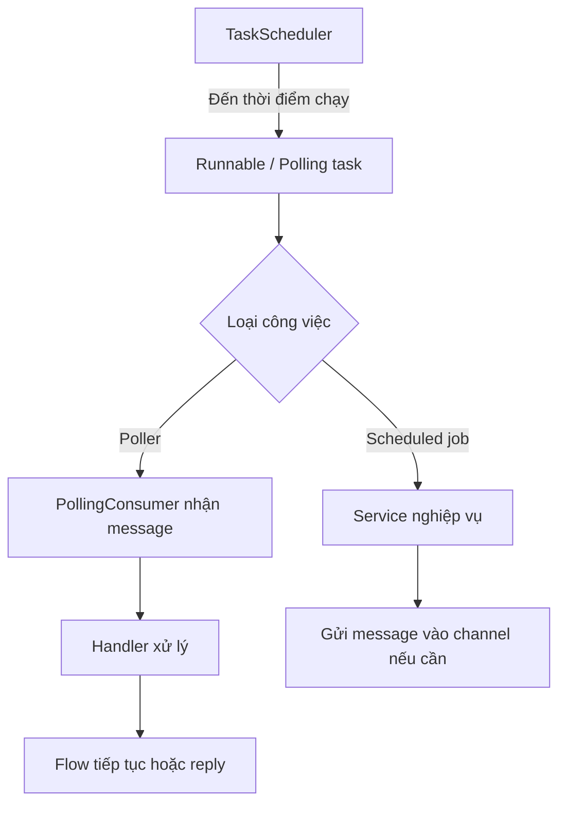

# TaskScheduler và các công việc theo thời gian

Trong Spring Integration, nhiều endpoint cần thực hiện công việc theo thời gian: đọc message từ queue theo chu kỳ, lấy dữ liệu từ một nguồn bên ngoài, chạy một lần sau khoảng trễ hoặc kích hoạt flow theo biểu thức cron. `TaskScheduler` cung cấp cơ chế lập lịch cho những tác vụ này. Nó quyết định **khi nào một tác vụ được gọi**; channel, endpoint, consumer và handler vẫn chịu trách nhiệm nhận và xử lý message.

Bài học thuộc phần **Task scheduler** của module `SPRING_INTEGRATION_RUNTIME`. Module này tìm hiểu cách Spring Integration điều phối message flow qua channel, endpoint, consumer, poller và executor; đồng thời thực hành quản lý vòng đời IntegrationFlow, transaction, retry, message store, lỗi, correlation và chẩn đoán threading, hiệu năng, trạng thái runtime.

## 1. TaskScheduler là gì?

`TaskScheduler` là abstraction của Spring Framework để lập lịch thực thi `Runnable`. Thay vì tự tạo thread và dùng vòng lặp `sleep`, ứng dụng giao tác vụ cho scheduler với thời điểm hoặc quy tắc chạy.

Các kiểu lịch phổ biến:

- Chạy một lần tại một thời điểm xác định.
- Chạy lặp theo fixed rate.
- Chạy lại sau một khoảng delay tính từ lúc lần trước hoàn tất.
- Chạy theo lịch calendar/cron.
- Chạy theo một `Trigger` tùy biến, trong đó thời điểm tiếp theo được tính dựa trên trạng thái thực thi trước đó.

`TaskScheduler` không phải message channel và cũng không phải handler. Nó gọi một tác vụ đúng thời điểm đã lập lịch. Nếu tác vụ đó là poller của Spring Integration, poller sẽ lấy message từ input channel rồi chuyển cho endpoint/handler. Nếu tác vụ là một job nghiệp vụ độc lập, chính code của job quyết định gọi service hoặc gửi message vào channel.



Phân biệt rõ scheduler và executor giúp tránh nhầm lẫn: scheduler quản lý thời điểm kích hoạt; executor quản lý việc thực thi tác vụ trên thread nào hoặc phân phối công việc tới thread pool nào.

## 2. Các API lập lịch cơ bản

`TaskScheduler` có các phương thức chính:

| API | Mục đích |
|---|---|
| `schedule(Runnable, Instant)` | Chạy một lần tại thời điểm xác định |
| `schedule(Runnable, Trigger)` | Lập lịch theo quy tắc do Trigger quyết định |
| `scheduleAtFixedRate(Runnable, Duration)` | Chạy định kỳ theo fixed rate |
| `scheduleWithFixedDelay(Runnable, Duration)` | Chạy lại sau fixed delay tính từ khi lần trước hoàn tất |

Tùy phiên bản Spring Framework, một số overload có thể nhận `Date`, `Instant` hoặc đơn vị thời gian khác. Hãy chọn API tương ứng với phiên bản framework của ứng dụng.

Một ví dụ đơn giản:

```java
@Component
public class CacheRefreshJob {

    private final CacheService cacheService;

    public CacheRefreshJob(CacheService cacheService) {
        this.cacheService = cacheService;
    }

    public void refresh() {
        cacheService.refresh();
    }
}
```

Có thể lập lịch job bằng `TaskScheduler`:

```java
@Configuration
public class SchedulerConfiguration {

    @Bean
    ThreadPoolTaskScheduler taskScheduler() {
        ThreadPoolTaskScheduler scheduler =
            new ThreadPoolTaskScheduler();

        scheduler.setPoolSize(4);
        scheduler.setThreadNamePrefix("app-scheduler-");
        scheduler.setWaitForTasksToCompleteOnShutdown(true);
        scheduler.setAwaitTerminationSeconds(30);

        return scheduler;
    }
}
```

Spring quản lý vòng đời bean `ThreadPoolTaskScheduler`: scheduler được khởi tạo khi bean lifecycle yêu cầu và được đóng khi context shutdown. Không cần tự gọi `initialize()` hoặc `shutdown()` khi đã đăng ký nó như một bean Spring thông thường.

Khi ứng dụng có nhiều nhóm tác vụ với yêu cầu độc lập, có thể khai báo nhiều scheduler với tên và pool riêng. Ví dụ, scheduler cho poller có thể được tách khỏi scheduler cho các tác vụ bảo trì để một job chạy lâu không làm trễ lịch polling.

## 3. Fixed rate, fixed delay và cron khác nhau thế nào?

Ba kiểu lịch thường dùng có ngữ nghĩa khác nhau.

| Kiểu lịch | Mốc tính lần tiếp theo | Phù hợp với |
|---|---|---|
| **Fixed rate** | Theo nhịp thời gian cố định giữa các lần bắt đầu dự kiến | Thu thập metric, đồng bộ định kỳ, tác vụ cần nhịp đều |
| **Fixed delay** | Tính khoảng nghỉ sau khi lần chạy trước hoàn tất | Poll queue, gọi dịch vụ chậm, tác vụ cần tránh chạy dồn |
| **Cron** | Theo biểu thức lịch trên giây/phút/giờ/ngày/tháng/thứ | Báo cáo lúc cố định, đối soát cuối ngày, lịch nghiệp vụ |

Ví dụ: một tác vụ mất 8 giây để chạy và có chu kỳ 5 giây.

- Với fixed rate 5 giây, lịch bắt đầu dự kiến cách nhau 5 giây. Nếu lần trước chưa hoàn tất, lần chạy tiếp theo của cùng periodic task không thực thi đồng thời; nó bị trễ so với nhịp dự kiến.
- Với fixed delay 5 giây, scheduler chờ tác vụ hoàn tất rồi mới đợi thêm 5 giây trước lần tiếp theo. Tổng khoảng cách giữa hai lần bắt đầu là thời gian xử lý cộng thêm 5 giây.
- Với cron, lần chạy tiếp theo phụ thuộc biểu thức lịch và chính sách trigger; nó không đơn giản là một khoảng delay cố định sau khi task hoàn tất.

### 3.1. Fixed rate

Ví dụ dùng `TaskScheduler`:

```java
taskScheduler.scheduleAtFixedRate(
    () -> metricsService.collect(),
    Duration.ofSeconds(30)
);
```

Fixed rate thích hợp khi cần giữ nhịp đều. Tuy nhiên, nếu tác vụ thường xuyên chạy lâu hơn chu kỳ, lịch sẽ bị trễ và các tác vụ khác dùng chung pool có thể bị ảnh hưởng.

### 3.2. Fixed delay

Ví dụ:

```java
taskScheduler.scheduleWithFixedDelay(
    () -> cleanupService.removeExpiredRecords(),
    Duration.ofMinutes(5)
);
```

Fixed delay phù hợp với tác vụ cần chờ lần chạy trước kết thúc. Đây cũng là lựa chọn phổ biến cho poller khi muốn duy trì khoảng nghỉ giữa các lần polling thay vì cố đạt một tần suất bắt đầu cố định.

### 3.3. Cron và múi giờ

Biểu thức cron của Spring thường có sáu trường: giây, phút, giờ, ngày trong tháng, tháng và ngày trong tuần. Ví dụ `0 0 2 * * *` nghĩa là chạy lúc 02:00:00 mỗi ngày theo múi giờ được áp dụng cho trigger.

Có thể chỉ định múi giờ rõ ràng để tránh việc lịch chạy thay đổi ngoài dự kiến khi môi trường triển khai dùng timezone khác:

```java
Trigger trigger = new CronTrigger(
    "0 0 2 * * *",
    TimeZone.getTimeZone("Asia/Ho_Chi_Minh")
);

ScheduledFuture<?> future =
    taskScheduler.schedule(
        () -> reconciliationService.run(),
        trigger
    );
```

Cần kiểm tra cú pháp cron theo Spring, không mặc định rằng mọi biểu thức cron của hệ thống Unix đều dùng cùng số trường hoặc cùng quy tắc. Với tác vụ tài chính hoặc đối soát, timezone phải là một phần của yêu cầu nghiệp vụ.

## 4. Trigger và lịch động

`Trigger` cho phép tính thời điểm chạy tiếp theo. `PeriodicTrigger`, `CronTrigger` và trigger tùy biến là các cách phổ biến để biểu diễn quy tắc đó.

Trigger hữu ích khi lịch phụ thuộc trạng thái hoặc kết quả lần chạy trước. Ví dụ, một tác vụ kiểm tra remote API có thể tăng khoảng nghỉ khi dịch vụ lỗi và giảm lại khi kết nối phục hồi. Khi đó có thể cài đặt `Trigger` tùy biến hoặc thay đổi lịch thông qua cơ chế quản lý task.

Ví dụ khái niệm về trigger động:

```java
public class AdaptiveTrigger implements Trigger {

    private final BackoffPolicy backoffPolicy;

    public AdaptiveTrigger(BackoffPolicy backoffPolicy) {
        this.backoffPolicy = backoffPolicy;
    }

    @Override
    public Instant nextExecution(TriggerContext context) {
        Duration delay = backoffPolicy.currentDelay();
        return Instant.now().plus(delay);
    }
}
```

Đây là ví dụ minh họa; implementation thực tế cần xác định rõ cách cập nhật trạng thái backoff, xử lý clock và đồng bộ khi nhiều thread cùng truy cập policy. Không nên dùng `Instant.now()` trực tiếp trong mọi tình huống nếu hệ thống cần test thời gian hoặc sử dụng clock có thể thay thế. Có thể inject `Clock` để kiểm thử lịch xác định.

## 5. TaskScheduler trong Spring Integration Poller

Trong Spring Integration, `Poller` là cấu hình cho một polling endpoint. Endpoint dạng pollable, thường là `PollingConsumer`, dùng poller để nhận message từ `PollableChannel` hoặc gọi một `MessageSource` theo lịch.

Một poller thường định nghĩa:

- **Trigger:** fixed delay, fixed rate, cron hoặc trigger tùy biến.
- **maxMessagesPerPoll:** số message tối đa lấy trong một lần poll.
- **receiveTimeout:** thời gian chờ khi nhận message từ channel hỗ trợ timeout.
- **Advice chain:** các advice bao quanh lần polling/xử lý, ví dụ retry hoặc transaction.
- **TaskExecutor:** executor tùy chọn để thực thi công việc polling theo cấu hình.
- **Error handling:** cách lỗi trong quá trình polling hoặc xử lý được chuyển tới cơ chế xử lý lỗi.

Ví dụ Java DSL đọc queue mỗi giây, tối đa 10 message mỗi lần poll:

```java
@Bean
IntegrationFlow orderQueueFlow(OrderService orderService) {
    return IntegrationFlow.from("orders.queue",
            endpoint -> endpoint.poller(
                Pollers.fixedDelay(1000)
                    .maxMessagesPerPoll(10)))
        .handle(orderService, "process")
        .get();
}
```

Trong ví dụ này, scheduler kích hoạt polling task theo fixed delay. Polling consumer nhận tối đa 10 message từ `orders.queue` rồi chuyển từng message qua handler. Nếu queue rỗng, lần poll không có message để xử lý; poller tiếp tục theo lịch.

### 5.1. Poller với MessageSource

Một inbound adapter có thể dùng `MessageSource` để lấy dữ liệu từ một nguồn không chủ động đẩy message. Ví dụ, đọc từng bản ghi đang chờ từ repository:

```java
@Bean
@InboundChannelAdapter(
    channel = "orders.in",
    poller = @Poller(
        fixedDelay = "1000",
        maxMessagesPerPoll = "10"
    )
)
MessageSource<Order> pendingOrderSource(OrderRepository repository) {
    return () -> {
        Order order = repository.findNextPending();
        return order == null ? null : new GenericMessage<>(order);
    };
}
```

Khi `MessageSource.receive()` trả về message, inbound adapter chuyển message vào channel `orders.in`. Nếu trả về `null`, lần poll đó không tạo message mới.

Đây là mô hình polling nguồn dữ liệu. Nếu nguồn ngoài có khả năng push event, inbound adapter dựa trên listener/callback có thể phù hợp hơn và tránh polling liên tục.

### 5.2. maxMessagesPerPoll ảnh hưởng tới tải như thế nào?

`maxMessagesPerPoll` giới hạn số message mà một lần poll xử lý:

- Giá trị dương giới hạn số message tối đa trong một lượt.
- Giá trị âm có thể cho phép poll liên tục cho tới khi không còn message, tùy loại poller và channel.
- Giá trị 0 có thể được dùng để tạm ngừng việc lấy message mà vẫn giữ endpoint trong context.

Không nên đặt số lượng quá lớn chỉ để tăng throughput. Một poll kéo dài sẽ chiếm thread scheduler lâu hơn, làm chậm các lần poll khác dùng chung scheduler. Hãy cân bằng batch size, thời gian xử lý message, độ trễ mong muốn và kích thước thread pool.

## 6. TaskScheduler khác TaskExecutor như thế nào?

Hai abstraction này thường cùng xuất hiện trong một flow nhưng giải quyết hai bài toán khác nhau.

| Thành phần | Trách nhiệm | Ví dụ |
|---|---|---|
| `TaskScheduler` | Xác định thời điểm một tác vụ được kích hoạt | Kích hoạt poller mỗi giây |
| `TaskExecutor` | Thực thi hoặc phân phối tác vụ trên thread | Chuyển việc xử lý message sang worker thread |

Với polling endpoint, scheduler thường kích hoạt lần poll. Nếu không cấu hình executor riêng cho poller, công việc poll và xử lý có thể chạy trên thread của scheduler. Khi poller có task executor, việc thực thi được chuyển theo cấu hình executor tương ứng.

Không nên dùng scheduler pool nhỏ cho các tác vụ xử lý lâu nếu các task đó chạy trực tiếp trên scheduler thread. Một handler mất nhiều giây có thể làm trễ các poller khác. Tách scheduler và executor giúp cô lập lịch kích hoạt khỏi thời gian xử lý nghiệp vụ.

Ví dụ cấu hình poller có executor:

```java
@Bean
ThreadPoolTaskExecutor pollerExecutor() {
    ThreadPoolTaskExecutor executor = new ThreadPoolTaskExecutor();
    executor.setCorePoolSize(4);
    executor.setMaxPoolSize(8);
    executor.setQueueCapacity(100);
    executor.setThreadNamePrefix("poller-worker-");
    return executor;
}

@Bean
IntegrationFlow asyncOrderPolling(
        OrderService orderService,
        TaskExecutor pollerExecutor) {

    return IntegrationFlow.from("orders.queue",
            endpoint -> endpoint.poller(
                Pollers.fixedDelay(1000)
                    .taskExecutor(pollerExecutor)
                    .maxMessagesPerPoll(10)))
        .handle(orderService, "process")
        .get();
}
```

Khi tách sang executor, cần đánh giá lại transaction, thread-local context, security context, logging MDC và thứ tự xử lý. Các ngữ cảnh gắn với thread hiện tại không tự động truyền qua ranh giới executor nếu ứng dụng không cấu hình cơ chế truyền phù hợp.

## 7. Transaction, retry và xử lý lỗi trong poller

Poller có thể kết hợp advice để bao quanh thao tác nhận message và xử lý. Transaction advice thường được dùng khi message lấy từ nguồn dữ liệu và cập nhật trạng thái nghiệp vụ cần nằm trong một transaction phù hợp.

Ví dụ cấu hình transaction advice cho poller có thể dùng `TransactionInterceptor` hoặc helper tương ứng của Spring Integration:

```java
@Bean
IntegrationFlow transactionalPolling(
        OrderService orderService,
        TransactionInterceptor transactionAdvice) {

    return IntegrationFlow.from("orders.queue",
            endpoint -> endpoint.poller(
                Pollers.fixedDelay(1000)
                    .advice(transactionAdvice)
                    .maxMessagesPerPoll(5)))
        .handle(orderService, "process")
        .get();
}
```

Phạm vi transaction cụ thể phụ thuộc loại channel, nguồn nhận message và vị trí advice trong poller. Với queue trong bộ nhớ, transaction database không tự khôi phục message đã dequeue nếu channel không tham gia cùng transaction. Với broker, cần xem transaction/ack semantics của adapter và broker.

Retry advice có thể dùng để thử lại khi handler hoặc lời gọi downstream thất bại. Cần chọn exception nào được retry, số lần thử, backoff và hành vi cuối cùng. Không retry vô hạn một lỗi dữ liệu vĩnh viễn; cũng không retry side effect không idempotent mà không có cơ chế chống xử lý trùng.

Lỗi trong scheduled task có thể ảnh hưởng tới những lần chạy tiếp theo tùy cơ chế scheduler và cách exception được xử lý. Trong Spring Integration, cần phân biệt lỗi phát sinh ở bước poll, lỗi nhận message và lỗi trong handler. Dùng error channel, error handler hoặc advice phù hợp để ghi nhận và xử lý lỗi; không để log là cơ chế quan sát duy nhất.

## 8. Quản lý ScheduledFuture và vòng đời tác vụ

Các phương thức lập lịch trả về `ScheduledFuture` trong nhiều trường hợp. Handle này cho phép hủy lịch, kiểm tra trạng thái hoặc lấy kết quả khi tác vụ hoàn tất theo hợp đồng API.

Ví dụ:

```java
ScheduledFuture<?> future =
    taskScheduler.scheduleAtFixedRate(
        () -> reportService.publish(),
        Duration.ofMinutes(1)
    );

// Khi không còn cần lịch:
future.cancel(false);
```

`cancel(false)` ngăn các lần chạy tiếp theo nhưng không yêu cầu interrupt lần chạy đang thực hiện. `cancel(true)` có thể yêu cầu interrupt thread đang chạy; chỉ dùng khi tác vụ được thiết kế để phản ứng an toàn với interrupt.

Khi quản lý tác vụ động, cần lưu handle theo định danh nghiệp vụ để tránh tạo lịch trùng. Khi tenant hoặc resource bị xóa, hủy lịch trước khi giải phóng dependency mà task sử dụng. Nếu lịch được tạo bởi một bean Spring, nên gắn việc hủy task với lifecycle của bean thay vì để handle thất lạc.

Với poller endpoint, không nên tự tạo một lịch thứ hai để gọi cùng message source nếu endpoint đã quản lý poller. Việc có hai scheduler độc lập cùng đọc một nguồn có thể dẫn tới xử lý trùng hoặc tranh chấp dữ liệu.

## 9. Pool size, thread và hiệu năng

`ThreadPoolTaskScheduler` thường dựa trên scheduled thread pool. Pool size quyết định có bao nhiêu task scheduled độc lập có thể thực thi đồng thời. Cần quan sát:

- Thời gian chạy trung bình và p95/p99 của từng scheduled task.
- Số lần poll bị trễ so với thời điểm dự kiến.
- Số task đang chạy và queue công việc ở executor downstream.
- Tỷ lệ exception, retry và timeout.
- Queue depth của channel hoặc broker.
- Thread bị block bởi I/O, lock hoặc transaction kéo dài.

Một số nguyên tắc vận hành:

1. Giữ scheduler task ngắn nếu scheduler dùng chung cho nhiều poller.
2. Chuyển xử lý nặng sang executor riêng khi mô hình flow cho phép.
3. Chọn pool size theo số tác vụ có thể chạy đồng thời và đặc tính blocking, không chỉ theo số endpoint.
4. Giới hạn queue của executor để tạo backpressure và tránh tăng bộ nhớ vô hạn.
5. Đặt timeout cho lời gọi I/O; một task block vô thời hạn có thể chiếm scheduler thread lâu dài.
6. Dùng thread name prefix để nhận diện scheduler và worker trong thread dump.
7. Đo độ trễ thực tế trước khi tăng pool size; nhiều thread hơn có thể làm database hoặc remote service quá tải.

Nếu một scheduler có pool size bằng 1, một tác vụ chạy lâu có thể chặn lịch của tác vụ khác trên cùng pool. Tăng pool size có thể cải thiện tính song song, nhưng cũng làm tăng số lần gọi đồng thời tới dependency. Hãy phối hợp giới hạn concurrency ở cả scheduler, executor và hệ thống đích.

## 10. Shutdown và tác vụ đang chạy

Khi ApplicationContext dừng, scheduler cần ngừng nhận lịch mới và xử lý các task đang chạy theo chính sách shutdown đã chọn. Với `ThreadPoolTaskScheduler`, có thể cấu hình chờ task hoàn tất và thời gian chờ tối đa, ví dụ `setWaitForTasksToCompleteOnShutdown(true)` và `setAwaitTerminationSeconds(30)`.

Không nên giả định mọi scheduled task đều hoàn tất trước khi JVM thoát. Cần xác định:

- Task có thể bị interrupt hay phải được phép hoàn tất?
- Task có ghi dữ liệu hoặc phát message mà cần bảo đảm tính nhất quán không?
- Nếu task bị dừng giữa chừng, lần khởi động sau có thể chạy lại an toàn không?
- ScheduledFuture hoặc endpoint poller có được hủy/dừng trước khi dependency đóng không?

Với poller, graceful shutdown cần dừng nguồn nhận message mới, cho phép các lần xử lý đang chạy hoàn tất trong giới hạn timeout, rồi mới đóng resource. Transaction/ack và cơ chế redelivery phải được kiểm tra riêng theo adapter.

## 11. Chẩn đoán khi tác vụ chạy sai lịch

| Triệu chứng | Nguyên nhân có thể | Cách kiểm tra |
|---|---|---|
| Poller không chạy | Endpoint chưa start, autoStartup=false, poller thiếu cấu hình hoặc scheduler chưa sẵn sàng | Kiểm tra endpoint lifecycle và log scheduler |
| Poller chạy chậm hơn chu kỳ | Task xử lý lâu, scheduler pool bận hoặc thread bị block | Đo thời gian task, xem thread dump và pool size |
| Message được xử lý theo lô quá lớn | maxMessagesPerPoll cao hoặc không giới hạn | Kiểm tra cấu hình poller và thời gian mỗi poll |
| Hai lần xử lý trùng nhau | Nhiều poller cùng đọc nguồn, lịch bị đăng ký lặp hoặc xử lý không idempotent | Kiểm tra registration, lock/claim record và idempotency key |
| Cron chạy sai giờ | Timezone mặc định khác timezone nghiệp vụ hoặc cron expression sai | Kiểm tra timezone, sáu trường cron và thời điểm kế tiếp |
| Một poller ảnh hưởng poller khác | Dùng chung scheduler pool và handler chạy lâu | Tách scheduler/executor hoặc điều chỉnh concurrency |
| Lỗi lặp lại nhưng message không được phục hồi | Retry/transaction/ack không đúng với nguồn nhận | Kiểm tra advice chain, transaction manager và adapter semantics |

Quy trình kiểm tra:

1. Xác định task được tạo bởi `@Scheduled`, `TaskScheduler` trực tiếp hay Spring Integration poller.
2. Kiểm tra task/endpoint có được đăng ký và start không.
3. Kiểm tra trigger, timezone, initial delay và maxMessagesPerPoll.
4. Kiểm tra scheduler pool có thread rảnh hay tất cả đang block.
5. Kiểm tra executor downstream, queue capacity và thời gian handler.
6. Kiểm tra transaction, retry, error channel và trạng thái message nguồn.
7. Kiểm tra có lịch trùng hoặc nhiều instance ứng dụng cùng chạy job hay không.

Trong triển khai nhiều replica, một scheduled task trong mỗi application instance có thể chạy đồng thời trên tất cả replica. Nếu nghiệp vụ yêu cầu chỉ một instance thực hiện, cần cơ chế leader election, distributed lock hoặc scheduler phân tán phù hợp; một `ThreadPoolTaskScheduler` cục bộ không cung cấp bảo đảm singleton trên toàn cluster.

## 12. Chọn cơ chế lập lịch phù hợp

| Nhu cầu | Cơ chế |
|---|---|
| Đọc message từ QueueChannel theo chu kỳ | Spring Integration poller với TaskScheduler |
| Đọc dữ liệu từ repository hoặc file nguồn định kỳ | MessageSource + inbound channel adapter + poller |
| Chạy job định kỳ độc lập với message flow | TaskScheduler hoặc `@Scheduled` |
| Chạy theo thời điểm calendar | CronTrigger hoặc cron poller với timezone rõ ràng |
| Thực hiện lại sau khoảng nghỉ tính từ khi hoàn tất | Fixed delay |
| Duy trì nhịp bắt đầu định kỳ | Fixed rate |
| Thời điểm tiếp theo phụ thuộc trạng thái trước | Trigger tùy biến |
| Xử lý nặng hoặc I/O blocking | Scheduler kích hoạt + TaskExecutor riêng, có giới hạn concurrency |

TaskScheduler giúp điều phối **thời điểm** chạy tác vụ. Trong Spring Integration, poller dùng lịch đó để lấy message từ nguồn pollable; endpoint và handler thực hiện công việc tiếp theo. Khi thiết kế, hãy chọn trigger theo ý nghĩa thời gian, tách scheduler khỏi executor khi cần, giới hạn pool/queue, và xác định transaction, retry, error handling cùng shutdown policy. Như vậy, tác vụ định kỳ sẽ dễ dự đoán, quan sát và vận hành trong toàn bộ message runtime.

