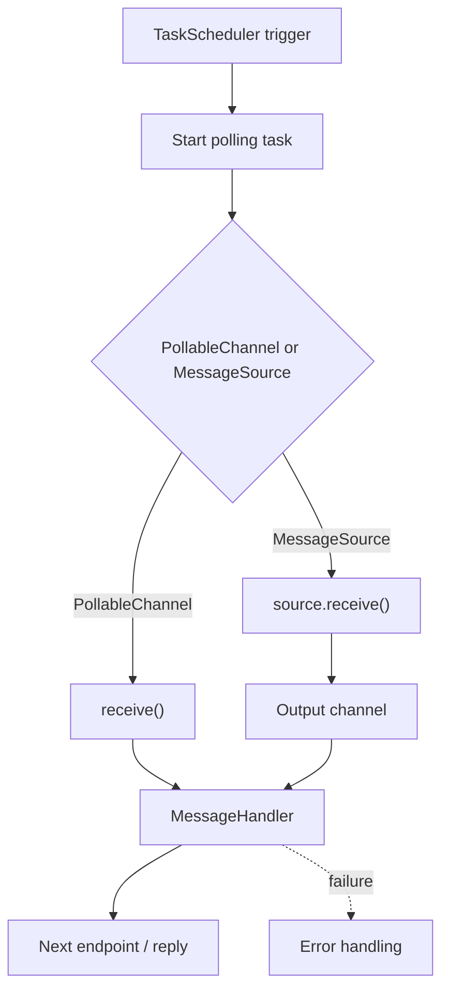

# Poller scheduler với thread pool

Trong Spring Integration, một polling endpoint cần được đánh thức theo lịch để lấy message từ `PollableChannel` hoặc gọi một `MessageSource`. Thành phần quyết định thời điểm đánh thức là `TaskScheduler`. Khi không cấu hình executor riêng cho poller, việc nhận message và gọi handler thường tiếp tục chạy trên thread của scheduler. Khi cấu hình `TaskExecutor`, polling task có thể được bàn giao sang một pool worker riêng.

Hai pool này giải quyết hai việc khác nhau. Scheduler giữ nhịp poll và kích hoạt tác vụ; executor cung cấp năng lực thực thi cho polling/handler. Cấu hình đúng giúp nhiều endpoint hoạt động mà không chiếm hết scheduler thread. Cấu hình lệch giữa nhịp submit, thời gian chờ nhận message và năng lực worker có thể làm hàng đợi task tăng liên tục, ngay cả khi queue message không có nhiều dữ liệu.

## 1. Poller nằm ở đâu trong message runtime?

Spring Integration có hai mô hình consumer:

- **Event-driven consumer** đăng ký handler trên một `SubscribableChannel`. Khi channel dispatch message, handler được gọi; endpoint không cần poller.
- **Polling consumer** nhận message từ `PollableChannel` bằng cách gọi `receive()` theo lịch. Endpoint cần poller để xác định khi nào thực hiện lần nhận tiếp theo.

Một inbound channel adapter dựa trên `MessageSource` cũng có thể được poll theo lịch. Khi đó `SourcePollingChannelAdapter` gọi source, sau đó gửi message nhận được vào output channel. Cần phân biệt nó với `PollingConsumer`: một bên chủ động lấy message từ channel, bên kia chủ động gọi source để tạo message.

Sơ đồ luồng polling:

Nếu poller không có `TaskExecutor`, polling task thường chạy trực tiếp trên thread do scheduler cấp. Nếu có executor, poller có thể bàn giao tác vụ cho executor; handler được thực thi trên worker thread. Đây là điểm cần nắm trước khi chọn pool size.

## 2. Phân biệt TaskScheduler và TaskExecutor

Hai abstraction đều có thể dùng thread pool, nhưng mục đích của chúng khác nhau.

| Thành phần | Trách nhiệm | Ví dụ |
|---|---|---|
| `TaskScheduler` | Lên lịch và kích hoạt tác vụ theo thời điểm hoặc trigger | Chạy poller mỗi 500 ms hoặc theo cron |
| `TaskExecutor` | Thực thi task được gửi tới | Chạy receive, handler hoặc công việc nghiệp vụ trên worker |
| `ThreadPoolTaskScheduler` | Implementation scheduler dùng pool thread | Pool thread `si-scheduler-` |
| `ThreadPoolTaskExecutor` | Implementation executor có core/max size và task queue | Pool thread `si-worker-` |

Khi không khai báo executor cho poller, scheduler thread có thể phải làm cả các việc sau:

1. Đợi đến thời điểm trigger.
2. Gọi `receive()` hoặc `MessageSource.receive()`.
3. Chờ tối đa `receiveTimeout` nếu chưa có message.
4. Chạy handler và các bước đồng bộ downstream.
5. Kết thúc poll cycle rồi mới sẵn sàng cho công việc scheduler tiếp theo trên thread đó.

Với handler ngắn và số poller ít, cách này có thể đủ. Với nhiều endpoint hoặc handler chờ I/O lâu, scheduler pool dễ bị chiếm hết. Khi đó trigger của các endpoint khác có thể bị trễ.

Khi cấu hình executor riêng, scheduler có thể bàn giao polling task cho worker pool. Scheduler thread không phải giữ toàn bộ thời gian xử lý nghiệp vụ. Đổi lại, cần quản lý queue task, số worker và chính sách từ chối task.

### Mặc định cần biết

Trong cấu hình mặc định của Spring Integration, bean scheduler trung tâm có tên `taskScheduler` và implementation mặc định là `ThreadPoolTaskScheduler`. Tài liệu Spring Integration hiện hành mô tả pool mặc định có 10 thread; giá trị mặc định này có thể được điều chỉnh bằng global property `spring.integration.taskScheduler.poolSize` hoặc bằng cách cung cấp bean `taskScheduler` của ứng dụng.

Khi ứng dụng có Spring Boot hoặc cấu hình scheduling riêng, hãy xác minh bean scheduler thực tế đang được dùng. Không nên suy ra pool size chỉ từ một thuộc tính Boot hoặc từ tên class; bean do ứng dụng cung cấp có thể thay thế cấu hình mặc định của framework.

## 3. Poll cycle và các tham số ảnh hưởng đến thread

Một poll cycle không chỉ là một lần gọi `receive()`. Poller có thể nhận nhiều message liên tiếp trong cùng cycle.

| Tham số | Ý nghĩa | Ảnh hưởng tới runtime |
|---|---|---|
| `fixedDelay` | Thời gian chờ sau khi lần thực thi trước hoàn tất trước khi bắt đầu lần tiếp theo | Giữ khoảng nghỉ sau mỗi poll cycle |
| `fixedRate` | Nhịp kích hoạt theo khoảng thời gian cố định | Có thể submit task nhanh hơn tốc độ worker hoàn tất nếu dùng executor |
| `cron` | Kích hoạt theo biểu thức lịch | Phù hợp với công việc theo mốc thời gian |
| `initialDelay` | Khoảng chờ trước lần poll đầu tiên | Tránh poll ngay khi ứng dụng vừa khởi động |
| `maxMessagesPerPoll` | Giới hạn số message nhận trong một poll cycle | Kiểm soát thời gian một cycle và tốc độ xả backlog |
| `receiveTimeout` | Thời gian `receive()` chờ khi chưa có message | Có thể giữ poller thread ở trạng thái chờ |

Poller mặc định dùng `PeriodicTrigger` với khoảng fixed delay 1 giây. `receiveTimeout` mặc định là 1.000 ms. Cần kiểm tra cấu hình endpoint cụ thể, vì giá trị mặc định của `maxMessagesPerPoll` phụ thuộc loại polling endpoint.

### fixedDelay và fixedRate

`fixedDelay` phù hợp khi muốn giữ một khoảng nghỉ sau khi tác vụ được schedule hoàn tất. Khi không cấu hình executor riêng, tác vụ schedule bao gồm poll cycle nên nếu poll mất 300 ms và fixed delay là 1.000 ms, lần tiếp theo bắt đầu sau khoảng 1.000 ms kể từ khi poll cycle trước hoàn tất. Khi poller bàn giao công việc sang `TaskExecutor`, callback trên scheduler có thể kết thúc ngay sau khi submit; fixed delay khi đó không nhất thiết chờ worker xử lý xong message mới bắt đầu tính lần tiếp theo.

`fixedRate` hướng tới nhịp kích hoạt theo chu kỳ cố định. Khi dùng executor để bàn giao polling task, scheduler có thể submit tác vụ tiếp theo trong khi worker của tác vụ trước vẫn đang xử lý. Nếu submit rate cao hơn completion rate, queue của executor sẽ tích tụ.

Không nên chọn fixed rate chỉ vì muốn polling nhanh. Hãy so sánh thời gian thực thi, `receiveTimeout`, `maxMessagesPerPoll` và khả năng xử lý đồng thời.

### maxMessagesPerPoll

Với `PollingConsumer`, `maxMessagesPerPoll` mặc định thường là `-1`, nghĩa là tiếp tục gọi `receive()` trong cùng cycle cho tới khi channel không còn message hoặc điều kiện dừng được đáp ứng. Với `SourcePollingChannelAdapter`, mặc định thường là 1 message mỗi cycle.

Giả sử poller có fixed delay 5 giây và `maxMessagesPerPoll=20`. Nếu queue có 100 message và handler xử lý nhanh, poller có thể lấy 20 message, chờ trigger tiếp theo, rồi lấy 20 message kế tiếp. Giá trị lớn giúp xả backlog nhanh nhưng có thể giữ worker lâu và làm các endpoint khác phải chờ nếu dùng chung executor. Với giá trị `-1`, một poll cycle có thể tiếp tục nhận cho tới khi channel rỗng; nếu message liên tục được bổ sung, worker có thể bị giữ lâu và ít có cơ hội nhường tài nguyên cho endpoint khác.

Từ Spring Integration 5.5, với polling endpoint dựa trên `MessageSource`, giá trị `0` có nghĩa bỏ qua lời gọi `MessageSource.receive()` trong poll cycle; có thể dùng để tạm pause endpoint và đổi lại giá trị sau đó. Đây không phải cách đặt “không giới hạn”. Hãy kiểm tra semantics của đúng loại endpoint và phiên bản đang dùng.

### receiveTimeout và long polling

`receiveTimeout` xác định thời gian chờ trong một lần nhận. Nếu poller dùng `receiveTimeout=1000`, thread có thể bị giữ tới một giây khi queue trống.

Có hai cấu hình nhìn khá giống nhau nhưng tạo ra hành vi khác:

- Trigger 5 giây, receive timeout 50 ms: poller kiểm tra thưa; message có thể phải đợi gần 5 giây mới được phát hiện.
- Trigger 50 ms, receive timeout 5 giây: thread chờ message lâu hơn và có thể phản ứng nhanh khi message tới, nhưng thread bị giữ trong thời gian chờ.

Cách thứ hai là long polling. Nó hữu ích khi channel hoặc source thực sự hỗ trợ thao tác chờ có timeout. Với nguồn không block như một số file scan, tăng `receiveTimeout` không làm phát hiện dữ liệu nhanh hơn.

## 4. Cấu hình scheduler pool trung tâm

Có thể cung cấp một bean tên `taskScheduler` để Spring Integration sử dụng làm scheduler trung tâm:

~~~java
@Configuration
@EnableIntegration
class IntegrationSchedulingConfiguration {

    @Bean(name = "taskScheduler")
    ThreadPoolTaskScheduler integrationTaskScheduler() {
        ThreadPoolTaskScheduler scheduler = new ThreadPoolTaskScheduler();
        scheduler.setPoolSize(4);
        scheduler.setThreadNamePrefix("si-scheduler-");
        scheduler.setWaitForTasksToCompleteOnShutdown(true);
        scheduler.setAwaitTerminationSeconds(30);
        return scheduler;
    }
}
~~~

Trong ví dụ, scheduler có bốn thread và tên thread có prefix dễ nhận diện trong log hoặc thread dump. `setWaitForTasksToCompleteOnShutdown(true)` yêu cầu scheduler chờ các scheduled task theo chính sách shutdown của nó; thời gian chờ được giới hạn bởi cấu hình await termination và shutdown của application context. Nếu poller bàn giao công việc cho một `TaskExecutor` riêng, scheduler hoàn tất task submit ngay sau khi bàn giao; worker executor vẫn cần chính sách drain và shutdown riêng.

Pool size 4 chỉ là giá trị minh họa. Nếu không có executor riêng cho poller, số scheduler thread cần đủ cho các poll cycle có thể chạy đồng thời, bao gồm cả thời gian chờ `receive()` và thời gian handler. Nếu mọi poller có executor riêng, scheduler chủ yếu chịu trách nhiệm kích hoạt và submit tác vụ, nên yêu cầu về số worker thực thi nghiệp vụ nằm ở executor.

### Global property

Khi sử dụng scheduler mặc định do Spring Integration tạo, có thể điều chỉnh số thread bằng global property:

~~~properties
spring.integration.taskScheduler.poolSize=10
~~~

Nếu tự khai báo bean `taskScheduler`, hãy đặt pool size trên bean đó. Đừng cấu hình đồng thời nhiều scheduler cùng tên hoặc giả định mọi endpoint đều dùng một scheduler nếu chúng được cấu hình với scheduler riêng.

## 5. Cấu hình TaskExecutor riêng cho poller

Với handler chạy lâu hoặc có nhiều polling endpoint, nên tách worker pool khỏi scheduler. Ví dụ:

~~~java
@Configuration
class PollerExecutorConfiguration {

    @Bean
    ThreadPoolTaskExecutor pollerExecutor() {
        ThreadPoolTaskExecutor executor = new ThreadPoolTaskExecutor();
        executor.setCorePoolSize(4);
        executor.setMaxPoolSize(8);
        executor.setQueueCapacity(100);
        executor.setThreadNamePrefix("si-poller-worker-");
        executor.setRejectedExecutionHandler(
                new ThreadPoolExecutor.AbortPolicy()
        );
        return executor;
    }
}
~~~

Các tham số:

- `corePoolSize` là số worker cốt lõi được duy trì theo chính sách executor.
- `maxPoolSize` là giới hạn trên khi queue đã đầy và executor cần tăng số worker.
- `queueCapacity` giới hạn số task đang chờ worker.
- `threadNamePrefix` giúp nhận diện thread khi đọc log và thread dump.
- Rejection policy quyết định hành vi khi pool và queue đều không nhận thêm task.

Với `ThreadPoolTaskExecutor`, task thường được giao cho core thread trước, sau đó được đưa vào queue; khi queue đầy executor mới tăng thread vượt core size cho tới max size. Nếu queue không giới hạn, max size hầu như không phát huy tác dụng vì task tiếp tục được xếp hàng. Queue không giới hạn có thể làm heap tăng dần khi tốc độ submit vượt tốc độ xử lý.

`AbortPolicy` từ chối task khi không thể tiếp nhận thêm và phát sinh `RejectedExecutionException`. `CallerRunsPolicy` có thể tạo backpressure bằng cách buộc thread gửi task tự chạy task đó; trong poller, thread gửi có thể là scheduler thread, vì vậy chính sách này có thể làm trễ các poller khác. Chọn rejection policy theo semantics của flow và quan sát lỗi bị từ chối.

## 6. Ghép poller với executor bằng Java DSL

Ví dụ sau tạo queue có capacity hữu hạn và cấu hình poller chạy công việc qua executor:

~~~java
@Configuration
@EnableIntegration
class OrdersPollingFlow {

    @Bean
    QueueChannel ordersQueue() {
        return new QueueChannel(500);
    }

    @Bean
    IntegrationFlow ordersFlow(
            QueueChannel ordersQueue,
            @Qualifier("pollerExecutor") TaskExecutor pollerExecutor,
            OrderHandler orderHandler
    ) {
        return IntegrationFlow.from(
                        ordersQueue,
                        endpoint -> endpoint.poller(
                                Pollers.fixedDelay(250)
                                        .maxMessagesPerPoll(10)
                                        .receiveTimeout(100)
                                        .taskExecutor(pollerExecutor)
                        )
                )
                .handle(orderHandler, "process")
                .get();
    }
}
~~~

Trong flow này:

1. `TaskScheduler` kích hoạt poll theo fixed delay 250 ms.
2. Poller bàn giao polling task cho `pollerExecutor`.
3. Polling task nhận tối đa 10 message trong một cycle.
4. Mỗi lần nhận có thể chờ tối đa 100 ms nếu queue đang trống.
5. Handler chạy trên worker thread thuộc executor.

Queue capacity 500 và executor queue capacity 100 là hai hàng đợi khác nhau. Queue channel giữ message đang chờ consumer lấy; executor queue giữ task polling đang chờ worker thực thi. Khi chẩn đoán backlog, cần kiểm tra cả hai.

Không phải lúc nào cũng cần cấu hình `TaskExecutor`. Với handler rất ngắn và số endpoint ít, để poller chạy trực tiếp trên scheduler có thể đơn giản và đủ hiệu quả. Executor chỉ mang lại lợi ích khi có công việc cần tách thread và pool được cấu hình cân bằng.

## 7. Hai nhịp phải cân bằng: scheduler submit và executor complete

Khi poller dùng executor, có hai tốc độ cần theo dõi:

- **Submit rate:** tốc độ scheduler đưa polling task vào executor.
- **Completion rate:** tốc độ worker hoàn tất polling task.

Nếu submit rate cao hơn completion rate trong thời gian dài, task queue sẽ tăng. Tăng scheduler pool size không giải quyết được thiếu năng lực worker; nó thậm chí có thể tăng tốc độ submit và làm backlog task lớn nhanh hơn.

Ví dụ, poller có `fixedRate=50ms` nên scheduler có thể submit khoảng 20 task mỗi giây. Giả sử có 20 worker, mỗi task có thể block 5 giây ở `receiveTimeout`. Khi queue rỗng, năng lực hoàn tất tối đa chỉ khoảng 4 task mỗi giây. Nếu scheduler tiếp tục submit 20 task mỗi giây, task queue tăng khoảng 16 task mỗi giây dù không có message mới. Đây là dấu hiệu cấu hình poller và executor không ăn khớp.

### Công thức ước lượng ban đầu

Có thể dùng định luật Little như một ước lượng sơ bộ:

\[
N \approx \lambda \times W
\]

Trong đó:

- `\lambda` là tốc độ công việc cần xử lý (task/giây hoặc message/giây).
- `W` là thời gian xử lý trung bình tính bằng giây.
- `N` là số công việc đồng thời cần để đạt tốc độ đó trong điều kiện ổn định.

Ví dụ, nếu cần xử lý trung bình 12 message/giây và mỗi message mất 0,5 giây, tải đồng thời trung bình xấp xỉ 6 message. Pool 6 thread là mức lý thuyết ban đầu; thực tế cần headroom cho thời gian xử lý biến động, retry, I/O và các giới hạn downstream.

Với công việc CPU-bound, số thread nên bắt đầu gần số core CPU khả dụng rồi đo thực tế. Với công việc I/O-bound, có thể cần nhiều thread hơn vì worker dành thời gian chờ I/O, nhưng phải xét giới hạn connection pool, database, API ngoài và bộ nhớ.

## 8. Batching và thời gian chiếm worker

`maxMessagesPerPoll` quyết định số message tối đa mà một polling task xử lý trong một cycle. Giá trị lớn giúp giảm chi phí kích hoạt task và xả backlog nhanh hơn, nhưng worker có thể bị giữ lâu trong một batch.

Giả sử một message mất trung bình 40 ms:

- Batch 1: thời gian xử lý nghiệp vụ xấp xỉ 40 ms.
- Batch 10: xấp xỉ 400 ms nếu xử lý tuần tự.
- Batch 50: xấp xỉ 2 giây nếu xử lý tuần tự.

Đây là phép ước lượng đơn giản, chưa tính receive timeout, transaction, I/O và bước downstream. Batch lớn có thể tăng throughput nhưng làm tăng latency của message ở cuối batch và giảm cơ hội chia sẻ worker cho endpoint khác nếu dùng chung executor.

Nếu nhiều endpoint dùng chung pool, nên giới hạn batch và cân nhắc pool riêng cho endpoint có workload khác biệt. Một endpoint polling file chậm không nên chiếm hết worker của endpoint xử lý queue giao dịch quan trọng.

## 9. Concurrency làm thay đổi thứ tự và trạng thái dùng chung

Khi poller bàn giao task cho executor có nhiều worker, nhiều polling task có thể chạy đồng thời. Điều đó có thể làm nhiều message được xử lý song song, tùy channel, endpoint và cấu hình.

Trước khi tăng concurrency, cần xác định:

- Handler có thread-safe không?
- Có thể xử lý hai message cùng một aggregate hoặc cùng một business key đồng thời không?
- Database connection pool có đủ kết nối không?
- API downstream có giới hạn rate hoặc số request đồng thời không?
- Transaction có bao quanh từng poll operation hay từng message theo cấu hình?
- Reply và correlation có được giữ đúng khi message hoàn tất không?
- Có yêu cầu ordering theo partition hoặc key không?

Không nên giả định `QueueChannel` và nhiều worker sẽ tự bảo đảm thứ tự hoàn tất giống thứ tự lấy message. Nếu thứ tự nghiệp vụ quan trọng, hãy thiết kế serialization theo key, partition hoặc cơ chế khóa phù hợp thay vì chỉ giảm interval.

## 10. Transaction và error handling trên poller

Poller hỗ trợ AOP advice chain để áp dụng các concern quanh polling task, bao gồm transaction. Trong Java DSL, có thể cấu hình `transactional()` hoặc thêm advice tương ứng vào `PollerSpec`.

Ví dụ:

~~~java
@Bean
IntegrationFlow transactionalOrdersFlow(
        QueueChannel ordersQueue,
        PlatformTransactionManager transactionManager,
        OrderHandler handler
) {
    return IntegrationFlow.from(
                    ordersQueue,
                    endpoint -> endpoint.poller(
                            Pollers.fixedDelay(500)
                                    .maxMessagesPerPoll(5)
                                    .transactional(transactionManager)
                    )
            )
            .handle(handler, "process")
            .get();
}
~~~

Transaction advice được áp dụng quanh polling task theo cấu hình poller. Khi task chạy trên executor, transaction được mở trên worker thread thực thi task; transaction thread-bound của một thread khác không tự động đi theo. Nếu một poll cycle nhận nhiều message, advice có thể bao quanh toàn bộ thao tác poll theo cách endpoint thực thi; đừng mặc định rằng cấu hình transactional của poller luôn tạo một transaction riêng cho từng message.

Cần xác định transaction boundary phù hợp với loại channel và adapter. Với broker, acknowledgment và transaction semantics còn phụ thuộc adapter, broker và transaction manager. Không suy ra rằng side effect ở hệ thống ngoài tự động được rollback.

### Lỗi từ poller và executor

Khi poller chạy bất đồng bộ, exception có thể xuất hiện trên worker thread sau khi scheduler đã hoàn tất việc submit task. Do đó, không phải mọi lỗi đều có thể truyền về thread scheduler hoặc producer.

Spring Integration hỗ trợ error handling cho polling task. `PollerSpec` có thể cấu hình `errorChannel` hoặc `errorHandler` cho lỗi của polling task. Nếu cung cấp scheduler tùy chỉnh, cần kiểm tra error handler của scheduler; tài liệu Spring Integration khuyến nghị dùng `MessagePublishingErrorHandler` khi muốn lỗi scheduler được chuyển thành `ErrorMessage` tới error channel.

Ngoài ra, phải quan sát `RejectedExecutionException` khi executor không nhận thêm task. Lỗi từ chối submit khác với lỗi nghiệp vụ trong handler và cần được phân loại riêng.

## 11. Bounded queue và backpressure

Có ít nhất ba nơi có thể tích tụ công việc:

1. Queue của `QueueChannel` chứa message chưa được consumer nhận.
2. Queue của `ThreadPoolTaskExecutor` chứa polling task đang chờ worker.
3. Queue hoặc buffer của broker/adapter chứa message ở ngoài application process.

Các queue này có semantics và đơn vị đếm khác nhau. Một queue channel có thể có 500 message nhưng executor queue chỉ có 2 task; ngược lại, executor queue có thể chứa hàng trăm poll task trong khi queue message đang trống do các worker đang chờ `receiveTimeout`.

Hãy ưu tiên capacity hữu hạn khi tải có thể tăng đột biến. Khi đầy, quyết định rõ hệ thống sẽ:

- Từ chối task và phát cảnh báo.
- Chạy task trên caller thread để tạo backpressure, sau khi đánh giá nguy cơ làm block scheduler.
- Giảm nhịp poll hoặc giảm số task được submit.
- Để broker giữ message và giao lại theo cơ chế adapter.
- Tạm dừng endpoint hoặc chuyển sang trạng thái degraded có kiểm soát.

Không dùng queue không giới hạn như cách che giấu thiếu worker. Queue chỉ trì hoãn thời điểm quá tải biểu hiện ra; nó không làm tăng năng lực xử lý.

## 12. Chọn pool size theo workload

Không có một pool size phù hợp cho mọi hệ thống. Hãy đo workload và đặt giới hạn dựa trên tài nguyên downstream.

| Loại workload | Cách bắt đầu |
|---|---|
| Handler CPU-bound | Bắt đầu gần số core khả dụng; theo dõi CPU utilization và throughput |
| Handler chờ database | Giới hạn concurrency theo connection pool và khả năng database |
| Handler gọi HTTP/RPC | Cân nhắc thời gian chờ, giới hạn kết nối, rate limit và timeout của dịch vụ đích |
| Nhiều poller ngắn | Scheduler pool cần đủ để trigger không bị trễ; executor có thể nhỏ hoặc không cần nếu xử lý nhanh |
| Ít poller nhưng xử lý lâu | Dùng executor riêng để tách scheduler thread khỏi worker |
| Poller có long receive timeout | Tính cả thời gian thread bị giữ khi queue trống vào concurrency cần thiết |

Một cách thực tế là bắt đầu với:

- Scheduler pool đủ cho số poller có thể chạy đồng thời nếu không có executor.
- Executor core size dựa trên concurrency cần thiết và giới hạn downstream.
- Queue capacity hữu hạn để kiểm soát backlog.
- `maxMessagesPerPoll` vừa phải để tránh một task giữ worker quá lâu.
- `receiveTimeout` đủ ngắn để tránh giữ worker vô ích, trừ khi long polling là chủ đích.

Sau đó đo throughput, p95/p99 latency, queue depth, rejection, active threads và thời gian poll bị trễ. Chỉ tăng pool khi có bằng chứng bottleneck nằm ở năng lực worker và downstream còn đủ khả năng tiếp nhận.

## 13. Quan sát scheduler và executor trong runtime

Khi vận hành, cần quan sát scheduler pool và worker pool riêng biệt.

| Chỉ số | Ý nghĩa | Dấu hiệu bất thường |
|---|---|---|
| Scheduler active threads | Số thread scheduler đang thực thi task | Gần full liên tục, poller khác bị trễ |
| Scheduler task delay | Độ trễ giữa thời điểm dự kiến và thời điểm poll thực sự bắt đầu | Trigger bị chậm dù queue có message |
| Executor active threads | Số worker đang bận | Luôn bằng max có thể cho thấy thiếu worker hoặc downstream chậm |
| Executor queue depth | Số task đang chờ worker | Tăng đều cho thấy submit rate lớn hơn completion rate |
| Executor rejected tasks | Số task bị từ chối | Pool/queue đã chạm giới hạn |
| Message queue depth | Số message đang chờ consumer | Consumer không theo kịp producer hoặc poller không hoạt động |
| Poll cycle duration | Thời gian một lần polling task hoàn tất | Tăng do handler, receive timeout hoặc downstream I/O |
| Message processing latency | Thời gian từ khi message vào đến khi xử lý xong | Tăng do backlog, worker contention hoặc retry |

Có thể dùng thread name prefix như `si-scheduler-` và `si-poller-worker-` để đọc thread dump. Với Spring Boot Actuator và Micrometer được cấu hình, executor và scheduler có thể được bind thành metrics; tên metric cụ thể phụ thuộc binder và phiên bản.

Correlation ID trong log giúp nối thời điểm producer gửi, poller nhận và handler hoàn tất. Không ghi toàn bộ payload nhạy cảm chỉ để debug thread.

### Cách đọc thread dump

- Nhiều thread `si-scheduler-` đang `TIMED_WAITING` trong queue receive: có thể `receiveTimeout` đang giữ scheduler thread.
- Scheduler thread đang chạy handler hoặc chờ I/O: poller có thể chưa tách executor hoặc handler đang chạy đồng bộ.
- Worker thread đều bận chờ cùng một dependency: bottleneck có thể nằm ở database, HTTP client hoặc connection pool.
- Executor queue tăng nhưng worker active thấp: kiểm tra task bị block ở pool khác, executor configuration hoặc task scheduling cadence.
- Scheduler active thấp nhưng message queue tăng: kiểm tra poller có chạy, endpoint có start và trigger có đúng không.

## 14. Các lỗi cấu hình thường gặp

| Triệu chứng | Nguyên nhân có thể | Hướng xử lý |
|---|---|---|
| Poller khác bị trễ | Scheduler pool quá nhỏ hoặc handler chạy lâu trên scheduler thread | Dùng executor cho poller xử lý lâu; điều chỉnh scheduler pool sau khi đo |
| Worker queue tăng dù không có message | `receiveTimeout` dài và trigger submit task quá nhanh | Cân bằng interval, timeout và số worker; giới hạn queue |
| CPU thấp nhưng latency cao | Worker chờ I/O hoặc queue task lớn | Kiểm tra downstream latency, receive timeout và executor queue |
| Message backlog tăng đều | Poller nhận ít hơn producer phát hoặc batch quá nhỏ | Đo throughput; điều chỉnh batch/concurrency nếu downstream cho phép |
| Database connection pool cạn | Executor concurrency lớn hơn khả năng database | Giảm worker hoặc tăng capacity database có kiểm soát |
| RejectedExecutionException | Worker và queue đều đạt giới hạn | Xác định backpressure/retry policy và cảnh báo |
| Message xử lý song song sai thứ tự | Nhiều worker xử lý cùng channel/key | Thiết kế ordering theo key hoặc giảm concurrency tại ranh giới cần tuần tự |
| Scheduler bị starvation | Quá nhiều poller hoặc receive/handler chạy trên scheduler thread | Tách executor và giảm receive timeout không cần thiết |

## 15. Checklist cấu hình poller với thread pool

Trước khi đưa poller vào production, hãy xác nhận:

- [ ] Input là `PollableChannel` hay endpoint đang poll một `MessageSource`?
- [ ] Có thực sự cần poller không, hay channel là subscribable và có thể dùng event-driven consumer?
- [ ] Scheduler bean nào đang được Spring Integration sử dụng?
- [ ] Scheduler pool size có đủ cho số poller và thời gian thực thi trên scheduler thread không?
- [ ] Handler có chạy lâu hoặc block I/O không?
- [ ] Poller có `TaskExecutor` riêng khi cần tách worker không?
- [ ] `fixedDelay`, `fixedRate` hoặc cron có phù hợp với latency mục tiêu không?
- [ ] `receiveTimeout` có giữ thread chờ quá lâu không?
- [ ] `maxMessagesPerPoll` có giới hạn thời gian batch hợp lý không?
- [ ] Executor queue có capacity hữu hạn và rejection policy được xác định không?
- [ ] Submit rate có cân bằng với completion rate không?
- [ ] Worker concurrency có nằm trong giới hạn database, broker và API ngoài không?
- [ ] Transaction advice và error channel có bao phủ polling task đúng cách không?
- [ ] Có metric cho active threads, queue depth, rejection, poll duration và message latency không?
- [ ] Shutdown có chờ task đang chạy theo chính sách và timeout phù hợp không?

## Tài liệu tham khảo

- [Spring Integration — Configuring the Task Scheduler](https://docs.spring.io/spring-integration/reference/configuration.html) — scheduler trung tâm, pool mặc định và cấu hình global.
- [Spring Integration — Message Endpoints](https://docs.spring.io/spring-integration/reference/endpoint.html) — polling consumer, trigger, receive timeout, max messages per poll và TaskExecutor support.
- [Spring Integration — Pollers Java DSL](https://docs.spring.io/spring-integration/reference/dsl/java-pollers.html) — Pollers factory và cấu hình PollerSpec.
- [Spring Integration — PollerSpec API](https://docs.spring.io/spring-integration/api/org/springframework/integration/dsl/PollerSpec.html) — taskExecutor, receiveTimeout, maxMessagesPerPoll, transactional và error handling.
- [Spring Framework — Task Execution and Scheduling](https://docs.spring.io/spring-framework/reference/integration/scheduling.html) — TaskExecutor, TaskScheduler và thread pool.
- [Spring Boot — Task Execution and Scheduling](https://docs.spring.io/spring-boot/reference/features/task-execution-and-scheduling.html) — auto-configuration scheduler/executor và thuộc tính cấu hình.

Pool size, default trigger và cách scheduler được tạo có thể khác theo phiên bản Spring Integration, Spring Framework, Spring Boot và cấu hình application context. Hãy xác minh bean scheduler thực tế cùng dependency version của ứng dụng trước khi áp dụng các giá trị mặc định.
