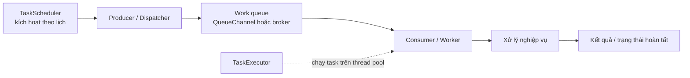
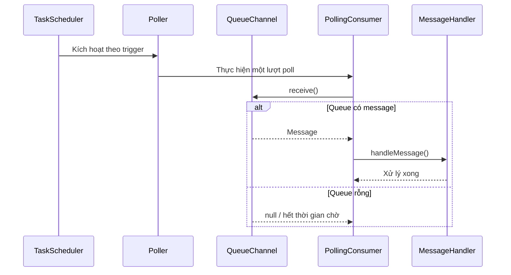
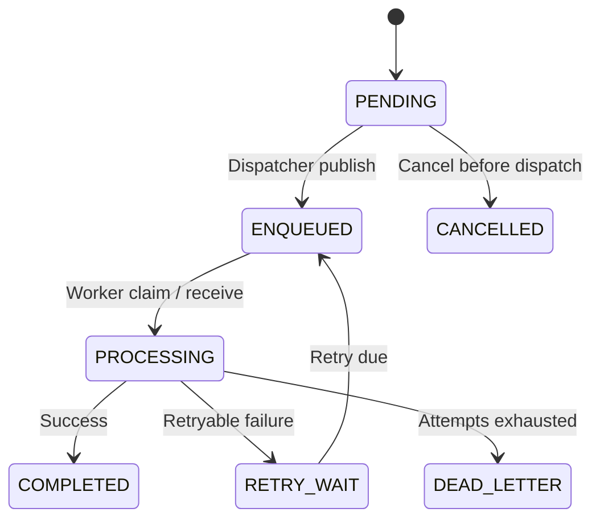

# Không dùng scheduler thay cho queue điều phối công việc

`TaskScheduler` và queue giải quyết hai bài toán khác nhau. Scheduler quyết định **khi nào** một tác vụ được kích hoạt. Queue giữ **công việc nào đang chờ** và chuyển từng work item cho consumer xử lý. Dùng scheduler để tạo nhịp polling hoặc phát lệnh định kỳ là hợp lý; dùng một lịch timer làm nơi chứa backlog công việc thường dẫn đến mất dữ liệu, khó giới hạn tải và khó phục hồi sau restart.

Trong Spring Integration, poller dùng scheduler để kích hoạt việc đọc message. Bản thân poller không phải nơi lưu message. Message có thể nằm trong `QueueChannel`, broker queue hoặc một kho dữ liệu khác; scheduler chỉ tạo thời điểm để consumer đọc hoặc source tạo message.

Một cách nhớ hữu ích:

- `TaskScheduler`: khi nào chạy?
- `TaskExecutor`: chạy trên thread nào, với mức song song ra sao?
- Queue: công việc nào đang chờ xử lý?
- Poller: khi nào gọi `receive()` để lấy công việc từ nguồn hoặc channel có thể đọc?

## 1. Scheduler và queue khác nhau ở trách nhiệm

Scheduler quản lý lịch chạy của các `Runnable`: chạy một lần vào thời điểm cụ thể, chạy lặp theo fixed delay/fixed rate hoặc theo trigger/cron. API thường trả về một `ScheduledFuture` để kiểm tra hoặc hủy lịch.

Queue lưu các message/work item chưa được consumer lấy ra. Producer có thể thêm việc vào queue nhanh hơn tốc độ xử lý; consumer lấy dần theo năng lực của nó. Queue vì vậy tạo ra ranh giới giữa thời điểm công việc được tạo và thời điểm công việc được xử lý.

| Khía cạnh | TaskScheduler | Work/message queue |
|---|---|---|
| Câu hỏi chính | Khi nào chạy một tác vụ? | Công việc nào đang chờ? |
| Đơn vị quản lý | Lịch và `Runnable` | Message hoặc work item |
| Thời gian tồn tại | Theo lịch đăng ký và vòng đời scheduler | Cho đến khi được nhận/xử lý hoặc hết hạn theo chính sách |
| Điều phối consumer | Không có semantics consumer của message | Có producer và consumer |
| Buffer backlog | Không phải mục tiêu chính | Là trách nhiệm chính |
| Backpressure | Scheduler thread/pool có thể bị bận hoặc trễ lịch | Có thể giới hạn dung lượng, từ chối, block hoặc điều tiết producer |
| Retry / redelivery | Phải tự xây dựng quanh task | Có thể được hỗ trợ bởi broker hoặc cơ chế consumer |
| Acknowledgment | Không có acknowledgment message chuẩn | Có thể có ack/commit theo channel hoặc broker |
| Khôi phục sau restart | Lịch trong bộ nhớ cần được đăng ký lại | Queue bền vững có thể giữ work item qua restart |
| Phù hợp | Timer, cron, poll định kỳ, trigger | Backlog, burst, phân phối công việc, worker |

Một scheduler có thể lưu thông tin về những lần chạy đã được lên lịch trong bộ lập lịch nội bộ. Điều đó không biến nó thành queue nghiệp vụ: một scheduled task không tự có message payload, consumer group, acknowledgment, dead-letter policy hay khả năng phục hồi work item như một broker queue.

## 2. Các thành phần Spring thường bị nhầm lẫn

| Thành phần | Vai trò | Không nên xem là |
|---|---|---|
| `TaskScheduler` | Lên lịch thực thi `Runnable` theo thời gian hoặc trigger | Queue lưu công việc nghiệp vụ |
| `TaskExecutor` | Thực thi task trên thread; kiểm soát concurrency và thread pool | Durable message broker |
| `Poller` | Dùng trigger để kích hoạt consumer/source polling | Nơi lưu message |
| `QueueChannel` | Giữ message trong channel để consumer nhận sau | Scheduler |
| `DirectChannel` | Dispatch message trực tiếp đến subscriber | Queue có buffering |
| `ExecutorChannel` | Dispatch message qua `TaskExecutor` | Queue bền vững |
| Broker queue | Lưu và phân phối message theo semantics của broker | Timer hoặc cron scheduler |

### 2.1. TaskScheduler: lên lịch thời gian

Spring cung cấp abstraction `TaskScheduler` cho các tác vụ có lịch. Một số kiểu lịch thường gặp:

- `schedule(task, startTime)`: chạy một lần tại thời điểm xác định.
- `schedule(task, trigger)`: để trigger quyết định lần chạy tiếp theo.
- `scheduleAtFixedRate(task, period)`: chạy theo nhịp cố định.
- `scheduleWithFixedDelay(task, delay)`: chờ khoảng delay sau khi lần chạy trước hoàn tất.

Ví dụ:

```java
@Component
public class MaintenanceScheduler {

    @Scheduled(cron = "0 0 2 * * *")
    public void cleanExpiredRecords() {
        // Dọn dữ liệu hết hạn mỗi ngày lúc 02:00.
    }
}
```

Ứng dụng cần bật scheduling bằng `@EnableScheduling`. Scheduler thích hợp cho việc dọn dữ liệu, phát báo cáo định kỳ, kiểm tra nguồn ngoài hoặc đánh thức một dispatcher.

Nếu tác vụ trong scheduler kéo dài, chiếm hết scheduler thread hoặc gọi I/O chậm, các lần chạy khác có thể bị trễ. Cần cấu hình scheduler pool phù hợp, giữ callback ngắn và chuyển công việc nặng sang executor hoặc queue.

### 2.2. TaskExecutor: thực thi công việc

`TaskExecutor` quyết định task chạy trên thread nào. Ví dụ `ThreadPoolTaskExecutor` có core/max pool size, queue capacity và rejection policy.

Executor có thể có một hàng đợi task nội bộ, nhưng hàng đợi đó phục vụ việc phân phối task cho thread trong process. Nó thường không cung cấp semantics của một message queue bền vững: không tự có acknowledgment, replay sau restart, dead-letter hoặc hợp đồng nghiệp vụ về trạng thái công việc.

Ví dụ:

```java
@Bean
public ThreadPoolTaskExecutor workExecutor() {
    ThreadPoolTaskExecutor executor = new ThreadPoolTaskExecutor();
    executor.setCorePoolSize(4);
    executor.setMaxPoolSize(8);
    executor.setQueueCapacity(200);
    executor.setThreadNamePrefix("work-");
    return executor;
}
```

Khi executor queue đầy, kết quả phụ thuộc rejection policy. Có thể từ chối task, chạy task trên thread gọi hoặc áp dụng chính sách khác. Đây là điều tiết thực thi trong process, không phải một cơ chế lưu trữ work item bền vững.

### 2.3. Queue: giữ work item chờ consumer

Trong Spring Integration, `QueueChannel` là một `PollableChannel`. Producer gửi message vào channel; một `PollingConsumer` dùng poller gọi `receive()` để lấy message và chuyển cho handler.



Queue tạo ra nơi chứa backlog. Nếu producer phát 100 công việc trong một đợt nhưng worker chỉ xử lý được 10 công việc mỗi giây, queue có thể giữ phần còn lại để worker lấy dần, trong giới hạn dung lượng và chính sách lưu trữ.

Không phải mọi queue đều bền vững. `QueueChannel` thông thường giữ message trong bộ nhớ của process. Muốn giữ work item qua restart, cần một message store có persistence phù hợp hoặc broker/database queue có durability.

## 3. Poller dùng scheduler nhưng không thay thế queue

Trong Spring Integration, poller là cơ chế kích hoạt việc đọc. Nó thường gắn với một trong hai tình huống:

1. `PollingConsumer` đọc message từ `PollableChannel`.
2. `SourcePollingChannelAdapter` gọi `MessageSource.receive()` để tạo message từ nguồn.



Scheduler tạo thời điểm chạy poller. Queue giữ message. Consumer lấy message. Handler thực hiện nghiệp vụ. Nếu queue rỗng, poller có thể kết thúc lượt đó mà không có công việc để xử lý.

Với `SourcePollingChannelAdapter`, poller gọi một `MessageSource`; source có thể truy vấn database, đọc file hoặc gọi API. Trong trường hợp đó, nguồn dữ liệu có thể là nơi lưu backlog. Scheduler chỉ điều khiển tần suất kiểm tra nguồn.

Vì vậy, có thể dùng scheduler và queue cùng nhau. Ví dụ, scheduler định kỳ đánh thức dispatcher để lấy các công việc đến hạn từ database và đưa vào queue; worker lấy công việc từ queue. Scheduler và queue bổ sung cho nhau.

## 4. Ví dụ: scheduler tạo việc, QueueChannel giữ việc, worker xử lý

Ví dụ dưới đây minh họa ranh giới trách nhiệm. Một tác vụ định kỳ tạo công việc mới và gửi vào queue; polling consumer lấy tối đa 10 message trong mỗi lượt.

```java
@Configuration
@EnableIntegration
@EnableScheduling
public class WorkQueueConfiguration {

    @Bean
    public PollableChannel workQueue() {
        return new QueueChannel(500);
    }

    @Bean
    public IntegrationFlow workConsumer(WorkService workService) {
        return IntegrationFlow.from(
                        "workQueue",
                        endpoint -> endpoint.poller(
                                Pollers.fixedDelay(200)
                                        .maxMessagesPerPoll(10)))
                .handle(workService, "process")
                .get();
    }
}
```

Producer theo lịch:

```java
@Component
public class WorkDispatcher {

    private final MessageChannel workQueue;

    public WorkDispatcher(
            @Qualifier("workQueue") MessageChannel workQueue) {
        this.workQueue = workQueue;
    }

    @Scheduled(fixedDelay = 1000)
    public void enqueueNextWork() {
        WorkItem item = findNextWork();

        if (item == null) {
            return;
        }

        Message<WorkItem> message = MessageBuilder
                .withPayload(item)
                .setHeader("workId", item.id())
                .build();

        boolean accepted = workQueue.send(message, 0);

        if (!accepted) {
            // Queue đầy: giữ công việc ở nguồn và ghi nhận để thử lại.
            log.warn("Work queue is full; workId={}", item.id());
        }
    }

    private WorkItem findNextWork() {
        // Ví dụ minh họa: đọc một công việc đủ điều kiện từ nguồn.
        return null;
    }
}
```

Worker:

```java
@Service
public class WorkService {

    public void process(WorkItem item) {
        // Xử lý một work item.
    }
}
```

Ví dụ dùng `QueueChannel(500)` để minh họa queue có dung lượng giới hạn. `send(message, 0)` trả về ngay nếu message không thể được chấp nhận. Ứng dụng phải quyết định việc tiếp theo: giữ công việc ở nguồn, thử lại sau, phát cảnh báo hoặc chuyển sang trạng thái cần can thiệp.

Đây là ví dụ kiến trúc, chưa phải một dispatcher production hoàn chỉnh. Nếu nguồn công việc là database, không được đánh dấu một record là đã dispatch trước khi message được chấp nhận một cách đáng tin cậy. Với yêu cầu không mất việc khi process restart, hãy dùng transactional outbox, cơ chế claim/lease trong database hoặc broker queue bền vững thay vì chỉ dựa vào `QueueChannel` trong bộ nhớ.

## 5. Vì sao không nên tạo một scheduled task cho mỗi work item?

Một cách triển khai dễ nghĩ đến là mỗi khi có công việc, gọi `TaskScheduler.schedule()` để tạo một timer riêng. Cách này có thể hợp lý với số lượng nhỏ các lịch độc lập, nhưng trở nên khó quản lý khi mỗi message nghiệp vụ lại trở thành một scheduled task.

Các vấn đề thường gặp:

- **Không có backlog nghiệp vụ rõ ràng:** task đã được schedule không cung cấp trạng thái pending/claimed/processed theo mô hình công việc.
- **Khó giới hạn tải consumer:** scheduler tập trung vào thời điểm chạy; queue mới là nơi dễ đo backlog và giới hạn số việc đang chờ.
- **Khó retry và redelivery:** nếu task ném exception hoặc bị cancel, ứng dụng phải tự quyết định cách khôi phục work item.
- **Khó phục hồi sau restart:** lịch đăng ký trong bộ nhớ thường mất khi process dừng; phải lưu và đăng ký lại từ nguồn bền vững.
- **Khó quan sát:** số lượng scheduled future không diễn tả đầy đủ tuổi backlog, số lần retry, trạng thái claim hoặc dead-letter.
- **Khó phân phối giữa nhiều worker/node:** scheduler trong một process không tự cung cấp consumer group hay cơ chế phân phối công việc giữa nhiều instance.
- **Rủi ro tài nguyên:** hàng nghìn hoặc hàng triệu timer riêng có thể làm tăng chi phí quản lý lịch và khiến shutdown phức tạp.

Nếu công việc cần chạy vào một thời điểm trong tương lai, hãy lưu `dueAt` cùng trạng thái công việc ở một nguồn bền vững. Scheduler có thể định kỳ tìm các công việc đã đến hạn và chuyển chúng vào queue. Nếu broker hỗ trợ delayed message hoặc scheduled delivery, có thể dùng khả năng đó để giữ công việc đến thời điểm phù hợp.

## 6. Queue có thể event-driven hoặc polling

Đừng đồng nhất queue với polling. Queue nói về nơi giữ và phân phối message; polling hay event-driven nói về cách consumer nhận message.

| Kiểu queue/transport | Cách consumer nhận | Mô hình |
|---|---|---|
| `QueueChannel` | Poller gọi `receive()` | PollingConsumer |
| Broker queue với listener container | Broker/listener đẩy message đến listener | Event-driven |
| Database work table | Worker query/claim các record đến hạn | Polling hoặc cơ chế notification kết hợp |
| Executor queue | Thread pool lấy task nội bộ | Task execution, không phải message queue bền vững |

Ví dụ, RabbitMQ có thể lưu message trong broker queue nhưng Spring Integration dùng inbound adapter/listener container để nhận message theo event-driven. Broker queue vẫn giữ vai trò backlog; consumer không cần tự polling channel nội bộ.

Ngược lại, `QueueChannel` trong Spring Integration thường được đọc bằng `PollingConsumer`. Đây là polling vì channel có hợp đồng `PollableChannel`, không phải vì mọi queue đều phải được polling.

## 7. Chọn QueueChannel, executor hay broker queue?

| Nhu cầu | Lựa chọn phù hợp | Lưu ý |
|---|---|---|
| Buffer message trong một process | `QueueChannel` | Thông thường dữ liệu trong bộ nhớ; không tự bền vững qua restart |
| Dispatch ngay trong cùng thread | `DirectChannel` | Không có queue backlog |
| Chuyển handler sang thread pool | `ExecutorChannel` | Queue nội bộ của executor không phải durable queue |
| Giữ công việc qua restart | Durable broker queue hoặc persistent work store | Cần ack, retry, dead-letter và chính sách retention |
| Nhiều instance cùng xử lý | Broker queue/consumer group hoặc DB claim có kiểm soát | Phải xác định ownership và tránh xử lý trùng |
| Chạy công việc vào giờ cố định | `TaskScheduler` hoặc `@Scheduled` | Scheduler tạo trigger; dispatcher vẫn cần nơi giữ công việc |
| Chạy một message sau khoảng delay | Delayed message, broker schedule hoặc Spring Integration Delayer | Xác định persistence và hành vi khi restart |

### 7.1. QueueChannel cho buffering trong process

`QueueChannel` hữu ích khi cần tách producer khỏi consumer nhưng cả hai nằm trong cùng ứng dụng. Có thể đặt capacity để giới hạn backlog. Khi queue đầy, producer phải xử lý kết quả send hoặc timeout phù hợp.

```java
@Bean
public PollableChannel boundedWorkQueue() {
    return new QueueChannel(1000);
}
```

Capacity hữu hạn giúp bộ nhớ có giới hạn và buộc producer nhận biết khi consumer không theo kịp. Cần đo queue depth, thời gian chờ send và tỷ lệ send thất bại để điều chỉnh dung lượng.

### 7.2. Broker queue cho công việc cần độ bền

Nếu công việc không được phép mất khi ứng dụng restart, queue trong bộ nhớ thường không đủ. Dùng broker queue hoặc persistent store có thể cung cấp:

- Message được lưu bền vững theo cấu hình broker.
- Acknowledgment và redelivery.
- Retry hoặc dead-letter routing.
- Phân phối công việc giữa nhiều consumer.
- Quan sát backlog và consumer lag.

Durability vẫn phụ thuộc cấu hình broker, persistence, replication, acknowledgment và chính sách retention. Không có queue nào tự bảo đảm exactly-once cho mọi side effect. Worker vẫn nên idempotent vì redelivery hoặc retry có thể khiến một work item được giao nhiều lần.

## 8. Backpressure và giới hạn concurrency

Scheduler không phải cơ chế backpressure cho backlog công việc. Nếu scheduler cứ kích hoạt producer trong khi consumer chậm, công việc vẫn cần một nơi chứa và một chính sách khi nơi đó đầy.

Với queue giới hạn, producer có thể:

- Chờ một khoảng ngắn để gửi.
- Từ chối công việc mới và để nguồn thử lại.
- Ghi công việc vào durable store để dispatcher gửi sau.
- Giảm tốc độ tạo việc hoặc tạm ngừng nguồn phát.

Với consumer, có thể điều chỉnh:

- Số worker/thread.
- `maxMessagesPerPoll`.
- Thời gian xử lý trung bình.
- Batch size.
- Poll interval.
- Executor queue capacity và rejection policy.

Một ước lượng sơ bộ: nếu producer tạo trung bình 80 work item/giây, còn consumer xử lý 50 item/giây, backlog tăng khoảng 30 item/giây. Queue chỉ hấp thụ được chênh lệch trong một khoảng thời gian; nó không giải quyết thiếu capacity lâu dài.

Theo dõi ít nhất:

- Queue depth và tuổi của message cũ nhất.
- Tốc độ enqueue và dequeue.
- Số work item đang xử lý.
- Tỷ lệ xử lý thành công/thất bại.
- Số lần retry và dead-letter.
- Thời gian chờ trong queue và thời gian xử lý.
- Scheduler lag và thời gian thực thi từng scheduled task.
- Executor active count, pool size, queue size và task bị reject.

## 9. Độ tin cậy: scheduler, queue và trạng thái công việc

Một thiết kế điều phối công việc thường cần trạng thái nghiệp vụ rõ ràng. Ví dụ:



Scheduler có thể kích hoạt dispatcher tìm các record `PENDING` đã đến hạn. Queue mang work item đến worker. Worker cập nhật trạng thái sau khi xử lý. Với hệ thống nhiều instance, việc claim công việc cần atomic hoặc dùng broker acknowledgment để tránh hai worker cùng xử lý một record ngoài ý muốn.

### 9.1. Transactional outbox

Khi nghiệp vụ tạo công việc và cần phát message, có thể ghi thay đổi nghiệp vụ và một outbox record trong cùng database transaction. Dispatcher được scheduler kích hoạt để đọc các outbox record chưa gửi và publish chúng vào broker. Sau khi publish được xác nhận, cập nhật trạng thái outbox.

Cách này tránh khoảng hở phổ biến: database đã commit công việc nhưng process chết trước khi gửi message. Việc publish có thể được lặp lại nếu không xác định chắc kết quả, vì vậy consumer vẫn cần idempotency.

### 9.2. Retry và dead-letter

Không nên dùng lịch timer như một cách retry ngầm không có trạng thái. Retry cần xác định:

- Exception nào có thể retry.
- Số lần retry tối đa.
- Khoảng delay hoặc backoff.
- Work item có giữ nguyên ID/correlation key không.
- Khi hết retry sẽ chuyển sang đâu.
- Ai có quyền replay dead-letter.

Với broker, có thể dùng redelivery và dead-letter policy. Với database queue, có thể lưu `attempts`, `nextAttemptAt` và `lastError`. Scheduler chỉ đánh thức dispatcher khi đến hạn; trạng thái retry vẫn nằm trong nguồn dữ liệu bền vững.

## 10. Trường hợp scheduler là lựa chọn đúng

Scheduler vẫn rất cần thiết, nhưng đúng vai trò:

- Chạy cleanup theo lịch.
- Định kỳ kiểm tra một nguồn chỉ hỗ trợ pull.
- Phát một trigger nghiệp vụ vào mỗi đầu giờ.
- Đánh thức dispatcher để đưa công việc đến hạn vào queue.
- Chạy đối soát hoặc reconciliation.
- Kiểm tra lease hết hạn và phục hồi work item bị worker bỏ dở.
- Tạo báo cáo hoặc snapshot định kỳ.

Nếu một scheduled task tạo ra một công việc nghiệp vụ cần được xử lý độc lập, task nên phát message vào queue hoặc ghi work item vào persistent store. Scheduler không nên trở thành nơi lưu mọi công việc chờ xử lý.

### 10.1. Delayer trong Spring Integration

Nếu yêu cầu là trì hoãn một message trong một flow, Spring Integration có `Delayer`. Delayer giữ message trong thời gian cấu hình rồi chuyển tiếp message đến output channel. Cấu hình có thể dùng message store và scheduler.

Đây là một bước xử lý message có thời gian trì hoãn. Nó phù hợp khi delay là một phần của semantics flow, ví dụ đợi một khoảng trước khi gửi nhắc nhở. Nếu cần quản lý hàng loạt công việc nghiệp vụ dài hạn, retry, claim giữa nhiều node hoặc phục hồi độc lập sau restart, vẫn cần thiết kế persistent queue/work store và trạng thái công việc rõ ràng.

## 11. Quy trình chọn giải pháp

1. Công việc có cần chạy theo giờ hoặc theo chu kỳ không?
   - Có: dùng scheduler để tạo trigger.
   - Không: không cần thêm scheduler chỉ để chuyển message.
2. Có work item cần chờ consumer xử lý không?
   - Có: đặt work item vào queue hoặc persistent store.
   - Không: scheduled task có thể thực hiện thao tác ngắn trực tiếp.
3. Công việc có được phép mất khi process restart không?
   - Có thể mất: queue trong bộ nhớ có thể đủ.
   - Không được mất: dùng broker queue bền vững hoặc database/outbox.
4. Có nhiều consumer hoặc nhiều node không?
   - Có: dùng cơ chế claim/ack/consumer group và idempotency.
5. Có cần delay, retry hoặc dead-letter không?
   - Có: biểu diễn trạng thái và lịch retry trong broker/store; scheduler chỉ đánh thức khi đến hạn.
6. Consumer có theo kịp producer không?
   - Đo backlog và thời gian xử lý; điều chỉnh concurrency, batch, capacity hoặc tốc độ producer.

## 12. Ghi nhớ

- Scheduler trả lời câu hỏi “khi nào chạy”; queue trả lời “công việc nào đang chờ”.
- Poller dùng scheduler để kích hoạt `receive()`; poller không phải nơi lưu message.
- TaskExecutor điều khiển thread và concurrency; queue nội bộ executor không thay thế durable work queue.
- `QueueChannel` phù hợp cho buffering trong process nhưng thông thường không bền vững qua restart.
- Broker queue hoặc persistent work store phù hợp khi công việc phải được giữ và phục hồi.
- Queue có thể được consume bằng polling hoặc event-driven; đừng nhầm queue với polling.
- Scheduler có thể tạo trigger cho dispatcher; dispatcher đưa work item vào queue để worker xử lý.
- Dùng capacity, backpressure, retry, dead-letter và idempotency để điều phối công việc an toàn.
- Với tác vụ chạy vào thời điểm tương lai, lưu due time và trạng thái bền vững; dùng scheduler hoặc broker để kích hoạt đúng lúc.

## Tài liệu tham khảo

- [Spring Framework — Task Execution and Scheduling](https://docs.spring.io/spring-framework/reference/integration/scheduling.html)
- [Spring Integration — Polling Consumer](https://docs.spring.io/spring-integration/reference/polling-consumer.html)
- [Spring Integration — Message Channels](https://docs.spring.io/spring-integration/reference/channel.html)
- [Spring Integration — Channel Adapter](https://docs.spring.io/spring-integration/reference/channel-adapter.html)
- [Spring Integration — Delayer](https://docs.spring.io/spring-integration/reference/dsl/java-delayer.html)
- [Spring Integration — Message Store](https://docs.spring.io/spring-integration/reference/message-store.html)

