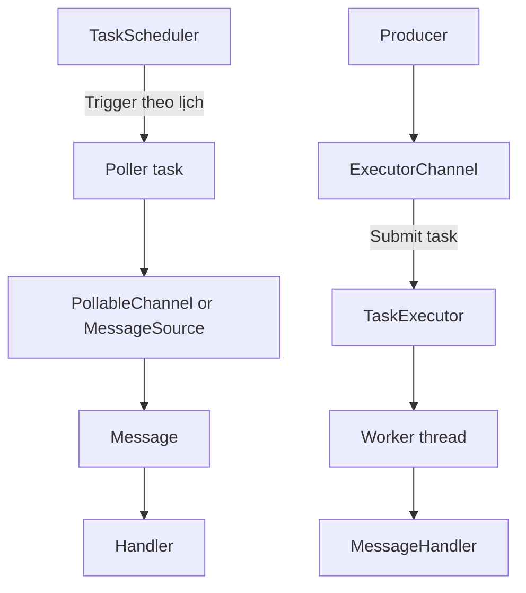
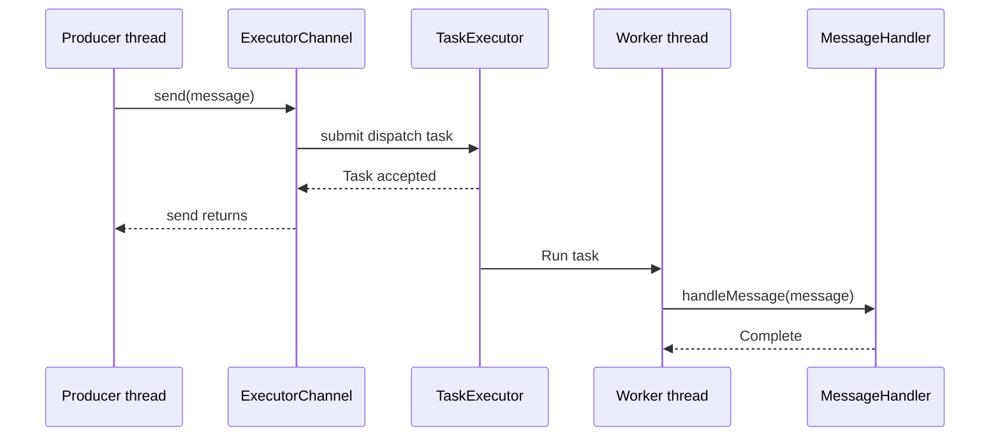
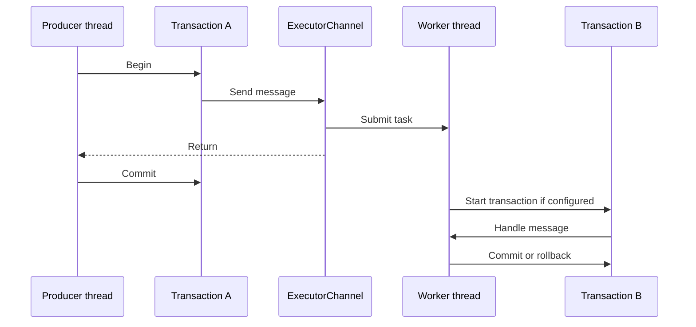

# TaskExecutor và chuyển xử lý sang thread khác

Trong Spring Integration, một message flow thường bắt đầu xử lý trên thread gửi message hoặc trên thread do poller quản lý. Khi một bước xử lý mất nhiều thời gian, việc giữ thread gọi có thể làm chậm producer, scheduler hoặc các công việc khác. Spring cung cấp abstraction **TaskExecutor** để giao một tác vụ cho thread thực thi khác. Spring Integration dùng abstraction này ở những điểm như `ExecutorChannel`, `PublishSubscribeChannel` và poller.

Chuyển xử lý sang thread khác giúp tách thời gian của producer khỏi thời gian chạy handler và cho phép xử lý đồng thời. Nhưng nó cũng tạo ra ranh giới mới về transaction, thứ tự hoàn tất, lỗi, context và khả năng quá tải. Muốn dùng đúng, cần hiểu rõ nơi chuyển thread và nơi quản lý pool.

## 1. TaskExecutor là gì?

`TaskExecutor` là abstraction của Spring Core cho việc thực thi một tác vụ dạng `Runnable`. Nó mở rộng hợp đồng `Executor` của Java và cho phép các thành phần Spring nhận một executor mà không phụ thuộc vào một implementation cụ thể.

Thay vì tự tạo thread trong handler, ứng dụng giao tác vụ cho `TaskExecutor`:

```java
taskExecutor.execute(() -> {
    // Công việc được thực thi bởi executor.
});
```

Lệnh `execute()` không trả về kết quả nghiệp vụ. Nó giao một tác vụ cho executor theo chính sách của implementation. Tác vụ có thể chạy ngay trên thread hiện tại, được xếp hàng hoặc chạy trên worker thread khác. Vì vậy, chỉ nhìn kiểu `TaskExecutor` chưa đủ để kết luận tác vụ có bất đồng bộ hay không; cần biết implementation và cấu hình thực tế.

Một số implementation thường gặp:

| Implementation | Đặc điểm | Khi cân nhắc |
|---|---|---|
| `SyncTaskExecutor` | Chạy task trên thread gọi | Kiểm thử hoặc thực thi đồng bộ có chủ đích |
| `SimpleAsyncTaskExecutor` | Tạo thread cho từng task, không tái sử dụng thread như pool truyền thống | Tác vụ ít hoặc trường hợp cần cấu hình đơn giản; cần giới hạn concurrency |
| `ThreadPoolTaskExecutor` | Quản lý worker pool và queue | Ứng dụng server cần kiểm soát concurrency và tài nguyên |
| `ConcurrentTaskExecutor` | Adapter cho một Java `Executor` có sẵn | Tích hợp executor được quản lý ở nơi khác |

Trong ứng dụng Spring Integration chạy lâu dài, `ThreadPoolTaskExecutor` thường là lựa chọn dễ kiểm soát vì có thể cấu hình số worker, queue capacity, rejection policy và shutdown behavior.

## 2. TaskExecutor khác TaskScheduler như thế nào?

Hai abstraction này liên quan đến thread nhưng giải quyết hai bài toán khác nhau:

- **TaskExecutor** quyết định tác vụ được thực thi trên thread nào và theo chính sách pool nào.
- **TaskScheduler** quyết định thời điểm tác vụ được kích hoạt, ví dụ mỗi giây hoặc theo cron.

Một poller cần trigger để biết lúc nào chạy. Scheduler lên lịch poll; executor có thể được dùng để thực thi tác vụ poll. Một `ExecutorChannel` thì không cần trigger định kỳ: nó giao việc cho executor ngay khi channel dispatch message.



Không nên dùng TaskScheduler như một thread pool tổng quát cho mọi công việc, hoặc dùng TaskExecutor để thay thế trigger của poller. Mỗi thành phần có vai trò riêng; cấu hình sai có thể khiến thread bị chiếm lâu hoặc tác vụ không được kích hoạt như dự định.

## 3. Chuyển xử lý bằng ExecutorChannel

`ExecutorChannel` là một `SubscribableChannel` sử dụng executor để dispatch message đến subscriber. Endpoint vẫn đăng ký handler theo mô hình event-driven, nhưng việc gọi handler được giao cho executor.

Đường đi message có thể mô tả như sau:



Khi task được executor chấp nhận, lệnh gửi message thường có thể trả về trước khi handler hoàn tất. Producer vì thế không cần chờ toàn bộ xử lý nghiệp vụ. Tuy nhiên, nếu executor từ chối task vì pool hoặc queue quá tải, thao tác gửi có thể thất bại và phát sinh lỗi giao message.

Ví dụ khai báo executor và channel:

```java
@Configuration
@EnableIntegration
public class AsyncIntegrationConfiguration {

    @Bean
    ThreadPoolTaskExecutor integrationTaskExecutor() {
        ThreadPoolTaskExecutor executor = new ThreadPoolTaskExecutor();
        executor.setCorePoolSize(4);
        executor.setMaxPoolSize(8);
        executor.setQueueCapacity(200);
        executor.setKeepAliveSeconds(60);
        executor.setThreadNamePrefix("integration-worker-");
        executor.setRejectedExecutionHandler(
                new ThreadPoolExecutor.AbortPolicy());
        executor.setWaitForTasksToCompleteOnShutdown(true);
        executor.setAwaitTerminationSeconds(30);
        return executor;
    }

    @Bean
    MessageChannel asyncOrdersChannel(
            ThreadPoolTaskExecutor integrationTaskExecutor) {
        return new ExecutorChannel(integrationTaskExecutor);
    }

}
```

Spring quản lý vòng đời của `ThreadPoolTaskExecutor` khi nó được khai báo như một bean. Không cần gọi `initialize()` thủ công trong phương thức `@Bean`; container gọi callback khởi tạo thích hợp. Các thuộc tính shutdown cho phép pool chờ task đang chạy trong khoảng thời gian được cấu hình khi ApplicationContext đóng.

Flow có thể nối qua channel bất đồng bộ:

```java
@Bean
MessageChannel ordersInput() {
    return new DirectChannel();
}

@Bean
IntegrationFlow ordersFlow(OrderService orderService) {
    return IntegrationFlow.from("ordersInput")
            .channel("asyncOrdersChannel")
            .handle(orderService, "process")
            .get();
}
```

Trong flow này, bước trước channel có thể gửi message trên thread hiện tại. Khi message đi qua `asyncOrdersChannel`, việc dispatch sang handler phía sau được giao cho executor. Channel là ranh giới chuyển thread của flow.

## 4. ExecutorChannel khác DirectChannel ra sao?

Cả hai đều là channel dạng subscribable, nhưng cách gọi handler khác nhau:

| Đặc điểm | DirectChannel | ExecutorChannel |
|---|---|---|
| Cách dispatch | Gọi subscriber trực tiếp | Giao tác vụ dispatch cho executor |
| Thread xử lý | Thường là thread gửi | Worker thread của executor |
| Thời điểm send hoàn tất | Thường sau khi xử lý đồng bộ xong | Thường sau khi task được chấp nhận |
| Exception từ handler | Có thể truyền ngược về sender | Thường không truyền về sender ban đầu |
| Thứ tự hoàn tất | Theo chuỗi gọi đồng bộ | Có thể khác thứ tự gửi khi chạy nhiều worker |
| Transaction của sender | Có thể tiếp tục trên cùng thread | Không tự truyền sang worker thread |
| Backlog | Producer có thể bị chậm trực tiếp | Có thể tích lũy trong queue executor |

Dùng `DirectChannel` khi cần chuỗi xử lý đồng bộ, dễ quan sát và muốn exception có thể truyền ngược. Dùng `ExecutorChannel` khi cần tách producer khỏi consumer hoặc cần xử lý song song. Hãy đặt channel ở đúng ranh giới mà việc chuyển thread mang lại lợi ích rõ ràng.

## 5. PublishSubscribeChannel với executor

`PublishSubscribeChannel` phân phối cùng một message đến nhiều subscriber. Khi được cấu hình với executor, việc gọi các subscriber có thể diễn ra bất đồng bộ. Đây là lựa chọn cho trường hợp một sự kiện cần kích hoạt nhiều nhánh độc lập.

Ví dụ:

```java
@Bean
PublishSubscribeChannel orderEventsChannel(
        ThreadPoolTaskExecutor integrationTaskExecutor) {
    return new PublishSubscribeChannel(integrationTaskExecutor);
}
```

Một message có thể được gửi đến các subscriber như audit, notification và metrics. Với executor, các nhánh có thể chạy đồng thời và hoàn tất theo thứ tự khác nhau.

Cần lưu ý:

- Producer không nên giả định tất cả subscriber đã hoàn tất khi lệnh gửi trả về.
- Một nhánh chạy chậm không nhất thiết giữ thread producer, nhưng vẫn chiếm worker.
- Lỗi trong nhánh bất đồng bộ cần được theo dõi qua error handling phù hợp.
- Nếu các nhánh cùng cập nhật một tài nguyên, phải kiểm soát race condition và idempotency.
- Nếu một subscriber bắt buộc phải chạy trước nhánh khác, hãy biểu diễn quan hệ phụ thuộc trong flow thay vì dựa vào thứ tự thread hoàn tất.

## 6. Dùng TaskExecutor trong poller

Poller có trigger do scheduler quản lý. Khi cần tách tác vụ polling khỏi thread scheduler, có thể cấu hình executor trong poller metadata.

```java
@Bean
IntegrationFlow pollingOrders(
        OrderService orderService,
        ThreadPoolTaskExecutor integrationTaskExecutor) {

    return IntegrationFlow.from("ordersQueue",
                    endpoint -> endpoint.poller(
                            Pollers.fixedDelay(Duration.ofSeconds(1))
                                    .maxMessagesPerPoll(10)
                                    .taskExecutor(integrationTaskExecutor)))
            .handle(orderService, "process")
            .get();
}
```

Ở đây executor được dùng cho tác vụ poll. Điều đó khác với việc đặt một `ExecutorChannel` giữa hai bước của flow:

| Vị trí cấu hình executor | Công việc được chuyển |
|---|---|
| `Pollers...taskExecutor(...)` | Tác vụ polling do poller kích hoạt |
| `ExecutorChannel` | Việc dispatch message từ channel đến subscriber |
| `PublishSubscribeChannel(executor)` | Việc dispatch message đến các subscriber |

Nếu poller xử lý message ngay trong cùng tác vụ poll, handler có thể chạy trên worker đang thực thi poller. Nếu flow sau đó đi qua một executor channel khác, message lại được chuyển sang một ranh giới thread tiếp theo. Nhiều ranh giới thread làm tăng tính độc lập nhưng cũng tăng độ phức tạp khi theo dõi lỗi, transaction và thứ tự.

## 7. Cấu hình ThreadPoolTaskExecutor

Một thread pool thường có các tham số chính:

| Thuộc tính | Ý nghĩa |
|---|---|
| `corePoolSize` | Số worker cốt lõi được giữ trong pool theo chính sách cấu hình |
| `maxPoolSize` | Số worker tối đa |
| `queueCapacity` | Số task có thể chờ trong queue |
| `keepAliveSeconds` | Thời gian worker vượt core có thể nhàn rỗi trước khi được thu hồi |
| `threadNamePrefix` | Tiền tố tên thread, hữu ích khi đọc log và thread dump |
| `rejectedExecutionHandler` | Chính sách khi không thể nhận thêm task |
| `waitForTasksToCompleteOnShutdown` | Có chờ task đã nhận hoàn tất khi shutdown hay không |
| `awaitTerminationSeconds` | Thời gian chờ shutdown hoàn tất |

### Core size, max size và queue capacity

Khi task đến, thread pool thường tạo worker đến core size trước. Khi số worker cốt lõi bận, task được đưa vào queue. Khi queue đầy, pool mới tăng worker vượt core cho đến max size. Nếu vẫn không thể nhận task, rejection policy được áp dụng.

Vì vậy, queue không giới hạn có thể khiến pool hầu như không bao giờ tăng đến max size: task tiếp tục được xếp hàng thay vì tạo thêm worker. Nếu muốn pool tăng worker khi tải cao, queue capacity và max size phải được thiết kế cùng nhau.

Không có bộ thông số tối ưu chung. Với tác vụ CPU-bound, số worker thường nên gần với số CPU khả dụng để tránh context switching quá nhiều. Với tác vụ I/O-bound, có thể cần nhiều worker hơn vì thread thường chờ I/O; hãy đo thời gian chờ, CPU, latency và khả năng của downstream trước khi tăng pool.

## 8. Rejection policy và cách hệ thống phản ứng khi quá tải

Khi worker đã đạt giới hạn và queue đầy, executor phải quyết định xử lý task mới thế nào. Một số chính sách phổ biến:

| Policy | Hành vi | Tác động |
|---|---|---|
| Abort | Ném exception khi không nhận task | Báo quá tải rõ ràng để caller/error flow xử lý |
| CallerRuns | Chạy task trên thread gọi | Tạo áp lực ngược tự nhiên bằng cách làm chậm producer |
| Discard | Bỏ task mới | Có thể mất message nếu không có cơ chế khác |
| DiscardOldest | Bỏ task cũ nhất trong queue rồi thử nhận task mới | Có thể làm mất message đã chờ |

Với xử lý message nghiệp vụ, các policy bỏ task cần được cân nhắc rất kỹ. Không nên dùng discard nếu không có yêu cầu nghiệp vụ cho phép mất message và cơ chế đo/khôi phục tương ứng.

`CallerRunsPolicy` có thể giúp giảm tốc producer vì thread gửi phải thực thi task. Nhưng nó cũng làm thay đổi giả định về threading: trong tình trạng quá tải, handler có thể chạy trên thread gửi thay vì worker. Nếu code phụ thuộc thread name, transaction hoặc context, cần tính đến tình huống này.

`AbortPolicy` làm việc từ chối hiện rõ hơn. Với `ExecutorChannel`, lỗi submit có thể xuất hiện ở phía gửi message dưới dạng lỗi giao message. Ứng dụng cần bắt, retry hoặc chuyển message sang đường xử lý lỗi phù hợp; đừng chỉ log rồi bỏ qua.

## 9. Async boundary ảnh hưởng transaction như thế nào?

Trong Spring, transaction imperative thường gắn với thread thông qua transaction context. Khi flow đi qua `ExecutorChannel`, handler chạy trên worker thread khác. Transaction đang hoạt động ở thread producer không tự động truyền sang worker.



Nếu handler cần transaction, hãy mở transaction tại phía worker, ví dụ bằng service method được proxy `@Transactional` hoặc transaction advice phù hợp với endpoint. Khi đó transaction của handler là một transaction riêng, có boundary và kết quả commit/rollback riêng.

Điều này đặc biệt quan trọng khi producer ghi database rồi gửi message sang executor channel. Database transaction của producer có thể commit trước khi handler bất đồng bộ chạy. Nếu cần bảo đảm message chỉ được xử lý sau khi dữ liệu đã commit, hãy thiết kế outbox hoặc cơ chế phát message sau commit phù hợp; không dựa vào việc thread executor tự nhìn thấy transaction chưa commit.

Với reactive transaction, context propagation có cơ chế riêng dựa trên Reactor Context. Không suy luận rằng ThreadLocal transaction imperative sẽ tự hoạt động qua reactive pipeline hoặc executor.

## 10. Message headers được truyền, ThreadLocal không tự truyền

Message của Spring Integration mang payload và headers. Khi message được dispatch sang worker, chính message cùng headers của nó được chuyển đi. Vì vậy, message ID, correlation ID, reply channel và metadata định tuyến vẫn có thể theo message đến handler.

Nhưng các giá trị gắn với thread hiện tại không tự động đi cùng message, ví dụ:

- MDC của logging.
- SecurityContext lưu trong ThreadLocal.
- Tenant context được lưu trong ThreadLocal.
- Transaction context imperative.
- Các biến context tự tạo khác.

Nếu cần truyền context, hãy chọn cơ chế phù hợp thay vì dựa vào thread reuse. Với MDC hoặc context tùy chỉnh, có thể dùng `TaskDecorator` để capture context khi submit và restore context trên worker. Với Spring Security, dùng executor hỗ trợ truyền SecurityContext như `DelegatingSecurityContextAsyncTaskExecutor`. Với tracing, ưu tiên cơ chế context propagation của instrumentation đang dùng.

Ví dụ `TaskDecorator` để bảo toàn MDC:

```java
@Bean
ThreadPoolTaskExecutor contextAwareExecutor() {
    ThreadPoolTaskExecutor executor = new ThreadPoolTaskExecutor();
    executor.setCorePoolSize(4);
    executor.setMaxPoolSize(8);
    executor.setQueueCapacity(200);
    executor.setThreadNamePrefix("context-worker-");

    executor.setTaskDecorator(task -> {
        Map<String, String> captured = MDC.getCopyOfContextMap();

        return () -> {
            Map<String, String> previous = MDC.getCopyOfContextMap();
            try {
                if (captured == null) {
                    MDC.clear();
                }
                else {
                    MDC.setContextMap(captured);
                }

                task.run();
            }
            finally {
                if (previous == null) {
                    MDC.clear();
                }
                else {
                    MDC.setContextMap(previous);
                }
            }
        };
    });

    return executor;
}
```

Ví dụ này cần dependency logging có MDC, chẳng hạn SLF4J với backend hỗ trợ MDC. Việc restore trong `finally` rất quan trọng vì worker thread được tái sử dụng; nếu không xóa hoặc phục hồi context, thông tin của message trước có thể rò sang message sau.

Không nên copy toàn bộ ThreadLocal một cách tùy tiện. Chỉ truyền những context có ý nghĩa, có vòng đời rõ ràng và không chứa dữ liệu nhạy cảm ngoài nhu cầu.

## 11. Exception trong xử lý bất đồng bộ

Với `DirectChannel`, exception của handler có thể truyền ngược theo call stack đến producer. Với `ExecutorChannel`, producer thường đã nhận kết quả submit task trước khi handler chạy xong. Vì vậy exception của handler không thể được trả ngược theo call stack ban đầu.

Spring Integration có cơ chế error handling cho tác vụ bất đồng bộ, thường thông qua `ErrorHandlingTaskExecutor` và error channel. Error message có thể chứa cause và failed message. Tuy nhiên, ứng dụng vẫn cần cấu hình subscriber cho error channel, log và chính sách retry/dead-letter phù hợp.

Cần phân biệt hai nhóm lỗi:

1. **Lỗi submit task**: executor từ chối task hoặc không thể nhận task. Lỗi này có thể xuất hiện ngay trong thao tác gửi.
2. **Lỗi xử lý handler**: task đã được nhận nhưng handler ném exception khi chạy trên worker. Lỗi này cần được quan sát ở error handling của tác vụ bất đồng bộ.

Không nên chỉ kiểm tra giá trị trả về của `send()` rồi kết luận handler đã xử lý thành công. Với async channel, việc task được chấp nhận chỉ chứng minh executor nhận công việc, không chứng minh nghiệp vụ đã hoàn tất.

## 12. Thứ tự xử lý và concurrency

Khi executor có nhiều worker, nhiều message có thể được xử lý đồng thời. Thời điểm hoàn tất phụ thuộc thời gian xử lý từng message, vì vậy thứ tự hoàn tất có thể khác thứ tự gửi.

Ví dụ:

- Message A được gửi trước nhưng handler mất 2 giây.
- Message B được gửi sau nhưng handler chỉ mất 100 ms.
- B có thể hoàn tất trước A.

Nếu nghiệp vụ yêu cầu thứ tự theo key, có thể phân vùng message theo key, dùng một consumer tuần tự cho từng partition hoặc thiết kế channel/executor riêng phù hợp. Một pool một thread có thể giữ thứ tự thực thi trong một queue cụ thể, nhưng làm giảm concurrency và vẫn không thay thế semantics ordering của broker hoặc toàn hệ thống.

Nếu nhiều message cùng cập nhật một aggregate, hãy bảo vệ state bằng transaction, optimistic locking, partitioning hoặc cơ chế serialization thích hợp. Không dựa vào thứ tự thread khởi chạy để bảo đảm thứ tự nghiệp vụ.

## 13. Backpressure và giới hạn queue

Executor queue là một buffer trong bộ nhớ. Nó không phải durable message store và không bảo đảm message tồn tại qua process crash. Nếu JVM dừng đột ngột, các task còn trong queue có thể mất.

Một queue lớn giúp hấp thụ burst ngắn nhưng làm tăng thời gian chờ và lượng memory sử dụng. Queue không giới hạn có thể khiến hệ thống tích lũy backlog đến khi heap cạn. Một queue quá nhỏ có thể khiến task bị từ chối sớm. Cần chọn queue capacity dựa trên tốc độ đến, tốc độ xử lý và thời gian burst có thể chấp nhận.

Các cách điều tiết:

- Giới hạn queue capacity.
- Giới hạn số worker bằng core/max pool size.
- Dùng rejection policy phù hợp với semantics message.
- Giảm tốc producer hoặc dùng cơ chế flow control.
- Dùng broker hoặc persistent queue nếu cần buffer bền vững.
- Theo dõi queue size và thời gian task chờ trước khi chạy.

`CallerRunsPolicy` có thể tạo feedback khi producer gửi trực tiếp vào executor, nhưng nó không thay thế một chính sách backpressure được thiết kế xuyên suốt. Nếu upstream tiếp tục gửi không giới hạn qua nhiều lớp queue, quá tải vẫn có thể dịch chuyển sang nơi khác.

## 14. Lifecycle và shutdown của executor

Executor là tài nguyên có vòng đời. Nếu tự tạo thread pool trong handler mà không đóng, worker thread có thể sống lâu hơn flow hoặc thậm chí ngăn JVM kết thúc.

Khi khai báo `ThreadPoolTaskExecutor` như Spring bean, container quản lý callback khởi tạo và hủy. Các thiết lập như:

- `setWaitForTasksToCompleteOnShutdown(true)`
- `setAwaitTerminationSeconds(...)`

cho phép ứng dụng chờ các task đã nhận trong khoảng thời gian giới hạn khi context shutdown.

Cần phân biệt executor dùng chung và executor thuộc riêng một flow:

| Executor | Chủ sở hữu | Cleanup |
|---|---|---|
| Pool dùng chung cho nhiều flow | ApplicationContext hoặc hạ tầng ứng dụng | Đóng khi context hoặc owner đóng |
| Pool riêng cho một flow động | Flow manager hoặc bean/resource gắn với registration | Đóng khi flow unregister sau khi xử lý công việc đang chạy |
| Executor do thư viện bên ngoài quản lý | Thư viện hoặc thành phần tạo nó | Tuân thủ lifecycle của owner |

Không đóng executor dùng chung khi unregister một flow. Nếu flow động cần pool riêng, hãy gắn resource đó với một bean có lifecycle rõ ràng và đảm bảo việc remove flow thực sự gọi cleanup.

Shutdown có timeout không đồng nghĩa mọi message đã được xử lý. Ứng dụng cần quyết định điều gì xảy ra khi hết thời gian chờ: tiếp tục chờ, dừng process, lưu công việc còn lại hoặc chấp nhận bỏ task theo chính sách nghiệp vụ.

## 15. Kiểm thử xử lý trên thread khác

Kiểm thử async cần đồng bộ bằng công cụ như `CountDownLatch`, `CompletableFuture` hoặc Awaitility thay vì dùng `Thread.sleep()` tùy tiện.

Ví dụ đơn giản với latch:

```java
CountDownLatch handled = new CountDownLatch(1);

MessageHandler handler = message -> {
    try {
        // Kiểm tra logic xử lý.
    }
    finally {
        handled.countDown();
    }
};

// Gửi message vào flow hoặc channel.
boolean accepted = channel.send(message);

assertThat(accepted).isTrue();
assertThat(handled.await(5, TimeUnit.SECONDS)).isTrue();
```

Trong test thực tế, hãy dùng một executor có cấu hình xác định, kiểm tra cả kết quả handler và đường đi lỗi. Đóng ApplicationContext sau test để worker thread không rò sang test khác. Không kiểm tra chỉ bằng thread name vì tên thread không chứng minh task đã hoàn tất hoặc dữ liệu đã được commit.

Các trường hợp nên kiểm thử:

- Task được xử lý trên thread khác khi executor còn capacity.
- Executor từ chối task khi queue đầy.
- Exception của handler đi đến error handling mong muốn.
- Message headers/correlation ID còn nguyên sau handoff.
- MDC hoặc security context được truyền và được xóa đúng sau task.
- Shutdown chờ task theo cấu hình và không để worker thread mồ côi.
- Nhiều message đồng thời không làm hỏng state nghiệp vụ.

## 16. Quan sát TaskExecutor trong runtime

Khi một flow chậm hoặc message không hoàn tất, cần quan sát cả channel lẫn executor:

| Chỉ số | Dấu hiệu cần chú ý |
|---|---|
| Active thread count | Pool thường xuyên dùng hết worker |
| Pool size | Số worker thực tế so với core/max |
| Queue size | Task chờ tăng liên tục |
| Task execution time | Handler hoặc tác vụ poll chạy lâu |
| Rejected task count | Executor không nhận thêm công việc |
| Completed task count | Throughput hoàn tất |
| Thread state | Worker bị BLOCKED, WAITING hoặc chờ I/O lâu |
| Error count | Handler thất bại sau khi task được nhận |

Khi đọc thread dump, tìm thread theo prefix đã đặt như `integration-worker-`. Nếu tất cả worker đều chờ cùng một downstream, tăng pool có thể chỉ làm tăng số request đồng thời và khiến downstream quá tải. Hãy xác định điểm nghẽn trước khi thay đổi core/max size.

Gắn các metadata sau vào log sẽ giúp truy vết:

- Component name hoặc endpoint ID.
- Message ID và correlation ID.
- Thread name.
- Thời điểm gửi, thời điểm bắt đầu handler và thời điểm hoàn tất.
- Số lần retry và exception gốc.

## 17. Chọn cách chuyển thread theo nhu cầu

| Nhu cầu | Cơ chế |
|---|---|
| Giữ xử lý đồng bộ trên thread gửi | DirectChannel và handler đồng bộ |
| Tách dispatch của một nhánh sang worker pool | ExecutorChannel |
| Gửi cùng sự kiện đến nhiều nhánh bất đồng bộ | PublishSubscribeChannel với executor |
| Chạy poller trên worker được quản lý | Poller metadata với taskExecutor |
| Gọi một method bất đồng bộ trong application service | Spring `@Async` khi phù hợp với kiến trúc |
| Cần buffer và giao nhận bền vững | Broker hoặc persistent message store, không chỉ executor queue |

Hãy đặt async boundary ở nơi có ý nghĩa về latency hoặc concurrency. Nếu mỗi bước đều chuyển sang một pool khác, hệ thống sẽ có nhiều queue, nhiều thread context và nhiều nơi phát sinh lỗi. Một ranh giới được thiết kế rõ thường dễ vận hành hơn nhiều ranh giới không cần thiết.

## 18. Checklist trước khi đưa executor vào production

- TaskExecutor nào đang được dùng và ai sở hữu lifecycle của nó?
- Pool có core size, max size và queue capacity rõ ràng không?
- Rejection policy có phù hợp với semantics message không?
- Channel có thật sự chuyển việc xử lý sang worker không?
- Poller executor có bị nhầm với executor channel không?
- Transaction có được mở ở worker nếu handler cần không?
- Error channel có tiếp nhận exception bất đồng bộ không?
- Message headers và correlation ID có còn được giữ không?
- MDC, SecurityContext và tracing context có cần truyền không?
- Thứ tự hoàn tất có ảnh hưởng nghiệp vụ không?
- Queue executor có được theo dõi và giới hạn không?
- Shutdown có chờ task và có timeout không?
- Message có cần durable buffering qua process crash không?

TaskExecutor giúp Spring Integration chuyển công việc sang thread được quản lý và tăng khả năng xử lý đồng thời. Hiệu quả của nó phụ thuộc vào vị trí async boundary, cấu hình pool, chính sách quá tải và cách ứng dụng xử lý transaction, context, lỗi cùng lifecycle. Khi các yếu tố này được xác định rõ, việc chuyển thread sẽ cải thiện khả năng đáp ứng mà vẫn giữ được khả năng quan sát và kiểm soát runtime.

