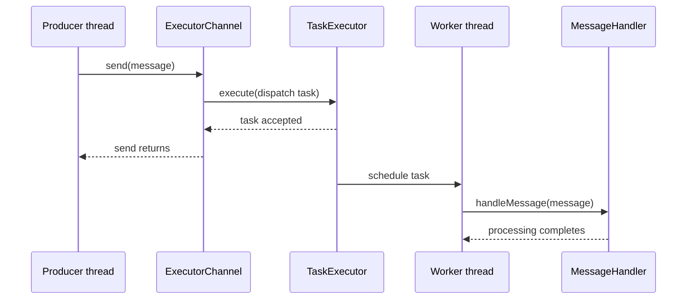
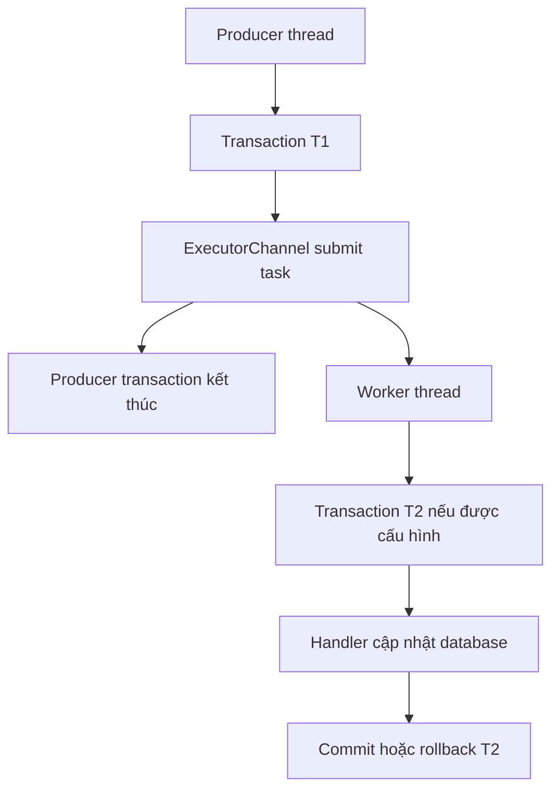

# ExecutorChannel với async dispatch

Trong Spring Integration, `ExecutorChannel` tạo một ranh giới thực thi bất đồng bộ giữa nơi gửi message và nơi xử lý message. Channel chuyển việc dispatch tới một `TaskExecutor`; handler thường chạy trên worker thread thay vì thread gửi. Cách này giúp tách thời gian xử lý nghiệp vụ khỏi luồng gửi, tăng khả năng xử lý song song và tránh để một handler chậm giữ thread producer quá lâu.

Bài học thuộc phần **Task executor** của module `SPRING_INTEGRATION_RUNTIME`. Module tập trung vào cách Spring Integration điều phối message flow qua channel, endpoint, consumer, poller và executor; đồng thời giúp quản lý vòng đời IntegrationFlow, transaction, retry, message store, lỗi, correlation và chẩn đoán threading, hiệu năng, trạng thái runtime.

## 1. ExecutorChannel hoạt động như thế nào?

`ExecutorChannel` là một `SubscribableChannel` sử dụng `TaskExecutor` để dispatch message tới consumer. Endpoint đăng ký handler làm subscriber của channel. Khi producer gửi message, channel giao tác vụ gọi subscriber cho executor. Với executor bất đồng bộ thực sự, worker thread sẽ gọi handler sau đó.



Trình tự trên mô tả trường hợp executor nhận tác vụ thành công và thực thi bất đồng bộ. Khi `send()` trả về, điều đó thường chỉ cho biết việc dispatch đã được chấp nhận; nó không chứng minh handler đã chạy xong hoặc nghiệp vụ đã commit.

ExecutorChannel không tự thực hiện nghiệp vụ. Nó chỉ thay đổi cách chuyển message tới subscriber. Handler vẫn chịu trách nhiệm xử lý payload, tạo reply hoặc phát sinh lỗi theo hợp đồng của endpoint.

## 2. Cấu hình ExecutorChannel trong Spring Integration

Có thể khai báo một `ThreadPoolTaskExecutor` rồi truyền nó cho `ExecutorChannel`: 

```java
@Bean
ThreadPoolTaskExecutor integrationExecutor() {
    ThreadPoolTaskExecutor executor = new ThreadPoolTaskExecutor();
    executor.setCorePoolSize(4);
    executor.setMaxPoolSize(8);
    executor.setQueueCapacity(200);
    executor.setThreadNamePrefix("si-worker-");
    executor.setWaitForTasksToCompleteOnShutdown(true);
    executor.setAwaitTerminationSeconds(30);
    return executor;
}

@Bean
MessageChannel asyncOrders(TaskExecutor integrationExecutor) {
    return new ExecutorChannel(integrationExecutor);
}

@Bean
IntegrationFlow asyncOrderFlow(OrderService orderService) {
    return IntegrationFlow.from("orders.in")
        .channel("asyncOrders")
        .handle(orderService, "process")
        .get();
}
```

Khi message đi tới `asyncOrders`, channel dispatch việc gọi handler thông qua `integrationExecutor`. `ThreadPoolTaskExecutor` là một Spring bean nên container quản lý vòng đời khởi tạo và shutdown. Hãy cấu hình pool size, queue capacity, thread name và chính sách shutdown theo tải thực tế.

Một lưu ý quan trọng: `TaskExecutor` là abstraction. Nếu truyền một executor chạy đồng bộ như `SyncTaskExecutor`, tác vụ có thể được thực thi ngay trên thread gọi. Muốn có async dispatch, hãy dùng executor thực sự chuyển công việc sang worker thread và kiểm tra cấu hình runtime.

## 3. ExecutorChannel khác DirectChannel và QueueChannel ra sao?

Cả ba channel đều có thể kết nối producer với consumer, nhưng cách dispatch khác nhau.

| Channel | Cơ chế | Thread xử lý | Có buffer message riêng? |
|---|---|---|---|
| `DirectChannel` | Gọi subscriber trực tiếp trong lần send | Thường là thread gửi | Không |
| `ExecutorChannel` | Giao việc dispatch cho TaskExecutor | Thường là worker thread | Không có queue message riêng; executor có thể có task queue |
| `QueueChannel` | Đưa message vào queue, consumer nhận bằng poller | Thread poller/consumer | Có |

`ExecutorChannel` khác `QueueChannel` ở chỗ nó không biến message channel thành một kho message chờ consumer poll. Việc chờ tác vụ nếu có thường nằm trong hàng đợi nội bộ của executor. Queue của executor chứa task dispatch, còn QueueChannel chứa message. Hai loại queue có vòng đời, giới hạn và semantics khác nhau.

`ExecutorChannel` cũng khác `PublishSubscribeChannel`. ExecutorChannel sử dụng cơ chế unicast: mỗi message được dispatch tới một subscriber theo chiến lược phân phối của dispatcher. PublishSubscribeChannel phù hợp khi cùng một message cần được broadcast tới nhiều subscriber.

Hãy chọn theo ý định:
- Dùng DirectChannel khi muốn xử lý đồng bộ và cần exception có thể truyền về phía gửi trong cùng call stack.
- Dùng ExecutorChannel khi cần tách thread thực thi và cho phép handler chạy bất đồng bộ.
- Dùng QueueChannel khi cần tách thời điểm gửi/nhận bằng một message queue có khả năng giữ message trong giới hạn capacity.
- Dùng PublishSubscribeChannel khi cần phát cùng message tới nhiều subscriber.

## 4. Async dispatch thay đổi ý nghĩa của send()

Với DirectChannel, lời gọi send thường bao gồm cả việc dispatch và thực thi handler. Nếu handler ném exception đồng bộ, exception có thể truyền ngược về phía gửi.

Với ExecutorChannel và một executor bất đồng bộ, send thường hoàn tất sau khi tác vụ dispatch được chấp nhận. Handler có thể bắt đầu sau đó, chạy lâu hơn hoặc thất bại trên worker thread.

| Sự kiện | DirectChannel | ExecutorChannel |
|---|---|---|
| Gọi handler | Trong call stack gửi | Thường trên worker thread |
| Thời điểm send trả về | Sau khi dispatch đồng bộ hoàn tất | Thường sau khi task được nhận vào executor |
| Handler chạy lâu | Giữ thread gửi | Giữ worker thread |
| Handler ném exception | Có thể truyền về sender | Không thể quay lại call stack sender đã kết thúc |
| Quá tải | Sender chịu thời gian xử lý | Phụ thuộc queue và rejection policy của executor |

Cần phân biệt hai nhóm lỗi:

1. **Lỗi khi submit task:** executor từ chối tác vụ, ví dụ pool và queue đã đầy. Lỗi rejection có thể xuất hiện ngay trong lời gọi send.
2. **Lỗi khi handler thực thi:** task đã được nhận, nhưng handler ném exception trên worker thread. Sender có thể đã nhận kết quả send từ trước và không bắt được exception này bằng try/catch quanh send.

Do đó, không được xem kết quả send thành công là bằng chứng nghiệp vụ đã xử lý thành công. Nếu cần xác nhận kết quả, hãy thiết kế reply, acknowledgement hoặc trạng thái xử lý riêng.

## 5. Message được phân phối tới subscriber như thế nào?

ExecutorChannel là channel dạng subscribable và sử dụng cơ chế unicast dispatch. Khi có nhiều subscriber, dispatcher chọn subscriber theo load-balancing strategy. Một message được gửi tới một subscriber cho lần dispatch đó, không mặc định gửi bản sao tới tất cả subscriber.

Nếu cần một message được xử lý bởi nhiều nhánh độc lập, hãy dùng PublishSubscribeChannel hoặc tách flow rõ ràng. Không nên đăng ký nhiều subscriber vào ExecutorChannel rồi kỳ vọng tất cả đều nhận cùng một message.

Với nhiều worker thread, các message khác nhau có thể được xử lý đồng thời. Điều này giúp tăng throughput khi handler có thể chạy song song, nhưng cũng làm phát sinh các vấn đề về thứ tự, race condition và truy cập tài nguyên dùng chung.

## 6. Thread boundary và những ngữ cảnh không tự truyền sang worker

Khi message chuyển qua ExecutorChannel, xử lý được chuyển sang thread khác. Các thông tin nằm trong object Message và headers vẫn đi cùng message, nhưng những dữ liệu gắn với thread hiện tại không tự động chuyển sang worker thread.

Các ngữ cảnh cần chú ý:
- **Transaction context:** transaction gắn với sender thread không tự bao quanh công việc chạy trên worker.
- **ThreadLocal:** dữ liệu lưu trong ThreadLocal của producer không tự xuất hiện trên worker.
- **SecurityContext:** thông tin xác thực không tự được truyền nếu executor không có cơ chế context propagation phù hợp.
- **Logging MDC:** correlation key hoặc trace fields trong MDC cần được truyền/cài đặt ở worker nếu muốn log liên tục cùng ngữ cảnh.
- **Request context:** dữ liệu phụ thuộc HTTP request thread không nên được đọc trực tiếp sau khi request thread đã kết thúc.

Nếu worker cần correlation ID, tenant ID hoặc thông tin truy vết, hãy đưa chúng vào message headers hoặc payload theo hợp đồng rõ ràng. Với security context và MDC, sử dụng cơ chế task decorator/context propagation phù hợp với stack ứng dụng; luôn làm sạch context sau khi task hoàn tất để tránh rò rỉ dữ liệu giữa các task dùng chung thread.

Spring Message có cấu trúc bất biến, nhưng payload bên trong có thể là object mutable. Nếu producer sửa object sau khi gửi, worker có thể quan sát dữ liệu đã bị thay đổi hoặc gặp race condition. Ưu tiên payload immutable hoặc tạo bản sao khi cần chuyển quyền sở hữu dữ liệu qua ranh giới thread.

## 7. Transaction không tự lan qua ExecutorChannel

Đây là một khác biệt quan trọng khi chuyển từ DirectChannel sang ExecutorChannel.

Với DirectChannel, sender và handler thường chạy trong cùng thread. Nếu cùng tham gia một transaction manager, transaction bao quanh lời gọi gửi có thể bao gồm cả xử lý handler, tùy cấu hình transaction và propagation.

Với ExecutorChannel, handler chạy trên worker thread. Transaction gắn với sender thread không tự truyền sang worker. Nếu handler cần transaction, hãy mở transaction tại worker, ví dụ bằng transaction advice trên endpoint hoặc transaction boundary trong service được gọi.



Điều này cũng có nghĩa producer có thể commit transaction của nó sau khi task được submit, trong khi handler phía worker chưa xử lý xong. Nếu nghiệp vụ yêu cầu việc ghi dữ liệu nguồn và phát message phải nguyên tử, chỉ dùng ExecutorChannel không tạo ra bảo đảm đó. Cân nhắc transactional outbox, broker có transaction/ack phù hợp hoặc một thiết kế lưu trạng thái bền vững trước khi dispatch.

Không nên giả định đổi DirectChannel sang ExecutorChannel mà không điều chỉnh transaction vẫn giữ nguyên semantics. Đây là một thay đổi kiến trúc về ranh giới xử lý.

## 8. Xử lý lỗi bất đồng bộ

Với async dispatch, exception phát sinh trong handler không thể truyền ngược về thread gửi đã kết thúc. Vì vậy, lỗi cần được quan sát và định tuyến ở phía asynchronous execution.

Spring Integration hỗ trợ cơ chế error channel cho message flow. Có thể sử dụng header `errorChannel` trên message để định tuyến lỗi theo từng message; nếu không có header riêng, cấu hình error channel toàn cục của ứng dụng có thể được sử dụng theo cơ chế error handling đang bật.

Ví dụ gắn error channel vào message trước khi gửi:

```java
Message<Order> message = MessageBuilder
    .withPayload(order)
    .setHeader("errorChannel", "orders.errors")
    .build();

asyncOrders.send(message);
```

Có thể tạo flow riêng để nhận lỗi:

```java
@Bean
IntegrationFlow orderErrorFlow(OrderErrorService errorService) {
    return IntegrationFlow.from("orders.errors")
        .handle(errorService, "record")
        .get();
}
```

Error flow cần có khả năng xử lý message lỗi và giữ thông tin cần thiết để điều tra, chẳng hạn exception, failed message, correlation ID và business key. Tùy cấu hình async error handler, exception có thể được đóng gói trong ErrorMessage và gửi tới error channel.

Không nên chỉ đặt try/catch quanh `asyncOrders.send(message)` để xử lý mọi exception của handler. Try/catch đó có thể bắt lỗi tạo message hoặc lỗi submit/rejection, nhưng không thể bắt một exception xảy ra sau này trên worker thread.

Nếu error channel cũng được xử lý bất đồng bộ, cần tránh vòng lặp lỗi khi chính error handler tiếp tục ném exception. Hãy cấu hình dead-letter, lưu trạng thái lỗi hoặc cảnh báo phù hợp để lỗi không biến mất âm thầm.

## 9. Backpressure, queue capacity và rejection policy

ExecutorChannel không có message buffer riêng. Năng lực nhận task phụ thuộc executor. Với `ThreadPoolTaskExecutor`, các tham số quan trọng gồm:

| Thuộc tính | Ý nghĩa |
|---|---|
| `corePoolSize` | Số worker cơ bản được giữ trong pool |
| `maxPoolSize` | Giới hạn worker tối đa |
| `queueCapacity` | Số task có thể chờ trong hàng đợi |
| `keepAliveSeconds` | Thời gian worker vượt core có thể nhàn rỗi trước khi bị thu hồi |
| `RejectedExecutionHandler` | Chính sách khi pool không thể nhận thêm task |

Một queue không giới hạn có thể khiến producer gửi nhanh hơn tốc độ xử lý trong thời gian dài, làm backlog và bộ nhớ tăng liên tục. Một queue hữu hạn giúp giới hạn backlog nhưng buộc hệ thống phải có chính sách khi queue đầy.

Các lựa chọn thường gặp:
- **AbortPolicy:** từ chối task và ném lỗi rejection. Producer hoặc tầng gọi cần xử lý tình huống quá tải.
- **CallerRunsPolicy:** thread gửi tự chạy task khi executor từ chối. Đây là dạng backpressure đơn giản nhưng có thể làm sender bất ngờ thực thi handler đồng bộ.
- **DiscardPolicy/DiscardOldestPolicy:** loại bỏ task. Chỉ dùng khi nghiệp vụ cho phép mất task và có cơ chế quan sát phù hợp.

Ví dụ cấu hình CallerRunsPolicy:

```java
@Bean
ThreadPoolTaskExecutor integrationExecutor() {
    ThreadPoolTaskExecutor executor = new ThreadPoolTaskExecutor();
    executor.setCorePoolSize(4);
    executor.setMaxPoolSize(8);
    executor.setQueueCapacity(200);
    executor.setThreadNamePrefix("si-worker-");
    executor.setRejectedExecutionHandler(
        new ThreadPoolExecutor.CallerRunsPolicy());
    return executor;
}
```

CallerRunsPolicy có thể làm giảm tốc độ producer khi hệ thống quá tải, nhưng cũng thay đổi đặc tính bất đồng bộ tại thời điểm rejection. Nếu thread gửi là HTTP request thread, request có thể phải thực hiện nghiệp vụ nặng ngoài dự kiến. Hãy chọn rejection policy theo semantics nghiệp vụ, không chỉ theo mong muốn tránh exception.

## 10. Ordering và xử lý song song

ExecutorChannel không bảo đảm mọi message được xử lý theo đúng thứ tự gửi khi dùng pool nhiều thread. Ví dụ, message A được submit trước message B nhưng handler của B có thể hoàn tất trước A nếu A xử lý lâu hơn hoặc được worker khác nhận.

Ngay cả khi task queue giữ thứ tự submit, nhiều worker vẫn có thể hoàn thành task theo thứ tự khác nhau. Nếu nhiều producer cùng gửi, thứ tự submit giữa các thread cũng không nhất thiết phản ánh thứ tự nghiệp vụ mong muốn.

Khi cần giữ thứ tự:
- Dùng một worker hoặc executor đơn luồng cho luồng cần tuần tự hóa.
- Partition theo business key để cùng một nhóm dữ liệu đi qua cùng một luồng xử lý.
- Dùng resequencer hoặc aggregator khi cần khôi phục thứ tự message trong flow.
- Thiết kế handler idempotent và cập nhật dữ liệu có kiểm soát cạnh tranh.
- Không giả định chỉ vì channel point-to-point mà toàn bộ flow đã tuần tự.

Nếu tăng concurrency, hãy kiểm tra service downstream có an toàn đa luồng không. Một singleton service có mutable state không đồng bộ có thể phát sinh race condition khi được gọi từ nhiều worker cùng lúc.

## 11. Khi nào nên dùng ExecutorChannel?

ExecutorChannel phù hợp khi cần chuyển giao xử lý cho worker pool và chấp nhận các semantics bất đồng bộ:
- Handler thực hiện I/O chậm và không nên giữ thread gửi.
- Có thể xử lý nhiều message song song.
- Producer và consumer cần tách thời gian thực thi nhưng không cần một durable message store ngay tại channel.
- Flow có cơ chế theo dõi kết quả, lỗi và trạng thái xử lý riêng.
- Hệ thống có giới hạn concurrency phù hợp với database hoặc remote service.

Nên cân nhắc giải pháp khác khi:
- Cần lưu message bền vững qua restart hoặc process crash: dùng broker/durable messaging phù hợp.
- Cần mọi subscriber nhận cùng message: dùng PublishSubscribeChannel.
- Cần sender chờ kết quả xử lý đồng bộ: DirectChannel hoặc request-reply flow với timeout phù hợp.
- Cần giữ message trong queue và consumer lấy theo poller: QueueChannel hoặc broker-backed channel.
- Cần transaction nguyên tử giữa producer và xử lý downstream: thiết kế transaction/broker/outbox phù hợp, không dựa vào thread handoff đơn thuần.

## 12. Chẩn đoán ExecutorChannel trong runtime

| Triệu chứng | Nguyên nhân có thể | Cách kiểm tra |
|---|---|---|
| send trả về thành công nhưng handler chưa chạy xong | Task mới được nhận vào executor | Đo thời gian queue wait và handler duration |
| Task bị rejection | Pool và queue đã đầy hoặc executor đã shutdown | Kiểm tra active count, queue size, rejection count và lifecycle |
| Exception không xuất hiện ở sender | Handler chạy trên worker thread | Kiểm tra errorChannel, async error handler và log worker |
| Message hoàn tất sai thứ tự | Pool nhiều worker hoặc nhiều subscriber | Kiểm tra concurrency, partition key và yêu cầu ordering |
| Transaction không rollback theo producer | Handler chạy ở thread khác | Kiểm tra transaction boundary trên worker |
| Thread pool bị nghẽn | Handler blocking, queue lớn hoặc dependency chậm | Xem thread dump, queue depth và latency downstream |
| CPU cao sau khi tăng pool | Concurrency vượt khả năng hệ thống đích | Theo dõi CPU, DB connections, remote rate limit và context switching |
| Context hoặc MDC bị mất | ThreadLocal không được propagate | Kiểm tra TaskDecorator và message headers |

Quy trình điều tra:
1. Xác nhận channel thực sự là ExecutorChannel và executor được inject đúng bean.
2. Xác nhận executor là bất đồng bộ, không phải SyncTaskExecutor hoặc executor chạy caller thread.
3. Kiểm tra active worker, pool size, queue capacity và rejection policy.
4. Ghi nhận thời điểm producer gửi, task được bắt đầu và handler hoàn tất.
5. Theo dõi exception ở error channel hoặc async error handler.
6. Kiểm tra transaction, security context, MDC và correlation ID qua thread boundary.
7. Kiểm tra handler có an toàn đa luồng và idempotent không.
8. Đánh giá backlog, timeout và tải của hệ thống downstream.

Nên đặt thread name prefix riêng cho từng executor, ghi correlation ID trong log và đo ít nhất ba khoảng thời gian: thời gian chờ trong executor queue, thời gian handler chạy và tổng thời gian từ lúc gửi tới khi hoàn tất. Các số đo này giúp phân biệt nghẽn do worker thiếu, queue backlog hay dependency bên ngoài chậm.

## 13. Nguyên tắc thiết kế

- ExecutorChannel thay đổi thread thực thi; nó không phải durable queue.
- send thành công thường có nghĩa task đã được chấp nhận, không phải handler đã hoàn tất.
- Chỉ dùng executor thực sự bất đồng bộ nếu muốn chuyển sang worker thread.
- Xác định rõ queue capacity, concurrency và rejection policy.
- Không giả định transaction, ThreadLocal, SecurityContext hoặc MDC tự truyền qua thread boundary.
- Đưa correlation/business context cần thiết vào message headers hoặc payload.
- Thiết kế error channel để quan sát lỗi xảy ra sau khi sender đã return.
- Kiểm soát ordering và thread safety khi tăng số worker.
- Dùng broker hoặc durable messaging khi cần bảo đảm lưu message qua restart.

ExecutorChannel hữu ích khi cần async dispatch trong một process và có thể kiểm soát tải worker. Để vận hành an toàn, phải xem executor là một phần của message runtime: cấu hình pool và queue có giới hạn, xác định cách xử lý rejection, quan sát lỗi bất đồng bộ, và thiết kế transaction cùng correlation phù hợp với ranh giới thread.
