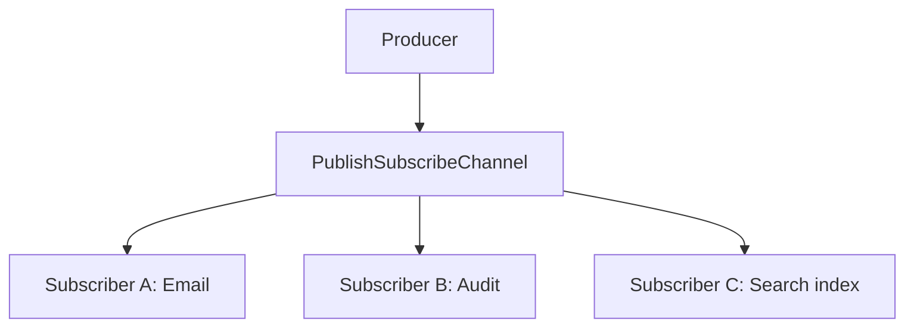
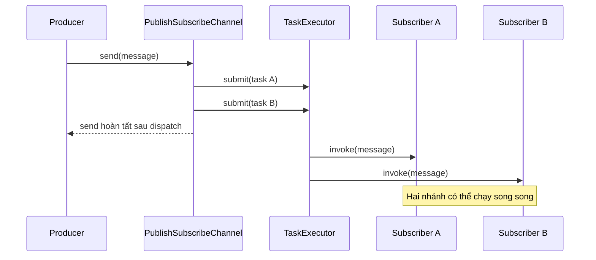
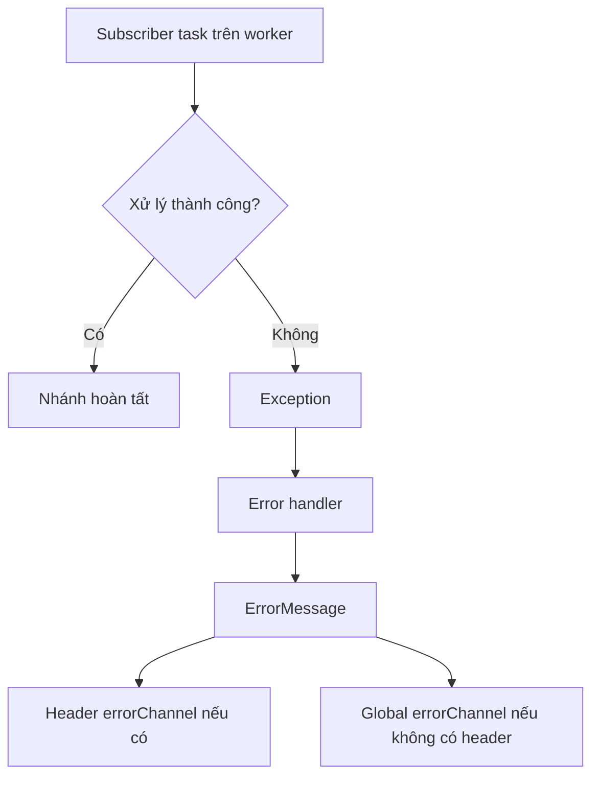
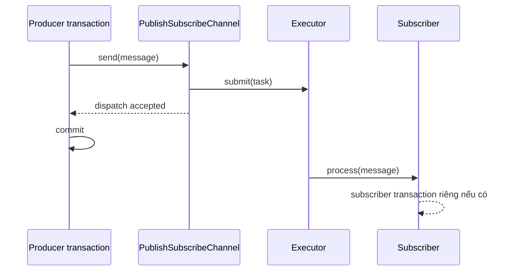

# PublishSubscribeChannel với task executor

`PublishSubscribeChannel` phát một message tới tất cả subscriber đã đăng ký trên channel. Khi không cấu hình executor, các subscriber thường được gọi tuần tự ngay trong thread gửi message. Khi gắn `TaskExecutor`, Spring Integration có thể dispatch từng subscriber trên worker thread, giúp producer không phải chờ toàn bộ nhánh xử lý hoàn tất.

Đây là cách triển khai fan-out bất đồng bộ trong Spring Integration. Nó phù hợp khi cùng một sự kiện cần kích hoạt nhiều tác vụ độc lập như gửi email, ghi audit, cập nhật search index và phát thông báo. Tuy nhiên, async fan-out làm thay đổi thời điểm hoàn tất, thứ tự xử lý, error handling và transaction boundary. Hiểu rõ các khác biệt đó giúp tránh nhầm lẫn giữa “đã gửi message” và “mọi subscriber đã xử lý thành công”.

## 1. Publish-subscribe là broadcast, không phải load balancing

Một `PublishSubscribeChannel` gửi cùng một message tới mọi subscriber đang đăng ký. Nếu có ba subscriber, cả ba đều nhận được message. Channel không chọn một subscriber để xử lý thay cho các subscriber còn lại.



Điều này khác `DirectChannel` và `ExecutorChannel`:

| Channel | Cách phân phối | Thread xử lý mặc định |
| --- | --- | --- |
| `DirectChannel` | Point-to-point; một subscriber được chọn để nhận message. | Thread gửi. |
| `ExecutorChannel` | Point-to-point; một subscriber được chọn và invocation được giao cho executor. | Worker thread. |
| `PublishSubscribeChannel` không có executor | Broadcast tới tất cả subscriber. | Thread gửi, lần lượt từng subscriber. |
| `PublishSubscribeChannel` có executor | Broadcast tới tất cả subscriber, invocation được submit cho executor. | Worker thread, tùy executor và rejection policy. |

Vì thế, nếu mục tiêu là chia tải cho nhiều worker cùng xử lý một message theo kiểu competing consumers, hãy chọn point-to-point channel và cấu hình load balancing phù hợp. Nếu mục tiêu là mọi nhánh đều nhận cùng sự kiện, `PublishSubscribeChannel` mới là lựa chọn đúng.

## 2. Đồng bộ và bất đồng bộ

Không có executor, channel gọi các subscriber trong thread đang gọi `send()`. Producer chỉ nhận kết quả sau khi việc dispatch đồng bộ kết thúc. Nếu subscriber đầu tiên xử lý lâu, các subscriber tiếp theo phải chờ.

Khi cấu hình executor, channel submit công việc cho executor. Mỗi subscriber có một invocation riêng. Producer thường trở về sau khi các công việc đã được chấp nhận vào executor, trong khi các subscriber có thể tiếp tục xử lý sau đó.



Thời điểm `send()` trả về không phải bằng chứng rằng subscriber đã hoàn thành. Nó cũng không phải xác nhận rằng side effect của từng nhánh đã commit. Nếu producer cần kết quả từ tất cả nhánh, cần thiết kế request-reply/scatter-gather, aggregator hoặc cơ chế theo dõi trạng thái hoàn tất riêng.

### Không bảo đảm thứ tự hoàn tất

Executor có thể chạy subscriber trên nhiều worker. Subscriber B có thể hoàn tất trước A dù A được submit trước. Các message liên tiếp cũng có thể được xử lý đồng thời và hoàn tất theo thứ tự khác thứ tự gửi.

Nếu một nhánh cần thứ tự theo từng key, hãy partition theo key, dùng một executor/channel có mô hình tuần tự phù hợp, hoặc serialize công việc cho key đó. `PublishSubscribeChannel` với thread pool chung không bảo đảm thứ tự hoàn tất của mỗi subscriber.

## 3. Cấu hình Java với ThreadPoolTaskExecutor

Ví dụ tạo executor có số worker và queue giới hạn, rồi gắn vào `PublishSubscribeChannel`:

```java
@Configuration
class NotificationConfiguration {

    @Bean("notificationExecutor")
    ThreadPoolTaskExecutor notificationExecutor() {
        ThreadPoolTaskExecutor executor = new ThreadPoolTaskExecutor();
        executor.setCorePoolSize(4);
        executor.setMaxPoolSize(12);
        executor.setQueueCapacity(200);
        executor.setKeepAliveSeconds(60);
        executor.setThreadNamePrefix("notification-");
        executor.setWaitForTasksToCompleteOnShutdown(true);
        executor.setAwaitTerminationSeconds(30);
        executor.setRejectedExecutionHandler(
            new ThreadPoolExecutor.CallerRunsPolicy());
        return executor;
    }

    @Bean
    MessageChannel notifications(
            @Qualifier("notificationExecutor") TaskExecutor executor) {
        PublishSubscribeChannel channel = new PublishSubscribeChannel(executor);
        channel.setApplySequence(true);
        channel.setMinSubscribers(1);
        return channel;
    }
}
```

Các lựa chọn trong ví dụ:

- `corePoolSize = 4`: số worker cơ sở được giữ trong pool.
- `maxPoolSize = 12`: giới hạn số worker tối đa khi queue đã đầy và executor cần tăng pool.
- `queueCapacity = 200`: giới hạn số task chờ để tránh hàng đợi tăng không giới hạn.
- `CallerRunsPolicy`: khi executor từ chối task vì quá tải, thread gọi `send()` có thể tự chạy task đó, tạo backpressure.
- `waitForTasksToCompleteOnShutdown` và `awaitTerminationSeconds`: cho phép executor chờ các task đã nhận hoàn tất trong thời gian giới hạn khi ứng dụng shutdown.
- `setApplySequence(true)`: yêu cầu channel bổ sung sequence metadata cho các message broadcast.
- `setMinSubscribers(1)`: yêu cầu tối thiểu một subscriber để việc gửi được xem là thành công.

`TaskExecutor` là abstraction của Spring; `ThreadPoolTaskExecutor` là implementation thường dùng cho ứng dụng server. Bean executor do Spring quản lý sẽ được khởi tạo và đóng theo lifecycle của container. Không tạo một thread pool mới cho từng message hoặc từng lần gửi.

### Cấu hình XML

Nếu dùng XML namespace, có thể gắn executor trực tiếp lên channel:

```xml
<task:executor id="notificationExecutor"
               pool-size="4-12"
               queue-capacity="200"
               rejection-policy="CALLER_RUNS"/>

<int:publish-subscribe-channel id="notifications"
        task-executor="notificationExecutor"
        apply-sequence="true"
        min-subscribers="1"/>
```

Khai báo namespace `task` và `int` tương ứng trong phần tử gốc XML. Các flow/endpoint đăng ký vào channel `notifications` sẽ trở thành các subscriber được broadcast.

## 4. Đăng ký nhiều subscriber bằng IntegrationFlow

Mỗi flow dưới đây đăng ký như một subscriber riêng trên cùng channel `notifications`:

```java
@Configuration
class NotificationFlows {

    @Bean
    IntegrationFlow emailNotificationFlow(EmailService emailService) {
        return IntegrationFlow.from("notifications")
            .handle(emailService, "send")
            .get();
    }

    @Bean
    IntegrationFlow auditNotificationFlow(AuditService auditService) {
        return IntegrationFlow.from("notifications")
            .handle(auditService, "record")
            .get();
    }

    @Bean
    IntegrationFlow searchNotificationFlow(SearchIndexService searchService) {
        return IntegrationFlow.from("notifications")
            .handle(searchService, "update")
            .get();
    }
}
```

Khi producer gửi một `Notification` tới channel, cả ba flow đều nhận message. Vì channel có executor, mỗi subscriber có thể được chạy trên worker thread. Các service nên được inject như bean thông thường; channel chỉ điều phối việc dispatch, không tạo hoặc quản lý dependency nghiệp vụ của subscriber.

Producer có thể gửi qua `MessageChannel` hoặc `MessagingTemplate`:

```java
@Service
class NotificationPublisher {

    private final MessageChannel notifications;

    NotificationPublisher(MessageChannel notifications) {
        this.notifications = notifications;
    }

    void publish(Notification notification) {
        notifications.send(MessageBuilder.withPayload(notification).build());
    }
}
```

Nếu ứng dụng có nhiều `MessageChannel` cùng kiểu, dùng `@Qualifier("notifications")` ở constructor để tránh inject nhầm channel.

## 5. Sequence metadata và `applySequence`

`PublishSubscribeChannel` có thể thêm sequence metadata khi `applySequence` được bật. Khi broadcast tới N subscriber, các message được tạo cho các nhánh có thể mang các header:

| Header | Ý nghĩa |
| --- | --- |
| `CORRELATION_ID` | Khóa liên hệ các message được phát từ cùng một lần broadcast. |
| `SEQUENCE_NUMBER` | Vị trí của message trong tập message broadcast. |
| `SEQUENCE_SIZE` | Số message dự kiến trong tập đó. |

Mặc định, `applySequence` tắt. Chỉ bật khi downstream cần metadata này, ví dụ các nhánh sau đó đi vào aggregator hoặc cần quan sát quan hệ giữa các bản sao. Header sequence không làm cho subscriber chạy theo thứ tự và cũng không chờ tất cả subscriber hoàn tất.

Không nhầm sequence metadata của publish-subscribe với correlation ID nghiệp vụ. Một channel có thể phát hàng nghìn sự kiện; nếu cần ghép kết quả theo request, hãy thiết kế correlation key nghiệp vụ rõ ràng và bảo đảm nó tồn tại qua các endpoint.

## 6. `minSubscribers` và `ignoreFailures`

`minSubscribers` là số subscriber tối thiểu để `send()` được xem là dispatch thành công. Giá trị mặc định cho phép channel không có subscriber mà vẫn không bắt buộc báo lỗi. Với một event bắt buộc phải có ít nhất một consumer, đặt `minSubscribers` thành `1` giúp phát hiện lỗi wiring hoặc flow chưa đăng ký.

`ignoreFailures` kiểm soát cách dispatcher phản ứng với exception khi gọi subscriber. Trong dispatch đồng bộ, bật thuộc tính này cho phép bỏ qua lỗi của một subscriber để tiếp tục dispatch các subscriber còn lại. Cần cân nhắc kỹ vì việc bỏ qua exception không có nghĩa nhánh đã thành công; nó có thể khiến producer không nhận ra một side effect đã thất bại.

Với async dispatch, các task có thể đã được submit độc lập trước khi một nhánh thất bại. Không nên dựa vào `ignoreFailures` như một cơ chế retry hoặc xác nhận hoàn tất tất cả nhánh. Hãy dùng error flow và trạng thái nghiệp vụ nếu cần biết nhánh nào thành công/thất bại.

## 7. Error handling khi subscriber chạy trên executor

Trong chế độ đồng bộ, exception từ subscriber có thể truyền ngược qua `send()` và ảnh hưởng việc dispatch các subscriber còn lại tùy cấu hình failure handling.

Trong chế độ bất đồng bộ, producer thường không còn call stack để nhận exception phát sinh sau khi task chạy. Cơ chế error handling của Spring Integration chuyển lỗi worker thành `ErrorMessage` tới error channel thích hợp. Thông thường, đích được chọn từ header `errorChannel` của message nếu có, nếu không thì dùng global `errorChannel`. Nếu ứng dụng thay executor hoặc error handler mặc định, hãy xác minh cấu hình thực tế vẫn thực hiện error publishing như mong muốn.



Có thể khai báo error flow chung:

```java
@Bean
IntegrationFlow notificationErrorFlow(ErrorAuditService auditService) {
    return IntegrationFlow.from("errorChannel")
        .handle((MessageHandler) message -> {
            ErrorMessage error = (ErrorMessage) message;
            auditService.record(error.getPayload(), error.getOriginalMessage());
        })
        .get();
}
```

Error flow nên lưu exception gốc, failed message, subscriber/endpoint ID nếu có, correlation ID và thời điểm. Phân loại lỗi transient để retry có giới hạn; lỗi dữ liệu hoặc lỗi nghiệp vụ vĩnh viễn nên đi tới dead-letter/audit flow. Không để error flow tự ném lỗi liên tục mà không có đường xử lý dự phòng.

Một điểm cần nhớ: `send()` thành công trong async mode chủ yếu xác nhận việc dispatch được chấp nhận. Nó không bảo đảm các subscriber xử lý thành công. Nếu executor từ chối task, rejection có thể xảy ra ngay lúc submit và làm lời gọi gửi thất bại; nếu task đã chạy rồi mới ném exception, lỗi đi theo error handling của worker.

## 8. Backpressure và rejection policy

Executor là một tài nguyên hữu hạn. Khi producer gửi nhanh hơn tốc độ subscriber xử lý, task queue sẽ tăng. Nếu queue không giới hạn, ứng dụng có thể tích lũy nhiều task trong heap, tăng độ trễ và cuối cùng gây `OutOfMemoryError`.

Nên dùng queue có capacity hữu hạn và chọn rejection policy theo yêu cầu:

| Rejection policy | Hành vi | Khi nào cân nhắc |
| --- | --- | --- |
| `AbortPolicy` | Ném `RejectedExecutionException` khi không nhận thêm task. | Muốn producer nhận tín hiệu quá tải rõ ràng và có thể retry/giảm tốc. |
| `CallerRunsPolicy` | Thread gửi tự chạy task bị từ chối. | Muốn tạo backpressure tự nhiên; chấp nhận producer có lúc phải xử lý đồng bộ. |
| `DiscardPolicy` | Bỏ task bị từ chối mà không báo lỗi. | Chỉ dùng khi mất task được chấp nhận rõ ràng; thường không phù hợp với event nghiệp vụ. |
| `DiscardOldestPolicy` | Bỏ task cũ nhất đang chờ rồi thử submit task mới. | Chỉ phù hợp với dữ liệu mới có giá trị hơn dữ liệu cũ và có thể mất sự kiện cũ. |

Với thông báo nghiệp vụ, `AbortPolicy` hoặc một cơ chế backpressure/retry có quan sát thường an toàn hơn chính sách discard. `CallerRunsPolicy` giúp hạn chế tốc độ producer nhưng có thể làm thay đổi thread execution: một nhánh đôi khi chạy trên thread gửi. Subscriber vì vậy phải an toàn khi chạy trên nhiều loại thread.

### Chọn kích thước pool

Không có một con số core/max/queue phù hợp cho mọi flow. Cần đo thời gian xử lý, tỷ lệ I/O và CPU, số subscriber, tốc độ message đến và độ trễ chấp nhận được.

- Tác vụ CPU-bound thường cần số worker gần số CPU khả dụng; tăng quá nhiều thread chỉ làm tăng context switching.
- Tác vụ I/O-bound có thể dùng nhiều worker hơn, nhưng cần tính giới hạn connection pool, rate limit và capacity của dịch vụ đích.
- Queue lớn làm tăng thời gian chờ và lượng memory giữ lại. Queue không phải cách chữa thiếu năng lực xử lý.
- `ThreadPoolTaskExecutor` thường chỉ tăng từ core lên max khi queue đã đầy; nếu queue không giới hạn, max pool size có thể không đạt tới.
- Theo dõi thời gian chờ trong queue và thời gian xử lý riêng biệt để biết bottleneck nằm ở executor hay subscriber.

## 9. Payload dùng chung và thread safety

Spring `Message` là immutable ở mức envelope: header không thể tùy ý thay đổi sau khi message được tạo. Tuy nhiên, payload không được deep-copy tự động. Tất cả subscriber có thể nhận cùng một object payload.

Nếu payload là mutable object và một subscriber sửa field, subscriber khác có thể đọc dữ liệu đã bị thay đổi hoặc gặp race condition. Hãy ưu tiên immutable DTO/record, hoặc tạo bản sao riêng cho mỗi nhánh trước khi cho phép mutation. Tránh giữ state request trong field của singleton handler khi cùng handler có thể được gọi đồng thời bởi nhiều worker.

```java
public record Notification(String recipient, String subject, String body) { }
```

Record/immutable DTO giúp các nhánh đọc dữ liệu an toàn hơn. Các side effect riêng như email, audit và index update nên có idempotency key để tránh xử lý trùng khi producer retry hoặc message được phát lại.

## 10. Transaction và async fan-out

Transaction của producer không tự truyền sang worker thread. Nếu producer gửi message tới `PublishSubscribeChannel` có executor bên trong transaction, transaction có thể commit sau khi task đã được submit, trước khi subscriber thực hiện xong.



Nếu subscriber cần cập nhật database trong transaction, hãy đặt transaction boundary tại handler/service của nhánh đó. Nếu yêu cầu nghiệp vụ là dữ liệu database và sự kiện broadcast phải được ghi nhận nguyên tử, hãy cân nhắc transactional outbox: lưu event trong cùng database transaction với thay đổi nghiệp vụ, sau đó publisher phát event từ outbox. Không dựa vào việc gửi vào executor để bảo đảm broker hoặc subscriber đã nhận sự kiện bền vững.

## 11. Context propagation: MDC, security và tracing

Khi chuyển qua executor, `ThreadLocal` của thread gửi không tự động xuất hiện trong worker thread. Các context thường bị ảnh hưởng gồm:

- MDC logging context (trace ID, request ID).
- Security context.
- Locale hoặc context tự xây dựng trong `ThreadLocal`.
- Một số context tracing/observation phụ thuộc instrumentation.

Không nên giả định `ThreadLocal` được sao chép chỉ vì payload và message headers được chuyển tiếp. Có thể dùng `TaskDecorator` trên `ThreadPoolTaskExecutor` để capture context lúc submit và restore/clear context sau khi task kết thúc. Với Spring Security, dùng cơ chế delegating executor/context propagation tương ứng. Với tracing, ưu tiên instrumentation chính thức của phiên bản Spring Boot/Micrometer đang dùng.

Ví dụ minh họa decorator cho MDC:

```java
executor.setTaskDecorator(task -> {
    Map<String, String> context = MDC.getCopyOfContextMap();
    return () -> {
        Map<String, String> previous = MDC.getCopyOfContextMap();
        try {
            if (context == null) {
                MDC.clear();
            }
            else {
                MDC.setContextMap(context);
            }
            task.run();
        }
        finally {
            if (previous == null) {
                MDC.clear();
            }
            else {
                MDC.setContextMap(previous);
            }
        }
    };
});
```

Đây là ví dụ minh họa; trong ứng dụng thật cần chọn đúng MDC implementation và kết hợp với tracing/security context mà ứng dụng sử dụng. Luôn restore hoặc clear context trong `finally` để dữ liệu của một request không rò sang task tiếp theo dùng chung worker.

## 12. Graceful shutdown và vòng đời executor

Khi context đóng, executor cần dừng nhận task mới và xử lý các task đã được chấp nhận theo chính sách shutdown. Các thuộc tính như `waitForTasksToCompleteOnShutdown` và `awaitTerminationSeconds` giúp giới hạn thời gian chờ. Tuy nhiên, shutdown timeout không bảo đảm mọi side effect bên ngoài đã hoàn tất; task có thể bị ngắt hoặc process có thể kết thúc trước khi hoàn thành.

Khi triển khai:

1. Dừng producer hoặc ngăn nhận event mới trước khi đóng executor.
2. Chờ các task đã submit trong khoảng thời gian phù hợp.
3. Theo dõi số task đang active và queue còn lại.
4. Đảm bảo subscriber có timeout cho I/O để shutdown không treo vô hạn.
5. Với sự kiện không được phép mất, persist trước khi submit hoặc dùng broker/outbox làm nguồn bền vững.

Không tạo executor thủ công trong từng handler và quên shutdown. Dùng bean executor do Spring quản lý để lifecycle nhất quán với channel và application context.

## 13. Quan sát hiệu năng và troubleshooting

Các chỉ số nên quan sát:

- Số subscriber đăng ký trên channel và số message được gửi.
- Số task đang active, kích thước pool và queue depth.
- Số lần executor từ chối task.
- Thời gian từ lúc submit tới lúc worker bắt đầu (queue wait time).
- Thời gian xử lý của từng subscriber.
- Số exception và `ErrorMessage` theo nhánh.
- Số task còn lại trong shutdown và thời gian drain.

| Triệu chứng | Nguyên nhân có thể | Hướng xử lý |
| --- | --- | --- |
| Producer gửi một message nhưng email/audit/index đều chạy | Broadcast đang hoạt động đúng. | Xác minh số subscriber và mỗi nhánh có idempotency. |
| Producer trả về nhanh nhưng nhánh chưa hoàn tất | Async dispatch chỉ submit task. | Dùng completion tracking/scatter-gather nếu caller cần kết quả. |
| Nhánh hoàn tất sai thứ tự | Worker xử lý song song. | Partition/serialize theo key hoặc dùng resequencer nếu có sequence phù hợp. |
| Một nhánh lỗi nhưng producer không nhận exception | Lỗi xảy ra trên worker thread sau khi submit. | Kiểm tra header/global `errorChannel` và error flow. |
| `RejectedExecutionException` khi send | Pool và queue đã đạt capacity hoặc executor đang shutdown. | Kiểm tra pool/queue, tốc độ producer và rejection policy. |
| CPU thấp nhưng queue tăng | Subscriber chờ I/O, connection pool hoặc dịch vụ đích bị nghẽn. | Đo latency I/O, giới hạn downstream và tăng worker chỉ khi resource cho phép. |
| Heap tăng liên tục | Queue không giới hạn hoặc payload lớn được giữ trong task. | Dùng bounded queue, giới hạn payload và xử lý backpressure. |
| Subscriber đọc payload đã bị thay đổi | Các nhánh chia sẻ mutable object. | Dùng immutable payload hoặc copy theo nhánh. |
| Log thiếu trace/request ID ở worker | ThreadLocal/MDC chưa được truyền. | Cấu hình TaskDecorator hoặc context propagation phù hợp. |

Khi điều tra một message, log message ID, correlation ID, subscriber/endpoint ID, thread name, thời điểm submit, thời điểm bắt đầu và kết thúc xử lý. Điều này giúp phân biệt độ trễ trong executor queue với độ trễ trong business handler.

## 14. Quy trình chọn và cấu hình PublishSubscribeChannel

1. Xác nhận nghiệp vụ cần broadcast tới tất cả subscriber hay chỉ cần một consumer xử lý.
2. Nếu mọi subscriber phải chạy trong thread gửi, dùng `PublishSubscribeChannel` không có executor.
3. Nếu các nhánh độc lập và cần chạy song song, gắn một `TaskExecutor` được quản lý bởi Spring.
4. Đặt core/max pool, queue capacity, rejection policy và shutdown timeout dựa trên tải thực tế.
5. Chỉ bật `applySequence` khi downstream cần sequence metadata; đặt `minSubscribers` nếu cần phát hiện thiếu subscriber.
6. Xác định error channel, retry, dead-letter và cách quan sát kết quả từng nhánh.
7. Dùng immutable payload và truyền context qua decorator/instrumentation nếu cần.
8. Kiểm thử overload, executor rejection, subscriber failure và shutdown để xác nhận semantics vận hành.

## 15. Điểm cần nhớ

- `PublishSubscribeChannel` broadcast một message tới tất cả subscriber; nó không chia tải kiểu competing consumers.
- Không có executor thì subscriber chạy đồng bộ trong thread gửi; có executor thì mỗi subscriber được dispatch thành task bất đồng bộ.
- `send()` hoàn tất không có nghĩa mọi subscriber đã xử lý thành công.
- Executor làm thay đổi thứ tự hoàn tất, transaction boundary và error routing; worker thread không kế thừa transaction của producer.
- Dùng bounded queue và rejection policy có chủ đích để kiểm soát backpressure; tránh discard sự kiện nghiệp vụ một cách âm thầm.
- Payload object có thể được chia sẻ giữa các nhánh; ưu tiên immutable DTO và idempotent subscriber.
- Dùng error flow, metrics và graceful shutdown để vận hành fan-out đáng tin cậy.

## Tài liệu tham khảo

- [Spring Integration Reference — Channel Configuration](https://docs.spring.io/spring-integration/reference/channel/configuration.html)
- [Spring Integration Reference — Error Handling](https://docs.spring.io/spring-integration/reference/error-handling.html)
- [Spring Integration Reference — Task Executor Support](https://docs.spring.io/spring-integration/reference/task-executor.html)
- [Spring Framework Reference — Task Execution and Scheduling](https://docs.spring.io/spring-framework/reference/integration/scheduling.html)
- [Spring Integration API — PublishSubscribeChannel](https://docs.spring.io/spring-integration/api/org/springframework/integration/channel/PublishSubscribeChannel.html)
