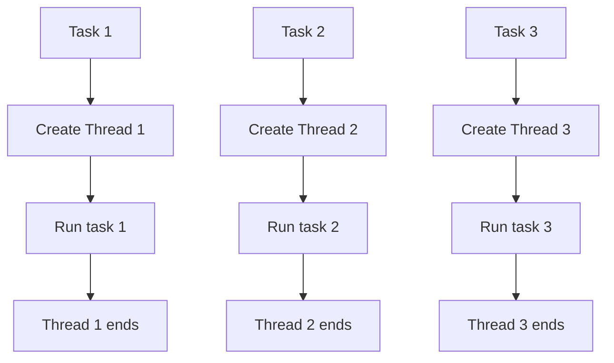

# SimpleAsyncTaskExecutor và giới hạn tạo thread

`SimpleAsyncTaskExecutor` là một `TaskExecutor` của Spring dùng mô hình **một task được giao thì tạo một thread để chạy task đó**. Executor này không duy trì thread pool để tái sử dụng thread sau khi task kết thúc. Vì vậy, nếu nhiều message được dispatch đồng thời, số thread hoạt động có thể tăng nhanh nếu không đặt giới hạn concurrency.

Điểm cần phân biệt là `concurrencyLimit` giới hạn **số task đang chạy đồng thời**, không giới hạn tổng số thread được tạo trong suốt vòng đời ứng dụng. Ví dụ, đặt giới hạn 10 có nghĩa tối đa khoảng 10 task của executor được thực thi cùng lúc; khi các task hoàn thành, những task tiếp theo vẫn có thể tạo thread mới. Trong một ngày, executor có thể tạo hàng nghìn thread tuần tự dù concurrency limit chỉ là 10.

Trong Spring Integration, `SimpleAsyncTaskExecutor` có thể được dùng làm executor cho `ExecutorChannel`, `PublishSubscribeChannel` hoặc các điểm xử lý bất đồng bộ khác có nhận `TaskExecutor`. Muốn dùng an toàn, cần hiểu thread-per-task, hành vi khi đạt giới hạn, ảnh hưởng tới message flow và khi nào nên chọn `ThreadPoolTaskExecutor`.

## 1. Mô hình thread-per-task

Khi gọi `execute(task)`, `SimpleAsyncTaskExecutor` tạo một thread mới và chạy task trên thread đó. Khi task hoàn tất, thread kết thúc. Executor không giữ thread rảnh để giao cho task tiếp theo.



Ví dụ tạo executor:

```java
SimpleAsyncTaskExecutor executor =
        new SimpleAsyncTaskExecutor("integration-");

executor.execute(() -> processMessage(message));
```

Prefix `integration-` giúp nhận diện thread trong log và thread dump. Mỗi lần `execute()` được chấp nhận, executor tạo thread mới theo cấu hình. Nếu ứng dụng gửi task liên tục, thread được tạo và kết thúc liên tục.

### 1.1. Ưu điểm và chi phí

| Đặc điểm | Ý nghĩa |
|---|---|
| Cấu hình đơn giản | Không cần điều chỉnh core pool, max pool hoặc queue như thread pool |
| Thread riêng cho từng task | Task không phải chờ một thread rảnh trong pool nếu chưa đạt concurrency limit |
| Không tái sử dụng thread | Có chi phí tạo và kết thúc thread cho mỗi task |
| Không có queue của thread pool | Khi đạt concurrency limit, executor áp dụng hành vi chờ hoặc từ chối theo cấu hình |
| Mặc định không giới hạn concurrency | Nhiều task đồng thời có thể tạo rất nhiều thread và gây áp lực lên process |

`SimpleAsyncTaskExecutor` phù hợp với workload vừa phải hoặc các tác vụ độc lập mà mô hình thread-per-task là lựa chọn có chủ đích. Với tải cao, đều đặn và cần tái sử dụng thread, `ThreadPoolTaskExecutor` thường dễ kiểm soát tài nguyên hơn.

## 2. Concurrency limit hoạt động thế nào?

`SimpleAsyncTaskExecutor` hỗ trợ đặt giới hạn số task đồng thời bằng `setConcurrencyLimit(int)`. Mặc định là không giới hạn (`UNBOUNDED_CONCURRENCY`). Khi đặt một số dương, executor theo dõi số task đang chạy và chỉ cho phép số lượng đó hoạt động cùng lúc.

```java
SimpleAsyncTaskExecutor executor =
        new SimpleAsyncTaskExecutor("integration-");

executor.setConcurrencyLimit(10);
```

Với cấu hình này, tối đa 10 task do executor quản lý có thể chạy đồng thời. Task tiếp theo sẽ chịu hành vi khi chạm giới hạn.

### 2.1. Giới hạn concurrency không phải giới hạn tổng thread

Giả sử executor có `concurrencyLimit = 3` và lần lượt xử lý 12 task. Tại một thời điểm, tối đa 3 task chạy. Khi một task kết thúc, slot được giải phóng và task kế tiếp có thể bắt đầu bằng một thread mới.

```text
Thời gian  ─────────────────────────────────────────────>

Task 1     [ Thread 1 ]
Task 2     [ Thread 2       ]
Task 3     [ Thread 3 ]
Task 4                     [ Thread 4 ]
Task 5                     [ Thread 5       ]
Task 6                     [ Thread 6 ]
Task 7                                      [ Thread 7 ]
...

Concurrency tối đa tại một thời điểm: 3
Tổng thread được tạo trong toàn bộ lượt xử lý: có thể là 12
```

Do đó, concurrency limit bảo vệ số tác vụ hoạt động cùng lúc. Nó không đặt trần tích lũy cho số thread đã được tạo kể từ khi ứng dụng khởi động.

## 3. Hành vi khi chạm concurrency limit

Khi số task đang chạy đạt giới hạn, `SimpleAsyncTaskExecutor` có thể xử lý task mới theo hai cách.

**Chờ slot trống:** đây là hành vi mặc định khi giới hạn được bật. Thread gọi `execute()` phải chờ cho tới khi một task đang chạy hoàn tất và giải phóng slot. Điều này tạo backpressure ngược lên caller.

**Từ chối task:** có thể cấu hình `setRejectTasksWhenLimitExceeded(true)` ở các phiên bản Spring Framework hỗ trợ thuộc tính này. Khi đạt giới hạn, executor ném `TaskRejectedException` thay vì chờ.

Ví dụ cấu hình giới hạn và từ chối:

```java
@Bean("integrationTaskExecutor")
SimpleAsyncTaskExecutor integrationTaskExecutor() {
    SimpleAsyncTaskExecutor executor =
            new SimpleAsyncTaskExecutor("integration-");
    executor.setConcurrencyLimit(20);
    executor.setRejectTasksWhenLimitExceeded(true);
    return executor;
}
```

Hãy kiểm tra phiên bản Spring Framework đang dùng trước khi gọi `setRejectTasksWhenLimitExceeded`; API và khả năng cấu hình có thể khác giữa các phiên bản. Nếu không bật chế độ reject, caller có thể bị block khi executor đã đạt giới hạn.

### 3.1. Chọn chờ hay từ chối?

| Chính sách | Hành vi | Khi phù hợp | Rủi ro cần kiểm soát |
|---|---|---|---|
| Chờ slot | Caller bị block cho tới khi có slot | Có thể tạo backpressure và caller chịu được thời gian chờ | Có thể giữ thread request hoặc thread poller quá lâu |
| Từ chối task | `execute()` ném `TaskRejectedException` | Muốn fail-fast và để flow xử lý quá tải rõ ràng | Phải có error handling, retry hoặc lưu message phù hợp |

Chính sách chờ không đồng nghĩa message được đưa vào một queue nội bộ. Caller đang thực hiện thao tác submit bị chặn. Nếu caller là thread HTTP, thread poller hoặc đang giữ lock/transaction, việc chờ có thể làm nghẽn một phần khác của hệ thống.

Chính sách từ chối giúp caller nhận biết quá tải ngay. Trong Spring Integration, lỗi khi dispatch qua executor có thể xuất hiện dưới dạng lỗi gửi message hoặc lỗi delivery tùy channel và đường gọi. Cần cấu hình error handling phù hợp, đồng thời quyết định message sẽ retry, lưu lại hay chuyển sang error flow.

## 4. Dùng SimpleAsyncTaskExecutor với Spring Integration

`ExecutorChannel` sử dụng `TaskExecutor` để dispatch message tới handler trên thread khác. Có thể cấu hình channel như một bean:

```java
@Bean("integrationTaskExecutor")
SimpleAsyncTaskExecutor integrationTaskExecutor() {
    SimpleAsyncTaskExecutor executor =
            new SimpleAsyncTaskExecutor("si-worker-");
    executor.setConcurrencyLimit(16);
    executor.setRejectTasksWhenLimitExceeded(true);
    return executor;
}

@Bean
MessageChannel asyncOrdersChannel(
        @Qualifier("integrationTaskExecutor") TaskExecutor executor) {
    return new ExecutorChannel(executor);
}

@Bean
IntegrationFlow ordersFlow(MessageChannel asyncOrdersChannel,
                           OrderService orderService) {
    return IntegrationFlow.from("orders.input")
            .channel(asyncOrdersChannel)
            .handle(orderService, "process")
            .get();
}
```

Khi message tới `asyncOrdersChannel`, `ExecutorChannel` chuyển việc gọi handler sang executor. Với `SimpleAsyncTaskExecutor`, mỗi task được dispatch sẽ dùng một thread mới nếu được chấp nhận.

### 4.1. Điều gì thay đổi trong message flow?

Trước điểm async, message được xử lý trên thread gửi. Sau `ExecutorChannel`, handler có thể chạy trên thread do executor tạo. Điều này có một số hệ quả:

- Thread gửi có thể tiếp tục sau khi task được dispatch thành công.
- `send()` thành công chỉ xác nhận việc dispatch được chấp nhận; nó không xác nhận xử lý nghiệp vụ đã hoàn tất.
- Exception xảy ra trong handler bất đồng bộ không thể được truyền ngược như một exception đồng bộ tới thread gửi; cần error channel và cơ chế giám sát lỗi.
- Thứ tự hoàn tất giữa nhiều message có thể khác thứ tự gửi.
- Transaction gắn với thread gửi không tự truyền sang thread xử lý mới.

Nếu cần kết quả nghiệp vụ đồng bộ, `DirectChannel` có thể phù hợp hơn. Nếu cần tách thread, phải xác định rõ nơi nhận kết quả, nơi xử lý exception và cách theo dõi message đang chạy.

### 4.2. Phân biệt TaskExecutor và TaskScheduler

`TaskExecutor` thực thi task. `TaskScheduler` lên lịch thời điểm task được kích hoạt, ví dụ poller chạy mỗi giây hoặc theo cron. Hai abstraction có thể tham gia cùng một flow nhưng không thay thế nhau.

Nếu một inbound adapter dùng poller, scheduler quyết định thời điểm poll. Executor có thể được cấu hình để thực thi công việc liên quan tùy endpoint và cấu hình poller. Đặt concurrency limit trên executor không tự giới hạn tần suất cron hoặc fixed-rate trigger; cần cấu hình scheduler/poller phù hợp riêng.

## 5. Giới hạn thread để bảo vệ downstream

Số thread phù hợp không chỉ phụ thuộc CPU. Nó còn phụ thuộc thời gian task giữ thread, tỷ lệ chờ I/O, connection pool và năng lực của hệ thống phía sau.

Ví dụ, nếu một flow gọi database và database pool chỉ có 12 connection, cấu hình 100 task đồng thời có thể khiến nhiều thread chờ connection. Các thread chờ vẫn tiêu thụ stack, bộ nhớ và năng lực scheduling. Tăng thread không làm database xử lý nhanh hơn.

Khi chọn concurrency limit, hãy xem:

1. Số request đồng thời mà downstream chịu được.
2. Kích thước connection pool của database/HTTP client.
3. Thời gian xử lý trung bình và percentile cao của task.
4. Tỷ lệ task CPU-bound và I/O-bound.
5. Số lượng flow/channel khác dùng chung executor.
6. Số replica của ứng dụng; giới hạn 20 trên mỗi replica có thể thành 100 task khi chạy 5 replica.

Nếu một executor được dùng chung bởi nhiều channel, concurrency limit là giới hạn chung cho các task gửi qua executor đó. Nếu mỗi flow có executor riêng, tổng concurrency toàn ứng dụng có thể bằng tổng giới hạn của tất cả executor. Hãy tính ở cấp process và cấp cluster, không chỉ ở một bean.

## 6. So sánh với ThreadPoolTaskExecutor

`SimpleAsyncTaskExecutor` và `ThreadPoolTaskExecutor` đều triển khai abstraction thực thi task của Spring, nhưng mô hình quản lý thread khác nhau.

| Tiêu chí | `SimpleAsyncTaskExecutor` | `ThreadPoolTaskExecutor` |
|---|---|---|
| Mô hình | Thread-per-task | Thread pool |
| Tái sử dụng thread | Không | Có |
| Queue task | Không có queue thread-pool riêng; có thể block caller khi đạt limit | Có thể cấu hình queue capacity |
| Giới hạn đồng thời | `concurrencyLimit` | Core/max pool size và queue policy |
| Chi phí tạo thread | Tạo thread cho từng task được chấp nhận | Chủ yếu tạo thread khi pool tăng kích thước |
| Hành vi khi quá tải | Block hoặc reject theo cấu hình | Queue, mở rộng pool hoặc reject theo cấu hình |
| Phù hợp | Workload vừa phải, thread-per-task có chủ đích | Workload thường xuyên, cần reuse và kiểm soát pool/queue |

Ví dụ cấu hình `ThreadPoolTaskExecutor`:

```java
@Bean("integrationPool")
ThreadPoolTaskExecutor integrationPool() {
    ThreadPoolTaskExecutor executor = new ThreadPoolTaskExecutor();
    executor.setThreadNamePrefix("si-pool-");
    executor.setCorePoolSize(8);
    executor.setMaxPoolSize(16);
    executor.setQueueCapacity(100);
    executor.initialize();
    return executor;
}
```

Đây là cấu hình minh họa. Với `ThreadPoolTaskExecutor`, queue capacity ảnh hưởng đến thời điểm pool mở rộng từ core size tới max size. Cần hiểu rejection policy và shutdown behavior trước khi dùng trong production.

Chọn `SimpleAsyncTaskExecutor` khi muốn mô hình thread-per-task và có thể giới hạn số task đang chạy. Chọn `ThreadPoolTaskExecutor` khi cần tái sử dụng thread, queue có giới hạn và điều khiển pool size. Không có một giá trị concurrency hoặc pool size phù hợp cho mọi ứng dụng; cần đo tải và năng lực downstream.

## 7. Virtual threads

Ở các phiên bản Spring Framework hỗ trợ virtual threads, `SimpleAsyncTaskExecutor` có thể được cấu hình để dùng virtual thread thay vì platform thread:

```java
@Bean("virtualIntegrationExecutor")
SimpleAsyncTaskExecutor virtualIntegrationExecutor() {
    SimpleAsyncTaskExecutor executor =
            new SimpleAsyncTaskExecutor("si-virtual-");
    executor.setVirtualThreads(true);
    executor.setConcurrencyLimit(200);
    return executor;
}
```

Khả năng `setVirtualThreads(true)` phụ thuộc phiên bản Spring Framework; hỗ trợ virtual threads được bổ sung trong dòng Spring Framework 6.2 và cần runtime Java hỗ trợ virtual threads (Java 21 trở lên). Kiểm tra version thực tế trước khi dùng.

Virtual thread giảm chi phí duy trì nhiều thread cho tác vụ blocking I/O, nhưng không làm database, HTTP server hoặc broker có thêm capacity. Nếu 200 virtual threads cùng tranh 10 database connections, 190 task vẫn có thể phải chờ connection. Vì vậy, concurrency limit vẫn có ý nghĩa để bảo vệ downstream và kiểm soát số tác vụ đang giữ tài nguyên.

Virtual thread cũng không biến task CPU-bound thành nhanh hơn. Với xử lý CPU nặng, số task chạy đồng thời vẫn nên cân nhắc số core và khả năng của CPU.

## 8. Thread naming, context propagation và shutdown

### 8.1. Thread name và chẩn đoán

Đặt prefix dễ nhận diện:

```java
SimpleAsyncTaskExecutor executor =
        new SimpleAsyncTaskExecutor("orders-integration-");
```

Khi xem thread dump, prefix giúp xác định thread thuộc executor/flow nào. Kết hợp thread name với correlation ID trong log để lần theo một message qua nhiều endpoint.

### 8.2. ThreadLocal không tự truyền sang thread mới

Khi task chạy trên thread khác, dữ liệu gắn với `ThreadLocal` của thread gửi không tự động có mặt trên thread mới. Điều này có thể ảnh hưởng tới:

- MDC logging context.
- Security context.
- Tenant context hoặc request context do ứng dụng tự quản lý.
- Transaction context gắn với thread.

Nếu cần truyền context, dùng cơ chế chuyên biệt của framework hoặc `TaskDecorator` để capture context khi submit và restore context trong worker, đồng thời xóa context sau khi task kết thúc. Không dựa vào `InheritableThreadLocal` như một giải pháp chung; cách đó có thể gây rò rỉ hoặc mang context sai khi mô hình thực thi thay đổi.

### 8.3. Shutdown và task đang chạy

Thread-per-task không có pool để shutdown theo cách giống `ThreadPoolTaskExecutor`. Nếu ứng dụng cần chờ task đang chạy kết thúc khi đóng context, hãy kiểm tra lifecycle và termination tracking của phiên bản `SimpleAsyncTaskExecutor` đang dùng. Các phiên bản hỗ trợ có thể cấu hình thời gian chờ kết thúc task bằng `setTaskTerminationTimeout(...)`.

Không nên giả định gọi `stop()` một integration endpoint sẽ tự hủy mọi task đã được executor dispatch. Endpoint dừng nhận công việc mới theo lifecycle của nó; task đã chạy có thể tiếp tục. Nếu task cần dừng hợp tác, thiết kế cancellation/interruption và timeout rõ ràng.

## 9. Kiểm thử concurrency limit

Có thể dùng `CountDownLatch` để giữ hai task đang chạy, sau đó xác minh task thứ ba bị từ chối khi limit là 2 và reject mode được bật.

```java
@Test
void rejectsTaskWhenConcurrencyLimitIsReached() throws Exception {
    SimpleAsyncTaskExecutor executor =
            new SimpleAsyncTaskExecutor("limit-test-");
    executor.setConcurrencyLimit(2);
    executor.setRejectTasksWhenLimitExceeded(true);

    CountDownLatch started = new CountDownLatch(2);
    CountDownLatch release = new CountDownLatch(1);
    CountDownLatch finished = new CountDownLatch(2);

    Runnable blockingTask = () -> {
        started.countDown();
        try {
            release.await();
        }
        catch (InterruptedException ex) {
            Thread.currentThread().interrupt();
        }
        finally {
            finished.countDown();
        }
    };

    try {
        executor.execute(blockingTask);
        executor.execute(blockingTask);

        assertTrue(started.await(2, TimeUnit.SECONDS));
        assertThrows(TaskRejectedException.class,
                () -> executor.execute(() -> fail("Task không được chạy")));
    }
    finally {
        release.countDown();
    }

    assertTrue(finished.await(2, TimeUnit.SECONDS));
}
```

Test này minh họa reject mode và giả định phiên bản Spring có `setRejectTasksWhenLimitExceeded(true)`. Với chế độ mặc định block caller, test phải chạy lần submit thứ ba trên một thread riêng để có thể giải phóng latch từ thread test; nếu gọi trực tiếp, chính test thread sẽ bị block.

Ngoài test executor riêng, cần một test tích hợp với `ExecutorChannel` để xác minh hành vi gửi message khi executor từ chối task và cách error flow nhận lỗi. Kiểm thử phải phân biệt lỗi dispatch với lỗi nghiệp vụ xảy ra sau khi handler đã bắt đầu.

## 10. Quan sát executor trong runtime

Khi flow xử lý chậm hoặc tăng thread bất thường, hãy thu thập các tín hiệu sau:

- Số task đang chạy và số task được submit trong một khoảng thời gian.
- Thời gian chờ khi submit nếu executor đang dùng chế độ block khi đạt limit.
- Số lần `TaskRejectedException` và lỗi dispatch message.
- Thời gian xử lý của handler và độ trễ message end-to-end.
- Thread dump, thread name prefix và stack trace của task đang chờ I/O.
- Số connection đang dùng/chờ trong database và HTTP client pool.
- Số replica và tổng concurrency được cấp trên toàn cluster.

`SimpleAsyncTaskExecutor` không cung cấp mô hình pool với queue size và active pool size giống `ThreadPoolTaskExecutor`. Nếu cần dashboard concurrency, có thể bọc task bằng `TaskDecorator` hoặc instrumentation ở tầng ứng dụng để tăng/giảm bộ đếm active task và ghi nhận thời gian thực thi. Đảm bảo bộ đếm được giảm trong `finally` để không lệch khi task ném exception.

## 11. Lỗi thường gặp và cách xử lý

| Triệu chứng | Nguyên nhân có thể | Hướng kiểm tra |
|---|---|---|
| Số thread tăng cao | Concurrency mặc định không giới hạn hoặc limit đặt quá lớn | Đặt limit, kiểm tra task duration và thread dump |
| Thread gửi message bị block | Đã đạt limit trong chế độ chờ slot | Đo thời gian submit, xem task nào giữ slot lâu |
| Message bị reject | Bật reject mode và đã đạt limit | Xử lý `TaskRejectedException`, kiểm tra error flow/retry |
| Downstream quá tải | Concurrency cao hơn năng lực database/HTTP service | Giảm limit, kiểm tra connection pool và timeout |
| Log thiếu correlation/MDC | ThreadLocal không được truyền sang thread mới | Dùng TaskDecorator hoặc context propagation phù hợp |
| Transaction không bao phủ handler async | Transaction thread-bound không truyền qua executor | Đặt transaction ở phía worker/handler phù hợp |
| Message hoàn tất sai thứ tự | Nhiều thread xử lý song song | Dùng partition/key hoặc channel/consumer giữ thứ tự cần thiết |
| Shutdown còn task chạy | Task đã dispatch trước khi endpoint dừng | Thiết kế timeout, termination tracking và cancellation hợp tác |

## 12. Quy tắc lựa chọn và cấu hình

- Dùng `SimpleAsyncTaskExecutor` khi chấp nhận thread-per-task và tải đồng thời được kiểm soát.
- Luôn đánh giá `concurrencyLimit`; mặc định không giới hạn có thể nguy hiểm khi tải tăng đột biến.
- Chọn block khi cần backpressure và caller có thể chờ; chọn reject khi muốn fail-fast và có recovery path rõ.
- Không xem concurrency limit là giới hạn tổng thread đã tạo trong suốt vòng đời process.
- Dùng `ThreadPoolTaskExecutor` khi cần thread reuse, queue capacity và điều khiển pool rõ ràng.
- Với virtual threads, vẫn giới hạn concurrency theo năng lực downstream.
- Tách vai trò scheduler và executor khi cấu hình poller.
- Xác định rõ transaction, error handling, ordering và context propagation tại ranh giới async.
- Đo concurrency tổng của mọi executor trên từng replica và toàn cluster.
- Kiểm thử cả trường hợp đạt limit, block, reject và shutdown.

`SimpleAsyncTaskExecutor` đơn giản vì mỗi task có thread riêng, nhưng sự đơn giản đó cần đi kèm giới hạn concurrency và chính sách quá tải. Khi hiểu rõ executor tạo thread như thế nào, điều gì xảy ra khi đạt limit và `ExecutorChannel` chuyển message sang thread khác ra sao, ta có thể chọn cấu hình phù hợp mà không làm thread, downstream hoặc trạng thái runtime vượt khỏi khả năng kiểm soát.
