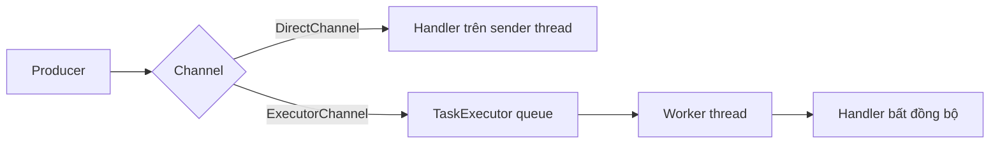

# Chọn executor theo CPU, I/O và latency

Trong Spring Integration, `TaskExecutor` quyết định công việc được thực thi trên thread nào và có thể chạy đồng thời đến mức nào. Chọn executor không chỉ là chọn số thread. Một pool phù hợp với tác vụ CPU-bound có thể hoạt động kém khi dùng cho I/O-bound; một queue lớn có thể làm throughput nhìn có vẻ ổn định nhưng khiến latency tăng mạnh; một pool không giới hạn có thể đẩy ứng dụng tới cạn bộ nhớ hoặc làm quá tải hệ thống downstream.

Muốn chọn executor đúng, cần bắt đầu từ đặc tính công việc: thời gian CPU, thời gian chờ I/O, số tác vụ đồng thời, giới hạn latency và khả năng chịu tải của database, broker hoặc API bên ngoài. Sau đó mới chọn pool size, queue capacity và chính sách từ chối task.

## 1. TaskExecutor nằm ở đâu trong message flow?

`TaskExecutor` là abstraction của Spring để thực thi một `Runnable` trên một thread. Spring Integration sử dụng nó ở các ranh giới bất đồng bộ, ví dụ `ExecutorChannel` hoặc polling endpoint được cấu hình giao công việc cho executor.

Hai kiểu channel thường được so sánh:

| Channel | Cách dispatch | Hệ quả |
|---|---|---|
| `DirectChannel` | Gọi subscriber ngay trên thread gửi message | Sender thường chờ handler hoàn tất; exception có thể truyền ngược về sender |
| `ExecutorChannel` | Giao việc xử lý cho `TaskExecutor` | Sender có thể tiếp tục sau khi task được chấp nhận; handler chạy trên worker thread |

Ví dụ, producer gửi message vào `DirectChannel` sẽ gọi handler đồng bộ trong cùng call stack. Khi gửi vào `ExecutorChannel`, channel dùng executor để dispatch message. Điều này tạo ranh giới thread và thay đổi semantics về thứ tự, exception, transaction và context của request.



Executor quyết định nơi thực thi task; channel quyết định cách message được chuyển tới consumer. Queue của executor chứa các task chờ worker, còn `QueueChannel` chứa message chờ polling consumer. Đây là hai queue ở hai ranh giới khác nhau.

## 2. Phân biệt CPU-bound và I/O-bound

Đặc tính quan trọng nhất khi sizing pool là thời gian một task dùng CPU so với thời gian nó chờ tài nguyên bên ngoài.

| Loại công việc | Đặc điểm | Ví dụ | Hệ quả khi tăng thread |
|---|---|---|---|
| CPU-bound | Phần lớn thời gian thực thi lệnh trên CPU | Tính toán, nén/giải nén, mã hóa, xử lý ảnh | Vượt số core có thể làm tăng context switching và tranh chấp CPU |
| I/O-bound | Phần lớn thời gian chờ network, database, file hoặc broker | Gọi HTTP, truy vấn DB, đọc object storage | Có thể cần nhiều task đồng thời hơn số core để tận dụng thời gian chờ |
| Mixed | Có cả tính toán và chờ I/O | Đọc dữ liệu, biến đổi rồi ghi sang hệ thống khác | Cần đo từng giai đoạn và giới hạn tải downstream |

Một handler có thể thay đổi loại tải theo dữ liệu. Ví dụ, parse JSON nhỏ có thể thiên về CPU; gọi API để xác minh đơn hàng có thể thiên về I/O. Đừng phân loại chỉ dựa trên tên nghiệp vụ. Hãy đo thời gian CPU, wall-clock time và thời gian chờ ở các dependency.

## 3. Chọn số thread cho CPU-bound work

Với tác vụ CPU-bound thuần, điểm bắt đầu thường là số worker gần với số CPU core khả dụng cho tiến trình. Nếu tác vụ có một phần chờ ngắn, có thể thử thêm một lượng nhỏ thread, nhưng tăng mạnh thường không đem lại lợi ích.

Một heuristic phổ biến để bắt đầu thử nghiệm:

\[
N_{threads} \approx N_{CPU}
\]

Trong đó `N_CPU` là số processor mà JVM/container thực sự được phép sử dụng, không nhất thiết là tổng số core vật lý của máy host. Trong môi trường container, cần tính đến CPU quota và cấu hình JVM nhận biết container.

Ví dụ, nếu ứng dụng được cấp 4 CPU và handler chủ yếu thực hiện tính toán, bắt đầu với khoảng 4 worker rồi đo throughput và latency. Nếu tăng lên 8 worker mà CPU đã gần 100%, throughput không tăng nhưng context switching tăng, pool lớn hơn có thể làm hệ thống chậm hơn.

CPU-bound task thường cần queue hữu hạn và admission control. Nếu producer tạo task nhanh hơn CPU có thể xử lý, queue dài chỉ làm task chờ lâu và giữ tham chiếu tới payload trong heap. Khi latency vượt mục tiêu, từ chối sớm hoặc giảm tốc producer có thể tốt hơn tích lũy một backlog lớn.

## 4. Chọn số thread cho I/O-bound work

Với I/O-bound task, worker thường dành nhiều thời gian chờ response từ hệ thống bên ngoài. Khi một worker đang chờ network hoặc database, CPU có thể rảnh để xử lý task khác. Vì vậy, số worker có thể lớn hơn số CPU core.

Một heuristic thường dùng để có điểm bắt đầu là:

\[
N_{threads} \approx N_{CPU} \times \left(1 + \frac{T_{wait}}{T_{compute}}\right)
\]

`T_wait` là thời gian chờ I/O trung bình và `T_compute` là thời gian CPU trung bình của một task. Đây chỉ là ước lượng ban đầu, không phải công thức bảo đảm tối ưu. Nó không phản ánh đầy đủ phân phối latency, burst traffic, giới hạn connection pool, rate limit hoặc hành vi retry.

Ví dụ, một task dùng 10 ms CPU và chờ API trung bình 90 ms có tỷ lệ wait/compute cao. Có thể thử pool lớn hơn số core, nhưng concurrency phải nằm trong giới hạn mà API đích chấp nhận. Nếu API chỉ cho phép 30 request đồng thời, pool 200 worker chỉ làm tăng timeout, queueing và lỗi 429/503.

Với I/O-bound work, hãy đặt timeout hữu hạn cho HTTP, database và broker. Nếu worker bị block vô thời hạn, pool sẽ dần hết thread dù CPU vẫn thấp. Theo dõi connection pool và số request đang chờ để biết bottleneck nằm ở executor hay dependency.

## 5. Latency quan trọng không kém throughput

Throughput là số message xử lý trong một đơn vị thời gian. Latency là thời gian một message đi từ lúc được gửi tới lúc hoàn tất xử lý. Một executor có thể tăng throughput tổng thể nhưng vẫn làm latency của từng message xấu đi nếu queue chờ quá lâu.

Nên theo dõi ít nhất:

- **Queue wait:** thời gian task nằm trong hàng đợi trước khi worker bắt đầu.
- **Execution time:** thời gian worker thực thi task.
- **End-to-end latency:** thời gian từ lúc message được gửi tới lúc xử lý hoàn tất.
- **Tail latency:** các phân vị p95/p99, thể hiện trải nghiệm của những message chậm nhất.
- **Throughput:** số task hoặc message hoàn tất mỗi giây.

Định luật Little mô tả quan hệ giữa số công việc trung bình trong hệ thống, tốc độ hoàn tất và thời gian lưu lại:

\[
L = \lambda W
\]

Trong đó `L` là số task trung bình đang ở trong hệ thống, `λ` là throughput trung bình và `W` là thời gian trung bình một task lưu lại. Nếu throughput không đổi mà số task chờ tăng, thời gian chờ trung bình cũng tăng. Vì vậy, queue depth là tín hiệu quan trọng khi latency tăng.

Một queue lớn có thể hấp thụ burst ngắn, nhưng khi tốc độ đến cao hơn tốc độ xử lý trong thời gian dài, queue sẽ tăng và latency sẽ xấu đi. Queue capacity nên dựa trên thời gian chờ tối đa có thể chấp nhận, bộ nhớ cho mỗi task và khả năng phục hồi tải sau burst.

## 6. ThreadPoolTaskExecutor: core, max và queue capacity

`ThreadPoolTaskExecutor` là implementation Spring phổ biến cho worker pool. Ba thuộc tính cần hiểu rõ:

| Thuộc tính | Ý nghĩa |
|---|---|
| `corePoolSize` | Số worker cốt lõi mà pool duy trì theo chính sách khởi tạo và timeout |
| `maxPoolSize` | Số worker tối đa mà pool có thể tạo |
| `queueCapacity` | Số task có thể chờ trong hàng đợi trước khi pool phải tăng worker hoặc từ chối task |

Với queue capacity dương, `ThreadPoolTaskExecutor` thường dùng hàng đợi có giới hạn kiểu `LinkedBlockingQueue`. Với capacity bằng 0 hoặc nhỏ hơn, nó dùng cơ chế handoff trực tiếp tương tự `SynchronousQueue`. Hành vi này ảnh hưởng mạnh đến lúc pool tạo thêm worker.

Quy tắc của `ThreadPoolExecutor` thường là:

1. Tạo worker đến `corePoolSize` khi có task mới.
2. Khi đã có đủ core worker, ưu tiên đưa task vào queue.
3. Khi queue đầy, mới tạo thêm worker vượt core cho tới `maxPoolSize`.
4. Nếu đạt max và queue vẫn không nhận được task, áp dụng rejection policy.

Vì vậy, cấu hình `corePoolSize = 4`, `maxPoolSize = 16`, `queueCapacity = 500` không có nghĩa pool lập tức chạy 16 task. Pool có thể giữ 4 worker và xếp task vào queue; chỉ khi queue đầy mới tăng worker vượt core. Nếu queue không giới hạn, pool thường không cần tăng tới `maxPoolSize`, nên max size có thể không tạo tác động như người cấu hình mong đợi.

## 7. Cấu hình một executor có giới hạn

Ví dụ dưới đây tạo pool có core 8, tối đa 16 worker và queue 200 task:

```java
@Configuration
class IntegrationExecutorConfiguration {

    @Bean("integrationExecutor")
    ThreadPoolTaskExecutor integrationExecutor() {
        ThreadPoolTaskExecutor executor = new ThreadPoolTaskExecutor();
        executor.setCorePoolSize(8);
        executor.setMaxPoolSize(16);
        executor.setQueueCapacity(200);
        executor.setKeepAliveSeconds(60);
        executor.setThreadNamePrefix("si-worker-");
        executor.setRejectedExecutionHandler(
                new ThreadPoolExecutor.AbortPolicy());
        executor.setWaitForTasksToCompleteOnShutdown(true);
        executor.setAwaitTerminationSeconds(30);
        return executor;
    }
}
```

Khi được Spring quản lý như bean, `ThreadPoolTaskExecutor` được khởi tạo theo lifecycle của container. Không cần tự gọi `initialize()` trong phương thức `@Bean` thông thường. Giá trị 8/16/200 chỉ là ví dụ để minh họa; cần điều chỉnh theo CPU, thời gian I/O, latency mục tiêu và giới hạn downstream.

`AbortPolicy` từ chối task khi pool đã đạt giới hạn và ném exception từ chối thực thi. Điều này làm tình trạng quá tải có thể quan sát và xử lý ở phía gửi. Với `ExecutorChannel`, lỗi từ chối có thể xảy ra ngay trong lúc gửi message nếu executor không nhận task; lỗi xảy ra sau khi task đã được nhận thì thuộc execution path bất đồng bộ.

## 8. Chọn queue capacity theo latency và bộ nhớ

Queue capacity không nên được đặt tùy ý theo một con số lớn. Mỗi task được xếp hàng có thể giữ tham chiếu tới message, payload, header và object liên quan. Nếu payload lớn, một queue vài chục nghìn task có thể chiếm đáng kể heap.

Khi chọn capacity, xem xét:

- Tốc độ task đến trong burst và thời gian burst dự kiến.
- Throughput xử lý ổn định của worker pool.
- Thời gian chờ tối đa mà nghiệp vụ chấp nhận.
- Kích thước trung bình và trường hợp xấu của payload.
- Số pool khác cùng sử dụng heap và connection của ứng dụng.
- Chính sách khi queue đầy: block, từ chối, chạy trên caller hay chuyển sang durable broker.

Một cách ước lượng gần đúng là lấy số task chờ chia cho throughput xử lý của pool để ước lượng thời gian backlog cần để drain, với điều kiện tốc độ đến mới được tính riêng. Nếu queue có 200 task và pool hoàn tất 100 task/giây, backlog hiện tại cần khoảng 2 giây để xử lý khi không có task mới. Đây là ước lượng thô; phân phối thời gian xử lý và concurrency thực tế có thể làm kết quả khác đi.

Nếu mục tiêu latency là 300 ms nhưng queue thường xuyên giữ task chờ vài giây, tăng capacity sẽ làm tình hình tệ hơn. Cần giảm tải đầu vào, tăng năng lực xử lý trong giới hạn downstream hoặc từ chối task sớm.

## 9. Rejection policy và backpressure

Khi pool đã đạt `maxPoolSize` và queue không thể nhận thêm task, executor cần quyết định xử lý task mới như thế nào.

| Chính sách | Hành vi | Khi cân nhắc |
|---|---|---|
| `AbortPolicy` | Ném exception từ chối task | Muốn lỗi quá tải hiển thị rõ và để caller/recovery xử lý |
| `CallerRunsPolicy` | Thread gọi `execute()` tự chạy task nếu executor chưa shutdown | Muốn làm chậm producer bằng cách buộc sender thực hiện công việc |
| `DiscardPolicy` | Bỏ task mới mà không báo lỗi | Chỉ phù hợp khi mất task được chấp nhận rõ ràng |
| `DiscardOldestPolicy` | Bỏ task cũ nhất đang chờ rồi thử submit task mới | Chỉ phù hợp khi chính sách bỏ task cũ được nghiệp vụ cho phép |

Không có rejection policy nào phù hợp cho mọi flow. Với message nghiệp vụ cần bảo toàn, bỏ task âm thầm thường nguy hiểm. `AbortPolicy` giúp ứng dụng nhận biết quá tải, nhưng phải có cách phản hồi, retry có giới hạn hoặc chuyển message sang nơi lưu bền vững.

`CallerRunsPolicy` có thể tạo backpressure vì producer phải thực hiện handler thay vì gửi task vào worker pool. Tuy nhiên, nó cũng làm thay đổi latency và thread của sender; nếu sender là thread nhận request HTTP hoặc thread của một broker listener, xử lý nặng trên thread đó có thể gây nghẽn ở ranh giới khác. Hãy kiểm tra tác động tới transaction và call stack trước khi chọn.

## 10. Dùng executor với ExecutorChannel

`ExecutorChannel` là một cách phổ biến để tách xử lý message sang worker pool:

```java
@Bean
MessageChannel ordersAsyncChannel(
        @Qualifier("integrationExecutor") TaskExecutor executor) {
    return new ExecutorChannel(executor);
}

@Bean
IntegrationFlow ordersFlow(OrderService orderService) {
    return IntegrationFlow
            .from("orders.input")
            .channel("ordersAsyncChannel")
            .handle(orderService, "process")
            .get();
}
```

Message được gửi tới `ordersAsyncChannel`; executor nhận task gọi handler trên worker thread. Sender không đợi handler hoàn tất như với `DirectChannel`. Vì vậy, một lần `send()` thành công thường chỉ cho biết việc dispatch được chấp nhận, không chứng minh nghiệp vụ phía sau đã hoàn tất.

Khi executor từ chối task, việc gửi có thể thất bại ngay. Khi handler thất bại sau khi task đã được dispatch, exception không thể tự truyền ngược về sender đã tiếp tục chạy. Cần cấu hình error handling phù hợp cho endpoint và message, ví dụ error channel hoặc recovery flow, và ghi log có message ID/correlation ID.

`ExecutorChannel` với pool nhiều thread không bảo đảm thứ tự xử lý hoàn tất giống thứ tự gửi. Nếu thứ tự theo key hoặc theo aggregate là yêu cầu, cần partition theo key, dùng consumer có concurrency phù hợp hoặc chọn channel/executor có semantics bảo toàn thứ tự. Một single-thread executor có thể bảo toàn thứ tự thực thi trong một queue, nhưng giới hạn throughput và vẫn cần chính sách queue.

## 11. Dùng executor với poller

Poller và `ExecutorChannel` là hai điểm có thể sử dụng executor nhưng mục tiêu khác nhau:

- Poller dùng scheduler để kích hoạt việc nhận message theo lịch. Poller có thể được cấu hình executor để tách tác vụ polling khỏi scheduler thread.
- `ExecutorChannel` dùng executor để dispatch message từ channel tới subscriber/handler bất đồng bộ.

Nếu cả hai ranh giới đều bất đồng bộ, một message có thể đi qua nhiều queue và nhiều thread pool. Điều đó làm tăng tổng concurrency và độ phức tạp quan sát. Cần tránh cấu hình nhiều tầng executor chỉ vì muốn “tăng tốc”; mỗi tầng nên có lý do rõ ràng, queue hữu hạn và metric.

Khi cấu hình `taskExecutor` trong `PollerMetadata` hoặc Java DSL, kiểm tra API của phiên bản Spring Integration đang sử dụng. Không nhầm executor của poller với scheduler kích hoạt trigger, cũng không nhầm nó với executor của channel downstream.

## 12. Transaction, security context và dữ liệu theo thread

Nhiều cơ chế trong ứng dụng Spring gắn với thread hiện tại, ví dụ transaction được quản lý bằng thread-bound resource, một số security context hoặc MDC logging context. Khi message đi qua `ExecutorChannel`, handler có thể chạy trên thread khác với producer.

Hệ quả:

- Transaction đang mở ở sender thread không tự động lan sang worker thread.
- Exception của handler không thể truyền ngược qua call stack đã kết thúc ở sender.
- ThreadLocal hoặc MDC không tự động có giá trị như thread gửi.
- Không nên truyền dữ liệu nghiệp vụ bằng cách dựa vào thread-local; hãy đặt dữ liệu cần thiết vào payload/header hoặc cơ chế context propagation được hỗ trợ.

Nếu handler cần transaction, hãy tạo transaction tại worker boundary bằng transaction advice hoặc cơ chế phù hợp với endpoint. Nếu cần correlation, đưa correlation ID vào message header và khôi phục MDC ở worker khi cần. Với thao tác cần nhất quán giữa database và publish message, cân nhắc outbox/inbox hoặc một cơ chế transaction phù hợp thay vì giả định transaction sẽ vượt qua ranh giới executor.

## 13. Tách pool theo loại tải và bulkhead

Một pool dùng chung cho mọi loại công việc có thể khiến tác vụ chậm chiếm hết worker và làm tác vụ latency-sensitive bị đói thread. Có thể tách pool theo nhóm:

| Pool | Loại công việc | Mục tiêu |
|---|---|---|
| `cpuExecutor` | Biến đổi hoặc tính toán CPU-bound | Giữ concurrency gần năng lực CPU |
| `ioExecutor` | Gọi HTTP, DB hoặc file có thời gian chờ | Cho phép concurrency cao hơn nhưng giới hạn theo dependency |
| `batchExecutor` | Tác vụ nền, batch hoặc backfill | Cô lập tải batch khỏi luồng tương tác |
| `latencyExecutor` | Công việc cần thời gian phản hồi ổn định | Queue nhỏ, admission rõ và ít bị ảnh hưởng bởi batch |

Đây là cách áp dụng bulkhead: sự cố hoặc backlog của một nhóm không chiếm toàn bộ worker của nhóm khác. Đổi lại, mỗi pool có queue, thread và lifecycle riêng nên cần quản lý tổng số thread và heap. Không tạo pool riêng cho từng message hoặc từng tenant nếu không có nhu cầu cách ly thực sự.

## 14. Shutdown và lifecycle của executor

Executor là tài nguyên có vòng đời. Khi application context đóng, Spring quản lý shutdown của bean `ThreadPoolTaskExecutor`. Các thuộc tính như `waitForTasksToCompleteOnShutdown` và `awaitTerminationSeconds` điều khiển việc chờ task đã nhận hoàn tất trong một khoảng thời gian.

Một số nguyên tắc:

- Ngừng nhận task mới trước khi đóng executor.
- Chọn thời gian chờ shutdown phù hợp với timeout của dependency.
- Xác định task đang chờ sẽ được drain hay hủy khi hết thời gian.
- Không đóng executor dùng chung khi flow khác vẫn còn sử dụng.
- Theo dõi task bị từ chối, task chưa hoàn tất và thời gian shutdown.

Nếu flow được đăng ký động, stop/destroy endpoint trước khi giải phóng executor do flow sở hữu. Với executor dùng chung, chỉ application context hoặc component sở hữu nó mới nên đóng. Đừng tự tạo executor bằng `Executors.newFixedThreadPool()` trong mỗi handler rồi bỏ quên `shutdown()`.

## 15. Quan sát và chẩn đoán executor

Khi message bị trễ hoặc không được xử lý, các metric cần xem gồm:

- Pool size, core size, maximum size và số worker active.
- Queue size, remaining capacity và thời gian task chờ.
- Completed task count và rejected task count.
- Thời gian thực thi handler và end-to-end latency p95/p99.
- CPU utilization, số thread runnable/blocked/waiting và thread dump.
- Connection pool, request rate, timeout và lỗi của hệ thống downstream.

| Triệu chứng | Nguyên nhân có thể | Hướng kiểm tra |
|---|---|---|
| CPU cao, throughput không tăng | Quá nhiều worker CPU-bound hoặc xử lý lặp | CPU profile, core count, context switching |
| CPU thấp nhưng queue executor tăng | Worker đang chờ I/O hoặc dependency chậm | Thread dump, network/DB latency, connection pool |
| p99 tăng trong khi throughput ổn định | Queue wait tăng hoặc một số task có thời gian xử lý dài | Queue depth, task duration distribution |
| Rejected task tăng | Pool và queue đã đạt giới hạn | Admission, producer rate, max size, downstream |
| Handler chạy trên sender thread ngoài dự kiến | CallerRunsPolicy hoặc đang dùng DirectChannel | Rejection policy và channel topology |
| Message được gửi thành công nhưng nghiệp vụ thất bại | Dispatch bất đồng bộ đã nhận task, lỗi xảy ra ở worker | Error channel, recovery và correlation ID |

Không chỉ nhìn số thread đang chạy. Một pool có nhiều thread nhưng queue tăng và latency cao vẫn đang quá tải. Hãy đọc cùng lúc queue wait, execution time, rejected count và khả năng của downstream để xác định đúng bottleneck.

## 16. Quy trình chọn executor

1. **Phân loại công việc:** đo tỷ lệ CPU và I/O, xác định thao tác nào có thể block.
2. **Đặt mục tiêu latency:** xác định p95/p99 và thời gian chờ tối đa trong queue.
3. **Ước lượng concurrency:** bắt đầu gần số CPU core với CPU-bound; thử cao hơn với I/O-bound nhưng giới hạn theo dependency.
4. **Đặt queue hữu hạn:** chọn capacity theo burst, payload size và thời gian chờ có thể chấp nhận.
5. **Chọn rejection policy:** quyết định quá tải sẽ được báo lỗi, tạo backpressure hay chuyển sang cơ chế durable.
6. **Chọn đúng execution boundary:** DirectChannel, ExecutorChannel, poller executor hoặc executor nghiệp vụ phải phản ánh semantics cần có.
7. **Tải thử và quan sát:** đo throughput, queue wait, p95/p99, CPU, rejected task và tải downstream.
8. **Kiểm tra lỗi và shutdown:** xác nhận transaction, error handling, context propagation và cleanup hoạt động đúng khi tải cao hoặc context đóng.

Executor tốt là executor giữ được throughput trong giới hạn tài nguyên, đồng thời không để queue làm latency tăng ngoài mục tiêu. Hãy chọn pool theo CPU, I/O và latency thực tế; sau đó dùng queue capacity, rejection policy và metrics để giữ hệ thống ổn định khi tải thay đổi.
