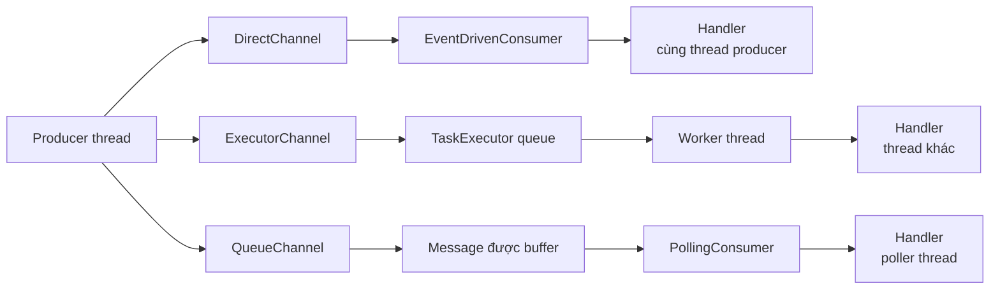
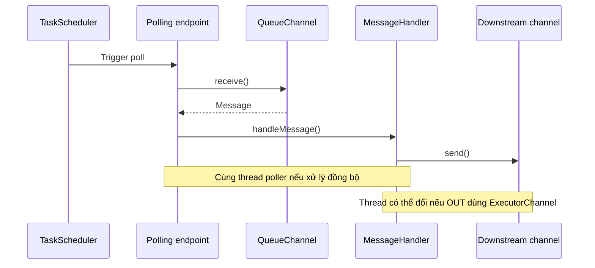
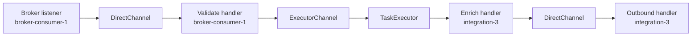
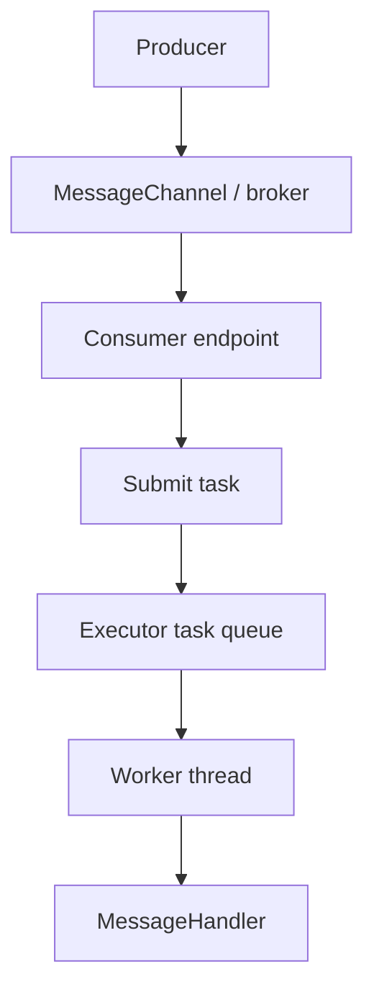

# Thread boundary giữa channel và endpoint

Trong Spring Integration, một message flow không nhất thiết chạy trên một thread từ đầu đến cuối. Thread xử lý message phụ thuộc vào nơi message được tạo, loại channel dùng để dispatch hoặc buffer, cách endpoint nhận message và các cơ chế chuyển giao công việc như poller hay executor.

Điểm quan trọng là `MessageChannel` không phải lúc nào cũng tạo thread mới. `DirectChannel` gọi consumer ngay trong thread gửi message; `ExecutorChannel` chuyển việc dispatch sang executor; `QueueChannel` giữ message để một polling consumer lấy ra sau. Một inbound adapter có thể nhận dữ liệu trên thread riêng của thư viện kết nối, còn một polling endpoint thường chạy công việc trong thread được poller kích hoạt.

Bài này lần theo thread qua producer, channel, endpoint và handler, đồng thời giải thích tác động đến transaction, exception, context thread-local, concurrency và hiệu năng.

## 1. Thread boundary là gì?

Thread boundary là điểm mà việc xử lý message chuyển từ thread hiện tại sang một thread khác hoặc được tách khỏi call stack hiện tại. Một flow có thể có nhiều boundary:

- Producer gọi `MessageChannel.send()`.
- Channel dispatch trực tiếp hoặc chuyển task sang executor.
- Poller được scheduler kích hoạt để nhận message.
- Inbound adapter nhận dữ liệu trên thread do transport quản lý.
- Một handler gọi executor hoặc API bất đồng bộ khác.
- Outbound adapter chuyển dữ liệu sang client có event loop hoặc thread riêng.

Sơ đồ dưới đây minh họa ba cách dispatch phổ biến:



Một message có thể đi qua nhiều channel và endpoint. Mỗi lần đi qua một channel đồng bộ, handler thường tiếp tục trên thread hiện tại. Khi đi qua channel hoặc endpoint có cơ chế bất đồng bộ, thread có thể thay đổi.

Không có quy tắc rằng mỗi endpoint tương ứng với một thread. Endpoint là thành phần kết nối message channel với handler hoặc source; thread phụ thuộc vào cơ chế dispatch/receive mà endpoint sử dụng.

## 2. Channel quyết định cách dispatch message

Interface `MessageChannel` chỉ mô tả thao tác gửi message. Hành vi thread cụ thể phụ thuộc implementation của channel.

| Channel | Cách dispatch | Thread xử lý thường gặp | Có buffer message? |
|---|---|---|---|
| `DirectChannel` | Gọi subscriber trực tiếp | Thread gọi `send()` | Không |
| `PublishSubscribeChannel` không executor | Gọi tất cả subscriber trong đường dispatch | Thread gọi `send()` | Không |
| `PublishSubscribeChannel` có executor | Gửi việc dispatch subscriber qua executor | Thread trong executor | Không phải backlog bền vững |
| `ExecutorChannel` | Dispatch qua `TaskExecutor` | Worker thread của executor | Executor có task queue riêng nếu được cấu hình |
| `QueueChannel` | Lưu message, consumer gọi `receive()` | Thread gọi `receive()`, thường là poller | Có; mặc định dùng queue trong bộ nhớ và có thể cấu hình implementation khác |
| `PriorityChannel` | Buffer và lấy theo priority | Thread gọi `receive()`, thường là poller | Có |

### 2.1. DirectChannel: đồng bộ trong thread gửi

`DirectChannel` là channel point-to-point, triển khai cơ chế subscribe/dispatch. Khi producer gọi `send()`, channel chọn một subscriber và gọi handler ngay trong call stack hiện tại.

```java
@Bean
public MessageChannel ordersIn() {
    return new DirectChannel();
}

@Bean
public IntegrationFlow orderFlow(OrderService orderService) {
    return IntegrationFlow.from("ordersIn")
            .handle(orderService, "process")
            .get();
}
```

Nếu producer gọi:

```java
log.info("before send: {}", Thread.currentThread().getName());
ordersIn.send(new GenericMessage<>(order));
log.info("after send: {}", Thread.currentThread().getName());
```

Handler thường log cùng tên thread với producer. Lời gọi `send()` thường chỉ trả về sau khi đường dispatch đồng bộ hoàn tất.

Điều này đem lại một số đặc điểm:

- Dễ lần theo call stack khi debug.
- Exception từ handler có thể truyền ngược về caller trong đường dispatch đồng bộ, tùy error handling.
- Nếu handler chậm, producer cũng bị chậm.
- Transaction thread-bound đang hoạt động ở caller có thể tiếp tục bao phủ các bước xử lý đồng bộ phía sau, nếu transaction manager và resource tương ứng hỗ trợ.

**Đồng bộ không đồng nghĩa với chỉ có một thread trong toàn hệ thống.** Hai producer khác nhau có thể đồng thời gọi `send()` trên cùng `DirectChannel`, khiến cùng một handler được gọi đồng thời trên hai thread. Nếu cần tuần tự hóa, phải thiết kế concurrency/serialization rõ ràng; chỉ dùng `DirectChannel` không bảo đảm handler chạy lần lượt trên một thread duy nhất.

Khi có nhiều subscriber, `DirectChannel` thường chọn một subscriber cho mỗi message theo load-balancing strategy. Nó không broadcast message đến tất cả subscriber; muốn broadcast, cân nhắc `PublishSubscribeChannel`.

### 2.2. ExecutorChannel: chuyển dispatch sang worker thread

`ExecutorChannel` vẫn là một `SubscribableChannel`, nhưng nó dùng `TaskExecutor` để dispatch message. Producer gửi message và executor lên lịch task gọi consumer.

```java
@Bean
public ThreadPoolTaskExecutor integrationExecutor() {
    ThreadPoolTaskExecutor executor = new ThreadPoolTaskExecutor();
    executor.setCorePoolSize(4);
    executor.setMaxPoolSize(8);
    executor.setQueueCapacity(200);
    executor.setThreadNamePrefix("integration-");
    return executor;
}

@Bean
public MessageChannel asyncOrders(
        @Qualifier("integrationExecutor") TaskExecutor executor) {
    return new ExecutorChannel(executor);
}

@Bean
public IntegrationFlow asyncOrderFlow(OrderService orderService) {
    return IntegrationFlow.from("asyncOrders")
            .handle(orderService, "process")
            .get();
}
```

Trong ví dụ này, handler chạy trên thread do `integrationExecutor` cấp. Producer không cần chờ handler hoàn tất; lời gọi `send()` thường kết thúc sau khi task được executor chấp nhận.

Có hai loại lỗi cần phân biệt:

- Executor từ chối task ngay lúc gửi, ví dụ queue đã đầy và rejection policy từ chối. Lỗi này có thể xuất hiện ngay trong lời gọi gửi.
- Handler ném exception sau khi task đã chạy trên worker thread. Đây là lỗi bất đồng bộ, không thể truyền ngược về call stack producer đã kết thúc; cần cấu hình error channel hoặc cơ chế xử lý lỗi của executor/endpoint.

Executor không tự làm message bền vững. Task queue của thread pool thường nằm trong bộ nhớ process và có thể mất khi process dừng.

### 2.3. PublishSubscribeChannel: broadcast không nhất thiết bất đồng bộ

`PublishSubscribeChannel` gửi cùng một message đến nhiều subscriber. Nếu không cấu hình executor, subscriber thường được gọi trong thread gửi message. Nếu cấu hình executor, việc dispatch có thể được chuyển sang thread pool.

Vì vậy, tên “publish-subscribe” mô tả mô hình phân phối một-nhiều, không tự nói lên thread boundary. Cần xem cấu hình executor của channel.

### 2.4. QueueChannel: buffer không tự tạo worker thread

`QueueChannel` lưu message để consumer nhận sau. Với cấu hình mặc định, queue nằm trong bộ nhớ; channel không tự khởi chạy một thread xử lý message. Thông thường, một `PollingConsumer` dùng poller để gọi `receive()`.

Producer có thể chạy trên thread A, đưa message vào queue rồi tiếp tục. Sau đó poller lấy message trên thread B và gọi handler. Thread boundary ở đây đến từ cơ chế polling, không phải do bản thân thao tác buffer tạo thread.

Nếu ứng dụng tự gọi `receive()` từ thread riêng, handler hoặc code nhận message chạy trên thread đó. Do đó, channel không quyết định một thread cố định cho `QueueChannel`.

## 3. Endpoint không tự động có một thread riêng

Endpoint là cầu nối giữa channel và message handler hoặc message source. Nó quản lý subscription, polling, lifecycle và cấu hình xử lý. Thread mà endpoint sử dụng phụ thuộc cách nó được kích hoạt.

| Endpoint / adapter | Cách nhận message | Thread thường thực hiện |
|---|---|---|
| `EventDrivenConsumer` trên `DirectChannel` | Channel gọi subscriber | Thread gửi message |
| `EventDrivenConsumer` trên `ExecutorChannel` | Executor dispatch subscriber | Worker thread |
| `PollingConsumer` trên `QueueChannel` | Poller gọi `receive()` | Thread chạy poller task |
| `SourcePollingChannelAdapter` | Poller gọi `MessageSource.receive()` | Thread chạy poller task |
| Inbound listener adapter | Transport/listener nhận dữ liệu rồi gửi message vào flow | Thread do listener container hoặc client quản lý |
| Outbound adapter | Handler gọi client gửi dữ liệu | Thread hiện tại, trừ khi client/adapter chuyển sang cơ chế bất đồng bộ |

Ví dụ, một inbound adapter của broker có thể được listener container gọi trên consumer thread. Nếu adapter gửi vào `DirectChannel`, handler downstream thường tiếp tục trên consumer thread đó. Nếu gửi vào `ExecutorChannel`, handler chuyển sang executor thread.

Do đó, khi xem thread dump, cần xác định nguồn thread: broker listener, scheduler, executor hay thread request của ứng dụng.

## 4. Poller tạo thread boundary như thế nào?

Poller định kỳ kích hoạt việc đọc message. Với polling consumer, poller gọi `receive()` trên `PollableChannel`; với source polling adapter, poller gọi `MessageSource.receive()`.



Thông thường, scheduler kích hoạt poller task. Nếu cấu hình task executor cho poller, công việc polling có thể được thực hiện bởi executor. Ví dụ Java DSL:

```java
@Bean
public IntegrationFlow queuedOrders(
        OrderService orderService,
        @Qualifier("pollerExecutor") TaskExecutor pollerExecutor) {

    return IntegrationFlow.from(
                    "ordersQueue",
                    endpoint -> endpoint.poller(
                            Pollers.fixedDelay(500)
                                    .maxMessagesPerPoll(10)
                                    .taskExecutor(pollerExecutor)))
            .handle(orderService, "process")
            .get();
}
```

Cần phân biệt:

- `TaskScheduler` quản lý thời điểm kích hoạt poll.
- `TaskExecutor` có thể thực thi công việc poll trên thread pool.
- `PollingConsumer` thực hiện receive và gọi handler.
- `QueueChannel` giữ message giữa producer và consumer.

Nếu poller xử lý message đồng bộ, handler thường chạy trên thread thực hiện poller task. Nếu flow gửi tiếp qua `ExecutorChannel`, thread sẽ đổi tại điểm dispatch đó.

## 5. Một flow có thể đổi thread nhiều lần

Ví dụ một flow có inbound listener, direct channel, executor channel rồi outbound adapter:



Thread trace có thể như sau:

| Bước | Thành phần | Thread ví dụ |
|---|---|---|
| 1 | Broker listener nhận message | `broker-consumer-1` |
| 2 | Inbound adapter gửi vào DirectChannel | `broker-consumer-1` |
| 3 | Validate handler | `broker-consumer-1` |
| 4 | ExecutorChannel submit task | Chuyển giao từ `broker-consumer-1` |
| 5 | Enrich handler | `integration-3` |
| 6 | DirectChannel downstream | `integration-3` |
| 7 | Outbound handler đồng bộ | `integration-3` |

Tên thread ở đây chỉ là ví dụ. Cấu hình executor, adapter và container sẽ quyết định tên thực tế.

Một nguyên tắc debug hiệu quả là tìm **điểm chuyển thread đầu tiên**. Nếu handler đầu tiên chạy đúng thread nhưng handler tiếp theo chạy trên thread khác, hãy kiểm tra channel hoặc endpoint nằm giữa hai handler.

## 6. Thread boundary ảnh hưởng transaction và context như thế nào?

### 6.1. Transaction gắn với thread

Spring transaction thông thường gắn với thread hiện tại thông qua transaction synchronization/resource binding. Khi message đi qua các bước đồng bộ trên cùng thread, các bước đó có thể tham gia transaction đang hoạt động nếu được cấu hình đúng.

Khi message chuyển qua `ExecutorChannel` hoặc executor khác, worker thread không tự kế thừa transaction của producer. Nếu downstream cần transaction, hãy mở transaction tại endpoint/handler downstream hoặc dùng transaction support phù hợp với transport.

| Đường xử lý | Hệ quả transaction thường gặp |
|---|---|
| Producer → DirectChannel → handler | Có thể cùng transaction thread-bound |
| Producer → ExecutorChannel → handler | Transaction của producer không tự truyền sang worker |
| Poller → handler đồng bộ | Poller transaction advice có thể bao phủ lượt xử lý nếu được cấu hình |
| Listener container → DirectChannel → handler | Có thể tham gia transaction của listener thread nếu adapter/transport hỗ trợ |
| Listener → ExecutorChannel → handler | Transaction của listener không tự truyền sang executor thread |

Không nên suy luận rằng mọi message flow đều transactional chỉ vì producer hoặc handler có annotation `@Transactional`. Phải xác định transaction bắt đầu ở đâu, thread nào thực hiện, resource nào được enlist và nơi commit/rollback diễn ra.

### 6.2. ThreadLocal không tự đi theo message

Các dữ liệu sau thường gắn với thread hoặc execution context:

- Transaction resources và transaction synchronization.
- MDC logging context.
- Security context nếu dùng cơ chế lưu theo thread.
- Request context và một số context của tracing.
- Các biến `ThreadLocal` do ứng dụng tự tạo.

Khi chuyển sang executor thread, các giá trị này không tự động được sao chép. Message headers vẫn được truyền cùng message, nhưng chúng không đồng nghĩa với việc ThreadLocal được truyền.

Nếu cần truyền context:

- Dùng message headers cho correlation ID, tenant ID hoặc metadata nghiệp vụ.
- Dùng `TaskDecorator` hoặc wrapper executor để capture/restore MDC hoặc context phù hợp.
- Dùng integration dành riêng cho security/tracing khi thư viện cung cấp.
- Luôn khôi phục hoặc xóa context trong `finally` để tránh rò dữ liệu giữa các task tái sử dụng cùng worker thread.

Không nên đưa đối tượng transaction hoặc toàn bộ request context vào message header để cố truyền transaction qua thread. Hãy thiết kế transaction boundary mới tại nơi xử lý.

## 7. Exception và error channel qua ranh giới thread

Với đường dispatch đồng bộ, exception của handler có thể đi ngược theo call stack và được producer nhìn thấy. Error handling interceptor hoặc error channel có thể thay đổi cách lỗi được xử lý.

Với đường dispatch bất đồng bộ, producer có thể đã kết thúc trước khi handler ném exception. Lỗi cần được xử lý ở phía worker, thường qua error channel được cấu hình hoặc cơ chế error handling của endpoint/executor.

| Tình huống | Nơi exception xuất hiện | Cần quan sát |
|---|---|---|
| Handler lỗi qua DirectChannel | Call stack của producer hoặc error flow đồng bộ | Kết quả `send()`, log handler, error channel |
| Executor từ chối task | Thread producer lúc submit | Rejection policy, executor queue và log send |
| Handler lỗi sau khi ExecutorChannel dispatch | Worker thread | Error channel, async error handler, log worker |
| Polling handler lỗi | Thread thực hiện poller task | Poller advice, error handler, error channel |
| Inbound listener lỗi trước khi publish | Thread listener/container | Error handler và acknowledgment/redelivery của transport |

Khi dùng executor, đừng chỉ bắt exception quanh lời gọi `send()` rồi cho rằng đã bắt được mọi lỗi downstream. Lời gọi send có thể thành công trong khi handler thất bại sau đó.

## 8. Concurrency không đồng nghĩa với thread boundary

Một thread boundary tạo khả năng chuyển việc sang thread khác, nhưng không tự nói có bao nhiêu message được xử lý đồng thời. Concurrency còn phụ thuộc:

- Số producer thread gửi message.
- Số subscriber và load-balancing strategy.
- Số thread trong executor.
- Capacity của task queue.
- Số poller/consumer đang hoạt động.
- Concurrency của listener container.
- Thời gian xử lý và giới hạn downstream.

Ví dụ, một `DirectChannel` không có executor vẫn có thể gọi cùng handler đồng thời nếu nhiều producer thread gửi message cùng lúc. Ngược lại, một `ExecutorChannel` dùng single-thread executor có thể chuyển thread nhưng xử lý tuần tự trên một worker.

| Cấu hình | Thread boundary | Concurrency có thể xảy ra |
|---|---|---|
| DirectChannel, một producer thread | Không | Thường tuần tự trên thread đó |
| DirectChannel, nhiều producer thread | Không tại channel | Có thể đồng thời do nhiều sender |
| ExecutorChannel, pool 8 worker | Có | Có thể xử lý đồng thời đến năng lực pool |
| ExecutorChannel, single-thread executor | Có | Worker xử lý tuần tự |
| QueueChannel, một polling consumer | Tách producer/consumer bằng buffer | Thường một lượt consumer tại một thời điểm |
| QueueChannel, nhiều polling endpoint/consumer | Có thể có nhiều consumer | Có thể cạnh tranh lấy message và xử lý đồng thời |

Nếu nghiệp vụ yêu cầu thứ tự theo key, chẳng hạn mọi message của cùng một order phải xử lý lần lượt, cần partition theo key, serialize theo key hoặc dùng broker/consumer strategy có ordering phù hợp. Không thể chỉ dựa vào việc chọn DirectChannel hoặc QueueChannel để đảm bảo thứ tự toàn cục.

## 9. Executor queue và message queue là hai lớp khác nhau

Khi dùng `ExecutorChannel`, có thể tồn tại queue nội bộ của thread pool. Queue đó chứa task chờ worker thread. Message queue như `QueueChannel` hoặc broker queue chứa message chờ consumer.



Hai queue có mục đích và cách vận hành khác nhau:

| Đặc điểm | Message queue | Executor task queue |
|---|---|---|
| Lưu gì? | Message/work item | Runnable/task chờ thread |
| Consumer | Message endpoint/worker | Thread pool worker |
| Ack/redelivery | Có thể có theo broker | Không có semantics message ack chuẩn |
| Persistence | Broker có thể lưu bền vững; QueueChannel thường ở memory | Thường chỉ ở memory |
| Metrics | Message depth, age, redelivery | Task queue size, active threads, rejected tasks |
| Khi đầy | Producer send có thể block/reject | Executor áp dụng rejection policy |

Một message có thể đã rời message queue nhưng task xử lý nó vẫn đang chờ trong executor queue. Khi quan sát backlog, phải xem cả hai lớp để tránh kết luận sai rằng consumer đã xử lý xong chỉ vì queue message giảm.

## 10. Cấu hình executor an toàn

Thread pool cần được thiết kế theo thời gian xử lý, loại workload và giới hạn tài nguyên. Một executor có queue vô hạn có thể che giấu tình trạng consumer không theo kịp trong thời gian dài và làm bộ nhớ tăng.

Ví dụ cấu hình bounded pool:

```java
@Bean
public ThreadPoolTaskExecutor integrationExecutor() {
    ThreadPoolTaskExecutor executor = new ThreadPoolTaskExecutor();
    executor.setCorePoolSize(4);
    executor.setMaxPoolSize(8);
    executor.setQueueCapacity(200);
    executor.setKeepAliveSeconds(60);
    executor.setThreadNamePrefix("integration-");
    executor.setRejectedExecutionHandler(
            new ThreadPoolExecutor.CallerRunsPolicy());
    return executor;
}
```

`CallerRunsPolicy` khiến thread gọi submit tự chạy task khi executor quá tải. Đây là một cách tạo backpressure, nhưng nó làm thay đổi hành vi thread: message vốn dự kiến chạy trên worker có thể chạy trên producer thread khi pool đầy. Cần cân nhắc tác động đến latency, transaction và request thread.

Một số nguyên tắc:

- Đặt queue capacity hữu hạn nếu cần giới hạn backlog task.
- Chọn core/max pool theo CPU, I/O và thời gian xử lý thực tế.
- Dùng thread name prefix để phân biệt executor trong log và thread dump.
- Xác định rejection policy và cách xử lý khi task bị từ chối.
- Không dùng chung một pool cho mọi loại công việc nếu workload có thể chặn lẫn nhau.
- Theo dõi active count, pool size, queue size, task duration và rejected count.
- Đóng executor đúng lifecycle; tránh tạo executor mới cho từng message.

## 11. Quan sát thread boundary trong thực tế

Cách đơn giản nhất là log tên thread ở producer, handler và các điểm quan trọng trong flow:

```java
private void logThread(String step, Message<?> message) {
    log.info(
            "step={}, thread={}, messageId={}",
            step,
            Thread.currentThread().getName(),
            message.getHeaders().getId());
}
```

Gọi hàm này ở:

- Trước và sau `MessageChannel.send()`.
- Handler trước khi xử lý.
- Handler sau khi gọi service downstream.
- Callback từ inbound adapter.
- Scheduled/polling task.
- Điểm trước và sau khi chuyển qua executor.

Khi xem thread dump, phân nhóm theo tên thread prefix như `http-nio`, `task-scheduler`, `integration-`, `broker-`. Kiểm tra thread nào đang block I/O, thread nào chờ queue, thread nào xử lý handler lâu và thread nào bị giữ bởi lock.

### 11.1. Các triệu chứng thường gặp

| Triệu chứng | Điểm cần kiểm tra | Nguyên nhân có thể |
|---|---|---|
| Producer API chậm khi gửi message | DirectChannel và handler downstream | Handler chạy đồng bộ trong request thread |
| Handler chạy trên thread khác | ExecutorChannel, poller executor, listener container | Có asynchronous handoff |
| Transaction không còn active ở handler | Thread boundary trước handler | Transaction thread-bound không được truyền qua executor |
| MDC/correlation log bị mất | Executor và context propagation | ThreadLocal không được copy |
| Queue message giảm nhưng xử lý vẫn chậm | Executor task queue | Message đã được lấy nhưng task vẫn chờ worker |
| CPU thấp nhưng latency cao | Thread dump, I/O, lock, queue wait | Worker bị block hoặc pool thiếu thread phù hợp |
| Handler chạy song song ngoài dự kiến | Số producer, executor pool, consumer concurrency | Có nhiều thread gọi cùng handler |
| Task bị từ chối | Executor queue capacity và rejection policy | Pool đã hết khả năng nhận task |
| Thứ tự message thay đổi | Executor concurrency, multi-producer, channel dispatch | Nhiều task chạy đồng thời |

### 11.2. Quy trình tìm điểm đổi thread

1. Ghi tên thread ở producer ngay trước khi gửi message.
2. Ghi tên thread ở handler đầu tiên.
3. Nếu khác nhau, kiểm tra inbound adapter, listener container, poller hoặc channel đầu vào.
4. Ghi thread ở từng handler kế tiếp để xác định boundary đầu tiên làm đổi thread.
5. Kiểm tra channel implementation tại boundary đó.
6. Nếu có executor, kiểm tra pool size, queue, rejection policy và thread name prefix.
7. Nếu có poller, kiểm tra scheduler, task executor và thời gian thực hiện từng lượt.
8. Đối chiếu transaction, MDC và error handling tại cùng boundary.

## 12. Ví dụ tổng hợp: cùng flow, hai thread model

Cùng một handler có thể chạy đồng bộ hoặc bất đồng bộ chỉ bằng cách đổi channel:

```java
@Bean
public MessageChannel syncOrders() {
    return new DirectChannel();
}

@Bean
public MessageChannel asyncOrders(
        @Qualifier("integrationExecutor") TaskExecutor executor) {
    return new ExecutorChannel(executor);
}

@Bean
public IntegrationFlow syncFlow(OrderService service) {
    return IntegrationFlow.from("syncOrders")
            .handle(service, "process")
            .get();
}

@Bean
public IntegrationFlow asyncFlow(OrderService service) {
    return IntegrationFlow.from("asyncOrders")
            .handle(service, "process")
            .get();
}
```

Nếu producer gọi hai channel từ cùng thread:

- `syncOrders`: handler chạy trong thread producer; producer thường chờ xử lý xong.
- `asyncOrders`: handler chạy trên executor worker; producer chỉ chờ việc dispatch được chấp nhận.

Sự khác biệt này ảnh hưởng đến thời gian trả về của producer, transaction, exception propagation, context propagation và thứ tự xử lý. Khi thay channel trong một flow đang chạy, cần xem lại các thuộc tính đó thay vì chỉ đo throughput.

## 13. Ghi nhớ

- Channel không mặc định tạo thread mới; implementation quyết định cách dispatch.
- `DirectChannel` thường gọi handler đồng bộ trong thread gửi message.
- `ExecutorChannel` chuyển dispatch sang `TaskExecutor`.
- `PublishSubscribeChannel` broadcast; executor quyết định có chuyển thread hay không.
- `QueueChannel` buffer message; polling consumer nhận message trên thread chạy poller task.
- Inbound adapter có thể chạy trên thread của listener container hoặc client transport.
- Một flow có thể đổi thread nhiều lần; tìm boundary đầu tiên để debug.
- Transaction và ThreadLocal không tự truyền qua executor; message headers vẫn đi theo message.
- Đồng bộ không bảo đảm tuần tự toàn hệ thống: nhiều producer thread có thể đồng thời gọi cùng handler.
- Phân biệt message queue với executor task queue khi đo backlog.
- Bounded executor, rejection policy và metrics là cần thiết để kiểm soát tải.
- Dùng thread name, log và thread dump để quan sát thread thực tế thay vì suy luận chỉ từ sơ đồ flow.

## Tài liệu tham khảo

- [Spring Integration — Message Channels](https://docs.spring.io/spring-integration/reference/channel.html)
- [Spring Integration — Message Endpoints](https://docs.spring.io/spring-integration/reference/endpoint.html)
- [Spring Integration — Polling Consumer](https://docs.spring.io/spring-integration/reference/polling-consumer.html)
- [Spring Integration — Executor Channel](https://docs.spring.io/spring-integration/reference/channel.html#channel-implementations-executorchannel)
- [Spring Framework — Task Execution and Scheduling](https://docs.spring.io/spring-framework/reference/integration/scheduling.html)
- [Spring Framework — Transaction Management](https://docs.spring.io/spring-framework/reference/data-access/transaction.html)

