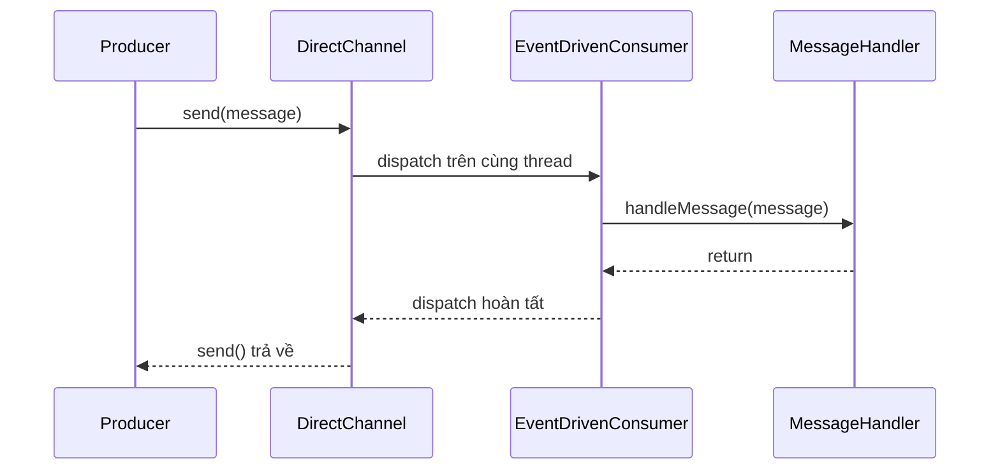
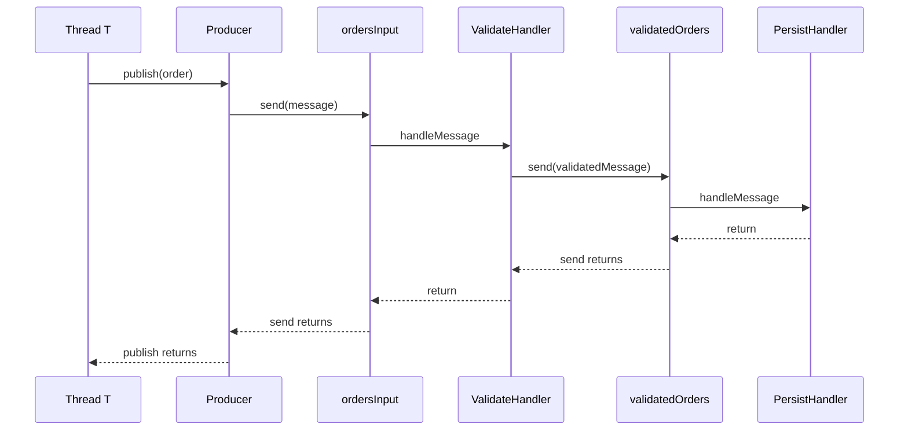
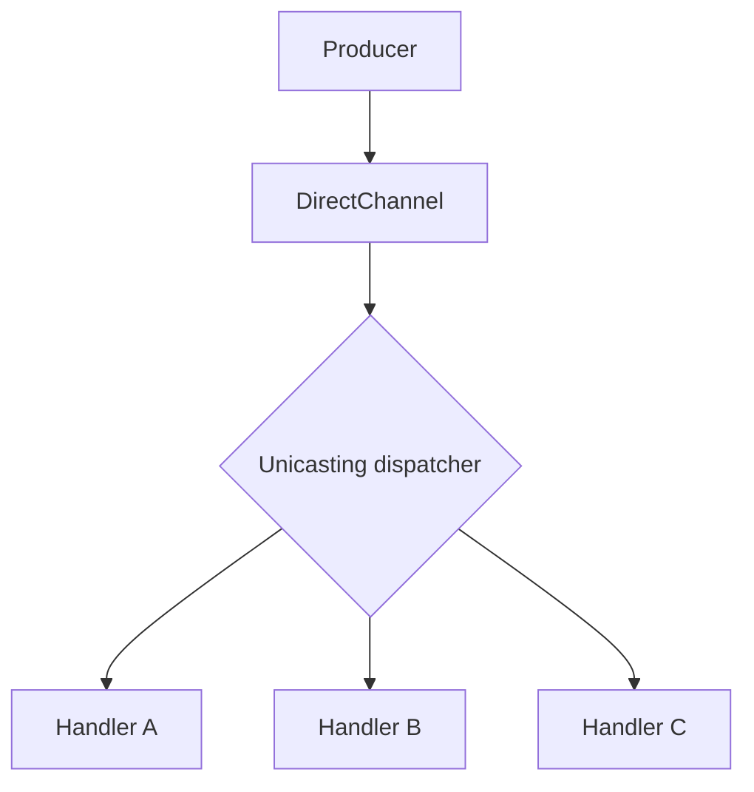
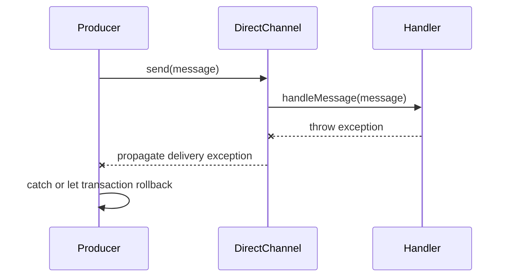

# Đồng bộ trong DirectChannel

Trong Spring Integration, `DirectChannel` là channel dạng point-to-point, dispatch message trực tiếp đến một consumer đã đăng ký. Với cấu hình thông thường, handler được gọi ngay trên thread đang gửi message. Lệnh `send()` vì thế nằm trong cùng call stack với phần xử lý phía sau và chỉ hoàn tất sau khi quá trình dispatch đồng bộ kết thúc.

Cơ chế này làm cho luồng xử lý dễ theo dõi: producer gọi channel, channel gọi endpoint, endpoint gọi handler, rồi quyền điều khiển quay trở lại producer. Đổi lại, thời gian xử lý của handler tác động trực tiếp đến thời gian chờ của thread gửi. Đây là đặc tính quan trọng khi thiết kế transaction, xử lý lỗi và hiệu năng của runtime.

## 1. DirectChannel là gì?

`DirectChannel` triển khai `SubscribableChannel`. Producer gửi message bằng `send()`; consumer đăng ký subscription với channel; channel dispatch message đến một subscriber được chọn.

Các đặc điểm chính:

- **Point-to-point dispatch**: một lần gửi thông thường được chuyển đến một consumer được chọn, không broadcast đến mọi subscriber.
- **Không có queue lưu message**: channel không giữ message để consumer lấy sau như `QueueChannel`.
- **Đồng bộ theo mặc định**: handler được gọi trong thread gửi message.
- **Có thể có nhiều subscriber**: dispatcher chọn một subscriber theo load-balancing strategy được cấu hình.
- **Có thể cấu hình failover**: nếu handler được chọn thất bại, dispatcher có thể thử subscriber khác tùy cấu hình.

```mermaid
flowchart LR
    A[Producer thread] -->|send(message)| B[DirectChannel]
    B --> C[EventDrivenConsumer]
    C --> D[MessageHandler]
    D -->|return or exception| C
    C --> B
    B -->|send returns or throws| A
```

Điểm cốt lõi là channel dispatch trực tiếp. Không có bước enqueue để một worker khác nhận message sau đó. Nếu handler mất 300 ms, thread gọi `send()` cũng bị giữ trong khoảng thời gian xử lý đó.

## 2. DirectChannel phối hợp với EventDrivenConsumer

`DirectChannel` là nơi nhận và dispatch message. `EventDrivenConsumer` là endpoint kết nối channel với `MessageHandler`.

Khi endpoint khởi động, nó đăng ký handler với channel. Khi endpoint dừng, nó hủy đăng ký. Vì vậy, channel và endpoint có trách nhiệm khác nhau:

| Thành phần | Trách nhiệm |
|---|---|
| `DirectChannel` | Nhận message và dispatch đến subscriber |
| `EventDrivenConsumer` | Quản lý subscription của handler theo lifecycle |
| `MessageHandler` | Thực hiện logic xử lý message |
| Producer | Tạo message và gọi `send()` |

Với một endpoint đang chạy, đường đi cơ bản là:



Không cần poller cho endpoint này. Channel chủ động dispatch message khi producer gửi. Đây là điểm khác biệt với `PollingConsumer`, nơi một poller gọi `receive()` trên `PollableChannel`.

## 3. Một flow đồng bộ từ đầu đến cuối

Ví dụ khai báo channel và flow xử lý đơn hàng:

```java
@Configuration
@EnableIntegration
public class OrderIntegrationConfiguration {

    @Bean
    DirectChannel ordersInput() {
        return new DirectChannel();
    }

    @Bean
    IntegrationFlow orderFlow(OrderService orderService) {
        return IntegrationFlow.from("ordersInput")
                .handle(orderService, "process")
                .get();
    }

}
```

Producer gửi message vào channel:

```java
@Service
public class OrderPublisher {

    private final MessageChannel ordersInput;

    public OrderPublisher(
            @Qualifier("ordersInput") MessageChannel ordersInput) {
        this.ordersInput = ordersInput;
    }

    public void publish(Order order) {
        Message<Order> message =
                MessageBuilder.withPayload(order).build();

        this.ordersInput.send(message);
    }

}
```

Trong ví dụ này, `publish()` gọi `send()`; `DirectChannel` dispatch đến endpoint; endpoint gọi `OrderService.process(...)`. Nếu handler hoàn tất bình thường, `send()` trả quyền điều khiển về `publish()`. Nếu handler ném exception và không có cơ chế xử lý giữ lại lỗi, exception có thể truyền ngược qua chuỗi gọi đồng bộ.

Không có worker pool nào được thêm vào chỉ vì ứng dụng dùng Spring Integration. Nếu `publish()` chạy trên request thread của web server, handler cũng thường chạy trên request thread đó. Nếu producer gọi từ một worker thread, handler tiếp tục trên worker thread đó.

## 4. Một call stack, một thread

Khi dùng `DirectChannel`, các bước đồng bộ trong flow được thực thi lồng nhau trên cùng thread. Ví dụ:



Nếu cả `ordersInput` và `validatedOrders` đều là `DirectChannel`, lời gọi handler thứ hai diễn ra trước khi handler thứ nhất kết thúc. Call stack có thể được đọc từ trên xuống và exception có thể đi ngược qua các frame.

Đặc tính này có lợi khi muốn xử lý tuần tự và giữ transaction/context của thread. Nhưng flow càng dài thì thời gian giữ thread càng lâu. Một handler gọi dịch vụ từ xa hoặc truy vấn database chậm sẽ kéo dài toàn bộ lời gọi từ producer.

## 5. DirectChannel là point-to-point, không phải broadcast

Một `DirectChannel` có thể có nhiều subscriber. Dispatcher chọn một subscriber để xử lý một message theo chiến lược load balancing. Nó không gửi bản sao message đến tất cả subscriber.

Ví dụ có ba handler đăng ký cùng một channel:



Tùy chiến lược dispatcher, các message có thể được phân phối giữa các handler. Nếu cần tất cả subscriber đều nhận cùng một message, dùng `PublishSubscribeChannel` hoặc biểu diễn các nhánh broadcast trong flow.

Cần phân biệt ba khái niệm:

- **Unicast**: mỗi message được gửi đến một subscriber được chọn.
- **Publish-subscribe**: một message được phát đến nhiều subscriber.
- **Load balancing**: nhiều subscriber chia nhau xử lý các message khác nhau.

Với nhiều subscriber, hãy kiểm tra load-balancing strategy và failover setting thay vì giả định một thứ tự cố định. Nếu nhiều producer thread gửi đồng thời, các handler có thể được gọi đồng thời dù channel là `DirectChannel`.

## 6. DirectChannel không tạo queue và không tự giới hạn concurrency

Vì channel dispatch trực tiếp, message không được xếp vào queue của channel để chờ consumer. Điều này có hai hệ quả:

1. Khi handler chậm, producer bị giữ trong lời gọi `send()`.
2. Khi có nhiều producer thread, mỗi thread có thể thực hiện dispatch đồng thời; channel không tự biến toàn bộ hệ thống thành một consumer tuần tự.

Ví dụ, một web server nhận 50 request đồng thời và mỗi request gửi vào cùng một `DirectChannel`. Nếu handler thực hiện I/O blocking, nhiều request thread có thể cùng bị giữ. Channel không tạo queue riêng để làm dịu đợt tải đó.

Đây có thể là dạng coupling có ích: tốc độ producer gắn trực tiếp với tốc độ xử lý trong call stack. Nhưng nó không phải một giao thức backpressure xuyên suốt và không thay thế giới hạn concurrency của web server, connection pool hoặc downstream.

Nếu cần buffer, dùng channel có semantics lưu trữ như `QueueChannel` hoặc một broker phù hợp. Nếu cần chuyển việc xử lý sang worker thread, đặt async boundary có chủ đích, ví dụ `ExecutorChannel`.

## 7. Transaction khi dùng DirectChannel

Transaction imperative của Spring thường gắn với thread. Vì handler của `DirectChannel` chạy trên thread gửi, transaction đang hoạt động trên thread đó có thể tiếp tục qua các bước đồng bộ.

Ví dụ producer mở transaction và gửi message:

```java
@Service
public class OrderApplicationService {

    private final MessageChannel ordersInput;

    public OrderApplicationService(
            @Qualifier("ordersInput") MessageChannel ordersInput) {
        this.ordersInput = ordersInput;
    }

    @Transactional
    public void accept(Order order) {
        // Các thao tác database trong transaction hiện tại.
        this.ordersInput.send(
                MessageBuilder.withPayload(order).build());
    }

}
```

Nếu handler gọi một service khác có `@Transactional` với propagation mặc định `REQUIRED` và dùng cùng transaction manager, lời gọi đó có thể tham gia transaction hiện tại vì nó chạy trên cùng thread. Nếu handler thất bại và exception làm transaction rollback theo rule, transaction bên ngoài có thể rollback.

Cần nhớ:

- `DirectChannel` không tự mở transaction.
- Transaction phải được mở bởi `@Transactional`, transaction advice hoặc cơ chế tương ứng.
- Transaction chỉ bao trùm những thao tác thực sự nằm trong boundary.
- Nếu handler bắt exception và không ném lại, transaction interceptor bên ngoài có thể không thấy lỗi để rollback.
- Các transaction manager khác nhau hoặc propagation khác nhau có thể tạo boundary riêng.

Với `ExecutorChannel`, handler chạy trên worker thread khác nên transaction của producer không tự truyền sang. DirectChannel giữ được thread affinity trong đoạn đồng bộ, nhưng không bảo đảm mọi thành phần ngoài thread đó cùng nằm trong một transaction.

## 8. ThreadLocal và context trong lời gọi đồng bộ

Vì handler chạy trên cùng thread, các context gắn với thread thường vẫn khả dụng trong suốt call stack:

- Transaction context imperative của Spring.
- MDC logging.
- SecurityContext nếu ứng dụng đang dùng cơ chế lưu theo thread.
- Tenant hoặc request context do ứng dụng quản lý bằng ThreadLocal.

Không cần copy các giá trị này qua executor vì không có ranh giới thread trong đoạn DirectChannel đồng bộ. Tuy nhiên, điều đó không có nghĩa nên lưu state nghiệp vụ trong ThreadLocal. Message headers vẫn là nơi phù hợp để mang message ID, correlation ID, reply channel và metadata cần đi cùng message.

Nếu flow sau đó đi qua `ExecutorChannel`, hoặc handler tự submit công việc sang executor, các ThreadLocal không tự động truyền sang thread mới. Khi ấy cần cơ chế context propagation tương ứng.

Cũng cần bảo đảm context được dọn đúng ở ranh giới request. Servlet container hoặc thread pool tái sử dụng thread; một ThreadLocal không được clear có thể làm context của request trước rò sang request sau.

## 9. Exception truyền ngược qua call stack

Trong flow đồng bộ, exception từ handler có thể quay lại nơi gọi `send()`. Spring Integration có thể bọc exception bằng các loại `MessagingException` phù hợp, kèm thông tin message hoặc endpoint tùy điểm phát sinh.



Ví dụ xử lý lỗi ở application service:

```java
public void publish(Order order) {
    Message<Order> message =
            MessageBuilder.withPayload(order).build();

    try {
        ordersInput.send(message);
    }
    catch (MessagingException ex) {
        log.error("Cannot process order message", ex);
        throw ex;
    }
}
```

Nếu producer bắt exception rồi tiếp tục như không có lỗi, transaction bên ngoài có thể commit tùy rule rollback. Hãy quyết định rõ lỗi nào cần ném lại, lỗi nào được chuyển thành kết quả nghiệp vụ và lỗi nào cần đưa vào error flow.

### Failover khi có nhiều subscriber

Với nhiều subscriber, dispatcher có thể được cấu hình để thử subscriber khác khi handler được chọn thất bại. Khi bật failover, một exception không nhất thiết quay về producer ngay sau lần gọi đầu tiên. Hành vi cụ thể phụ thuộc dispatcher và load-balancing/failover configuration.

Điều này có ý nghĩa với side effect: nếu handler đầu tiên đã ghi dữ liệu rồi mới ném exception, việc thử handler khác có thể dẫn đến xử lý lặp. Hãy dùng idempotency và chỉ bật failover khi semantics nghiệp vụ cho phép.

### Error channel có tự nhận mọi exception không?

Không nên giả định mọi exception trong DirectChannel đều tự động trở thành message trên `errorChannel`. Trong xử lý đồng bộ, lỗi thường có thể truyền ngược qua call stack. Error channel được sử dụng khi có cơ chế endpoint, gateway, error handler hoặc cấu hình tương ứng chuyển exception thành error message.

Khi điều tra lỗi, hãy xác định exception được ném tại handler, được endpoint bắt, được gateway chuyển đổi hay được gửi đến error channel. Việc có bean tên `errorChannel` không có nghĩa mọi lỗi trong ứng dụng đều tự động được route đến đó.

## 10. ChannelInterceptor trong luồng đồng bộ

`ChannelInterceptor` cho phép quan sát hoặc can thiệp vào quá trình gửi message tại ranh giới channel. Các hook thường dùng gồm:

- `preSend()`: chạy trước khi channel dispatch message; có thể trả message đã biến đổi hoặc từ chối gửi.
- `postSend()`: chạy sau thao tác gửi/dispatch và nhận thông tin kết quả gửi.
- `afterSendCompletion()`: được gọi khi quá trình gửi hoàn tất, kể cả khi có exception, để cleanup hoặc ghi nhận kết quả.
- `preReceive()` và `postReceive()`: liên quan đến thao tác nhận trên pollable channel, không phải đường dispatch thông thường của DirectChannel.

Với DirectChannel đồng bộ, interceptor nằm trong cùng lời gọi gửi nên thời gian chạy interceptor cũng ảnh hưởng latency của producer. Không nên thực hiện truy vấn từ xa hoặc công việc nặng trong `preSend()` hay `postSend()`.

Ví dụ interceptor chỉ ghi nhận metadata:

```java
public class MessageAuditInterceptor implements ChannelInterceptor {

    private static final Logger log =
            LoggerFactory.getLogger(MessageAuditInterceptor.class);

    @Override
    public Message<?> preSend(
            Message<?> message, MessageChannel channel) {

        log.debug("channel={}, messageId={}",
                channel,
                message.getHeaders().getId());

        return message;
    }

}
```

Đăng ký interceptor với channel phù hợp:

```java
@Bean
DirectChannel ordersInput() {
    DirectChannel channel = new DirectChannel();
    channel.addInterceptor(new MessageAuditInterceptor());
    return channel;
}
```

Trong ứng dụng thực tế, có thể đăng ký interceptor như bean và quản lý dependency theo Spring. Tránh ghi payload nhạy cảm vào log; message ID, correlation ID và component name thường hữu ích hơn.

## 11. Gateway và request-reply đồng bộ

Khi ứng dụng gọi một integration flow qua messaging gateway, lời gọi gateway có thể hoạt động theo mô hình request-reply. Nếu các channel và endpoint trên đường đi đều đồng bộ, thread gọi gateway tiếp tục thực thi cho đến khi có reply hoặc timeout.

Điều này giúp code ứng dụng dùng flow như một lời gọi service:

```java
@MessagingGateway
public interface OrderGateway {

    @Gateway(requestChannel = "ordersInput",
             replyTimeout = 3000)
    OrderResult process(Order order);

}
```

Gateway có thể chuyển request thành message, gửi vào request channel và chờ reply theo cấu hình. Nếu handler xử lý đồng bộ, thời gian xử lý nằm trong thời gian gọi gateway. Nếu flow có async boundary, reply có thể đến sau trên một thread khác; gateway cần cơ chế correlation/reply phù hợp và có thể timeout trước khi kết quả về.

Không nên tăng timeout chỉ để che giấu handler chậm. Hãy đo latency từng bước, xác định downstream đang block ở đâu và quyết định liệu lời gọi đồng bộ có phù hợp với yêu cầu ứng dụng hay không.

## 12. Lifecycle của endpoint trên DirectChannel

Endpoint tiêu thụ một DirectChannel thường là `EventDrivenConsumer`. Khi endpoint start, handler được subscribe; khi endpoint stop, subscription được gỡ.

Các thuộc tính lifecycle cần quan tâm:

| Thuộc tính | Ý nghĩa |
|---|---|
| `autoStartup` | Có tự động start endpoint khi context khởi động không |
| `phase` | Thứ tự start/stop giữa các thành phần SmartLifecycle |
| `isRunning()` | Trạng thái lifecycle của endpoint |
| `start()` | Đăng ký handler và bắt đầu nhận dispatch |
| `stop()` | Gỡ subscription để không nhận dispatch mới |

Bean channel có thể vẫn tồn tại khi endpoint dừng. Producer gửi vào channel lúc không có subscriber sẽ chịu hành vi theo cấu hình channel/dispatcher, chẳng hạn send không thành công hoặc phát sinh lỗi khi yêu cầu subscriber. Vì vậy, cần kiểm tra cả trạng thái endpoint và channel thay vì chỉ kiểm tra bean channel có tồn tại.

Stop endpoint cũng không đồng nghĩa với việc hủy một handler đang chạy giữa chừng. Nếu dispatch đã bắt đầu trên thread gửi, thao tác stop cần được phối hợp với quá trình đang thực thi và ingress nếu ứng dụng cần graceful shutdown.

## 13. Thứ tự xử lý và concurrency

Với một producer thread gửi lần lượt nhiều message qua một DirectChannel có một subscriber, lời gọi handler diễn ra tuần tự trên thread đó: message tiếp theo chỉ được gửi sau khi lần xử lý trước trả về.

Tuy nhiên, điều này không tạo bảo đảm thứ tự toàn cục:

- Nhiều producer thread có thể gửi đồng thời.
- Một DirectChannel có nhiều subscriber có thể phân phối các message đến handler khác nhau.
- Handler có thể gọi dịch vụ bất đồng bộ hoặc tự chuyển công việc sang executor.
- Downstream có thể lưu message vào queue hoặc broker và xử lý theo chính sách riêng.

Nếu nghiệp vụ yêu cầu thứ tự theo một khóa, hãy xác định rõ phạm vi thứ tự: theo một request, theo một aggregate, theo một partition hay toàn hệ thống. Có thể cần serialization theo key, partitioning hoặc broker có ordering guarantee.

Đừng dùng một DirectChannel làm cơ chế khóa toàn cục. Nó không tự serialize tất cả producer thread.

## 14. Hiệu năng và giới hạn của xử lý đồng bộ

Ưu điểm của DirectChannel là ít tầng điều phối: không có queue nội bộ và không phải submit task cho executor. Nhưng thời gian xử lý của handler cộng dồn vào latency của producer.

Ví dụ, một flow gồm ba handler tuần tự mất lần lượt 30 ms, 120 ms và 50 ms. Nếu không có thời gian chờ khác, producer có thể bị giữ khoảng 200 ms cho lần gửi đó. Nếu một handler gọi HTTP và chờ 1 giây, toàn bộ call stack cũng bị giữ thêm khoảng thời gian chờ.

Các dấu hiệu cần theo dõi:

| Triệu chứng | Nguyên nhân có thể |
|---|---|
| Request thread tăng thời gian xử lý | Handler đồng bộ chậm hoặc downstream latency cao |
| Producer bị block | DirectChannel đang gọi handler trong thread gửi |
| Thread dump có nhiều thread chờ JDBC/HTTP | Handler thực hiện I/O blocking |
| Throughput giảm khi thêm bước flow | Thời gian xử lý tuần tự tăng |
| Exception quay lại API caller | Lỗi truyền qua call stack đồng bộ |
| Nhiều handler chạy cùng lúc | Có nhiều producer thread hoặc nhiều subscriber/nhánh |

Cách tối ưu thường bắt đầu bằng đo thời gian từng handler và downstream. Tối ưu truy vấn, connection pool, payload transformation và số bước tuần tự trước khi thêm concurrency. Chuyển thread có thể giúp producer phản hồi nhanh hơn nhưng cũng tạo queue, context boundary và xử lý lỗi bất đồng bộ.

## 15. Deadlock, reentrancy và flow lặp

Vì DirectChannel gọi handler ngay trên call stack hiện tại, một handler có thể gửi message đồng bộ sang channel khác. Điều này hữu ích khi flow có nhiều bước, nhưng có một số tình huống cần tránh:

- **Circular flow**: handler A gửi sang channel B, handler B lại gửi ngược về A mà không có điều kiện dừng; call stack có thể lặp vô hạn.
- **Reentrant handler**: handler gửi lại cùng channel trong khi state nội bộ chưa ở trạng thái an toàn.
- **Lock ordering**: hai thread giữ các lock theo thứ tự khác nhau rồi gọi chéo vào flow đồng bộ, dẫn đến deadlock.
- **Blocking wait**: handler chờ một kết quả mà chỉ có thể được tạo bởi một công việc bị chặn bởi cùng tài nguyên/thread.

Hãy vẽ rõ hướng đi của message và tránh vòng lặp không có điều kiện dừng. Không giữ lock nghiệp vụ trong lúc gọi một flow đồng bộ dài nếu các nhánh khác có thể cần cùng lock.

## 16. Kiểm thử đặc tính đồng bộ

Một test đơn giản có thể ghi nhận thread tại producer và handler:

```java
@Test
void directChannelInvokesHandlerOnSendingThread() {
    DirectChannel channel = new DirectChannel();
    AtomicReference<String> handlerThread = new AtomicReference<>();

    channel.subscribe(message ->
            handlerThread.set(Thread.currentThread().getName()));

    String senderThread = Thread.currentThread().getName();

    boolean sent = channel.send(
            new GenericMessage<>("order-1"));

    assertThat(sent).isTrue();
    assertThat(handlerThread.get()).isEqualTo(senderThread);
}
```

Test này chứng minh đặc tính đồng bộ của cấu hình DirectChannel đơn giản trong test. Với integration flow thực tế, nên kiểm tra thêm:

- Handler được gọi trước khi `send()` trả về.
- Exception của handler được quan sát tại producer theo cấu hình.
- Transaction của producer được tham gia bởi handler khi dùng cùng transaction manager và propagation phù hợp.
- Channel interceptor được gọi đúng thứ tự.
- Endpoint stop làm gỡ subscription.
- Nhiều producer thread không làm hỏng state của handler.
- Flow không tạo vòng lặp message ngoài ý muốn.

Không dùng `Thread.sleep()` để chứng minh đồng bộ. Hãy kiểm tra thứ tự gọi và trạng thái ngay sau `send()` trả về.

## 17. Khi nào DirectChannel là lựa chọn phù hợp?

| Nhu cầu | DirectChannel phù hợp khi |
|---|---|
| Nối các bước xử lý tuần tự | Muốn handler chạy ngay trong call stack |
| Cần exception truyền về caller | Producer cần biết xử lý đồng bộ thất bại |
| Cần tham gia transaction hiện tại | Các bước chạy cùng thread và transaction manager phù hợp |
| Muốn ít overhead điều phối | Không cần queue hay worker pool tại ranh giới đó |
| Muốn fan-out | Không phù hợp; dùng publish-subscribe semantics |
| Muốn buffer khi consumer bận | Không phù hợp; dùng pollable queue hoặc broker |
| Muốn tách producer khỏi handler | Không phù hợp; dùng async boundary có chủ đích |

DirectChannel thường phù hợp với các bước chuyển đổi, kiểm tra, định tuyến và gọi service nhanh trong cùng một luồng xử lý. Với I/O lâu, fan-out hoặc nhu cầu hấp thụ burst, hãy đánh giá channel và endpoint có semantics khác.

## 18. Checklist chẩn đoán DirectChannel

Khi một message gửi qua DirectChannel bị chậm hoặc thất bại, hãy kiểm tra theo trình tự:

1. Bean channel có đúng là `DirectChannel` và endpoint nào subscribe vào nó?
2. Endpoint đã start chưa, `autoStartup` và `phase` có đúng không?
3. Có bao nhiêu subscriber và dispatcher đang dùng load-balancing/failover strategy nào?
4. Producer gọi `send()` trên thread nào?
5. Handler nào chiếm phần lớn thời gian xử lý?
6. Handler có gọi JDBC, HTTP hoặc thao tác blocking không?
7. Exception truyền ngược hay được chuyển thành error message ở đâu?
8. Transaction có thực sự hoạt động trên cùng thread và cùng transaction manager không?
9. Có interceptor nào chạy tác vụ nặng trước hoặc sau dispatch không?
10. Có nhiều producer thread hoặc handler dùng chung state không?
11. Có flow vòng lặp, lock ordering hoặc blocking wait gây deadlock không?
12. Nếu cần async, ranh giới chuyển thread sẽ nằm ở channel/endpoint nào và ai quản lý executor?

Khi hiểu DirectChannel là một lời gọi dispatch đồng bộ trên thread gửi, ta có thể dự đoán chính xác hơn latency, transaction, exception và thread context. Đây là nền tảng để quyết định bước nào nên giữ đồng bộ và cách quan sát một message đi qua Spring Integration runtime.

