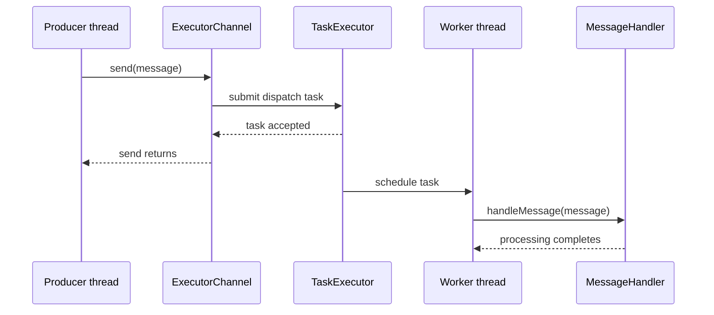
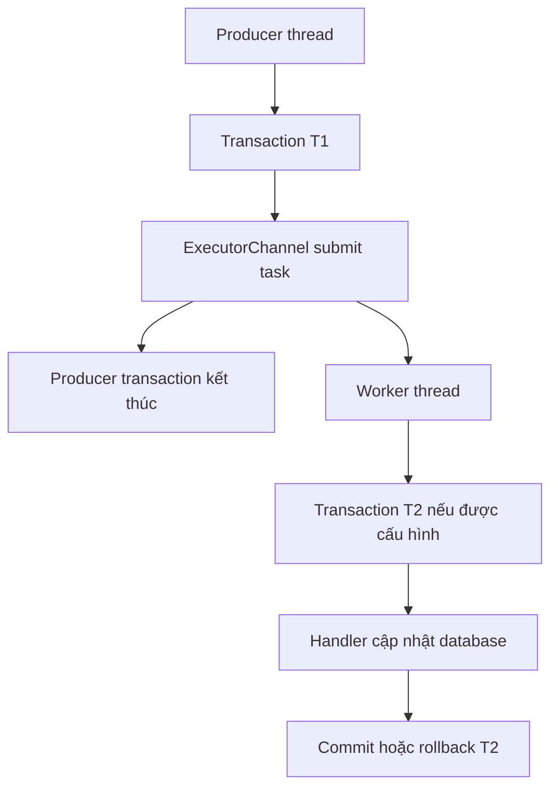

# Bất đồng bộ qua ExecutorChannel

Trong Spring Integration, `ExecutorChannel` tạo một ranh giới thực thi bất đồng bộ giữa nơi gửi message và nơi xử lý message. Channel chuyển việc dispatch tới một `TaskExecutor`; handler thường chạy trên worker thread thay vì thread gửi. Cơ chế này giúp tách thời gian xử lý nghiệp vụ khỏi luồng gửi, cho phép xử lý song song và tránh để handler chậm giữ thread producer quá lâu.

Bài học thuộc phần **Threading model** của module `SPRING_INTEGRATION_RUNTIME`. Module tìm hiểu cách Spring Integration điều phối message flow qua channel, endpoint, consumer, poller và executor; đồng thời thực hành quản lý vòng đời IntegrationFlow, transaction, retry, message store, lỗi, correlation và chẩn đoán threading, hiệu năng, trạng thái runtime.

## 1. Async dispatch là ranh giới thread trong message flow

Một message flow có thể đi qua nhiều endpoint. Nếu các endpoint nối nhau bằng `DirectChannel`, handler thường chạy nối tiếp trên cùng thread gọi send. Khi flow đi qua `ExecutorChannel`, channel giao việc gọi subscriber cho executor. Từ điểm này, phần xử lý phía sau chạy trên worker thread do executor quản lý.



Sơ đồ mô tả trường hợp executor nhận task và thực thi bất đồng bộ. Khi `send()` trả về, điều đó thường chỉ cho biết task đã được chấp nhận; handler có thể chưa bắt đầu, đang chạy hoặc đã hoàn tất sau đó.

Ranh giới này chỉ ảnh hưởng tới phần flow sau ExecutorChannel. Những bước phía trước channel vẫn chạy trên thread hiện tại. Nếu handler phía worker tiếp tục gửi message qua DirectChannel, các bước downstream đồng bộ tiếp theo thường tiếp tục trên chính worker thread đó. Nếu flow gặp một ExecutorChannel khác, nó lại tạo một lần handoff mới.

## 2. ExecutorChannel kết nối dispatcher với TaskExecutor

`ExecutorChannel` là một `SubscribableChannel` dùng cơ chế unicast dispatch. Endpoint đăng ký handler làm subscriber. Khi producer gửi message, dispatcher chọn subscriber và giao tác vụ dispatch cho `TaskExecutor`.

Một ví dụ cấu hình:

```java
@Bean
ThreadPoolTaskExecutor integrationExecutor() {
    ThreadPoolTaskExecutor executor = new ThreadPoolTaskExecutor();
    executor.setCorePoolSize(4);
    executor.setMaxPoolSize(8);
    executor.setQueueCapacity(200);
    executor.setThreadNamePrefix("si-worker-");
    executor.setWaitForTasksToCompleteOnShutdown(true);
    executor.setAwaitTerminationSeconds(30);
    return executor;
}

@Bean
MessageChannel asyncOrders(TaskExecutor integrationExecutor) {
    return new ExecutorChannel(integrationExecutor);
}

@Bean
IntegrationFlow asyncOrderFlow(OrderService orderService) {
    return IntegrationFlow.from("orders.in")
        .channel("asyncOrders")
        .handle(orderService, "process")
        .get();
}
```

Trong ví dụ, các bước trước `asyncOrders` chạy trên thread gửi. Khi message tới channel này, việc gọi handler `process` được giao cho `integrationExecutor`. `ThreadPoolTaskExecutor` là Spring bean nên container quản lý vòng đời khởi tạo và shutdown.

`TaskExecutor` chỉ là abstraction. Nếu truyền một executor đồng bộ như `SyncTaskExecutor`, task có thể chạy ngay trên thread gọi. Muốn tạo async dispatch, cần một executor thực sự chuyển task sang worker thread. Vì vậy, hãy kiểm tra loại executor được inject và thread name khi chạy ứng dụng.

## 3. ExecutorChannel, DirectChannel và QueueChannel tạo ra mô hình thread khác nhau

| Channel | Cách chuyển message | Thread xử lý thường gặp | Lưu message trong channel? |
|---|---|---|---|
| `DirectChannel` | Gọi subscriber trực tiếp trong lần send | Thread gửi | Không |
| `ExecutorChannel` | Submit task dispatch tới TaskExecutor | Worker thread | Không; executor có thể có task queue |
| `QueueChannel` | Đưa message vào queue, consumer nhận qua poller | Thread poller/consumer | Có, trong giới hạn queue |
| `PublishSubscribeChannel` | Broadcast message tới các subscriber | Thread gửi hoặc executor tùy cấu hình | Không phải message store |

ExecutorChannel không phải một queue channel. Nếu executor có hàng đợi, hàng đợi đó chứa task dispatch, còn QueueChannel chứa Message. Hai loại queue khác nhau về thành phần sở hữu, vòng đời và cách lấy phần tử.

ExecutorChannel cũng không có nghĩa broadcast. Nó dùng unicast dispatcher; mỗi lần dispatch chọn một subscriber. Nếu cần tất cả subscriber nhận cùng message, hãy dùng PublishSubscribeChannel hoặc tách các nhánh flow rõ ràng.

Chọn channel theo yêu cầu xử lý:

- Dùng DirectChannel khi cần xử lý đồng bộ và muốn exception có thể truyền về phía gửi trong cùng call stack.
- Dùng ExecutorChannel khi muốn tách thread và cho phép handler chạy bất đồng bộ trong cùng process.
- Dùng QueueChannel khi cần tách thời điểm gửi/nhận và giữ message trong queue để consumer poll.
- Dùng PublishSubscribeChannel khi cần gửi cùng message tới nhiều subscriber.

## 4. Một flow có thể chuyển thread nhiều lần

Không phải toàn bộ flow tự động chạy bất đồng bộ chỉ vì có một ExecutorChannel. Chỉ các bước được dispatch qua channel đó mới chuyển sang worker. Những channel và endpoint tiếp theo quyết định thread tiếp tục được giữ hay chuyển thêm lần nữa.

Ví dụ:

```java
@Bean
IntegrationFlow orderFlow(
        ValidationService validation,
        OrderService orderService,
        NotificationService notificationService) {

    return IntegrationFlow.from("orders.in")
        .handle(validation, "validate")
        .channel("orders.async")
        .handle(orderService, "persist")
        .channel("orders.notifications")
        .handle(notificationService, "notify")
        .get();
}
```

Giả sử `orders.async` là ExecutorChannel còn `orders.notifications` là DirectChannel:

1. `validation.validate` chạy trên thread đưa message vào flow.
2. Khi message đi qua `orders.async`, phần dispatch tới `orderService.persist` được chuyển sang worker thread.
3. `notificationService.notify` tiếp tục trên worker thread đó vì channel kế tiếp là DirectChannel.
4. Nếu `orders.notifications` cũng là ExecutorChannel, notification lại được giao cho một worker theo executor của channel thứ hai.

Cần vẽ rõ từng ranh giới thread trong flow khi phân tích latency hoặc lỗi. Một handler chạy lâu trước async boundary vẫn giữ thread producer; chỉ đặt ExecutorChannel sau handler không làm cho handler trước đó trở thành bất đồng bộ.

## 5. Send thành công không có nghĩa xử lý đã hoàn tất

Với DirectChannel, send thường bao gồm dispatch và lời gọi handler trong cùng call stack. Nếu handler ném exception đồng bộ, exception có thể truyền về phía gửi.

Với ExecutorChannel và executor bất đồng bộ, send thường hoàn tất sau khi executor nhận task. Handler có thể thất bại sau khi sender đã return.

| Sự kiện | DirectChannel | ExecutorChannel |
|---|---|---|
| Gọi handler | Trong call stack gửi | Thường trên worker thread |
| Send trả về | Sau dispatch đồng bộ | Thường sau khi task được chấp nhận |
| Handler chạy lâu | Giữ thread gửi | Giữ worker thread |
| Handler ném exception | Có thể truyền về sender | Không quay lại call stack sender đã kết thúc |
| Quá tải | Sender chịu thời gian xử lý | Phụ thuộc queue và rejection policy |

Có hai nhóm lỗi cần phân biệt:

- **Lỗi submit:** executor từ chối task, chẳng hạn pool đã shutdown hoặc queue đầy. Lỗi rejection có thể xuất hiện ngay trong lời gọi send.
- **Lỗi xử lý:** task đã được nhận nhưng handler ném exception trên worker thread. Try/catch quanh send không bắt được exception xảy ra sau đó.

Do đó, kết quả send chỉ xác nhận việc dispatch theo hợp đồng channel/executor. Nếu caller cần biết nghiệp vụ đã hoàn tất, hãy thiết kế acknowledgement, reply message, trạng thái xử lý hoặc một cơ chế theo dõi task riêng.

## 6. ThreadLocal và context không tự truyền qua ranh giới

Khi message được chuyển từ producer thread sang worker thread, object Message và headers đi cùng message. Dữ liệu gắn với thread hiện tại thì không tự động chuyển sang worker.

Các ví dụ thường gặp:

- **Transaction context:** transaction gắn với producer thread không tự bao quanh công việc ở worker.
- **ThreadLocal:** dữ liệu lưu trong ThreadLocal của producer không tự xuất hiện trên worker.
- **SecurityContext:** thông tin xác thực cần cơ chế context propagation phù hợp nếu worker cần dùng.
- **Logging MDC:** trace ID hoặc correlation fields trong MDC cần được cài đặt trên worker nếu muốn log liên tục cùng ngữ cảnh.
- **Request context:** không nên truy cập dữ liệu phụ thuộc HTTP request thread sau khi request thread đã kết thúc.

Nếu worker cần correlation ID, tenant ID hoặc business key, hãy đưa các giá trị đó vào message headers hoặc payload theo hợp đồng rõ ràng. Với security context và MDC, có thể dùng TaskDecorator hoặc wrapper executor phù hợp với stack ứng dụng. Phải khôi phục hoặc xóa context trong finally để dữ liệu của task trước không rò sang task tiếp theo trên cùng worker.

Ví dụ khái niệm dùng TaskDecorator để truyền MDC:

```java
@Bean
ThreadPoolTaskExecutor integrationExecutor() {
    ThreadPoolTaskExecutor executor = new ThreadPoolTaskExecutor();
    executor.setCorePoolSize(4);
    executor.setMaxPoolSize(8);
    executor.setQueueCapacity(200);
    executor.setTaskDecorator(task -> {
        Map<String, String> captured = MDC.getCopyOfContextMap();
        return () -> {
            Map<String, String> previous = MDC.getCopyOfContextMap();
            try {
                if (captured == null) {
                    MDC.clear();
                }
                else {
                    MDC.setContextMap(captured);
                }
                task.run();
            }
            finally {
                if (previous == null) {
                    MDC.clear();
                }
                else {
                    MDC.setContextMap(previous);
                }
            }
        };
    });
    return executor;
}
```

Đây là ví dụ cho MDC của SLF4J; cần có dependency logging tương ứng. Với context khác, hãy dùng cơ chế propagation được hỗ trợ bởi framework đó thay vì sao chép mọi ThreadLocal một cách tùy tiện.

Spring Message có cấu trúc bất biến, nhưng payload có thể là object mutable. Nếu producer sửa payload sau khi gửi, worker có thể nhìn thấy dữ liệu đã bị thay đổi hoặc gặp race condition. Ưu tiên payload immutable hoặc tạo bản sao khi chuyển quyền sở hữu dữ liệu qua ranh giới thread.

## 7. Transaction có ranh giới riêng ở worker

Với DirectChannel, sender và handler thường chạy trong cùng thread. Nếu cùng tham gia transaction manager, transaction bao quanh lời gọi gửi có thể bao gồm xử lý handler, tùy cấu hình transaction và propagation.

Với ExecutorChannel, handler chạy trên worker thread. Transaction gắn với sender thread không tự truyền sang worker. Nếu handler cần transaction, hãy mở transaction tại worker, ví dụ bằng transaction advice trên endpoint hoặc transaction boundary trong service được gọi.



Producer có thể commit transaction của nó sau khi task được submit, trong khi handler phía worker chưa xử lý xong. Nếu nghiệp vụ yêu cầu việc ghi dữ liệu nguồn và phát message phải nguyên tử, chỉ dùng ExecutorChannel không tạo ra bảo đảm đó. Cân nhắc transactional outbox, broker có transaction/ack phù hợp hoặc thiết kế lưu trạng thái bền vững trước khi dispatch.

Khi chuyển một flow từ DirectChannel sang ExecutorChannel, hãy đánh giá lại transaction boundary, isolation, retry và idempotency. Đây là thay đổi semantics, không chỉ là thay đổi hiệu năng.

## 8. Xử lý exception sau khi sender đã return

Exception của handler trên worker thread cần được xử lý tại phía asynchronous execution. Không thể trông chờ exception quay về call stack của producer.

Spring Integration có cơ chế error channel. Tùy cấu hình async error handling, exception có thể được đóng gói trong ErrorMessage và gửi tới error channel; header `errorChannel` có thể chỉ định đích lỗi cho từng message, nếu không thì cơ chế toàn cục có thể được sử dụng.

Ví dụ gắn error channel vào message:

```java
Message<Order> message = MessageBuilder
    .withPayload(order)
    .setHeader("errorChannel", "orders.errors")
    .build();

asyncOrders.send(message);
```

Có thể tạo flow riêng để nhận lỗi:

```java
@Bean
IntegrationFlow orderErrorFlow(OrderErrorService errorService) {
    return IntegrationFlow.from("orders.errors")
        .handle(errorService, "record")
        .get();
}
```

Error flow nên lưu exception, failed message, correlation ID và business key để có thể điều tra hoặc redrive. Hãy xác nhận async error handler đang gửi lỗi tới channel nào trong cấu hình thực tế; không mặc định rằng mọi executor tự động định tuyến lỗi tới một error flow tùy ý.

Nếu error flow cũng chạy bất đồng bộ và chính error handler tiếp tục ném exception, cần tránh vòng lặp lỗi. Có thể ghi trạng thái lỗi bền vững, đưa message vào dead-letter flow hoặc phát cảnh báo theo chính sách vận hành.

## 9. Backpressure và rejection policy

ExecutorChannel không có message buffer riêng. Năng lực nhận task phụ thuộc executor. Với `ThreadPoolTaskExecutor`, các tham số quan trọng gồm:

| Thuộc tính | Ý nghĩa |
|---|---|
| `corePoolSize` | Số worker cơ bản |
| `maxPoolSize` | Giới hạn worker tối đa |
| `queueCapacity` | Số task chờ trong hàng đợi executor |
| `keepAliveSeconds` | Thời gian worker vượt core có thể nhàn rỗi trước khi thu hồi |
| `RejectedExecutionHandler` | Chính sách khi executor không nhận thêm task |

Một hàng đợi không giới hạn có thể khiến producer gửi nhanh hơn tốc độ xử lý trong thời gian dài, làm backlog và bộ nhớ tăng liên tục. Với ThreadPoolExecutor, khi các worker core đã bận, task thường được đưa vào queue trước; pool chỉ tăng vượt core khi queue không nhận thêm task và vẫn còn dưới maxPoolSize. Vì vậy, queue không giới hạn có thể khiến maxPoolSize ít khi được dùng.

Các chính sách thường gặp:

- **AbortPolicy:** từ chối task và ném lỗi rejection. Producer hoặc tầng gọi phải xử lý quá tải.
- **CallerRunsPolicy:** thread gửi tự chạy task khi executor từ chối. Đây là backpressure đơn giản nhưng có thể làm sender thực thi handler đồng bộ tại thời điểm quá tải.
- **DiscardPolicy/DiscardOldestPolicy:** loại bỏ task. Chỉ dùng khi nghiệp vụ cho phép mất task và có cơ chế quan sát phù hợp.

Ví dụ cấu hình CallerRunsPolicy:

```java
@Bean
ThreadPoolTaskExecutor integrationExecutor() {
    ThreadPoolTaskExecutor executor = new ThreadPoolTaskExecutor();
    executor.setCorePoolSize(4);
    executor.setMaxPoolSize(8);
    executor.setQueueCapacity(200);
    executor.setThreadNamePrefix("si-worker-");
    executor.setRejectedExecutionHandler(
        new ThreadPoolExecutor.CallerRunsPolicy());
    return executor;
}
```

CallerRunsPolicy có thể làm giảm tốc độ producer khi hệ thống quá tải, nhưng cũng thay đổi đặc tính bất đồng bộ tại thời điểm rejection. Nếu thread gửi là HTTP request thread, request có thể phải thực hiện nghiệp vụ nặng ngoài dự kiến. Hãy chọn rejection policy theo semantics nghiệp vụ, không chỉ để tránh exception.

## 10. Ordering, concurrency và thread safety

ExecutorChannel không bảo đảm mọi message hoàn tất theo đúng thứ tự gửi khi dùng pool nhiều thread. Message A có thể được submit trước B nhưng handler của B hoàn tất trước A nếu A xử lý lâu hơn hoặc được worker khác nhận.

Ngay cả khi task queue giữ thứ tự submit, nhiều worker vẫn có thể hoàn tất task theo thứ tự khác nhau. Nếu nhiều producer cùng gửi, thứ tự submit giữa các thread cũng không nhất thiết phản ánh thứ tự nghiệp vụ mong muốn.

Khi cần giữ thứ tự:

- Dùng executor đơn luồng cho luồng cần tuần tự hóa.
- Partition theo business key để cùng nhóm dữ liệu đi qua cùng một luồng xử lý.
- Dùng resequencer hoặc aggregator khi cần khôi phục thứ tự message.
- Thiết kế handler idempotent và cập nhật dữ liệu có kiểm soát cạnh tranh.
- Không giả định channel point-to-point đồng nghĩa toàn flow đã tuần tự.

Khi tăng concurrency, kiểm tra service downstream có an toàn đa luồng không. Singleton service có mutable state không đồng bộ có thể phát sinh race condition khi nhiều worker gọi đồng thời.

## 11. Reply và correlation khi flow chạy bất đồng bộ

ExecutorChannel không chặn sender để chờ handler hoàn tất. Nếu flow cần trả kết quả, reply vẫn có thể được tạo và gửi qua reply channel sau khi handler xử lý xong, nhưng caller phải sử dụng mô hình request-reply phù hợp và có timeout.

Cần bảo đảm:

- Request có reply channel hợp lệ hoặc endpoint có output channel rõ ràng.
- Caller có timeout đủ cho thời gian chờ executor queue cộng thời gian xử lý.
- Correlation ID hoặc business key được giữ để ghép reply với request tương ứng.
- Hệ thống xử lý được trường hợp reply đến muộn, caller đã timeout hoặc request bị gửi lại.
- Reply channel còn tồn tại và có consumer nhận tại thời điểm reply được gửi.

Không nên dùng một object mutable trong memory làm cơ chế ghép request-reply giữa nhiều thread nếu không có đồng bộ. Với flow phân tán hoặc cần tồn tại qua restart, hãy dùng correlation và persistence phù hợp thay vì dựa vào bộ nhớ của một JVM.

## 12. Chẩn đoán ranh giới thread trong runtime

| Triệu chứng | Nguyên nhân có thể | Cách kiểm tra |
|---|---|---|
| send trả về nhưng handler chưa chạy xong | Task mới được nhận vào executor | Đo queue wait và handler duration |
| Handler chạy trên thread gửi | Executor đồng bộ hoặc CallerRunsPolicy khi rejection | Kiểm tra loại executor và rejection counter |
| Task bị rejection | Pool/queue đầy hoặc executor đã shutdown | Kiểm tra active count, queue size, rejection và lifecycle |
| Exception không xuất hiện ở sender | Handler thất bại sau async handoff | Kiểm tra errorChannel và log worker |
| Message hoàn tất sai thứ tự | Pool nhiều worker hoặc nhiều producer | Kiểm tra concurrency, partition key và yêu cầu ordering |
| Transaction không rollback theo producer | Handler chạy trên thread khác | Kiểm tra transaction boundary ở worker |
| MDC hoặc SecurityContext bị mất | Context không được propagate | Kiểm tra TaskDecorator hoặc context-aware executor |
| Thread pool nghẽn | Handler blocking, queue backlog hoặc dependency chậm | Xem thread dump, queue depth và latency downstream |

Quy trình điều tra:

1. Xác nhận channel thực sự là ExecutorChannel và executor được inject đúng bean.
2. Xác nhận executor có thực hiện async dispatch, không phải SyncTaskExecutor.
3. Ghi nhận thread name trước và sau ranh giới channel.
4. Đo thời điểm gửi, thời điểm worker bắt đầu và thời điểm handler hoàn tất.
5. Kiểm tra active worker, pool size, queue capacity và rejection policy.
6. Theo dõi exception qua error channel hoặc async error handler.
7. Kiểm tra transaction, security context, MDC và correlation ID qua thread boundary.
8. Kiểm tra handler thread-safe, idempotent và downstream chịu được concurrency không.

Nên đo ít nhất ba khoảng thời gian: thời gian chờ trong executor queue, thời gian handler chạy và tổng thời gian từ lúc gửi tới khi hoàn tất. Tách được ba số đo này giúp phân biệt nghẽn do thiếu worker, queue backlog hay dependency bên ngoài chậm.

## 13. Nguyên tắc thiết kế

- ExecutorChannel thay đổi thread thực thi; nó không phải durable message queue.
- Ranh giới async chỉ bắt đầu từ channel dispatch; các bước phía trước vẫn chạy trên thread hiện tại.
- Send thành công thường chỉ có nghĩa task đã được chấp nhận, không phải handler đã hoàn tất.
- Không giả định transaction, ThreadLocal, SecurityContext hoặc MDC tự truyền qua thread boundary.
- Xác định rõ queue capacity, concurrency và rejection policy.
- Đưa correlation/business context cần thiết vào message headers hoặc payload.
- Thiết kế error handling cho exception xảy ra sau khi sender đã return.
- Kiểm soát ordering và thread safety khi tăng số worker.
- Dùng broker hoặc durable messaging khi cần lưu message qua restart.

ExecutorChannel phù hợp khi cần async dispatch trong một process và có thể kiểm soát tải worker. Để vận hành an toàn, hãy xem mỗi ExecutorChannel là một ranh giới thread rõ ràng trong flow: cấu hình pool và queue có giới hạn, xác định cách xử lý rejection, quan sát lỗi bất đồng bộ, và thiết kế transaction, reply cùng correlation phù hợp với ranh giới đó.

