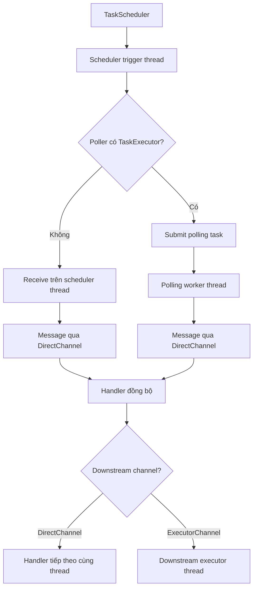

# Polling thread và handler thread

Trong một polling flow của Spring Integration, việc nhận message và việc xử lý message có thể diễn ra trên cùng một thread hoặc trên nhiều thread khác nhau. Sự khác biệt này phụ thuộc vào scheduler, `TaskExecutor` của poller và loại channel nằm giữa các endpoint.

Khi chưa phân biệt các thread boundary, log có thể khiến ta hiểu nhầm handler đang chạy trên scheduler thread, transaction hoặc MDC bị mất khi chuyển executor, hoặc nhiều lượt poll đang chạy đồng thời dù poller dùng `fixedDelay`. Muốn chẩn đoán chính xác, hãy theo dõi từng bước: **thread kích hoạt lịch, thread thực hiện polling, thread chạy handler và thread của các bước downstream**.

## 1. Các thread tham gia vào một polling flow

Một polling consumer thường có ít nhất hai vai trò thread:

- **Scheduler trigger thread:** thread của `TaskScheduler` theo dõi trigger và quyết định khi nào kích hoạt một lượt poll.
- **Polling execution thread:** thread thực hiện thao tác `receive()` hoặc gọi message source, sau đó chuyển message vào flow.

Nếu poller không cấu hình `TaskExecutor`, scheduler thread thường thực hiện luôn polling task. Khi đó receive và các handler đồng bộ ở downstream chạy trên cùng thread.

Nếu poller có `TaskExecutor`, scheduler thread giao polling task cho executor. Một worker thread của executor thực hiện receive và xử lý phần đồng bộ của flow. Scheduler thread có thể quay lại điều phối trigger tiếp theo mà không cần chờ handler hoàn tất.



Sơ đồ mô tả đường đi phổ biến. Inbound adapter, message source và các endpoint chuyên biệt có thể bổ sung bước thực thi riêng; cần xem cấu hình thực tế của từng endpoint.

Các đoạn cấu hình ở những mục sau là những phương án độc lập để so sánh. Khi áp dụng vào cùng một configuration class, hãy chọn phương án cần dùng hoặc đặt tên bean khác nhau.

## 2. Poller không có TaskExecutor

Ví dụ poller không khai báo executor:

```java
@Bean
public IntegrationFlow ordersFlowDirect(
        PollableChannel ordersQueue,
        OrderHandler orderHandler) {

    return IntegrationFlow.from(ordersQueue, endpoint -> endpoint.poller(
            Pollers.fixedDelay(500)
                .maxMessagesPerPoll(10)))
        .handle(orderHandler, "handle")
        .get();
}
```

Với cấu hình này, scheduler kích hoạt polling task và polling task chạy trong scheduler thread. Nếu `ordersQueue` có message, thread đó nhận message rồi gọi `OrderHandler.handle`. Nếu handler tiếp tục gửi qua `DirectChannel`, handler kế tiếp cũng chạy đồng bộ trên cùng thread.

Ưu điểm là luồng thực thi đơn giản, dễ lần theo stack trace và transaction đồng bộ có thể bao quanh toàn bộ đoạn xử lý trên thread đó. Nhược điểm là handler chạy lâu sẽ giữ scheduler thread, làm chậm những poller hoặc scheduled task khác dùng chung scheduler.

Nếu một handler gọi HTTP hoặc database với thời gian chờ dài, scheduler thread có thể bị chiếm trong toàn bộ thời gian đó. Vì vậy, không nên đặt quá nhiều poller có xử lý blocking lên một scheduler pool nhỏ.

## 3. Poller có TaskExecutor

Có thể cấu hình `TaskExecutor` riêng cho poller để tách việc kích hoạt lịch khỏi việc thực hiện polling:

```java
@Bean("pollerExecutor")
public ThreadPoolTaskExecutor pollerExecutor() {
    ThreadPoolTaskExecutor executor = new ThreadPoolTaskExecutor();
    executor.setCorePoolSize(4);
    executor.setMaxPoolSize(8);
    executor.setQueueCapacity(100);
    executor.setThreadNamePrefix("poller-worker-");
    return executor;
}

@Bean
public IntegrationFlow ordersFlowWithPollerExecutor(
        PollableChannel ordersQueue,
        @Qualifier("pollerExecutor") TaskExecutor pollerExecutor,
        OrderHandler orderHandler) {

    return IntegrationFlow.from(ordersQueue, endpoint -> endpoint.poller(
            Pollers.fixedDelay(500)
                .taskExecutor(pollerExecutor)
                .maxMessagesPerPoll(10)))
        .handle(orderHandler, "handle")
        .get();
}
```

Trong ví dụ, scheduler thread kích hoạt poller và submit task vào `pollerExecutor`. Worker thread có tên bắt đầu bằng `poller-worker-` thực hiện receive và gọi handler. Vì `QueueChannel` là `PollableChannel`, thao tác lấy message cũng nằm trong polling worker.

`TaskExecutor` của poller điều khiển thread chạy toàn bộ polling task. Nó không chỉ chuyển riêng lời gọi handler sang thread khác. Nếu downstream vẫn dùng `DirectChannel`, handler tiếp theo tiếp tục chạy trên polling worker thread đó.

Trong ví dụ, executor là Spring bean nên container tự quản lý khởi tạo và shutdown thông qua lifecycle callback của `ThreadPoolTaskExecutor`. Không gọi `initialize()` thủ công trong bean method vì có thể dẫn đến khởi tạo lặp.

### TaskExecutor không phải lúc nào cũng tạo thread mới

`TaskExecutor` là abstraction; việc có chuyển thread hay không phụ thuộc implementation. `ThreadPoolTaskExecutor` thường thực thi task trên worker thread của pool. `SyncTaskExecutor` chạy task ngay trên thread gọi `execute()`, vì vậy dùng nó làm poller executor không tạo thread boundary mới.

Chính sách khi pool đầy cũng có thể ảnh hưởng thread thực thi. Ví dụ `CallerRunsPolicy` có thể chạy task bị từ chối ngay trên thread submit (trong trường hợp poller là scheduler thread). Khi đó thread model lúc tải cao có thể khác lúc bình thường. Hãy chọn rejection policy có chủ đích và kiểm tra hành vi dưới tải, không suy luận thread chỉ từ tên kiểu `TaskExecutor`.

## 4. Poller TaskExecutor khác ExecutorChannel

Hai cấu hình này đều liên quan đến executor nhưng đặt thread boundary ở vị trí khác nhau:

| Cơ chế | Executor chạy phần nào? | Điểm chuyển thread |
|---|---|---|
| Poller `.taskExecutor(...)` | Toàn bộ polling task: nhận message và phần flow đồng bộ theo sau | Giữa scheduler trigger và polling execution. |
| `ExecutorChannel` | Các handler được dispatch qua channel đó | Tại channel sau khi message được gửi vào. |
| `DirectChannel` | Không tạo executor boundary | Handler chạy trên thread gửi message. |

Ví dụ poller chạy trên một worker, sau đó chuyển downstream sang executor khác:

```java
@Bean("handlerExecutor")
public ThreadPoolTaskExecutor handlerExecutor() {
    ThreadPoolTaskExecutor executor = new ThreadPoolTaskExecutor();
    executor.setCorePoolSize(8);
    executor.setMaxPoolSize(16);
    executor.setQueueCapacity(500);
    executor.setThreadNamePrefix("handler-worker-");
    return executor;
}

@Bean
public MessageChannel asyncHandlerChannel(
        @Qualifier("handlerExecutor") TaskExecutor executor) {
    return new ExecutorChannel(executor);
}

@Bean
public IntegrationFlow ordersFlowWithSeparateHandlerExecutor(
        PollableChannel ordersQueue,
        @Qualifier("pollerExecutor") TaskExecutor pollerExecutor,
        MessageChannel asyncHandlerChannel,
        OrderHandler orderHandler) {

    return IntegrationFlow.from(ordersQueue, endpoint -> endpoint.poller(
            Pollers.fixedDelay(500).taskExecutor(pollerExecutor)))
        .channel(asyncHandlerChannel)
        .handle(orderHandler, "handle")
        .get();
}
```

Ở đây có hai lần chuyển giao:

1. Scheduler thread submit polling task cho `pollerExecutor`.
2. Polling worker gửi message qua `ExecutorChannel`; channel submit handler task cho `handlerExecutor`.

Vì vậy `OrderHandler.handle` chạy trên thread `handler-worker-...`, không phải scheduler thread hoặc polling worker thread. Thêm executor có thể tăng khả năng chạy song song, nhưng cũng làm tăng số queue, độ trễ và số nơi cần theo dõi lỗi.

## 5. Thread name và cách lần theo message

Đặt prefix khác nhau cho scheduler, poller executor và handler executor giúp đọc log dễ hơn:

```text
si-scheduler-1       -> kích hoạt trigger
poller-worker-2      -> nhận message và chạy đoạn đồng bộ trong poller flow
handler-worker-5     -> chạy handler sau ExecutorChannel
```

Tên thread là dấu hiệu hỗ trợ chẩn đoán, không phải định danh nghiệp vụ. Một worker có thể xử lý nhiều message ở các thời điểm khác nhau. Để nối log giữa các bước, hãy ghi thêm:

- `MessageHeaders.ID` hoặc message ID tương ứng.
- Correlation ID của nghiệp vụ.
- Tên flow, endpoint hoặc channel.
- Thread name và timestamp.
- Tenant hoặc khóa nghiệp vụ đã được làm sạch nếu cần.

Không ghi token, credential hoặc toàn bộ payload nhạy cảm vào log. Với message đi qua nhiều executor, correlation ID trong header giúp nối các đoạn xử lý dù thread thay đổi.

## 6. Concurrency và nhiều lượt poll chạy đồng thời

Khi poller dùng `TaskExecutor`, scheduler thread có thể submit một polling task rồi quay lại xử lý trigger tiếp theo. Nếu worker trước vẫn chưa hoàn tất, một polling task mới có thể được submit. Vì vậy, việc dùng `fixedDelay` không tự bảo đảm polling task trước đã kết thúc trước khi task tiếp theo bắt đầu khi có executor bất đồng bộ.

Lý do là scheduled callback có thể kết thúc ngay sau khi submit task vào executor. `fixedDelay` khi đó được tính theo thời gian callback submit hoàn tất, không chờ công việc polling bất đồng bộ kết thúc.

Ví dụ, poller có fixed delay 500 ms, nhưng mỗi lượt xử lý mất 2 giây. Scheduler có thể tiếp tục submit các lượt poll mới trong khi các worker trước vẫn bận. Nếu executor có nhiều thread, nhiều lượt poll có thể cùng chạy và lấy message từ một queue.

Điều này có thể tăng throughput, nhưng cũng tạo ra các yêu cầu:

- Handler phải an toàn khi nhiều message được xử lý đồng thời.
- Service và các object dùng chung phải thread-safe.
- Nếu cần thứ tự, phải xác định thứ tự theo message, key hoặc partition.
- Pool và queue cần giới hạn để không tích lũy task vô hạn.
- Nếu nghiệp vụ yêu cầu chỉ một lượt poll hoạt động tại một thời điểm, cần cấu hình executor một thread hoặc cơ chế đồng bộ/giới hạn concurrency thích hợp.

`maxMessagesPerPoll` giới hạn số message được xử lý trong một lượt poll, không giới hạn tổng số lượt poll đang chạy đồng thời. Hai khái niệm này phải được thiết kế riêng.

## 7. Scheduler thread bị block và starvation

Nếu không cấu hình poller executor, handler blocking có thể giữ scheduler thread. Nếu scheduler pool có ít thread, các poller khác phải chờ trigger hoặc không được kích hoạt đúng nhịp.

Ngay cả khi đã tách poller executor, worker của poller vẫn có thể bị block trong `receiveTimeout` hoặc trong handler. Nếu toàn bộ worker đang chờ hoặc xử lý chậm, các polling task mới có thể nằm trong executor queue.

Một số triệu chứng thường gặp:

| Triệu chứng | Nguyên nhân có thể |
|---|---|
| Nhiều poller trễ cùng lúc | Scheduler pool thiếu thread hoặc một scheduled task block lâu. |
| Scheduler thread nhàn nhưng queue message tăng | Poller executor thiếu worker hoặc handler xử lý chậm. |
| `pollerExecutor` queue tăng liên tục | Scheduler submit nhanh hơn tốc độ worker hoàn thành task. |
| Handler chạy đồng thời gây lỗi dữ liệu | Service hoặc state dùng chung không thread-safe. |
| `RejectedExecutionException` | Executor hết khả năng nhận task theo cấu hình queue/pool/rejection policy. |

Không nên giải quyết mọi vấn đề bằng cách tăng pool size. Hãy đo thời gian chờ, thời gian xử lý, số thread active, queue depth và tỷ lệ task bị từ chối trước khi thay đổi cấu hình.

## 8. receiveTimeout ảnh hưởng đến polling worker

Với `PollableChannel`, poller gọi `receive()` để lấy message. Nếu queue rỗng và `receiveTimeout` dương, thread đang thực hiện polling bị giữ trong thời gian chờ đó.

Nếu không có poller executor, thread bị giữ là scheduler thread. Nếu có poller executor, thread bị giữ là polling worker thread. Đây là một khác biệt vận hành quan trọng.

Ví dụ:

```java
Pollers.fixedDelay(1_000)
    .taskExecutor(pollerExecutor)
    .receiveTimeout(200)
    .maxMessagesPerPoll(5)
```

Nếu có nhiều poller dùng chung executor nhỏ và tất cả cùng chờ receive, worker pool có thể bị chiếm dù queue chưa có message. Hãy phối hợp receive timeout, số poller và pool size. Timeout ngắn giảm thời gian giữ worker khi queue rỗng nhưng có thể làm tăng số lượt polling rỗng; timeout dài giảm polling rỗng nhưng tăng thời gian chờ thread.

## 9. Transaction, ThreadLocal và context propagation

Nhiều cơ chế trong Java gắn trạng thái vào thread hiện tại. Ví dụ transaction Spring thường được bind vào thread, MDC logging có thể dùng `ThreadLocal`, và một số security context cũng dựa trên thread-local storage.

Khi poller chạy đồng bộ, transaction advice bao quanh polling task có thể bao gồm receive và các handler downstream chạy đồng bộ trên cùng thread, tùy vị trí cấu hình advice và transaction manager.

Khi dùng `ExecutorChannel` hoặc executor khác, message được chuyển sang thread mới. Transaction thread-bound không tự truyền sang thread mới; MDC hoặc security context cũng không tự động được sao chép nếu không có cơ chế context propagation tương ứng.

Các hướng xử lý thường dùng:

- Đặt transaction ở endpoint thực sự thực hiện thao tác dữ liệu sau thread boundary.
- Dùng message headers để truyền correlation ID và dữ liệu định tuyến cần thiết.
- Cấu hình `TaskDecorator` hoặc cơ chế context propagation phù hợp để sao chép và dọn MDC/security context khi dùng executor.
- Không lưu trạng thái request vào `ThreadLocal` rồi giả định handler ở thread khác sẽ đọc được.
- Không giữ transaction mở trong lúc chờ một công việc bất đồng bộ hoàn tất ở thread khác.

Ví dụ một `TaskDecorator` đơn giản để truyền MDC:

```java
@Bean
public TaskDecorator mdcTaskDecorator() {
    return task -> {
        Map<String, String> context = MDC.getCopyOfContextMap();
        return () -> {
            Map<String, String> previous = MDC.getCopyOfContextMap();
            try {
                if (context != null) {
                    MDC.setContextMap(context);
                }
                else {
                    MDC.clear();
                }
                task.run();
            }
            finally {
                if (previous != null) {
                    MDC.setContextMap(previous);
                }
                else {
                    MDC.clear();
                }
            }
        };
    };
}
```

Để sử dụng decorator, gắn nó vào `ThreadPoolTaskExecutor` bằng `setTaskDecorator(...)`. Ví dụ này minh họa việc sao chép MDC tại thời điểm submit và khôi phục context trước đó trên worker; với reactive context hoặc security context cần cơ chế chuyên biệt tương ứng.

## 10. Exception và error handling theo thread boundary

Với `DirectChannel`, handler thường chạy đồng bộ trên thread gửi message. Exception có thể truyền ngược về caller hoặc được xử lý bởi advice/error handling ở endpoint.

Với `ExecutorChannel`, sender thường chỉ biết task đã được submit hoặc channel đã tiếp nhận message. Exception phát sinh sau đó thuộc thread xử lý bất đồng bộ; không thể mặc định trả về lời gọi `send()` ban đầu. Cần cấu hình error channel/error handler thích hợp cho endpoint hoặc executor task.

Với poller, lỗi trong quá trình nhận hoặc xử lý message có thể được chuyển thành `ErrorMessage` theo error channel được cấu hình cho poller. Nếu poller có `TaskExecutor`, hãy xác định lỗi được tạo trong polling worker và được chuyển đi đâu. Scheduler trigger thread không nhất thiết nhìn thấy exception nghiệp vụ nếu poller đã xử lý lỗi bên trong.

Khi chẩn đoán, ghi nhận cả thread nơi exception phát sinh và thread nơi error handler chạy. Nếu error flow cũng bất đồng bộ, đó có thể là thread thứ ba.

## 11. Transaction và thứ tự xử lý

Thread boundary ảnh hưởng đến transaction và thứ tự hoàn tất. Với poller một thread, các message thường được xử lý tuần tự trong một polling task. Với executor nhiều worker, các message khác nhau có thể xử lý song song và hoàn tất không theo thứ tự nhận.

Nếu cần bảo đảm thứ tự theo một khóa nghiệp vụ, có thể:

- Partition message theo key để cùng key đi vào cùng consumer tuần tự.
- Dùng một executor một thread cho flow cần tuần tự, nếu throughput cho phép.
- Dùng lock hoặc cơ chế serialize theo key ở service, nhưng phải đánh giá contention.
- Thiết kế handler idempotent và trạng thái nghiệp vụ chịu được retry hoặc hoàn tất không đúng thứ tự.

Không nên giả định `QueueChannel` cùng một poller là đủ để giữ thứ tự hoàn tất khi poller dispatch sang nhiều worker. Queue có thể giữ thứ tự lấy message, nhưng các handler song song có thể kết thúc theo thứ tự khác.

## 12. Sizing và phân chia thread pool

Một ứng dụng có thể có các pool với trách nhiệm khác nhau:

| Pool | Công việc | Điều cần theo dõi |
|---|---|---|
| `TaskScheduler` | Kích hoạt poller và scheduled task | Số thread, thời gian trigger trễ, task bị block. |
| Poller `TaskExecutor` | Receive và chạy phần đồng bộ của polling flow | Active worker, queue depth, thời gian poll, task overlap. |
| Handler executor | Chạy downstream sau `ExecutorChannel` | Throughput, queue depth, rejection và latency handler. |
| Client-specific executor | I/O hoặc callback của thư viện ngoài | Số request in-flight, timeout và thread leak. |

Không nhất thiết phải tạo bốn pool riêng. Có thể dùng chung pool khi tải và lifecycle phù hợp, nhưng phải hiểu rằng một nhóm task có thể chiếm thread của nhóm khác. Tránh dùng cùng một executor nhỏ cho các tác vụ blocking phụ thuộc lẫn nhau, vì có thể gây starvation hoặc deadlock.

Khi sizing, đo thời gian xử lý trung bình và p95/p99, số poller, số message mỗi lượt, tỷ lệ blocking, queue depth và SLA. Tăng thread có thể cải thiện throughput cho workload I/O-bound nhưng cũng tăng contention, context switching và số kết nối đồng thời.

## 13. Chẩn đoán thread thực tế

Khi handler chạy trên thread không như dự kiến, kiểm tra theo thứ tự:

1. **Poller có `taskExecutor` không?** Nếu không, polling task thường chạy trên scheduler thread.
2. **Channel sau receive là loại nào?** `DirectChannel` giữ thread hiện tại; `ExecutorChannel` chuyển sang executor khác.
3. **Có service activator hoặc adapter tạo async boundary không?** Kiểm tra executor được cấu hình tại endpoint.
4. **Thread name prefix cho biết pool nào?** So sánh `si-scheduler-`, `poller-worker-` và `handler-worker-`.
5. **Có nhiều lượt poll đang chạy đồng thời không?** Kiểm tra thời gian xử lý so với trigger và số worker active.
6. **Pool có bị block hoặc đầy queue không?** Xem thread dump, active count, queue depth và rejection.
7. **Context có bị mất khi đổi thread không?** Kiểm tra MDC, security context, transaction và correlation headers.
8. **Có exception ở thread nền không?** Đối chiếu error channel, scheduler error handler và log của executor.

Thread dump giúp nhận diện worker đang chờ `receive()`, chờ lock, chờ HTTP hoặc thực thi handler. Metrics của executor giúp phân biệt scheduler không kích hoạt với poller task đã được submit nhưng không có worker để chạy.

## 14. Kiểm thử thread boundary

Có thể kiểm tra thread name trực tiếp trong handler:

```java
public void handle(Order order) {
    log.info("Handling order on thread {}",
        Thread.currentThread().getName());
}
```

Để kiểm thử ổn định, dùng `CountDownLatch` hoặc `BlockingQueue<String>` ghi lại thread name từ handler rồi assert prefix mong đợi. Tránh assert chính xác số thứ tự thread vì pool có thể tái sử dụng worker theo thứ tự khác nhau.

Một số test hữu ích:

- Poller không có `TaskExecutor`: xác minh handler chạy trên thread scheduler được cấu hình.
- Poller có `TaskExecutor`: xác minh handler đồng bộ chạy trên polling worker.
- Poller có `TaskExecutor` và downstream `ExecutorChannel`: xác minh handler sau channel chạy trên handler executor.
- Handler chậm: xác minh số lượt poll đồng thời và queue task theo cấu hình.
- Shutdown context: xác minh poller ngừng submit task mới và executor được đóng theo lifecycle.
- Context propagation: xác minh MDC/correlation ID còn đúng sau khi đổi thread và được dọn khỏi worker sau task.

## 15. Những lỗi thiết kế thường gặp

- **Cho rằng scheduler thread luôn chạy handler.** Điều này chỉ đúng khi polling task không được giao cho executor và downstream không có async boundary.
- **Nhầm poller `TaskExecutor` với `ExecutorChannel`.** Một cái chuyển toàn bộ polling task; cái kia chuyển message tại một channel cụ thể.
- **Cho rằng fixedDelay bảo đảm không overlap khi poller dùng executor.** Scheduler có thể submit lượt tiếp theo trong khi worker trước chưa xong.
- **Dùng chung pool nhỏ cho nhiều tác vụ blocking.** Một nhóm công việc có thể chiếm hết worker của nhóm khác.
- **Không giới hạn queue executor.** Task có thể tích tụ và tạo độ trễ lớn khi tốc độ submit vượt tốc độ xử lý.
- **Giả định transaction hoặc MDC tự truyền qua thread.** ThreadLocal không tự chia sẻ giữa worker threads.
- **Tăng worker mà không xem tính thread-safe.** State dùng chung có thể phát sinh race condition.
- **Dùng maxMessagesPerPoll để giới hạn concurrency.** Giá trị này giới hạn message mỗi lượt, không nhất thiết giới hạn số lượt poll đồng thời.
- **Không quan sát rejection và lỗi async.** Caller có thể đã gửi thành công nhưng handler downstream vẫn thất bại.

## 16. Checklist thiết kế

Trước khi vận hành polling flow, hãy xác định:

- Thread nào kích hoạt poller và thread nào thực hiện receive?
- Poller có `TaskExecutor` không, pool đó có bao nhiêu worker?
- Handler có chạy đồng bộ sau receive hay được chuyển qua `ExecutorChannel`?
- Một thời điểm có thể có bao nhiêu polling task chạy đồng thời?
- Handler có thread-safe và idempotent không?
- Thứ tự message cần giữ ở mức toàn cục hay theo khóa nghiệp vụ?
- Transaction, MDC và security context được xử lý thế nào khi đổi thread?
- Queue và executor có giới hạn, metric và rejection policy phù hợp không?
- Error của polling worker và downstream worker được quan sát ở đâu?
- Khi context đóng, các pool và polling task được dừng theo trình tự nào?

Khi xác định rõ scheduler trigger thread, polling execution thread và handler thread, việc đọc log, sizing executor, thiết kế transaction và điều tra lỗi trở nên chính xác hơn. Mỗi thread boundary nên là một quyết định kiến trúc có chủ đích, gắn với yêu cầu throughput, latency, thứ tự và khả năng phục hồi của message flow.
