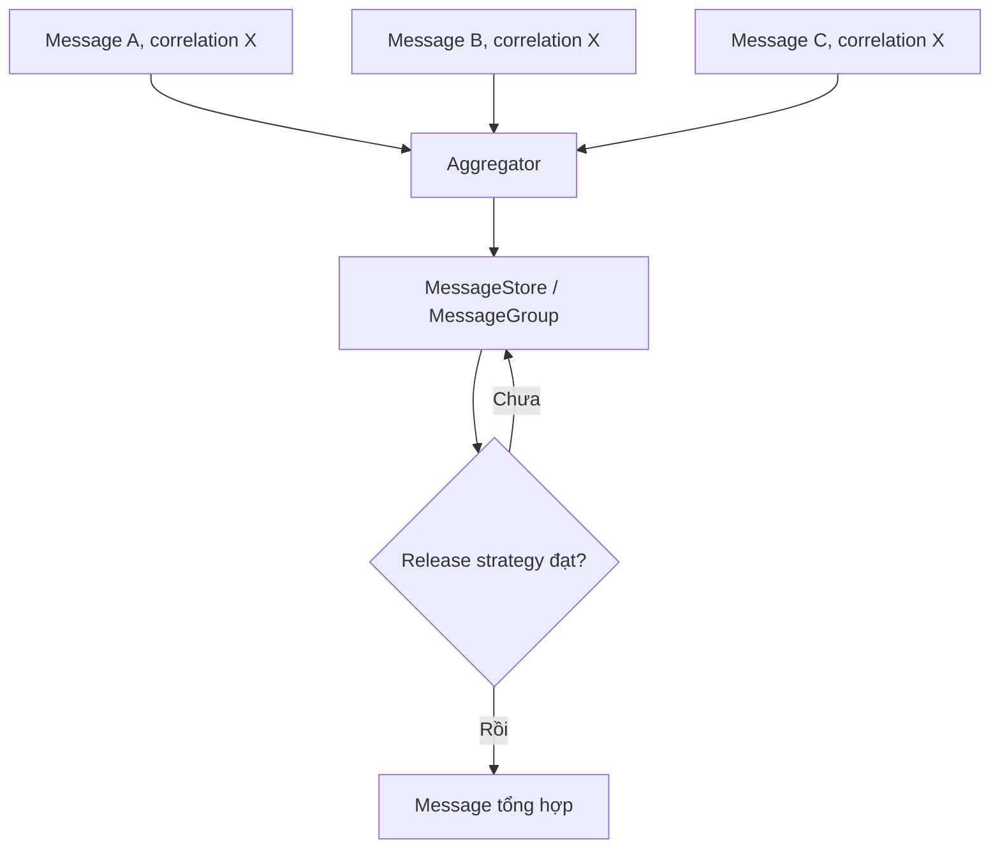

# Thread safety của handler và stateful component

Trong Spring Integration, một message có thể được xử lý trên thread gửi, trên thread của poller hoặc trên thread do executor cấp. Một endpoint thường giữ reference tới handler trong suốt vòng đời của ứng dụng; nếu handler là Spring singleton, nhiều message có thể gọi cùng một instance gần như đồng thời. Vì vậy, một flow chạy đúng với một message chưa chắc đã an toàn khi tăng số consumer hoặc chuyển sang xử lý bất đồng bộ.

Thread safety là khả năng một thành phần giữ hành vi và trạng thái đúng khi nhiều thread truy cập đồng thời. Với handler và stateful component, cần xác định dữ liệu nào được chia sẻ, ai có quyền thay đổi dữ liệu, thao tác nào phải nguyên tử và trạng thái được lưu ở đâu. Bài này đi từ thread model của Spring Integration tới cách thiết kế handler an toàn, quản lý state, bảo vệ thứ tự và kiểm thử race condition.

## 1. Vì sao handler có thể bị gọi đồng thời?

Spring quản lý bean theo scope. Scope mặc định là singleton: một instance được chia sẻ trong phạm vi `ApplicationContext`. Nếu một service được inject vào nhiều endpoint, các endpoint có thể cùng gọi một object đó.

```java
@Service
public class OrderHandler {

    public void handle(Order order) {
        // Logic xử lý message
    }
}
```

Bean trên không tự động được tạo một instance cho mỗi message. Nếu nhiều thread gọi `handle()` cùng lúc, chúng đang thực thi trên cùng một object. Điều đó hoàn toàn hợp lệ khi method chỉ dùng dữ liệu cục bộ và các dependency được dùng an toàn; nhưng sẽ gây lỗi nếu method sửa field hoặc collection dùng chung mà không đồng bộ.

### 1.1. Các đường dẫn tạo concurrency

| Cơ chế runtime | Cách handler được gọi | Rủi ro cần xem xét |
|---|---|---|
| `DirectChannel` | Handler được gọi đồng bộ trên thread gửi | Nhiều thread gửi độc lập vẫn có thể gọi cùng handler đồng thời |
| `ExecutorChannel` | Task được dispatch qua `TaskExecutor` | Nhiều worker có thể cùng gọi handler; thứ tự hoàn tất có thể thay đổi |
| `PublishSubscribeChannel` | Một message được phát tới nhiều subscriber | Nhiều nhánh có thể chạy đồng thời khi cấu hình executor; cùng payload có thể được chia sẻ |
| `QueueChannel` với nhiều polling consumer | Các consumer lấy message từ queue | Nhiều handler invocation có thể chạy song song |
| Polling endpoint có executor hoặc nhiều instance | Poll task có thể chạy trên thread được quản lý riêng | Phải xác định số lần poll đang hoạt động và khả năng chồng lấn theo cấu hình |

`DirectChannel` không đồng nghĩa với single-thread. Nó gọi handler trong thread gửi, nhưng hai request HTTP đến cùng lúc có thể tạo hai thread gửi khác nhau và cùng gọi endpoint. Tương tự, một endpoint chỉ có một poller thread vẫn có thể nhận message đồng thời từ các đường vào khác nếu cùng handler được dùng ở nhiều flow.

### 1.2. Không suy ra thread safety từ loại channel

Channel quyết định cách message được chuyển giao; thread safety là thuộc tính của handler, payload và state được chia sẻ. Đổi `DirectChannel` sang `ExecutorChannel` thường làm lộ race condition vốn đã tồn tại do nhiều request gửi đồng thời.

Khi đánh giá một handler, hãy lần theo tất cả nơi nó được gọi, số consumer, executor, poller, subscriber và các flow dùng chung bean đó. Đếm endpoint không đủ; cần biết số invocation có thể diễn ra đồng thời trên cùng instance.

## 2. Stateless handler là lựa chọn dễ bảo đảm nhất

Một handler stateless không lưu trạng thái riêng của từng message trong field. Dữ liệu xử lý được truyền qua tham số và biến cục bộ; dependency dùng chung có hợp đồng thread-safe hoặc bất biến.

```java
@Service
public class OrderHandler {

    private final OrderRepository repository;
    private final OrderValidator validator;

    public OrderHandler(OrderRepository repository,
                        OrderValidator validator) {
        this.repository = repository;
        this.validator = validator;
    }

    public OrderResult handle(Order order) {
        validator.validate(order);
        Order normalized = normalize(order);
        repository.save(normalized);
        return new OrderResult(normalized.id(), "ACCEPTED");
    }

    private Order normalize(Order order) {
        // Tạo giá trị mới, không sửa object đầu vào dùng chung.
        return new Order(order.id(), order.customerId(),
                List.copyOf(order.lines()));
    }
}
```

Ví dụ này giả định `Order`, `OrderLine` và `OrderResult` là kiểu dữ liệu bất biến, còn repository và validator được thiết kế an toàn khi dùng đồng thời. Stateless không có nghĩa là mọi dependency đều tự động thread-safe; cần xem hợp đồng của từng dependency, connection/session và transaction manager.

Các nguyên tắc hữu ích:

- Dùng biến local cho dữ liệu tạm của một lần xử lý.
- Truyền trạng thái nghiệp vụ qua payload hoặc một store có cơ chế đồng bộ phù hợp.
- Ưu tiên DTO bất biến, record và collection không sửa được.
- Không giữ `currentMessage`, `currentOrder` hoặc buffer theo message trong field singleton.
- Không chia sẻ object mutable giữa các nhánh flow nếu mỗi nhánh có quyền sửa nó.
- Xác nhận thư viện dùng chung có hỗ trợ concurrent access hay cần một instance riêng theo invocation.

## 3. Những lỗi thường gặp với mutable state

### 3.1. Field lưu dữ liệu của message hiện tại

Đoạn code sau không an toàn:

```java
@Service
public class UnsafeOrderHandler {

    private String currentOrderId;

    public void handle(Order order) {
        currentOrderId = order.id();
        validate(currentOrderId);
        save(currentOrderId);
    }
}
```

Nếu thread A gán `order-1`, rồi thread B gán `order-2` trước khi A gọi `save()`, A có thể lưu nhầm ID. Field không đại diện cho trạng thái ổn định của bean; nó đang được dùng như biến local nhưng lại bị chia sẻ giữa các invocation.

Sửa bằng biến cục bộ:

```java
public void handle(Order order) {
    String orderId = order.id();
    validate(orderId);
    save(orderId);
}
```

### 3.2. Collection dùng chung

`ArrayList`, `HashMap` và nhiều collection mutable thông thường không hỗ trợ cập nhật đồng thời một cách an toàn.

```java
@Service
public class UnsafeBatchCollector {

    private final List<Order> orders = new ArrayList<>();

    public void handle(Order order) {
        orders.add(order);
    }
}
```

Nhiều thread gọi `add()` có thể gây mất cập nhật hoặc trạng thái nội bộ không nhất quán. Thay `ArrayList` bằng `Collections.synchronizedList()` hoặc `ConcurrentLinkedQueue` có thể bảo vệ một số thao tác collection, nhưng chưa chắc bảo vệ được quy trình nghiệp vụ nhiều bước như kiểm tra kích thước rồi lấy cả batch rồi xóa.

Ví dụ, chuỗi `if (orders.size() >= batchSize) { copy; clear; }` vẫn cần một cơ chế đồng bộ bao quanh toàn bộ thao tác hoặc một thiết kế batch khác. Thread safety của từng method không tự tạo tính nguyên tử cho một chuỗi method.

### 3.3. Payload mutable được chia sẻ giữa nhiều nhánh

Message chuẩn của Spring có envelope và headers bất biến theo thiết kế, nhưng payload không tự động bất biến. Nếu một message chứa `ArrayList` hoặc object nghiệp vụ có setter, các nhánh có thể cùng giữ reference tới object đó.

```text
                  Message<OrderDraft>
                          |
                  PublishSubscribeChannel
                    /           \
                   v             v
             Inventory       Pricing
             branch          branch
                 |              |
             sửa lines      sửa discount
```

Nếu hai nhánh cùng sửa một `OrderDraft`, kết quả phụ thuộc vào thứ tự thực thi. Có ba cách xử lý phổ biến:

1. Chuyển payload thành immutable trước khi broadcast.
2. Tạo bản sao riêng cho từng nhánh nếu mỗi nhánh phải biến đổi dữ liệu.
3. Chỉ cho một component sở hữu quyền ghi; các component khác gửi command hoặc kết quả mới về owner đó.

Copy collection chỉ là shallow copy nếu phần tử bên trong vẫn mutable. Khi cần isolation thật sự, phải copy sâu có chủ đích hoặc dùng immutable object graph.

## 4. Phân biệt thread-safe, immutable và atomic

Ba khái niệm này liên quan nhưng không giống nhau.

| Khái niệm | Ý nghĩa | Ví dụ |
|---|---|---|
| Immutable | Trạng thái object không thay đổi sau khi tạo | `record` chứa giá trị bất biến và collection immutable |
| Thread-safe | Nhiều thread truy cập đồng thời vẫn giữ được invariant | Concurrent map với thao tác phù hợp hoặc object có lock bảo vệ |
| Atomic operation | Một thao tác được quan sát như một đơn vị không bị xen giữa | `AtomicLong.incrementAndGet()` |

`AtomicLong` giúp tăng một bộ đếm an toàn, nhưng không làm cho nhiều field liên quan trở thành một transaction. `ConcurrentHashMap` bảo vệ các thao tác map được định nghĩa, nhưng chuỗi `get -> kiểm tra -> put` không mặc nhiên atomic. `synchronized` có thể bảo vệ một critical section, nhưng chỉ khi tất cả đường truy cập dùng cùng monitor.

Khi chọn cơ chế bảo vệ, trước hết xác định invariant nghiệp vụ. Ví dụ: “mỗi order ID chỉ được xử lý một lần” là invariant; dùng một collection thread-safe đơn thuần không bảo đảm invariant đó nếu thao tác kiểm tra và ghi nhận không được thực hiện nguyên tử.

## 5. Các cách bảo vệ state trong handler

### 5.1. Dùng object immutable

Nếu trạng thái không cần thay đổi, hãy tạo object bất biến và thay thế toàn bộ snapshot khi cần cập nhật. Đây là cách giảm nhu cầu khóa và dễ chia sẻ giữa các thread.

```java
public record ConnectorConfig(
        String endpoint,
        Duration timeout,
        int maxAttempts) {
}
```

Khi cấu hình thay đổi, tạo `ConnectorConfig` mới rồi publish reference mới qua cơ chế an toàn như `volatile` hoặc `AtomicReference`. Không sửa từng field của object cấu hình cũ trong khi handler đang đọc.

### 5.2. Dùng concurrent collection cho thao tác đơn giản

Nếu cần map trạng thái theo key, có thể dùng `ConcurrentHashMap`:

```java
private final ConcurrentMap<String, ConnectorStatus> statuses =
        new ConcurrentHashMap<>();

public void markRunning(String connectorId) {
    statuses.put(connectorId, ConnectorStatus.RUNNING);
}
```

Nếu cần khởi tạo value theo key, dùng `computeIfAbsent()` để đảm bảo việc tính toán cho cùng key được phối hợp theo hợp đồng của map:

```java
ConnectorState state = states.computeIfAbsent(
        connectorId, id -> new ConnectorState(id));
```

Hàm mapping nên ngắn và không thực hiện I/O chậm hoặc gọi ngược vào cùng map theo cách gây tái nhập. Với state có nhiều field liên quan, object value cũng phải thread-safe; concurrent map không bảo vệ tự động nội dung mutable của value.

### 5.3. Dùng atomic type cho một giá trị độc lập

```java
private final AtomicLong processedCount = new AtomicLong();

public void handle(Order order) {
    process(order);
    processedCount.incrementAndGet();
}
```

`AtomicLong` phù hợp với bộ đếm độc lập. Nếu cần cập nhật đồng thời `processedCount`, `failedCount` và `lastProcessedAt` như một trạng thái thống nhất, hãy dùng một object state được bảo vệ hoặc lưu trong hệ thống có transaction.

### 5.4. Dùng synchronized hoặc Lock cho invariant nhiều bước

```java
public class BatchState {

    private final List<Order> pending = new ArrayList<>();

    public synchronized List<Order> takeBatch(int size) {
        if (pending.size() < size) {
            return List.of();
        }

        List<Order> batch = new ArrayList<>(pending.subList(0, size));
        pending.subList(0, size).clear();
        return batch;
    }
}
```

Đoạn code bảo vệ thao tác kiểm tra, copy và xóa bằng cùng monitor. Mọi method khác đọc hoặc sửa `pending` cũng phải dùng cùng monitor; nếu có một đường truy cập không đồng bộ, invariant vẫn có thể bị phá vỡ.

Giữ critical section ngắn. Tránh gọi HTTP, database hoặc chờ I/O khi đang giữ lock vì thread khác sẽ phải chờ lâu, tăng nguy cơ nghẽn và deadlock. Nếu cần xử lý I/O, lấy một snapshot dưới lock rồi nhả lock trước khi gọi hệ thống ngoài.

## 6. Stateful component trong Spring Integration

Một số thành phần cần giữ trạng thái qua nhiều message. Ví dụ:

- Aggregator giữ message group cho tới khi release strategy cho phép phát kết quả.
- Resequencer giữ message để sắp xếp lại thứ tự.
- Service gom batch hoặc deduplicate message.
- Handler giữ cache, counter, session hoặc trạng thái connector.
- Component điều phối workflow nhiều bước.

Không thể áp dụng quy tắc “không có state” cho mọi component. Thay vào đó, cần xác định state được sở hữu ở đâu và cơ chế nào bảo vệ nó.

### 6.1. Aggregator và MessageStore

Aggregator là stateful component điển hình. Nó nhận các message có cùng correlation key, lưu chúng thành một message group, kiểm tra release strategy và phát message tổng hợp khi nhóm đủ điều kiện.



`MessageStore` lưu message và group state theo implementation. Khi có nhiều message cùng correlation ID đến gần như đồng thời, cần đảm bảo store và aggregator phối hợp đúng để không mất message hoặc release group sai thời điểm. Spring Integration cung cấp các implementation và cơ chế quản lý group; nếu tự viết store hoặc message group processor, phải tuân thủ contract về concurrent access và lifecycle.

Các điểm cần kiểm tra:

- Correlation strategy có tạo key ổn định và không vô tình gom message của hai nghiệp vụ khác nhau không?
- Store có hỗ trợ nhiều thread hoặc nhiều process theo cách ứng dụng đang triển khai không?
- Release strategy có thể được gọi đồng thời cho các message cùng group không?
- Group được hoàn tất và xóa khỏi store theo chính sách nào?
- Message group timeout và expiry có tránh giữ state vô hạn không?
- Khi ứng dụng restart, group đang mở có được phục hồi đúng không?

Đừng giả định mọi `MessageStore` đều cung cấp cùng mức durability hoặc distributed coordination. In-memory store phù hợp với state tạm trong một process; store bền vững cần được cấu hình và kiểm thử với transaction, serialization và concurrency thực tế.

### 6.2. Stateful service tự viết

Nếu handler cần lưu trạng thái theo order ID, hãy cân nhắc đặt state vào database hoặc store chuyên dụng thay vì giữ một `HashMap` trong singleton bean.

```java
@Service
public class OrderProgressHandler {

    private final OrderProgressRepository progressRepository;

    public OrderProgressHandler(OrderProgressRepository progressRepository) {
        this.progressRepository = progressRepository;
    }

    public void handle(OrderEvent event) {
        progressRepository.applyEvent(event.orderId(), event);
    }
}
```

Repository phải thực hiện cập nhật theo transaction và concurrency control phù hợp, chẳng hạn optimistic locking với version, unique constraint hoặc câu lệnh cập nhật có điều kiện. Chỉ đặt `@Transactional` lên method chưa đủ để bảo đảm không có lost update nếu mô hình dữ liệu và isolation không đáp ứng invariant.

State trong memory có thể hữu ích cho cache hoặc dữ liệu tạm, nhưng cần quy định rõ giới hạn, eviction, khôi phục sau restart và hành vi khi chạy nhiều replica. Một map trong singleton chỉ tồn tại trong một JVM; các replica không tự chia sẻ map đó.

## 7. Bảo vệ trạng thái nghiệp vụ khi retry và xử lý trùng

Thread safety không giải quyết toàn bộ vấn đề duplicate delivery. Spring Integration flow có thể retry một message, adapter có thể phát lại sau reconnect, hoặc broker có thể giao lại message khi consumer chưa acknowledge. Một handler thread-safe vẫn có thể áp dụng cùng side effect hai lần.

Hãy phân biệt:

- **Thread safety:** nhiều thread thao tác đồng thời không làm hỏng state.
- **Idempotency:** cùng một yêu cầu được áp dụng nhiều lần nhưng kết quả nghiệp vụ tương đương một lần.
- **Deduplication:** nhận diện và bỏ qua message đã được xử lý theo một khóa.
- **Ordering:** đảm bảo các event được áp dụng theo thứ tự cần thiết.

Ví dụ, thanh toán theo `paymentRequestId` cần unique constraint hoặc bảng idempotency để hai thread cùng nhận một request không thể tạo hai khoản thu. Một `synchronized` method trong một JVM không bảo vệ khi ứng dụng có nhiều replica.

Với cập nhật state trong database, có thể dùng optimistic locking:

```java
@Entity
public class OrderProgress {
    @Id
    private String orderId;

    @Version
    private long version;

    private String status;
}
```

Khi hai transaction cùng đọc một version và cùng cập nhật, transaction ghi sau có thể nhận optimistic locking failure. Ứng dụng cần quyết định retry transaction, đọc lại state và áp dụng event theo quy tắc nghiệp vụ. Cơ chế version không tự làm event idempotent; vẫn cần event ID hoặc idempotency key nếu message có thể bị giao lại.

## 8. Giữ thứ tự bằng partitioning thay vì khóa toàn cục

Một số nghiệp vụ yêu cầu message của cùng entity được xử lý tuần tự, ví dụ các event cập nhật một order hoặc một tài khoản. Khóa toàn cục quanh toàn bộ handler sẽ làm mọi message phải xếp hàng, giảm throughput.

Một lựa chọn là partition theo business key:

```text
order-1001 -> partition 1 -> xử lý tuần tự
order-1002 -> partition 2 -> xử lý tuần tự
order-1003 -> partition 1 -> xử lý tuần tự
```

Message cùng key đi vào cùng partition/consumer tuần tự; các key khác nhau vẫn có thể xử lý song song. Có thể thực hiện bằng partition key ở broker, router theo key tới các queue riêng hoặc một cơ chế serial executor theo key. Cần xác định hành vi khi scale consumer và khi partition được chuyển owner.

`ExecutorChannel` không tự đảm bảo ordering giữa các message khi có nhiều worker. Nếu thứ tự quan trọng, hãy thiết kế cơ chế giữ thứ tự rõ ràng thay vì dựa vào timing thread.

## 9. Tránh các lỗi thiết kế khi thêm synchronization

Đồng bộ hóa quá ít gây race condition; đồng bộ hóa quá rộng có thể làm flow nghẽn.

| Thiết kế | Vấn đề | Hướng cải thiện |
|---|---|---|
| `synchronized` toàn bộ handler | Mọi message bị tuần tự hóa dù không chia sẻ state | Tách phần state cần bảo vệ thành critical section ngắn |
| Giữ lock khi gọi database/HTTP | Lock bị giữ trong lúc chờ I/O | Lấy snapshot dưới lock, nhả lock rồi thực hiện I/O |
| Dùng `ConcurrentHashMap` nhưng value mutable | Map an toàn, object value vẫn có race | Value immutable hoặc tự đồng bộ |
| Dùng `ThreadLocal` lưu state nghiệp vụ | State gắn với thread, không gắn với message; async flow đổi thread | Đưa state vào payload/header hoặc store theo business key |
| Dùng static mutable field | Chia sẻ giữa mọi instance và test trong JVM | Dùng bean quản lý state rõ ràng hoặc store ngoài |
| Dùng lock trong JVM cho cluster | Replica khác không thấy lock | Dùng distributed coordination hoặc database constraint |
| Dựa vào message order của executor | Task có thể hoàn tất khác thứ tự | Partition theo key hoặc consumer tuần tự |

Deadlock có thể xuất hiện khi hai lock được lấy theo thứ tự khác nhau ở hai đường code. Nếu phải dùng nhiều lock, quy định một thứ tự lấy lock nhất quán và luôn nhả lock trong `finally`.

## 10. Kiểm thử thread safety

Test tuần tự thường không phát hiện race condition. Cần tạo nhiều invocation đồng thời và xác minh invariant cuối cùng.

Ví dụ kiểm tra một handler đếm số message đã xử lý:

```java
@Test
void counterKeepsAllConcurrentUpdates() throws Exception {
    int taskCount = 100;
    ExecutorService pool = Executors.newFixedThreadPool(8);
    CountDownLatch ready = new CountDownLatch(taskCount);
    CountDownLatch start = new CountDownLatch(1);
    CountDownLatch done = new CountDownLatch(taskCount);

    try {
        for (int i = 0; i < taskCount; i++) {
            pool.submit(() -> {
                ready.countDown();
                try {
                    start.await();
                    handler.handle(message);
                }
                catch (InterruptedException ex) {
                    Thread.currentThread().interrupt();
                }
                finally {
                    done.countDown();
                }
            });
        }

        assertTrue(ready.await(2, TimeUnit.SECONDS));
        start.countDown();
        assertTrue(done.await(5, TimeUnit.SECONDS));
        assertEquals(taskCount, handler.processedCount());
    }
    finally {
        start.countDown();
        pool.shutdownNow();
    }
}
```

Đây là skeleton minh họa barrier đồng bộ; `handler` và `message` phải được khởi tạo trong test. Nếu test đang kiểm tra race condition của một implementation không an toàn, có thể chạy lặp nhiều vòng hoặc dùng công cụ chuyên dụng như jcstress cho các primitive concurrency. Một test JUnit pass một lần không chứng minh tuyệt đối rằng race condition không tồn tại.

### 10.1. Các invariant nên kiểm tra

- Tổng số event được ghi nhận bằng số event gửi vào.
- Không có hai side effect cho cùng idempotency key.
- Mọi update của cùng business key tuân thủ thứ tự yêu cầu.
- Không có message group bị mất hoặc release hai lần.
- Sau khi nhiều thread cập nhật, state vẫn thỏa các ràng buộc nghiệp vụ.
- Khi exception xảy ra, lock/counter/permit được giải phóng trong `finally`.

### 10.2. Test trên flow thật

Ngoài unit test cho handler, cần ít nhất một integration test chạy qua channel và endpoint thực tế. Gửi nhiều message đồng thời qua `ExecutorChannel` hoặc nhiều producer vào `DirectChannel`, rồi kiểm tra kết quả ở store/handler. Test phải đợi xử lý hoàn tất bằng latch hoặc Awaitility, không dựa vào `Thread.sleep()`.

Nếu dùng aggregator, gửi nhiều message cùng correlation ID đồng thời và xác minh group chỉ release theo điều kiện dự kiến. Nếu dùng nhiều replica hoặc distributed store, test trong một JVM chưa đủ để chứng minh tính đúng đắn ở cluster.

## 11. Quan sát thread safety trong runtime

Khi nghi ngờ race condition, cần thu thập dữ liệu đủ để nối invocation với state:

- Thread name và endpoint/channel đang xử lý.
- Message ID, correlation ID và business key an toàn để log.
- Thời điểm bắt đầu/kết thúc handler và thời gian chờ lock nếu đo được.
- Số task đang chạy trên executor và số consumer/poller.
- Số optimistic locking conflict, duplicate key và retry.
- Số message group đang mở, group quá hạn và lỗi release.
- Số lần handler bị gọi lại cho cùng idempotency key.

Log không nên chứa toàn bộ payload nếu có dữ liệu nhạy cảm. Correlation ID giúp theo dấu message, còn business key giúp tìm các invocation cùng sửa một entity. Hai giá trị này có mục đích khác nhau và nên được ghi nhận phù hợp.

## 12. Checklist thiết kế handler và stateful component

- [ ] Xác định handler là singleton hay scope khác và tất cả flow/endpoint gọi nó.
- [ ] Đếm các nguồn concurrency: producer, channel, consumer, poller và executor.
- [ ] Không lưu dữ liệu riêng của message trong field singleton.
- [ ] Payload và object lồng nhau bất biến hoặc được copy trước khi chia sẻ.
- [ ] Dependency dùng chung có hợp đồng thread-safe rõ ràng.
- [ ] Collection và map mutable được bảo vệ đúng với invariant nghiệp vụ.
- [ ] Không nhầm thread-safe collection với atomic workflow nhiều bước.
- [ ] Stateful component có owner, store, expiry và cơ chế phục hồi rõ ràng.
- [ ] Aggregator có correlation, release, timeout và persistence phù hợp.
- [ ] Retry và duplicate delivery được xử lý bằng idempotency/deduplication.
- [ ] Ordering được bảo đảm theo business key khi nghiệp vụ yêu cầu.
- [ ] Lock ngắn, thứ tự lock nhất quán và không giữ lock khi chờ I/O.
- [ ] Có test concurrent invocation và integration test qua channel/endpoint.
- [ ] Có metrics/log để phát hiện contention, duplicate, retry và state group bất thường.

Handler thread-safe không nhất thiết phải khóa mọi method. Cách thiết kế dễ kiểm soát nhất là giữ handler stateless, truyền dữ liệu qua message bất biến và đặt state cần chia sẻ trong component có ownership cùng cơ chế đồng bộ rõ ràng. Với stateful component như aggregator hoặc workflow coordinator, hãy kiểm thử đồng thời, retry, restart và nhiều replica theo đúng phạm vi triển khai. Khi các invariant này được xác định trước, việc tăng executor hoặc số consumer sẽ không làm kết quả nghiệp vụ phụ thuộc vào lịch chạy thread.
