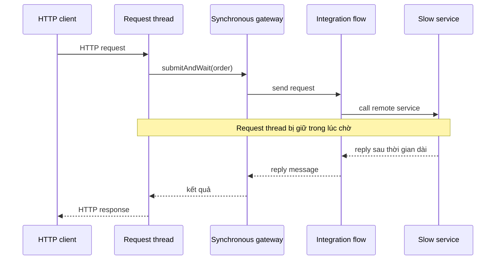
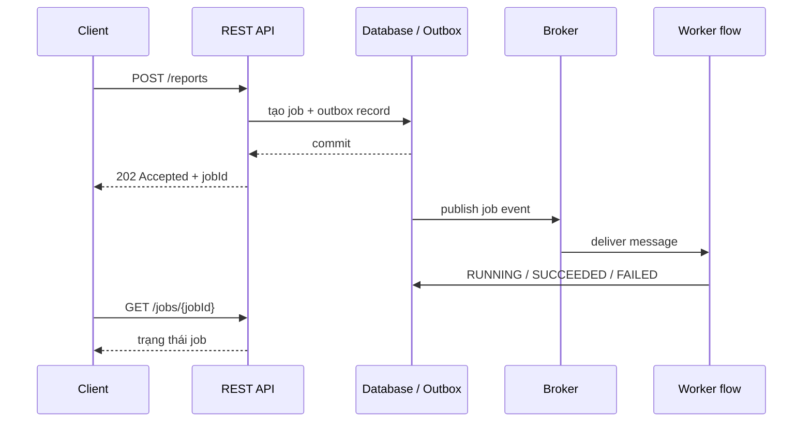

# Không giữ request thread qua flow không giới hạn

Một HTTP request hoặc một lời gọi gateway thường bắt đầu trên một request thread. Nếu message flow xử lý đồng bộ, thread đó tiếp tục chạy qua các endpoint cho đến khi flow trả kết quả hoặc ném exception. Khi một bước gọi dịch vụ chậm, chờ message khác, đợi aggregator đủ phần hoặc chạy công việc có thời lượng không xác định, request thread bị giữ trong toàn bộ khoảng thời gian đó.

Giữ request thread quá lâu làm giảm số request mà server có thể tiếp nhận đồng thời. Khi số request đang chờ tăng, servlet thread pool có thể cạn, request mới phải xếp hàng hoặc bị timeout dù CPU chưa bận. Với flow không có giới hạn thời gian hoàn tất rõ ràng, cần tách thời gian nhận request khỏi thời gian xử lý nghiệp vụ.

Điều đó không có nghĩa mọi flow đều phải bất đồng bộ. Một request ngắn, cần kết quả ngay và có thời gian xử lý được kiểm soát có thể chạy đồng bộ. Bài học này tập trung vào cách nhận diện flow dài, chọn điểm handoff phù hợp, trả kết quả qua `Future`/`CompletableFuture`, giới hạn executor và xử lý các hệ quả về transaction, context, timeout và độ tin cậy.

## 1. Request thread bị giữ như thế nào?

Trong flow đồng bộ, `DirectChannel` gọi handler trong cùng thread đã gửi message. Nếu controller gọi synchronous gateway, gateway gửi message vào flow rồi chờ reply. Request thread vẫn đang thực thi message flow trong thời gian đó.



Ví dụ:

```java
@MessagingGateway
public interface OrderGateway {

    @Gateway(requestChannel = "orders.input")
    OrderResult submit(Order order);
}
```

Với chữ ký trả về `OrderResult`, lời gọi gateway là request-reply đồng bộ. Nếu downstream chờ một API ngoài 20 giây, request thread có thể bị giữ khoảng thời gian đó. Nếu flow đợi một sự kiện có thể đến sau vài phút hoặc không bao giờ đến, giữ request thread là thiết kế không phù hợp.

### Một phép tính đơn giản về thread occupancy

Giả sử ứng dụng có 200 request threads và mỗi request đồng bộ giữ thread trung bình 5 giây. Khi 200 request cùng đến và đều chờ, server đã dùng hết 200 request threads. Request thứ 201 phải đợi dù CPU có thể vẫn còn khả năng xử lý.

Little's Law cho biết số request đồng thời trung bình xấp xỉ tốc độ request nhân với thời gian giữ request. Nếu tải đến là 40 request/giây và thời gian giữ thread trung bình là 5 giây, cần khoảng 200 request threads chỉ để duy trì tải đó, chưa kể burst và headroom.

Không nên giải quyết vấn đề bằng cách tăng request thread pool vô hạn. Thread vẫn là tài nguyên hữu hạn; khi flow chờ I/O lâu, tăng số thread chỉ đẩy giới hạn sang memory, connection pool hoặc dịch vụ downstream.

## 2. Xác định điểm cần tách request thread

Hãy xem xét handoff bất đồng bộ khi flow có một hoặc nhiều đặc điểm:

- Gọi API bên ngoài có latency cao hoặc biến động mạnh.
- Chờ phản hồi từ nhiều nhánh, aggregator hoặc scatter-gather.
- Xử lý file lớn, báo cáo, import/export hoặc batch.
- Chờ trạng thái từ một hệ thống khác mà thời điểm hoàn tất không xác định.
- Thực hiện nhiều side effect độc lập sau khi request đã được chấp nhận.
- Có thể hoàn tất sau khi HTTP connection đã đóng hoặc client không cần chờ kết quả.

Trước khi chuyển sang async, xác định hợp đồng của caller:

| Nhu cầu | Mô hình phù hợp |
| --- | --- |
| Cần kết quả ngay và thời gian xử lý ngắn, có giới hạn | Synchronous gateway/DirectChannel. |
| Cần kết quả sau nhưng không muốn giữ request thread | Asynchronous gateway trả `Future`/`CompletableFuture`, kết hợp async HTTP response nếu là web request. |
| Chỉ cần xác nhận đã nhận công việc | Send-and-forget hoặc durable queue; trả job ID/HTTP 202. |
| Công việc phải sống qua restart và cần retry bền vững | Broker hoặc persistent message store, thường kết hợp outbox/inbox. |
| Cần kết quả của nhiều nhánh | Scatter-gather/aggregator; nếu thời gian không giới hạn thì dùng async reply hoặc job resource. |

Không nên tách thread chỉ vì một handler chạy lâu hơn vài mili giây. Cần cân nhắc overhead chuyển thread, queue, observability và semantics lỗi. Chỉ tách khi nó cải thiện khả năng tiếp nhận request hoặc cách ly workload.

## 3. Phân biệt channel handoff và asynchronous gateway

Hai cơ chế thường bị nhầm lẫn:

**`ExecutorChannel`** chuyển invocation của một subscriber sang `TaskExecutor`. `send()` thường trở về nhanh sau khi task được chấp nhận, nhưng caller có thể vẫn phải chờ reply nếu đang gọi synchronous request-reply gateway.

**Asynchronous gateway** thay đổi hợp đồng của lời gọi gateway. Phương thức trả về `Future` hoặc `CompletableFuture`, nên caller nhận handle của kết quả và có thể tiếp tục công việc khác. Với gateway được cấu hình async executor, framework thực hiện invocation trên executor và trả future cho caller.

| Cấu hình | Handler chạy ở đâu? | Request thread có còn phải chờ reply? |
| --- | --- | --- |
| Synchronous gateway + `DirectChannel` | Thread gọi gateway. | Có; bị giữ cho đến khi flow trả hoặc lỗi. |
| Synchronous gateway + `ExecutorChannel` | Worker thread sau điểm handoff. | Có thể có; gateway vẫn chờ reply theo timeout. |
| Async gateway trả `CompletableFuture` và có async executor | Executor của gateway chạy invocation/flow. | Không cần chờ trong lời gọi ban đầu; caller nhận future. |
| Send message tới channel bất đồng bộ, không đợi reply | Worker thread xử lý. | Không chờ hoàn tất xử lý; chỉ biết kết quả dispatch theo semantics của channel. |

Điểm quan trọng: `reply-timeout` của synchronous gateway không thể ngắt một handler đang chạy lâu trong cùng thread. Timeout chỉ có tác dụng khi flow đã trả quyền điều khiển về gateway, chẳng hạn sau khi message được handoff sang thread khác và gateway đang đợi reply. Nếu downstream vẫn chạy đồng bộ, request thread vẫn bị giữ đến khi handler kết thúc.

## 4. Asynchronous gateway với CompletableFuture

Spring Integration hỗ trợ gateway method trả về `Future` hoặc `CompletableFuture`. Khi cấu hình async executor và method trả đúng kiểu `CompletableFuture` (không phải subclass tùy biến), framework thực hiện invocation trên executor và trả future ngay cho caller.

### Khai báo gateway

```java
@MessagingGateway(asyncExecutor = "orderGatewayExecutor")
public interface OrderGateway {

    @Gateway(requestChannel = "orders.input")
    CompletableFuture<OrderResult> submit(Order order);
}
```

Flow vẫn có thể nối bằng `DirectChannel` mặc định:

```java
@Configuration
class OrderFlowConfiguration {

    @Bean
    IntegrationFlow orderFlow(OrderService orderService) {
        return IntegrationFlow.from("orders.input")
            .handle(orderService, "process")
            .get();
    }
}
```

Vì gateway đã chạy invocation trên `orderGatewayExecutor`, downstream flow được gọi từ worker thread của gateway. Không cần thêm một `ExecutorChannel` ngay sau gateway nếu không có lý do cách ly workload riêng; chuyển thread nhiều lần làm tăng queueing và khó truy vết.

### Dùng future mà không block

```java
CompletableFuture<OrderResult> result = orderGateway.submit(order);

result.thenApply(this::toResponse)
      .thenAccept(this::publishResponse);
```

Các callback `thenApply`/`thenAccept` có thể chạy trên thread hoàn tất future nếu không chỉ định executor riêng. Callback nên ngắn và không block worker. Với bước xử lý nặng, dùng `thenApplyAsync(..., anotherExecutor)` và giới hạn executor tương ứng.

Đoạn code sau làm mất lợi ích của async:

```java
OrderResult result = orderGateway.submit(order).get();
```

`get()` giữ thread hiện tại cho đến khi kết quả sẵn sàng hoặc timeout. Nếu gọi nó trong controller, request thread lại bị giữ. Hãy trả future cho framework web hoặc chuyển sang job/status API nếu công việc không cần trả ngay.

### Cấu hình executor tường minh

Gateway dùng `SimpleAsyncTaskExecutor` mặc định trong một số trường hợp Future. Executor này tạo thread mới cho từng invocation thay vì tái sử dụng thread như một pool. Với tải server, nên cấu hình executor riêng để kiểm soát concurrency, queue và tên thread.

```java
@Configuration
class OrderExecutorConfiguration {

    @Bean("orderGatewayExecutor")
    ThreadPoolTaskExecutor orderGatewayExecutor() {
        ThreadPoolTaskExecutor executor = new ThreadPoolTaskExecutor();
        executor.setCorePoolSize(8);
        executor.setMaxPoolSize(16);
        executor.setQueueCapacity(100);
        executor.setKeepAliveSeconds(60);
        executor.setThreadNamePrefix("order-flow-");
        executor.setRejectedExecutionHandler(
            new ThreadPoolExecutor.AbortPolicy());
        executor.setWaitForTasksToCompleteOnShutdown(true);
        executor.setAwaitTerminationSeconds(30);
        return executor;
    }
}
```

Các con số chỉ là ví dụ để minh họa cách cấu hình, không phải giá trị tối ưu cho mọi ứng dụng. Chọn pool size dựa trên thời gian xử lý, tỷ lệ CPU/I/O, giới hạn connection pool và năng lực của dịch vụ downstream.

## 5. Trả CompletableFuture từ Spring MVC

Nếu flow được gọi từ REST controller, Spring MVC hỗ trợ kiểu trả về bất đồng bộ như `CompletableFuture`. Controller có thể trả future thay vì gọi `get()`; servlet request thread được giải phóng trong lúc kết quả đang được xử lý, và Spring MVC hoàn tất response khi future hoàn tất.

```java
@RestController
@RequestMapping("/orders")
class OrderController {

    private final OrderGateway orderGateway;

    OrderController(OrderGateway orderGateway) {
        this.orderGateway = orderGateway;
    }

    @PostMapping
    CompletableFuture<ResponseEntity<OrderResult>> submit(
            @RequestBody Order order) {
        return orderGateway.submit(order)
            .thenApply(ResponseEntity::ok);
    }
}
```

Đây là asynchronous request processing của Spring MVC. Nó giải phóng servlet thread trong thời gian chờ, nhưng HTTP connection và request lifecycle vẫn mở cho đến khi response hoàn tất hoặc timeout. Nếu công việc có thể kéo dài nhiều phút, giữ client connection mở cũng không phải lựa chọn tốt; hãy dùng job resource và trả `202 Accepted`.

WebFlux có mô hình non-blocking riêng. Không gọi `.block()` trên event-loop thread. Nếu một message flow gọi blocking JDBC hoặc SDK, cần chuyển blocking work sang scheduler/executor phù hợp; chỉ đổi kiểu trả về thành `Mono` không tự biến code blocking thành non-blocking.

## 6. ExecutorChannel khi cần tách một nhánh

Nếu không cần asynchronous gateway nhưng muốn tách một bước trong flow, dùng `ExecutorChannel` hoặc DSL channel có executor. Ví dụ:

```java
@Configuration
class OrderAsyncChannelConfiguration {

    @Bean("orderWorkerExecutor")
    ThreadPoolTaskExecutor orderWorkerExecutor() {
        ThreadPoolTaskExecutor executor = new ThreadPoolTaskExecutor();
        executor.setCorePoolSize(6);
        executor.setMaxPoolSize(12);
        executor.setQueueCapacity(80);
        executor.setThreadNamePrefix("order-worker-");
        return executor;
    }

    @Bean(name = "orders.async")
    MessageChannel orderAsyncChannel(
            @Qualifier("orderWorkerExecutor") TaskExecutor executor) {
        return new ExecutorChannel(executor);
    }

    @Bean
    IntegrationFlow orderWorkerFlow(OrderWorker worker) {
        return IntegrationFlow.from("orders.async")
            .handle(worker, "process")
            .get();
    }
}
```

Khi gửi message vào `orders.async`, channel dispatch tới một subscriber trên executor. Đây là point-to-point handoff. Nó hữu ích cho command không cần chờ reply hoặc cho một nhánh downstream có transaction/error handling riêng.

Nếu synchronous gateway gửi vào `ExecutorChannel` rồi chờ reply, gateway caller vẫn có thể bị giữ để đợi kết quả. Dùng async gateway khi cần thay đổi hợp đồng request-reply và giải phóng caller ngay.

`ExecutorChannel` không chia sẻ transaction context giữa sender và handler. Nó cũng có thể chạy task trên caller thread khi executor dùng `CallerRunsPolicy` và đã quá tải. Vì thế, không xem việc thêm executor là bảo đảm tuyệt đối rằng request thread không bao giờ thực thi công việc dài.

## 7. Công việc dài: trả job ID thay vì giữ HTTP request

Với báo cáo, import dữ liệu hoặc xử lý có thể kéo dài nhiều phút, mô hình job resource thường phù hợp hơn Future gắn với HTTP connection:

1. API nhận request và validate dữ liệu.
2. Ứng dụng tạo `jobId`, lưu trạng thái `ACCEPTED` cùng payload/tham chiếu tới dữ liệu.
3. Công việc được publish tới broker hoặc persistent queue.
4. API trả `202 Accepted` và URL truy vấn trạng thái job.
5. Worker cập nhật `RUNNING`, `SUCCEEDED` hoặc `FAILED`.
6. Client truy vấn trạng thái hoặc nhận callback/webhook khi hoàn tất.



Transactional outbox giúp lưu thay đổi nghiệp vụ và sự kiện cần publish trong cùng database transaction. Một publisher riêng gửi outbox tới broker và đánh dấu đã gửi; worker phải idempotent vì message có thể được giao lại. Queue trong memory của một executor không thay thế broker/persistent store nếu yêu cầu công việc không được mất khi process restart.

## 8. Bounded executor, queue và backpressure

Tách request thread chỉ có ý nghĩa khi executor được giới hạn. Nếu queue không giới hạn, hệ thống có thể nhận vô hạn task trong khi worker xử lý chậm dần, dẫn tới heap tăng, latency cao và cuối cùng `OutOfMemoryError`.

Với `ThreadPoolTaskExecutor`, khi submit task, executor thường dùng worker đến `corePoolSize`, sau đó đưa task vào queue. Khi queue đầy, nó mới tăng worker vượt core đến `maxPoolSize`; khi cả queue và pool đạt giới hạn, task bị reject.

| Chính sách | Hành vi | Hệ quả với request thread |
| --- | --- | --- |
| `AbortPolicy` | Ném lỗi từ chối khi pool/queue đầy. | Caller nhận tín hiệu quá tải; có thể ánh xạ sang HTTP 429/503. |
| `CallerRunsPolicy` | Caller tự chạy task bị từ chối. | Có thể giữ request thread lâu; backpressure mạnh nhưng không còn cách ly thread. |
| `DiscardPolicy` | Bỏ task bị từ chối. | Request có thể tưởng dispatch thành công dù công việc bị mất; không phù hợp job nghiệp vụ. |
| `DiscardOldestPolicy` | Bỏ task cũ nhất đang chờ rồi thử submit task mới. | Có thể làm mất công việc cũ; chỉ dùng khi semantics cho phép. |

Nếu yêu cầu là request thread không chạy công việc dài, tránh `CallerRunsPolicy` ở executor được gọi trực tiếp từ request path. Dùng reject/fail-fast, trả lỗi quá tải hoặc persist vào broker. Nếu chọn `AbortPolicy`, xử lý `TaskRejectedException`/`RejectedExecutionException` ở boundary để caller nhận response rõ ràng.

Queue capacity phải phù hợp với thời gian chờ tối đa. Một queue có thể chứa 100 task nhưng nếu mỗi task mất 30 giây và pool chỉ có 4 worker, task cuối có thể phải chờ rất lâu. Giới hạn số phần tử mà không tính queue wait time vẫn có thể tạo latency vượt xa SLA.

## 9. Đừng giữ worker thread trong khi chờ một tác vụ khác

Sau khi giải phóng request thread, không nên vô tình tạo một điểm nghẽn mới trong worker pool. Ví dụ, một task trên pool A gọi `future.get()` để chờ task khác cũng cần pool A. Nếu tất cả worker của pool A đều đang block chờ các task nằm trong queue của chính pool đó, hệ thống có thể thread-starvation deadlock.

Các nguyên tắc:

- Tránh `.get()`, `.join()` hoặc `CountDownLatch.await()` trong worker nếu tác vụ được chờ cần cùng pool.
- Dùng composition của `CompletableFuture` (`thenCompose`, `thenCombine`, `allOf`) thay vì block chờ.
- Tách pool theo loại workload khi có tác vụ blocking dài và tác vụ latency-sensitive.
- Không dùng chung một pool nhỏ cho gateway invocation, HTTP client callback và các tác vụ cần hoàn tất để giải phóng chính pool đó.
- Đặt timeout ở lời gọi I/O và giới hạn concurrency tới dịch vụ đích.

Ví dụ ghép hai lời gọi bất đồng bộ mà không block worker:

```java
CompletableFuture<Customer> customer = customerClient.fetchAsync(order.customerId());
CompletableFuture<Inventory> inventory = inventoryClient.checkAsync(order.items());

CompletableFuture<OrderContext> context = customer.thenCombine(
    inventory,
    (customerResult, inventoryResult) ->
        new OrderContext(order, customerResult, inventoryResult));
```

Đoạn code này giả định hai client thực sự trả về future bất đồng bộ. Nếu một client chỉ bọc lời gọi blocking trong `CompletableFuture` nhưng dùng common pool không giới hạn phù hợp, vấn đề thread vẫn có thể xuất hiện ở pool khác.

## 10. Timeout, deadline và cancellation

Timeout là giới hạn thời gian chờ kết quả; nó không tự động dừng công việc đang chạy.

- `reply-timeout` của synchronous gateway giới hạn thời gian chờ reply sau khi flow trả quyền điều khiển về gateway. Nó không cắt ngang handler đang chạy đồng bộ trên caller thread.
- `Future.get(timeout, unit)` làm caller ngừng chờ khi hết hạn nhưng vẫn block caller trong khoảng thời gian đó.
- `CompletableFuture.orTimeout(...)` hoàn tất future bằng `TimeoutException`; nó không bảo đảm underlying operation bị interrupt hoặc hủy.
- `Future.cancel(true)` chỉ yêu cầu interrupt theo semantics của task/executor. Code đang chạy phải hợp tác với interruption và các client I/O phải có timeout riêng.
- Client HTTP ngắt kết nối không tự động có nghĩa message flow đã bị hủy.

Nên truyền một deadline hoặc timeout budget qua header/message metadata để từng bước biết thời gian còn lại. Nếu tổng SLA là 10 giây, không nên để ba lời gọi downstream mỗi lời gọi tự chờ 10 giây. Mỗi bước cần dùng budget còn lại và dừng sớm khi deadline đã hết.

```java
CompletableFuture<OrderResult> result = orderGateway.submit(order)
    .orTimeout(8, TimeUnit.SECONDS);
```

Ví dụ trên chỉ giới hạn thời gian hoàn tất future ở phía caller. Để dừng I/O thật sự, cần cấu hình connect/read/response timeout của HTTP client, timeout database, cancellation token hoặc interrupt handling phù hợp ở worker.

## 11. Transaction và request context không tự đi qua thread boundary

Khi async gateway hoặc `ExecutorChannel` chuyển sang worker thread, transaction đang gắn với request thread không được truyền tự động. Không nên mở transaction ở controller rồi mong worker tiếp tục sử dụng transaction đó.

Hãy đặt transaction tại service/endpoint thực hiện phần cập nhật dữ liệu trên worker thread:

```java
@Service
class OrderService {

    @Transactional
    public OrderResult process(Order order) {
        // Đọc/ghi dữ liệu trong transaction của worker invocation.
        return ...;
    }
}
```

Không giữ transaction database mở trong lúc chờ remote API lâu. Thường nên chia quy trình thành các bước transaction ngắn, lưu trạng thái trung gian và dùng idempotency/outbox để tiếp tục an toàn.

Các dữ liệu gắn với `ThreadLocal` như MDC, security context, locale và một số tracing context cũng không tự xuất hiện ở worker. Dùng message headers cho correlation ID, tenant ID và deadline; dùng `TaskDecorator`, Micrometer context propagation hoặc delegating executor tương ứng cho context cần truyền. Luôn restore/clear context sau task để tránh rò dữ liệu giữa các request.

## 12. Error handling và kết quả bất đồng bộ

Với synchronous gateway, exception downstream thường có thể được truyền về caller trong lời gọi method. Với async gateway, lỗi xảy ra trong worker sẽ hoàn tất `Future`/`CompletableFuture` ở trạng thái exceptional. Caller cần xử lý lỗi bằng `exceptionally`, `handle` hoặc `whenComplete`, và nên giữ nguyên cause để log/metrics.

```java
return orderGateway.submit(order)
    .thenApply(ResponseEntity::ok)
    .exceptionally(ex -> {
        Throwable cause = unwrapCompletionException(ex);
        log.error("Order flow failed", cause);
        return ResponseEntity.status(HttpStatus.SERVICE_UNAVAILABLE).build();
    });
```

Trong hệ thống thật, ánh xạ lỗi cần phân biệt validation, business rejection, timeout, dependency outage và executor overload. Không trả 503 cho mọi lỗi một cách máy móc; dùng status phù hợp với hợp đồng API.

Với message flow send-and-forget qua `ExecutorChannel`, lỗi worker không thể quay lại lời gọi `send()` đã hoàn tất. Cần error channel để chuyển `ErrorMessage` tới error flow, hoặc dùng broker có retry/dead-letter. Một future chỉ theo dõi được lỗi nếu gateway/flow trả kết quả future tương ứng; đừng giả định async dispatch tự tạo completion handle cho từng subscriber.

## 13. Observability: biết request thread đã được giải phóng

Để xác nhận thread boundary hoạt động như thiết kế, log thread name và thời gian tại các điểm:

1. Vào controller/gateway.
2. Trước và sau khi submit async invocation.
3. Bắt đầu handler trên worker.
4. Kết thúc handler hoặc phát sinh lỗi.
5. Hoàn tất future và trả HTTP response.

Theo dõi các metric:

- Request thread active, queue và request latency của web server.
- Executor active count, pool size, queue depth và số task rejected.
- Thời gian chờ trong executor queue tách biệt với thời gian chạy handler.
- Số future đang chờ, timeout, cancellation và exceptional completion.
- Downstream connection pool utilization, timeout và error rate.
- Số job `ACCEPTED`, `RUNNING`, `FAILED` quá hạn nếu dùng job resource.

| Triệu chứng | Nguyên nhân thường gặp | Cách kiểm tra |
| --- | --- | --- |
| Request thread vẫn bận dù đã thêm `ExecutorChannel` | Synchronous gateway vẫn chờ reply hoặc controller gọi `.get()`. | Kiểm tra chữ ký gateway và call stack của controller. |
| Request trả về nhanh nhưng task không chạy | Executor queue đang chờ, executor shutdown hoặc không có subscriber. | Kiểm tra queue depth, active count, rejection và channel subscription. |
| Request thread đôi lúc chạy handler dài | `CallerRunsPolicy` được kích hoạt khi executor quá tải. | Kiểm tra rejection policy và thread name khi handler bắt đầu. |
| Latency tăng dù worker không bận | Task nằm trong queue hoặc chờ connection pool/downstream. | Đo queue wait time và thời gian I/O riêng. |
| Future timeout nhưng side effect vẫn xảy ra | Timeout không hủy task/remote operation. | Kiểm tra cancellation, deadline propagation và idempotency. |
| Worker thiếu trace/security context | `ThreadLocal` không được propagate. | Kiểm tra TaskDecorator/context propagation và message headers. |
| Task mất khi restart | Chỉ dùng executor queue in-memory. | Dùng persistent broker/store hoặc transactional outbox. |

## 14. Quy trình thiết kế flow không giữ request thread

1. Xác định SLA của request và thời gian tối đa mà request thread được phép giữ.
2. Phân loại flow: đồng bộ ngắn, async request-reply hay job dài hạn.
3. Chọn một điểm handoff rõ ràng; tránh thêm nhiều executor/channel liên tiếp mà không có lý do.
4. Nếu cần kết quả sau, dùng async gateway trả `CompletableFuture`; không gọi `get()` trong controller.
5. Nếu công việc dài và không cần giữ HTTP connection, persist job/event và trả `202 Accepted` cùng job ID.
6. Dùng bounded executor queue, rejection policy và giới hạn concurrency của downstream.
7. Đặt transaction tại worker boundary; truyền correlation/deadline/context một cách tường minh.
8. Cấu hình timeout/cancellation cho từng I/O; nhớ rằng timeout future không tự dừng công việc.
9. Quan sát request threads, executor queue, task latency, rejection và future completion.
10. Kiểm thử tải, overload, worker failure, client disconnect, timeout và restart để xác nhận semantics.

## 15. Điểm cần nhớ

- Flow đồng bộ qua `DirectChannel` giữ request thread cho đến khi downstream trả kết quả hoặc lỗi.
- `ExecutorChannel` tách handler khỏi sender thread, nhưng synchronous gateway vẫn có thể chờ reply và giữ request thread.
- Async gateway trả `Future`/`CompletableFuture` mới cho phép caller nhận handle kết quả mà không chờ trong lời gọi ban đầu.
- Không gọi `.get()`/`.join()` trong controller nếu mục tiêu là giải phóng request thread.
- Executor cần queue hữu hạn và rejection policy rõ ràng. `CallerRunsPolicy` có thể đưa công việc dài trở lại request thread.
- Với công việc dài, trả `202 Accepted` và job ID; dùng broker/persistent store nếu công việc phải tồn tại qua restart.
- Transaction, `ThreadLocal`, security và tracing context không tự truyền qua worker thread.
- Timeout không đồng nghĩa cancellation; cần deadline, I/O timeout, idempotency và chính sách dừng task.

## Tài liệu tham khảo

- [Spring Integration Reference — Messaging Gateways: Asynchronous Gateway](https://docs.spring.io/spring-integration/reference/gateway.html)
- [Spring Integration Reference — ExecutorChannel](https://docs.spring.io/spring-integration/reference/channel/implementations.html)
- [Spring Integration Reference — Message Channel Configuration](https://docs.spring.io/spring-integration/reference/channel/configuration.html)
- [Spring Framework Reference — Task Execution and Scheduling](https://docs.spring.io/spring-framework/reference/integration/scheduling.html)
- [Spring Framework Reference — Asynchronous Requests in Spring MVC](https://docs.spring.io/spring-framework/reference/web/webmvc/mvc-ann-async.html)
