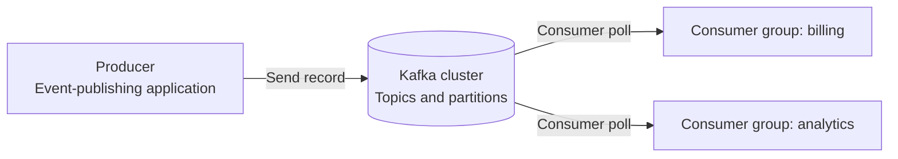
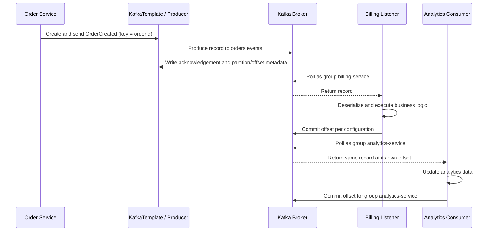

# Roles of Producer, Consumer, and Broker

In a system using Apache Kafka, applications often need to exchange events without calling each other directly. For example, when the order service creates a new order, the payment service needs to know to process payment, and the analytics service needs to receive the data to update reports. If the order service had to call each service sequentially, it would depend on the availability and response speed of every recipient.

Kafka solves this problem with an event stream stored in a cluster. The application sending events plays the role of **producer**; the application reading events plays the role of **consumer**; and the Kafka servers that receive, store, and serve events to clients are called **brokers**. These three roles work together while keeping distinct responsibilities. Understanding these boundaries helps you design messaging flows that are scalable, resilient to failures, and easy to operate with Spring Kafka.

## 1. The Big Picture

The producer writes a record to a Kafka topic. The broker receives the record, stores it in the corresponding partition, and maintains replicas according to replication settings. The consumer actively fetches records from the broker, executes business logic, and updates its reading progress using offsets.



In the diagram, two consumer groups read the same topic. The `billing` group handles payment processing; the `analytics` group updates analytics data. Each group has independent reading progress, so the billing group reading a record does not make it disappear for the analytics group.

A Kafka record typically has the following components:

| Component | Meaning |
| --- | --- |
| Topic | Logical stream name containing records of the same type or purpose |
| Partition | A subdivision of a topic organized as an ordered log |
| Offset | Position of a record within a partition |
| Key | Value used to route records to partitions; often used to group related events |
| Value | Main content of the event, such as JSON describing an order |
| Headers | Key-value metadata, which may contain event type, trace ID, or schema version |
| Timestamp | Time attached to the record according to producer or broker timestamp configuration |

A topic is a logical concept; a partition is the unit of storage and ordered reading. An offset only has meaning within a single partition, not as a global sequence number across the entire topic or cluster.

## 2. Producer: Creating and Sending Events

**A producer is a client that creates records and sends them to Kafka.** A producer typically lives inside a business application, such as Order Service, Payment Service, or a data ingestion job. The producer decides which events to emit, the content of each event, and how the event is routed.

### 2.1. Producer Responsibilities

- **Emit events at the right time:** after a meaningful business change occurs, the application creates an event such as `OrderCreated`, `PaymentSucceeded`, or `InventoryReserved`. Event names and semantics should describe what happened, rather than merely describing an internal function call.
- **Define the data contract:** the producer aligns payload structure, field names, data types, and schema versions with consumers. A breaking change can prevent older consumers from reading new records.
- **Serialize data:** convert application objects into bytes for transmission over Kafka. Common examples are JSON, Avro, or Protobuf. The producer serializer must be compatible with the consumer deserializer.
- **Choose key and partition:** the key helps route related records to the same partition via the partitioner. With the default partitioner, a non-`null` key is normally hashed to select a partition. Therefore, using `orderId` as the key usually sends events for the same order to the same partition and preserves their relative order.
- **Send and handle send results:** send records, track failures, retry according to an appropriate policy, and record metadata such as topic, partition, and offset when observability is needed.

The producer does not send directly to a specific consumer. The producer sends records to Kafka; the broker stores the records and consumers independently read at their own pace. Nor can the producer conclude that consumer business logic has completed simply because the broker acknowledged the write.

### 2.2. Keys Determine How Records Are Distributed

Suppose Order Service emits three events:

| Event | Key | Meaning |
| --- | --- | --- |
| `OrderCreated` | `ORD-100` | Order was created |
| `OrderPaid` | `ORD-100` | Order was paid |
| `OrderCancelled` | `ORD-200` | Another order was cancelled |

When `orderId` is used as the key, events with key `ORD-100` are normally routed to the same partition. Kafka maintains record order within each partition, so a consumer can read `OrderCreated` before `OrderPaid` if the producer sends them in that order to the same partition.

Without a key, a producer can still send records; the partitioner distributes them according to its null-key strategy. However, applications should not rely on that to preserve ordering for a specific business entity.

Ordering is guaranteed only within a single partition. Kafka does not provide global ordering across multiple partitions. If the partition count is increased or the partitioner changes, the same key may map to a different partition; this must be accounted for when designing long-term ordering requirements.

### 2.3. What Acknowledgements Does a Producer Receive?

Sending a record is usually asynchronous. The send result indicates whether Kafka acknowledged the write according to the producer's configuration. Important settings include:

- `acks=0`: the producer does not wait for broker acknowledgement; latency is low, but it is hard to know if the record was written.
- `acks=1`: the partition leader acknowledges after writing the record to its local log. If the leader fails before replicas receive the record, the record may be lost.
- `acks=all`: the producer waits for replicas currently in the ISR (in-sync replicas) to acknowledge according to the Kafka protocol. Combined with an appropriate `min.insync.replicas` setting, this increases data durability.

Retries help recover from transient failures, but retries must also be designed alongside idempotence and consumer handling. An idempotent producer helps avoid creating duplicate Kafka records from retries within the scope of Kafka's supported producer mechanism and session. That does not automatically guarantee that a business side effect outside Kafka happens only once.

## 3. Broker: Receiving, Storing, and Serving Records

**A broker is a Kafka server process that accepts requests from producers and consumers, manages the partitions it stores, and participates in cluster coordination.** A Kafka cluster typically consists of multiple brokers. Each broker can store multiple partitions or replicas belonging to different topics.

### 3.1. Brokers Store Records in Partition Logs

Upon receiving a record, the broker routes the request to the leader of the target partition. The leader appends the record to the log and assigns it an offset. Records in a partition are read in ascending offset order.

For example, partition `orders.events-0` might contain:

| Partition | Offset | Key | Event |
| --- | ---: | --- | --- |
| `orders.events-0` | 0 | `ORD-100` | `OrderCreated` |
| `orders.events-0` | 1 | `ORD-100` | `OrderPaid` |
| `orders.events-0` | 2 | `ORD-200` | `OrderCreated` |

Offset `1` only identifies the second record in partition `orders.events-0`. Another partition can also have offset `1`, but that is a different record.

### 3.2. Brokers Coordinate Replication

A partition can have multiple replicas across different brokers. One replica acts as the **leader**; the remaining replicas are **followers** that replicate data from the leader. Under normal operation, producers write to the leader and consumers read from the leader. If the broker hosting the leader fails, Kafka can elect an eligible replica in the ISR as the new leader.

Replication improves fault tolerance, but not all configurations are equally safe. The number of replicas, `min.insync.replicas`, `acks`, ISR health, and cluster deployment topology together determine the level of data protection. Increasing the replication factor alone without configuring producer acks and ISR thresholds properly is not enough to achieve desired durability.

### 3.3. Brokers Retain Data Based on Retention Policies

Kafka stores records in logs and manages data lifecycle according to retention policies, such as time-based or size-based retention. A record does not automatically disappear just because a consumer has read it. Each consumer group keeps its own offset to track progress; multiple groups can read the same record as long as it is still retained.

For topics configured with log compaction, Kafka can retain the latest value per key after compaction. Compaction differs from deleting records immediately after consumer processing. Once a record expires or is compacted, consumers cannot assume all historical data remains available for replay.

### 3.4. Brokers Do Not Execute Business Logic for Consumers

Brokers are responsible for storage, data transfer, replication, metadata, and part of consumer group coordination. A broker does not know whether an order is valid, does not call the application's business database, and does not execute payment logic. Those tasks belong to consumers or business services handling the events.

Brokers also participate in consumer group coordination, including helping determine which consumer receives which partitions. When group membership changes or the partition count changes, Kafka may trigger a rebalance to reassign partitions.

## 4. Consumer: Reading and Processing Events

**A consumer is a client that fetches records from Kafka and performs work on the receiving side.** A consumer can be a microservice, a data-processing application, or a scheduled job. The consumer decides where to start reading, how to process records, and when to record progress.

### 4.1. Consumers Actively Poll for Data

Kafka uses a pull model: the consumer sends `poll` requests to fetch new records from the broker. The broker does not actively invoke an application callback whenever a new record arrives. In Spring Kafka, the listener container manages the poll loop underneath; developers typically only declare a method with `@KafkaListener`.

A consumer performs these main tasks:

1. Subscribe to topics and join a consumer group.
2. Poll records from assigned partitions.
3. Deserialize keys/values and validate input data.
4. Execute business logic, such as recording a payment or updating inventory.
5. Record processed offsets according to the configured commit mechanism.
6. Apply retries, error handling, or route failed records to a dead-letter topic according to application policy.

A consumer does not delete records from Kafka after reading them. It updates the group's offset so Kafka knows how far the group has read.

### 4.2. Offsets Are Progress Specific to Each Consumer Group

An offset is a record's position within a partition. Kafka stores committed progress per consumer group and partition pair. Therefore, the same partition may be read up to offset `120` by the `billing` group, while the `analytics` group has only read up to offset `95`.

When a consumer restarts, it usually resumes from the group's committed offset. `auto.offset.reset` is used only when the group has no valid offset for a partition, such as on initial startup or when the old offset is outside the retained log range; it does not mean the consumer always reads from the beginning on every restart. Setting `earliest` requests starting from the earliest readable record, whereas `latest` starts from new records at the end of the log.

Commit timing is critical:

- If you commit the offset before business processing succeeds, the application may skip a record if it crashes after committing.
- If business processing completes but the consumer crashes before committing, the record may be read and processed again after restart or rebalance.

Therefore, many systems adopt **at-least-once** processing: accepting that a record may be redelivered and making business operations idempotent. For example, using an `eventId` with a unique constraint avoids recording the same payment event twice. Commit settings, retries, and transactions must be chosen based on concrete data requirements.

### 4.3. Consumer Groups and Scalability

A consumer group is a set of consumers sharing the work of reading a topic. Within a group, at any given time, each partition is assigned to at most one consumer. This allows consumers in the group to process in parallel while preserving read order within each partition.

Suppose a topic has 4 partitions:

| Consumers in Group | Illustrative Assignment | Consequence |
| ---: | --- | --- |
| 1 | One consumer receives all 4 partitions | Can read all partitions, processed sequentially per partition |
| 2 | Each consumer receives 2 partitions | Increases parallel reading capacity |
| 4 | Each consumer receives 1 partition | Can utilize full partition-level parallelism |
| 6 | 4 consumers receive partitions, 2 consumers have none | The two extra consumers do not increase parallelism for this topic |

The number of partitions limits how many consumers in the same group can work in parallel on that topic. Adding consumers beyond the partition count does not automatically increase throughput. Conversely, increasing partitions requires considering broker load, key-based ordering, and data distribution strategy.

Two different consumer groups can both read the entire topic. This is how one event serves multiple purposes without the producer knowing the list of consumers. Each group has its own offsets, so the pace or failures of one group do not directly alter the progress of another.

## 5. Producer, Broker, and Consumer in Spring Kafka

Spring Kafka provides components that let Java applications work with Kafka without managing the entire client protocol directly. The two most common components are `KafkaTemplate` on the sending side and `@KafkaListener` on the receiving side.

### 5.1. Connection and Serializer Configuration

The example below uses strings for both key and value to focus on the send/receive flow. In real applications, the value is usually JSON or a schema-based format; in that case, configure matching serializers/deserializers and manage schema compatibility.

```yaml
spring:
  kafka:
    bootstrap-servers: localhost:9092
    producer:
      key-serializer: org.apache.kafka.common.serialization.StringSerializer
      value-serializer: org.apache.kafka.common.serialization.StringSerializer
      acks: all
    consumer:
      group-id: billing-service
      key-deserializer: org.apache.kafka.common.serialization.StringDeserializer
      value-deserializer: org.apache.kafka.common.serialization.StringDeserializer
      auto-offset-reset: earliest
```

`bootstrap-servers` is the address of one or more brokers used to initiate connections and fetch cluster metadata. Clients are not pinned to a single broker: after receiving metadata, the Kafka client connects directly to the broker holding the leader of the target partition.

In the example, `acks: all` instructs the producer to wait for acknowledgements from in-sync replicas according to Kafka's protocol. Actual protection also depends on replication settings and `min.insync.replicas` on the broker/topic. `auto-offset-reset: earliest` only affects groups without a valid offset; a group with an existing offset resumes from its committed progress.

### 5.2. Sending Events with KafkaTemplate

Suppose the application has an `OrderCreated` event and wants to use `orderId` as the key:

```java
public record OrderCreated(
        String eventId,
        String orderId,
        BigDecimal total
) {}
```

The producer serializes the event to JSON and sends it using `KafkaTemplate`. The example uses Spring Kafka 3.x, where `send` returns a `CompletableFuture`. Imports and the `log` logger declaration are omitted to focus on the processing flow; add them according to your project structure when using in a project:

```java
@Service
public class OrderEventPublisher {

    private final KafkaTemplate<String, String> kafkaTemplate;
    private final ObjectMapper objectMapper;

    public OrderEventPublisher(
            KafkaTemplate<String, String> kafkaTemplate,
            ObjectMapper objectMapper
    ) {
        this.kafkaTemplate = kafkaTemplate;
        this.objectMapper = objectMapper;
    }

    public void publish(OrderCreated event) throws JsonProcessingException {
        String payload = objectMapper.writeValueAsString(event);

        kafkaTemplate.send("orders.events", event.orderId(), payload)
                .whenComplete((result, error) -> {
                    if (error != null) {
                        // Log/record metrics and route the error to an appropriate handler.
                        log.error("Failed to send event {}", event.eventId(), error);
                        return;
                    }

                    RecordMetadata metadata = result.getRecordMetadata();
                    log.info(
                            "Sent event {} to topic={}, partition={}, offset={}",
                            event.eventId(),
                            metadata.topic(),
                            metadata.partition(),
                            metadata.offset()
                    );
                });
    }
}
```

In this example, `orders.events` is the topic, `event.orderId()` is the key, and the JSON string is the value. `KafkaTemplate` uses a producer factory to create the Kafka producer and perform serialization as configured. Returning a future lets the application observe the send outcome without blocking the calling thread while waiting for the broker response.

When the future completes successfully, the metadata reports which partition and offset the record was written to as acknowledged by Kafka. This is an acknowledgement at the messaging layer; it does not prove that `Billing Service` has read or processed the event.

### 5.3. Receiving Events with @KafkaListener

On the receiving side, Spring Kafka creates and manages the listener container. The container uses a Kafka consumer to poll records, then invokes the method annotated with `@KafkaListener`:

```java
@Component
public class BillingEventListener {

    private final ObjectMapper objectMapper;
    private final BillingService billingService;

    public BillingEventListener(
            ObjectMapper objectMapper,
            BillingService billingService
    ) {
        this.objectMapper = objectMapper;
        this.billingService = billingService;
    }

    @KafkaListener(topics = "orders.events")
    public void onOrderCreated(String payload) throws JsonProcessingException {
        OrderCreated event = objectMapper.readValue(payload, OrderCreated.class);
        billingService.handleOrderCreated(event);
    }
}
```

The listener uses group ID `billing-service` from the consumer configuration. When the listener finishes processing, the listener container manages offset recording according to the configured `AckMode` and commit settings. If business logic requires manual confirmation, manual acknowledgment can be configured; the listener method then accepts an `Acknowledgment` parameter and calls `acknowledge()` only after completing the corresponding work. Understand retry and commit semantics thoroughly before changing the ack mode.

Another group, such as `analytics-service`, can subscribe to the same topic for analytics processing. That group has independent offsets and does not require Order Service to send a separate copy of the event.

### 5.4. Complete Execution Flow

For the order example, the data flow proceeds as follows:

1. Order Service saves the order and creates an `OrderCreated` event with `eventId`, `orderId`, and required data.
2. `OrderEventPublisher` serializes the event and sends the record to topic `orders.events` via `KafkaTemplate`, using `orderId` as the key.
3. Kafka routes the record to the appropriate partition. The partition leader appends the record to its log, assigns an offset, and coordinates replication.
4. The producer receives the send result according to `acks` configuration. This result reflects the write status in Kafka.
5. Billing Service's listener container polls records from partitions assigned to the `billing-service` group.
6. The `onOrderCreated` method deserializes the payload and invokes billing business logic.
7. When processing meets commit conditions, the listener container records the group's offset. If the consumer fails before committing, the record may be redelivered.
8. Analytics Service reads the record with its own group, processes analytics data, and commits its offset independently.



## 6. Responsibility Boundaries and Common Misconceptions

| Component | Responsible For | Not Responsible For |
| --- | --- | --- |
| Producer | Creating events, formatting data, choosing keys, sending records, and tracking send results | Guaranteeing that consumers have completed business processing |
| Broker | Accepting requests, storing records, assigning offsets, replicating, serving data, and assisting group coordination | Executing application business logic |
| Consumer | Polling records, deserializing, running business logic, managing offsets, retries, and error handling | Deciding record retention expiration or deleting records from a topic merely because they were read |

Several misconceptions to avoid:

- **"Producers send messages directly to consumers."** In reality, producers send records to Kafka. Consumers independently poll data from brokers.
- **"Once a consumer reads a message, it gets deleted."** The group's offset advances; the record remains retained according to retention/compaction and can be read by other groups.
- **"A topic only has one consumer."** Multiple groups can read the same topic. Consumers within the same group share partitions.
- **"Adding more consumers always increases throughput."** Parallelism within a group is bounded by the number of partitions and the capacity of brokers, network, consumers, and target databases.
- **"Broker acknowledgement means business processing succeeded."** The broker only acknowledges writing the record according to configuration. A consumer might not have read it yet, might be retrying, or might fail while processing it.
- **"Kafka guarantees everything exactly-once."** Kafka provides idempotent producer and transaction mechanisms, but effects on external systems still require appropriate transactional or idempotent design.

## 7. How to Design an Event Flow

When designing a messaging flow, start from business requirements and then divide responsibilities:

1. **Define events and data contracts.** Specify which events are emitted, the meaning of each field, a unique `eventId`, and how to evolve schemas without breaking existing consumers.
2. **Choose keys by the entity requiring ordering.** If events for an order must be processed in order, use `orderId` as the key and ensure those events are sent to the same topic/partition using a consistent strategy.
3. **Choose partition counts based on throughput and parallelism.** Estimate read/write rates, record sizes, desired concurrent consumers, and broker capacity. Partition counts affect load distribution and key-based ordering.
4. **Choose replication and send acknowledgements.** Weigh replication factor, `min.insync.replicas`, and `acks` against durability, availability, and latency requirements.
5. **Choose consumer groups by processing purpose.** Each independent business application typically has its own group. Instances of the same application share a group to scale processing.
6. **Define commit and duplicate-handling strategies.** Choose auto/manual acknowledgment, retries, dead-letter topics, and idempotency mechanisms matching the impact of redelivery.
7. **Monitor all three sides.** Producers need monitoring for send failures and latency; brokers need monitoring for disk usage, replication, and partition health; consumers need monitoring for lag, processing errors, retries, and record processing time.

In systems that must publish events after updating a database, there is another crucial concern: database writes and Kafka sends are not automatically atomic together. If the application commits to the database but the Kafka send fails, business state and the event stream can drift out of sync. Transactional outbox is a common design pattern: the application writes both the business change and an outbox record within the same database transaction, and a separate process publishes outbox records to Kafka. This pattern helps manage consistency between databases and messaging; it still requires handling duplicate publishing and idempotent consumers.

## 8. Self-Check

1. If a producer receives an `acks=all` acknowledgement, can it conclude that Billing Service has processed the order? Why or why not?
2. Why can two consumer groups read the same record without causing data loss for each other?
3. If a topic has 3 partitions but a consumer group runs 5 consumers, what happens to the other two consumers?
4. Why should `orderId` be used as the key when ordering of events for the same order must be preserved?
5. If a consumer processes successfully but crashes before committing the offset, what must the application prepare to prevent duplicate business side effects?

If you can answer these questions, you can distinguish the three core roles: the producer creates and sends records, the broker stores and serves records, and the consumer reads and processes records. Spring Kafka maps those roles onto `KafkaTemplate`, Kafka listener containers, and `@KafkaListener`, while the reliability of the overall flow depends on how you design keys, partitions, replication, offsets, retries, and idempotent business logic.
