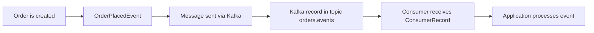

# The Difference Between Event, Message, and Record

When building messaging systems, the three terms **event**, **message**, and **record** frequently appear side by side. In Kafka documentation, they are even sometimes used interchangeably. However, each word describes a different perspective:

- **Event** describes something that has happened and has business meaning.
- **Message** is a unit of information sent from one component to another.
- **Record** is the unit of data that Kafka writes to a topic and delivers to consumers to read.

An event can be packaged into a message and then stored by Kafka as a record. Understanding all three concepts clearly helps you design payloads, metadata, topics, and consumers cleanly, while avoiding confusing business data with transport details.

## 1. Event: A Business Fact That Has Occurred

An event is a fact about something that happened in the system. Event names usually use past tense, such as `OrderPlaced`, `PaymentAuthorized`, or `InventoryReserved`. An event answers the question **"What happened?"**, not **"What should the system do next?"**.

For example, when a customer successfully places an order, the system may emit an `OrderPlaced` event. This event might contain:

- `eventId`: unique identifier for this event occurrence.
- `orderId`: the associated order.
- `occurredAt`: timestamp when the business occurrence happened.
- `total`: total order value at that moment.

In Java, the event payload can be represented using a `record`:

```java
import java.math.BigDecimal;
import java.time.Instant;

public record OrderPlacedEvent(
        String eventId,
        String orderId,
        Instant occurredAt,
        BigDecimal total
) {}
```

This is data describing an event that has occurred. Consumers can use it to update reports, send notifications, or kick off another workflow. Each consumer decides the action appropriate to its own responsibility.

### Domain Events and Integration Events

In layered applications or Domain-Driven Design, it is helpful to distinguish two common usages:

- **Domain event** represents a meaningful occurrence within a business domain. It is typically produced while processing a domain model and may serve only components within the same application.
- **Integration event** is a published event contract meant to be consumed by external systems or other services. It needs to be stable, have a defined schema, and contain only information allowed to be shared.

A domain event can be mapped to an integration event before being sent to Kafka. You should not assume every internal object is a suitable integration contract for external consumers.

Events are generally treated as immutable once published: if business information changes due to a new occurrence, publish a new event rather than rewriting the meaning of an old event. This allows consumers to replay history and explain system state.

## 2. Message: A Unit of Information Being Transmitted

A message is a unit of data sent from one component to another over a communication mechanism. A message focuses on **transport**: who sends it, where it goes, what its content is, and what information the consumer needs to process it.

A message can carry an event, but not every message is an event. Depending on communication intent, a message can be:

| Content Type | Meaning | Example |
|---|---|---|
| Event | Notification that something happened | `OrderPlaced` |
| Command | Request for a component to perform an action | `ReserveInventory` |
| Query or request | Request to provide information | `GetOrderStatus` |
| Reply or response | Answer to a request | `OrderStatusFound` |

For example, `OrderPlaced` is an event because the order was created. `ReserveInventory` is a command because it asks inventory to reserve stock. Both can be transmitted as messages over Kafka, but their meaning and how consumers handle them differ.

Conceptually, a message usually has two parts:

1. **Payload**: the main content, such as the data of `OrderPlacedEvent`.
2. **Metadata or envelope**: information supporting routing, identification, correlation, and processing, such as message type, schema version, correlation ID, or trace ID.

Metadata can live in protocol headers, in an envelope wrapping the payload, or inside the payload itself. Choose a consistent convention so producers and consumers understand the same contract. Avoid duplicating the same information in multiple places unless a single authoritative source is clearly designated.

## 3. Record: Kafka's Unit of Data

In Kafka, data is written to topics as **records**. A record is the unit that a producer sends and a broker stores in a partition log. When reading data, a consumer receives the record along with metadata about its position in Kafka.

Conceptually, a Kafka record consists of these main parts:

| Component | Role |
|---|---|
| `key` | Key used for routing/partitioning and grouping related records; may be null/empty. |
| `value` | Main payload of the record; usually a serialized event or message. |
| `headers` | Byte-valued key/value pairs carrying additional metadata. |
| `timestamp` | Timestamp attached to the record per Kafka timestamp configuration. |
| `topic` and `partition` | Where the record is stored in Kafka. |
| `offset` | Position of the record in a partition's log. |

`topic`, `partition`, and `offset` are location details observed on the consumer side. The producer constructs a `ProducerRecord` before the broker writes the data, so it does not know the final offset yet. After the record is written, the consumer receives a `ConsumerRecord` with the corresponding topic, partition, and offset. An offset is meaningful only within a single partition; therefore, to locate a record unambiguously, combine topic, partition, and offset.

In the Kafka API, `ProducerRecord<K, V>` represents a record on the producer side. `ConsumerRecord<K, V>` represents a record on the consumer side and provides key, value, headers, as well as metadata like partition and offset.

## 4. Relationship Between the Three Concepts in Spring Kafka

Consider the following order flow:



`OrderPlacedEvent` is the event from the business perspective. The producer packages the event into a message for transmission. When sent through Kafka, the message is represented as a Kafka record in the `orders.events` topic. The consumer reads that record and extracts the payload to handle the event.

Example producer using `KafkaTemplate` and `ProducerRecord`:

```java
import java.nio.charset.StandardCharsets;
import org.apache.kafka.clients.producer.ProducerRecord;
import org.springframework.kafka.core.KafkaTemplate;

public class OrderEventPublisher {

    private final KafkaTemplate<String, OrderPlacedEvent> kafkaTemplate;

    public OrderEventPublisher(
            KafkaTemplate<String, OrderPlacedEvent> kafkaTemplate) {
        this.kafkaTemplate = kafkaTemplate;
    }

    public void publish(OrderPlacedEvent event) {
        ProducerRecord<String, OrderPlacedEvent> kafkaRecord =
                new ProducerRecord<>("orders.events", event.orderId(), event);

        kafkaRecord.headers().add(
                "event-type",
                "OrderPlaced".getBytes(StandardCharsets.UTF_8)
        );

        kafkaTemplate.send(kafkaRecord);
    }
}
```

In this example:

- `event` is the business data.
- `ProducerRecord` is the Kafka object used to construct the outgoing record.
- `event.orderId()` is used as the key. With the default partitioner and a non-null key, records with the same key are normally routed to the same partition, allowing Kafka to preserve their order within that partition.
- The `event-type` header is metadata helping consumers identify the event type. Kafka headers have byte values, so producers and consumers must agree on character encoding.
- `KafkaTemplate.send(...)` sends the record asynchronously; real applications should handle send results and failures according to producer policy.

For this example to work, `KafkaTemplate` must be configured with key and value serializers matching the data types, such as a JSON serializer for `OrderPlacedEvent`. Consumers also need corresponding deserializers.

The consumer side can accept the full `ConsumerRecord` when Kafka metadata is needed:

```java
import org.apache.kafka.clients.consumer.ConsumerRecord;
import org.springframework.kafka.annotation.KafkaListener;
import org.springframework.stereotype.Component;

@Component
public class OrderEventListener {

    @KafkaListener(topics = "orders.events", groupId = "billing-service")
    public void onOrderPlaced(
            ConsumerRecord<String, OrderPlacedEvent> kafkaRecord) {

        OrderPlacedEvent event = kafkaRecord.value();

        System.out.printf(
                "Received orderId=%s from topic=%s, partition=%d, offset=%d%n",
                event.orderId(),
                kafkaRecord.topic(),
                kafkaRecord.partition(),
                kafkaRecord.offset()
        );

        // Execute business logic based on the event.
    }
}
```

If a listener only needs the payload, Spring Kafka can convert and pass the event object directly according to converter/deserializer configuration:

```java
@KafkaListener(topics = "orders.events", groupId = "notification-service")
public void onOrderPlaced(OrderPlacedEvent event) {
    // Send notification based on event data.
}
```

Choose a `ConsumerRecord` parameter when you need to inspect the key, headers, topic, partition, or offset. Choose the payload directly when the logic only cares about business data and conversion is already configured appropriately.

## 5. Common Points of Confusion

### Are message and Kafka record the same thing?

In day-to-day conversation, many Kafka materials call a record a message and vice versa. That phrasing is acceptable when context is clear. However, `record` emphasizes the storage unit and position in Kafka; `message` emphasizes the content transmitted between components. A message can also travel over HTTP, RabbitMQ, or another system without becoming a Kafka record.

### Does one event always correspond to exactly one record?

Not necessarily. A single event can be sent to multiple topics or republished, creating multiple physical records carrying the same business meaning. Conversely, a record can carry a command or response rather than an event. Therefore, do not use an offset as a business identifier for an event.

If you need to identify an event across multiple deliveries or processing flows, include a stable `eventId` in the data contract. An offset only locates a record within a specific partition; it does not replace `eventId`.

### Is the key the event ID?

Not required. The key primarily serves partitioning and helps group records for the same entity into the same partition. For example, `orderId` is suitable when changes to the same order must be processed in order within a partition. `eventId`, on the other hand, identifies a specific occurrence of an event. The two values can differ and serve two different purposes.

### Does the offset belong in the payload?

Usually no. An offset is location metadata managed by Kafka and observed by consumers via `ConsumerRecord`. Do not embed the offset into the payload as if it were a stable business attribute, because the same event republished could receive a different offset.

### Is a Java `record` a Kafka record?

No. A `record` in Java is a data type declaration form, commonly used for immutable data classes with automatically generated constructor, accessors, `equals`, `hashCode`, and `toString`. A Kafka record is a unit of data in a topic. For instance, `OrderPlacedEvent` declared as a Java `record` can be used as the `value` of a Kafka record; these two uses of the word `record` refer to completely different concepts.

## 6. Choosing Terminology When Designing Systems

When discussing business behavior, call the occurrence an **event**: `OrderPlaced`, `PaymentFailed`. When talking about contracts and sending/receiving between services, use **message** or **integration event message**. When talking about the Kafka API, topic data, keys, partitions, and offsets, use **record**.

| Question to Answer | Concept to Use |
|---|---|
| What happened in the business domain? | Event |
| What information is this component sending to another? | Message |
| What unit of data does Kafka store and the consumer read? | Record |
| Where is the business data of a Kafka record located? | Value/payload |
| How do you locate a record that has been written? | Topic + partition + offset |
| How do you identify the same event across deliveries? | Event ID in the contract |

When naming topics and schemas, express intent clearly. Topic `orders.events` suggests it holds order events; event type `OrderPlaced` clearly states what occurred; key `orderId` supports routing by order. These conventions help producers, consumers, and operators understand the data being exchanged.

## 7. Takeaways

- **Event** is a business fact that has occurred.
- **Message** is a unit of information being transmitted; it can carry an event, command, or response.
- **Kafka record** is the unit of data written to a topic, consisting of key, value, headers, and timestamp; consumers also observe topic, partition, and offset.
- One event can be represented by multiple records across retries or different flows. `eventId` and offset solve two different problems.
- In Spring Kafka, `KafkaTemplate` sends records; `@KafkaListener` can receive either the payload or a `ConsumerRecord` depending on processing needs.

When reading or designing a Kafka flow, ask yourself three things: **what business occurrence happened, what information is being transmitted, and where is Kafka storing that record?** Answering those three questions clearly separates the responsibilities of the domain model, the message contract, and the Kafka API.
