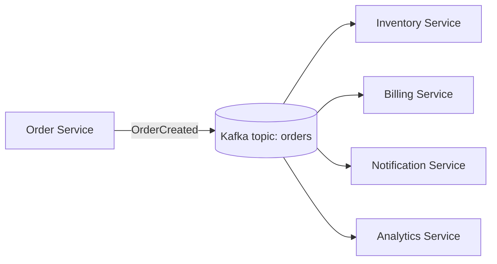

# When to Use Kafka and When Not to Use It

Kafka is a distributed platform for writing, storing, and distributing event streams. Kafka is especially well suited when multiple systems need to exchange data asynchronously, handle high event volumes, replay historical data, or allow multiple independent application groups to tap into the same data stream.

However, Kafka is not the default choice for every background task or every inter-service communication. Kafka brings operational overhead, partition design, schema management, consumer lag monitoring, and error handling. If a problem only needs a synchronous call or a simple job queue, a lighter solution is often easier to build and operate.

This lesson helps you evaluate the problem before choosing Kafka, distinguish cases where Kafka excels from cases where it adds unnecessary complexity, and outline a decision process applicable when designing Spring Kafka applications.

## 1. What Kind of Problems Does Kafka Solve?

Imagine an e-commerce application. When a customer places an order, the system must record the order, deduct inventory, charge payment, send an email, update analytics, and notify the shipping system. If the order service calls all remaining services sequentially, response latency depends on the sum of all those systems' latencies. One slow or temporarily down service can fail the checkout request even though the order was already recorded.

Kafka lets the order service publish an event such as `OrderCreated`. Interested systems subscribe to receive the event independently:



Order Service does not need to know how many consumers are processing the event. Inventory, Billing, Notification, and Analytics can be deployed, scaled, or recovered independently. If Analytics pauses temporarily, other consumers can continue; when Analytics comes back online, it can read records still within the retention window.

Kafka's core benefits come from a combination of characteristics:

- **Temporal decoupling:** producers can write events while consumers are slow or temporarily paused, as long as Kafka remains available and has capacity.
- **Retention and replay:** records are kept according to retention policy. Consumers can resume from saved offsets or replay a range of data to recover or rebuild state.
- **Multiple independent consumers:** each consumer group maintains its own offsets. Multiple groups can read the same topic for different purposes without competing for a single copy of a message.
- **Partition-based scaling:** topics are split into partitions to scale parallel reads and writes. Within a partition, record order is preserved.
- **Continuous data streams:** Kafka fits event processing, system integration, telemetry ingestion, and continuously running data pipelines.

These properties are valuable when the problem genuinely requires them. They also introduce design and operational decisions that a small application may not need to bear.

## 2. Cases Where Kafka Is Often a Good Fit

### 2.1. Multiple Services Need to React to the Same Event

This is one of the classic use cases. A business event is emitted once, and multiple independent systems care about it.

For example, `OrderCreated` can be consumed by:

- Inventory Service to reserve or deduct stock.
- Billing Service to initiate the payment flow.
- Notification Service to send customer confirmations.
- Analytics Service to update business metrics.
- Shipping Service to prepare delivery workflows.

Each service uses its own consumer group if it needs to receive and process every event. Kafka stores the event stream for independent consumption. When a Fraud Detection Service is needed later, a new consumer group can be added without forcing Order Service to know about it.

This pattern is particularly useful when the number of recipients may grow over time and teams have independent deployment lifecycles.

### 2.2. High or Spiky Event Throughput

Kafka is engineered to write and read high record volumes using a distributed log model. Partitions distribute load across brokers and consumers. Producers can batch records; consumers can fetch in batches to amortize per-message overhead.

Suitable examples include:

- Clicks, page views, and user-behavior events from many servers.
- Application logs, access logs, and monitoring telemetry.
- Transaction events from many branches or services.
- Continuously emitted IoT sensor data.
- Status updates from a system with many producers.

Kafka also helps absorb short traffic bursts. Producers can keep writing while consumers process more slowly, within cluster storage, retention, and configuration limits. Consumers accumulate lag and catch up once capacity catches up.

This does not mean Kafka provides infinite capacity. If production rate permanently exceeds consumption rate, lag will grow indefinitely. Measure throughput, record sizes, partition counts, consumer processing speed, and retention to size the cluster appropriately.

### 2.3. Data Replay Is Needed for Recovery or Reprocessing

In a traditional queue, messages are typically removed once successfully processed. With Kafka, records persist per retention; consumers track read positions via offsets.

Replay capability is useful when:

- A consumer had a logic bug and needs to reprocess data after a fix is deployed.
- A read model or projection must be rebuilt from stored events.
- A new analytics team needs to read historical data still within retention.
- An incident needs investigation by reviewing the sequence of events.
- A new consumer must start from earliest or from a specific offset/timestamp.

For instance, Analytics Service can be redeployed with updated revenue calculation logic. It can replay the orders topic to build reports under the new rules, while Billing Service continues unaffected at its own group's offset.

Always distinguish **replay** from **permanent data archival**. Records expire under retention or compaction policies; Kafka is not a replacement for backups and long-term storage. Replaying consumers may also trigger side effects again, making idempotent processing critical.

### 2.4. Parallel Processing Is Needed While Preserving Per-Key Order

Kafka preserves record order within a single partition. If a producer sends records with the same key, the partitioner normally routes records with that key to the same partition. Consequently, events for a single entity can be processed sequentially in that partition.

For example, for account events keyed by `accountId`, updates for the same account land in the same partition. Different accounts can be processed in parallel by multiple consumers in the same group.

```java
public void publish(AccountEvent event) {
    kafkaTemplate.send(
        "account-events",
        event.accountId(),
        event
    );
}
```

The key here is `accountId`. It routes events for the same account to the same partition under the active partitioner. When picking keys, consider load skew: an overly hot key can turn a single partition into a bottleneck.

Kafka does not guarantee global order across all partitions. If business logic demands every event across every customer follow one single sequence, forcing everything into one partition limits parallelism and caps throughput. Determine the exact scope of ordering the business genuinely needs first.

### 2.5. Building Event Pipelines and Data Integration

Kafka works well as a backbone between data-producing systems and data-processing systems. Sources can be business applications, databases via CDC, logging systems, or IoT devices. Targets can be business services, data warehouses, search engines, or stream-processing platforms.

For example, an application can stream order changes into Kafka; one consumer updates Elasticsearch for search, another loads a data warehouse, and another sends notifications. Recipients do not need to query each other's transactional databases directly.

Kafka is especially valuable when a data stream must be shared across many systems and source deployment cadence must be decoupled from each target's processing speed.

## 3. Cases Where Kafka Should Not Be the First Choice

### 3.1. Users Need an Immediate Result Within the Same Request

If an API must answer "Does this username already exist?" or "Was the payment accepted?", HTTP or gRPC is usually a better fit. The caller needs the operation's outcome to decide the next step.

Kafka is asynchronous communication. A producer successfully sending a record only means the broker accepted it at the configured acknowledgement level; it does not mean the consumer finished business processing. Making a caller wait on a consumer, receive a response, handle timeouts, and correlate request/response adds complexity over a direct synchronous call.

HTTP and Kafka can be combined: the API validates and records the request, returning an acceptance ID; long-running work flows through Kafka, and the client polls status or receives a callback later. Yet if an operation is simple and needs an immediate answer, start with synchronous communication.

### 3.2. Only a Simple Job Queue Is Needed

Tasks like sending an email, generating a thumbnail, or running a background job may only need a queue with receive, acknowledge, retry, and dead-letter queue semantics. Messages are typically processed and then removed from the queue.

Queue systems like RabbitMQ or managed queue services may fit better if the problem requires flexible routing, per-message acknowledgements, delayed redelivery schedules, priorities, or classic work-queue semantics. Kafka can still distribute work via consumer groups, but records do not disappear after a consumer processes them; offsets and retention work differently.

Choose based on required semantics: job queuing, routing, delayed retries, and individual message acks may matter far more than replaying an event log.

### 3.3. Low Volume and Currently Simple Architecture

If an internal application emits only a few events per minute, has one consumer, and needs no replay, adopting Kafka introduces substantial overhead:

- Provisioning and monitoring brokers or paying for a managed Kafka service.
- Managing topics, partitions, retention, ACLs, and producer/consumer settings.
- Monitoring consumer lag, rebalances, serialization errors, and storage capacity.
- Designing retries, dead letters, idempotency, and incident runbooks.
- Managing schemas and compatibility between producers and consumers.

A database job table, background job runner, or managed queue may serve better. When system count, throughput, or replay needs grow, re-evaluate using real metrics.

### 3.4. Business Logic Requires Immediate Cross-Operation Consistency

Suppose a service updates an order in a database and then emits `OrderPaid` to Kafka. If the database commits yet sending to Kafka fails, other services miss the event. If Kafka sends first and the database rolls back, consumers receive an event for a change that never persisted.

Kafka transactions support transactions scoped to Kafka, such as writing multiple records and committing offsets consistently. They do not create an ACID transaction spanning both Kafka and an independent relational database.

For problems requiring consistent event emission alongside database changes, evaluate **Transactional Outbox**: write business data and an outbox row in the same database transaction; a separate process forwards outbox rows to Kafka. CDC can be used to read the outbox. Consumers should still be idempotent because duplicate publishing can occur.

If the requirement is truly a synchronous transaction with strict immediate consistency and no clear distributed design yet, do not introduce Kafka merely to replace a database transaction.

### 3.5. Global Ordering or Single-Entity Sequential Processing Is Required

Kafka preserves order only within each partition. Achieving global order usually requires funneling all data into a single partition or building another coordination mechanism. This limits parallelism and creates bottlenecks.

If an application only needs one sequential worker handling a small workload, a simple queue or background worker may be easier to reason about. If ordering is only needed per order, account, or device, use keys and partitions to preserve order within that entity's scope.

### 3.6. Treating Kafka as a Primary Database or Indefinite Archive

Kafka is an event log, not a general-purpose database replacing relational or NoSQL stores. Kafka does not natively provide ad-hoc queries, joins, constraints, or business transactions like a database.

Log compaction can retain the latest record per key in some scenarios, but it does not turn Kafka into a full database. Applications needing multi-criteria lookups, record updates, data constraints, and relational management still need an appropriate database. Kafka can stream changes to synchronize read models or other storage systems.

## 4. How Do Kafka, HTTP/gRPC, and Message Queues Differ?

No single technology wins in every scenario. Start from how the two sides need to interact and the data semantics required.

| Criterion | Kafka | HTTP/gRPC | Traditional Message Queue |
|---|---|---|---|
| Typical communication style | Asynchronous event streaming | Request/response | Work distribution or asynchronous messaging |
| Who initiates interaction | Producer publishes record | Client calls server | Producer sends message to queue/exchange |
| Multiple independent recipients | Yes, via multiple consumer groups | Usually requires calling each API or adding fan-out | Depends on queue, exchange, and subscription setup |
| Replaying data | Yes, within retention and offset limits | Not a built-in feature | Usually depends on broker and message retention mode |
| Ordering | Within a single partition | Per request/stream managed by application | Depends on queue, consumer count, and settings |
| Best suited for | High-volume event streams, replay, multiple consumers, data pipelines | Queries and operations needing direct responses | Work queues, routing, per-message acks and retries |
| Costs to weigh | Partitions, retention, consumer lag, cluster ops | Temporal coupling, timeouts, retries | Queue topology, routing, acks, and message policies |

Real-world architectures often combine technologies. For instance, an API accepts a request via HTTP, saves the order to a database, publishes `OrderCreated` over Kafka, and another service calls a payment provider via HTTP. Avoid forcing every interaction onto a single transport.

## 5. Distinguish Events from Commands Before Creating Topics

A common reason Kafka gets misused is putting every request into a topic and calling all of them events.

- **Event** describes something that happened: `OrderCreated`, `PaymentCaptured`, `InventoryReserved`. Events are often of interest to multiple parties and do not ask one specific consumer for an immediate reply.
- **Command** asks a specific party to perform an action: `ChargePayment`, `ReserveInventory`, `SendEmail`. Commands have an intended recipient or processor and often expect an outcome or completion status.

Kafka can carry both events and commands, yet their designs differ. With events, multiple consumer groups can react concurrently. With commands, you must clearly define who owns execution, how to avoid duplicate execution, how results are returned, and how expired or failed commands are handled.

Name topics and schemas according to business intent. `orders.created` expresses the fact that an order was created. `orders.create` sounds like a request to create an order. That distinction helps consumers understand whether they are observing a past fact or receiving an instruction to execute.

## 6. Selection Example in a Spring Kafka Application

Suppose Order Service has saved an order and needs to notify interested systems. Once a design ensures database changes and events are emitted consistently, the producer can send the event using `KafkaTemplate`:

```java
public record OrderCreatedEvent(
    String eventId,
    String orderId,
    BigDecimal total,
    Instant occurredAt
) {}

@Service
public class OrderEventPublisher {
    private final KafkaTemplate<String, OrderCreatedEvent> kafkaTemplate;

    public OrderEventPublisher(
            KafkaTemplate<String, OrderCreatedEvent> kafkaTemplate) {
        this.kafkaTemplate = kafkaTemplate;
    }

    public void publish(OrderCreatedEvent event) {
        kafkaTemplate.send("orders.created", event.orderId(), event);
    }
}
```

`orderId` is used as the key so events for the same order normally land in the same partition. Serializer settings must match between producer and consumer; this example assumes the application configured a suitable JSON serializer for the record.

Billing Service can subscribe an independent consumer:

```java
@Component
public class OrderCreatedListener {

    @KafkaListener(
        topics = "orders.created",
        groupId = "billing-service"
    )
    public void handle(OrderCreatedEvent event) {
        // Check eventId and process idempotently before side effects.
        // Initiate the payment workflow for orderId.
    }
}
```

Notification Service can use group `notification-service` to consume the same event stream for sending notifications. The two groups maintain independent offsets. If multiple instances of Billing Service belong to `billing-service`, Kafka distributes the group's partitions across those instances for parallel processing.

The example above illustrates publishing and consuming an event; it is not a complete production configuration. A real system also needs bootstrap server settings, serializers/deserializers, security, partition counts, replication, consumer concurrency, error handlers, retry/dead-letter handling, lag monitoring, and a schema compatibility strategy. More importantly, handlers must tolerate redelivery of an event. A successful record send does not prove all downstream billing business logic has completed.

If Order Service's requirement were to ask Billing "is payment approved right now?" and answer the customer within the same HTTP request, a synchronous API would be a better fit. Kafka is a better fit when Order Service publishes an event and Billing processes it independently afterward.

## 7. Scenario-Based Decision Table

| Scenario | Initial Direction | Reason |
|---|---|---|
| Multiple services need to receive `OrderCreated` | Kafka | Fan-out across consumer groups, independent processing |
| Ingesting millions of telemetry events continuously | Kafka | Throughput, partitions, and stream pipelines |
| Replaying events to rebuild a projection | Kafka | Offsets and retention support replay |
| API needs a validation result within a few hundred milliseconds | HTTP/gRPC | Caller needs a direct response |
| Sending background emails for a small app | Background job or simple queue | Replay and streaming needs may not justify Kafka overhead |
| Work requiring routing, priority, per-message delayed retries | Evaluate a message queue | Those semantics are typically first-class in queues |
| Updating a database and emitting an event must stay consistent | Database + Outbox/CDC + Kafka as needed | A standalone Kafka transaction does not cover external databases |
| Storing business data for ad-hoc queries | Database | Kafka is not a general-purpose query database |
| Every record must follow a single global order | Re-evaluate requirements and architecture | Multiple partitions do not provide global ordering |

The directions in this table are starting points for analysis. Final decisions also depend on throughput, latency, durability, operational capability, budget, and existing organizational technology.

## 8. Evaluation Process Before Introducing Kafka

Before provisioning a cluster or adding the Spring Kafka dependency, answer these questions:

1. **What is the data?** Is it an event describing what happened, a command requesting action, or a request needing a response?
2. **Who needs to receive it?** One worker or multiple independent systems? Do recipients need to read the same record at their own pace?
3. **Is replay needed?** For how long must data be re-readable—for recovery, auditing, or building new projections?
4. **What are throughput and latency expectations?** Measure records per second, record sizes, bursts, allowable consumer lag, and actual processing speed.
5. **What is the ordering scope?** System-wide, or per `orderId`, `accountId`, or another business key?
6. **What happens on errors?** Should it retry, can retries cause duplicate side effects, when does it go to dead-letter, and who handles failed records?
7. **Who operates Kafka?** Is there already a cluster or managed service, monitoring, alerting, ACLs, and upgrade procedures?
8. **How is consistency ensured?** If both a database and Kafka participate in one business flow, design Outbox/CDC or an equivalent mechanism.
9. **How do schemas evolve?** Producers and consumers may deploy at different times; compatibility rules and schema versioning are required.

If basic questions about recipients, semantics, and failures remain unanswered, do not start by creating topics. Model the business flow first, then pick the technology.

## 9. Misconceptions to Avoid

- **"Using Kafka means messages are never lost."** Durability depends on replication, acknowledgements, broker settings, retention, operational errors, and how producers/consumers handle failures. Configure and test against real requirements.
- **"Kafka guarantees exactly-once processing for all business logic."** Exactly-once has specific scope and prerequisites, especially with databases or external APIs. Idempotency and side-effect design are still required.
- **"A topic equals a queue."** A topic is a partitioned log. Consumer groups, offsets, retention, and multi-reader behavior differ from queues that delete messages upon ack.
- **"Adding partitions always makes it faster."** Partitions increase parallelism but also affect ordering, key distribution, broker resources, consumer counts, and rebalance cost.
- **"Producer send success means business processing is complete."** It only reflects the send result at the configured acknowledgement level. Consumers may not have read or finished processing yet.
- **"Kafka replaces databases."** Kafka stores and distributes record streams; applications still need proper stores for business state and queries.

## 10. Selection Conclusion

Consider Kafka when a system needs a durable event stream, high throughput, multiple independent consumers, replay capability, or continuous data pipelines. Kafka is particularly valuable when services need temporal and rate decoupling.

Do not adopt Kafka just to run a background job, replace a simple HTTP call, or follow "microservices means we must use Kafka." For request/response, favor HTTP/gRPC. For small work queues, consider background jobs or message queues. For queryable, transactional business state, use a database; if consistent event emission is needed, evaluate Outbox/CDC.

Good decisions start from business requirements: who needs the data, when they need it, whether replay is required, what scope of ordering must be preserved, and how the system recovers on failure. When those requirements align with Kafka's distributed log model and your organization can operate it, Spring Kafka with `KafkaTemplate` and `@KafkaListener` is a strong fit.
