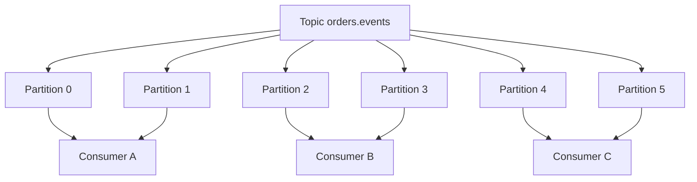
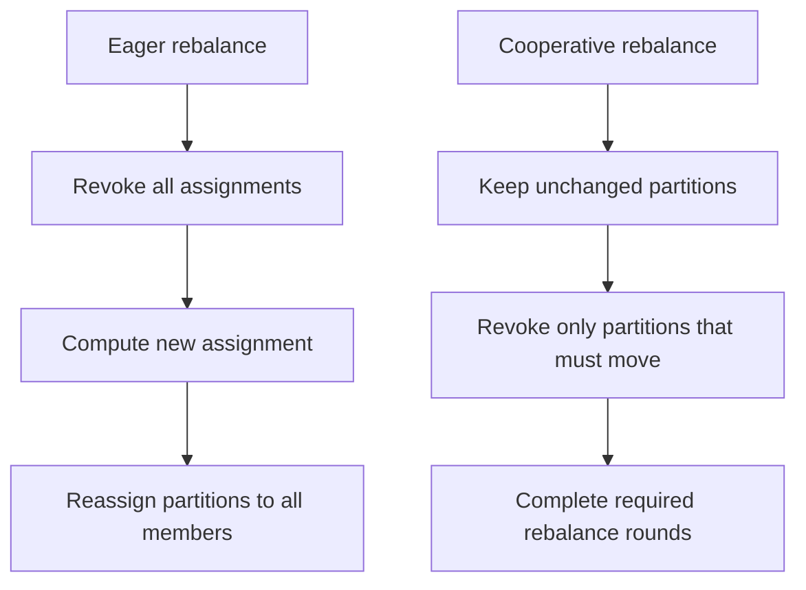

# Partition Assignment Strategy

When a consumer group has multiple consumers subscribed to a topic, Kafka must decide which partitions are assigned to which consumer. The mechanism that performs this distribution is called the **partition assignment strategy**. The strategy affects load balance, how many partitions must move when group membership changes, and how long consumers are disrupted during a rebalance.

Kafka provides common assignors such as `RangeAssignor`, `RoundRobinAssignor`, `StickyAssignor`, and `CooperativeStickyAssignor`. They all distribute partitions to eligible consumers within the same group, but their distribution rules and rebalance handling differ. Understanding the differences helps you choose the configuration suited to your topic count, subscriptions, concurrency, and availability requirements in a Spring Kafka application.

## 1. What Does a Partition Assignor Do?

A consumer group can consist of multiple consumer instances. Each consumer subscribes to one or more topics. The Kafka group coordinator manages membership and the rebalance process; the partition assignor determines how to distribute the partitions of the subscribed topics among the members.

For example, the `orders.events` topic has six partitions and the `order-projection` group has three consumers:



This is an illustrative assignment. Within the same group, each partition is assigned to at most one consumer member at a time. A consumer can receive multiple partitions; if there are more consumers than assignable partitions, some consumers will not receive any partitions for that topic.

The partition assignor must consider:

- The list of available topics and partitions.
- The subscription of each consumer member.
- The members belonging to the same consumer group.
- Prior assignments, for strategies aimed at keeping assignments stable.

An assignment strategy does not decide which records belong to the consumer group. It only decides **which partition is assigned to which member**. Committed offsets and reading positions are still managed separately per group and partition.

## 2. RangeAssignor

`RangeAssignor` distributes partitions on a per-topic basis. For each topic, the assignor sorts partitions numerically and divides them into contiguous ranges for consumers subscribed to that topic.

Suppose a topic has 6 partitions and 3 consumers subscribe together:

| Consumer | Assigned partitions |
|---|---|
| Consumer A | P0, P1 |
| Consumer B | P2, P3 |
| Consumer C | P4, P5 |

For a single topic whose partition count divides evenly by the number of consumers, Range usually produces a balanced, predictable assignment. Each consumer receives a contiguous range of partitions.

### Watch-Outs When Subscribing to Multiple Topics

Range divides each topic independently. Therefore, if multiple topics have partition counts not evenly divisible by the consumer count, the remainder can repeatedly fall onto the first consumers in the list for every topic. When summing assignments across multiple topics, total partition counts across consumers can become noticeably skewed.

For example, two topics `orders.events` and `payments.events`, each with 3 partitions, subscribed to by 2 consumers:

| Consumer | `orders.events` | `payments.events` | Total |
|---|---|---|---:|
| Consumer A | P0, P1 | P0, P1 | 4 |
| Consumer B | P2 | P2 | 2 |

Range still divides each topic correctly, but the total partition load between A and B is uneven. This is a case where RoundRobin or Sticky may be more appropriate.

## 3. RoundRobinAssignor

`RoundRobinAssignor` sorts the partitions of subscribed topics and distributes them in round-robin fashion across the list of consumers. If consumers share identical subscriptions, this strategy typically produces a more balanced assignment when a group subscribes to multiple topics.

With two topics, each having three partitions, and two consumers subscribing together:

| Consumer | Illustrative assignment |
|---|---|
| Consumer A | `orders.events-0`, `orders.events-2`, `payments.events-1` |
| Consumer B | `orders.events-1`, `payments.events-0`, `payments.events-2` |

Partitions are interleaved across consumers rather than split into separate ranges per topic. When consumers have different subscriptions, RoundRobin only assigns partitions to members subscribed to the corresponding topic; therefore, assignments are not guaranteed to split strictly evenly in every configuration.

RoundRobin is suitable when:

- One group subscribes to multiple topics.
- Members have similar subscriptions.
- You want interleaved partition distribution to avoid per-topic remainders piling onto the same member.

## 4. StickyAssignor

`StickyAssignor` targets two goals simultaneously:

1. Distribute partitions relatively evenly across consumers.
2. Preserve prior assignments as much as possible during a group rebalance, limiting the number of partitions that must move to another consumer.

For example, a group initially has three consumers and six partitions. If one consumer leaves the group, Sticky tries to keep the existing partitions on the two remaining consumers intact, then redistributes the departed member's partitions. Reducing partition movement lowers the cost of reinitializing state, caches, or resources tied to partitions.

Sticky still uses the eager rebalance mechanism in the classic protocol: consumers revoke their current assignments before receiving new assignments. Thus, even though partition movement is optimized, the group can still pause processing during the rebalance.

Sticky fits systems with stateful processing or those wanting fewer partition ownership changes after membership changes, while still tolerating the brief pause of an eager rebalance.

## 5. CooperativeStickyAssignor

`CooperativeStickyAssignor` combines Sticky's goal of keeping assignments stable with **cooperative/incremental rebalancing**. Instead of revoking all partitions from every consumer, Kafka only revokes partitions that need to move. Unchanged partitions can continue being processed by their current consumers.

For example, a group has three consumers owning six partitions. When consumer C leaves the group, the new assignment only needs to transfer C's partitions to A and B. With cooperative rebalancing, A and B keep the partitions they already owned, and only the partitions that must move go through revocation and reassignment.



Cooperative does not mean there are no rebalances or no disruptions. When a partition must change owners, the old consumer must release it before the new consumer acquires it. A single change may require more than one rebalance round to complete safely. However, unrelated partitions do not have to stop processing just because group membership changed.

`CooperativeStickyAssignor` fits consumer groups with continuous traffic, many partitions, or stateful workloads where revoking all partitions causes significant disruption.

## 6. Comparing Common Strategies

| Strategy | Distribution method | Retention of prior assignments | Rebalance style |
|---|---|---|---|
| `RangeAssignor` | Assigns contiguous ranges per topic. | Does not optimize keeping prior assignments. | Eager |
| `RoundRobinAssignor` | Distributes round-robin across partitions of subscribed topics. | Does not optimize keeping prior assignments. | Eager |
| `StickyAssignor` | Balances and tries to keep partitions on previous consumers. | High | Eager |
| `CooperativeStickyAssignor` | Balances, preserves assignments, and moves only necessary partitions incrementally. | High | Cooperative/incremental |

No strategy guarantees strictly equal CPU load or processing time. Assignors primarily balance the number of partitions. If one partition has far higher traffic than others, the consumer receiving that partition can still become overloaded even when partition counts are split evenly.

## 7. Configuring partition.assignment.strategy in Spring Boot

A Kafka consumer accepts `partition.assignment.strategy` to specify allowed assignors. With Spring Boot, you can declare it in `application.yml`:

```yaml
spring:
  kafka:
    bootstrap-servers: localhost:9092
    consumer:
      group-id: order-projection
      properties:
        "[partition.assignment.strategy]": org.apache.kafka.clients.consumer.CooperativeStickyAssignor
```

To use RoundRobin:

```yaml
spring:
  kafka:
    consumer:
      properties:
        "[partition.assignment.strategy]": org.apache.kafka.clients.consumer.RoundRobinAssignor
```

Assignor classes reside in the Kafka client. If you need to declare a list of multiple assignors, you can configure the class list in the format supported by the Kafka client, such as a comma-separated string in the property map:

```yaml
spring:
  kafka:
    consumer:
      properties:
        "[partition.assignment.strategy]": >-
          org.apache.kafka.clients.consumer.RangeAssignor,
          org.apache.kafka.clients.consumer.CooperativeStickyAssignor
```

This list is useful when migrating strategies in stages. Kafka selects a common assignor supported by all members in the group; if consumers share no compatible assignor, the group may fail to complete a rebalance. When migrating to cooperative, follow a controlled rolling migration process and switch completely only after every member supports the new strategy.

The examples above apply to the **classic consumer group protocol**. `CooperativeStickyAssignor` has been supported since Kafka client 2.4. In newer Kafka versions that introduce the consumer group protocol (`group.protocol=consumer`), assignment is coordinated server-side on the broker and remote assignor configuration follows its own rules; `partition.assignment.strategy` is no longer the setting that controls assignment for the new protocol. Check which protocol your cluster and clients use before applying configuration.

## 8. Combining with @KafkaListener and Concurrency

In Spring Kafka, `@KafkaListener` creates a listener container. The `concurrency` attribute sets the number of child consumer threads/containers for that listener. Each child consumer joins the group and receives partitions from the assignor.

```java
import org.springframework.kafka.annotation.KafkaListener;
import org.springframework.stereotype.Component;

@Component
public class OrderEventListener {

    @KafkaListener(
            topics = "orders.events",
            groupId = "order-projection",
            concurrency = "3"
    )
    public void onOrderEvent(OrderCreatedEvent event) {
        // Process event and update projection.
    }
}
```

Suppose the topic has six partitions and the listener has `concurrency=3`; up to three child consumers of the listener receive partitions, with each consumer potentially receiving two partitions. If concurrency is increased to eight, still at most six child consumers receive partitions from this topic; the remaining two consumers have no assigned partitions.

When multiple `@KafkaListener` endpoints use the same group ID, they join the group together and assignments depend on each consumer's subscription. Assignor configuration lives on the consumer factory, so ensure all members in the same group have compatible configurations. Do not change the group ID just to change the assignor, because a new group will have its own committed offsets.

## 9. Rebalance Callbacks Are Not Partition Assignors

`ConsumerRebalanceListener` is a lifecycle callback allowing an application to react when partitions are revoked or assigned. It does not decide which partitions belong to which consumer; that is the assignor's job.

Common callback use cases:

- Before partitions are revoked: flush a state store or save required checkpoints.
- After partitions are assigned: restore corresponding state or initialize resources for the partitions.
- When partition ownership is lost outside the normal revoke flow: avoid continuing to write state as if the consumer still owned the partition.

Spring Kafka provides `ConsumerAwareRebalanceListener` to integrate callbacks with the listener container. For applications using `@KafkaListener`, configure the callback through `ContainerProperties` / the listener container factory rather than manually calling `subscribe()` on a Spring-managed consumer.

In particular, do not perform long-running I/O in rebalance callbacks. Callbacks must finish within the group's timing bounds; if they take too long, the consumer may be treated as inactive and trigger additional rebalances.

## 10. Eager and Cooperative Rebalance

### Eager Rebalance

With eager rebalance, all consumer members revoke all partitions they currently own. Once the coordinator finishes determining membership and assignments, partitions are handed out again. This approach is straightforward and used by Range, RoundRobin, and Sticky in the classic protocol.

Its advantage is a simple, widely compatible revoke/assign model. Its limitation is that unchanged partitions must also go through revocation and reassignment, increasing consumption pause times when the group changes.

### Cooperative Rebalance

With cooperative rebalance, consumers keep partitions that do not need to move. Partitions needing a new owner are revoked first, then assigned to the new member in the subsequent rebalance round. This reduces disruption scope and fits continuously processing systems.

To use `CooperativeStickyAssignor`, all consumer members in the group must have a supporting Kafka client version and compatible configuration. During rolling deployments, perform migration steps according to the guidelines of your running Kafka version; do not mix clients that share no common assignor.

## 11. Other Factors Affecting Rebalances

The assignment strategy is one part of the consumer group picture. The following factors also influence rebalance frequency and duration:

| Factor | Impact |
|---|---|
| Consumers starting or stopping | Group membership changes, potentially triggering a rebalance. |
| `session.timeout.ms` | If the coordinator receives no heartbeat within the timeout, the member can be removed from the group. |
| `heartbeat.interval.ms` | Adjusts heartbeat frequency in the classic protocol; usually needs to be smaller than `session.timeout.ms`. |
| `max.poll.interval.ms` | If the application fails to call `poll()` in time, the consumer may be considered no longer making progress and leave the group. |
| `concurrency` | Creates child consumers in the Spring listener container; changing concurrency can alter membership. |
| Partition count | Increasing partitions changes the set of partitions to assign and can change key-to-partition mapping. |
| Static membership (`group.instance.id`) | Can reduce unnecessary rebalances when an instance restarts in time; requires unique IDs and careful timeout handling. |

Static membership is not a partition assignment strategy. It helps the coordinator recognize a stable member across restarts, while the assignor still decides partition distribution.

## 12. Choosing a Strategy by Scenario

| Scenario | Suggested strategy | Reason |
|---|---|---|
| Single topic, identical subscriptions, simple setup needed | `RangeAssignor` | Predictable range-based assignment. |
| One group subscribing to multiple topics, wanting interleaved distribution | `RoundRobinAssignor` | Avoids per-topic remainders piling onto the same consumer in many cases. |
| Wanting to keep partitions on previous consumers when the group changes | `StickyAssignor` | Reduces partition movement, though still eager. |
| Continuous workload, wanting minimal disruption during rebalances | `CooperativeStickyAssignor` | Retains unchanged partitions and revokes only what must move. |

Benchmark using your real workload. If partitions differ significantly in traffic or processing cost, balancing partition counts may not balance resource utilization. You may need to adjust key-based partitioning, add partitions for hot streams, or split topics by workload profile.

## 13. Key Takeaways

- The partition assignor decides how partitions are distributed to consumer members within the same group.
- `RangeAssignor` divides partition ranges per topic independently; multiple topics can produce skewed overall assignments.
- `RoundRobinAssignor` distributes subscribed partitions in round-robin order.
- `StickyAssignor` tries to balance and preserve prior assignments, but still uses eager rebalancing.
- `CooperativeStickyAssignor` keeps unchanged partitions and moves only necessary partitions via incremental rebalancing.
- Configure the Kafka client with `partition.assignment.strategy`; in Spring Boot set it under `spring.kafka.consumer.properties`.
- `@KafkaListener(concurrency=...)` creates child consumers; effective concurrency is bounded by the number of assigned partitions.
- `ConsumerRebalanceListener` handles revoke/assign events and does not replace the assignor.
- Static membership and timeouts affect membership/rebalancing, but are not assignment strategies.

When choosing a partition assignment strategy, look at how many topics the group subscribes to, desired balance, partition movement cost, and tolerance for rebalance pauses. For continuously running Spring Kafka systems, `CooperativeStickyAssignor` is often worth considering if all consumer members support it and you can roll out the transition consistently.

## References

- [Apache Kafka — Consumer Configurations](https://kafka.apache.org/documentation/#consumerconfigs)
- [Apache Kafka — ConsumerRebalanceListener API](https://kafka.apache.org/40/javadoc/org/apache/kafka/clients/consumer/ConsumerRebalanceListener.html)
- [Spring for Apache Kafka — Message Listener Containers](https://docs.spring.io/spring-kafka/reference/kafka/receiving-messages/message-listener-container.html)
