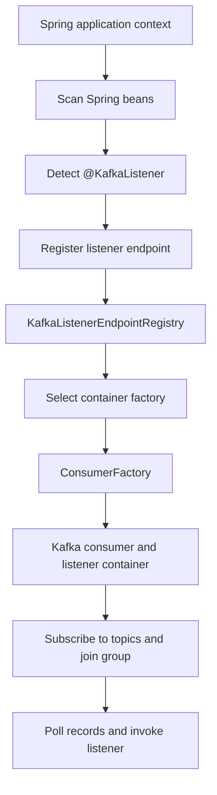

# Enabling @EnableKafka and Registering Listeners

Spring Kafka uses `@KafkaListener` to mark a record-handling method, while the listener container is responsible for creating and managing the underlying Kafka consumer. For this annotation to work, the application must enable the listener processing infrastructure and provide an appropriate `KafkaListenerContainerFactory`.

In a plain Spring application, `@EnableKafka` activates Spring Kafka's annotation-driven infrastructure. With Spring Boot, auto-configuration usually registers this infrastructure and creates a default listener container factory automatically, so `@EnableKafka` is not needed just to use `@KafkaListener`.

## 1. Components Involved in Listener Registration

A listener does not directly create a Kafka consumer merely by having an annotated method. Spring Kafka reads the annotation metadata, registers an endpoint, and uses a container factory to create the listener container.

Main components:

| Component | Role |
|---|---|
| `@EnableKafka` | Enables discovery and registration of `@KafkaListener` in Spring applications that do not rely on Boot auto-configuration |
| `@KafkaListener` | Declares a record-receiving endpoint, including topic subscription, group, container factory, and listener options |
| `KafkaListenerAnnotationBeanPostProcessor` | Detects annotations on Spring beans and turns them into listener endpoints |
| `KafkaListenerEndpointRegistry` | Manages listener containers registered from endpoints |
| `KafkaListenerContainerFactory` | Creates containers to run listeners; commonly `ConcurrentKafkaListenerContainerFactory` |
| `ConsumerFactory` | Creates Kafka consumers with bootstrap servers, deserializers, and consumer properties |
| Listener container | Manages consumers, polls, invokes listeners, and coordinates acknowledgment/commits |

The initialization flow can be visualized as follows:



`@KafkaListener` describes where events are received. The container factory describes how the listener is operated, such as consumer factory, concurrency, acknowledgment mode, and error handler. Separating these two roles allows multiple listeners to share one factory or select dedicated factories as required.

## 2. When Is @EnableKafka Needed?

### Spring Framework Applications Without Spring Boot

With plain Java configuration, add `@EnableKafka` to a `@Configuration` class to enable annotation processing:

```java
import org.springframework.context.annotation.Configuration;
import org.springframework.kafka.annotation.EnableKafka;

@Configuration
@EnableKafka
public class KafkaListenerConfiguration {
}
```

This annotation registers the components required for Spring to detect `@KafkaListener` and create endpoints. The application must still provide a `ConsumerFactory` and a `KafkaListenerContainerFactory` bean for endpoints to run.

### Spring Boot Applications

With Spring Boot and the Spring Kafka starter, auto-configuration automatically sets up the listener annotation infrastructure along with a default container factory when the configuration conditions match. Therefore, you can use it directly:

```java
@Component
public class OrderListener {

    @KafkaListener(topics = "orders", groupId = "orders-service")
    public void onOrder(OrderCreated event) {
        // Process event.
    }
}
```

There is no need to add `@EnableKafka` just to make a listener work in a standard Spring Boot setup. If the application already has custom listener configuration, inspect auto-configuration and existing beans before registering duplicate infrastructure.

## 3. Minimal Listener Registration with Spring Boot

Example broker, group ID, and deserializer configuration in `application.yml`:

```yaml
spring:
  kafka:
    bootstrap-servers: ${KAFKA_BOOTSTRAP_SERVERS:localhost:9092}
    consumer:
      group-id: orders-service
      enable-auto-commit: false
      auto-offset-reset: earliest
      key-deserializer: org.apache.kafka.common.serialization.StringDeserializer
      value-deserializer: org.springframework.kafka.support.serializer.JsonDeserializer
      properties:
        spring.json.value.default.type: com.example.orders.OrderCreated
        spring.json.trusted.packages: com.example.orders

app:
  kafka:
    topics:
      orders: orders.v1
```

Create a Spring bean containing the listener:

```java
import org.springframework.kafka.annotation.KafkaListener;
import org.springframework.stereotype.Component;

@Component
public class OrderCreatedListener {

    @KafkaListener(
            id = "order-created-listener",
            topics = "${app.kafka.topics.orders}"
    )
    public void onOrderCreated(OrderCreated event) {
        // Update read model or invoke application service.
    }
}
```

Spring Boot creates a default container factory named `kafkaListenerContainerFactory`. If a listener does not specify `containerFactory`, Spring Kafka uses this default factory. `spring.kafka.*` properties are bound by Boot into the factories created by auto-configuration.

In this example, `id` identifies the listener endpoint in Spring; `group-id` identifies the consumer group. These are two different concepts. If `groupId` is not specified on the annotation, the listener uses the group ID from the consumer factory.

## 4. Registering Listeners in Plain Spring

If not using Spring Boot, the application must declare all required beans explicitly. The example below assumes `ConsumerFactory` has already been created with the corresponding bootstrap servers and deserializers:

```java
import org.springframework.context.annotation.Bean;
import org.springframework.context.annotation.Configuration;
import org.springframework.kafka.annotation.EnableKafka;
import org.springframework.kafka.config.ConcurrentKafkaListenerContainerFactory;
import org.springframework.kafka.core.ConsumerFactory;

@Configuration
@EnableKafka
public class KafkaListenerConfiguration {

    @Bean
    public ConcurrentKafkaListenerContainerFactory<String, OrderCreated>
            kafkaListenerContainerFactory(
                    ConsumerFactory<String, OrderCreated> consumerFactory) {

        var factory = new ConcurrentKafkaListenerContainerFactory<String, OrderCreated>();
        factory.setConsumerFactory(consumerFactory);
        factory.setConcurrency(3);
        return factory;
    }
}
```

The default factory named `kafkaListenerContainerFactory` by convention is used for listeners that do not declare `containerFactory`. You can use a different bean name, in which case the listener must reference that exact factory name.

Example listener bean:

```java
import org.springframework.kafka.annotation.KafkaListener;
import org.springframework.stereotype.Component;

@Component
public class OrderListener {

    @KafkaListener(
            id = "orders-listener",
            topics = "orders",
            groupId = "orders-service"
    )
    public void listen(OrderCreated event) {
        // Process event.
    }
}
```

Beans must reside in the Spring application context. If the listener class is not component-scanned or declared via `@Bean`, Spring has no bean on which to detect the annotation.

## 5. Container Factories and Choosing a Factory

`ConcurrentKafkaListenerContainerFactory<K,V>` is the factory commonly used to create listener containers. The factory combines `ConsumerFactory` with operational options such as concurrency, acknowledgment mode, record/batch listener, error handler, and converters.

With Spring Boot, the default factory is usually sufficient for basic listeners. When a dedicated configuration is needed, another factory bean can be created:

```java
@Configuration
public class KafkaContainerConfiguration {

    @Bean
    public ConcurrentKafkaListenerContainerFactory<String, OrderCreated>
            ordersListenerContainerFactory(
                    ConsumerFactory<String, OrderCreated> consumerFactory) {

        var factory = new ConcurrentKafkaListenerContainerFactory<String, OrderCreated>();
        factory.setConsumerFactory(consumerFactory);
        factory.setConcurrency(2);
        return factory;
    }
}
```

A listener selects a factory via the `containerFactory` attribute:

```java
@KafkaListener(
        topics = "orders",
        groupId = "orders-service",
        containerFactory = "ordersListenerContainerFactory"
)
public void onOrder(OrderCreated event) {
    // Listener runs with ordersListenerContainerFactory configuration.
}
```

An application can have multiple factories when different processing behavior is required, such as one factory for JSON records, one for batch listeners, or one with a dedicated error handler. There is no need to create a new factory for every listener if they share the same operational requirements.

The bean name in `containerFactory` must match the registered bean exactly. If the name is wrong or the factory does not exist in the context, the listener endpoint cannot be initialized properly.

## 6. Commonly Used Attributes on @KafkaListener

Some important attributes:

| Attribute | Meaning |
|---|---|
| `id` | Identifies the listener endpoint; can be used to look up the container in the registry |
| `topics` | One or more specific topic names |
| `topicPattern` | Regex to subscribe to topics whose names match the pattern |
| `topicPartitions` | Specifies exact topics and partitions |
| `groupId` | Consumer group used for the listener |
| `containerFactory` | Name of the factory bean creating the container for the listener |
| `autoStartup` | Controls whether the container starts automatically with the application context |
| `concurrency` | Overrides concurrency for the listener if the factory supports this setting |
| `clientIdPrefix` | Client ID prefix for consumers created by the listener |
| `properties` | Additional or overridden per-listener consumer properties, depending on version |

Example combining attributes:

```java
@KafkaListener(
        id = "orders-listener",
        topics = "${app.kafka.topics.orders}",
        groupId = "orders-service",
        containerFactory = "ordersListenerContainerFactory",
        autoStartup = "${app.kafka.listener.auto-startup:true}",
        concurrency = "2",
        clientIdPrefix = "orders-consumer"
)
public void onOrder(OrderCreated event) {
    // Process event.
}
```

Annotation values can use placeholders or SpEL as supported by Spring Kafka. For string-typed attributes such as `autoStartup` and `concurrency`, use syntax compatible with the annotation attribute type in the library version being used.

Do not declare `topics`, `topicPattern`, and `topicPartitions` simultaneously on the same endpoint. Choose one subscription mode according to your needs.

## 7. Listener Methods and Parameter Types

A method annotated with `@KafkaListener` can receive the deserialized payload:

```java
@KafkaListener(topics = "orders", groupId = "orders-service")
public void handle(OrderCreated event) {
    // Only business data is needed.
}
```

If Kafka metadata is needed, it can receive `ConsumerRecord`:

```java
@KafkaListener(topics = "orders", groupId = "orders-service")
public void handle(ConsumerRecord<String, OrderCreated> record) {
    String topic = record.topic();
    int partition = record.partition();
    long offset = record.offset();
    OrderCreated event = record.value();

    // Process event and record coordinates.
}
```

Or receive the payload along with specific headers:

```java
@KafkaListener(topics = "orders", groupId = "orders-service")
public void handle(
        @Payload OrderCreated event,
        @Header(KafkaHeaders.RECEIVED_TOPIC) String topic,
        @Header(KafkaHeaders.RECEIVED_PARTITION) int partition,
        @Header(KafkaHeaders.OFFSET) long offset) {

    // Process event with required metadata.
}
```

Parameter types must be compatible with the deserializer and message converter. If the deserializer returns `String` while the listener expects `OrderCreated`, the application must configure a JSON deserializer or suitable converter; the annotation does not automatically turn arbitrary strings into POJOs.

## 8. Registering Multiple Listeners in the Same Application

Multiple endpoints can be declared in the same bean or in separate beans:

```java
@Component
public class OrderEventListeners {

    @KafkaListener(
            id = "order-projection",
            topics = "orders",
            groupId = "order-projection"
    )
    public void project(OrderCreated event) {
        // Update read model.
    }

    @KafkaListener(
            id = "order-audit",
            topics = "orders",
            groupId = "order-audit"
    )
    public void audit(OrderCreated event) {
        // Write independent audit log.
    }
}
```

The two endpoints subscribe to the same topic but use different group IDs. Therefore, each group tracks reading progress independently and can receive all events. `id` helps manage containers in Spring; `groupId` identifies the consumer group in Kafka.

If multiple listeners share the same group ID, Kafka distributes partitions among the consumers in the group according to their subscription. When separate business functions must each receive every event, use a distinct group ID for each function.

## 9. Managing Listener Lifecycle via the Registry

Spring Kafka registers listener containers in `KafkaListenerEndpointRegistry`. If `id` is declared on `@KafkaListener`, the application can look up the container by ID to inspect its status or control its lifecycle.

Example of stopping and restarting a listener:

```java
import org.springframework.kafka.config.KafkaListenerEndpointRegistry;
import org.springframework.kafka.listener.MessageListenerContainer;
import org.springframework.stereotype.Service;

@Service
public class ListenerLifecycleService {

    private final KafkaListenerEndpointRegistry registry;

    public ListenerLifecycleService(KafkaListenerEndpointRegistry registry) {
        this.registry = registry;
    }

    public void stopOrdersListener() {
        MessageListenerContainer container =
                registry.getListenerContainer("orders-listener");
        if (container != null) {
            container.stop();
        }
    }

    public void startOrdersListener() {
        MessageListenerContainer container =
                registry.getListenerContainer("orders-listener");
        if (container != null) {
            container.start();
        }
    }
}
```

`stop()` requests the container to stop consuming according to Spring Kafka's lifecycle; `start()` restarts the container. Handle the case where the ID does not exist and avoid exposing arbitrary admin APIs that could stop production listeners indiscriminately.

The registry only manages containers registered by the annotation infrastructure. If the application creates containers programmatically without registering corresponding endpoints, do not assume those containers appear in the registry.

### Conditional Listener Startup

Container startup can be deferred using `autoStartup`:

```java
@KafkaListener(
        id = "orders-listener",
        topics = "orders",
        groupId = "orders-service",
        autoStartup = "false"
)
public void onOrder(OrderCreated event) {
    // Only begins consuming after the application calls container.start().
}
```

The container is still registered in the registry, but does not start automatically when the application context starts. The application can call `start()` after completing dependency initialization steps. If using a placeholder, configure the startup value explicitly per environment.

## 10. Distinguishing id, groupId, and clientIdPrefix

These three attributes are often confused:

| Attribute | Scope | Purpose |
|---|---|---|
| `id` | Spring application context | Identifies the endpoint/container for management in the registry |
| `groupId` | Kafka cluster | Identifies the consumer group and shared offset progress |
| `clientIdPrefix` | Kafka client | Generates identifiable client IDs for the listener's consumers |

Example:

```java
@KafkaListener(
        id = "billing-orders-listener",
        topics = "orders",
        groupId = "billing-service",
        clientIdPrefix = "billing-orders"
)
public void handle(OrderCreated event) {
    // Process data for billing.
}
```

Changing `id` does not create a new consumer group if `groupId` remains unchanged. Changing `groupId` causes consumers to join a different group and potentially start from that group's own offsets. `clientIdPrefix` helps identify consumers in broker logs and metrics.

## 11. Configuring Concurrency on the Listener Container

A factory can set default concurrency for listeners using it:

```java
factory.setConcurrency(3);
```

Or a listener can override it using the `concurrency` attribute if supported by the Spring Kafka version. Concurrency is the number of child consumers/containers that a listener container creates within a single instance. Total consumers scale with the number of application instances.

The number of consumers that receive partitions to process is bounded by the total number of partitions in the group's subscription. For example, if a topic has four partitions and a listener runs with concurrency six, at most four consumers are assigned partitions in steady state; the remaining two consumers have no partitions assigned.

Do not increase concurrency merely to boost throughput. Consider partition count, processing time, CPU, I/O, lag, and instance count to choose an appropriate value. When group membership changes, Kafka may rebalance and reassign partitions.

## 12. Conditions for Successful Listener Registration

Before a listener can process records, the following conditions must be satisfied:

1. Annotation infrastructure is enabled: `@EnableKafka` in plain Spring or proper auto-configuration in Spring Boot.
2. The class containing the listener is a Spring bean.
3. A valid listener container factory exists, typically `kafkaListenerContainerFactory` or an explicitly specified factory.
4. The factory has a `ConsumerFactory` with proper bootstrap servers, key/value deserializers, and consumer properties.
5. Topic subscription, group ID, and Kafka access permissions are valid.
6. The method's payload parameter type is compatible with deserialization/conversion results.
7. The container is allowed to start and is not kept in a stopped state by lifecycle configuration.

If any condition is missing, the endpoint may fail to register, the container may not start, or the listener may receive no records. Check application context startup logs and container state before investigating business logic.

## 13. Testing Listener Registration

Integration tests can use `@EmbeddedKafka` or Testcontainers Kafka to start a test-scoped broker. The goal is to verify that the Spring context registers the endpoint, the consumer subscribes to the right topic, and the listener method is invoked when a record arrives.

Illustrative example with Spring Kafka test support:

```java
@SpringBootTest
@EmbeddedKafka(partitions = 1, topics = "orders")
class OrderListenerIntegrationTest {

    @Autowired
    private KafkaTemplate<String, OrderCreated> kafkaTemplate;

    @Autowired
    private KafkaListenerEndpointRegistry registry;

    @Test
    void shouldRegisterOrdersListener() {
        MessageListenerContainer container =
                registry.getListenerContainer("orders-listener");

        assertThat(container).isNotNull();
        assertThat(container.isRunning()).isTrue();
    }
}
```

The test must configure a listener with `id = "orders-listener"` and ensure the embedded broker is used by the Spring Boot context. If the test verifies that the listener processes an event, use a latch or Awaitility with a timeout rather than a fixed `Thread.sleep`.

Unit tests can independently test the service called by the listener. However, mocking the listener method does not verify annotation infrastructure or partition assignment. Only integration tests verify registration against the Spring context and a Kafka broker.

## 14. Common Errors When Enabling and Registering Listeners

**Forgetting `@EnableKafka` in plain Spring:** annotations are not processed because listener infrastructure is not enabled. Add `@EnableKafka` to a configuration class.

**Adding `@EnableKafka` without a container factory:** endpoints have no factory to create listener containers. Declare `ConcurrentKafkaListenerContainerFactory` and `ConsumerFactory`.

**Adding duplicate configuration in Spring Boot:** can make it hard for the application to resolve the factory or unintentionally override auto-configuration. Inspect default beans before creating custom factories.

**Listener class is not a Spring bean:** the annotation is not detected. Ensure component scanning covers it or declare the class with `@Bean`.

**Wrong `containerFactory` name:** the endpoint references a nonexistent bean. Verify the bean name and annotation attribute.

**Confusing `id` with `groupId`:** the registry ID does not replace the Kafka consumer group. Declare the group ID appropriately.

**Container does not start automatically:** check `autoStartup`, container status, and lifecycle calls made in the application.

**Listener is invoked but deserialization fails:** check key/value deserializers, schema, and listener parameter types.

**Listener receives no records:** check topic, group ID, offsets, partition assignment, ACLs, and consumer lag.

**Concurrency exceeds partition count:** some consumers receive no partitions; increasing consumer count does not automatically create more partitions.

## 15. Production Readiness Checklist for Listeners

- Confirmed whether the application uses Spring Boot auto-configuration or plain Spring requiring `@EnableKafka`.
- The listener class is registered as a Spring bean in the application context.
- Appropriate container factory and consumer factory exist for the listener.
- `containerFactory` in the annotation points to an actual bean if not using the default factory.
- `id`, `groupId`, and `clientIdPrefix` are used in their proper roles.
- Topics, deserializers, and payload types are compatible.
- `autoStartup` aligns with dependency initialization order.
- Concurrency matches partition count and processing capacity.
- Listener state can be inspected via the registry or appropriate metrics.
- Integration tests verify the endpoint is registered and processes records.

`@EnableKafka` enables annotation-based registration in plain Spring applications; `@KafkaListener` describes the endpoint; the container factory determines how the endpoint operates. When these three pieces are configured properly and the listener is a valid Spring bean, Spring Kafka can create, start, and manage consumers throughout the application lifecycle.
