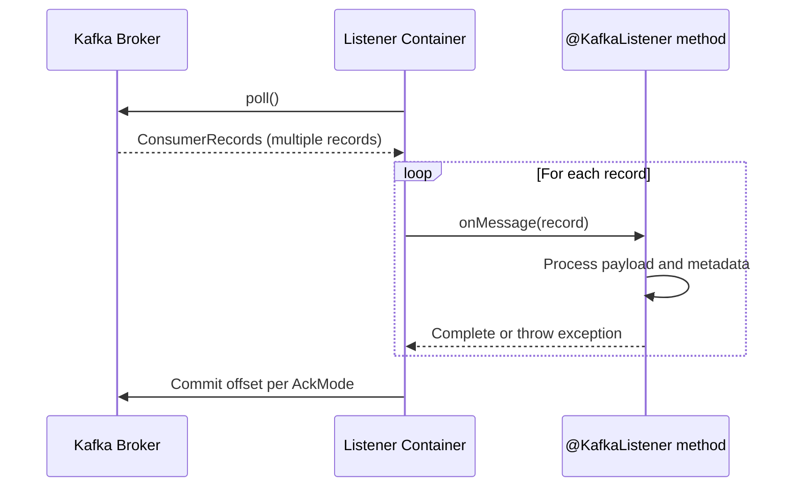

# Record-Based Listener Methods

In Spring Kafka, a **record listener** is a listener method invoked for each individual Kafka record. The listener container polls a batch from the broker and then passes each record one by one to the method annotated with `@KafkaListener`. The method typically receives the deserialized payload, or receives `ConsumerRecord` directly when full Kafka metadata is needed.

This listener style fits most business processing: each order, payment, or inventory event translates into one method invocation. Developers can read the key, topic, partition, offset, timestamp, and headers to process, log, or trace events.

## 1. How Does a Record Listener Work?

A Kafka consumer uses `poll()` to fetch records from the partitions assigned to it. With the record listener configuration (Spring Kafka's default), the container invokes the listener method once per record. If a single poll returns 20 records, the listener method may be invoked 20 times.



An important distinction is that method invocation count and poll count are not the same. A consumer can poll many records in one request, yet a record listener still processes each record through separate invocations. Offset committing is governed by `AckMode`, not merely by the fact that the method was called.

### Record Listener vs. Batch Listener

| Characteristic | Record listener | Batch listener |
| --- | --- | --- |
| Method input | A single payload or a single `ConsumerRecord` | A list of records or a list of payloads |
| Invocation count | Once per record | Typically once per poll batch |
| Error handling | Can pinpoint failures per individual record | Must track which records in the batch already succeeded |
| Best suited for | Per-event business logic, validation, and per-record retry | Batch database writes, bulk APIs, or batch optimization |
| Container setting | `batchListener=false` (default) | `batchListener=true` |

This guide focuses on record listeners. There is no need to write a manual `poll()` loop in the application; the Spring Kafka listener container manages the consumer and invokes the method.

## 2. Basic Listener Configuration

Example application receiving `OrderCreated` events from topic `orders.events`. Consumer configuration in `application.yml`:

```yaml
spring:
  kafka:
    bootstrap-servers: ${KAFKA_BOOTSTRAP_SERVERS:localhost:9092}
    consumer:
      group-id: billing-service
      enable-auto-commit: false
      auto-offset-reset: earliest
      key-deserializer: org.apache.kafka.common.serialization.StringDeserializer
      value-deserializer: org.springframework.kafka.support.serializer.JsonDeserializer
      properties:
        spring.json.trusted.packages: com.example.messaging.event
        spring.json.value.default.type: com.example.messaging.event.OrderCreated
    listener:
      ack-mode: record

app:
  kafka:
    topic:
      orders: orders.events
```

In this example:

- `group-id` identifies the listener's consumer group.
- `key-deserializer` converts the byte key into a `String`.
- `value-deserializer` converts JSON into an `OrderCreated` object.
- `trusted.packages` restricts the packages from which the JSON deserializer is allowed to instantiate objects.
- `ack-mode: record` instructs the container to commit the offset after each record is successfully processed by the listener.
- `enable-auto-commit: false` lets Spring Kafka manage commits instead of Kafka client auto-commit.

`auto-offset-reset: earliest` applies only when the group has no valid offset yet or the old offset is no longer in the log. It does not cause a group that already has valid offsets to re-read from the beginning automatically.

With `JsonDeserializer`, producer and consumer must agree on the JSON schema and how Java types are resolved. If the producer sends type headers, Spring Kafka can use them to determine the type; if you want a fixed target type for this topic, configure `spring.json.value.default.type` and control type-header usage according to your Spring Kafka version. Do not open `trusted.packages=*` without a clear reason.

## 3. Receiving a Deserialized Payload

The simplest approach is to declare a method parameter of the event type. Spring Kafka passes the deserialized payload into that parameter:

```java
package com.example.messaging.consumer;

import com.example.messaging.event.OrderCreated;
import org.slf4j.Logger;
import org.slf4j.LoggerFactory;
import org.springframework.kafka.annotation.KafkaListener;
import org.springframework.stereotype.Component;

@Component
public class OrderCreatedListener {

    private static final Logger log =
            LoggerFactory.getLogger(OrderCreatedListener.class);

    @KafkaListener(topics = "${app.kafka.topic.orders}")
    public void onOrderCreated(OrderCreated event) {
        log.info("Received order event: eventId={}, orderId={}",
                event.eventId(), event.orderId());

        // Invoke order processing logic.
    }
}
```

Here the method cares only about business data. It does not need to know which partition or offset the record came from. This is a suitable choice when metadata does not affect processing logic.

A payload method parameter is not a Kafka `ConsumerRecord`; it is the value produced by the deserializer. If metadata or headers are required, add `@Header` parameters or receive `ConsumerRecord` directly.

The listener classes in the following sections illustrate **alternative declaration styles**. You should not enable all of these classes simultaneously on the same topic and group ID if the goal is for each class to receive every event: within the same group, they act as consumer members sharing partitions and splitting records among themselves. If multiple components need to receive all events independently, each must use its own group ID.

## 4. Receiving ConsumerRecord Directly

`ConsumerRecord<K,V>` is the Kafka client type containing the key, value, and record metadata. Use this type when you need exact record coordinates, header access, or logging for traceability.

```java
package com.example.messaging.consumer;

import com.example.messaging.event.OrderCreated;
import java.nio.charset.StandardCharsets;
import org.apache.kafka.clients.consumer.ConsumerRecord;
import org.apache.kafka.common.header.Header;
import org.slf4j.Logger;
import org.slf4j.LoggerFactory;
import org.springframework.kafka.annotation.KafkaListener;
import org.springframework.stereotype.Component;

@Component
public class OrderRecordListener {

    private static final Logger log =
            LoggerFactory.getLogger(OrderRecordListener.class);

    @KafkaListener(
            topics = "${app.kafka.topic.orders}",
            groupId = "billing-service"
    )
    public void onRecord(ConsumerRecord<String, OrderCreated> record) {
        OrderCreated event = record.value();

        Header traceHeader = record.headers().lastHeader("trace-id");
        String traceId = traceHeader == null
                ? null
                : new String(traceHeader.value(), StandardCharsets.UTF_8);

        log.info(
                "topic={}, partition={}, offset={}, key={}, traceId={}, eventId={}",
                record.topic(),
                record.partition(),
                record.offset(),
                record.key(),
                traceId,
                event == null ? null : event.eventId()
        );

        if (event == null) {
            // Handle tombstone or null payload per topic convention.
            return;
        }

        // Process business logic with event.
    }
}
```

This snippet assumes the application has a `log` logger declared in the class. You can use Lombok's `@Slf4j` or declare an SLF4J `Logger` as shown in the previous section.

Important members on `ConsumerRecord`:

| Method | Value |
| --- | --- |
| `topic()` | Name of the topic containing the record |
| `partition()` | Partition containing the record |
| `offset()` | Offset of the record within that partition |
| `key()` | Deserialized key |
| `value()` | Deserialized payload |
| `timestamp()` | Record timestamp |
| `timestampType()` | Timestamp type, e.g., create time or log append time |
| `headers()` | Collection of key/byte-array-value headers |
| `serializedKeySize()` | Size of the serialized key |
| `serializedValueSize()` | Size of the serialized value |

An offset is meaningful only within the scope of a single partition. When logging or recording processing markers, combine topic, partition, and offset; logging only the offset can cause confusion across partitions.

## 5. Extracting Metadata with @Header

If only a few metadata fields are needed, there is no need to accept the full `ConsumerRecord`. Spring Kafka maps metadata to message headers so methods can extract them with `@Header`:

```java
package com.example.messaging.consumer;

import com.example.messaging.event.OrderCreated;
import org.springframework.kafka.annotation.KafkaListener;
import org.springframework.kafka.support.KafkaHeaders;
import org.springframework.messaging.handler.annotation.Header;
import org.springframework.messaging.handler.annotation.Payload;
import org.springframework.stereotype.Component;

@Component
public class OrderMetadataListener {

    @KafkaListener(topics = "${app.kafka.topic.orders}")
    public void onOrderCreated(
            @Payload OrderCreated event,
            @Header(KafkaHeaders.RECEIVED_TOPIC) String topic,
            @Header(KafkaHeaders.RECEIVED_PARTITION) int partition,
            @Header(KafkaHeaders.OFFSET) long offset,
            @Header(value = KafkaHeaders.RECEIVED_KEY, required = false) String key
    ) {
        System.out.printf(
                "Received topic=%s partition=%d offset=%d key=%s eventId=%s%n",
                topic, partition, offset, key, event.eventId()
        );
    }
}
```

`@Payload` marks the parameter holding the main data; the annotation can be omitted if the method signature is unambiguous. `KafkaHeaders` provides standard header names to avoid typing raw strings. `RECEIVED_KEY` is declared optional because Kafka allows records without a key.

Commonly used headers:

| Header constant | Meaning |
| --- | --- |
| `KafkaHeaders.RECEIVED_TOPIC` | Topic from which the record was received |
| `KafkaHeaders.RECEIVED_PARTITION` | Partition from which the record was received |
| `KafkaHeaders.OFFSET` | Record offset |
| `KafkaHeaders.RECEIVED_KEY` | Received key |
| `KafkaHeaders.RECEIVED_TIMESTAMP` | Received timestamp |
| `KafkaHeaders.ACKNOWLEDGMENT` | `Acknowledgment` object when the container uses a matching manual mode |

The timestamp header can be retrieved as a `long` if you need to record the event time. Always check nullability when working with keys or custom headers added by producers.

## 6. Receiving Spring Message Instead of ConsumerRecord

Another option is to receive Spring Messaging's `Message<T>`. The payload is accessed via `getPayload()`, and metadata via `getHeaders()`:

```java
package com.example.messaging.consumer;

import com.example.messaging.event.OrderCreated;
import org.springframework.kafka.annotation.KafkaListener;
import org.springframework.kafka.support.KafkaHeaders;
import org.springframework.messaging.Message;
import org.springframework.stereotype.Component;

@Component
public class OrderMessageListener {

    @KafkaListener(topics = "${app.kafka.topic.orders}")
    public void onMessage(Message<OrderCreated> message) {
        OrderCreated event = message.getPayload();

        String topic = message.getHeaders()
                .get(KafkaHeaders.RECEIVED_TOPIC, String.class);
        Integer partition = message.getHeaders()
                .get(KafkaHeaders.RECEIVED_PARTITION, Integer.class);
        Long offset = message.getHeaders()
                .get(KafkaHeaders.OFFSET, Long.class);

        System.out.printf(
                "topic=%s partition=%s offset=%s eventId=%s%n",
                topic, partition, offset, event.eventId()
        );
    }
}
```

`Message<T>` is useful when the processing layer already uses Spring Messaging or needs to pass payload and metadata together in a single object. If the full Kafka record API is needed, `ConsumerRecord<K,V>` directly is clearer.

Avoid declaring multiple parameters representing the same payload simultaneously, such as accepting both `ConsumerRecord` and `@Payload` in the same method, unless the signature is explicitly supported in the Spring Kafka version you are using. Pick one primary input style to prevent ambiguity during argument resolution.

## 7. Custom Headers and Event Tracing

Producers can attach headers to pass auxiliary information such as trace IDs, event types, or schema versions. Consumers read those headers from `ConsumerRecord.headers()`.

Example producer sending a record with a trace header:

```java
import java.nio.charset.StandardCharsets;
import org.apache.kafka.clients.producer.ProducerRecord;
import org.springframework.kafka.core.KafkaTemplate;

ProducerRecord<String, OrderCreated> record = new ProducerRecord<>(
        "orders.events",
        event.orderId(),
        event
);
record.headers().add(
        "trace-id",
        traceId.getBytes(StandardCharsets.UTF_8)
);

kafkaTemplate.send(record);
```

Consumer reading the header:

```java
Header header = record.headers().lastHeader("trace-id");
String traceId = header == null
        ? null
        : new String(header.value(), StandardCharsets.UTF_8);
```

Headers are byte arrays, so producer and consumer must agree on encoding. Kafka allows multiple headers with the same name; `lastHeader(name)` returns the last header with that name. If the contract requires a single header, validate and handle duplicates instead of assuming only one value ever exists.

Avoid putting large payloads or sensitive information in headers. Headers should hold small metadata, not replace the value schema, and must not contain authentication tokens or secrets.

## 8. Handling Keys, Partitions, and Ordering

A record listener normally processes events in the order the consumer receives them from a partition. Kafka guarantees ordering within a single partition, not global ordering across multiple partitions.

Example producer using `orderId` as the key:

```java
kafkaTemplate.send("orders.events", event.orderId(), event);
```

Events with the same key are typically routed to the same partition by the default partitioner. If `OrderCreated`, `OrderPaid`, and `OrderCancelled` for a single order must be processed in sequence, using `orderId` as the key is a suitable choice.

However, ordering can be affected if:

- The producer emits events for the same entity from multiple threads or instances without controlling emission order.
- The application hands work off from the listener to a thread pool and processes it asynchronously without per-key serialization.
- Changing the partition count causes a key to hash to a different partition under the partitioner.
- Business logic processes records from different partitions in parallel while assuming global ordering.

If per-entity ordering is a strict requirement, combine stable keys, an appropriate producer strategy, and sequential consumer processing within the required partition/key scope.

## 9. Acknowledgment and Offset Commits in Record Listeners

When the listener method completes successfully, the container decides when to commit offsets based on `AckMode`. Common modes in Spring Kafka:

| AckMode | Behavior |
| --- | --- |
| `RECORD` | Commits the offset after each record listener invocation succeeds |
| `BATCH` | Commits offsets after all records in the poll batch are processed successfully |
| `MANUAL` | Listener calls `acknowledge()`; the container batches acknowledgments and commits at the poll batch boundary |
| `MANUAL_IMMEDIATE` | Commits immediately when the listener calls `acknowledge()` on the consumer thread; if called from another thread, behavior follows container rules |

With record listeners, `RECORD` is usually straightforward because the offset is committed after each record succeeds. `BATCH` can reduce commit frequency, though if one record in the batch fails, commit progress may be held back depending on error handling.

### 9.1. Manual Acknowledgment

Use `Acknowledgment` only when the container is configured with `MANUAL` or `MANUAL_IMMEDIATE`. Example:

```yaml
spring:
  kafka:
    consumer:
      enable-auto-commit: false
    listener:
      ack-mode: manual
```

```java
import org.springframework.kafka.support.Acknowledgment;

@KafkaListener(topics = "${app.kafka.topic.orders}")
public void onOrderCreated(
        OrderCreated event,
        Acknowledgment acknowledgment
) {
    billingService.handle(event);
    acknowledgment.acknowledge();
}
```

Call `acknowledge()` only after the business operation meets the condition to be considered processed. Calling it before the database commits or before side effects complete risks losing the opportunity to reprocess the record if a failure occurs afterward.

Manual acknowledgment does not automatically create a distributed transaction between Kafka and the database. If the database commits successfully but the application crashes before committing the offset, the record may be redelivered; the consumer still needs idempotency or an appropriate state-synchronization strategy.

## 10. Handling Null Payloads and Tombstones

Kafka permits records with a key and a `null` value. In compacted topics, such records are usually tombstones representing deletion of the key's state. Therefore, do not assume `record.value()` is always non-null.

Example:

```java
@KafkaListener(topics = "customer.current-state")
public void onCustomerState(ConsumerRecord<String, CustomerState> record) {
    String customerId = record.key();
    CustomerState state = record.value();

    if (state == null) {
        customerStateService.remove(customerId);
        return;
    }

    customerStateService.upsert(customerId, state);
}
```

Even when a topic does not use tombstones, null payloads can still appear if a producer sends null or due to data conventions. Define null handling explicitly in the event contract. Distinguish legitimate null payloads from deserialization failures; deserialization errors may occur before the listener method is ever called.

## 11. Errors in Listener Methods

If a listener method throws an exception, Spring Kafka delegates the error to the listener container's error handler. Depending on configuration, the record can be retried, seeked for redelivery, or routed to a dead-letter topic after exhausting attempts.

Key principles:

- Do not catch and swallow an exception if the business logic has not actually processed the record. The container will treat the listener as completed and may commit the offset.
- Distinguish transient errors (database timeouts, network glitches) from non-recoverable errors (malformed schema payloads, invalid data).
- Use bounded retries with backoff for transient errors.
- Use a dead-letter topic or quarantine mechanism to preserve unprocessable records along with original metadata such as topic, partition, offset, and exception details.
- Ensure idempotent processing because retries or restarts may cause the same record to be delivered again.

Errors occurring in the deserializer differ from errors thrown inside the method. When a deserializer throws an exception, the listener method has not received a payload; configure `ErrorHandlingDeserializer` or an equivalent deserialization error-handling mechanism so the container error handler can process the failed record.

## 12. Concurrency and Parallelism Limits

You can increase the number of consumers for a listener using the `concurrency` attribute:

```java
@KafkaListener(
        topics = "${app.kafka.topic.orders}",
        groupId = "billing-service",
        concurrency = "3"
)
public void onOrderCreated(OrderCreated event) {
    billingService.handle(event);
}
```

`concurrency = 3` instructs the listener container to create three consumer members in the same group. Each consumer receives partitions assigned by the group coordinator. If the topic has two partitions, at most two consumers are assigned partitions at any time; the remaining consumer adds no parallelism for that topic.

Within a group, a partition is assigned to at most one consumer member at a time. Thus, the partition count sets the upper bound on partition-level parallelism. When raising concurrency or scaling replicas, monitor partition assignments, consumer lag, and rebalance duration.

The listener method executes on the consumer/container processing thread. If the method offloads work to an executor and returns immediately, the container may consider the record done and commit the offset before asynchronous work completes. To process asynchronously, design explicit acknowledgment, backpressure, ordering, and error management; do not simply call `executor.submit()` and return.

## 13. Testing Record Listeners

At a minimum, test the following scenarios:

1. Valid JSON payloads deserialize into the expected event type.
2. The method receives the correct key, topic, partition, offset, and headers.
3. Events sharing a key are read from the expected partition per producer configuration.
4. Null payloads/tombstones are handled according to the topic contract.
5. Throwing an exception from the listener triggers the configured retry or recovery policy.
6. Offsets are committed only after processing criteria under the configured `AckMode` are met.
7. Multiple consumer members split partitions according to group assignment.

For integration tests, `spring-kafka-test` provides `@EmbeddedKafka` to run an embedded broker. You can send events with `KafkaTemplate`, use a test listener with a `CountDownLatch` or `BlockingQueue` to await invocation, and assert payloads and metadata. Use a dedicated test group ID to avoid relying on offsets from other environments. When testing listeners inside a Spring context, wait for the listener container to receive partition assignments before sending records or use Spring Kafka Test helpers to avoid race conditions.

Avoid using fixed `Thread.sleep()` calls as your sole synchronization mechanism. Use latches, queues, or polling assertions with timeouts so tests remain stable and fail clearly when a listener receives no record.

## 14. Common Pitfalls

| Symptom | Common cause | How to check |
| --- | --- | --- |
| Listener does not receive the expected object | Deserializer does not match value type or JSON type mapping is wrong | Inspect `value-deserializer`, type headers, and default type |
| Method is never called | Listener is not subscribed, group has no assignment, or broker is unreachable | Check container logs, group assignment, and consumer lag |
| `@Header` reports missing header | Producer did not send that key/header or header is absent from the record | Use `required=false` when headers may be absent |
| Same record processed multiple times | Consumer failed before commit, or retry/rebalance occurred | Use event IDs and idempotent processing |
| Record skipped after exception | Method caught exception without rethrowing, so container treated it as success | Catch errors only when handled or explicitly routed per policy |
| Tombstone causes `NullPointerException` | Listener assumes payload is always non-null | Check for null and handle tombstones per business rules |
| Increasing concurrency does not improve throughput | Low partition count or bottleneck in downstream system | Inspect assignment, partition count, lag, and processing time |
| Event ordering is broken | Async execution or producer sending from multiple threads without ordering | Inspect keys, partitions, and work dispatching |

## 15. Design Process for Record-Based Listener Methods

When creating a new listener, decide in order:

1. Determine whether the listener processes one event at a time or requires batch processing.
2. Choose the input parameter style: payload type when only business data is needed; `ConsumerRecord<K,V>` when full metadata is needed; `Message<T>` when Spring Messaging headers are preferred.
3. Choose the deserializer and define the payload contract, schema, type headers, and null-handling rules.
4. Choose the group ID, topic subscription, partition count, and concurrency based on scaling needs.
5. Select an `AckMode` aligned with business transaction boundaries.
6. Configure retries, error handlers, and a dead-letter topic for unrecoverable errors.
7. Design idempotency and ordering guarantees if records may be redelivered or processed concurrently.
8. Log/trace with event ID, topic, partition, and offset to aid investigation.
9. Test valid payloads, nulls/tombstones, deserialization errors, business errors, retries, and commits.

Record listeners map one Kafka record directly to one Java method invocation. By choosing the right parameter type and understanding metadata, acknowledgment, and error handling, listeners can process each event cleanly while still leveraging Kafka's polling, partition assignment, and commit mechanisms.

## 16. Self-Check

1. If a single `poll()` returns 10 records, how many times is a record listener invoked?
2. When should you accept `OrderCreated`, and when should you accept `ConsumerRecord<String, OrderCreated>`?
3. Why should offsets be logged together with topic and partition?
4. Under what circumstances can `@Header(KafkaHeaders.RECEIVED_KEY)` be missing?
5. How does `AckMode.RECORD` differ from `AckMode.BATCH`?
6. Why can catching an exception without rethrowing cause a record to be committed?
7. What is a tombstone, and why must listeners check for a null payload?
8. Why can offloading work to an executor and returning immediately cause premature offset commits?
