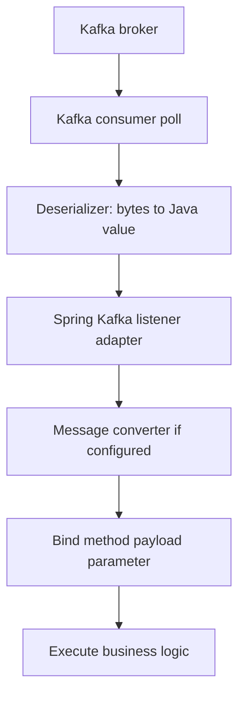

# Payload-Based Listener Methods

With Spring Kafka, a `@KafkaListener` method can accept the Kafka record payload directly as a parameter. This style keeps the listener focused on business data without needing to handle `ConsumerRecord` when partition, offset, or technical metadata is unnecessary.

Example:

```java
import org.springframework.kafka.annotation.KafkaListener;
import org.springframework.stereotype.Component;

@Component
public class OrderEventListener {

    @KafkaListener(
        topics = "order-events",
        groupId = "billing-service"
    )
    public void onOrderCreated(OrderCreated event) {
        // Process order event.
    }
}
```

Spring Kafka receives the record from the consumer, converts its value to the appropriate data type, and invokes the listener method. To use this approach safely, you need to understand the boundary between the Kafka deserializer, the Spring message converter, and the method's parameter type.

## 1. How Do Payload Methods Work?

A Kafka record contains a key, a value, and metadata such as topic, partition, offset, timestamp, and headers. With a payload-based listener, the method parameter receives the converted value.

High-level processing flow:



There are two conversion steps to distinguish:

1. **Kafka deserializer** converts wire byte arrays into a Java type such as `String`, `byte[]`, or `OrderCreated`.
2. **Spring message converter** converts the record/payload to the method parameter type when a suitable converter is configured, such as from a JSON `String` into a DTO.

If the deserializer already returns an `OrderCreated` object, the listener can accept that object directly. If the deserializer returns a `String`, the method does not automatically turn a JSON `String` into a DTO unless a supporting message converter is configured or the application parses it explicitly.

## 2. Receiving a DTO Directly

This is the right choice when the application uses JSON events and the consumer can deserialize directly into the DTO type.

Example event:

```java
import java.math.BigDecimal;
import java.time.Instant;

public record OrderCreated(
    String orderId,
    String customerId,
    BigDecimal amount,
    Instant occurredAt
) {
}
```

Listener:

```java
import org.springframework.kafka.annotation.KafkaListener;
import org.springframework.stereotype.Component;

@Component
public class BillingListener {

    @KafkaListener(
        topics = "order-events",
        groupId = "billing-service"
    )
    public void handle(OrderCreated event) {
        // Pass deserialized payload to the business processing layer.
    }
}
```

Consumer configuration can use `JsonDeserializer`:

```yaml
spring:
  kafka:
    consumer:
      group-id: billing-service
      key-deserializer: org.apache.kafka.common.serialization.StringDeserializer
      value-deserializer: org.springframework.kafka.support.serializer.JsonDeserializer
      properties:
        spring.json.value.default.type: com.example.messaging.event.OrderCreated
        spring.json.trusted.packages: com.example.messaging.event
```

In this example, the Kafka consumer deserializer creates the `OrderCreated` object before the listener method is invoked. `spring.json.value.default.type` specifies the default type when the deserializer needs to determine the target type without getting an applicable type from headers. The package name must match the event's actual package in the application.

The YAML snippet above illustrates the `JsonSerializer`/`JsonDeserializer` classes commonly used with Spring Kafka 3.x. Spring Kafka 4.x provides `JacksonJsonSerializer`/`JacksonJsonDeserializer`; choose the serializer/deserializer pair matching your project's Spring Kafka version and Jackson major version.

The producer must serialize the value compatibly, for example using Spring Kafka's `JsonSerializer`. If the producer sends type headers, the consumer can use that information to determine the type. When multiple services use different classes or packages, agree on schemas and type mappings; avoid trusting all packages merely to bypass deserialization errors.

### When Should You Use a Default Type?

Use a default type when a topic carries one primary value type and the consumer knows that type ahead of time. If a topic carries multiple event types, design an explicit type mapping or use a shared envelope containing an event type/version field. Avoid letting a consumer infer types from untrusted class names in message headers.

## 3. Receiving a String and Converting JSON to a DTO

Another approach is to let the Kafka deserializer return a `String`, then let a Spring Kafka message converter turn JSON into the listener's parameter type.

Consumer configuration:

```yaml
spring:
  kafka:
    consumer:
      key-deserializer: org.apache.kafka.common.serialization.StringDeserializer
      value-deserializer: org.apache.kafka.common.serialization.StringDeserializer
```

With Spring Boot, you can register a `RecordMessageConverter` bean so auto-configuration attaches it to the default listener container factory:

```java
import org.springframework.context.annotation.Bean;
import org.springframework.context.annotation.Configuration;
import org.springframework.kafka.support.converter.JacksonJsonMessageConverter;
import org.springframework.kafka.support.converter.RecordMessageConverter;

@Configuration
public class KafkaMessageConverterConfiguration {

    @Bean
    RecordMessageConverter recordMessageConverter() {
        return new JacksonJsonMessageConverter();
    }
}
```

This example uses the converter name from Spring Kafka 4.x. With Spring Kafka 3.3.x, use `StringJsonMessageConverter`; choose the converter matching your project's version and Jackson major version. If you build your own listener container factory instead of using Spring Boot's auto-configured factory, call `setRecordMessageConverter(...)` on that factory.

The listener can still accept a DTO:

```java
@KafkaListener(
    topics = "order-events",
    groupId = "billing-service"
)
public void handle(OrderCreated event) {
    // Payload has been converted to DTO by the message converter.
}
```

This approach is useful when you want to control JSON-to-DTO conversion at the Spring Messaging layer, or when the consumer receives `String` payloads from Kafka. The converter must be attached to the exact listener container factory used by the listener.

For method-level `@KafkaListener` declarations, Spring Kafka passes the method parameter type to the converter to aid target-type inference. When using class-level `@KafkaListener` combined with multiple `@KafkaHandler` methods, the payload must be converted before the framework selects a method; in that case, configure type headers/type mappings or a deserializer to determine the type upfront.

Do not configure `JsonDeserializer` to deserialize into a DTO and then configure a converter as though the payload were still a JSON `String`. Choose a single place responsible for turning JSON into objects to avoid redundant conversions or type mismatches.

## 4. Receiving a String and Parsing Manually

If you want full control over parsing, the listener can accept a `String` and use `ObjectMapper`:

```java
import com.fasterxml.jackson.core.JsonProcessingException;
import com.fasterxml.jackson.databind.ObjectMapper;
import org.springframework.kafka.annotation.KafkaListener;
import org.springframework.stereotype.Component;

@Component
public class RawOrderListener {

    private final ObjectMapper objectMapper;
    private final OrderApplicationService orderService;

    public RawOrderListener(
            ObjectMapper objectMapper,
            OrderApplicationService orderService) {
        this.objectMapper = objectMapper;
        this.orderService = orderService;
    }

    @KafkaListener(
        topics = "order-events",
        groupId = "billing-raw-service"
    )
    public void handle(String payload) throws JsonProcessingException {
        OrderCreated event =
            objectMapper.readValue(payload, OrderCreated.class);

        orderService.process(event);
    }
}
```

This approach is straightforward and helpful when payload formatting follows custom rules. However, each listener may repeat parsing, error handling, and schema mapping logic. When multiple listeners consume the same event type, centralize conversion in a shared deserializer or message converter.

Parsing errors thrown inside the method are treated as listener errors and flow through the container's error handler. They differ from deserialization errors occurring before the method is called.

## 5. Choosing the Payload Parameter Type

The parameter type should reflect what the consumer actually receives:

| Parameter type | When to use |
|---|---|
| `String` | Text or JSON payloads not yet converted to a DTO |
| `byte[]` | Custom binary decoding is needed |
| DTO such as `OrderCreated` | Consumer already deserialized or converted to the object |
| `JsonNode` | Flexible JSON reading is needed before choosing a concrete type |
| `Message<OrderCreated>` | Both payload and Spring message headers are needed |
| `ConsumerRecord<K, V>` | Full record metadata access via the Kafka API is needed |

Example receiving a JSON tree:

```java
@KafkaListener(topics = "external-events")
public void handle(JsonNode payload) {
    String eventType = payload.path("eventType").asText();

    // Dispatch handling based on eventType.
}
```

To receive `JsonNode`, the deserializer/converter must be configured to produce that type. A method parameter type cannot alter what type the Kafka client deserialized the byte array into earlier.

If a method accepts `List<OrderCreated>`, verify whether the listener is running in batch mode. In a batch listener, `List<T>` normally represents multiple records from a single poll; it does not automatically mean a single record's JSON value is a JSON array.

For compacted topics, a record with a `null` value (tombstone) signals deletion of the key's state. A listener handling tombstones must mark the payload as optional and usually also retrieve the key to know which entity was deleted:

```java
import org.springframework.kafka.annotation.KafkaListener;
import org.springframework.kafka.support.KafkaHeaders;
import org.springframework.messaging.handler.annotation.Header;
import org.springframework.messaging.handler.annotation.Payload;

@KafkaListener(topics = "account-state")
public void handle(
        @Payload(required = false) AccountState state,
        @Header(value = KafkaHeaders.RECEIVED_KEY, required = false) String accountId) {

    if (state == null) {
        // Delete state for accountId.
        return;
    }

    // Update state for accountId.
}
```

With default listeners, Spring Kafka provides a resolver that supports null payloads. If you replace `MessageHandlerMethodFactory` yourself, add `KafkaNullAwarePayloadArgumentResolver` to the resolver list so tombstones bind properly.

## 6. Combining Payload with @Payload and @Header

When a method has only one payload parameter, Spring Kafka can usually infer that parameter as the payload. You can add `@Payload` to make the intent explicit, especially when the method has multiple parameters:

```java
import org.springframework.kafka.annotation.KafkaListener;
import org.springframework.kafka.support.KafkaHeaders;
import org.springframework.messaging.handler.annotation.Header;
import org.springframework.messaging.handler.annotation.Payload;

@KafkaListener(topics = "order-events")
public void handle(
        @Payload OrderCreated event,
        @Header(KafkaHeaders.RECEIVED_KEY) String orderKey,
        @Header(KafkaHeaders.RECEIVED_PARTITION) int partition,
        @Header(KafkaHeaders.OFFSET) long offset) {

    // Use key, partition, offset for tracing when needed; process event.
}
```

Commonly used headers:

- `KafkaHeaders.RECEIVED_KEY`: key of the record.
- `KafkaHeaders.RECEIVED_PARTITION`: partition from which it was received.
- `KafkaHeaders.OFFSET`: offset of the record.
- `KafkaHeaders.RECEIVED_TOPIC`: topic from which it was received.
- `KafkaHeaders.RECEIVED_TIMESTAMP`: timestamp of the record.

If the key can be null, declare the header as optional:

```java
@KafkaListener(topics = "order-events")
public void handle(
        @Payload OrderCreated event,
        @Header(value = KafkaHeaders.RECEIVED_KEY, required = false) String key) {
    // Process event; key may be null if producer did not send one.
}
```

The Java type of a header parameter must be compatible with the mapped header value. For example, offset can be received as `long` or `Long`; missing headers must be handled via `required` or a default value.

## 7. Using Message<T> to Receive Payload and Headers

If you want to keep payload and metadata in a single parameter, the listener can accept Spring's `Message<T>`:

```java
import org.springframework.messaging.Message;
import org.springframework.kafka.support.KafkaHeaders;
import org.springframework.kafka.annotation.KafkaListener;

@KafkaListener(
    topics = "order-events",
    groupId = "billing-service"
)
public void handle(Message<OrderCreated> message) {
    OrderCreated event = message.getPayload();

    String topic = message.getHeaders()
        .get(KafkaHeaders.RECEIVED_TOPIC, String.class);

    Integer partition = message.getHeaders()
        .get(KafkaHeaders.RECEIVED_PARTITION, Integer.class);

    Long offset = message.getHeaders()
        .get(KafkaHeaders.OFFSET, Long.class);

    // Pass payload along with required metadata to the processing layer.
}
```

This style is convenient when passing a message through multiple processing layers while retaining needed metadata. If only the payload is required, a plain DTO parameter is easier to read.

Another option is accepting a header map:

```java
import java.util.Map;

import org.springframework.kafka.annotation.KafkaListener;
import org.springframework.kafka.support.KafkaHeaders;
import org.springframework.messaging.handler.annotation.Headers;
import org.springframework.messaging.handler.annotation.Payload;

@KafkaListener(topics = "order-events")
public void handle(
        @Payload OrderCreated event,
        @Headers Map<String, Object> headers) {

    Object topic = headers.get(KafkaHeaders.RECEIVED_TOPIC);
    // Extract additional needed headers and process event.
}
```

Do not log or persist all headers to a business database by default. Extract only the values you need, because headers may contain sensitive data or internal metadata.

## 8. Validating Payloads Before Processing

Payload DTOs should be validated before running business logic. Bean Validation with `@Valid` can be used:

```java
import java.math.BigDecimal;

import jakarta.validation.constraints.NotBlank;
import jakarta.validation.constraints.Positive;

public record OrderCreated(
    @NotBlank String orderId,
    @NotBlank String customerId,
    @Positive BigDecimal amount
) {
}
```

Listener:

```java
import jakarta.validation.Valid;
import org.springframework.kafka.annotation.KafkaListener;
import org.springframework.messaging.handler.annotation.Payload;

@KafkaListener(topics = "order-events")
public void handle(@Payload @Valid OrderCreated event) {
    // Payload has been validated before entering the method body.
}
```

Register the validator with the listener endpoint registrar. When `spring-boot-starter-validation` is present, Spring Boot auto-configures a `LocalValidatorFactoryBean` that can be injected into configuration:

```java
import org.springframework.context.annotation.Configuration;
import org.springframework.kafka.annotation.KafkaListenerConfigurer;
import org.springframework.kafka.config.KafkaListenerEndpointRegistrar;
import org.springframework.validation.Validator;

@Configuration
public class KafkaValidationConfiguration implements KafkaListenerConfigurer {

    private final Validator validator;

    public KafkaValidationConfiguration(Validator validator) {
        this.validator = validator;
    }

    @Override
    public void configureKafkaListeners(KafkaListenerEndpointRegistrar registrar) {
        registrar.setValidator(validator);
    }
}
```

The project needs a Bean Validation provider, such as `spring-boot-starter-validation`, and constraint annotations from `jakarta.validation` on Spring Boot 3/4. If validation fails, Spring Kafka throws a validation error during method invocation handling; the error is routed to the listener container's error handler.

Structural payload validation does not replace business checks. For instance, a positive `amount` may still be invalid if the order has already been cancelled or the customer is not permitted to pay.

## 9. Distinguishing Deserialization Errors from Payload Processing Errors

These errors occur at different stages:

| Error type | Stage | Example | Is listener method called? |
|---|---|---|---|
| Deserialization | Kafka client converts bytes to Java value | Malformed JSON, DTO type mismatch | Typically no |
| Message conversion | Spring converter converts payload to method type | Cannot convert String to DTO | Does not enter method body |
| Argument validation | Parameter validation after binding | Missing `orderId` or invalid `amount` | Method body does not run |
| Business processing | After method execution begins | Order not found or database error | Yes |

For deserialization errors, wrap the real deserializer with `ErrorHandlingDeserializer` to feed error details into Spring Kafka's handling mechanism:

```yaml
spring:
  kafka:
    consumer:
      key-deserializer: org.springframework.kafka.support.serializer.ErrorHandlingDeserializer
      value-deserializer: org.springframework.kafka.support.serializer.ErrorHandlingDeserializer
      properties:
        spring.deserializer.key.delegate.class: org.apache.kafka.common.serialization.StringDeserializer
        spring.deserializer.value.delegate.class: org.springframework.kafka.support.serializer.JsonDeserializer
        spring.json.value.default.type: com.example.messaging.event.OrderCreated
        spring.json.trusted.packages: com.example.messaging.event
```

The delegate configuration above uses `JsonDeserializer` from Spring Kafka 3.x. With Spring Kafka 4.x, replace the delegate with the corresponding `JacksonJsonDeserializer`.

`ErrorHandlingDeserializer` preserves deserialization error details so the container error handler can process them. It can be combined with `DefaultErrorHandler`, a recoverer, or a Dead Letter Topic to route bad records for investigation. Exact settings must match key/value types and your Spring Kafka version.

For conversion or validation errors occurring in the listener adapter, the container error handler also receives the exception. Classify exceptions to decide between retrying and routing to a DLT; permanent data errors should generally not be retried indefinitely.

## 10. Choosing Between Payload Methods and ConsumerRecord

Use a payload method when logic needs only business data:

```java
@KafkaListener(topics = "order-events")
public void handle(OrderCreated event) {
    // Process business payload.
}
```

Use `ConsumerRecord` when you need to work with Kafka-level metadata:

```java
import org.apache.kafka.clients.consumer.ConsumerRecord;
import org.springframework.kafka.annotation.KafkaListener;

@KafkaListener(topics = "order-events")
public void handle(ConsumerRecord<String, OrderCreated> record) {
    OrderCreated event = record.value();
    int partition = record.partition();
    long offset = record.offset();

    // Use metadata when tracing or specialized handling is needed.
}
```

Both approaches are valid. There is no need to accept `ConsumerRecord` just to extract the payload; conversely, do not omit metadata when business requirements need tracing, partition control, or specialized offset handling.

## 11. Testing Payload-Based Listeners

Integration tests with Embedded Kafka can verify that JSON is deserialized and bound to the DTO parameter properly.

A simple test listener can push received payloads into a queue for test assertions:

```java
import java.util.concurrent.BlockingQueue;
import java.util.concurrent.LinkedBlockingQueue;
import java.util.concurrent.TimeUnit;

import com.example.messaging.event.OrderCreated;
import org.springframework.kafka.annotation.KafkaListener;
import org.springframework.stereotype.Component;

@Component
public class OrderEventCapture {

    private final BlockingQueue<OrderCreated> received =
        new LinkedBlockingQueue<>();

    @KafkaListener(
        id = "order-capture-test-listener",
        topics = "order-events",
        groupId = "order-capture-test"
    )
    public void capture(OrderCreated event) {
        received.add(event);
    }

    public OrderCreated poll(long timeout, TimeUnit unit)
            throws InterruptedException {
        return received.poll(timeout, unit);
    }
}
```

Test:

```java
import java.math.BigDecimal;
import java.time.Instant;
import java.util.concurrent.TimeUnit;

import com.example.messaging.event.OrderCreated;
import org.junit.jupiter.api.BeforeEach;
import org.junit.jupiter.api.Test;
import org.springframework.beans.factory.annotation.Autowired;
import org.springframework.boot.test.context.SpringBootTest;
import org.springframework.kafka.config.KafkaListenerEndpointRegistry;
import org.springframework.kafka.core.KafkaTemplate;
import org.springframework.kafka.listener.MessageListenerContainer;
import org.springframework.kafka.test.context.EmbeddedKafka;
import org.springframework.kafka.test.utils.ContainerTestUtils;

import static org.assertj.core.api.Assertions.assertThat;

@SpringBootTest(properties = {
    "spring.kafka.producer.key-serializer=org.apache.kafka.common.serialization.StringSerializer",
    "spring.kafka.producer.value-serializer=org.springframework.kafka.support.serializer.JsonSerializer",
    "spring.kafka.consumer.key-deserializer=org.apache.kafka.common.serialization.StringDeserializer",
    "spring.kafka.consumer.value-deserializer=org.springframework.kafka.support.serializer.JsonDeserializer",
    "spring.kafka.consumer.properties.spring.json.value.default.type=com.example.messaging.event.OrderCreated",
    "spring.kafka.consumer.properties.spring.json.trusted.packages=com.example.messaging.event",
    "spring.kafka.consumer.auto-offset-reset=earliest"
})
@EmbeddedKafka(
    partitions = 1,
    topics = "order-events",
    bootstrapServersProperty = "spring.kafka.bootstrap-servers"
)
class OrderPayloadListenerTest {

    @Autowired
    private KafkaTemplate<String, OrderCreated> kafkaTemplate;

    @Autowired
    private OrderEventCapture capture;

    @Autowired
    private KafkaListenerEndpointRegistry registry;

    @BeforeEach
    void waitForListenerAssignment() {
        MessageListenerContainer container =
            registry.getListenerContainer("order-capture-test-listener");
        ContainerTestUtils.waitForAssignment(container, 1);
    }

    @Test
    void bindsJsonRecordToPayloadArgument() throws Exception {
        OrderCreated event = new OrderCreated(
            "order-42",
            "customer-9",
            new BigDecimal("125000"),
            Instant.now()
        );

        kafkaTemplate.send("order-events", event.orderId(), event)
            .get(10, TimeUnit.SECONDS);

        OrderCreated received = capture.poll(10, TimeUnit.SECONDS);

        assertThat(received).isNotNull();
        assertThat(received.orderId()).isEqualTo("order-42");
        assertThat(received.customerId()).isEqualTo("customer-9");
    }
}
```

These test properties use `JsonSerializer`/`JsonDeserializer` from Spring Kafka 3.x. With Spring Kafka 4.x, replace them with `JacksonJsonSerializer`/`JacksonJsonDeserializer` for Jackson 3.

For reliable tests, test producer and consumer must use compatible serializers/deserializers. Tests should use a dedicated group ID, finite timeouts, and a queue or Awaitility to await records. Avoid fixed `Thread.sleep()` calls.

`com.example.messaging.event.OrderCreated` in the test properties is an illustrative class name; replace it with the fully qualified class name of your project's DTO.

Additional cases worth testing:

- Valid JSON binds to the expected DTO.
- JSON missing required fields is rejected by validation.
- Malformed JSON routes to the configured error handler/DLT.
- Key, topic, partition, and offset headers bind properly when requested by the method.
- The consumer does not inadvertently use an incompatible type header or default type.

## 12. Common Pitfalls

| Symptom | Possible cause | How to resolve |
|---|---|---|
| Listener receives `String` instead of DTO | Consumer uses `StringDeserializer` without a JSON message converter | Configure `JsonDeserializer` or `JacksonJsonMessageConverter` |
| Cannot deserialize DTO | Type header, default type, package, or schema mismatch | Check `JsonDeserializer` and type mapping |
| Listener method is never invoked | Deserialization error occurred before adapter invoked the method | Use `ErrorHandlingDeserializer` and check container error handler |
| Conversion error despite valid JSON | Converter is not attached to the active listener factory | Check factory and `RecordMessageConverter` |
| Missing key header | Producer sent a record without a key | Set `required=false` if keys may be null |
| Validation does not run | `Validator` not registered or validation provider missing | Configure `KafkaListenerConfigurer.setValidator(...)` and validation starter |
| Consumer receives wrong DTO type | Topic contains multiple event types with only one default type configured | Use type mapping or an envelope with event type/version |

## 13. Payload Listener Design Checklist

- Choose a parameter type reflecting the value the consumer actually deserializes.
- Clearly distinguish the Kafka deserializer from the Spring message converter.
- Configure only one clear path with clear responsibility for converting JSON to DTOs.
- Use stable DTOs/schemas and maintain a versioning strategy.
- Use `@Payload`, `@Header`, or `Message<T>` when metadata is needed.
- Set `required=false` for headers that may be absent.
- Validate payloads before running business logic.
- Distinguish deserialization, conversion, validation, and business errors.
- Configure error handlers and DLTs for unprocessable records.
- Test both valid and malformed payloads.

## 14. Key Takeaways

- Payload-based listener methods directly receive the record's value, typically as a DTO.
- The Kafka deserializer turns bytes into a Java value before the method is called.
- A message converter can convert the deserialized payload into the method's parameter type.
- `@Payload` marks the payload; `@Header` and `@Headers` extract metadata.
- `Message<T>` carries both the payload and Spring message headers.
- Deserialization errors can occur before the listener method is invoked.
- Clean payload DTOs keep business logic readable, yet validation, schema compatibility, and error handling remain essential.

When you choose the right payload type and configure the conversion layer properly, `@KafkaListener` can focus on business event processing while Spring Kafka handles receiving records, binding data, and routing errors to recovery mechanisms.

