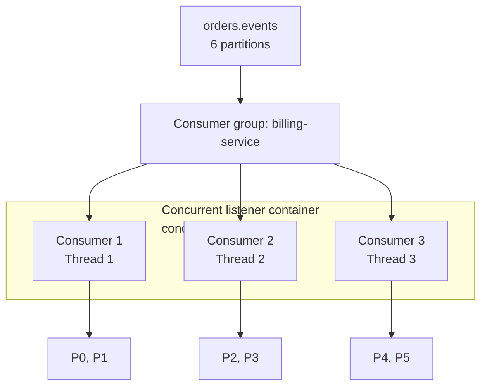

# Setting concurrency on Annotations

In Spring Kafka, the `concurrency` attribute on `@KafkaListener` specifies how many consumers are created for that listener container. Each consumer runs its own poll loop and joins the consumer group to receive partitions. This lets a single listener process multiple partitions in parallel without manually creating threads or managing Kafka consumers.

For example, a listener with `concurrency = "3"` will have up to three consumer members in the group. If the topic has enough partitions and the broker distributes them across all three members, three processing threads can operate concurrently. If the topic has only one partition, only one consumer is assigned that partition; the other two consumers add no throughput.

`concurrency` must be chosen alongside partition count, application replica count, processing speed, and downstream system limits. Increasing the annotation value does not automatically cause a single partition to be processed concurrently by multiple consumers.

## 1. What Is @KafkaListener Concurrency?

When Spring Kafka registers a method annotated with `@KafkaListener`, the framework creates a listener container to manage Kafka consumers. With `ConcurrentKafkaListenerContainerFactory`, the container can create multiple child containers; each child manages one Kafka consumer and its own poll thread.



Each consumer is a member of the same consumer group when the listener shares the same `group.id`. The group coordinator distributes partitions among members. A partition is assigned to at most one consumer member in the group at a time.

This produces two distinct levels of execution:

- **Parallelism across partitions:** different consumers process different partitions simultaneously.
- **Sequentiality within a partition:** one consumer reads records in offset order for that partition; the record listener is invoked per record on its corresponding thread.

`concurrency` does not split a single partition into multiple parallel streams. It creates additional consumers so separate partitions can be utilized concurrently.

## 2. Setting Concurrency Directly on the Annotation

Example listener receiving `OrderCreated` events and creating three consumers:

```java
package com.example.messaging.consumer;

import com.example.messaging.event.OrderCreated;
import org.springframework.kafka.annotation.KafkaListener;
import org.springframework.stereotype.Component;

@Component
public class OrderCreatedListener {

    private final BillingService billingService;

    public OrderCreatedListener(BillingService billingService) {
        this.billingService = billingService;
    }

    @KafkaListener(
            id = "ordersBillingListener",
            topics = "orders.events",
            groupId = "billing-service",
            concurrency = "3"
    )
    public void onOrderCreated(OrderCreated event) {
        billingService.handle(event);
    }
}
```

Notable attributes:

| Attribute | Meaning |
| --- | --- |
| `id` | ID of the listener endpoint managed by Spring Kafka; can be used to look up the container via `KafkaListenerEndpointRegistry` |
| `topics` | Topics the listener subscribes to |
| `groupId` | Consumer group joined by the listener's consumers |
| `concurrency` | Number of consumer members created by the concurrent listener container for this listener |

The `concurrency` value on the annotation is a string. You can write a literal like `"3"`; Spring Kafka resolves the value into the consumer count when creating the endpoint/container.

If `concurrency` is omitted on the annotation, the listener uses the default concurrency of the `KafkaListenerContainerFactory`. Therefore, check both the annotation and the factory to determine the actual number of consumers.

With a concurrent container factory that has no custom concurrency configured, the default is one consumer per listener. In other words, omitting `concurrency` does not make the listener automatically parallelize across partitions.

## 3. Using Properties to Vary Concurrency by Environment

You should not have to edit source code whenever you want to change the consumer count across local, staging, and production. Use placeholders in the annotation:

```java
@KafkaListener(
        id = "ordersBillingListener",
        topics = "${app.kafka.topic.orders:orders.events}",
        groupId = "${app.kafka.consumer.group-id:billing-service}",
        concurrency = "${app.kafka.listener.orders.concurrency:3}"
)
public void onOrderCreated(OrderCreated event) {
    billingService.handle(event);
}
```

Declare defaults in `application.yml`:

```yaml
app:
  kafka:
    topic:
      orders: orders.events
    consumer:
      group-id: billing-service
    listener:
      orders:
        concurrency: 3
```

Each environment can override via environment variables or deployment configuration. For example:

```text
APP_KAFKA_LISTENER_ORDERS_CONCURRENCY=6
```

When Spring creates the listener endpoint, the placeholder is resolved to the concurrency value. The value must be a valid positive integer. Setting `0`, a negative number, or a non-numeric string makes the listener configuration invalid or prevents startup.

Concurrency is applied when the container is created. To change the value, the simplest and safest approach is updating configuration and redeploying/restarting instances per operational procedure. Do not assume changing an environment variable on a running process alters its active consumer count.

## 4. Relationship Between the Annotation and ConcurrentKafkaListenerContainerFactory

Spring Kafka uses `ConcurrentKafkaListenerContainerFactory` to create concurrent listener containers. The factory can set a default concurrency shared by listeners.

### 4.1. Factory-Level Default Configuration

Example creating a factory with a default concurrency of two:

```java
package com.example.messaging.config;

import com.example.messaging.event.OrderCreated;
import org.springframework.context.annotation.Bean;
import org.springframework.context.annotation.Configuration;
import org.springframework.kafka.config.ConcurrentKafkaListenerContainerFactory;
import org.springframework.kafka.core.ConsumerFactory;

@Configuration
public class KafkaListenerConfiguration {

    @Bean
    public ConcurrentKafkaListenerContainerFactory<String, OrderCreated>
            kafkaListenerContainerFactory(
                    ConsumerFactory<String, OrderCreated> consumerFactory
            ) {
        var factory =
                new ConcurrentKafkaListenerContainerFactory<String, OrderCreated>();
        factory.setConsumerFactory(consumerFactory);
        factory.setConcurrency(2);
        return factory;
    }
}
```

If a listener uses this default factory and omits `concurrency`, it inherits two from the factory:

```java
@KafkaListener(topics = "orders.events", groupId = "billing-service")
public void onOrderCreated(OrderCreated event) {
    billingService.handle(event);
}
```

### 4.2. Annotation Overriding Default Concurrency

One listener may need more consumers than another. Declaring `concurrency` on `@KafkaListener` overrides the factory's default concurrency for that endpoint:

```java
@KafkaListener(
        topics = "orders.events",
        groupId = "billing-service",
        concurrency = "4"
)
public void handleOrders(OrderCreated event) {
    billingService.handle(event);
}

@KafkaListener(
        topics = "payments.events",
        groupId = "payment-audit"
)
public void auditPayments(PaymentEvent event) {
    paymentAuditService.handle(event);
}
```

With a default factory concurrency of two, `handleOrders` creates four consumers; `auditPayments` uses two consumers. Each listener has its own container and its own concurrency.

The methods above illustrate two independent listeners. If multiple listeners registered simultaneously subscribe to the same topic with the same group ID, consumers across those containers join one group and split partitions/records among themselves. They do not automatically give each listener a full copy of every record; for independent fan-out, each business function needs its own group ID.

### 4.3. Selecting a Dedicated Factory for a Listener

An application can define multiple container factories with different consumer settings. Use `containerFactory` to select the needed factory:

```java
@KafkaListener(
        id = "highVolumeOrders",
        topics = "orders.events",
        groupId = "billing-service",
        containerFactory = "ordersKafkaListenerContainerFactory",
        concurrency = "6"
)
public void handleHighVolumeOrders(OrderCreated event) {
    billingService.handle(event);
}
```

The referenced factory must be a `ConcurrentKafkaListenerContainerFactory` to support concurrency. A dedicated factory is also where you configure the consumer factory, acknowledgment mode, error handler, and container properties suited to that listener.

## 5. Concurrency and Partition Count

Partition count is the primary ceiling on parallel processing within a consumer group. Suppose topic `orders.events` has six partitions:

| Concurrency | Consumers created | Consumers with partitions (max) | Potentially idle consumers |
| ---: | ---: | ---: | ---: |
| 1 | 1 | 1 | 0 |
| 2 | 2 | 2 | 0 |
| 3 | 3 | 3 | 0 |
| 6 | 6 | 6 | 0 |
| 8 | 8 | 6 | 2 |

This illustrates a single six-partition topic and one group. Actual assignment depends on the partition assignor, subscriptions, and group state. When the number of consumers exceeds the assignable partitions, some consumers receive no partitions.

For example:

- Topic with 3 partitions, concurrency 1: one consumer handles all three partitions.
- Topic with 3 partitions, concurrency 3: three consumers can handle three partitions in parallel.
- Topic with 3 partitions, concurrency 6: at most three consumers are assigned partitions; the remaining three do not increase parallelism.

If a listener subscribes to multiple topics, partitions and assignments from all subscribed topics participate in the group. Do not simply sum partitions and assume every consumer receives an equal share; the partition assignor may distribute unevenly across members or topics.

## 6. Concurrency Across Multiple Application Replicas

Annotation concurrency applies per listener container inside each application instance. When deploying multiple replicas, total consumer members in the group scale along both dimensions:

\[
\text{Total consumers created} =
\text{Replica count} \times \text{Concurrency per replica}
\]

For example, deploying Billing across two pods, each using `concurrency = 3`:

| Component | Count |
| --- | ---: |
| Application replicas | 2 |
| Consumers per replica | 3 |
| Total consumer members in group | 6 |
| Partitions on topic `orders.events` | 6 |

The `billing-service` group can distribute six partitions across six consumer members. If the topic had only four partitions, at most four consumers would be assigned partitions; the remaining two consumers would sit idle.

Replicas must share the same `group.id` if the goal is load-sharing a single business workload. If each replica uses a different group ID, they become independent subscribers and each group can read the entire topic. That is not how you scale a consumer group.

## 7. Concurrency Does Not Break Per-Partition Ordering

Kafka preserves record ordering within each partition. With a normal record listener, a consumer processes a partition's records in the order received. Raising concurrency allows different partitions to be processed simultaneously, while records within the same partition still go through the single consumer assigned to that partition.

Example producer using `orderId` as key:

```java
kafkaTemplate.send("orders.events", event.orderId(), event);
```

Events sharing the same key are normally routed to the same partition by the default partitioner. This ensures `OrderCreated`, `OrderPaid`, and `OrderCancelled` for a single order are read sequentially within that partition.

However, concurrency does not guarantee global ordering across partitions. Moreover, if the listener hands events off to an executor and returns immediately, async tasks can finish out of order. If business ordering matters, keep processing synchronous inside the listener or implement per-key serialization in the async processing layer.

## 8. Impact on Rebalances and Processing Time

When the number of consumer members changes, Kafka may rebalance the group to redistribute partitions. Common triggers include:

- The application starts additional replicas or adds consumers due to higher concurrency.
- A pod stops, restarts, or crashes.
- A consumer fails to send heartbeats or poll within configured time limits.
- Topic subscriptions or partition counts change.

Raising concurrency can increase the number of members joining the group and increase assignment churn during rollouts. Rebalances can temporarily reduce throughput. Monitor group logs, rebalance duration, and consumer lag after configuration changes.

If a listener takes too long to process a record, the consumer may exceed `max.poll.interval.ms`. The broker then considers the consumer stalled, removes the member from the group, and triggers a rebalance. You can tune `max.poll.interval.ms` to match expected maximum processing time, while also reviewing timeouts, retries, and potential business stalls.

`max.poll.records` caps the maximum number of records a consumer receives in one poll. It is not concurrency. `concurrency` is the number of consumer members; `max.poll.records` is the maximum batch size each consumer can receive per poll. Both affect queued work and poll-batch processing duration.

## 9. Sizing Concurrency for Real Workloads

Do not blindly set concurrency to CPU core count or crank it as high as possible. Weigh these factors:

- **Partition count:** how many consumers can actually receive partitions in the same group.
- **Record processing time:** longer processing makes lag and `max.poll.interval.ms` more sensitive.
- **CPU and memory resources:** each consumer needs its own socket, buffers, heartbeats, and poll thread.
- **Broker and network:** more consumers increase requests, fetches, and broker connections.
- **Downstream systems:** databases, HTTP APIs, or downstream services can become bottlenecks under higher parallelism.
- **Retries and error handling:** blocking retries can stall a partition; adding consumers does not necessarily resolve failing records.

A practical benchmarking workflow:

1. Start with a small concurrency, such as 1 or 2.
2. Measure throughput, consumer lag, per-record processing time, and downstream errors.
3. Increase concurrency within the usable partition range.
4. Re-measure under the same workload and compare throughput/latency.
5. Stop increasing when throughput plateaus, lag stops dropping, or downstream systems show overload.

If a topic has too few partitions yet requires higher throughput, you may need to redesign its partition count. Increasing partitions affects key distribution, long-term ordering, and broker resources, so evaluate carefully before changing it.

## 10. Inspecting and Observing Concurrency

After configuring concurrency, verify the actual consumer member count rather than trusting the annotation value alone.

You can inspect the consumer group with the Kafka CLI:

```bash
kafka-consumer-groups.sh \
  --bootstrap-server localhost:9092 \
  --describe \
  --group billing-service
```

The output lets you check which partitions are assigned to which consumers, current offsets, and per-partition lag. Consumer/client IDs typically help distinguish members in the group.

Metrics to monitor:

| Metric | Meaning |
| --- | --- |
| Group member count | Actual number of consumers that joined the group |
| Partition assignment | Which consumer holds which partitions |
| Consumer lag | Gap between the group's read position and log end offset |
| Records consumed rate | Rate at which consumers read records |
| Listener processing time | Time taken to process one record or listener invocation |
| Rebalance count/duration | Frequency and duration of group partition reassignments |
| Error/retry/DLT rate | Failure rate during processing |

If concurrency increases while group member count stays unchanged, check whether the listener container uses the right factory, whether the annotation resolved properly, and whether the listener started successfully. If member count grows without throughput gains, check partition count, lag, processing time, and downstream bottlenecks.

## 11. Testing Listeners with Concurrency

Integration tests with `@EmbeddedKafka` can confirm a listener consumes records across multiple partitions. To verify parallel processing, create a topic with at least two partitions, set listener concurrency to at least two, and send records to different partitions.

A reliable test pattern:

1. Start an embedded broker with a topic having two or more partitions.
2. Start the listener with `concurrency = "2"` and a dedicated test group ID.
3. Wait for the container to join the group and receive assignments for both partitions.
4. Send two records to two different partitions, e.g., specifying partition 0 and partition 1 in `ProducerRecord`.
5. Inside the test listener, record processing start using a `CountDownLatch` or synchronization barrier.
6. Assert that both invocations start before the first invocation is released from the barrier.
7. Apply timeouts to all latches so tests never hang if assignment or listener execution fails.

Do not merely send two records with the same key and expect concurrent processing; identical keys usually route to the same partition and one consumer processes them sequentially. Also avoid fixed `Thread.sleep()` calls to simulate concurrency, as results become flaky across machine speeds and thread scheduling.

## 12. Common Pitfalls When Configuring Concurrency

| Symptom | Common cause | How to check |
| --- | --- | --- |
| Annotation sets `concurrency = "4"` but only one consumer is active | Topic has one partition or current assignment gives only one partition | Inspect partition count and group assignment |
| Raising concurrency does not raise throughput | Downstream bottleneck or insufficient partitions | Measure processing time, lag, and database/downstream load |
| Some consumers receive no partitions | Consumer count exceeds assignable partitions | Lower concurrency or evaluate increasing partitions |
| Listener fails to start | Invalid concurrency placeholder format or wrong container factory type | Verify property values and factory type |
| Group rebalances continuously | Slow consumer processing, frequent restarts, or heartbeat/poll timeouts | Check `max.poll.interval.ms`, member logs, and processing time |
| Events for the same entity processed out of order | Producer did not preserve emission order or listener dispatches asynchronously | Check keys, partitions, and parallel dispatch |
| Multiple pods all process every event | Each pod uses a different group ID | Ensure replicas share the same group ID |
| Downstream overloaded after raising concurrency | Parallel processing rate exceeds database/API capacity | Reduce concurrency, throttle load, and add backpressure |

## 13. Workflow for Configuring Concurrency on a New Listener

1. Identify the topic and its current partition count.
2. Determine the group ID; replicas serving the same business role must share the same group ID.
3. Pick a starting concurrency based on partition count and processing capacity.
4. Set concurrency directly on `@KafkaListener` or via an environment-specific property placeholder.
5. Verify the listener's container factory is `ConcurrentKafkaListenerContainerFactory`.
6. Confirm member count and partition assignments using Kafka CLI or metrics.
7. Measure lag, throughput, processing time, rebalances, and downstream load.
8. Tune concurrency or partition count based on measurements, then retest.

Setting `concurrency` on `@KafkaListener` is a concise way to configure the consumer count per listener. When aligned with partition count, group ID, container factory, and application capacity, it scales event consumption while preserving per-partition ordering and keeping system load under control.

## 14. Self-Check

1. How many consumer members does `concurrency = "3"` on `@KafkaListener` create within one instance?
2. If a topic has two partitions and concurrency is five, what is the maximum number of consumers assigned partitions?
3. If two pods run the same listener with concurrency three and the same group ID, how many total consumers are created?
4. If the `concurrency` attribute is omitted from the annotation, what value is used?
5. How does annotation concurrency differ from `max.poll.records`?
6. Why does increasing concurrency not allow a single partition to be processed by multiple consumers simultaneously?
7. What factors can cause increasing concurrency to decrease throughput?
8. Which metrics should you observe to tell whether concurrency improved event consumption?
