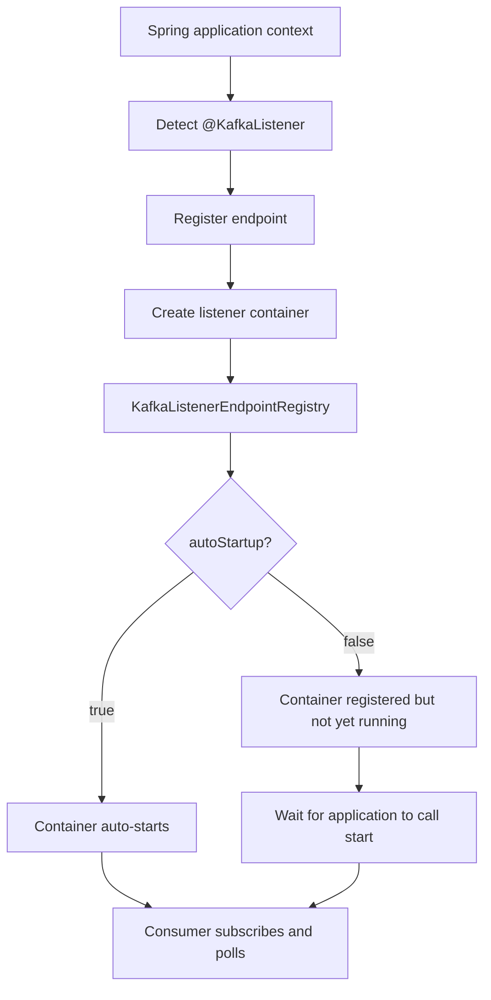

# Setting autoStartup on Annotations

The `autoStartup` attribute on `@KafkaListener` determines whether the listener container starts automatically along with the Spring application context. It provides control over when record consumption begins: the application still registers the endpoint, while allowing you to defer the consumer until a dependency is ready or an initialization step finishes.

`autoStartup` controls the listener container lifecycle. It does not enable/disable annotation processing, create or delete topics, reset offsets, or replace consumer commit settings. To control a listener after the application is already running, combine `autoStartup` with `KafkaListenerEndpointRegistry`.

## 1. Where Does autoStartup Take Effect?

Spring Kafka detects `@KafkaListener`, creates an endpoint, and registers its container in `KafkaListenerEndpointRegistry`. When the application context enters the lifecycle start phase, the registry starts containers configured for automatic startup.



There are three states to distinguish:

- **Endpoint registered:** Spring has read the annotation and created the corresponding container.
- **Container running:** the container has started its consumer and is subscribing/polling as configured.
- **Container stopped:** the container remains managed by the registry, but does not continue consuming until started again.

Therefore, `autoStartup = "false"` does not make Spring ignore the listener. It only skips the automatic container start step during lifecycle startup.

## 2. Declaring autoStartup Directly on @KafkaListener

Example listener that does not start automatically when the application boots:

```java
@Component
public class OrderListener {

    @KafkaListener(
            id = "orders-listener",
            topics = "orders",
            groupId = "orders-service",
            autoStartup = "false"
    )
    public void onOrder(OrderCreated event) {
        // Process order event.
    }
}
```

`id` names the endpoint so the application can look up the container via the registry. `topics` and `groupId` specify the subscription and consumer group. `autoStartup = "false"` instructs the container to wait for an explicit start command.

If `autoStartup` is omitted, the listener uses the container factory's auto-start policy. With the default factory, the behavior is normally automatic startup. When an application has multiple listeners, set `false` only on listeners that must be deferred so other listeners continue running normally.

## 3. Using Property Placeholders for Environment-Based Configuration

The `autoStartup` value can come from the Spring `Environment`:

```yaml
app:
  kafka:
    listeners:
      orders:
        auto-startup: false
```

```java
@KafkaListener(
        id = "orders-listener",
        topics = "orders",
        groupId = "orders-service",
        autoStartup = "${app.kafka.listeners.orders.auto-startup:true}"
)
public void onOrder(OrderCreated event) {
    // Process event.
}
```

In this example, the listener starts automatically by default if the property is undeclared; setting `false` defers the listener. Different values can be set per profile:

```yaml
# application-local.yml
app:
  kafka:
    listeners:
      orders:
        auto-startup: true

---
# application-maintenance.yml
app:
  kafka:
    listeners:
      orders:
        auto-startup: false
```

The annotation is resolved when Spring creates the endpoint. Changing the config file after the application has already started does not automatically change the current container state. For standard config changes, redeploy the application with the desired profile; when runtime control is needed, use the registry.

## 4. Configuring Default Auto-Start for Multiple Listeners

When using Spring Boot, you can set a default policy for the Boot-created listener container factory:

```yaml
spring:
  kafka:
    listener:
      auto-startup: false
```

This property fits when you want all listeners using the default factory to wait for an explicit start. Individual listeners can then override the default policy using `autoStartup` on the annotation if they should auto-start.

If the application declares its own `ConcurrentKafkaListenerContainerFactory`, inspect that factory's configuration. A custom factory can set its own policy:

```java
@Bean
public ConcurrentKafkaListenerContainerFactory<String, OrderCreated>
        ordersListenerContainerFactory(
                ConsumerFactory<String, OrderCreated> consumerFactory) {

    var factory = new ConcurrentKafkaListenerContainerFactory<String, OrderCreated>();
    factory.setConsumerFactory(consumerFactory);
    factory.setAutoStartup(false);
    return factory;
}
```

This policy applies to containers created from that factory whenever the annotation does not supply an override. Do not set global `auto-startup: false` unless the application has a mechanism to start required listeners; otherwise, listeners may register and never consume records.

## 5. Starting a Listener with KafkaListenerEndpointRegistry

`KafkaListenerEndpointRegistry` manages containers created from `@KafkaListener`. When an explicit `id` is set, you can look up the container and call `start()` or `stop()`:

```java
import org.springframework.kafka.config.KafkaListenerEndpointRegistry;
import org.springframework.kafka.listener.MessageListenerContainer;
import org.springframework.stereotype.Service;

@Service
public class OrderListenerControl {

    private final KafkaListenerEndpointRegistry registry;

    public OrderListenerControl(KafkaListenerEndpointRegistry registry) {
        this.registry = registry;
    }

    public void startOrdersListener() {
        MessageListenerContainer container =
                registry.getListenerContainer("orders-listener");

        if (container == null) {
            throw new IllegalStateException("Listener orders-listener was not registered");
        }

        if (!container.isRunning()) {
            container.start();
        }
    }

    public void stopOrdersListener() {
        MessageListenerContainer container =
                registry.getListenerContainer("orders-listener");

        if (container != null && container.isRunning()) {
            container.stop();
        }
    }
}
```

`getListenerContainer(id)` returns the matching container or `null` if the ID is not found. Check the result before calling lifecycle methods. `isRunning()` helps avoid unnecessary repeated start/stop calls; if multiple management threads operate concurrently, synchronize operations when strict state transitions are required.

The registry only manages containers for endpoints registered through the annotation infrastructure. Containers created manually elsewhere do not appear automatically in the registry unless registered through the corresponding mechanism.

## 6. Starting Only After the Application Is Ready

A common reason to set `autoStartup = "false"` is that the listener depends on seed data or external services. You can start the listener after the application finishes its preparation steps.

Example starting upon receiving `ApplicationReadyEvent`:

```java
import org.springframework.boot.context.event.ApplicationReadyEvent;
import org.springframework.context.event.EventListener;
import org.springframework.kafka.config.KafkaListenerEndpointRegistry;
import org.springframework.kafka.listener.MessageListenerContainer;
import org.springframework.stereotype.Component;

@Component
public class OrderListenerStartup {

    private final KafkaListenerEndpointRegistry registry;

    public OrderListenerStartup(KafkaListenerEndpointRegistry registry) {
        this.registry = registry;
    }

    @EventListener(ApplicationReadyEvent.class)
    public void startListenerWhenReady() {
        MessageListenerContainer container =
                registry.getListenerContainer("orders-listener");

        if (container != null && !container.isRunning()) {
            container.start();
        }
    }
}
```

In this example, the listener is already registered but not running yet. Only after Spring Boot publishes `ApplicationReadyEvent` does the application start the container. This suits cases where initialization logic must complete before the consumer receives events.

If a listener depends on a specific bootstrap routine, start it right after that routine reports success rather than relying solely on application readiness. `ApplicationReadyEvent` only indicates that Spring Boot has finished starting up; it does not prove that external non-Kafka systems are healthy or that all business data has finished syncing.

## 7. Stopping a Listener Safely

You can stop a listener for maintenance, data migrations, or temporarily pausing consumption:

```java
MessageListenerContainer container =
        registry.getListenerContainer("orders-listener");

if (container != null && container.isRunning()) {
    container.stop(() -> log.info("Orders listener stopped"));
}
```

The `stop(Runnable)` callback is invoked once container shutdown completes according to the container lifecycle. You can use the callback to record status or proceed to a maintenance step after the container has stopped.

Stopping a listener does not delete topics, delete the consumer group, or reset committed offsets. The consumer leaves the group and partitions may be reassigned to other consumers. When restarted in the same group, the consumer resumes from that group's committed offsets.

If a record is mid-processing when the container stops, the final outcome depends on processing timing, acknowledgment mode, and commits. Records already processed but not yet committed may be redelivered upon restart. Therefore, handlers must remain idempotent and shutdown procedures should be tested under realistic load.

## 8. autoStartup Is Not Auto-Commit or Auto Topic Creation

The following settings control completely different things:

| Setting | Controls | Does not control |
|---|---|---|
| `@KafkaListener.autoStartup` | Whether the container starts automatically with the application context | Offset commits, topic creation, or offset resets |
| `spring.kafka.listener.auto-startup` | Default auto-start policy of Boot-configured listener factories | Business processing state of records |
| `enable.auto.commit` | Whether the Kafka client periodically commits offsets automatically | Whether the listener container starts |
| `auto-offset-reset` | Starting position when the group has no valid offset | Rewinding a group that already has valid offsets |
| `auto.create.topics.enable` | Whether the broker allows auto-creating topics referenced by clients | Lifecycle of listener containers |

For instance, `autoStartup = "false"` only keeps the container stopped. It does not set `enable.auto.commit=false`, nor does it guarantee offsets will reset when the container starts.

## 9. Impact on Consumer Groups and Offsets

While the container has not started, the consumer has not subscribed or polled for that endpoint. When the container starts, the consumer joins the group and receives partition assignments based on the group's state at that time.

If other instances in the same group are running, they continue processing the group's partitions while this listener remains stopped. When the listener starts, the group may rebalance to redistribute partitions. This is normal consumer group behavior.

When stopping and restarting:

1. The running consumer is stopped per the container lifecycle.
2. The Kafka group updates its membership and may reassign partitions.
3. Starting the container creates/starts the consumer according to configuration.
4. The consumer resumes from the group's committed offset, or applies `auto-offset-reset` if no valid offset exists.

To ensure no processing is lost, choose an appropriate acknowledgment mode, commit after processing succeeds, and make handlers idempotent. `autoStartup` does not provide exactly-once business guarantees.

## 10. Multiple Listeners Can Have Different autoStartup Policies

An application can auto-start critical listeners while keeping reporting listeners idle until requested:

```java
@Component
public class ApplicationListeners {

    @KafkaListener(
            id = "payments-listener",
            topics = "payments",
            groupId = "payment-service",
            autoStartup = "true"
    )
    public void onPayment(PaymentEvent event) {
        // Primary stream, starts automatically.
    }

    @KafkaListener(
            id = "analytics-listener",
            topics = "orders",
            groupId = "analytics-service",
            autoStartup = "false"
    )
    public void onOrderForAnalytics(OrderEvent event) {
        // Runs only when explicitly started by the application.
    }
}
```

When two listeners need different lifecycle policies, setting `autoStartup` per listener makes the intent clear right at the annotation. Ensure there is a mechanism to start any listener set to `false`, such as `ApplicationReadyEvent`, an admin operation, or a conditional scheduler.

Do not use `autoStartup=false` as a cluster-wide consumer cap. This attribute applies per container within each application instance. With multiple application replicas, all instances configured with `true` will still start their listeners and join the group normally.

If only a single instance is permitted to run a listener, use leader election or an appropriate distributed lock. `autoStartup` is not a distributed lock and does not coordinate decisions across pods.

## 11. Configuring autoStartup with a Custom Factory

A factory can set default auto-start behavior for listeners that use it:

```java
@Configuration
public class KafkaListenerConfiguration {

    @Bean
    public ConcurrentKafkaListenerContainerFactory<String, OrderEvent>
            controlledListenerFactory(
                    ConsumerFactory<String, OrderEvent> consumerFactory) {

        var factory = new ConcurrentKafkaListenerContainerFactory<String, OrderEvent>();
        factory.setConsumerFactory(consumerFactory);
        factory.setAutoStartup(false);
        factory.setConcurrency(2);
        return factory;
    }
}
```

Listener using the factory:

```java
@KafkaListener(
        id = "controlled-orders-listener",
        topics = "orders",
        groupId = "orders-service",
        containerFactory = "controlledListenerFactory"
)
public void onOrder(OrderEvent event) {
    // Waits to be started via the registry.
}
```

If the annotation does not specify `autoStartup`, the container uses the factory's policy. When the annotation provides an explicit value, that value governs the endpoint. This lets you combine a shared default with per-listener exceptions.

## 12. Monitoring Listener Status

The application can look up a container from the registry and inspect `isRunning()`:

```java
public boolean isOrdersListenerRunning() {
    MessageListenerContainer container =
            registry.getListenerContainer("orders-listener");

    return container != null && container.isRunning();
}
```

`isRunning()` reflects container lifecycle state. It does not guarantee the consumer holds partitions, is receiving records, or is error-free. A container can be running while the group has no partition assignment, the topic has no records, or the consumer has connectivity errors.

In operations, combine container state with other signals:

- Whether the consumer group has members and partition assignments.
- Consumer lag per topic/partition.
- Counts of successfully processed vs. failed records.
- Rebalance counts and connection/deserialization errors.
- Listener processing latency and downstream dependency health.

If the application needs readiness probes reflecting Kafka consumption capability, build a health/readiness indicator tailored to your requirements. Never infer readiness solely from the container having started.

## 13. Testing autoStartup

Integration tests should verify both cases: automatic startup and deferred explicit startup. You can use `@EmbeddedKafka` or Testcontainers Kafka with a Spring test context.

Example testing a listener with `autoStartup="false"`:

```java
@SpringBootTest
@EmbeddedKafka(partitions = 1, topics = "orders")
class OrderListenerStartupTest {

    @Autowired
    private KafkaListenerEndpointRegistry registry;

    @Test
    void listenerShouldRemainStoppedUntilStarted() {
        MessageListenerContainer container =
                registry.getListenerContainer("orders-listener");

        assertThat(container).isNotNull();
        assertThat(container.isRunning()).isFalse();

        container.start();

        await().atMost(Duration.ofSeconds(10))
                .until(container::isRunning);
    }
}
```

The test requires a listener with `id = "orders-listener"`, `autoStartup="false"`, and matching Kafka dependencies. Depending on Spring Kafka version and test lifecycle, use Awaitility or a timeout-bounded wait condition for container state transitions rather than fixed `Thread.sleep` calls.

Scenarios worth testing:

- Default listener auto-starts when the context starts.
- `autoStartup=false` keeps the container stopped after startup.
- Calling `registry.getListenerContainer(id).start()` starts the container.
- Calling stop halts the container and allows restarting it.
- Profile-dependent placeholders produce the expected startup state.
- Deferring one listener does not disrupt other listeners using other factories or groups.
- Uncommitted records may be redelivered after stop/restart; handlers tolerate duplicates safely.

## 14. Common Pitfalls When Using autoStartup

**Setting `false` without a start trigger:** the endpoint registers but the container never consumes. Provide an explicit startup hook or management workflow.

**Confusing `autoStartup` with `enable.auto.commit`:** one controls lifecycle, while the other controls the Kafka client's commit behavior.

**Omitting listener `id`:** makes looking up the specific container in the registry difficult. Assign unique IDs to listeners that must be controlled.

**Using the wrong ID:** `getListenerContainer` returns `null` or controls the wrong endpoint. Keep IDs consistent across annotations, config, and management code.

**Global auto-start disabled:** all listeners using the default factory may fail to start automatically. Check `spring.kafka.listener.auto-startup` and the startup plan.

**Custom factory has a different policy:** Boot's global setting does not necessarily affect app-created factories. Check `setAutoStartup` and the endpoint's `containerFactory`.

**Assuming a running container means records are being processed:** check assignments, lag, consumer errors, and topics.

**Stopping a listener expecting offsets to reset:** stop does not reset offsets. Rewinding requires a dedicated offset management procedure.

**Using autoStartup to elect a single pod:** every instance with identical config makes the same startup decision. Use leader election or distributed coordination if a single consumer owner is needed.

**Starting before dependencies are ready:** the listener can receive records while the database or downstream service is still unready. Start only after real readiness signals from dependencies.

## 15. Deployment Checklist

- Should the listener auto-start or wait for an initialization condition?
- Is `autoStartup` set directly or sourced from an environment-specific property?
- Does the container factory's default policy match the listeners using it?
- Does every controllable listener have a unique `id` resolvable in the registry?
- Is there a startup hook or management workflow to start deferred containers?
- Is there a controlled way to stop the container and observe when shutdown finishes?
- Have impacts on group rebalances, offset commits, and duplicate handling been evaluated?
- Is the handler idempotent if records are redelivered after restart?
- If only one instance may run, is leader election/distributed coordination in place?
- Do metrics and readiness distinguish a running container from a truly healthy consumer?
- Do integration tests verify state before/after start and stop?

`autoStartup` gives control over when a listener container begins consuming. By combining annotation or factory settings with `KafkaListenerEndpointRegistry`, an application can defer, start, and stop listeners according to dependency lifecycles. For safe operations, manage offsets, rebalances, container state, and duplicate handling alongside this lifecycle policy.
