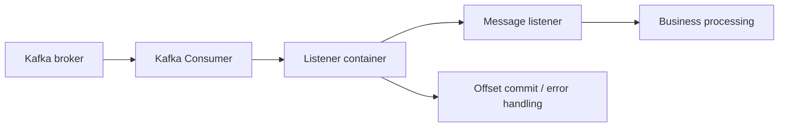
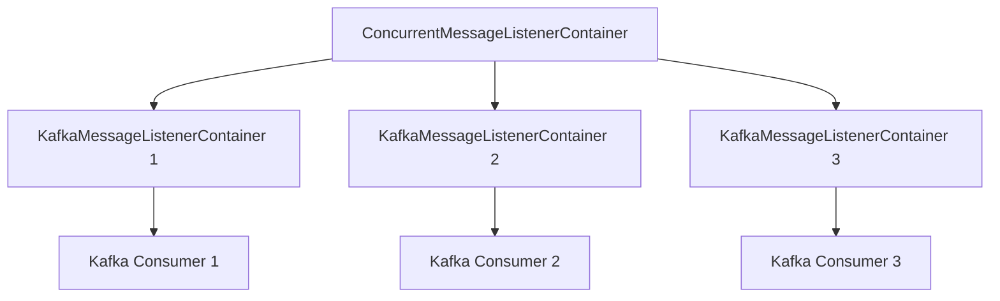

# KafkaMessageListenerContainer and container factory

Spring Kafka provides listener containers to manage the Kafka consumer lifecycle, invoke `poll()`, dispatch records to listeners, and coordinate with the consumer group. Two commonly encountered components are **`KafkaMessageListenerContainer`** and **`ConcurrentKafkaListenerContainerFactory`**. The container directly performs data consumption; the factory creates and configures containers for endpoints, especially endpoints declared with `@KafkaListener`.

When a single simple consumer is needed, you can create `KafkaMessageListenerContainer` directly. When multiple consumers running in parallel are needed or you want to use `@KafkaListener` with unified configuration, `ConcurrentKafkaListenerContainerFactory` is typically used. Understanding the role of each class helps choose the right level of abstraction and avoid unnecessary manual consumer management.

## 1. What is a listener container?

A listener container is a Spring Kafka component that sits between the Kafka consumer and business processing code. The container creates a consumer from a `ConsumerFactory`, executes the record polling loop, invokes the listener in record or batch mode, and handles acknowledgement, error handlers, and lifecycle.

Overall flow:



The application does not need to write its own `poll()` loop when using a listener container. Spring Kafka manages the consumer thread and coordinates listener invocations according to the container configuration.

Related components:

| Component | Responsibility |
|---|---|
| `ConsumerFactory<K, V>` | Creates Kafka consumers with bootstrap servers, group ID, deserializers, and consumer properties. |
| `ContainerProperties` | Configures topic/partition subscription, listener, acknowledgement, poll timeout, and operational properties. |
| `KafkaMessageListenerContainer<K, V>` | Runs a single Kafka consumer in a single consumer thread. |
| `ConcurrentMessageListenerContainer<K, V>` | Manages multiple child `KafkaMessageListenerContainer` instances to increase concurrency. |
| `ConcurrentKafkaListenerContainerFactory<K, V>` | Factory that creates `ConcurrentMessageListenerContainer` instances and applies shared configuration to endpoints. |
| `KafkaListenerEndpointRegistry` | Manages containers created from `@KafkaListener`, supporting lookup and lifecycle control. |

## 2. KafkaMessageListenerContainer

`KafkaMessageListenerContainer<K, V>` is a low-level container that manages a single Kafka consumer. It runs the consumer on a single thread and invokes the listener sequentially in the order records are polled from the partitions owned by that consumer.

This container is suitable when:

- The application only needs a single consumer instance for the data stream.
- You want to create and manage the container programmatically instead of using annotations.
- You need explicit control over `ContainerProperties`, the listener, and the lifecycle.
- You are building an integration component or tool with its own consumer lifecycle.

Example of creating a container directly:

```java
import org.apache.kafka.clients.consumer.ConsumerRecord;
import org.springframework.kafka.listener.ContainerProperties;
import org.springframework.kafka.listener.KafkaMessageListenerContainer;
import org.springframework.kafka.listener.MessageListener;
import org.springframework.kafka.core.ConsumerFactory;

public class OrderConsumerRunner {

    private final KafkaMessageListenerContainer<String, OrderCreatedEvent> container;

    public OrderConsumerRunner(
            ConsumerFactory<String, OrderCreatedEvent> consumerFactory) {

        ContainerProperties properties =
                new ContainerProperties("orders.events");

        properties.setMessageListener(
                (MessageListener<String, OrderCreatedEvent>) this::onRecord
        );

        this.container = new KafkaMessageListenerContainer<>(
                consumerFactory,
                properties
        );
    }

    private void onRecord(
            ConsumerRecord<String, OrderCreatedEvent> record) {
        OrderCreatedEvent event = record.value();
        // Business processing for the event.
    }

    public void start() {
        container.start();
    }

    public void stop() {
        container.stop();
    }
}
```

The `ConsumerFactory` in the example must be configured with the proper group ID, bootstrap servers, key deserializer, and value deserializer. `ContainerProperties("orders.events")` subscribes the container to the topic; `setMessageListener(...)` provides the callback to process each `ConsumerRecord`.

A directly created container creates the consumer when started and must be stopped when the application no longer uses it. If creating the container in a Spring application, integrate it into the bean lifecycle or an explicit management service to avoid forgetting to close the consumer.

## 3. ConcurrentMessageListenerContainer

`ConcurrentMessageListenerContainer<K, V>` is a container that coordinates multiple child `KafkaMessageListenerContainer` instances. Each child container has its own Kafka consumer and its own consumer thread. The `concurrency` property determines the number of child containers created.

For example, with concurrency equal to 3:



The three child consumers join the same consumer group. The Kafka assignor distributes partitions among them. Each partition is assigned to at most one consumer member in the same group at a time; a single consumer can receive multiple partitions.

If a topic has 6 partitions and concurrency is 3, under appropriate subscription and assignment, each consumer can receive 2 partitions. If the topic has only 2 partitions but concurrency is 5, at most 2 child consumers can receive partitions; the remaining consumers have no partitions to process for that topic.

Concurrency is the level of consumer parallelism, not an arbitrary number of processing threads in the application. If the listener offloads records to a separate executor, the application must also protect side-effect ordering and offset commits on its own.

## 4. What does a container factory do?

`ConcurrentKafkaListenerContainerFactory<K, V>` is the factory commonly used to create `ConcurrentMessageListenerContainer` instances. It centralizes the configuration of `ConsumerFactory`, concurrency, and `ContainerProperties`, and is then used by Spring Kafka to create containers for endpoints.

In a Spring Boot application, the default factory usually has the bean name `kafkaListenerContainerFactory`. `@KafkaListener` endpoints that do not specify `containerFactory` use this default factory.

A factory is useful because listeners can share a consistent set of configurations:

- Consumer factory and deserializers.
- Number of child consumers/concurrency.
- Ack mode and offset commit strategy.
- Error handler and retry policy.
- Batch listener or record listener.
- Poll timeout, shutdown timeout, and other container properties.

A factory is not a running Kafka consumer. It is a configuration and container-creation mechanism; consumers are only created when the corresponding container is started.

## 5. Declaring a container factory in Spring Boot

Example of creating a dedicated factory for an orders topic:

```java
import org.springframework.context.annotation.Bean;
import org.springframework.context.annotation.Configuration;
import org.springframework.kafka.config.ConcurrentKafkaListenerContainerFactory;
import org.springframework.kafka.core.ConsumerFactory;
import org.springframework.kafka.listener.ContainerProperties;

@Configuration
public class KafkaListenerConfiguration {

    @Bean
    ConcurrentKafkaListenerContainerFactory<String, OrderCreatedEvent>
    orderListenerContainerFactory(
            ConsumerFactory<String, OrderCreatedEvent> consumerFactory) {

        var factory =
                new ConcurrentKafkaListenerContainerFactory<String, OrderCreatedEvent>();

        factory.setConsumerFactory(consumerFactory);
        factory.setConcurrency(3);
        factory.getContainerProperties()
                .setAckMode(ContainerProperties.AckMode.RECORD);

        return factory;
    }
}
```

In the example:

- `setConsumerFactory(...)` provides how to create consumers and connection settings.
- `setConcurrency(3)` creates up to three child consumers for each endpoint using this factory.
- `AckMode.RECORD` requests committing the offset after each record is successfully processed by the listener according to the container's acknowledgement mechanism.

`AckMode` must be chosen based on processing and error handling requirements. With `RECORD`, each record is acknowledged individually; with `BATCH`, offsets are committed after processing the polled batch; manual modes allow the listener to explicitly acknowledge according to the corresponding contract. Do not choose an ack mode solely to increase throughput without considering the consequences during error handling or restarts.

## 6. Using a factory with @KafkaListener

After declaring the factory, specify the bean name in `containerFactory`:

```java
import org.springframework.kafka.annotation.KafkaListener;
import org.springframework.stereotype.Component;

@Component
public class OrderEventListener {

    @KafkaListener(
            id = "orderCreatedListener",
            topics = "orders.events",
            groupId = "order-projection",
            containerFactory = "orderListenerContainerFactory"
    )
    public void onOrderCreated(OrderCreatedEvent event) {
        // Update projection or trigger downstream processing.
    }
}
```

Spring Kafka registers the endpoint, looks up the factory by name, creates the container, and manages it via `KafkaListenerEndpointRegistry`. The application does not need to manually instantiate `KafkaMessageListenerContainer` for this endpoint.

If `containerFactory` is omitted, Spring Kafka looks for the default factory named `kafkaListenerContainerFactory`. You can create multiple factories so different groups of listeners use different configurations—for example, a high-concurrency factory for an event topic and a lower-concurrency factory for a topic that requires more sequential processing.

## 7. ContainerProperties and commonly used settings

`ContainerProperties` is where listener container behavior is configured. Some important properties:

| Property | Meaning |
|---|---|
| `topics` / `topicPattern` / `topicPartitions` | Selects how the container subscribes to topics by name, pattern, or specific partitions. |
| `messageListener` | Callback for processing a record or batch. |
| `ackMode` | Defines when the container commits offsets. |
| `pollTimeout` | Maximum wait time for a single poll as configured on the container. |
| `shutdownTimeout` | Wait time when stopping the container to finish processing and close consumers. |
| `idleEventInterval` | Interval for publishing idle events when no records are received, if configured. |
| `syncCommits` | Chooses synchronous or asynchronous commits in the corresponding commit modes. |

Example of configuring several properties:

```java
factory.getContainerProperties().setPollTimeout(1_500);
factory.getContainerProperties().setShutdownTimeout(10_000);
factory.getContainerProperties().setSyncCommits(true);
```

The values above are only examples. `pollTimeout` should fit the processing cadence and emitted events; `shutdownTimeout` should be long enough for in-flight listeners to finish within operational limits; synchronous commits may increase latency, but let the container know the commit result before proceeding along the corresponding flow.

## 8. Record listener and batch listener

The container can invoke the listener per record or per batch. This choice is independent of whether a single container or a concurrent container is used.

### Record listener

A record listener receives each payload or `ConsumerRecord`:

```java
@KafkaListener(
        topics = "orders.events",
        groupId = "order-projection",
        containerFactory = "orderListenerContainerFactory"
)
public void onOrderEvent(OrderCreatedEvent event) {
    // Process an event.
}
```

This style is easy to write and fits when each record must be processed independently or when per-record error control is required.

### Batch listener

To have a listener receive multiple records in a single poll, configure the factory with `setBatchListener(true)` and declare a list parameter:

```java
import org.springframework.context.annotation.Bean;
import org.springframework.kafka.config.ConcurrentKafkaListenerContainerFactory;
import org.springframework.kafka.core.ConsumerFactory;

@Bean
ConcurrentKafkaListenerContainerFactory<String, OrderCreatedEvent>
batchOrderListenerFactory(
        ConsumerFactory<String, OrderCreatedEvent> consumerFactory) {

    var factory =
            new ConcurrentKafkaListenerContainerFactory<String, OrderCreatedEvent>();
    factory.setConsumerFactory(consumerFactory);
    factory.setBatchListener(true);
    factory.setConcurrency(3);
    return factory;
}
```

```java
import java.util.List;

@KafkaListener(
        topics = "orders.events",
        groupId = "order-batch-projection",
        containerFactory = "batchOrderListenerFactory"
)
public void onOrderEvents(List<OrderCreatedEvent> events) {
    for (OrderCreatedEvent event : events) {
        // Process each event in the batch.
    }
}
```

A batch listener can reduce listener invocation overhead and fits batch-oriented processing. However, you must clearly design how to handle a failure of one record in a batch, how to identify the failing record, and how to commit offsets. A batch listener also does not mean a single partition is read simultaneously by multiple consumers in the same group.

## 9. Choosing a single container or concurrent container?

| Criterion | `KafkaMessageListenerContainer` | `ConcurrentMessageListenerContainer` |
|---|---|---|
| Number of consumers | One consumer. | Multiple child consumers according to concurrency. |
| Number of consumer threads | One. | One thread per child container. |
| Parallelism | Across partitions assigned to the single consumer; the listener runs sequentially on the consumer thread. | Multiple partitions can be processed in parallel by multiple child consumers. |
| Creation | Instantiated directly with `ConsumerFactory` and `ContainerProperties`. | Usually created via `ConcurrentKafkaListenerContainerFactory`. |
| Suitable use cases | Single consumer, custom integrations, or when manual management is needed. | Service applications needing to scale consumers with concurrency and using `@KafkaListener`. |

A concurrent container is not always faster. If a topic has only one partition, increasing concurrency will not increase the number of consumers that can be assigned that partition. If business processing is constrained by a database or downstream API, adding consumers can overload dependencies.

## 10. Container lifecycle and management

Containers implement Spring's lifecycle. When using `@KafkaListener`, `KafkaListenerEndpointRegistry` manages containers and allows looking them up by listener ID to start/stop or check their status.

```java
import org.springframework.kafka.config.KafkaListenerEndpointRegistry;
import org.springframework.kafka.listener.MessageListenerContainer;

MessageListenerContainer container =
        registry.getListenerContainer("orderCreatedListener");

if (container != null && !container.isRunning()) {
    container.start();
}
```

With a container created directly via `new KafkaMessageListenerContainer<>(...)`, the application must manage starting and stopping it manually, or register the container as an appropriate lifecycle bean. Avoid creating a consumer in a constructor without a shutdown procedure when the application context stops.

When a container stops, the consumer closes and leaves the group; partitions may be rebalanced to other members. If you only want to temporarily stop receiving records while keeping group membership, consider pause/resume instead of stop/start.

## 11. Notes when choosing concurrency and factories

- The number of effectively active child consumers is limited by the number of partitions assigned in the group.
- All consumers in the same group must have compatible configurations for group ID, subscription, and assignment strategy.
- Multiple listeners can share a factory if they share configuration requirements; create a separate factory when clear differences in ack mode, concurrency, batch mode, or error handler are needed.
- If a listener processes slowly, check `max.poll.interval.ms`, `max.poll.records`, and batch processing time to avoid unintended consumer group eviction.
- Do not share a single `KafkaMessageListenerContainer` as if it were multiple independent consumers; use a concurrent container or multiple separate containers when multiple consumers are required.
- When increasing concurrency, measure consumer lag, throughput, CPU, database connection pool usage, and downstream latency to determine the optimal point.

## 12. Common errors

| Symptom | Cause | Resolution |
|---|---|---|
| `@KafkaListener` cannot find container factory | `containerFactory` name does not match bean name. | Verify the bean name or use the default `kafkaListenerContainerFactory`. |
| Container receives no records | Wrong topic, group ID, deserializer, or consumer has not started. | Check consumer properties, topic subscription, lifecycle, and container logs. |
| Increasing concurrency does not change throughput | Too few partitions or downstream bottleneck. | Compare partition count and measure end-to-end throughput. |
| Multiple child consumers receive no partitions | Concurrency exceeds the number of assignable partitions. | Reduce concurrency or increase partitions after evaluating ordering and resources. |
| Listener receives unexpected data type | Value deserializer/converter does not match payload. | Align serializer, deserializer, and schema. |
| Offset commit behaves unexpectedly | Ack mode or error handler is inappropriate. | Inspect `ContainerProperties.AckMode`, acknowledgement, and error handling mechanism. |
| Consumer rebalances repeatedly | Listener takes too long, misses polls, or consumer restarts frequently. | Check `max.poll.interval.ms`, processing time, and rebalance logs. |
| Manually created container does not stop on app shutdown | Lifecycle is not integrated with Spring. | Register as a lifecycle bean or invoke stop in the application shutdown procedure. |

## 13. Key takeaways

- `KafkaMessageListenerContainer` manages a single Kafka consumer and a single consumer thread.
- `ConcurrentMessageListenerContainer` manages multiple child containers to increase concurrency.
- `ConcurrentKafkaListenerContainerFactory` creates and configures concurrent containers for `@KafkaListener`.
- `ContainerProperties` holds subscription, listener, ack mode, poll timeout, and operational settings.
- `@KafkaListener(containerFactory = "...")` selects a factory; if omitted, Spring Kafka uses the default `kafkaListenerContainerFactory`.
- Concurrency cannot exceed the limit of partitions assigned to the consumer group.
- Record listener and batch listener determine how payloads are delivered to the listener, independent of single vs. concurrent containers.
- Directly created containers must have their lifecycle managed and be properly closed.

When building consumers with Spring Kafka, choose a single container for streams requiring one directly controlled consumer; use a container factory and `@KafkaListener` when you want standardized configuration and concurrency scaling. Then tune `ContainerProperties`, ack mode, and error handling according to actual processing requirements.

## References

- [Spring for Apache Kafka — Message Listener Containers](https://docs.spring.io/spring-kafka/reference/kafka/receiving-messages/message-listener-container.html)
- [Spring for Apache Kafka — @KafkaListener Annotation](https://docs.spring.io/spring-kafka/reference/kafka/receiving-messages/listener-annotation.html)
- [Spring Kafka — ConcurrentKafkaListenerContainerFactory API](https://docs.spring.io/spring-kafka/api/org/springframework/kafka/config/ConcurrentKafkaListenerContainerFactory.html)
- [Spring Kafka — KafkaMessageListenerContainer API](https://docs.spring.io/spring-kafka/api/org/springframework/kafka/listener/KafkaMessageListenerContainer.html)
