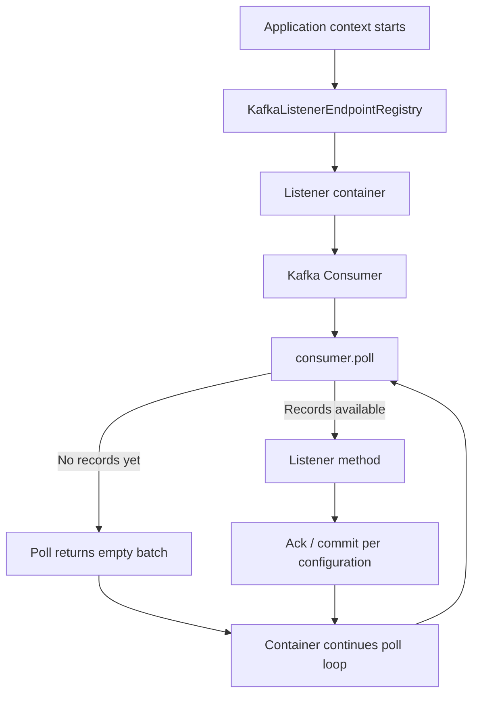

# ContainerProperties and poll timeout

In Spring Kafka, the listener container manages the lifecycle of the Kafka consumer and invokes methods annotated with `@KafkaListener`. The container decides when the consumer polls, how records are delivered to the listener, which acknowledgement mode commits offsets, and how the consumer stops during application shutdown.

`ContainerProperties` is where many behaviors at the listener container level are configured. One key property is `pollTimeout`: the maximum duration a single `consumer.poll()` call waits for records when no data is currently ready. Understanding poll timeout properly and distinguishing it from `max.poll.interval.ms` helps balance responsiveness, processing load, and consumer group stability.

## 1. What does a listener container do?

`@KafkaListener` does not invoke the Kafka consumer directly. Spring Kafka registers the listener endpoint and creates a listener container to manage the consumer underneath.

Basic processing flow:



The container handles the main tasks:

- Creating and managing the Kafka consumer from `ConsumerFactory`.
- Subscribing to topics or assigning partitions as configured.
- Calling `poll()` to fetch records from the broker.
- Dispatching records to the listener in record mode or batch mode.
- Coordinating acknowledgement, offset commits, and error handlers.
- Managing pause/resume, rebalances, and shutdown.
- Publishing application events for observing container state.

Therefore, consumer configuration and container configuration are two related but distinct layers. `spring.kafka.consumer.*` configures the Kafka client; `ContainerProperties` controls how the Spring Kafka container operates that client.

## 2. Two types of listener containers

Spring Kafka has two commonly used container types:

| Type | Role | Usage |
|---|---|---|
| `KafkaMessageListenerContainer` | A single container managing one Kafka consumer on one thread | Suitable when one consumer is needed or when creating containers manually |
| `ConcurrentMessageListenerContainer` | Parent container creating and managing multiple child containers, each with its own consumer | Typically used by `ConcurrentKafkaListenerContainerFactory` for `@KafkaListener` |

When using `@KafkaListener`, Spring Boot usually provides a default `ConcurrentKafkaListenerContainerFactory`. The factory creates containers for each listener endpoint. Concurrency can be configured so one listener has multiple consumer threads.

Example listener:

```java
import org.springframework.kafka.annotation.KafkaListener;
import org.springframework.stereotype.Component;

@Component
class OrderListener {

    @KafkaListener(
            id = "ordersListener",
            topics = "orders",
            groupId = "orders-service"
    )
    public void onOrder(OrderCreated event) {
        orderService.process(event);
    }
}
```

When the application context starts, the endpoint is registered and the container begins running according to the application lifecycle. The listener method is called when the container polls records and passes them through the appropriate message conversion/deserialization.

## 3. What is ContainerProperties?

`ContainerProperties` holds settings applied to a listener container. It can be configured directly or through a container factory.

Several important setting groups:

| Group | Example properties | Effect |
|---|---|---|
| Polling | `pollTimeout` | Maximum wait time during a single poll |
| Acknowledgement | `ackMode`, `ackCount`, `ackTime` | Determines when the container commits offsets |
| Commit | `syncCommits`, `syncCommitTimeout` | Controls commit mode and synchronous commit timeout |
| Idle | `idleEventInterval`, `idleBetweenPolls` | Monitors or throttles pauses when no records are present |
| Lifecycle | `shutdownTimeout` | Controls wait time during shutdown |
| Topic/partition | Topic, pattern, or partition assignment | Determines the record source read by the container |
| Transaction/error | Transaction manager, related error handling | Coordinates error handling and transactions as configured |

Not every property needs to be changed. Keep defaults when they meet requirements, and adjust only settings with a specific operational goal.

`ContainerProperties` does not replace all Kafka consumer properties. For example:

- `pollTimeout` is a Spring Kafka container configuration.
- `max.poll.interval.ms` and `max.poll.records` are Kafka consumer configurations.
- `group.id` identifies the consumer group.
- `enable.auto.commit` is a consumer client configuration; Spring Kafka normally manages commits via the container and recommends disabling auto-commit.

## 4. What is poll timeout?

A Kafka consumer retrieves data using the `poll(Duration)` method. The container calls this method inside its data-reading loop. `pollTimeout` sets the maximum time a single poll waits for data when no records are currently available.

Example setting poll timeout to 2 seconds:

```java
containerProperties.setPollTimeout(2_000L);
```

The unit for `ContainerProperties.setPollTimeout(long)` is milliseconds. In many Spring Kafka versions, the default is 5 seconds unless configured otherwise.

Three points to understand:

1. If records are already available, `poll()` may return before the timeout expires.
2. If no records exist, poll may wait up to the configured duration before returning an empty batch.
3. This timeout only bounds how long a single poll waits; it does not limit how long the listener spends processing records.

`pollTimeout` is not a fixed schedule like "read once every 2 seconds". The container continuously loops back to poll after finishing processing the current batch. When data arrives, the consumer can receive it earlier than the timeout.

## 5. What does tuning poll timeout affect?

The timeout value affects the poll loop when no data is available:

| Value | Behavior when topic is empty | Considerations |
|---|---|---|
| Short, e.g., 100–300 ms | Poll finishes more frequently when no records exist | Increases empty polls and loop overhead |
| Moderate, e.g., 1–3 seconds | Waits a moderate interval before polling again | Usually a reasonable starting point for experimentation |
| Long, e.g., 5–10 seconds | An empty poll can wait longer | Fewer empty poll cycles; evaluate responsiveness goals and other wait intervals |

Do not conclude that a long timeout always delays newly arriving records to the listener by the full timeout duration. When data arrives, the Kafka consumer can be woken up and poll returns data before the wait expires. Actual latency also depends on broker fetch, network, consumer processing, scheduling, and other Kafka settings.

A very short timeout usually does not make the consumer process records noticeably faster if the bottleneck is the database, network, or listener. Conversely, it can generate more empty polls when there is no data.

Choose the value based on measurements: processing speed, record receipt latency, empty poll rate, consumer lag, and broker load.

## 6. Configuring poll timeout with Spring Boot

If using the default listener container factory created by Spring Boot auto-configuration, you can set poll timeout in `application.yml`:

```yaml
spring:
  kafka:
    bootstrap-servers: localhost:9092
    consumer:
      group-id: orders-service
      enable-auto-commit: false
      max-poll-records: 100
      properties:
        "[max.poll.interval.ms]": 300000
    listener:
      poll-timeout: 2s
      ack-mode: record
      concurrency: 3
```

Meaning:

- `spring.kafka.listener.poll-timeout` sets the container's wait time per poll.
- `ack-mode: record` instructs the container to acknowledge per record after the listener finishes processing it.
- `concurrency: 3` instructs the container to create up to three child consumers for the corresponding listener.
- `spring.kafka.consumer.properties["max.poll.interval.ms"]` sets the maximum time allowed between poll calls per Kafka consumer config.
- `max-poll-records` caps the maximum number of records returned in a single poll.

Boot property names bind according to the Spring Boot version in use. If the application declares a custom factory, verify whether that factory receives Boot properties.

## 7. Configuring ContainerProperties in a custom factory

When a listener group needs dedicated settings, you can create a separate container factory. Use Spring Boot's configurer to inherit shared properties first, then override factory-specific settings:

```java
import org.springframework.boot.autoconfigure.kafka.ConcurrentKafkaListenerContainerFactoryConfigurer;
import org.springframework.context.annotation.Bean;
import org.springframework.context.annotation.Configuration;
import org.springframework.kafka.config.ConcurrentKafkaListenerContainerFactory;
import org.springframework.kafka.listener.ContainerProperties;
import org.springframework.kafka.core.ConsumerFactory;

@Configuration
class OrderListenerConfiguration {

    @Bean("ordersListenerFactory")
    ConcurrentKafkaListenerContainerFactory<String, OrderCreated>
    ordersListenerFactory(
            ConcurrentKafkaListenerContainerFactoryConfigurer configurer,
            ConsumerFactory<String, OrderCreated> consumerFactory) {

        var factory =
                new ConcurrentKafkaListenerContainerFactory<String, OrderCreated>();

        configurer.configure(factory, consumerFactory);

        factory.setConcurrency(3);
        factory.getContainerProperties()
                .setPollTimeout(2_000L);
        factory.getContainerProperties()
                .setAckMode(ContainerProperties.AckMode.RECORD);

        return factory;
    }
}
```

The listener selects the factory by name:

```java
@KafkaListener(
        id = "ordersListener",
        topics = "orders",
        groupId = "orders-service",
        containerFactory = "ordersListenerFactory"
)
public void onOrder(OrderCreated event) {
    orderService.process(event);
}
```

`configurer.configure(factory, consumerFactory)` applies Boot configuration to the factory. Calls made afterward such as `setPollTimeout()` or `setAckMode()` override the corresponding values for this factory. As a result, other listeners can continue using the default factory with a different timeout.

If creating a factory manually without the configurer, the application must configure the consumer factory, converter, error handler, acknowledgement mode, and other required components itself. Avoid omitting shared security or deserializer settings.

## 8. Configuring ContainerProperties directly

Outside a factory, you can create `ContainerProperties` directly when managing a container manually:

```java
import org.springframework.kafka.listener.ContainerProperties;
import org.springframework.kafka.listener.KafkaMessageListenerContainer;
import org.springframework.kafka.listener.MessageListener;
import org.springframework.kafka.core.ConsumerFactory;

ContainerProperties properties =
        new ContainerProperties("orders");

properties.setPollTimeout(2_000L);
properties.setAckMode(ContainerProperties.AckMode.RECORD);

properties.setMessageListener(
        (MessageListener<String, OrderCreated>)
                record -> orderService.process(record.value())
);

KafkaMessageListenerContainer<String, OrderCreated> container =
        new KafkaMessageListenerContainer<>(consumerFactory, properties);
container.start();
```

The constructor above creates a container for the `orders` topic. The example registers a listener and starts the container; the application must manage stopping the container when the lifecycle ends. For applications using `@KafkaListener`, configuring via a factory is usually more natural because Spring manages endpoints and lifecycle.

`ContainerProperties` can also accept a topic pattern or a list of `TopicPartitionOffset` if the application needs explicit subscription/assignment. When assigning partitions manually, understand the impact on consumer groups and rebalancing; avoid mixing subscribe and assign in ways inconsistent with the design.

## 9. Distinguishing pollTimeout from max.poll.interval.ms

These two settings are very easy to confuse:

| Property | Where does it live? | Meaning |
|---|---|---|
| `pollTimeout` | Spring Kafka `ContainerProperties` | Maximum time a single poll waits for data |
| `max.poll.interval.ms` | Kafka consumer config | Maximum time between two `poll()` calls before the consumer is considered no longer making progress |
| `max.poll.records` | Kafka consumer config | Maximum number of records returned in a single poll |
| `fetch.max.wait.ms` | Kafka consumer config | Time the broker may wait to satisfy a fetch request under fetch conditions |

For example, a consumer polls 100 records and the listener takes 4 minutes to process the whole batch. If `max.poll.interval.ms` is only 3 minutes, the consumer can exceed the allowed interval between polls, leave the group, and trigger a rebalance.

Increasing or decreasing `pollTimeout` does not solve a listener taking too long to process. Instead consider:

- Reducing records per poll with `max.poll.records` if batches are too large.
- Increasing `max.poll.interval.ms` when long processing time is a legitimate requirement and has been measured.
- Optimizing database/network calls or splitting processing work.
- Using a controlled asynchronous processing model, ensuring offsets are never committed before work finishes.
- Splitting topics/partitions or consumer groups according to throughput needs.

An operational rule of thumb is that total batch processing time plus gaps between polls must remain within the poll interval with a safety margin. Do not set `max.poll.interval.ms` arbitrarily huge to mask a hung listener.

## 10. Poll timeout is not listener processing time

A cycle can unfold like this:

```text
poll(2 seconds)
    -> receives 20 records
listener processes 20 records
    -> takes 8 seconds
container commits offsets per ack mode
poll(2 seconds)
    -> waits for next data if topic is empty
```

In the example, the listener takes 8 seconds to process the batch. `pollTimeout=2s` does not cancel or cap those 8 seconds of processing. The processing duration sits between two poll calls and counts toward the time the consumer goes without calling the next poll.

If processing takes a long time, check `max.poll.interval.ms` and batch size. If you need to bound database or HTTP call duration, configure timeouts on those respective clients or services—do not use poll timeout.

## 11. Acknowledgement mode is a separate setting

`ContainerProperties` also manages how offsets are acknowledged. Poll timeout does not determine when commits happen.

Common modes:

| Ack mode | Commit timing | Suitable for |
|---|---|---|
| `RECORD` | After listener finishes processing each record | Per-record processing, wanting per-record commits |
| `BATCH` | After the entire batch from a poll is processed | Batch listeners or per-poll processing |
| `TIME` | When configured time interval and processing conditions are met | Time-based commits |
| `COUNT` | When configured number of records have been processed | Count-based commits |
| `COUNT_TIME` | When either time or count threshold is reached | Balancing commit frequency |
| `MANUAL` | Listener calls `Acknowledgment.acknowledge()`; container commits per mode semantics | Applications needing explicit acknowledgment |
| `MANUAL_IMMEDIATE` | Acknowledges immediately when listener calls acknowledge on the consumer thread | Needing commit timing closely tied to processing |

`BATCH` is commonly the default mode for listener containers. For record-by-record listeners, you can choose `RECORD` to commit after each successful listener call. With manual modes, the listener must call acknowledge only after the corresponding work has completed.

Example:

```java
import org.springframework.kafka.annotation.KafkaListener;
import org.springframework.kafka.support.Acknowledgment;

@KafkaListener(
        topics = "orders",
        groupId = "orders-service",
        containerFactory = "manualOrdersListenerFactory"
)
public void onOrder(
        OrderCreated event,
        Acknowledgment acknowledgment) {

    orderService.process(event);
    acknowledgment.acknowledge();
}
```

The listener above must use a container factory configured in `MANUAL` mode. Example of a dedicated factory:

```java
import org.springframework.boot.autoconfigure.kafka.ConcurrentKafkaListenerContainerFactoryConfigurer;
import org.springframework.context.annotation.Bean;
import org.springframework.kafka.config.ConcurrentKafkaListenerContainerFactory;
import org.springframework.kafka.core.ConsumerFactory;
import org.springframework.kafka.listener.ContainerProperties;

@Bean("manualOrdersListenerFactory")
ConcurrentKafkaListenerContainerFactory<String, OrderCreated>
manualOrdersListenerFactory(
        ConcurrentKafkaListenerContainerFactoryConfigurer configurer,
        ConsumerFactory<String, OrderCreated> consumerFactory) {

    var factory =
            new ConcurrentKafkaListenerContainerFactory<String, OrderCreated>();
    configurer.configure(factory, consumerFactory);
    factory.getContainerProperties()
            .setAckMode(ContainerProperties.AckMode.MANUAL);
    return factory;
}
```

The listener selected `manualOrdersListenerFactory`, which is configured in `MANUAL` mode. Do not use the factory from the earlier example if that factory is configured with `AckMode.RECORD`.

If `process()` fails before acknowledge, the offset has not been acknowledged through this code path; the container/error handler can retry or recover per configuration. The processing design still requires idempotency because uncommitted records can be redelivered.

For `TIME`, `COUNT`, and `COUNT_TIME` modes, `ackTime` and `ackCount` can be used to set the corresponding thresholds. Those thresholds control commits, not poll wait duration.

## 12. Concurrency and partition count

`ConcurrentMessageListenerContainer` creates multiple child containers. Each child has its own consumer and executes the listener on its consumer thread.

Example setting concurrency to 3:

```java
factory.setConcurrency(3);
```

If a topic has 6 partitions, three consumers in the same group may be assigned around two partitions each depending on the assignor and group state. If the topic has only 2 partitions, at most two consumers can receive partitions in the same group at a time; the extra consumer may receive no partitions.

Concurrency affects the number of parallel processing streams, not the wait duration of each poll. When increasing concurrency, inspect:

- Partition count and how partitions are distributed.
- Capacity of databases and downstream services.
- Number of producer/consumer connections to brokers.
- Consumer lag per partition.
- Rebalances when instances start or stop.

Do not increase concurrency just to reduce poll timeout. The two settings address different concerns.

## 13. Idle, pause/resume, and shutdown

When a topic has no records, the container keeps polling in a loop. Several other settings support operations:

- `idleEventInterval` can emit an idle event when the container receives no records for the configured interval; applications use the event to observe idle listeners.
- `idleBetweenPolls` introduces a pause between polls in certain configurations; that pause must also be accounted for when evaluating `max.poll.interval.ms`.
- Containers support pause/resume to temporarily stop receiving records while maintaining consumer group management under Kafka's mechanism.
- `shutdownTimeout` controls how long the container waits for completion when stopping, helping the application shut down cleanly.

Containers can be controlled via `KafkaListenerEndpointRegistry` if the listener has an ID:

```java
import org.springframework.kafka.config.KafkaListenerEndpointRegistry;
import org.springframework.stereotype.Service;

@Service
class ListenerControlService {

    private final KafkaListenerEndpointRegistry registry;

    ListenerControlService(KafkaListenerEndpointRegistry registry) {
        this.registry = registry;
    }

    void pauseOrders() {
        var container = registry.getListenerContainer("ordersListener");
        if (container != null) {
            container.pause();
        }
    }

    void resumeOrders() {
        var container = registry.getListenerContainer("ordersListener");
        if (container != null) {
            container.resume();
        }
    }
}
```

Pause/resume controls the container rather than altering committed offsets. When paused, monitor status and lag to avoid mistaking a paused consumer for a disconnected or failing one.

## 14. Monitoring container and poll behavior

When investigating why a listener is not receiving records or is processing slowly, observe multiple layers:

| Symptom | What to check |
|---|---|
| Listener is not invoked | Topic, partition assignment, ACLs, consumer group, and pause state |
| Polls frequently return empty batches | Producer rate, whether the topic actually has data, poll timeout, and fetch behavior |
| Consumer lag increases | Listener processing time, records per poll, concurrency, and downstream |
| Group rebalances continuously | `max.poll.interval.ms`, listener processing time, network, and membership |
| Shutdown takes a long time | Listener currently processing, shutdown timeout, and how the container is stopped |
| No idle events emitted | `idleEventInterval`, subscription, and event listener configuration |

You can listen to Spring Kafka's idle event to tell when a listener has received no records for a period of time:

```java
import org.springframework.context.event.EventListener;
import org.springframework.kafka.event.ListenerContainerIdleEvent;
import org.springframework.stereotype.Component;

@Component
class ListenerIdleMonitor {

    @EventListener
    public void onIdle(ListenerContainerIdleEvent event) {
        log.info(
                "Listener idle: listenerId={}, idleTime={}ms, topicPartitions={}",
                event.getListenerId(),
                event.getIdleTime(),
                event.getTopicPartitions()
        );
    }
}
```

An idle event does not necessarily mean the consumer is broken. The topic may simply have no new data. Combine idle events with producer rate, lag, assignments, and broker health before drawing conclusions.

## 15. Common errors

| Symptom | Possible cause | Resolution |
|---|---|---|
| Lowered poll timeout but listener is still slow | Bottleneck is in the listener or downstream | Measure processing time, optimize dependencies and batch size |
| Consumer leaves group despite short poll timeout | Listener processing exceeds `max.poll.interval.ms` | Check poll interval, max poll records, and processing time |
| Empty topic produces many empty polls | Poll timeout is unnecessarily short | Increase timeout moderately and monitor idle behavior |
| Longer timeout creates impression consumer is stuck | Poll is waiting for data and listener has not been called | Check topic rate, assignment, and idle events |
| Custom factory ignores Boot settings | Factory created without configurer or property binding | Use `ConcurrentKafkaListenerContainerFactoryConfigurer` or configure completely |
| Offset commit behaves unexpectedly | Ack mode differs from expectations or listener acknowledges at wrong time | Check `ContainerProperties.AckMode` and acknowledgement flow |
| Consumer throughput does not scale with concurrency | Low partition count or downstream already saturated | Inspect partition assignment and bottlenecks |
| Slow shutdown | Listener still processing or shutdown timeout too large | Measure processing time and configure appropriate graceful shutdown |

## 16. Listener container configuration checklist

1. Determine whether the listener needs record mode or batch mode.
2. Start with a reasonable poll timeout; do not treat it as a processing timeout.
3. Configure `max.poll.interval.ms` based on measured batch processing time.
4. Choose `max.poll.records` to cap work per poll.
5. Choose ack mode based on commit requirements and tolerance for duplicate processing.
6. Set concurrency based on partition count and downstream capacity.
7. Use a custom container factory when a group of listeners needs separate configuration.
8. Use `KafkaListenerEndpointRegistry` to manage pause/resume when operationally needed.
9. Monitor idle events, lag, rebalances, and listener processing time.
10. Verify shutdown behavior to avoid stopping the application while work remains unfinished.

`ContainerProperties` controls the behavior of a Spring Kafka listener container; `pollTimeout` is the maximum wait time for a single poll. When configured alongside acknowledgment mode, concurrency, and Kafka consumer bounds such as `max.poll.interval.ms`, the application can operate listeners reliably and clearly explain why a consumer is waiting for data, processing slowly, or rebalancing.
