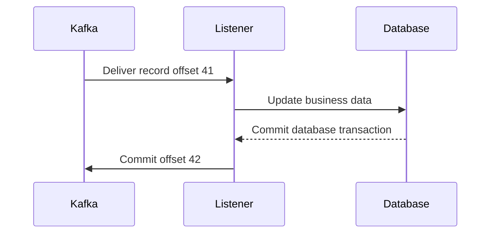

# AckMode MANUAL

In Spring Kafka, the listener container manages consumer offset commits. With `AckMode.MANUAL`, the application explicitly confirms a record has been processed by calling `Acknowledgment.acknowledge()` inside the listener method. The container receives this signal and commits offsets according to manual mode rules.

This mode suits cases where the application only wants consumer progress recorded after a specific business step completes, such as saving data to a database or finishing an important operation. However, manual acknowledgment does not automatically create an atomic transaction between Kafka and the database, nor does it guarantee exactly-once processing. You must understand exact commit timing and design safely for duplicate processing.

The examples in this lesson use a simple event and application service:

```java
import java.math.BigDecimal;
import java.time.Instant;

public record OrderCreatedEvent(
        String eventId,
        String orderId,
        BigDecimal total,
        Instant occurredAt
) {}

public interface OrderApplicationService {
    void apply(OrderCreatedEvent event);
}
```

## 1. Offsets and acknowledgment in Kafka

A Kafka consumer reads records by offset within each partition. After processing, the consumer commits an offset to record the resume position for the consumer group.

A common point of confusion: the consumer commits **the next offset to read**, not the offset of the record just processed. For example, if record offset `41` was processed successfully, the committed offset is typically `42`.

```text
Partition orders-0

offset:       40       41       42       43
record:     event-A  event-B  event-C  event-D
                       |
                       +-- processed successfully
                           commit offset 42

Next read starts from offset 42
```

Acknowledgment in Spring Kafka is a signal from the listener to the container that processing progress has reached a committable point. It is not an individual ACK message sent back to the broker per record, nor does it delete records from the topic. Kafka retains records according to the topic's retention or cleanup policy.

## 2. How does `AckMode.MANUAL` work?

Spring Kafka provides several acknowledgment modes. Commonly used ones include:

| AckMode | Commit timing |
|---|---|
| `RECORD` | After the listener finishes processing each individual record |
| `BATCH` | After the listener finishes processing all records received in a single poll |
| `MANUAL` | Listener calls `acknowledge()`; offsets are queued and committed after all records from the poll have been processed |
| `MANUAL_IMMEDIATE` | Commits immediately when `acknowledge()` is called on the consumer thread; if called from another thread, commits are handled according to container mechanics |

The key point of `MANUAL` is that calling `acknowledge()` does not necessarily cause the broker to receive a commit at that exact line of code. The container batches acknowledgments and commits at poll boundaries after the corresponding records have been processed.

`MANUAL_IMMEDIATE` fits when you need to request an immediate commit at the moment the listener acknowledges, though it must be called on the consumer thread for immediate semantics. If called from another thread, do not assume the commit has already occurred when the method returns.

Choose `MANUAL` when you want the listener to decide which records are eligible for acknowledgment while still letting the container group commits per poll. Choose `MANUAL_IMMEDIATE` when immediate commit semantics at the callback are required and thread constraints are understood.

## 3. Configuring a listener container with `MANUAL`

You can configure the acknowledgment mode on `ConcurrentKafkaListenerContainerFactory`:

```java
import org.springframework.context.annotation.Bean;
import org.springframework.context.annotation.Configuration;
import org.springframework.kafka.config.ConcurrentKafkaListenerContainerFactory;
import org.springframework.kafka.listener.ContainerProperties;
import org.springframework.kafka.listener.CommonErrorHandler;
import org.springframework.kafka.core.ConsumerFactory;

@Configuration
public class ManualAckKafkaConfiguration {

    @Bean
    public ConcurrentKafkaListenerContainerFactory<String, OrderCreatedEvent>
            manualAckKafkaListenerContainerFactory(
                    ConsumerFactory<String, OrderCreatedEvent> consumerFactory,
                    CommonErrorHandler errorHandler) {

        var factory = new ConcurrentKafkaListenerContainerFactory<
                String, OrderCreatedEvent>();
        factory.setConsumerFactory(consumerFactory);
        factory.getContainerProperties().setAckMode(
                ContainerProperties.AckMode.MANUAL
        );
        factory.setCommonErrorHandler(errorHandler);
        return factory;
    }
}
```

Then specify the factory on listeners needing manual acknowledgment:

```java
import org.springframework.kafka.annotation.KafkaListener;
import org.springframework.kafka.support.Acknowledgment;
import org.springframework.stereotype.Component;

@Component
public class OrderCreatedListener {

    private final OrderApplicationService orderService;

    public OrderCreatedListener(OrderApplicationService orderService) {
        this.orderService = orderService;
    }

    @KafkaListener(
            id = "ordersManualListener",
            topics = "orders.created",
            groupId = "orders-projection",
            containerFactory = "manualAckKafkaListenerContainerFactory"
    )
    public void onMessage(
            OrderCreatedEvent event,
            Acknowledgment acknowledgment) {

        orderService.apply(event);
        acknowledgment.acknowledge();
    }
}
```

The execution order is deliberate: invoke the application service first, and call `acknowledge()` only after processing completes. If `orderService.apply(event)` throws an exception, the acknowledgment line is not executed and the error is passed to the listener container's error handler.

## 4. Configuring via Spring Boot

With Spring Boot's default configuration, you can set the acknowledgment mode in `application.yml`:

```yaml
spring:
  kafka:
    bootstrap-servers: ${KAFKA_BOOTSTRAP_SERVERS:localhost:9092}
    consumer:
      group-id: orders-projection
      enable-auto-commit: false
      auto-offset-reset: earliest
    listener:
      ack-mode: manual
```

Keep `enable-auto-commit` set to `false` when you want the Spring Kafka container to manage commits based on acknowledgment mode. Spring Kafka disables auto-commit by default if the application does not enable it; declaring it explicitly improves readability.

If the application defines its own custom listener container factory, set `AckMode` on the exact factory used by the listener. The `spring.kafka.listener.ack-mode` property does not automatically override every custom factory created by the application.

## 5. What happens on success or failure?

### Successful processing

Normal flow:

1. The container polls records from Kafka.
2. Spring Kafka deserializes the record and invokes the listener.
3. The listener passes the event to the application service for processing.
4. Once business work completes, the listener calls `acknowledgment.acknowledge()`.
5. The container records the acknowledgment and commits offsets according to `MANUAL` semantics.

### Failed processing

If business logic throws an exception before `acknowledge()` is called, the record has not been acknowledged by the listener. The exception is forwarded to the container's error handler. Depending on retry, backoff, recovery, and recovered-offset commit settings, the record may be reprocessed or sent to a dead-letter topic.

Do not catch exceptions and still call `acknowledge()` inside a `finally` block. That can commit the offset even when business processing failed, causing the record to be skipped on subsequent reads.

Example of deliberate error handling:

```java
@KafkaListener(
        topics = "orders.created",
        groupId = "orders-projection",
        containerFactory = "manualAckKafkaListenerContainerFactory"
)
public void onMessage(
        OrderCreatedEvent event,
        Acknowledgment acknowledgment) {

    try {
        orderService.apply(event);
        acknowledgment.acknowledge();
    } catch (RuntimeException exception) {
        // Do not acknowledge; let the container error handler handle retry/recovery.
        throw exception;
    }
}
```

The `catch` block in the example simply illustrates propagating the error back to the container; if logging or extra context is unnecessary, you can omit `try/catch` and let the exception propagate naturally.

## 6. Manual acknowledgment does not mean exactly-once

Suppose a listener processes an event by updating a database and then committing the Kafka offset. There is a window between the two operations:



If the application stops after the database commit but before the Kafka offset commit, Kafka can redeliver record `41` after the consumer restarts. The database may then receive the same event a second time.

Therefore, `AckMode.MANUAL` generally supports at-least-once processing when configured properly; it does not by itself guarantee exactly-once effects outside Kafka. Ways to mitigate duplicate processing effects include:

- Designing idempotent handlers, such as storing processed `eventId` values with a unique constraint.
- Using database transactions to update business data and an inbox/idempotency table in the same transaction.
- For Kafka-to-Kafka flows, considering Kafka transactions and configuring a transaction-aware listener container to commit output records together with consumer offsets in one Kafka transaction.
- When synchronizing a database and Kafka, evaluating transactional outbox/inbox instead of assuming two independent commits are atomic.

Manual acknowledgment determines when the container is permitted to commit offsets; it does not replace transactional or idempotent business design.

## 7. Poll batches, multiple records, and concurrency

With `AckMode.MANUAL`, remember that the container manages acknowledgments across polled records. If a single poll returns multiple records, the listener can be called multiple times before the container finishes the poll cycle. Acknowledgments are recorded and committed per manual rules after the poll's records are processed.

If the listener runs with concurrency greater than one, each consumer thread has its own consumer and progress. Acknowledgments belong to the record processed by the respective listener; do not share `Acknowledgment` instances arbitrarily across threads.

For asynchronous processing, do not call `acknowledge()` from an arbitrary executor and assume the container commits in the same order. If you must acknowledge off the consumer thread or handle out-of-order completions, review `asyncAcks` and the limitations in your Spring Kafka version; this configuration can cause the container to pause record delivery until outstanding acknowledgments complete.

Do not raise `max.poll.records` or processing duration while ignoring `max.poll.interval.ms`. If processing a batch takes too long, the consumer may be deemed late on polling and leave the group, triggering a rebalance. Manual ack does not remove poll interval limits.

## 8. Combining retries and dead-letter topics

Manual acknowledgment and error handling solve two different concerns:

- Acknowledgment indicates how far the listener has processed and which offsets the container may commit.
- The error handler decides what happens when the listener throws an exception: retry, backoff, skip, or send the record to a dead-letter topic.

Illustrative example declaring `DefaultErrorHandler` with backoff:

```java
import org.springframework.context.annotation.Bean;
import org.springframework.context.annotation.Configuration;
import org.springframework.kafka.listener.DefaultErrorHandler;
import org.springframework.util.backoff.FixedBackOff;

@Configuration
public class KafkaErrorConfiguration {

    @Bean
    public DefaultErrorHandler kafkaErrorHandler() {
        return new DefaultErrorHandler(
                new FixedBackOff(1_000L, 2L)
        );
    }
}
```

The example above illustrates retries with a 1-second interval and up to two retries after the initial attempt. Real policies should classify retryable vs. non-retryable exceptions and configure suitable recovery. If using `DeadLetterPublishingRecoverer`, ensure the producer factory/template can serialize records to the DLT and the DLT topic has suitable partitions/configuration.

Do not acknowledge a failed record yourself just to avoid retries. Let the error handler determine recovery outcomes; when recovery succeeds and the offset is committed, that behavior must align with the application's data policy.

## 9. `MANUAL` vs `MANUAL_IMMEDIATE`: which mode to choose?

| Criterion | `MANUAL` | `MANUAL_IMMEDIATE` |
|---|---|---|
| Who triggers acknowledgment? | Listener | Listener |
| Commit | Offsets are queued and committed after processing the poll's records | Commits immediately if acknowledged on the consumer thread |
| Commit latency | May wait until the end of the poll | Can be lower |
| Suitability | Want control over acknowledged records while letting the container batch commits | Need immediate commit request at the callback |
| Note | Does not imply immediate commit at the `acknowledge()` line | Calling from another thread lacks the immediate semantics of the consumer thread |

If there is no explicit requirement for immediate commits, `MANUAL` is usually easier to manage. Choosing `MANUAL_IMMEDIATE` does not combine database and Kafka into a single transaction, nor does it prevent duplicate processing if the application crashes abruptly.

## 10. Testing listeners with `AckMode.MANUAL`

Tests should verify both processing order and commit behavior:

- **Listener unit test:** mock the application service and `Acknowledgment`; verify `acknowledge()` is called after the service succeeds.
- **Failure test:** make the application service throw an exception; verify the listener does not call acknowledgment.
- **Integration test:** use Embedded Kafka or Testcontainers to send records, start the listener with `MANUAL`, and inspect committed offsets.
- **Restart test:** stop the consumer after processing but before commit (if reproducible), restart, and verify the record can be redelivered.
- **Retry/DLT test:** verify errors are retried the expected number of times and records recover per policy.
- **Concurrency test:** verify each consumer thread processes and acknowledges the right partitions/records.

In a unit test, an example of basic logic:

```java
import static org.mockito.Mockito.inOrder;

import java.math.BigDecimal;
import java.time.Instant;

import org.junit.jupiter.api.Test;
import org.springframework.kafka.support.Acknowledgment;

class OrderCreatedListenerTest {

    @Test
    void acknowledgesAfterSuccessfulProcessing() {
        OrderApplicationService service = org.mockito.Mockito.mock(
                OrderApplicationService.class);
        Acknowledgment acknowledgment = org.mockito.Mockito.mock(
                Acknowledgment.class);
        OrderCreatedListener listener = new OrderCreatedListener(service);
        OrderCreatedEvent event = new OrderCreatedEvent(
                "evt-1",
                "order-1",
                new BigDecimal("1250000"),
                Instant.parse("2026-11-17T03:00:00Z")
        );

        listener.onMessage(event, acknowledgment);

        var inOrder = inOrder(service, acknowledgment);
        inOrder.verify(service).apply(event);
        inOrder.verify(acknowledgment).acknowledge();
    }
}
```

This example checks invocation ordering at the unit level; integration tests are still required to verify actual container offset commits.

## 11. Common errors

- **Calling `acknowledge()` before business work finishes:** offsets may be committed even if side effects fail.
- **Calling acknowledgment inside `finally`:** accidentally acknowledges failed processing cases as well.
- **Confusing `MANUAL` with immediate commit:** `MANUAL` queues acknowledgments and commits per poll; use `MANUAL_IMMEDIATE` when immediate semantics are needed.
- **Enabling `enable.auto.commit`:** causes Kafka consumer auto-commits to conflict with container-managed acknowledgment.
- **Assuming acknowledgment deletes records from the topic:** records remain governed by retention/compaction.
- **Assuming manual ack guarantees exactly-once:** database commits and Kafka offset commits can diverge; idempotency or appropriate transactions are still needed.
- **Catching exceptions without rethrowing or recovery:** the container may consider the listener complete depending on how exceptions are handled; define retry/recovery explicitly.
- **Using `Acknowledgment` on another thread without proper configuration:** can cause ordering issues or misunderstandings around commit timing.
- **Ignoring consumer lag and poll interval:** slow processing can still trigger rebalances even with manual ack.

## 12. Checklist when using `AckMode.MANUAL`

- [ ] Listener uses the container factory configured with `AckMode.MANUAL`.
- [ ] `enable.auto.commit` is disabled so the container manages offsets.
- [ ] Listener calls `acknowledge()` only after business processing succeeds.
- [ ] Exceptions propagate to the error handler on processing failures.
- [ ] Retry, backoff, and dead-letter recovery are configured per exception type.
- [ ] Handler is idempotent or guarded against duplicate processing.
- [ ] Team understands committed offset is the next offset to read.
- [ ] `Acknowledgment` is not shared arbitrarily across threads.
- [ ] `max.poll.interval.ms` and batch processing time are evaluated.
- [ ] Integration tests verify committed offsets and restart/retry behavior.

`AckMode.MANUAL` gives the listener control over when a record is acknowledged while the container still manages offset commits on the poll cycle. Placing the acknowledgment call after successful processing, combined with an error handler and idempotency, gives consumers clear progress tracking and reduces data loss risks when processing events.
