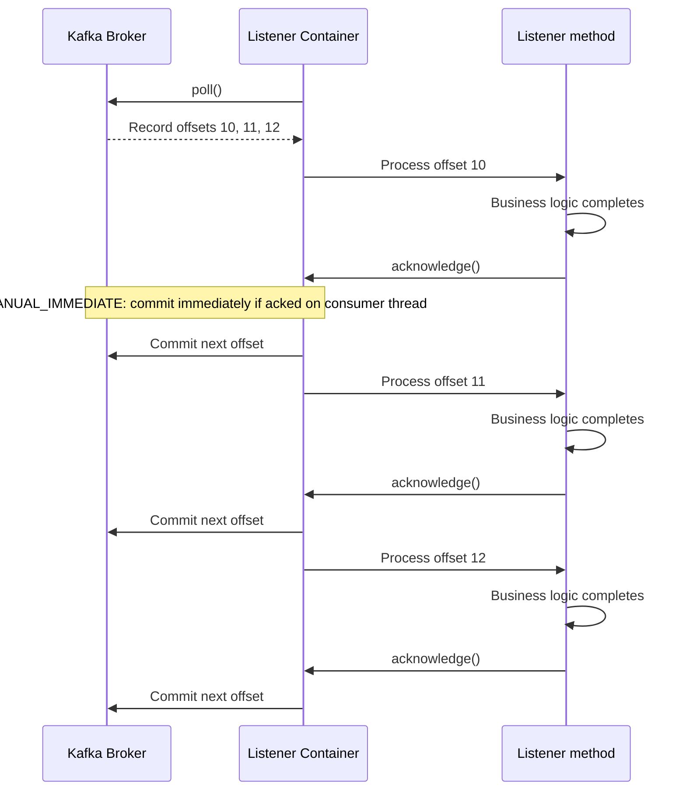

# AckMode MANUAL_IMMEDIATE

The Spring Kafka listener container manages when consumer offsets are committed. With `AckMode.MANUAL_IMMEDIATE`, the application explicitly acknowledges a record by calling `Acknowledgment.acknowledge()`. When this call occurs on the consumer thread, the container requests an immediate offset commit at the moment of acknowledgment, instead of waiting until the end of the poll batch like `MANUAL`.

This mode is suitable when the application needs to explicitly define when a record is considered finished, such as acknowledging only after a database update or downstream service call succeeds. However, committing an offset and a transaction in an external system outside Kafka are two separate operations. If the application commits the offset too early, a record may be skipped even though business work is incomplete; if processing succeeds without committing, the record can be redelivered and requires idempotent handling.

## 1. What does AckMode control?

A Kafka consumer reads records by offset. After processing, the consumer group must commit offsets to store the resume position. Spring Kafka provides several `AckMode` options to define when the listener container executes commits.

| AckMode | Commit behavior |
| --- | --- |
| `RECORD` | Commits after each record listener completes successfully |
| `BATCH` | Commits after all records returned in a single poll complete successfully |
| `TIME` | Commits when the configured interval has elapsed and the poll's records have been processed |
| `COUNT` | Commits when the configured record count is reached and the poll's records have been processed |
| `COUNT_TIME` | Combines count and time conditions |
| `MANUAL` | Listener calls `acknowledge()`; container batches acknowledgments and commits at poll batch boundaries |
| `MANUAL_IMMEDIATE` | Listener calls `acknowledge()`; if called on the consumer thread, container commits immediately |

The primary difference between `MANUAL` and `MANUAL_IMMEDIATE` is commit timing. Both require the listener to explicitly acknowledge, but `MANUAL` generally waits until records from the current poll finish processing before committing; `MANUAL_IMMEDIATE` can commit immediately when the listener acknowledges on the consumer thread.

`MANUAL_IMMEDIATE` does not mean Kafka automatically knows business work is done. The listener itself decides when to call `acknowledge()`. Therefore, where this call sits inside the method is part of the reliability design.

## 2. Configuring MANUAL_IMMEDIATE with Spring Boot

With Spring Boot, you can configure the acknowledgment mode in `application.yml`:

```yaml
spring:
  kafka:
    bootstrap-servers: ${KAFKA_BOOTSTRAP_SERVERS:localhost:9092}
    consumer:
      group-id: billing-service
      enable-auto-commit: false
      auto-offset-reset: earliest
      key-deserializer: org.apache.kafka.common.serialization.StringDeserializer
      value-deserializer: org.springframework.kafka.support.serializer.JsonDeserializer
      properties:
        spring.json.trusted.packages: com.example.messaging.event
        spring.json.value.default.type: com.example.messaging.event.OrderCreated
    listener:
      ack-mode: manual_immediate
```

Important properties:

- `group-id` identifies the consumer group storing offsets.
- `enable-auto-commit: false` lets the container manage commits according to acknowledgment mode.
- `ack-mode: manual_immediate` selects manual acknowledgment with immediate commit when `acknowledge()` is called on the consumer thread.
- Deserializers convert keys/values into the Java types accepted by the listener.

Spring Kafka normally sets `enable.auto.commit=false` automatically when the container manages offsets. Declaring it explicitly in the example helps readers see clearly that the application relies on the container's commit mechanism. Do not enable Kafka auto-commit alongside intended manual offset control.

`auto-offset-reset: earliest` only applies when the group has no valid offset yet or the committed offset falls outside the retained log range. It does not cause an active group to replay from the beginning automatically.

## 3. Configuring via ConcurrentKafkaListenerContainerFactory

If the application creates its own listener container factory, you can set `AckMode.MANUAL_IMMEDIATE` directly on `ContainerProperties`:

```java
package com.example.messaging.config;

import com.example.messaging.event.OrderCreated;
import org.springframework.context.annotation.Bean;
import org.springframework.context.annotation.Configuration;
import org.springframework.kafka.config.ConcurrentKafkaListenerContainerFactory;
import org.springframework.kafka.core.ConsumerFactory;
import org.springframework.kafka.listener.ContainerProperties;

@Configuration
public class KafkaListenerConfiguration {

    @Bean
    public ConcurrentKafkaListenerContainerFactory<String, OrderCreated>
            kafkaListenerContainerFactory(
                    ConsumerFactory<String, OrderCreated> consumerFactory
            ) {
        var factory =
                new ConcurrentKafkaListenerContainerFactory<String, OrderCreated>();
        factory.setConsumerFactory(consumerFactory);
        factory.getContainerProperties().setAckMode(
                ContainerProperties.AckMode.MANUAL_IMMEDIATE
        );
        factory.getContainerProperties().setSyncCommits(true);
        return factory;
    }
}
```

`setSyncCommits(true)` instructs the container to use synchronous commits when committing offsets. This is the common default on `ContainerProperties`, though setting it explicitly can make the configuration clearer. With synchronous commits, the consumer thread waits for the broker's commit response; with asynchronous commits, the application must monitor commit callbacks/errors per container configuration.

If you only need to configure one listener, you can use Spring Boot's default factory and set `spring.kafka.listener.ack-mode`. If multiple listeners have different commit policies, create multiple factories and select them via the `containerFactory` attribute on `@KafkaListener`.

## 4. Receiving Acknowledgment in the listener method

When using `MANUAL_IMMEDIATE`, the listener method must accept an `Acknowledgment` parameter and call `acknowledge()` after processing completes:

```java
package com.example.messaging.consumer;

import com.example.messaging.event.OrderCreated;
import org.springframework.kafka.annotation.KafkaListener;
import org.springframework.kafka.support.Acknowledgment;
import org.springframework.stereotype.Component;

@Component
public class OrderCreatedListener {

    private final BillingService billingService;

    public OrderCreatedListener(BillingService billingService) {
        this.billingService = billingService;
    }

    @KafkaListener(
            topics = "orders.events",
            groupId = "billing-service"
    )
    public void onOrderCreated(
            OrderCreated event,
            Acknowledgment acknowledgment
    ) {
        billingService.handle(event);

        // Only acknowledge after business processing completes.
        acknowledgment.acknowledge();
    }
}
```

The example assumes `billingService.handle(event)` returns only after the necessary work is complete, including committing any database transaction. If that method merely enqueues work into an internal queue and returns, acknowledging here would happen too early relative to when the work actually finishes.

If the listener returns without calling `acknowledge()`, the container receives no manual acknowledgment from the method. If the method throws an exception, the error is passed to the container's error handler. How retries, recovery, or dead-letter routing behave depends on the configured error handler.

## 5. How do MANUAL and MANUAL_IMMEDIATE differ in timing?

Suppose a single poll returns three records on one partition: offsets 10, 11, and 12. The listener processes each record and calls acknowledgment when done.



With `MANUAL_IMMEDIATE`, each acknowledgment on the consumer thread can trigger an immediate commit. With `MANUAL`, acknowledgments are recorded by the container and committed at poll batch boundaries after the poll's records finish processing.

This introduces a trade-off:

- `MANUAL_IMMEDIATE` reduces the window between completing processing and sending the commit request.
- `MANUAL` can combine multiple acknowledgments into fewer commits, reducing commit requests.
- `MANUAL_IMMEDIATE` can increase commit frequency when the listener acknowledges every record, increasing overhead at high throughput.

Committing an offset for a record typically stores the next position to read. For example, after processing record offset 10, the committed offset is 11. When inspecting consumer groups, do not confuse the committed offset value with the offset of the last processed record.

## 6. Ack must be called on the consumer thread

The behavior of `MANUAL_IMMEDIATE` depends on which thread invokes `acknowledge()`:

- **Called on the consumer thread:** the container commits immediately at the moment acknowledgment is called.
- **Called from another thread:** the acknowledgment is queued and processed after records from the preceding poll have been handled. It does not exhibit the same immediate commit timing as calling on the consumer thread.

Do not alternate between calling acknowledgment on the consumer thread and from another thread in the same listener. Mixing both patterns makes commit semantics unpredictable. Nor is `Acknowledgment` an object meant to be stored and reused arbitrarily after the listener returns.

The example below is unsuitable if immediate commits are expected:

```java
@KafkaListener(topics = "orders.events")
public void onOrderCreated(
        OrderCreated event,
        Acknowledgment acknowledgment
) {
    executor.execute(() -> {
        billingService.handle(event);
        acknowledgment.acknowledge();
    });
}
```

This snippet moves acknowledgment onto an executor thread. The container then processes the acknowledgment along the off-thread path, while the listener method has already returned before the business work finishes. This makes error handling, ordering, and commits harder to control.

If asynchronous processing is required, design an explicit acknowledgment and backpressure model. You can have the listener method wait for completion and acknowledge on the consumer thread, or use async listener support provided by your Spring Kafka version. Never offload work to an arbitrary executor and assume offsets will only commit after all tasks finish.

## 7. Placing acknowledgment after the business boundary

Where `acknowledge()` is called determines when the group advances its offset. Place it after everything the application considers a completion prerequisite has succeeded.

Example with database processing:

```java
@KafkaListener(topics = "orders.events", groupId = "billing-service")
public void onOrderCreated(
        OrderCreated event,
        Acknowledgment acknowledgment
) {
    billingService.processAndCommit(event);
    acknowledgment.acknowledge();
}
```

Suppose `processAndCommit` is a transactional service method that returns only after the database transaction commits. Once the method returns normally, the listener acknowledges the offset. Avoid calling acknowledgment before the database transaction completes.

### 7.1. Acknowledging too early can lose processing

```java
// Do not do this: acknowledging offset before business processing.
acknowledgment.acknowledge();
billingService.processAndCommit(event);
```

If the application commits the offset and the database update then fails, the Kafka group has already moved past the record. When the consumer restarts, the group may resume from the new offset and never automatically receive that record again.

### 7.2. Completing work without acking can cause redelivery

Suppose the database commits successfully, but the process stops before the `acknowledge()` line. Kafka has not received the new offset commit, so the record may be redelivered after the consumer recovers or the group rebalances.

This is expected behavior in an at-least-once model. Consumers must be idempotent, such as using `eventId` with a unique constraint or an inbox table to detect already-processed events. `MANUAL_IMMEDIATE` narrows the commit wait window after acknowledgment, but does not eliminate the failure window between a database transaction and a Kafka offset commit.

## 8. Combining with error handling and retries

If the listener throws an exception before calling `acknowledge()`, the container routes the error to the error handler. Depending on policy, the record can be retried, sought for redelivery, or recovered to a dead-letter topic.

```java
@KafkaListener(topics = "orders.events", groupId = "billing-service")
public void onOrderCreated(
        OrderCreated event,
        Acknowledgment acknowledgment
) {
    try {
        billingService.processAndCommit(event);
        acknowledgment.acknowledge();
    } catch (TemporaryBillingException ex) {
        // Rethrow error so the error handler performs configured retries.
        throw ex;
    }
}
```

Do not catch an exception, only log it, and let the method exit when the record was not processed. Returning normally without an explicit retry/recovery policy may leave the offset uncommitted or depend on container/error handler behavior; let exceptions reach the error handler when retries are desired.

If an exception occurs after `acknowledge()` has already been called, the commit has already been requested and cannot be rolled back simply by throwing an exception. Therefore, every operation that can fail must run before acknowledgment.

When configuring a dead-letter topic, define clearly when a record counts as recovered. An error handler/recoverer may commit offsets after successful recovery per configuration; that is distinct from the listener itself calling `acknowledge()`.

## 9. Choosing MANUAL_IMMEDIATE or MANUAL?

| Criterion | `MANUAL_IMMEDIATE` | `MANUAL` |
| --- | --- | --- |
| Commit timing when acked on consumer thread | Immediately when `acknowledge()` is called | After finishing the poll's records per container mechanics |
| Explicit acknowledgment control | Yes | Yes |
| Number of commits | Can be higher if acking every record | Can batch acknowledgments per poll |
| Commit latency | Typically lower after listener ack | May wait until the poll batch boundary |
| Suitability | Want immediate commit after each completed record | Want explicit ack while favoring batched commits |

Choose `MANUAL_IMMEDIATE` when per-record commit timing matters operationally and the extra commit cost is acceptable. Choose `MANUAL` if you want the listener to decide which records succeeded without needing immediate commits on every acknowledgment.

If manual acknowledgment is unnecessary, `RECORD` is usually simpler: the container commits automatically after each record listener invocation succeeds. Do not pick `MANUAL_IMMEDIATE` merely because of the word "immediate"; choose based on the semantics required.

## 10. Inspecting commit status and consumer groups

You can inspect committed offsets using the Kafka CLI:

```bash
kafka-consumer-groups.sh \
  --bootstrap-server localhost:9092 \
  --describe \
  --group billing-service
```

The command displays partition, current offset, log end offset, and lag. To verify `MANUAL_IMMEDIATE`, send records one by one and observe current offset right after the listener processes and acknowledges each one.

A useful verification workflow:

1. Use a test topic with one partition to track offsets easily.
2. Use a fresh group ID so prior offsets do not interfere.
3. Send one record and wait for the listener to finish business work.
4. Verify the listener called `acknowledge()` on the consumer thread.
5. Describe the group and confirm the committed offset advanced to the next position.
6. Send another record, intentionally raise an exception before acknowledgment, and observe retry/redelivery per the error handler.
7. Test stopping the process after the database commit but before acknowledgment to verify idempotency.

In integration tests, use `@EmbeddedKafka`, `CountDownLatch`, or `BlockingQueue` to synchronize with the listener. You can use a separate admin consumer to read committed offsets or `AdminClient` to query `listConsumerGroupOffsets`. Avoid relying on fixed `Thread.sleep()` calls as proof that a commit finished; poll status with a timeout instead.

## 11. Operational considerations

- **Synchronous vs. asynchronous commits:** `ContainerProperties` supports configuring `syncCommits`. Synchronous commits wait for broker responses; asynchronous commits require monitoring failures via callbacks. Choose based on latency goals and error visibility needs.
- **Commit failures:** commit requests themselves can fail due to coordinator changes, network interruptions, or group rebalances. Monitor commit failure logs and metrics.
- **Concurrency:** each consumer member has its own poll thread. Acknowledgment should occur on the corresponding consumer thread to preserve immediate semantics; do not share acknowledgments arbitrarily across threads.
- **Ordering:** within a partition, Kafka preserves record order. Do not acknowledge the offset of a later record while an earlier record in the same partition has not been processed in the required order.
- **Idempotency:** redelivery can still occur after business logic succeeds if the commit has not yet completed.
- **Database transactions:** Kafka offset commits and database commits do not automatically form a single atomic transaction.

## 12. Common errors when using MANUAL_IMMEDIATE

| Symptom | Common cause | Resolution |
| --- | --- | --- |
| Listener reports missing Acknowledgment | Container not configured for `MANUAL` or `MANUAL_IMMEDIATE` | Check `spring.kafka.listener.ack-mode` or factory config |
| Records skipped after database error | `acknowledge()` called before business work completed | Move acknowledgment after successful transaction |
| Records processed twice | Process stopped after business work but before offset commit | Use `eventId`, unique constraints, or inbox/idempotency |
| Commit does not happen immediately as expected | Ack called from a non-consumer thread | Call ack on the consumer thread or design explicit async semantics |
| Spike in commit requests | Every record triggers an immediate commit | Evaluate `MANUAL`, `BATCH`, or `RECORD` if requirements allow |
| Listener errors are not retried | Exception caught without rethrowing, or error handler recovered it | Inspect exception flow and error handler/recoverer config |
| Group offset differs from expectations | Confusing committed offset with last processed record offset, or checking wrong group/partition | Verify the exact group, topic, partition, and next offset |
| Commit fails during rebalance | Group coordinator or assignment changed mid-commit | Monitor rebalances and commit failures; let container/error policy handle appropriately |

## 13. Implementation procedure for MANUAL_IMMEDIATE

1. Identify exactly which business operations must complete before acknowledging a record.
2. Disable Kafka auto-commit and configure `AckMode.MANUAL_IMMEDIATE` on the listener container.
3. Add an `Acknowledgment` parameter to the listener method.
4. Place `acknowledge()` after database/service transactions complete.
5. Let unhandled exceptions reach the error handler; configure appropriate retry/backoff and dead-letter handling.
6. Design consumers to be idempotent to tolerate redelivered records.
7. Verify acknowledgment is invoked on the consumer thread; avoid mixing calls across threads.
8. Test offset commits, failures before ack, failures after business work, and restarts/rebalances.
9. Monitor commit latency/failures, consumer lag, retries, and dead-letter rates in production.

`MANUAL_IMMEDIATE` gives the listener control over when to acknowledge a record and lets the container commit immediately when acknowledgment is called on the consumer thread. The value of this mode lies in placing the commit boundary tightly after the point where business work truly finishes. For reliable messaging flows, pair it with error handling, idempotency, and commit observability; acknowledgment alone does not replace cross-system transactions.

## 14. Self-check

1. How does `MANUAL_IMMEDIATE` differ from `MANUAL` in commit timing?
2. Why should `enable.auto.commit=false` be configured when controlling offsets manually?
3. What happens if `acknowledge()` is called before the database transaction commits?
4. If business work succeeds but the process stops before acknowledgment, how can the record be handled when the consumer restarts?
5. Why does calling acknowledgment from an executor thread not have the same semantics as calling it on the consumer thread?
6. When using `MANUAL_IMMEDIATE`, why can per-record commits increase overhead?
7. Does `MANUAL_IMMEDIATE` create an atomic transaction between Kafka and a database?
8. What metrics and failure scenarios should be checked before deploying this mode?
