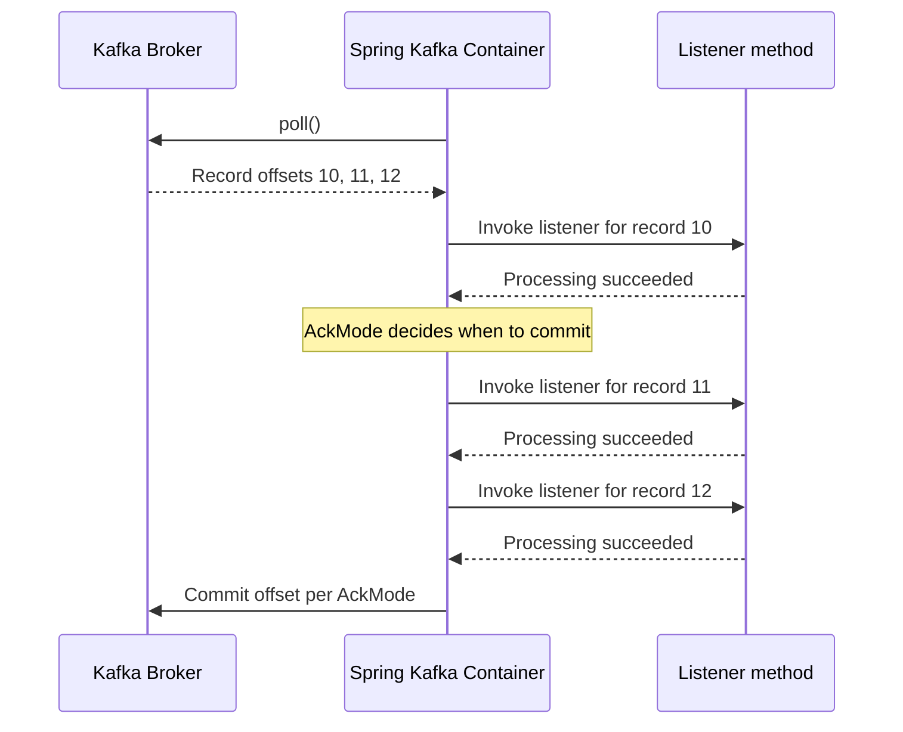
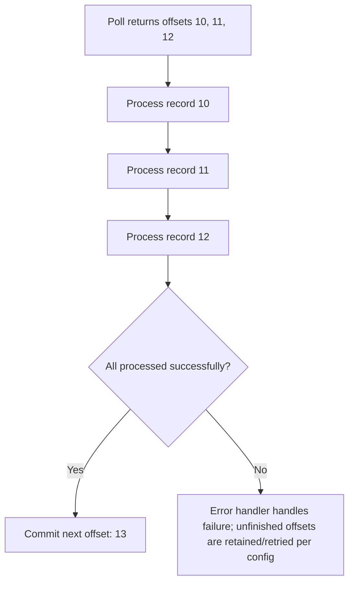

# How AckMode Affects Commits

A Kafka consumer reads records from partitions by offset. After processing, the consumer group needs to save its resume position by **committing an offset**. In Spring Kafka, `AckMode` determines when and at what boundary the listener container commits offsets.

Choosing an `AckMode` directly impacts record redelivery capability, risk of skipping data, number of commit requests, and consumer latency. For example, committing after every record records progress closely against processing outcomes; committing by batch reduces broker calls, but can cause multiple records to be re-read if the consumer fails mid-batch.

## 1. The Committed Offset Is the Next Position to Read

Each record in a partition has an increasing offset. When a consumer finishes processing a record with offset `10`, the offset value typically committed is `11`, which is the next position to read. The committed offset is not the offset number of the last processed record.

Example:

| Processed Record | Record Offset | Committed Offset |
| --- | ---: | ---: |
| First record | 10 | 11 |
| Second record | 11 | 12 |
| Third record | 12 | 13 |

Offsets are stored per consumer group and partition pair. `billing-service` may commit partition 0 up to offset 120 while `analytics-service` has committed only up to offset 95. The two groups maintain independent progress.

Committing offsets lets Kafka know how far a group has processed so it can resume after a restart or rebalance. Committing does not delete records from a topic; records remain according to retention or compaction policies.

## 2. Where Does AckMode Sit in the Processing Flow?

When using Spring Kafka, the listener container manages the consumer and the `poll()` loop. The container passes records to the listener method, tracks processing outcomes, and performs commits according to the configured `AckMode`.



`AckMode` is a Spring Kafka listener container setting. It is neither a topic property nor the way a producer confirms a record was written. Producer acknowledgments (`acks`) and consumer acknowledgments (`AckMode`) solve two different concerns:

- Producer `acks` determines what level of write confirmation the producer requires from brokers.
- Consumer `AckMode` determines when the listener container records the consumer group's reading progress.

## 3. Common AckModes

Spring Kafka provides the following modes:

| AckMode | Commit Timing | When Appropriate |
| --- | --- | --- |
| `RECORD` | After each record listener processes successfully | Need progress recorded closely per record |
| `BATCH` | After all records from one poll are processed successfully | Want to reduce commit calls; this is the common default |
| `TIME` | When the configured time interval elapses and the container reaches a safe commit point | Want to bound time between commits |
| `COUNT` | When the number of processed records reaches the configured threshold and the container reaches a commit point | Want to commit by record count |
| `COUNT_TIME` | When either the count or time threshold is reached | Want to combine both conditions |
| `MANUAL` | Listener calls `acknowledge()`; container processes commits with `BATCH` semantics | Listener decides which records are done without needing an immediate commit per call |
| `MANUAL_IMMEDIATE` | Listener calls `acknowledge()`; if called on the consumer thread, the container commits immediately | Need active acknowledgment and immediate commit after processing |

With a record listener, `RECORD` commits after each successful listener invocation. With a batch listener, the listener receives multiple records in a single invocation; `RECORD` is not an appropriate choice for that listener type. Choose the mode based on your listener type and Spring Kafka version.

`BATCH` is typically the default when using a listener container. If you need different behavior, explicitly declare `spring.kafka.listener.ack-mode` or configure `ContainerProperties` to avoid relying on defaults.

## 4. RECORD: Commit After Each Record

With `AckMode.RECORD`, the container commits the offset after the listener method successfully processes each record. Example:

```yaml
spring:
  kafka:
    consumer:
      enable-auto-commit: false
    listener:
      ack-mode: record
```

The listener can be a method handling the payload:

```java
@KafkaListener(topics = "orders.events", groupId = "billing-service")
public void onOrderCreated(OrderCreated event) {
    billingService.processAndCommit(event);
}
```

Suppose a poll returns three records with offsets 10, 11, and 12. The container invokes the method for each record. If all three records succeed, the offset advances sequentially through 11, 12, and 13 during commits.

If processing records at offsets 10 and 11 succeeds but record 12 fails, previously committed offsets remain intact. When the error is handled and the consumer re-reads, the failed record can be redelivered according to the error handler policy. This is one reason `RECORD` is useful when you want to limit the re-read scope.

The advantage of `RECORD` is that progress is recorded close to each record. In return, commit frequency can be higher than `BATCH`, increasing requests and overhead at high throughput. It also does not provide exactly-once semantics for database operations outside Kafka.

## 5. BATCH: Commit After a Poll

With `AckMode.BATCH`, the container processes the records received in a single `poll()` and then commits offsets after that batch has been processed successfully.

```yaml
spring:
  kafka:
    listener:
      ack-mode: batch
```

Example where one poll returns three records at offsets 10, 11, and 12:



The advantage of `BATCH` is fewer commits when a poll returns many records. The drawback is that if the consumer stops before committing, records already processed successfully in that poll may be redelivered alongside incomplete records.

For example, records at offsets 10 and 11 updated the database successfully, but record 12 causes an error before the batch is committed. After the consumer recovers, the committed offset may still be 10. Records 10 and 11 may be re-read. Therefore, consumers should be idempotent to avoid applying business effects twice.

## 6. TIME, COUNT, and COUNT_TIME

These three modes allow the container to commit based on time or record count thresholds rather than per record or strictly per poll batch.

### 6.1. TIME

`TIME` uses the elapsed time since the last commit as the condition. Once the time reaches the threshold, the container commits pending offsets at a safe processing point.

Example configuration in Java:

```java
factory.getContainerProperties().setAckMode(ContainerProperties.AckMode.TIME);
factory.getContainerProperties().setAckTime(5_000); // 5 seconds
```

This mode is useful when you want to cap the interval between commits. However, it is not an exact TTL per record and does not mean the broker will receive a commit strictly every 5 seconds regardless of what state the listener is in.

### 6.2. COUNT

`COUNT` uses the number of records processed since the last commit as the threshold:

```java
factory.getContainerProperties().setAckMode(ContainerProperties.AckMode.COUNT);
factory.getContainerProperties().setAckCount(100);
```

When the count reaches 100, the container commits pending offsets at an appropriate processing boundary. This is a way to reduce commit frequency under steady traffic.

### 6.3. COUNT_TIME

`COUNT_TIME` combines both conditions. The container commits when either the record count threshold or the time threshold is reached:

```java
factory.getContainerProperties().setAckMode(ContainerProperties.AckMode.COUNT_TIME);
factory.getContainerProperties().setAckCount(100);
factory.getContainerProperties().setAckTime(5_000);
```

For example, if 100 records arrive within one second, the count condition may trigger first; if traffic is low and 100 records have not arrived, the time condition may trigger first. This option balances commit volume against how frequently progress is saved.

The `ackCount` and `ackTime` thresholds are container properties. If using Spring Boot auto-configuration, verify property binding support in your Boot version; you can set them directly on `ContainerProperties` as shown above to make the values explicit.

## 7. MANUAL: Listener Actively Acknowledges

With `AckMode.MANUAL`, the listener accepts `Acknowledgment` and calls `acknowledge()` after the record is processed. The container records the acknowledgment and commits with `BATCH` semantics—meaning it normally waits until the records in the poll finish processing before committing.

```yaml
spring:
  kafka:
    consumer:
      enable-auto-commit: false
    listener:
      ack-mode: manual
```

```java
@KafkaListener(topics = "orders.events", groupId = "billing-service")
public void onOrderCreated(
        OrderCreated event,
        Acknowledgment acknowledgment
) {
    billingService.processAndCommit(event);
    acknowledgment.acknowledge();
}
```

In the example, the listener acknowledges only after `processAndCommit` finishes. If database processing fails and the method throws an exception, acknowledgment is not called; the error handler can retry or recover the record per configuration.

`MANUAL` is suitable when the application needs to decide which records are complete while still allowing the container to group commits by poll. It does not guarantee an immediate commit on the `acknowledge()` line.

## 8. MANUAL_IMMEDIATE: Acknowledge and Commit Immediately

`AckMode.MANUAL_IMMEDIATE` also requires the listener to call `Acknowledgment.acknowledge()`, but if the call occurs on the consumer thread, the container performs the commit immediately at that moment.

```yaml
spring:
  kafka:
    consumer:
      enable-auto-commit: false
    listener:
      ack-mode: manual_immediate
```

```java
@KafkaListener(topics = "orders.events", groupId = "billing-service")
public void onOrderCreated(
        OrderCreated event,
        Acknowledgment acknowledgment
) {
    billingService.processAndCommit(event);
    acknowledgment.acknowledge();
}
```

Key points to remember:

- Acking on the consumer thread allows an immediate commit.
- Acking from another thread is queued and processed after records from the previous poll have been processed; it does not have the same immediate commit semantics.
- Mixing acks on the consumer thread and from other threads can make commit behavior unpredictable.
- Committing per record can increase overhead compared to grouping commits.

`MANUAL_IMMEDIATE` does not turn database and Kafka transactions into a single shared atomic transaction. If the database commits successfully but the process stops before the offset commits, the record may be redelivered. Consumers still need idempotency.

## 9. Comparing Commit Timing by Example

Suppose a consumer polls three records on the same partition: offsets 20, 21, and 22. The listener processes each record sequentially.

| Scenario | `RECORD` | `BATCH` | `MANUAL` | `MANUAL_IMMEDIATE` |
| --- | --- | --- | --- | --- |
| Record 20 succeeds | Commit advances past 21 | Not committed until batch finishes | Ack recorded; commits at batch boundary | Ack on consumer thread can commit past 21 immediately |
| Record 21 succeeds | Commit advances past 22 | Not committed until batch finishes | Ack recorded; commits at batch boundary | Ack on consumer thread can commit past 22 immediately |
| Record 22 fails | Offsets 20 and 21 already committed | Batch incomplete so batch offsets not committed | Batch incomplete so pending acknowledgments not batch-committed | Offsets for 20 and 21 committed if acked per record earlier; record 22 unacked |

The table assumes each record is acknowledged/committed in order on the same partition, without a transactional container and before the error handler recovers the failed record. Actual behavior after an exception also depends on `DefaultErrorHandler`, retries, seeks, and recovered-record commit settings.

## 10. Disable Auto Commit So the Container Controls Offsets

The Kafka consumer client has an auto-commit mechanism if `enable.auto.commit=true`. This mechanism can commit offsets on a timer without knowing whether the listener has finished business processing.

When using a Spring Kafka listener container, the container needs to manage commits via `AckMode`. Therefore, auto commit should normally be disabled:

```yaml
spring:
  kafka:
    consumer:
      enable-auto-commit: false
```

Spring Kafka typically sets `enable.auto.commit=false` automatically if the user does not configure it, but declaring it explicitly avoids confusion and states the intent to control offsets. Never enable auto commit while simultaneously expecting `RECORD`, `BATCH`, or manual acknowledgment to determine exact commit timing.

## 11. Synchronous vs. Asynchronous Commits

After AckMode decides **when** to commit, the container still needs to choose how to send commit requests to the broker:

- **Synchronous commit (`commitSync`)**: the consumer thread waits for the broker's response. If the commit fails, the error can be surfaced in the execution flow and handled by the container's mechanisms.
- **Asynchronous commit (`commitAsync`)**: sends the commit request without waiting immediately for a response. A callback is needed to observe commit errors.

The Spring Kafka container supports configuring `syncCommits` on `ContainerProperties`. The common default is `true`, meaning synchronous commits are used.

```java
factory.getContainerProperties().setSyncCommits(true);
```

If choosing async commits:

```java
factory.getContainerProperties().setSyncCommits(false);
factory.getContainerProperties().setCommitCallback((offsets, exception) -> {
    if (exception != null) {
        log.error("Commit offset failed: {}", offsets, exception);
    }
});
```

The callback must be configured using the API of your Spring Kafka version. Do not ignore callback errors because the application might assume offsets were saved when the broker has not confirmed them. Choosing sync vs. async is a decision about how commits are executed; it does not change the business boundaries selected by AckMode.

## 12. AckMode, Retries, and Record Redelivery

AckMode determines which progress has been committed when an error occurs. If the listener processes successfully but the offset is not yet committed, the record may be redelivered after a restart or rebalance. If the offset was committed before processing finished, the record may be skipped when the consumer resumes.

Two important scenarios:

| Operation Order | Risk |
| --- | --- |
| Commit offset first, process business logic second | If business logic fails, the consumer may not re-read the record: risk of losing business impact |
| Process business logic first, commit offset second | If the process stops between the two steps, the record may be redelivered: risk of duplicate processing |

For most business applications, the second approach is chosen to achieve at-least-once delivery. In that case, the consumer must process idempotently. For instance, store `eventId` with a unique constraint or use an inbox table to ensure the same event does not cause duplicate effects.

If the listener throws an exception, the error handler can retry the record, seek offsets, or send the record to a dead-letter topic. After successful recovery, the error handler can be configured to commit the corresponding offset. Clarify whether the error handler commits recovered records so you do not confuse it with acknowledgments called by the listener.

## 13. AckMode and Transactions

Kafka transactions allow coordinating record sends and offsets within the same Kafka transaction in properly configured consume-transform-produce flows. When the listener container participates in a Kafka transaction, offsets can be sent into the transaction via `sendOffsetsToTransaction`; offsets are committed along with the transaction only if the transaction commits successfully.

This differs from a listener updating a database outside Kafka. A Kafka transaction does not automatically encompass a JDBC transaction or an HTTP request. If consistency between a database and Kafka is required, consider transactional outbox/inbox or idempotency mechanisms.

When using a transaction manager for a listener container, consult the documentation for your Spring Kafka version on how the container handles acknowledgments, transaction boundaries, and offsets. Do not blindly apply the non-transactional AckMode table above to a transactional container without checking the configuration.

## 14. Choosing an AckMode Based on System Requirements

| Requirement | Commonly Considered Option | Reason |
| --- | --- | --- |
| Process each event and record offsets close to each success | `RECORD` | Container commits after each record listener |
| High throughput, accepting possible re-reads of processed records within the same poll | `BATCH` | Reduces commit frequency |
| Listener wants to explicitly acknowledge after business logic completes, committed by poll | `MANUAL` | Listener decides when to ack; container groups commits |
| Listener wants an immediate commit right after ack on consumer thread | `MANUAL_IMMEDIATE` | Reduces latency between ack and commit request |
| Steady traffic, wanting commits by record count | `COUNT` | Controls record volume between commits |
| Variable traffic, needing both count and time thresholds | `COUNT_TIME` | Commits when either threshold is met |
| Need to bound the time interval between commits | `TIME` | Based on elapsed time |

There is no single optimal AckMode for every application. You must balance throughput, latency, redelivery scope, business complexity, and commit overhead.

## 15. Testing Commit Behavior

To verify AckMode, check both business results and committed offsets. A test that only confirms the listener was invoked is insufficient to prove commit timing.

Suggested integration test workflow:

1. Start a test broker using `@EmbeddedKafka` or Testcontainers.
2. Create a topic with an appropriate partition count and use a dedicated group ID for the test.
3. Configure the listener with the AckMode to be tested.
4. Send records with `KafkaTemplate` and wait for listener completion using `CountDownLatch` or `BlockingQueue`.
5. Query the group's offsets using `AdminClient.listConsumerGroupOffsets()` or the Kafka CLI.
6. Inject a failure before the listener finishes to check retries and whether offsets advance.
7. Simulate a process stop after business logic completes but before commit to verify redelivery and idempotency.
8. Compare commit count, consumer lag, and throughput if evaluating `RECORD` vs. `BATCH`.

Use timeouts on latches and condition-based polling for state queries. Avoid fixed `Thread.sleep()` calls because tests can run differently across machines or in CI.

## 16. Common Mistakes When Configuring AckMode

| Symptom | Possible Cause | How to Check |
| --- | --- | --- |
| Offset advances before business logic completes | Kafka auto commit is enabled or listener acks too early | Check `enable.auto.commit` and placement of `acknowledge()` |
| Records processed repeatedly after restart | Business logic succeeded but offset was not committed | Check AckMode, commit failures, and idempotency |
| `RECORD` does not behave as expected with a batch listener | `RECORD` is intended for record listeners | Check listener type and container factory |
| `MANUAL` does not commit right after each ack | `MANUAL` batches acks and commits with `BATCH` semantics | Use `MANUAL_IMMEDIATE` if immediate commit on consumer thread is truly needed |
| `MANUAL_IMMEDIATE` commits late | Ack was called from another thread or container is processing earlier poll records | Check which thread calls acknowledgment and listener design |
| Async commit fails silently | Commit callback is unconfigured or unobserved | Log/record metrics for callback exceptions |
| Count/time does not trigger as expected | Threshold not reached or wrong time unit | Check `ackCount`, `ackTime`, and millisecond units |
| Retries occur yet offset still advances | Exception was swallowed or error handler recovered/committed | Check exception flow and recoverer configuration |

## 17. Process for Choosing and Configuring AckMode

1. Determine whether the listener is a record listener or a batch listener.
2. Define the business condition that counts as successful processing.
3. Choose the desired commit timing: per record, end of poll, by count/time, or listener-driven.
4. Disable auto commit so the listener container manages offsets.
5. Configure `AckMode` via `spring.kafka.listener.ack-mode` or `ContainerProperties`.
6. If using a manual mode, place `acknowledge()` after the business boundary and pay attention to the calling thread.
7. Choose sync/async commits and monitor commit failures.
8. Design retries, dead-lettering, and idempotency to handle redelivered records.
9. Test committed offsets across success, error, restart, and rebalance scenarios.
10. Monitor consumer lag, commit latency, retry rate, and throughput in operations.

AckMode is the bridge between record processing outcomes in the application and reading progress stored in Kafka. Picking the right mode helps control commit timing, while ultimate reliability still depends on transaction boundaries, error handling, idempotency, and consumer group observability.

## 18. Self-Check

1. What is typically the committed offset value after processing a record at offset 25?
2. How does `RECORD` differ from `BATCH` in commit timing and re-read scope?
3. Why can `BATCH` cause some successfully processed records to be redelivered?
4. What conditions do `TIME`, `COUNT`, and `COUNT_TIME` use to decide when to commit?
5. How does `MANUAL` differ from `MANUAL_IMMEDIATE`?
6. Why should `enable.auto.commit` be disabled when using a listener container?
7. What does `syncCommits` control? What must be monitored when using async commits?
8. Why do an offset commit and a database commit not automatically provide business exactly-once?
9. How should a consumer be designed to tolerate record redelivery after a database commit when the offset was not committed?
