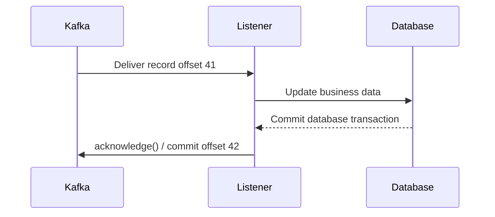

# Acknowledgment in Listeners

In Spring Kafka, the listener container manages the consumer and the consumer group's offset progress. If a listener needs to decide when to confirm that a record has finished processing, Spring Kafka can inject an `Acknowledgment` object into the `@KafkaListener` method. The listener calls `acknowledge()` after completing its work; the container receives that signal and commits the offset according to the configured `AckMode`.

Acknowledgment is useful when the application needs explicit control over the boundary between business processing and recording Kafka progress—for instance, acknowledging only after saving an order to the database. This mechanism must be configured on the listener container and coordinated with error handlers, retries, and idempotency. Calling `acknowledge()` does not automatically create an atomic transaction between Kafka and the database, nor does it mean Kafka sends a separate ACK message back to the producer.

The examples in this article use a simple event and application service:

```java
import java.math.BigDecimal;
import java.time.Instant;
import java.util.List;

public record OrderCreatedEvent(
        String eventId,
        String orderId,
        BigDecimal total,
        Instant occurredAt
) {}

public interface OrderApplicationService {
    void apply(OrderCreatedEvent event);
    void applyBatch(List<OrderCreatedEvent> events);
}
```

## 1. What Is Acknowledgment?

`Acknowledgment` is a Spring Kafka interface (`org.springframework.kafka.support.Acknowledgment`). The container supplies an instance to the listener when the listener runs with a manual acknowledgment mode. Its primary method is:

```java
acknowledgment.acknowledge();
```

This call informs the container that the record (or batch, depending on listener type) has been processed to a point the application accepts as confirmed. The container is responsible for recording and committing the offset according to `AckMode` semantics.

Distinguish three concepts:

| Concept | Meaning |
|---|---|
| Spring Kafka `Acknowledgment` | Handle used by the listener to signal to the container that processing has reached an acknowledgeable point |
| Consumer offset commit | Records the next position the consumer group will read in a partition |
| Producer acknowledgment (`acks`) | Policy governing how the producer waits for brokers to confirm a record was written |

`Acknowledgment` belongs to the consumer side. It does not delete records from the topic and has no effect on producer `acks`. Records remain stored according to the topic's retention or cleanup policy.

## 2. Passing `Acknowledgment` into `@KafkaListener`

A listener can receive the payload alongside an `Acknowledgment` parameter:

```java
import org.springframework.kafka.annotation.KafkaListener;
import org.springframework.kafka.support.Acknowledgment;
import org.springframework.stereotype.Component;

@Component
public class OrderCreatedListener {

    private final OrderApplicationService orderService;

    public OrderCreatedListener(OrderApplicationService orderService) {
        this.orderService = orderService;
    }

    @KafkaListener(
            id = "ordersManualListener",
            topics = "orders.created",
            groupId = "orders-projection",
            containerFactory = "manualAckKafkaListenerContainerFactory"
    )
    public void onMessage(
            OrderCreatedEvent event,
            Acknowledgment acknowledgment) {

        orderService.apply(event);
        acknowledgment.acknowledge();
    }
}
```

The ordering in the example is the key point: the application service processes the event first, and only then does the listener call `acknowledge()`. If `orderService.apply(event)` throws an exception, the acknowledgment line does not execute and the exception is routed to the container's error handler.

`Acknowledgment` is only meaningful when the listener container is configured with `AckMode.MANUAL` or `AckMode.MANUAL_IMMEDIATE`. Merely adding this parameter to the method signature does not automatically enable manual mode. Configure the exact container factory used by the listener.

## 3. Configuring `AckMode.MANUAL` on the Listener Container

You can create a dedicated `ConcurrentKafkaListenerContainerFactory` for listeners that require manual acknowledgment:

```java
import org.springframework.context.annotation.Bean;
import org.springframework.context.annotation.Configuration;
import org.springframework.kafka.config.ConcurrentKafkaListenerContainerFactory;
import org.springframework.kafka.core.ConsumerFactory;
import org.springframework.kafka.listener.CommonErrorHandler;
import org.springframework.kafka.listener.ContainerProperties;

@Configuration
public class KafkaListenerConfiguration {

    @Bean
    public ConcurrentKafkaListenerContainerFactory<String, OrderCreatedEvent>
            manualAckKafkaListenerContainerFactory(
                    ConsumerFactory<String, OrderCreatedEvent> consumerFactory,
                    CommonErrorHandler errorHandler) {

        var factory = new ConcurrentKafkaListenerContainerFactory<
                String, OrderCreatedEvent>();
        factory.setConsumerFactory(consumerFactory);
        factory.getContainerProperties().setAckMode(
                ContainerProperties.AckMode.MANUAL
        );
        factory.setCommonErrorHandler(errorHandler);
        return factory;
    }
}
```

Then attach the factory via the `containerFactory` attribute on `@KafkaListener`. This lets each listener use its appropriate commit policy. If the entire application shares one policy, you can configure the default factory instead of creating multiple factories.

When using a custom factory, ensure `ConsumerFactory` has key/value deserializers compatible with the event. If the application has a shared error handler, attach `CommonErrorHandler` to that factory to define exception handling behavior.

## 4. Configuring via Spring Boot

For the default listener container factory auto-configured by Spring Boot, you can set the acknowledgment mode in `application.yml`:

```yaml
spring:
  kafka:
    bootstrap-servers: ${KAFKA_BOOTSTRAP_SERVERS:localhost:9092}
    consumer:
      group-id: orders-projection
      enable-auto-commit: false
      auto-offset-reset: earliest
    listener:
      ack-mode: manual
```

`enable-auto-commit: false` lets the Spring Kafka container manage commits according to `AckMode`. Spring Kafka normally disables auto commit when not explicitly enabled; declaring it explicitly in configuration prevents misunderstandings about who is committing offsets.

If the application defines its own `ConcurrentKafkaListenerContainerFactory`, set `AckMode` directly on that factory. Boot's `spring.kafka.listener.ack-mode` property does not automatically alter every custom factory created by the application.

## 5. How Are Offsets Committed?

Kafka commits the next offset to read, not the offset of the record just processed. For example, after processing record offset `41`, the committed position is typically `42`.

```text
Partition orders-0

offset:       40       41       42       43
record:     event-A  event-B  event-C  event-D
                       |
                       +-- listener finishes processing and acknowledge()
                           commit offset 42

Next read starts from offset 42
```

For `AckMode.MANUAL`, calling `acknowledge()` marks the record as confirmed. The container collects acknowledgments and commits according to manual rules once the records returned in the poll have been processed. Therefore, you should not assume the broker necessarily receives a commit right at the `acknowledge()` line.

For `AckMode.MANUAL_IMMEDIATE`, the container requests a commit immediately when `acknowledge()` is called on the consumer thread. If called from another thread, the acknowledgment is processed via the container's mechanism and lacks the same immediate semantics. Avoid mixing calls on the consumer thread and external threads in the same listener, as commit ordering can become unpredictable.

## 6. Distinguishing `MANUAL` and `MANUAL_IMMEDIATE`

| Criterion | `MANUAL` | `MANUAL_IMMEDIATE` |
|---|---|---|
| Listener calls `acknowledge()` | Yes | Yes |
| Commit timing | Container collects acknowledgments and commits per poll | Commits immediately if called on consumer thread |
| Commit latency | May wait until the end of the poll | Can be lower |
| Best suited for | Wanting listener to decide acknowledged records while container manages commits | Needing immediate commit on callback while understanding thread constraints |
| Note | Not an immediate commit at the call line | Calling from another thread has no immediate commit guarantee |

Unless there is a clear requirement for immediate commits, `MANUAL` is usually easier to operate. Choose `MANUAL_IMMEDIATE` when commit latency is a real requirement and the listener calls acknowledgment on the consumer thread.

## 7. Acknowledge Only After Successful Processing

Never call acknowledgment before business processing completes. The following example clearly shows the success and failure paths:

```java
@KafkaListener(
        topics = "orders.created",
        groupId = "orders-projection",
        containerFactory = "manualAckKafkaListenerContainerFactory"
)
public void onMessage(
        OrderCreatedEvent event,
        Acknowledgment acknowledgment) {

    try {
        orderService.apply(event);
        acknowledgment.acknowledge();
    } catch (RuntimeException exception) {
        // Do not acknowledge; let the error handler handle retry/recovery.
        throw exception;
    }
}
```

If processing fails, the listener throws the exception so the error handler decides on retry, backoff, or recovery. Never catch an exception and still call `acknowledge()` in a `finally` block; doing so can commit the offset even though side effects did not complete.

If you do not need to add logging or context to the exception, you can omit the `try/catch` and let the exception propagate naturally. What matters is not swallowing errors in a way that tricks the container into thinking the listener succeeded.

## 8. Combining Acknowledgment with Retry and Dead-Lettering

Acknowledgment determines how far the listener has confirmed progress. The error handler determines what happens when the listener throws an exception. Both mechanisms work together, but neither replaces the other.

Example retry configuration using `DefaultErrorHandler`:

```java
import org.springframework.context.annotation.Bean;
import org.springframework.context.annotation.Configuration;
import org.springframework.kafka.listener.DefaultErrorHandler;
import org.springframework.util.backoff.FixedBackOff;

@Configuration
public class KafkaErrorConfiguration {

    @Bean
    public DefaultErrorHandler kafkaErrorHandler() {
        return new DefaultErrorHandler(
                new FixedBackOff(1_000L, 2L)
        );
    }
}
```

The example above illustrates a one-second interval and up to two retries after the initial processing attempt. In real applications, classify retryable and non-retryable exceptions, pick an appropriate backoff, and configure a recoverer if failed records should be routed to a dead-letter topic. If using `DeadLetterPublishingRecoverer`, the producer template must be able to serialize the record and the DLT must have suitable partitions/configuration.

Never manually acknowledge a failed record just to stop retries. Let the error handler decide the recovery outcome; committing after recovery must align with the application's data policy.

## 9. Batch Listeners and Acknowledgment

With a record listener, each method invocation typically corresponds to one record. With a batch listener, the method receives a collection or `ConsumerRecords` from a single poll; calling `Acknowledgment` confirms the batch according to container semantics.

Batch listener example:

```java
import java.util.List;

import org.springframework.kafka.annotation.KafkaListener;
import org.springframework.kafka.support.Acknowledgment;
import org.springframework.stereotype.Component;

@Component
public class OrderBatchListener {

    private final OrderApplicationService orderService;

    public OrderBatchListener(OrderApplicationService orderService) {
        this.orderService = orderService;
    }

    @KafkaListener(
            id = "ordersBatchListener",
            topics = "orders.created",
            groupId = "orders-batch",
            containerFactory = "manualAckBatchListenerContainerFactory"
    )
    public void onMessages(
            List<OrderCreatedEvent> events,
            Acknowledgment acknowledgment) {

        orderService.applyBatch(events);
        acknowledgment.acknowledge();
    }
}
```

A factory used by a batch listener must have `setBatchListener(true)` and `AckMode.MANUAL` configured. Acknowledge only after the entire batch has been processed successfully per business rules. If part of the batch fails, design retries/recovery or batch-specific nack/partial acknowledgment per your Spring Kafka version's API; never commit the whole batch when some records have not been safely processed.

## 10. Acknowledgment and Asynchronous Processing

Normally, a listener processes synchronously on the consumer thread and calls `acknowledge()` before returning. If offloading work to another executor, carefully examine completion order and commits.

Spring Kafka supports `asyncAcks` for certain cases where acknowledgments for polled records complete out of order. When enabled, the container can pause receiving more data until outstanding acknowledgments complete. This allows parallel processing, but increases complexity and can cause record redelivery after a crash before offsets are committed.

Only acknowledge from another thread when you have configured and understood the semantics of your Spring Kafka version. Never persist `Acknowledgment` into a database or long-lived queue like an anytime-usable token. It is a handle tied to the current delivery of the record, not an independent durable commit mechanism.

## 11. Manual Acknowledgment Does Not Guarantee Exactly-Once

Suppose a listener updates a database and then calls `acknowledge()`. There is a window between the database commit and the Kafka offset commit:



If the application stops after the database commits but before Kafka commits the offset, the record may be redelivered after the consumer restarts. The database may receive the same event a second time.

Therefore, manual acknowledgment is typically used in an at-least-once model when properly configured; it does not automatically guarantee exactly-once for side effects outside Kafka. Combine it with:

- Idempotent handlers, e.g., using `eventId` with a unique constraint to detect already-processed events.
- An inbox/idempotency table updated in the same database transaction as business data.
- Kafka transactions for Kafka-to-Kafka flows when output records and consumer offsets must commit in the same transaction.
- Transactional outbox/inbox when coordinating a database with Kafka without assuming the two systems commit atomically.

## 12. Testing Listeners with Acknowledgment

Tests should verify both processing order and offset progress:

- **Unit test:** mock the application service and `Acknowledgment`; verify the service runs first and acknowledgment is called only after the service succeeds.
- **Failure test:** make the service throw an exception; verify the listener does not call acknowledgment.
- **Integration test:** use Embedded Kafka or Testcontainers, send records, and check the consumer group's committed offsets.
- **Restart test:** simulate stopping the application after side effects complete but before offset commit; verify redelivery and idempotency.
- **Retry/DLT test:** verify retry counts, backoff, and recovery behavior.
- **Batch test:** verify a batch is acknowledged only after full processing per convention.
- **Async test:** if `asyncAcks` is enabled, verify the container handles out-of-order acknowledgments and pauses polling while gaps remain.

Example unit test verifying invocation order:

```java
import static org.mockito.Mockito.inOrder;

import java.math.BigDecimal;
import java.time.Instant;

import org.junit.jupiter.api.Test;
import org.springframework.kafka.support.Acknowledgment;

class OrderCreatedListenerTest {

    @Test
    void acknowledgesOnlyAfterSuccessfulProcessing() {
        OrderApplicationService service = org.mockito.Mockito.mock(
                OrderApplicationService.class);
        Acknowledgment acknowledgment = org.mockito.Mockito.mock(
                Acknowledgment.class);
        OrderCreatedListener listener = new OrderCreatedListener(service);
        OrderCreatedEvent event = new OrderCreatedEvent(
                "evt-1",
                "order-1",
                new BigDecimal("1250000"),
                Instant.parse("2026-11-17T03:00:00Z")
        );

        listener.onMessage(event, acknowledgment);

        var inOrder = inOrder(service, acknowledgment);
        inOrder.verify(service).apply(event);
        inOrder.verify(acknowledgment).acknowledge();
    }
}
```

Unit tests verify call order inside the listener; integration tests remain necessary to verify that the container actually commits offsets as configured.

## 13. Common Mistakes

- **Adding the `Acknowledgment` parameter without enabling manual AckMode:** the listener container is not configured to provide manual acknowledgments.
- **Calling `acknowledge()` before business logic finishes:** offsets may be committed even if side effects fail.
- **Calling acknowledgment inside `finally`:** accidentally acknowledges failed processing as well.
- **Confusing `MANUAL` with immediate commit:** `MANUAL` collects acknowledgments and commits per poll; `MANUAL_IMMEDIATE` has immediate semantics when called on the consumer thread.
- **Enabling `enable.auto.commit`:** causes Kafka consumer auto-commits to conflict with container-managed offset control.
- **Assuming acknowledgment deletes records from the topic:** records are still retained according to retention or compaction.
- **Assuming manual ack guarantees exactly-once:** the database and Kafka can commit separately; idempotency or appropriate transactions are needed.
- **Swallowing exceptions without recovery:** the container may treat the listener as having succeeded; define retries and recovery explicitly.
- **Calling acknowledgment from another thread without understanding `asyncAcks`:** can break ordering or cause misunderstandings about commit timing.
- **Ignoring consumer lag and poll intervals:** slow processing can still trigger rebalances even with manual acknowledgment.

## 14. Checklist When Using `Acknowledgment`

- [ ] Listener uses the correct container factory configured with `AckMode.MANUAL` or `MANUAL_IMMEDIATE`.
- [ ] `enable.auto.commit` is disabled so the container manages offsets.
- [ ] Listener calls `acknowledge()` after business processing succeeds.
- [ ] Exceptions propagate to the error handler when processing fails.
- [ ] Retries, backoff, and dead-letter recovery match the exception types.
- [ ] Handlers are idempotent or have duplicate-prevention mechanisms.
- [ ] Understand that committed offset is the next position to read.
- [ ] Distinguish `MANUAL` and `MANUAL_IMMEDIATE` by thread and poll boundary.
- [ ] For batch listeners, acknowledge only after the batch meets processing requirements.
- [ ] For asynchronous processing, evaluate `asyncAcks` and version limitations.
- [ ] Integration tests verify committed offsets and restart/retry behavior.

`Acknowledgment` lets a listener explicitly signal to the container when processing progress is ready to commit. By configuring manual AckMode properly, acknowledging only after successful processing, and combining retries with idempotency, consumers gain clear offset control and reduce the risk of data loss in messaging flows.
